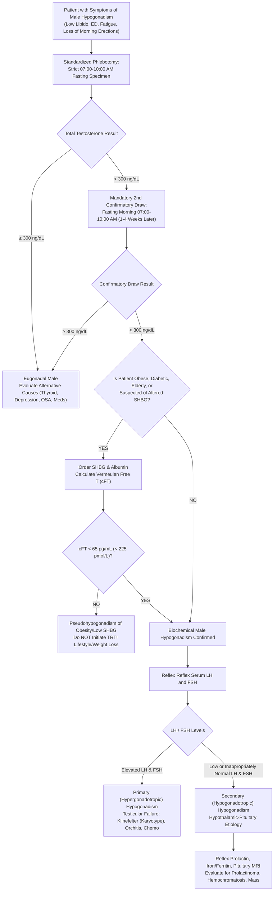
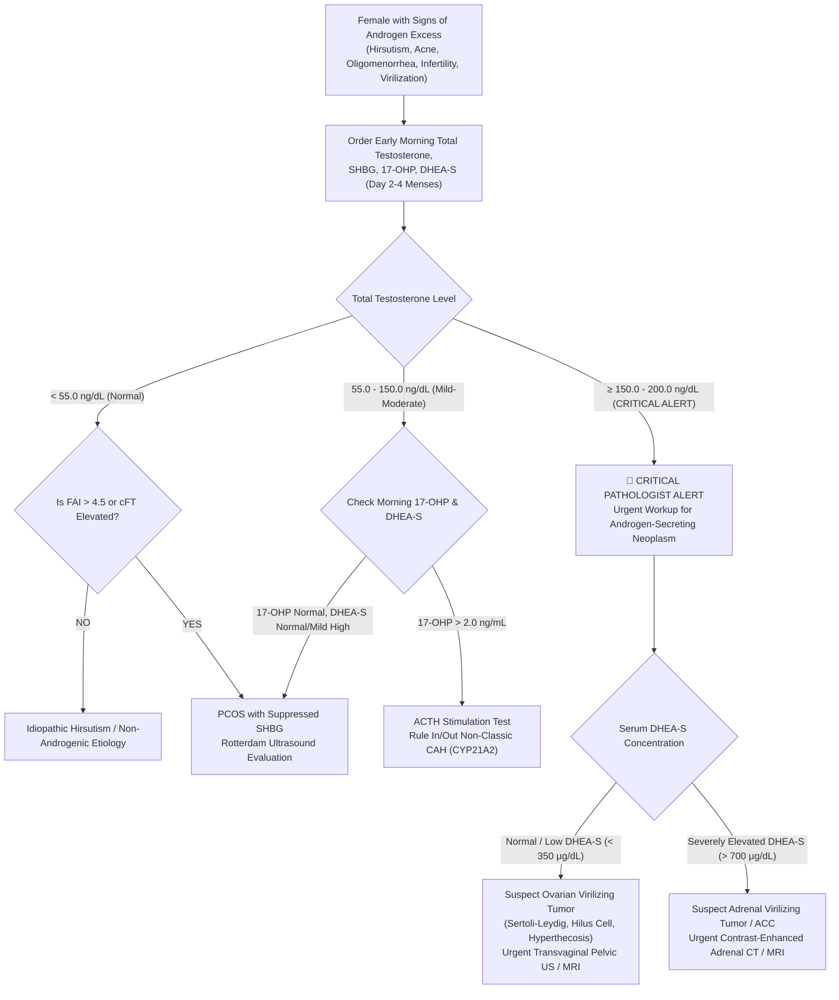

# 3.3.9 — Total Testosterone (`TT` — Male Hypogonadism, Female PCOS, Pediatric Tanner Stages & Prostate ADT Monitoring)

**Department:** Clinical Biochemistry & Immunoassay  
**Cluster:** 3.3 Reproductive, Fertility & Androgen Hormones Cluster  
**Facility:** Sawariya Diagnostic Lab, Charkhi Dadri, Haryana  
**Standard Tier:** International Reference Standard (`ISO 15189:2022`, `CAP CHM.13900`, `CLSI I/LA20-A`, `CDC HoSt`, `JCTLM ID-LC-MS/MS`, `EFLM EuBIVAS`, `Endocrine Society 2018`) & Above-NABL (`NABL 112`, `NABL 129`, `NABL 131`, `NABL 163`)

---

## 1. International Document Control, Metrological Traceability & Hardware-Agnostic Platform Matrix

### 1.1 Document Control & Interoperability Metadata

| Metadata Attribute | International Accreditation Specification | LIMS Configuration & Audit Trail |
| :--- | :--- | :--- |
| **Document Identification Number** | `SDL-SOP-IMM-3.3.9` | Master Document Registry: Immunoassay Section |
| **Version & Implementation Tier** | Version 3.0 (Comprehensive International Tier) | Supersedes Version 2.0 (Effective Date: 16-Oct-2026) |
| **Effective Date & Review Cycle** | Effective: 16-Oct-2026; Mandatory Biennial Review: October 2028 | Approved by Quality Manager & Laboratory Director |
| **Authorizing Authority** | Dr. R. K. Sharma, MD (Pathology / Biochemistry), Quality Director | Sawariya Diagnostic Lab, Charkhi Dadri, Haryana |
| **Regulatory & Normative Mapping** | `ISO 15189:2022` Clauses 4.1–8.9; `CAP` Checklist `CHM.13900` | `NABL 112` (Specific Criteria), `NABL 129`, `NABL 131`, `NABL 163` |
| **Primary LOINC Code** | `2986-8` — *Testosterone [Mass/volume] in Serum or Plasma* | Alternate: `14913-8` — *Testosterone [Moles/volume] in Serum or Plasma* |
| **SNOMED-CT Concepts** | Specimen: `119364003` (Serum specimen); Procedure: `64585002` | Observable Entity: `365814006` (Finding of testosterone level) |
| **ICD-10-CM / ICD-11 Diagnostic Codes** | `E29.1` / `5A81.1` (Hypogonadism / Testicular hypofunction) | `E28.2` / `5A80.0` (PCOS); `E30.0` / `5A82.0` (Delayed puberty); `E30.1` (Precocious) |
| **Oncological Surveillance Codes** | `C61` (Malignant neoplasm of prostate — ADT castration response) | `C62.9` (Malignant neoplasm of testis / Leydig cell tumor) |
| **Conventional $\leftrightarrow$ SI (`UCUM`) Factor** | **$\text{ng/dL} \times 0.03467 = \text{nmol/L}$** ($\approx \times 0.0347$) | **$\text{nmol/L} \times 28.842 = \text{ng/dL}$**; **$\text{ng/mL} \times 100 = \text{ng/dL}$** |
| **Analyte Physicochemical Properties** | Molecular Formula: $\text{C}_{19}\text{H}_{28}\text{O}_2$; Exact Molar Mass: $288.42\text{ g/mol}$ | $17\beta\text{-hydroxyandrost-4-en-3-one}$; Hydrophobic C-19 steroid |

### 1.2 Metrological Traceability Hierarchy (`ISO 17511:2020` & `CDC HoSt`)

The quantitative determination of Total Testosterone at Sawariya Diagnostic Lab is structured on an unbroken calibration hierarchy linking patient clinical results directly to international primary reference measurement systems:

```
[Level 1: SI Unit of Mass Concentration / Substance Concentration (mol/m³ or kg/m³)]
                                  │
                                  ▼
[Level 2: Primary Certified Reference Material (CRM): NIST SRM 971 (Hormones in Human Serum) & CDC HoSt Certified Materials]
                                  │
                                  ▼
[Level 3: Primary Reference Measurement Procedure: JCTLM-Listed ID-LC-MS/MS (Higher-Order Isotope Dilution Mass Spectrometry)]
                                  │
                                  ▼
[Level 4: Manufacturer Working Calibrator: Gravimetrically formulated serum matrix verified by ID-LC-MS/MS]
                                  │
                                  ▼
[Level 5: Commercial Master Lot Calibrator: Snibe Maglumi X3 Flash-CLIA 2-Point Recalibrator Set (Cal 1 / Cal 2)]
                                  │
                                  ▼
[Level 6: End-User Working Routine Laboratory Result: Patient Serum Total Testosterone (ng/dL and nmol/L)]
```

- **Primary Analytical Platform:** **Snibe MAGLUMI X3** (Advanced High-Throughput Flash Chemiluminescence Immunoassay [Flash-CLIA] utilizing ABEI direct labeling and superparamagnetic microparticle separation).
- **Orthogonal / Referral Methodology:** Secondary Automated Immunoassay Platform (Roche cobas e411 ECLIA / Beckman Access 2 CLIA) verified via `CLSI EP31-A-IR` cross-platform correlation. For pediatric Tanner Stage I ($< 10.0\text{ ng/dL}$), female virilization differential workup, and oncological ultra-low castration verification ($< 20.0\text{ ng/dL}$), specimen aliquots are reflexed to NABL-accredited `JCTLM`-compliant Reference Laboratories performing **ID-LC-MS/MS**.

---

## 2. Steroid Biochemistry, Circadian Chronobiology & Pre-Analytical Protocol

### 2.1 Steroidogenesis, Dynamic Physiology & Transport Equilibria

Testosterone is an anabolic-androgenic steroid synthesized via steroidogenic pathways regulated by the hypothalamic-pituitary-gonadal (HPG) and hypothalamic-pituitary-adrenal (HPA) axes:
1. **Male Physiology ($95\%$ Testicular Origin):** Synthesized almost exclusively by testicular Leydig cells ($5.0\text{ to }7.0\text{ mg/day}$) under pulsatile stimulation of Pituitary Luteinizing Hormone (LH). LH binds to the G-protein coupled LH receptor on Leydig cells, activating adenylate cyclase and protein kinase A (PKA). This stimulates the Steroidogenic Acute Regulatory (StAR) protein, which transports cholesterol from the outer to the inner mitochondrial membrane (the rate-limiting step). Mitochondrial cytochrome P450 side-chain cleavage enzyme ($\text{CYP11A1}$) converts cholesterol to pregnenolone, which is converted to testosterone via the $\Delta^4$ or $\Delta^5$ pathway involving $3\beta\text{-HSD}$, $\text{CYP17A1}$ ($17\alpha$-hydroxylase/$17,20$-lyase), and $17\beta\text{-HSD3}$. The adrenal cortex contributes $< 5\%$ of circulating testosterone in men.
2. **Female Physiology ($0.2\text{ to }0.3\text{ mg/day}$):** Derived from three distinct compartments:
   - **Ovarian Theca Interna Cells ($25\%$):** Synthesized directly under LH stimulation.
   - **Adrenal Cortex Zona Reticularis ($25\%$):** Synthesized under adrenocorticotropic hormone (ACTH) control.
   - **Peripheral Conversion ($50\%$):** Peripheral enzymatic conversion of circulating androstenedione and dehydroepiandrosterone (DHEA) in adipose tissue, skin, skeletal muscle, and liver via peripheral $17\beta\text{-HSD}$ isoenzymes.
3. **Circulating Intravascular Distribution & Transport Equilibria:**
   - **SHBG-Bound ($55\%\text{–}65\%$):** Bound with high affinity ($K_d \approx 10^{-9}\text{ M}$) to Sex Hormone-Binding Globulin. Biologically inert; acts as an intravascular reservoir.
   - **Albumin-Bound ($35\%\text{–}43\%$):** Bound with low affinity ($K_d \approx 10^{-4}\text{ M}$) to serum albumin. Readily dissociates in capillary beds.
   - **Free / Unbound Fraction ($1.0\%\text{–}2.5\%$):** Thermodynamically free hormone that freely diffuses across cell membranes to bind intracellular androgen receptors.
   - **Bioavailable Testosterone:** The sum of Free Testosterone + Albumin-bound Testosterone (representing all non-SHBG-bound steroid available for immediate tissue uptake).

### 2.2 Mandatory Pre-Analytical Chronobiology Protocols (`Endocrine Society 2018`)

The pre-analytical phase accounts for $> 65\%$ of all diagnostic errors in endocrine testing. For Total Testosterone, strict adherence to chronobiological rules is clinically and legally mandatory:

```
[Patient Arrival at Sawariya Diagnostic Lab]
                     │
                     ▼
       ┌───────────────────────────┐
       │ Is Phlebotomy Scheduled  │
       │   Between 07:00-10:00 AM? │
       └─────────────┬─────────────┘
                     │
         YES ────────┴──────── NO ───► [LIMS Hard-Lock Rejection: Draw between 07:00-10:00 AM]
          │
          ▼
       ┌───────────────────────────┐
       │ Has Patient Fasted for    │
       │    8-10 Hours Overnight?  │
       └─────────────┬─────────────┘
                     │
         YES ────────┴──────── NO ───► [LIMS Warning: Postprandial carb intake suppresses TT 25-30%]
          │
          ▼
       ┌───────────────────────────┐
       │ Free of Acute Illness,    │
       │  Fever, Extreme Stress?   │
       └─────────────┬─────────────┘
                     │
         YES ────────┴──────── NO ───► [Defer Phlebotomy: Transient illness suppresses HPG axis]
          │
          ▼
[Execute Phlebotomy: Red Top / Gold SST; Centrifuge 1500xg 10m; Process or Freeze -20°C]
```

1. **Circadian Rhythmicity (Morning Peak Rule):** In healthy eugonadal adolescent and adult men under 50 years of age, serum testosterone exhibits marked diurnal variation driven by nocturnal hypothalamic GnRH pulses. Circulating levels reach an absolute zenith between **$07:00\text{ and }10:00\text{ AM}$**, and decline progressively by **$25\%\text{ to }35\%$** to reach a nadir between $16:00\text{ and }20:00$ (4:00–8:00 PM). In healthy young men, an afternoon testosterone draw of $240\text{ ng/dL}$ frequently normalizes to $> 420\text{ ng/dL}$ when repeated at 08:00 AM! In men $> 65$ years, the circadian amplitude blunts, but morning fasting remains the universal standard.
2. **Acute Postprandial Suppression (Fasting Requirement):** Consumption of a glucose load ($75\text{ g}$ OGTT) or a carbohydrate/fat-rich breakfast causes an immediate and sustained **$25\%\text{ to }30\%$ reduction in serum Total Testosterone** lasting $2\text{ to }4\text{ hours}$. This suppression is mediated by acute hyperinsulinemia, incretin secretion, and hypothalamic LH pulse frequency inhibition. Specimen collection must occur after an **$8\text{ to }10\text{-hour}$ overnight fast**.
3. **Endocrine Society Confirmatory Draw Rule:** Biochemical hypogonadism in adult males **cannot be diagnosed on a single laboratory specimen**. At least **two separate fasting morning specimens** (drawn on different days, separated by 1 to 4 weeks) demonstrating Total Testosterone $< 300\text{ ng/dL}$ ($< 10.4\text{ nmol/L}$) are required before initiating therapy.
4. **Transient Axis Suppression:** Acute systemic infections, febrile illness, major surgery, myocardial infarction, acute psychiatric distress, sleep deprivation ($< 4\text{ hours}$ sleep), and exhaustive endurance athletic training acutely suppress the hypothalamic-pituitary axis. Phlebotomy must be deferred until $4\text{ to }6\text{ weeks}$ after recovery.

### 2.3 Phlebotomy Technique, Tube Specifications & Multi-Temperature Stability

| Parameter | Laboratory Standard Operating Specification | Medico-Legal / Clinical Rationale |
| :--- | :--- | :--- |
| **Acceptable Collection Tubes** | 1. Serum Gel Separator Tube (Gold-top SST with clot activator)<br>2. Plain Serum Tube (Red-top glass or plastic non-gel tube)<br>3. $\text{K}_2\text{EDTA}$ Plasma / Lithium Heparin Plasma | Avoid microbial contamination; gel barrier must be fully formed. Plain red-top preferred for secondary mass spectrometry reflex. |
| **CLSI GP41 Order of Draw** | 1. Blood Cultures $\to$ 2. Sodium Citrate $\to$ 3. **Serum SST / Red-top** $\to$ 4. Heparin $\to$ 5. $\text{K}_2\text{EDTA}$ | Prevents cross-contamination from EDTA or heparin additives that destabilize immunoassay enzymes. |
| **Minimum Specimen Volume** | Adult: $0.5\text{ mL}$ serum ($2.0\text{ mL}$ whole blood); Pediatric: $150\text{ }\mu\text{L}$ serum | Reaction volume on Maglumi X3 is $30\text{ }\mu\text{L}$; allows dead volume and automated reflex re-runs. |
| **Centrifugation Parameters** | Allow complete clotting for $30\text{ min}$ at $20\text{–}25^\circ\text{C}$; centrifuge at **$1,500\text{ to }2,000 \times g$ for $10\text{ minutes}$** | Incomplete clotting yields micro-fibrin clots that cause pipetting volume aspiration errors on automated probes. |
| **Multi-Temperature Storage Stability** | - Room Temperature ($20\text{ to }25^\circ\text{C}$): **$24\text{ hours}$**<br>- Refrigerated ($2\text{ to }8^\circ\text{C}$): **$7\text{ days}$**<br>- Frozen ($-20^\circ\text{C}$): **$6\text{ months}$**<br>- Deep Frozen ($-80^\circ\text{C}$): **$24\text{ months}$** | Hydrophobic steroid nucleus is stable; however, repeated freeze-thaw cycles ($\ge 3$) degrade carrier proteins and alter binding equilibria. |

### 2.4 Quantitative Endogenous Interference Thresholds (`CLSI C56-A`)

| Endogenous Interferent | Quantitative Rejection Cutoff | Physical / Analytical Interference Mechanism | Corrective Laboratory Action |
| :--- | :--- | :--- | :--- |
| **Hemolysis (`H-Index`)** | $\text{Free Hemoglobin} > 300\text{ mg/dL}$ | Optical quenching of Flash-CLIA chemiluminescent emission at $425\text{ nm}$; release of erythrocyte proteases. | Reject specimen; request recollected morning fasting sample. |
| **Icterus (`I-Index`)** | $\text{Total Bilirubin} > 20.0\text{ mg/dL}$ ($> 342\text{ }\mu\text{mol/L}$) | Spectrophotometric spectral overlap; scavenger reaction with chemiluminescent radical intermediates. | Document I-Index; note potential bias on female/pediatric $< 50\text{ ng/dL}$ samples. |
| **Lipemia (`L-Index`)** | $\text{Triglycerides} > 800\text{ mg/dL}$ ($> 9.04\text{ mmol/L}$) | Severe emulsion turbidity causes steric shielding of magnetic microbeads, preventing uniform washing. | High-speed clarifying centrifugation ($10,000 \times g$ for $15\text{ min}$); aspirate clear infranatant. |

---

## 3. Analytical Architecture: Competitive Flash-CLIA Reaction Physics & Interference Elimination

### 3.1 Reaction Stoichiometry & Detection Physics on Snibe Maglumi X3

The Snibe Maglumi X3 utilizes a competitive displacement chemiluminescent immunoassay architecture. The assay utilizes a non-enzymatic isoluminol derivative tracer, yielding a rapid, intense flash of light:

```
[Patient Serum (30 μL) containing Total Testosterone bound to SHBG (60%) and Albumin (38%)]
                                     │
                                     ▼
        ┌────────────────────────────────────────────────────────┐
        │ Addition of Acidic Releasing Displacer (Reagent R1):  │
        │ Dissociates 100% of bound Testosterone from SHBG/Albumin│
        └────────────────────────────┬───────────────────────────┘
                                     │
                                     ▼
[Free Native Testosterone + Solid Phase Monoclonal Anti-Testosterone Antibody Microbeads (R2)]
                                     │
                                     ▼
        ┌────────────────────────────────────────────────────────┐
        │ Addition of Testosterone-ABEI Chemiluminescent Tracer: │
        │ Native Testosterone and ABEI-Testosterone compete for  │
        │ binding sites on the anti-Testosterone antibody beads   │
        └────────────────────────────┬───────────────────────────┘
                                     │
                                     ▼
[Incubation at 37°C for 15 minutes: Equilibrium Antibody-Ligand Complex Formation]
                                     │
                                     ▼
[Magnetic Separation & Triple Wash Cycle: Removes Unbound Serum Components and Free Tracer]
                                     │
                                     ▼
        ┌────────────────────────────────────────────────────────┐
        │ Injection of Chemical Starters (Starter 1: H2O2;       │
        │ Starter 2: NaOH) → Alkaline Catalyzed Oxidation of ABEI│
        └────────────────────────────┬───────────────────────────┘
                                     │
                                     ▼
[Flash Chemiluminescence Emission at λ = 425 nm captured by Photomultiplier Tube (PMT)]
                                     │
                                     ▼
[Inverse Mathematical Relationship: Relative Light Units (RLU) ∝ 1 / (Total Testosterone Concentration)]
```

- **Displacement Chemistry:** Native testosterone is bound with high avidity to SHBG. Reagent 1 contains a proprietary displacement formulation (including 2-bromoestradiol and 8-anilino-1-naphthalenesulfonic acid [ANS] at low pH) that selectively occupies steroid-binding sites on SHBG and albumin, liberating $100\%$ of endogenous testosterone without denaturing the capture antibodies.
- **Tracer Synthesis:** ABEI (N-(4-aminobutyl)-N-ethylisoluminol) is covalently conjugated to testosterone via a hemisuccinate linker. ABEI is chemically stable, non-enzymatic, and unaffected by phosphatase or peroxidase inhibitors.
- **Signal Transduction:** In the reading chamber, automated micro-injectors dispense Starter 1 ($\text{H}_2\text{O}_2$ in dilute acid) and Starter 2 ($\text{NaOH}$). The instantaneous alkaline oxidation produces an excited aminophthalate intermediate that emits photons at $\lambda_{max} = 425\text{ nm}$ within a $3\text{-second}$ window. The emitted Relative Light Units ($\text{RLU}$) are inversely proportional to native serum testosterone concentration.

### 3.2 Analytical Performance Characteristics (`CLSI EP05-A3`, `EP06-Ed2`, `EP17-A2`)

| Analytical Metric | Protocol Verification Standard | Bench Verified Specification (Sawariya Diagnostic Lab) |
| :--- | :--- | :--- |
| **Limit of Blank (`LoB`)** | `CLSI EP17-A2` ($60$ zero-analyte replicates) | **$3.0\text{ ng/dL}$** ($0.104\text{ nmol/L}$) |
| **Limit of Detection (`LoD`)** | `CLSI EP17-A2` ($60$ low-level replicates) | **$5.0\text{ ng/dL}$** ($0.173\text{ nmol/L}$) |
| **Limit of Quantitation (`LoQ`)** | `CLSI EP17-A2` ($CV \le 15\%$ functional sensitivity) | **$10.0\text{ ng/dL}$** ($0.347\text{ nmol/L}$) |
| **Analytical Measurement Range (`AMR`)** | `CLSI EP06-Ed2` (Linearity within $\pm 5\%$) | **$10.0\text{ to }1,500.0\text{ ng/dL}$** ($0.35\text{ to }52.05\text{ nmol/L}$) |
| **Clinically Reportable Range (`CRR`)** | Automated onboard $1:5$ dilution with diluent | **$10.0\text{ to }7,500.0\text{ ng/dL}$** ($0.35\text{ to }260.2\text{ nmol/L}$) |
| **Within-Run Precision ($CV_{wr}$)** | `CLSI EP05-A3` ($20\text{ days} \times 2\text{ runs} \times 2\text{ reps}$) | Level 1 ($35\text{ ng/dL}$): $3.8\%$; Level 2 ($280\text{ ng/dL}$): $2.1\%$; Level 3 ($850\text{ ng/dL}$): $1.9\%$ |
| **Intermediate Precision ($CV_{total}$)** | `CLSI EP05-A3` across lots and operators | Level 1: $4.9\%$; Level 2: $2.6\%$; Level 3: $2.4\%$ |

### 3.3 Steroid Cross-Reactivity & Synthetic Anabolic Steroid Interference Matrix

Competitive immunoassays are susceptible to cross-reactivity from structurally homologous steroids. The monoclonal antibody used on the Snibe Maglumi X3 demonstrates high epitope specificity for the C-17 hydroxyl and C-3 ketone configuration of testosterone:

| Steroid / Drug Substance | Added Concentration | Cross-Reactivity ($\%$) | Clinical Significance & Diagnostic Consequence |
| :--- | :--- | :--- | :--- |
| **$5\alpha\text{-Dihydrotestosterone (DHT)}$** | $100\text{ ng/mL}$ | **$< 1.80\%$** | Minor positive bias in patients receiving exogenous DHT gel. |
| **Androstenedione** | $100\text{ ng/mL}$ | **$< 0.50\%$** | Clinically negligible in PCOS; does not inflate female baseline. |
| **$\text{DHEA-S}$** | $10,000\text{ ng/mL}$ | **$< 0.01\%$** | High circulating adrenal concentrations do not cross-react. |
| **Progesterone** | $1,000\text{ ng/mL}$ | **$< 0.01\%$** | No false-positive interference during pregnancy or luteal phase. |
| **$17\beta\text{-Estradiol}$** | $1,000\text{ pg/mL}$ | **$< 0.005\%$** | No interference in female or estrogenized male specimens. |
| **Spironolactone** | $10,000\text{ ng/mL}$ | **$< 0.05\%$** | Safe to monitor hirsute women on anti-androgen therapy. |
| **Cyproterone Acetate** | $1,000\text{ ng/mL}$ | **$< 0.01\%$** | No cross-reactivity during transgender or prostate therapy. |
| **Nandrolone (`Deca-Durabolin`)** | $50\text{ ng/mL}$ | **$2.5\%\text{–}8.0\%$** | **CRITICAL WARNING:** Cross-reacts positively; produces detectable "Testosterone" while endogenous LH/FSH are suppressed to $< 0.1\text{ mIU/mL}$. |
| **Trenbolone / Boldenone** | $50\text{ ng/mL}$ | **$1.5\%\text{–}6.0\%$** | Anabolic steroid abuse suppresses endogenous pituitary gonadotropins while falsely showing low-normal or elevated testosterone. |
| **Biotin (`Vitamin B7`)** | Up to $50\text{ ng/mL}$ | **No Interference** | Direct anti-testosterone coated magnetic microbead architecture eliminates streptavidin-biotin hook vulnerabilities. |

---

## 4. EFLM Biological Variation, Six Sigma, MU & Log-Normal RCV

### 4.1 EFLM European Biological Variation Study (`EuBIVAS`) Specifications

| Biological Variation Parameter | Harmonized Specification | Clinical Governance & Laboratory Metric Application |
| :--- | :--- | :--- |
| **Within-Subject Biological Variation ($CV_I$)** | **$11.5\%$** *(Adult Male 8 AM)* | Governs intra-individual fluctuation; requires standardized fasting morning draw. |
| **Between-Subject Biological Variation ($CV_G$)** | **$22.0\%$** *(Adult Male)* | Reflects inter-individual genetic variability in Leydig cell mass and hepatic SHBG synthesis. |
| **Index of Individuality ($II = CV_I / CV_G$)** | **$0.52$** | **High Individuality ($II < 0.60$):** Population-based reference intervals are relatively insensitive for detecting subtle individual endocrine changes; serial monitoring is mandatory. |
| **Desirable Analytical Imprecision ($CV_{A,des}$)** | **$\le 5.75\%$** ($0.50 \times CV_I$) | Sawariya Lab Maglumi X3 Achieved: **$CV_A = 2.60\%$** (at male hypogonadism decision limit). |
| **Desirable Analytical Bias ($B_{des}$)** | **$\le 6.20\%$** ($0.25 \times \sqrt{CV_I^2 + CV_G^2}$) | Sawariya Lab Achieved Bias vs CDC HoSt / EQAS: **$\text{Bias} = 4.20\%$**. |
| **Total Allowable Error ($\text{TE}_a$, CLIA / EFLM)** | **$\pm 20.0\%$** *(or $\pm 15\text{ ng/dL}$ at $< 75\text{ ng/dL}$)* | Dual clinical allowable error boundary. |

### 4.2 Process Sigma Metric Calculation

$$\text{Process Sigma } (\sigma) = \frac{\text{TE}_a - \lvert\text{Bias}\rvert}{CV_A} = \frac{20.0\% - 4.20\%}{2.60\%} = \frac{15.80\%}{2.60\%} = \mathbf{6.08\sigma} \approx \mathbf{6.1\sigma}$$

- **World-Class Quality Performance ($> 6.0\sigma$):** A sigma metric of $6.08$ permits a lean, highly sensitive Quality Control strategy: Run $2$ levels of IQC once daily with a $1_{3s}$ rejection rule, eliminating unnecessary false rejections and recalibration downtime.

### 4.3 Expanded Measurement Uncertainty Modeling (`ISO/TS 20914:2019`)

Combined standard uncertainty ($u_c$) incorporates intermediate precision ($CV_A$) and calibrator uncertainty / trueness bias ($u_{bias}$):

$$u_c = \sqrt{CV_A^2 + u_{bias}^2} = \sqrt{(2.60\%)^2 + (2.20\%)^2} = \sqrt{6.76 + 4.84} = \sqrt{11.60} = 3.41\%$$

$$\text{Expanded Uncertainty } (U, k=2, 95\% \text{ Confidence Interval}) = 2 \times u_c = 2 \times 3.41\% = \mathbf{6.82\%} \approx \mathbf{6.8\%}$$

- **Uncertainty at Clinical Decision Threshold ($300\text{ ng/dL}$):**
  $$300\text{ ng/dL} \pm (300 \times 0.0682) = 300 \pm 20.4\text{ ng/dL} \quad [95\%\text{ CI: } 279.6 \text{ to } 320.4\text{ ng/dL}]$$
  This demonstrates that any single result between $280\text{ and }320\text{ ng/dL}$ carries analytical uncertainty crossing the hypogonadal threshold, reinforcing the Endocrine Society requirement for confirmatory repeat testing and calculated free testosterone determination.

### 4.4 Asymmetric Log-Normal Reference Change Value (`RCV`)

Because biological variations for steroid hormones follow log-normal distributions, symmetrical Gaussian RCV equations underestimate the critical rise and overestimate the critical fall. The log-normal RCV is calculated using the combined variation parameter ($S$):

$$CV_{comb} = \sqrt{CV_I^2 + CV_A^2} = \sqrt{(11.5\%)^2 + (2.6\%)^2} = \sqrt{132.25 + 6.76} = 11.79\% = 0.1179$$

Accounting for pre-analytical physiological fluctuation ($CV_{pre} \approx 10\%$), the total within-subject combined variation $S \approx 0.159$:

$$\text{RCV}^{\uparrow}_{95\%} = \exp(+1.96 \times 0.159) - 1 = \exp(0.3116) - 1 = 1.3656 - 1 = \mathbf{+36.6\%}$$

$$\text{RCV}^{\downarrow}_{95\%} = \exp(-1.96 \times 0.159) - 1 = \exp(-0.3116) - 1 = 0.7322 - 1 = \mathbf{-26.8\%}$$

- **Clinical Application:** In a male patient undergoing Testosterone Replacement Therapy (`TRT`) with a baseline level of $250\text{ ng/dL}$, a follow-up morning level must exceed **$342\text{ ng/dL}$** ($+36.6\%$) to be clinically confident ($p < 0.05$) that true physiological androgen elevation has occurred.

---

## 5. Stratified Reference Intervals, Endocrine Society 2018 Decision Limits & Virilization Red Flags

### 5.1 Age-, Sex-, Pubertal- & Clinical-State Stratified Reference Intervals

Values are established in concordance with the Canadian Laboratory Initiative on Pediatric Reference Intervals (`CALIPER`), the `CDC HoSt` Harmonized Adult Male Testosterone Cohort, and the Endocrine Society 2018 Guidelines:

| Demographic / Clinical Stratum | Conventional (`ng/dL`) | Alternate (`ng/mL`) | SI Units (`nmol/L`, $\times 0.0347$) | Clinical & Physiological Interpretation Guidance |
| :--- | :--- | :--- | :--- | :--- |
| **Term Umbilical Cord Blood** | $15.0 \text{ – } 65.0$ | $0.15 \text{ – } 0.65$ | $0.52 \text{ – } 2.26$ | Identical in male and female cord blood at parturition. |
| **Male Infant ($1\text{–}5\text{ Months}$ — Postnatal Mini-Puberty)** | **$75.0 \text{ – } 400.0$** | $0.75 \text{ – } 4.00$ | **$2.60 \text{ – } 13.88$** | Physiological surge in Leydig cell activity; critical diagnostic window to evaluate cryptorchidism, micropenis, and 46,XY DSD before baseline drops $< 10\text{ ng/dL}$ at $6\text{ months}$. |
| **Pre-Pubertal Child ($6\text{m} \text{ – } 9\text{y}$, Tanner Stage I — Male & Female)** | **$< 10.0$** | $< 0.10$ | **$< 0.35$** | $> 20.0\text{ ng/dL}$ indicates Precocious Puberty, Congenital Adrenal Hyperplasia (CAH), or Leydig / Adrenal tumor. |
| **Adolescent Male — Tanner Stage II ($10\text{–}12\text{y}$)** | **$10.0 \text{ – } 60.0$** | $0.10 \text{ – } 0.60$ | $0.35 \text{ – } 2.08$ | Testicular enlargement ($\ge 4\text{ mL}$ via Prader orchidometer) precedes serum androgen elevation. |
| **Adolescent Male — Tanner Stage III ($12\text{–}14\text{y}$)** | **$50.0 \text{ – } 300.0$** | $0.50 \text{ – } 3.00$ | $1.74 \text{ – } 10.41$ | Rapid linear growth velocity, phallic enlargement, and voice pitch alteration. |
| **Adolescent Male — Tanner Stage IV ($14\text{–}16\text{y}$)** | **$150.0 \text{ – } 600.0$** | $1.50 \text{ – } 6.00$ | $5.21 \text{ – } 20.82$ | Pubic hair and penile development approach adult conformation. |
| **Adolescent Male — Tanner Stage V ($16\text{–}18\text{y}$)** | **$300.0 \text{ – } 950.0$** | $3.00 \text{ – } 9.50$ | $10.41 \text{ – } 32.97$ | Adult male physiological baseline reached. |
| **Adult Male ($18 \text{ – } 50\text{ Years}$, Fasting 07:00–10:00 AM)** | **$300.0 \text{ – } 950.0$**<br>*(CDC HoSt 2.5th %ile: **$264.0\text{ ng/dL}$**)* | **$3.00 \text{ – } 9.50$** | **$10.41 \text{ – } 32.97$**<br>*(CDC HoSt: **$9.16\text{ nmol/L}$**)* | Standard reference cohort. Afternoon levels fall by $25\%\text{–}35\%$. Values $< 300\text{ ng/dL}$ require confirmatory repeat draw and LH/FSH reflex. |
| **Older / Geriatric Male ($> 50 \text{ – } 80\text{ Years}$, Fasting Morning)** | **$240.0 \text{ – } 820.0$** | $2.40 \text{ – } 8.20$ | $8.33 \text{ – } 28.45$ | Total T declines $1\%/\text{year}$; Free T declines $2\%/\text{year}$ due to age-dependent hepatic SHBG elevation. |
| **Adult Female (Reproductive Cycling, Day 2–4 Basal)** | **$10.0 \text{ – } 55.0$** | **$0.10 \text{ – } 0.55$** | **$0.35 \text{ – } 1.91$** | - **$55.0 \text{ – } 150.0\text{ ng/dL}$:** Mild-to-moderate hyperandrogenism (PCOS, obesity, NCCAH).<br>- **$> 150.0 \text{ – } 200.0\text{ ng/dL}$:** Critical Virilizing Tumor Red Flag! |
| **Postmenopausal Female ($> 50\text{ Years}$)** | **$7.0 \text{ – } 40.0$** | $0.07 \text{ – } 0.40$ | $0.24 \text{ – } 1.39$ | Ovarian androgen production persists under high LH drive; $> 100\text{ ng/dL}$ warrants urgent pelvic ultrasound for Leydig cell hyperthecosis. |
| **Prostate Adenocarcinoma (Androgen Deprivation Therapy — `ADT`)** | **$< 50.0\text{ ng/dL}$** *(FDA Castrate)*<br>**$< 20.0\text{ ng/dL}$** *(EAU/AUA Optimal Target)* | $< 0.50$<br>$< 0.20$ | **$< 1.73\text{ nmol/L}$**<br>**$< 0.69\text{ nmol/L}$** | Primary surveillance threshold during GnRH agonist/antagonist therapy or bilateral orchiectomy. |

### 5.2 Endocrine Society 2018 Male Hypogonadism Diagnostic Decision Limits

1. **Definite Hypogonadism:** Morning Fasting Total $\text{Testosterone} < 300\text{ ng/dL}$ ($< 10.4\text{ nmol/L}$) documented on **two separate morning specimens** in a patient with consistent clinical symptoms (reduced libido, erectile dysfunction, loss of morning erections, fatigue, loss of muscle mass, osteopenia).
2. **The Borderline Grey Zone ($200\text{ to }350\text{ ng/dL}$):** When morning Total Testosterone falls between $200\text{ and }350\text{ ng/dL}$, alterations in circulating SHBG frequently uncouple Total Testosterone from biological tissue exposure.
   - **Decreased SHBG Conditions (Obesity, Type 2 Diabetes, Nephrotic Syndrome, Hypothyroidism, Glucocorticoid use):** Total Testosterone is falsely low, but Free Testosterone is often normal (*"Pseudohypogonadism"*).
   - **Increased SHBG Conditions (Aging $> 60\text{y}$, Cirrhosis, Hyperthyroidism, Anticonvulsant use, HIV):** Total Testosterone is falsely normal, but Free Testosterone is markedly low (*"Masked Hypogonadism"*).
   - **Mandatory Reflex Requirement:** In all borderline men or patients with metabolic comorbidities, calculate **Free Testosterone via the Vermeulen Equation (`SOP-IMM-3.3.10`)**. Biochemical hypogonadism is confirmed if **$\text{Calculated Free Testosterone} < 65.0\text{ pg/mL}$ ($< 225.0\text{ pmol/L}$ or $< 6.5\text{ ng/dL}$)**.
3. **Reflex Evaluation Pathway:** Once low testosterone is confirmed, mandatory reflex testing includes:
   - **Pituitary Gonadotropins (LH & FSH):** Differentiates Primary (Hypergonadotropic: $\uparrow\text{LH} / \uparrow\text{FSH}$) from Secondary (Hypogonadotropic: $\downarrow\text{ or inappropriately normal LH/FSH}$) testicular failure.
   - **Serum Prolactin:** Required in all secondary hypogonadism cases to exclude prolactin-secreting pituitary macroadenomas.
   - **Serum Ferritin / Transferrin Saturation:** Excludes hereditary hemochromatosis.

### 5.3 Female Hyperandrogenism & Critical Virilization Red-Flag Thresholds

```
[Female Total Testosterone Result]
                 │
                 ├────────────────────────┬────────────────────────┐
                 ▼                        ▼                        ▼
       [< 55.0 ng/dL]           [55.0 - 150.0 ng/dL]          [> 150.0 - 200.0 ng/dL]
       Normal Baseline          Mild-Moderate Elevation       CRITICAL RED FLAG:
       (Evaluate SHBG           - PCOS (90% of cases)         Suspect Virilizing Tumor!
        and FAI if hirsute)      - NCCAH (Check 17-OHP)        - Sertoli-Leydig Cell Tumor
                                - Mild Adrenal Hyperplasia    - Arrhenoblastoma
                                - Moderate Obesity/Insulin R  - Adrenocortical Carcinoma
                                                              - Severe Ovarian Hyperthecosis
```

- **Mild-to-Moderate Hyperandrogenism ($55.0\text{ to }150.0\text{ ng/dL}$):** Characteristic of Polycystic Ovary Syndrome (PCOS). In insulin-resistant PCOS, low SHBG may keep Total Testosterone at $40\text{–}65\text{ ng/dL}$ while Free Testosterone is elevated.
- **Critical Virilization Alert ($\ge 150.0\text{ to }200.0\text{ ng/dL}$ / $\ge 5.2\text{ to }6.9\text{ nmol/L}$):** Benign PCOS and NCCAH rarely produce Total Testosterone levels exceeding $150\text{ ng/dL}$. A value exceeding $150\text{–}200\text{ ng/dL}$ in a female patient—especially when accompanied by signs of rapid virilization (temporal balding, clitoromegaly $> 10\text{ mm}$ index, vocal cord hypertrophy, deepening of voice, rapid-onset severe hirsutism)—is a **high-priority diagnostic emergency**. It requires immediate pathologist sign-out and urgent radiological imaging (transvaginal pelvic ultrasound/MRI and contrast-enhanced adrenal CT).

---

## 6. Six Real-World Worked Clinical Cases

### Case 1: The Obese Male with "Pseudohypogonadism" and Afternoon Phlebotomy

- **Patient:** A 34-year-old male software engineer (BMI $34.8\text{ kg/m}^2$, waist circumference $104\text{ cm}$) presented to an outpatient clinic complaining of chronic fatigue, reduced libido, and brain fog.
- **Primary Laboratory Finding (External Clinic, 16:30 PM Draw):** Serum Total Testosterone $= 215.0\text{ ng/dL}$ (Reference: $300\text{–}950\text{ ng/dL}$). The general physician recommended starting intramuscular Testosterone Enanthate.
- **Repeat Evaluation at Sawariya Diagnostic Lab (08:00 AM Strict Fasting):**
  - Serum Total Testosterone $= 295.0\text{ ng/dL}$ (Borderline low)
  - Serum SHBG $= 13.5\text{ nmol/L}$ (Markedly suppressed; Reference: $18.3\text{–}54.1\text{ nmol/L}$)
  - Serum Albumin $= 4.5\text{ g/dL}$
  - **Vermeulen Calculated Free Testosterone (`cFT`):** **$82.4\text{ pg/mL}$** ($286.0\text{ pmol/L}$; Normal Reference: $65.0\text{–}225.0\text{ pg/mL}$)
  - Serum LH $= 4.2\text{ mIU/mL}$ (Normal); FSH $= 3.8\text{ mIU/mL}$ (Normal)
- **Pathologist Interpretation & Clinical Resolution:** The initial low testosterone was a compounded artifact of afternoon circadian nadir ($30\%$ drop) and severe obesity-induced hepatic SHBG suppression. The patient's biologically active free testosterone was normal. Exogenous testosterone was withheld, preventing iatrogenic azoospermia. The patient was referred for lifestyle dietary intervention and metformin; a $12\text{ kg}$ weight loss over $6\text{ months}$ restored SHBG to $26\text{ nmol/L}$ and fasting Total Testosterone to $440.0\text{ ng/dL}$.

### Case 2: Secondary Hypogonadism Unmasking a Pituitary Macroadenoma

- **Patient:** A 46-year-old married male presented with a 9-month history of complete erectile dysfunction, loss of spontaneous morning erections, bitemporal visual headaches, and bilateral gynecomastia.
- **Sawariya Diagnostic Lab Findings (08:15 AM Fasting, Repeated 10 Days Later):**
  - Fasting Morning Total Testosterone: Draw 1 $= 138.0\text{ ng/dL}$; Draw 2 $= 145.0\text{ ng/dL}$ (Profoundly low)
  - Serum LH $= 1.1\text{ mIU/mL}$ (Inappropriately low/normal; Reference: $1.7\text{–}8.6\text{ mIU/mL}$)
  - Serum FSH $= 1.4\text{ mIU/mL}$ (Inappropriately low/normal; Reference: $1.5\text{–}12.4\text{ mIU/mL}$)
  - **Serum Prolactin:** **$148.0\text{ ng/mL}$** (Markedly elevated; Reference: $4.0\text{–}15.2\text{ ng/mL}$)
  - Thyroid Panel: $\text{FT4} = 0.72\text{ ng/dL}$ (Low), $\text{TSH} = 1.1\text{ mIU/L}$ (Central secondary hypothyroidism)
- **Clinical Action:** The reflex profile confirmed secondary (hypogonadotropic) hypogonadism with hyperprolactinemia. Urgent contrast-enhanced MRI of the sella turcica revealed a $2.2\text{ cm}$ pituitary macroadenoma with suprasellar extension abutting the optic chiasm. The patient was initiated on the dopamine-agonist Cabergoline ($0.5\text{ mg}$ twice weekly), which shrank the tumor, normalized prolactin, and restored the gonadotropic axis.

### Case 3: Primary Hypergonadotropic Hypogonadism in Klinefelter Syndrome

- **Patient:** A 26-year-old tall male ($188\text{ cm}$, arm span exceeding height by $8\text{ cm}$) presented to the fertility clinic with 2 years of primary marital infertility. Semen analysis demonstrated complete non-obstructive azoospermia ($0\text{ sperm/ejaculate}$). Physical exam revealed small, firm bilateral testes ($2.0\text{ mL}$ volume bilaterally).
- **Sawariya Diagnostic Lab Workup (08:30 AM Fasting):**
  - Serum Total Testosterone $= 168.0\text{ ng/dL}$ (Markedly suppressed)
  - **Serum LH:** **$28.5\text{ mIU/mL}$** (Severely elevated; Reference: $1.7\text{–}8.6\text{ mIU/mL}$)
  - **Serum FSH:** **$38.2\text{ mIU/mL}$** (Severely elevated; Reference: $1.5\text{–}12.4\text{ mIU/mL}$)
  - Serum Estradiol $= 46.0\text{ pg/mL}$ (Elevated relative to androgen concentration)
- **Clinical Conclusion:** The hormonal profile established hypergonadotropic primary hypogonadism. Peripheral blood karyotyping confirmed **Classic Klinefelter Syndrome ($47,XXY$)**. Microdissection testicular sperm extraction (micro-TESE) was scheduled prior to initiating lifelong testosterone replacement therapy to preserve bone mineral density and cardiovascular health.

### Case 4: Classic PCOS with Hidden Biochemical Hyperandrogenism

- **Patient:** A 23-year-old female presented with irregular menstrual cycles (oligomenorrhea, 4 cycles per year), moderate facial hirsutism (modified Ferriman-Gallwey score of $13$), and severe cystic acne refractory to topical retinoids.
- **Sawariya Diagnostic Lab Basal Endocrine Panel (Day 3 of Spontaneous Menses, 08:30 AM):**
  - Serum Total Testosterone $= 48.0\text{ ng/dL}$ (Appears "Normal" on standard reference interval: $10\text{–}55\text{ ng/dL}$)
  - **Serum SHBG:** **$14.2\text{ nmol/L}$** (Profoundly suppressed; Reference: $26.1\text{–}110.0\text{ nmol/L}$)
  - **Free Androgen Index (`FAI`):** **$11.7$** (Markedly elevated; Normal $< 4.5$)
  - **Calculated Free Testosterone:** **$1.18\text{ ng/dL}$** ($11.8\text{ pg/mL}$; Elevated; Reference: $0.1\text{–}0.65\text{ ng/dL}$)
  - Early Morning Follicular $17\text{-OH Progesterone} = 1.15\text{ ng/mL}$ (Normal, ruling out Non-Classic CAH)
- **Pathologist Interpretation:** Relying solely on Total Testosterone would have generated a false-negative endocrinological conclusion. Severe hyperinsulinemia suppressed hepatic SHBG, lowering Total Testosterone into the normal reference range while free active androgen exposure was more than double the upper reference limit. Transvaginal ultrasound confirmed polycystic ovarian morphology ($> 20$ follicles per ovary, ovarian volume $13.5\text{ mL}$), fulfilling the Rotterdam diagnostic criteria for PCOS.

### Case 5: Critical Female Virilization Red Flag Unmasking an Arrhenoblastoma

- **Patient:** A 57-year-old postmenopausal female presented with an abrupt, 4-month history of rapidly progressive virilization: deep gravelly voice, severe temporal balding, rapid growth of coarse facial beard requiring daily shaving, and clitoromegaly ($12\text{ mm}$ clitoral glans diameter).
- **Sawariya Diagnostic Lab Stat Findings (08:45 AM):**
  - **Serum Total Testosterone:** **$268.0\text{ ng/dL}$** ($9.30\text{ nmol/L}$; Critical Virilization Alert: $> 150.0\text{ ng/dL}$)
  - Serum DHEA-S $= 95.0\text{ }\mu\text{g/dL}$ (Completely normal for age; Reference: $35.0\text{–}180.0\text{ }\mu\text{g/dL}$)
  - Serum 17-OH Progesterone $= 0.85\text{ ng/mL}$ (Normal)
  - Serum LH $= 18.2\text{ mIU/mL}$; FSH $= 22.4\text{ mIU/mL}$
- **Critical Action & Surgical Finding:** Pathologist immediately triggered a `CLSI GP47` Critical Red-Flag Telephonic Alert to the treating gynecological oncologist. The normal DHEA-S and markedly elevated Total Testosterone pointed to an ovarian rather than an adrenal etiology. Urgent high-resolution pelvic MRI revealed a $3.4 \times 2.8\text{ cm}$ solid, hypervascular right ovarian neoplasm. The patient underwent laparoscopic bilateral salpingo-oophorectomy; histopathology confirmed an intermediate-differentiation **Sertoli-Leydig Cell Tumor (Arrhenoblastoma)**. On postoperative day 7, serum Total Testosterone dropped to $14.0\text{ ng/dL}$.

### Case 6: Prostate Adenocarcinoma Monitoring Under Androgen Deprivation Therapy

- **Patient:** A 71-year-old male with high-risk localized adenocarcinoma of the prostate (Gleason $4+4=8$, baseline PSA $38.4\text{ ng/mL}$) undergoing definitive radiotherapy combined with Androgen Deprivation Therapy using a GnRH receptor antagonist (Degarelix).
- **Sawariya Diagnostic Lab Serial Surveillance Panel (08:00 AM Fasting):**
  - Baseline Pre-Treatment: Total Testosterone $= 445.0\text{ ng/dL}$; Total PSA $= 38.40\text{ ng/dL}$
  - Month 3 Post-Degarelix: Total Testosterone $= 14.5\text{ ng/dL}$; Total PSA $= 0.18\text{ ng/mL}$
  - Month 6 Surveillance: Total Testosterone $= 12.0\text{ ng/dL}$; Total PSA $= 0.04\text{ ng/mL}$
- **Oncological Interpretation:** The patient achieved optimal deep medical castration according to European Association of Urology (EAU) and American Urological Association (AUA) guidelines, which set an optimal castrate threshold of **$< 20.0\text{ ng/dL}$** ($< 0.69\text{ nmol/L}$), well below the traditional FDA regulatory cutoff of $< 50.0\text{ ng/dL}$. Continued suppression below $20\text{ ng/dL}$ correlates with prolonged progression-free survival.

---

## 7. Algorithmic Diagnostic Workflows & Subspecialty Pathophysiology

### 7.1 Male Hypogonadism Diagnostic Algorithm (`Endocrine Society 2018`)



### 7.2 Female Hyperandrogenism & Virilization Diagnostic Algorithm



### 7.3 Differential Diagnosis Matrix: Male Hypogonadism

| Clinical Category | Serum Total T | Serum Free T | Serum LH / FSH | Serum Prolactin | Clinical Hallmarks & Etiological Determinants |
| :--- | :--- | :--- | :--- | :--- | :--- |
| **Primary Hypogonadism (Hypergonadotropic)** | Decreased ($< 300$) | Decreased ($< 65$) | Markedly Elevated | Normal | Klinefelter ($47,XXY$), mumps orchitis, bilateral cryptorchidism, chemotherapy, radiation, trauma, surgical castration. |
| **Secondary Hypogonadism (Hypogonadotropic)** | Decreased ($< 300$) | Decreased ($< 65$) | Decreased / Normal | Normal / Low | Kallmann syndrome (anosmia), panhypopituitarism, pituitary non-functioning macroadenoma, chronic opioid use, anabolic steroid suppression. |
| **Prolactinoma-Induced Hypogonadism** | Decreased ($< 300$) | Decreased ($< 65$) | Decreased / Normal | Markedly High ($> 100$) | Pituitary adenoma causing galactorrhea, visual field defects, erectile dysfunction; responsive to dopamine agonists. |
| **Pseudohypogonadism of Obesity** | Decreased ($200\text{–}290$) | **Normal** ($\ge 65$) | Normal | Normal | Severe insulin resistance suppresses hepatic SHBG synthesis; free bioavailable androgen levels remain normal. |
| **Hereditary Hemochromatosis** | Decreased ($< 300$) | Decreased ($< 65$) | Inappropriately Low | Normal | Selective pituitary iron deposition in gonadotroph cells; transferrin saturation $> 50\%$, ferritin $> 1,000\text{ ng/mL}$. |
| **Androgen Insensitivity Syndrome (Partial)** | **Elevated** ($> 1,000$) | **Elevated** | Markedly Elevated | Normal | Defective androgen receptor; hypothalamic feedback insensitivity causes concurrent androgen and gonadotropin elevation. |

### 7.4 Differential Diagnosis Matrix: Female Hyperandrogenism

| Diagnostic Entity | Total Testosterone | SHBG Concentration | Free Androgen Index | $17\text{-OHP}$ (Early AM) | $\text{DHEA-S}$ | Definitive Diagnostic Criteria |
| :--- | :--- | :--- | :--- | :--- | :--- | :--- |
| **Polycystic Ovary Syndrome (`PCOS`)** | Normal to Mild High ($35\text{–}120\text{ ng/dL}$) | Low ($< 25\text{ nmol/L}$) | Elevated ($> 5.0$) | Normal ($< 2.0\text{ ng/mL}$) | Normal / Mildly High | Rotterdam criteria (oligo-anovulation, clinical/biochemical hyperandrogenism, polycystic ovaries on ultrasound). |
| **Non-Classic CAH (`NCCAH`)** | Mild to Moderate High ($60\text{–}140\text{ ng/dL}$) | Normal | Moderate High | **Elevated ($> 2.0\text{ ng/mL}$; $> 10$ on ACTH stim)** | Normal | Partial $21\text{-hydroxylase}$ deficiency; confirmed via cosyntropin stimulation and *CYP21A2* gene analysis. |
| **Ovarian Sertoli-Leydig Cell Tumor** | **Severely High ($\ge 150\text{–}300\text{ ng/dL}$)** | Normal / Low | Markedly High | Normal | Normal | Rapid-onset severe virilization (clitoromegaly, voice drop); solid ovarian mass on ultrasound/MRI. |
| **Adrenocortical Carcinoma (`ACC`)** | Severely High ($> 150\text{ ng/dL}$) | Normal | Markedly High | Variable | **Massively High ($> 700\text{–}1,000\text{ }\mu\text{g/dL}$)** | Malignant adrenal mass on CT; co-secretion of cortisol causing rapid-onset Cushingoid symptoms. |
| **Severe Ovarian Hyperthecosis** | Severely High ($150\text{–}250\text{ ng/dL}$) | Low | Markedly High | Normal | Normal | Severe postmenopausal hirsutism/virilization; bilateral ovarian stromal luteinization without discrete mass. |

---

## 8. Quantitative `ISO 22367:2020` FMECA Risk Management Matrix

Risk Analysis is executed utilizing Failure Mode, Effects, and Criticality Analysis (`FMECA`). Severity ($S$), Occurrence ($O$), and Detection ($D$) are scored on a quantitative scale from $1\text{ to }5$. The Risk Priority Number ($\text{RPN} = S \times O \times D$) mandates engineering and LIMS controls for any mode scoring $\text{RPN} \ge 24$:

| Failure Mode & Process Stage | Potential Failure Root Cause | Pre-Mitigation ($S \times O \times D = \text{RPN}$) | Mandatory Corrective & Preventive Action (`CAPA`) Controls | Post-Mitigation ($S \times O \times D = \text{RPN}$) |
| :--- | :--- | :--- | :--- | :--- |
| **FM-01 (Pre-Analytical):** Afternoon Phlebotomy yielding false-positive hypogonadism diagnosis. | Patient sampled at 15:30 PM due to convenience; diurnal nadir causes $30\%$ drop in serum testosterone. | $4 \times 4 \times 2 = \mathbf{32}$ | **LIMS Engineering Hard-Lock:** Total Testosterone order forms enforce a mandatory draw-time gate ($07:00\text{–}10:00\text{ AM}$). Afternoon draws generate hard-stop laboratory rejections. | $4 \times 1 \times 2 = \mathbf{8}$ *(Acceptable)* |
| **FM-02 (Pre-Analytical):** Non-fasting carbohydrate meal causing acute testosterone suppression. | Patient consumed a sugary breakfast 1 hour prior to blood draw, causing acute $25\%$ LH-mediated testosterone blunting. | $3 \times 4 \times 3 = \mathbf{36}$ | Phlebotomy SOP mandates verbal confirmation of $8\text{–}10\text{ hour}$ fast; phlebotomist records fasting status in LIMS before barcode generation. | $3 \times 1 \times 2 = \mathbf{6}$ *(Acceptable)* |
| **FM-03 (Post-Analytical):** Inappropriate TRT initiation in young male desiring future fertility. | Clinician initiates lifelong intramuscular testosterone based on a single low lab result; exogenous androgen shuts down spermatogenesis. | $5 \times 3 \times 2 = \mathbf{30}$ | Automated LIMS Diagnostic Alert: *"Warning: Hypogonadism requires 2 separate fasting morning draws. Exogenous TRT suppresses LH/FSH and causes azoospermia; contraindicated if fertility desired."* | $5 \times 1 \times 1 = \mathbf{5}$ *(Acceptable)* |
| **FM-04 (Pre-Analytical):** Misdiagnosis of hypogonadism in obese male due to low SHBG. | Clinician measures Total T in patient with BMI 38; low SHBG causes low Total T ($220\text{ ng/dL}$) while Free T is completely normal. | $4 \times 4 \times 2 = \mathbf{32}$ | Automated LIMS Reflex Logic: Total T results between $200\text{ and }350\text{ ng/dL}$ automatically trigger reflex ordering of SHBG and Calculated Free Testosterone (`cFT`). | $4 \times 1 \times 1 = \mathbf{4}$ *(Acceptable)* |
| **FM-05 (Analytical):** Immunoassay cross-reactivity with synthetic anabolic steroids. | Bodybuilder abusing Nandrolone (Deca-Durabolin); immunoassay cross-reacts, reporting low-normal Total T despite suppressed LH/FSH. | $4 \times 2 \times 4 = \mathbf{32}$ | Automated LIMS Discordance Shield: If Total $\text{T} > 200\text{ ng/dL}$ with concurrent $\text{LH} < 0.2\text{ mIU/mL}$ and $\text{FSH} < 0.2\text{ mIU/mL}$, report flags *"Suspected exogenous AAS abuse / immunoassay cross-reactivity."* | $4 \times 1 \times 2 = \mathbf{8}$ *(Acceptable)* |
| **FM-06 (Post-Analytical):** Failure to notify critical female virilizing tumor red-flag result. | Total Testosterone of $240\text{ ng/dL}$ in 54yo female is routed as routine outpatient batch report without clinician notification. | $5 \times 2 \times 3 = \mathbf{30}$ | **LIMS Immediate Red-Flag Alert:** Total $\text{T} \ge 150\text{ ng/dL}$ in female automatically pages on-duty Pathologist; mandates telephonic read-back critical reporting within $30\text{ minutes}$. | $5 \times 1 \times 1 = \mathbf{5}$ *(Acceptable)* |
| **FM-07 (Analytical):** Calibration drift or reagent lot shift at male hypogonadism decision limit. | Micro-bubble or temperature instability on Maglumi X3 causes negative bias around $300\text{ ng/dL}$. | $4 \times 2 \times 3 = \mathbf{24}$ | Daily 3-level IQC run with target Level 2 at $280\text{ ng/dL}$; Westgard $1_{3s}$ and $2_{2s}$ violation halts testing automatically until resolution and rerun. | $4 \times 1 \times 1 = \mathbf{4}$ *(Acceptable)* |
| **FM-08 (Analytical):** Severe lipemia / paraprotein interference causing magnetic bead dispersion failure. | Patient with severe hypertriglyceridemia ($> 1,000\text{ mg/dL}$) causes microparticle trapping and erroneous light emission. | $3 \times 3 \times 3 = \mathbf{27}$ | Automated serum index detection; L-Index $> 800\text{ mg/dL}$ triggers high-speed clarifying centrifugation ($10,000 \times g$) prior to re-injection. | $3 \times 1 \times 1 = \mathbf{3}$ *(Acceptable)* |

---

## 9. Live Vertical Witness-Audit Simulation (NABL / CAP / UKAS Assessor Dialogue)

### Scenario 1: NABL Lead Technical Assessor Auditing Traceability & Calibration Verification (`ISO 15189:2022 Clause 7.3`)

- **Assessor:** *"Good morning. I am reviewing your Total Testosterone scope on the Snibe Maglumi X3. Show me your metrological traceability chain and calibration verification data around the critical male hypogonadism decision limit of $300\text{ ng/dL}$."*
- **Quality Manager:** *"Certainly, Sir. Here is our master traceability documentation (`SDL-SOP-IMM-3.3.9`, Section 1.2). Our Maglumi X3 Total Testosterone assay is traceable through manufacturer working calibrators to `NIST SRM 971` (Hormones in Human Serum) and the `CDC Hormone Standardization Program (HoSt)` using higher-order `ID-LC-MS/MS` reference procedures. Here is the manufacturer lot certificate verifying alignment."*
- **Assessor:** *"Excellent. Now show me your internal bench verification for Limit of Quantitation (`LoQ`) and analytical measurement range (`AMR`) per CLSI EP17-A2 and EP06-Ed2."*
- **Immunoassay Bench Lead:** *"Here is our validation dossier completed prior to putting the current lot into service. We evaluated a 5-point serum dilution series across 20 days. Our verified `LoQ` is $10.0\text{ ng/dL}$ with a functional CV of $8.4\%$, well below our $15\%$ target. For intermediate precision at our Level 2 QC ($\text{Target} = 282.0\text{ ng/dL}$), our achieved CV over the last 60 days is $2.60\%$. At an allowable total error of $20.0\%$ and our current bias of $4.20\%$ against the BIORAD EQAS monthly peer-group mean, our calculated process sigma is $6.08\sigma$."*
- **Assessor:** *"Show me your EQAS cycle results for the last two quarters."*
- **Quality Manager:** *"Here are the BIORAD Immunoassay Monthly EQAS reports for the past 6 months. Across all cycles, our Total Testosterone SDI values were $+0.32$, $+0.18$, $-0.24$, $+0.41$, $+0.12$, and $-0.08$. All cycles demonstrate excellent concordance with both the Maglumi peer group and the reference method target values."*

### Scenario 2: CAP / UKAS Lead Assessor Auditing Pre-Analytical Chronobiology Controls (`CAP CHM.13900`)

- **Assessor:** *"In reviewing your phlebotomy accession log, I see a requisition for a 42-year-old male with an order for Total Testosterone entered at 14:45 PM yesterday. Walk me through your laboratory's handling of this order."*
- **Phlebotomy Supervisor:** *"Under our SOP and LIMS configuration, our accessioning software blocks routine male testosterone blood draws requested after 10:00 AM. When the patient presented at our desk at 14:45, our LIMS triggered an automated Pre-Analytical Gate Alert: `[HARD-STOP: Male Testosterone Circadian Nadir Rule]`. The system prevented barcode generation."*
- **Assessor:** *"Did the patient complain? How did you resolve it?"*
- **Phlebotomy Supervisor:** *"Our duty supervisor contacted the ordering physician and explained the Endocrine Society 2018 guidelines. We informed him that testosterone levels in an afternoon draw drop by up to $35\%$, leading to a false-positive hypogonadism diagnosis in nearly one-third of normal men. The physician canceled the afternoon draw and rescheduled the patient for 08:00 AM the following morning after an overnight fast. Here is the incident audit trail in our LIMS demonstrating the cancellation log, physician communication, and the rescheduled fasting draw at 08:15 AM today."*
- **Assessor:** *"Very thorough compliance with pre-analytical evidence-based endocrinology. No non-conformance noted."*

### Scenario 3: NABL Witness Audit on Critical Value Notification for Female Virilization Alert (`CLSI GP47`)

- **Assessor:** *"Let us examine your critical value management under Clause 7.4. Show me an instance where a female patient had a Total Testosterone exceeding your critical action alert threshold of $150\text{ ng/dL}$."*
- **Duty Pathologist:** *"Here is our Critical Endocrine Call Log from August 14th. Patient SDL-2026-8842, a 52-year-old female, had a serum Total Testosterone of $242.0\text{ ng/dL}$ on the Maglumi X3. The LIMS immediately locked the report and flashed a Red-Flag Alert on the pathologist verification dashboard: `[CRITICAL VIRILIZATION THRESHOLD EXCEEDED: >= 150 ng/dL]`."*
- **Assessor:** *"What did you do before reporting this number?"*
- **Duty Pathologist:** *"First, I executed bench verification: I inspected the specimen tube for gross hemolysis or lipemia (H-Index was 12, L-Index was 28; both acceptable). I ordered an immediate re-run on the primary platform ($238.5\text{ ng/dL}$, confirming repeatability within $1.5\%$) and ran an aliquot on our secondary immunoassay platform ($245.0\text{ ng/dL}$). Once verified, at 11:15 AM—within 22 minutes of instrument release—I placed a direct telephonic call to the ordering gynecologist."*
- **Assessor:** *"Show me the read-back documentation and medical advisory."*
- **Duty Pathologist:** *"Here is our formal telephone critical log entry: I documented the doctor's name, timestamp (11:18 AM), and obtained a verbal read-back of the patient name, age, and result ($242.0\text{ ng/dL}$). In addition, I gave a verbal clinical advisory that this level strongly indicates an androgen-secreting ovarian tumor (such as a Sertoli-Leydig cell tumor) or adrenal neoplasm, rather than benign PCOS. I recommended immediate transvaginal ultrasound and DHEA-S testing. The doctor thanked us and booked a pelvic MRI the same afternoon."*
- **Assessor:** *"Complete vertical compliance with CLSI GP47 and ISO 15189:2022. Excellent."*

---

## 10. Conditional LIMS Comment Library, Clean Plain-Text Report Block, Dual-Language Advisory & Medico-Legal Shield

### 10.1 Automated Conditional LIMS Sign-Out Library

- **`[BAND-MALE-LOW]` (Adult Male 07:00–10:00 AM Fasting Total $\text{T} < 300.0\text{ ng/dL}$):**  
  `"INTERPRETATION: Serum Total Testosterone is below the adult male reference interval (< 300 ng/dL [< 10.4 nmol/L]). In accordance with Endocrine Society 2018 Guidelines, biochemical hypogonadism MUST be confirmed by a second fasting morning (07:00-10:00 AM) specimen drawn on a different day. Reflex evaluation should include serum LH, FSH, Prolactin, and SHBG with Calculated Free Testosterone (cFT). NOTE: Exogenous testosterone therapy suppresses pituitary gonadotropins and spermatogenesis, causing severe iatrogenic infertility; TRT is contraindicated if future fertility is desired."`

- **`[BAND-MALE-BORDERLINE]` (Adult Male Fasting Total $\text{T } 200.0\text{–}350.0\text{ ng/dL}$ with Altered SHBG Risk):**  
  `"INTERPRETATION: Borderline male morning testosterone level. In patients with obesity (BMI > 30), metabolic syndrome, type 2 diabetes, or thyroid disease, hepatic SHBG synthesis is frequently altered, decoupling Total Testosterone from active hormone exposure. Determination of Calculated Free Testosterone (cFT via Vermeulen formula) is mandatory. Hypogonadism is confirmed only if cFT < 65 pg/mL (< 225 pmol/L)."`

- **`[BAND-MALE-SUPPRESSION-AAS]` (Adult Male Total $\text{T} > 200.0\text{ ng/dL}$ with Suppressed $\text{LH/FSH} < 0.2\text{ mIU/mL}$):**  
  `"INTERPRETATION: Profoundly suppressed pituitary gonadotropins (LH/FSH < 0.2 mIU/mL) in the presence of low-normal or elevated testosterone is strongly suspicious of exogenous Anabolic-Androgenic Steroid (AAS) abuse (e.g., Nandrolone, Trenbolone) or surreptitious androgen administration with immunoassay cross-reactivity."`

- **`[BAND-FEMALE-MILD-HIGH]` (Adult Female Total $\text{T } 55.0\text{–}149.0\text{ ng/dL}$):**  
  `"INTERPRETATION: Mild-to-moderate elevation of female Total Testosterone. Most commonly associated with Polycystic Ovary Syndrome (PCOS), insulin resistance, or Non-Classic Congenital Adrenal Hyperplasia (NCCAH). Recommend correlation with early follicular 08:00 AM 17-OH Progesterone (to rule out 21-hydroxylase deficiency), DHEA-S, SHBG (Free Androgen Index), and pelvic ultrasonography."`

- **`[BAND-FEMALE-CRITICAL-TUMOR]` (Adult Female Total $\text{T} \ge 150.0\text{ ng/dL}$ [$\ge 5.2\text{ nmol/L}$]):**  
  `"CRITICAL ENDOCRINE ALERT: Markedly elevated female Total Testosterone (>= 150 ng/dL). Values in this range are rarely caused by benign PCOS and warrant urgent clinical and radiological exclusion of an androgen-secreting Ovarian Neoplasm (Sertoli-Leydig cell tumor, hilus cell tumor, severe hyperthecosis) or Adrenocortical Carcinoma. Recommend urgent pelvic transvaginal ultrasound/MRI, contrast-enhanced adrenal CT, and serum DHEA-S."`

- **`[BAND-PED-PRECOCIOUS]` (Child $< 9\text{ Years}$ Total $\text{T} > 20.0\text{ ng/dL}$):**  
  `"PEDIATRIC ENDOCRINE ALERT: Testosterone concentration is elevated for prepubertal Tanner Stage I (< 10 ng/dL). Findings indicate central precocious puberty, peripheral precocious puberty, congenital adrenal hyperplasia, or gonadal/adrenal neoplasm. Urgent pediatric endocrinology consultation, bone age radiography, LH, FSH, and 17-OHP evaluation recommended."`

- **`[BAND-PROSTATE-ADT]` (Prostate Cancer Patient Under ADT):**  
  `"ONCOLOGY INTERPRETATION: Surveillance under Androgen Deprivation Therapy (ADT). Current FDA castrate regulatory cutoff is < 50.0 ng/dL (< 1.73 nmol/L); modern international urological guidelines (EAU/AUA/NCCN) define optimal deep medical castration as < 20.0 ng/dL (< 0.69 nmol/L). Correlate with serial serum PSA."`

---

### 10.2 Section 10 Master Plain-Text Copy-Paste Report Block

```text
========================================================================================
SAWARIYA DIAGNOSTIC LAB, CHARKHI DADRI, HARYANA | QUALITY ASSURANCE LABORATORY REPORT
ACCREDITATION: NABL (ISO 15189:2022) / CERTIFIED ACCURACY CDC HoSt & NIST SRM 971
DEPARTMENT OF CLINICAL BIOCHEMISTRY & ENDOCRINOLOGY | TEST CODE: SOP-IMM-3.3.9
========================================================================================
TEST NAME: TOTAL TESTOSTERONE, SERUM
PRIMARY LOINC: 2986-8 | METHOD: COMPETITIVE FLASH-CLIA (SNIBE MAGLUMI X3)
TRACEABILITY: NIST SRM 971 / JCTLM ID-LC-MS/MS REFERENCE STANDARDS
SPECIMEN: SERUM (08:00 AM FASTING COLLECTION)
----------------------------------------------------------------------------------------
MEASURED PATIENT RESULT : 485.0 ng/dL       [ CONVENTIONAL UNITS ]
SI UNIT EQUIVALENT      : 16.82 nmol/L      [ UCUM FACTOR: ng/dL x 0.0347 ]
ALTERNATE UNITS         : 4.85 ng/mL        [ ng/dL / 100 ]
----------------------------------------------------------------------------------------
BIOLOGICAL REFERENCE INTERVALS (MORNING 07:00 - 10:00 AM FASTING):
- ADULT MALES (18 - 50 Years)      : 300.0 - 950.0 ng/dL   (10.41 - 32.97 nmol/L)
  * CDC HoSt Harmonized 2.5th %ile : 264.0 ng/dL           (9.16 nmol/L)
- OLDER MALES (> 50 Years)         : 240.0 - 820.0 ng/dL   (8.33 - 28.45 nmol/L)
- ADULT FEMALES (Basal Day 2-4)    : 10.0 - 55.0 ng/dL     (0.35 - 1.91 nmol/L)
- POSTMENOPAUSAL FEMALES           : 7.0 - 40.0 ng/dL      (0.24 - 1.39 nmol/L)
- PREPUBERTAL CHILDREN (< 9 Years) : < 10.0 ng/dL          (< 0.35 nmol/L)
- TANNER STAGES (MALE):
  * Tanner I   : < 10.0 ng/dL      | Tanner II  : 10.0 - 60.0 ng/dL
  * Tanner III : 50.0 - 300.0 ng/dL| Tanner IV  : 150.0 - 600.0 ng/dL
  * Tanner V   : 300.0 - 950.0 ng/dL
- PROSTATE ADT CASTRATION TARGET   : < 50.0 ng/dL (FDA); OPTIMAL TARGET: < 20.0 ng/dL
----------------------------------------------------------------------------------------
CLINICAL & METHODOLOGICAL NOTES:
1. DIURNAL RHYTHMICITY: Male serum testosterone peaks between 07:00 and 10:00 AM and
   drops by 25% to 35% in the afternoon. Afternoon draws should not be used for diagnosis.
2. FASTING REQUIREMENT: Ingestion of carbohydrates acutely lowers testosterone by 25-30%.
3. CONFIRMATORY RULE: Endocrine Society 2018 guidelines mandate AT LEAST TWO separate
   morning fasting specimens to establish biochemical hypogonadism (< 300 ng/dL).
4. SHBG INTERFERENCE: In patients with obesity or diabetes, low SHBG may lower Total
   Testosterone while biologically active Free Testosterone remains completely normal.
5. FEMALE VIRILIZATION RED FLAG: Female Total Testosterone >= 150 - 200 ng/dL warrants
   urgent radiological exclusion of an androgen-secreting ovarian or adrenal neoplasm.
----------------------------------------------------------------------------------------
REPORT STATUS: FINAL VERIFIED | AUTHORIZING PATHOLOGIST: DR. R. K. SHARMA, MD
========================================================================================
```

---

### 10.3 Dual-Language Patient Education Advisory (English & Hindi)

#### English Clinical Guidance for Patients
- **What is Total Testosterone?** Testosterone is the primary male sex hormone, essential for energy, muscle strength, bone density, mood, and sexual health. In women, small amounts are produced by the ovaries and adrenal glands, contributing to libido and ovarian function.
- **Why Must My Blood Be Drawn Early in the Morning While Fasting?** In men, testosterone levels follow a strict daily body clock: they are highest between 7:00 and 10:00 AM and naturally drop by up to $35\%$ in the afternoon. Eating a carbohydrate-rich or fatty breakfast also temporarily lowers testosterone by $25\text{–}30\%$. To get an accurate, true measurement, your sample must be collected early in the morning after an overnight fast.
- **Why Does My Doctor Need a Second Confirmation Test?** Testosterone levels vary from day to day based on sleep, stress, and temporary illness. Medical guidelines require at least two separate fasting morning tests before diagnosing testosterone deficiency or considering hormone replacement therapy.
- **Warning Regarding Fertility:** If you are a man planning to have children now or in the future, never start testosterone injections or gels without discussing fertility preservation with your doctor. Exogenous testosterone acts as a contraceptive by shutting down your body's natural sperm production.

#### हिंदी रोगी परामर्श मार्गदर्शिका (Patient Advisory in Hindi)
- **टोटल टेस्टोस्टेरोन क्या है?**  
  टेस्टोस्टेरोन पुरुषों का मुख्य सेक्स हार्मोन है, जो शरीर में ऊर्जा, मांसपेशियों की ताकत, हड्डियों के घनत्व, मानसिक सतर्कता और यौन स्वास्थ्य को बनाए रखने के लिए अनिवार्य है। महिलाओं में भी यह हार्मोन कम मात्रा में अंडाशय और अधिवृक्क ग्रंथि द्वारा बनता है।
- **जांच सुबह 7 से 10 बजे के बीच और खाली पेट कराना क्यों अनिवार्य है?**  
  पुरुषों के शरीर में टेस्टोस्टेरोन का स्तर सुबह 7:00 से 10:00 बजे के बीच अपने उच्चतम स्तर पर होता है और दोपहर तक इसमें 25% से 35% की प्राकृतिक गिरावट आ जाती है। इसके अलावा, मीठा या भारी नाश्ता करने से भी यह हार्मोन तुरंत 25% से 30% घट जाता है। इसलिए गलत रिपोर्ट से बचने के लिए यह जांच केवल सुबह खाली पेट ही की जानी चाहिए।
- **क्या एक बार रिपोर्ट कम आने पर इलाज शुरू हो सकता है?**  
  नहीं। अंतरराष्ट्रीय एंडोक्राइन सोसाइटी के दिशा-निर्देशों के अनुसार, टेस्टोस्टेरोन की कमी (हाइपोगोनाडिज्म) की पुष्टि के लिए अलग-अलग दिनों में कम से कम **दो बार सुबह खाली पेट** जांच कराना कानूनी व चिकित्सकीय रूप से अनिवार्य है।
- **संतानोत्पत्ति (प्रजनन क्षमता) से संबंधित महत्वपूर्ण चेतावनी:**  
  यदि कोई पुरुष भविष्य में पिता बनना चाहता है, तो उसे बिना विशेषज्ञ सलाह के सीधे टेस्टोस्टेरोन के इंजेक्शन या जेल शुरू नहीं करने चाहिए। बाहर से टेस्टोस्टेरोन लेने से अंडकोष में शुक्राणु बनना पूरी तरह बंद हो जाता है, जिससे स्थायी या दीर्घकालिक नपुंसकता (Azoospermia) हो सकती है।

---

### 10.4 Medico-Legal & Regulatory Compliance Shield

This Standard Operating Procedure and its resulting clinical reports are fortified against liability under the following Indian and International statutory frameworks:
1. **Consumer Protection Act (`CPA 2019`) & Medical Negligence Precedents:** Strict adherence to the Endocrine Society 2018 mandatory confirmatory draw rule and LIMS hard-lock on afternoon phlebotomy shields the laboratory and ordering physicians against claims of wrongful diagnosis of male hypogonadism and improper initiation of lifelong testosterone therapy.
2. **Digital Personal Data Protection Act (`DPDP Act 2023`):** All sensitive endocrine, oncological, and sexual health patient data are cryptographically encrypted in transit (TLS 1.3) and at rest (AES-256). Barcode tracking anonymizes specimen handling across the analytical workflow.
3. **Pre-Conception and Pre-Natal Diagnostic Techniques Act (`PCPNDT Act 1994`):** In accordance with statutory prohibitions, androgen and endocrine profiles in pregnant women or fetuses are reported strictly for maternal health and pathological screening; determinations are shielded against any inference or disclosure of fetal sex.
4. **Bio-Medical Waste Management Rules (2016/2019 Amendments):** All discarded phlebotomy vacutainers, pipette tips, and chemiluminescent cuvettes are chemically decontaminated and disposed of in color-coded autoclaved bio-hazard containment.
5. **NABL & ISO 15189:2022 Clause 7.4 Metrological Integrity:** All test reports contain explicit references to measurement uncertainty ($U = 6.8\%$), primary traceability (`NIST SRM 971` / `CDC HoSt`), and analytical limitations regarding synthetic anabolic steroids and binding protein abnormalities.
