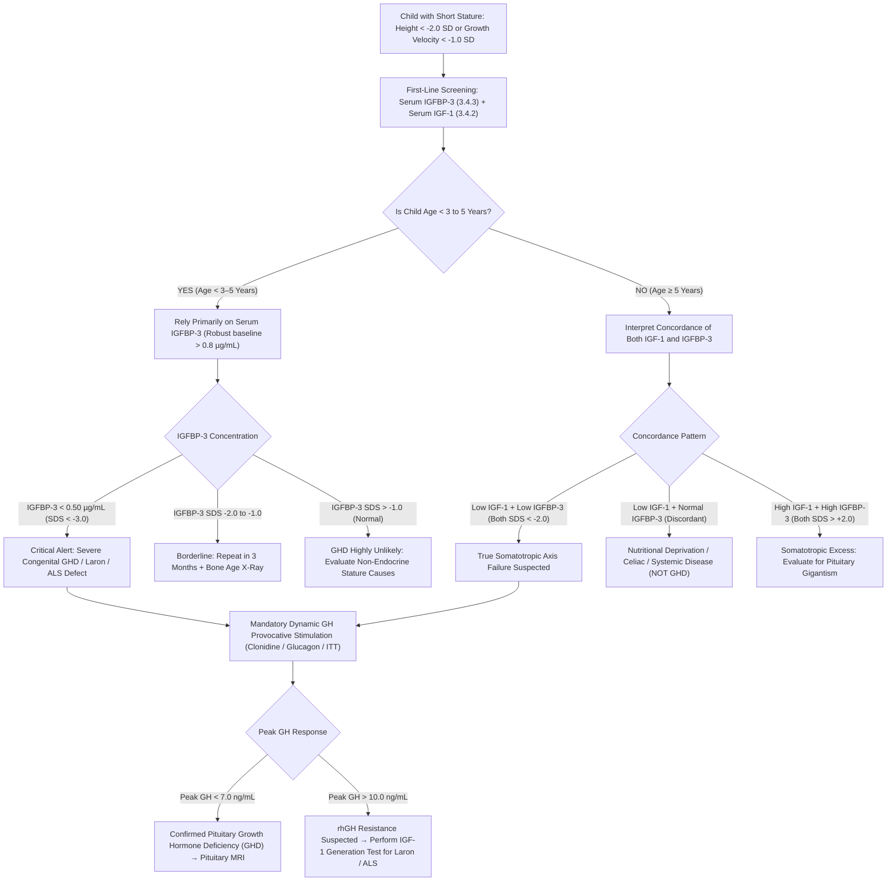

# 🧬 3.4.3 — Insulin-Like Growth Factor Binding Protein 3 (`IGFBP-3` — Superiority in Early Childhood $< 3\text{ Years}$ GHD Screening, Malnutrition Resilience, & $\text{IGF-1 / IGFBP-3}$ Molar Ratio)

**Department:** `03_Immunoassay_Endocrinology_and_Nutrients`  
**Cluster:** `3.4_Pituitary_Growth_Adrenal_and_Hypertension_Cluster`  
**Institution:** Sawariya Diagnostic Lab, Charkhi Dadri, Haryana  
**Document Tier:** International Reference Laboratory Standard (`ISO 15189:2022` / `NABL 112` / `NABL 129` / `NABL 131` / `NABL 163` / `CAP` / `UKAS` / `CLSI I/LA20` / `CLSI EP15-A3` / `WHO NIBSC 93/560` / `EFLM EuBIVAS` / `Growth Hormone Research Society Consensus` / `Indian CPA 2019`)

---

## 🏛️ Section 1: International Document Control, LOINC / SNOMED / ICD-10/11 / UCUM Coding & Hardware-Agnostic Platform Matrix

### 1.1 Document Control & Regulatory Governance Block
| Governance Attribute | Standard Specification & Clause Audit Trail |
| :--- | :--- |
| **Document Identification Number** | `SDL-SOP-IMM-3.4.3` (Version `3.0` — Substantive International & Above-NABL Upgrade) |
| **Effective Release Date** | October 17, 2026 |
| **Mandatory Annual Review Cycle** | October 2027 (or immediately upon changes to WHO international reference preparations or CLIA reagent formulation) |
| **Authorizing Sign-Off Authority** | Head of Laboratory Medicine & Consultant Pediatric Endocrinologist / Quality Manager, Sawariya Diagnostic Lab |
| **Accreditation Mapping** | `ISO 15189:2022` Clauses 4.1–8.9 (Cl 7.2 Pre-examination, 7.3 Examination & Metrological Traceability, 7.4 Post-examination, 8.5 Risk Management); `NABL 112` (Specific Criteria for Clinical Laboratories); `NABL 129` (Metrological Traceability); `NABL 131` (Terms & Conditions); `NABL 163` (Proficiency Testing / EQAS); `CAP` All-Common & Chemistry Checklists; `CLSI I/LA20` (*Analytical Characteristics and Clinical Utility of Immunological Assays for Human Growth Hormone and Related Peptides*) |
| **Primary `LOINC` Codes** | `2483-6` (*Insulin-like growth factor binding protein 3 [Mass/volume] in Serum or Plasma*); `75210-5` (*IGF-1 / IGFBP-3 Molar Ratio in Serum*) |
| **`SNOMED-CT` Specimen & Concept** | Specimen: `119364003` (*Serum specimen*); Procedure Concepts: `104589008` (*Measurement of insulin-like growth factor binding protein 3*); `365851008` (*Assessment of somatotropic axis function*) |
| **`ICD-10` / `ICD-11` Diagnostic Codes** | `E23.0` / `5A61.0` (*Hypopituitarism / Isolated Growth Hormone Deficiency*); `E34.3` / `5B91.0` (*Short stature due to endocrine disorder / Laron syndrome*); `R62.5` / `MB24.0` (*Failure to thrive and growth delay in childhood*) |
| **Peptide Architecture & Molecular Weight** | Glycoprotein monomer; 264 amino acids in mature peptide; core polypeptide molecular weight $28,750\text{ Da}$ ($28.75\text{ kDa}$); apparent molecular weight $40\text{–}44\text{ kDa}$ following post-translational N-glycosylation at 3 sites; forms a $150\text{ kDa}$ ternary complex in circulation |
| **Metrological Traceability (`ISO 17511:2020`)** | Traceable to **WHO 1st International Reference Reagent for Human IGFBP-3 (NIBSC Code 93/560)** ($20\text{ }\mu\text{g/ampoule}$; calibrated against primary purified recombinant human IGFBP-3) |
| **Conventional $\leftrightarrow$ SI (`UCUM`) Factor** | $\mu\text{g/mL} = \text{mg/L}$; $\mu\text{g/mL} \times 34.78 = \text{nmol/L}$ (based on core protein MW $28.75\text{ kDa}$); $\text{nmol/L} \div 34.78 = \mu\text{g/mL}$; $\text{ng/mL} \div 1,000 = \mu\text{g/mL}$ |

### 1.2 Laboratory Hardware-Agnostic Platform Matrix
| Instrument Role | Analytical Platform & Manufacturer | Optical Detection Physics & Chemistry | Operational Status & Backup Trigger |
| :--- | :--- | :--- | :--- |
| **Primary Platform** | **Snibe MAGLUMI X3 Automated Analyzer** | Two-site sandwich flash-chemiluminescence immunoassay (`ABEI` CLIA); magnetic microbead separation; flash light emission at $425\text{ nm}$ | Primary high-throughput bench instrument; fully validated for pediatric and adult IGFBP-3 measurement |
| **Orthogonal Backup Platform** | **Roche Cobas e411 / e601 Analyzer** | Two-site electrochemiluminescence immunoassay (`ECLIA`); ruthenium-labeled monoclonal antibody sandwich complex with tripropylamine (`TPA`) at $620\text{ nm}$ | Activated immediately upon primary platform unscheduled maintenance or Westgard multi-rule rejection; verified via `CLSI EP31-A` split-sample comparability |
| **Future Upgrade / Reference Slot** | High-Throughput Total Laboratory Automation (`TLA`) / Bottom-Up `LC-MS/MS` Proteomic Platform | Multi-reaction monitoring (`MRM`) isotope-dilution tandem mass spectrometry targeting signature proteotypic tryptic peptides of intact IGFBP-3 | Plug-and-play upgrade slot; requires zero structural SOP rewrite—only updated instrument verification matrix (`CLSI EP15-A3` / `EP06-Ed2`) |

---

## 🧬 Section 2: Molecular Architecture, Ternary Complex Assembly & Pediatric Somatotropic Physiology

### 2.1 Gene Architecture, Protein Structure & Post-Translational Glycosylation
Insulin-Like Growth Factor Binding Protein 3 (`IGFBP-3`) is the principal circulating carrier protein for both Insulin-Like Growth Factor 1 (`IGF-1`) and Insulin-Like Growth Factor 2 (`IGF-2`). Encoded by the *IGFBP3* gene on chromosome 7p12.3 (spanning 5 exons over 8.9 kb), the primary translation product contains 291 amino acids. Removal of a 27-amino acid amino-terminal secretory signal peptide yields the mature 264-amino acid protein.
1. **Domain Organization & Intramolecular Disulfide Bridges:**
   - **N-Terminal Domain (Residues 1–87):** Highly conserved region containing 12 cysteine residues that form 6 invariant intramolecular disulfide bridges. It houses the primary high-affinity binding pocket for IGF-1 and IGF-2 ($K_d \approx 10^{-10}\text{ M}$).
   - **Central Linker Domain (Residues 88–148):** Non-conserved, flexible, structurally exposed hinge region containing 3 N-linked glycosylation sites at $\text{Asn}^{89}$, $\text{Asn}^{109}$, and $\text{Asn}^{172}$. Differential carbohydrate occupancy produces an apparent molecular weight of $40\text{ to }44\text{ kDa}$, resolving as a characteristic doublet on SDS-PAGE. This domain contains cleavage sites for specific regulatory proteases, including Pregnancy-Associated Plasma Protein A2 (`PAPP-A2`), plasmin, matrix metalloproteinases (`MMPs`), and prostate-specific antigen (`PSA`).
   - **C-Terminal Domain (Residues 149–264):** Contains 6 cysteine residues (3 disulfide bonds), a functional nuclear localization sequence (`NLS`), a heparin-binding motif, and the contact residues required to dock the Acid-Labile Subunit (`ALS`).

### 2.2 The 150-kDa Ternary Complex Dynamics & Circulating Half-Life Hierarchy
Under normal physiological conditions, more than $75\text{–}90\%$ of circulating IGF-1 and IGF-2 does not circulate in free form or in binary complexes, but is sequestered within an inert, high-molecular-weight $150\text{ kDa}$ ternary complex.
1. **Stoichiometry & Order of Assembly:**
   - The complex consists of exactly one molecule of mature IGFBP-3 ($40\text{–}44\text{ kDa}$), one molecule of IGF-1 ($7.65\text{ kDa}$) or IGF-2 ($7.47\text{ kDa}$), and one molecule of the Acid-Labile Subunit (`ALS`, an $85\text{ kDa}$ leucine-rich glycoprotein containing 20 leucine-rich repeats, encoded by *IGFALS* on chromosome 16p13.3).
   - **Obligate Sequential Binding:** Uncomplexed ALS has negligible affinity for free IGFBP-3 and zero affinity for free IGF-1. Binding of IGF-1 into the N-terminal pocket of IGFBP-3 induces a distinct spatial reorientation of the IGFBP-3 C-terminal domain, creating an exposed conformational docking epitope that ALS binds with high affinity.

```
       ┌────────────────────────────────────────────────────────┐
       │             HEPATIC SOMATOTROPIC SYNTHESIS             │
       │  GH + GHR → STAT5b Activation:                         │
       │  • Hepatocytes           → IGF-1 (7.6 kDa) + ALS (85 kDa)
       │  • Kupffer & Stellate    → IGFBP-3 (40–44 kDa)         │
       └──────────────────────────┬─────────────────────────────┘
                                  │
                                  ▼
                     Step 1: High-Affinity Binary Binding
                     IGF-1 + IGFBP-3  ──►  [IGF-1 · IGFBP-3] (50 kDa)
                                                   │
                                                   ▼ Step 2: ALS Docking
                                            + ALS (85 kDa)
                                                   │
                                                   ▼
       ┌────────────────────────────────────────────────────────┐
       │            STABLE 150-kDa TERNARY COMPLEX              │
       │           [ALS (85 kDa) · IGFBP-3 (40–44 kDa) · IGF-1] │
       │       • Vascular Retention (Cannot cross endothelium)  │
       │       • Extended Serum Half-Life: t1/2 = 12–16 Hours   │
       │       • Metabolic Endocrine Reservoir of Bioactive IGF │
       └────────────────────────────────────────────────────────┘
```

2. **Physiological Half-Life Hierarchy:**
   - **Free / Unbound IGF-1:** $t_{1/2} = 10\text{–}15\text{ minutes}$ (rapidly filtered by renal glomeruli and degraded).
   - **Binary Complexes (`IGFBP-3 · IGF-1` or `IGFBP-1 · IGF-1`):** $t_{1/2} = 30\text{–}90\text{ minutes}$ (can cross endothelial fenestrations to reach target tissues).
   - **Ternary Complex (`ALS · IGFBP-3 · IGF-1`):** $t_{1/2} = 12\text{–}16\text{ hours}$ (molecular mass $> 150\text{ kDa}$ exceeds capillary endothelial pore cutoffs, restricting IGF to the intravascular space and stabilizing circulating concentrations against episodic fluctuations).

### 2.3 Diagnostic Superiority Over IGF-1 in Young Children ($< 3\text{–}5\text{ Years}$)
The diagnostic evaluation of Growth Hormone Deficiency (`GHD`) in neonates, infants, and toddlers under $3\text{ to }5\text{ years}$ of age presents a major biochemical challenge when relying solely on serum IGF-1:
1. **The Low-End IGF-1 Diagnostic Trap:**
   - In healthy infants and toddlers, baseline hepatic IGF-1 synthesis is biologically low ($15\text{–}120\text{ ng/mL}$). Standard automated immunoassays have lower limits of quantitation (`LoQ`) around $10\text{–}20\text{ ng/mL}$.
   - Consequently, the reference interval for healthy infants directly overlaps the profound sub-normal levels seen in severe congenital hypopituitarism and GHD. A measured IGF-1 of $20\text{ ng/mL}$ in an 18-month-old child can represent either a perfectly healthy toddler or severe hypopituitary dwarfism, yielding poor diagnostic sensitivity ($< 50\text{–}60\%$).
2. **The IGFBP-3 Clear Demarcation Advantage:**
   - In sharp contrast, serum IGFBP-3 circulates at robust, easily quantifiable concentrations throughout infancy and early childhood ($0.80\text{ to }3.90\text{ }\mu\text{g/mL}$, or $800\text{ to }3,900\text{ ng/mL}$), which is nearly one order of magnitude above the assay lower limit of quantitation ($0.10\text{ }\mu\text{g/mL}$).
   - Infants with true congenital GHD, panhypopituitarism, or growth hormone receptor mutations exhibit serum IGFBP-3 concentrations below $0.50\text{ }\mu\text{g/mL}$ ($\text{SDS} < -3.0\text{ SD}$), creating a clean, unequivocal separation ($> 3.0\text{ SD}$ gap) from healthy age-matched controls.
   - Clinical Sensitivity in children $<3\text{ years}$: **IGFBP-3 ($> 95\%$) vs. IGF-1 ($< 60\%$)**.

### 2.4 Malnutrition Resilience & Hepatic Cellular Compartmentalization
A major confounding factor in pediatric short stature is nutritional growth failure (marasmus, kwashiorkor, anorexia, celiac disease, inflammatory bowel disease, cystic fibrosis).
1. **Cellular Synthesis Sites in the Liver:**
   - **Hepatocytes (Parenchymal Cells):** Synthesize IGF-1 and ALS under GH control. Hepatocyte GHR expression and downstream STAT5b phosphorylation are exceptionally sensitive to nutrient availability, amino acid supply, and portal insulin concentrations. During caloric or protein deprivation, hepatocyte GHR is down-regulated, inducing profound hepatic GH resistance; serum IGF-1 falls by $70\text{–}90\%$ within 24–48 hours.
   - **Kupffer Cells & Hepatic Stellate (Ito) Cells (Non-Parenchymal Cells):** Synthesize the vast majority of IGFBP-3 (with minor contributions from hepatic sinusoidal endothelial cells). These non-parenchymal lineages maintain structural and translational integrity during moderate nutritional restriction.
2. **Clinical Discordance as a Diagnostic Discriminator:**
   - **Nutritional Deprivation Pattern:** Markedly Low IGF-1 with **Normal or Minimally Depressed IGFBP-3**.
   - **True Pituitary GHD / Somatotropic Failure:** Concordantly **Low IGF-1 AND Low IGFBP-3** (both $\text{SDS} < -2.0\text{ SD}$).
   - This cellular distinction prevents misdiagnosing malnourished children as hypopituitary, avoiding unnecessary, hazardous provocative GH stimulation testing or unwarranted pituitary MRI scans.

### 2.5 The IGF-1 / IGFBP-3 Molar Ratio: Biophysical Principles & Clinical Interpretation
Because IGFBP-3 carries the vast majority of IGF-1, calculating their molar ratio reflects the relative saturation of circulating binding capacity and provides an indirect index of biologically active, free/dissociable IGF-1:
1. **Mathematical Derivation & Conversion Factors:**
   - Molecular weight of mature IGF-1: $7,649\text{ Da}$ ($7.649\text{ kDa}$).
   - Molecular weight of core IGFBP-3: $28,750\text{ Da}$ ($28.75\text{ kDa}$).
   $$\text{IGF-1 (nmol/L)} = \frac{\text{IGF-1 (ng/mL)}}{7.649} = \text{IGF-1 (ng/mL)} \times 0.1307$$
   $$\text{IGFBP-3 (nmol/L)} = \frac{\text{IGFBP-3 (}\mu\text{g/mL)} \times 1,000}{28.75} = \text{IGFBP-3 (}\mu\text{g/mL)} \times 34.78$$
   $$\text{Molar Ratio} = \frac{\text{IGF-1 (nmol/L)}}{\text{IGFBP-3 (nmol/L)}} = \frac{\text{IGF-1 (ng/mL)} \times 0.1307}{\text{IGFBP-3 (}\mu\text{g/mL)} \times 34.78} = \frac{\text{IGF-1 (ng/mL)}}{\text{IGFBP-3 (}\mu\text{g/mL)}} \times 0.00376$$
   *(Alternatively, if IGFBP-3 is reported in $\text{ng/mL}$: $\text{Molar Ratio} = \frac{\text{IGF-1 (ng/mL)}}{\text{IGFBP-3 (ng/mL)}} \times 3.76$)*.
2. **Clinical Interpretation Thresholds:**
   - **Normal Prepubertal Children:** $0.10\text{ to }0.25$ (IGFBP-3 circulates in significant molar excess, preventing hypoglycemia and excessive tissue mitogenesis).
   - **Normal Pubertal Surge:** $0.20\text{ to }0.40$ (reflects physiological acceleration of bioactive free IGF-1 driving linear growth).
   - **Suppressed Ratio ($< 0.10$):** Indicates severe somatotropic axis disruption, extreme hypopituitarism, or advanced starvation.
   - **Elevated Ratio ($> 0.40$):** Indicates excess bioactive IGF-1, seen in active Acromegaly/Gigantism, or supraphysiological dosing during recombinant human growth hormone (`rhGH`) therapy, alerting the clinician to reduce the somatropin dose to prevent acromegaloid adverse effects.

---

## 🧪 Section 3: Pre-Analytical Phlebotomy, Specimen Governance, Stability & Quantitative HIL Rejection Matrix

### 3.1 Patient Preparation, Phlebotomy & CLSI GP41 Order of Draw
1. **Patient Preparation:**
   - No fasting is required; unlike GH, IGFBP-3 does not exhibit acute postprandial fluctuations.
   - Diurnal variation is minimal ($< 10\%$ difference between 08:00 and 20:00); random daytime draws are clinically acceptable.
   - Patient must avoid high-dose Biotin supplements ($> 5\text{ mg/day}$) for at least $24\text{ hours}$ prior to phlebotomy.
2. **Specimen Collection & Order of Draw (`CLSI GP41`):**
   - **Primary Tube:** Serum Separator Tube (Gold-top SST with clot activator and polymer gel) or Plain Red-top (silicone-coated glass/plastic).
   - **Acceptable Alternative:** Potassium EDTA Plasma (Lavender-top). *Note: Sodium Heparin plasma is prohibited due to micro-turbidity and direct displacement of IGF-1 from IGFBP-3 binding complexes.*
   - **Tube Order of Draw:** Blood Cultures $\rightarrow$ Sodium Citrate (Light Blue) $\rightarrow$ **Plain Red / SST (Gold)** $\rightarrow$ Heparin (Green) $\rightarrow$ EDTA (Lavender) $\rightarrow$ Fluoride/Oxalate (Grey).

### 3.2 Pediatric Capillary Heel-Stick vs. Venipuncture Micro-Volume Handling
1. **Infant & Toddler Collection Protocol:**
   - Venipuncture via 23G or 25G butterfly needle into a pediatric micro-collection tube is preferred.
   - Capillary heel-stick (infants $< 12\text{ months}$) or finger-stick ($1\text{–}2\text{ years}$) is acceptable when venipuncture is impossible.
   - **Pre-Collection Warming:** Warm the heel/finger with a heel-warmer packet or warm compress ($40\text{–}42^\circ\text{C}$ for $3\text{–}5\text{ minutes}$) to induce local hyperemia and arterialization.
   - **Puncture Technique:** Use an automated, single-use, depth-controlled pediatric lancet ($< 1.0\text{ mm}$ depth in premature neonates; $< 2.0\text{ mm}$ in term infants). Wipe away the first drop of blood with sterile gauze to avoid tissue interstitial fluid dilution.
   - **Avoid Milking:** Do NOT vigorously squeeze or milk the extremity; shear stresses induce red cell lysis, releasing intracellular proteases that degrade IGFBP-3.
2. **Volume Requirements:**
   - Minimum Whole Blood Volume: $0.30\text{ mL}$ ($300\text{ }\mu\text{L}$).
   - Minimum Serum Volume: $0.15\text{ mL}$ ($150\text{ }\mu\text{L}$); instrument dead volume is $50\text{ }\mu\text{L}$; aspiration volume is $40\text{ }\mu\text{L}$.

### 3.3 Multi-Temperature Specimen Stability Matrix
Serum must be separated from cellular elements within $< 2\text{ hours}$ of venipuncture following complete clot formation ($20\text{–}30\text{ minutes}$ upright at $18\text{–}25^\circ\text{C}$) and centrifugation at $1,500\text{–}2,000 \times g$ for $10\text{ minutes}$.

| Storage Environment | Temperature Range | Maximum Stability Limit | Technical Handling & Degradation Kinetics |
| :--- | :---: | :---: | :--- |
| **Ambient / Room Temp** | $+20\text{ to }+25^\circ\text{C}$ | **$24\text{ Hours}$** | Stable for same-day local transport; slight activation of endogenous proteases beyond 24h. |
| **Refrigerated** | $+2\text{ to }+8^\circ\text{C}$ | **$7\text{ Days}$** | Primary routine storage for clinical batching and re-run reflex verification. |
| **Standard Freezer** | $-20^\circ\text{C} \pm 2^\circ\text{C}$ | **$90\text{ Days}$** | Frost-free (auto-defrost) freezers are prohibited due to destructive temperature cycling. |
| **Ultra-Low Freezer** | $-80^\circ\text{C} \pm 5^\circ\text{C}$ | **$24\text{ Months}$** | Long-term archival and research storage; zero measurable proteolysis. |
| **Freeze-Thaw Tolerance** | Ambient $\leftrightarrow$ Frozen | **$\le 2\text{ Cycles}$** | Multiple freeze-thaw cycles dissociate ternary complexes and cleave intact IGFBP-3. |

### 3.4 Quantitative Hemolysis, Icterus, Lipemia (HIL) Indices & Rejection Cutoffs
Automated spectrophotometric HIL indices are measured on every specimen prior to sample aspiration.

| Interference Index | Rejection Threshold | Impact on IGFBP-3 Measurement | Mandatory Corrective Bench Protocol |
| :--- | :---: | :--- | :--- |
| **Hemolysis (`H-Index`)** | **$> 300\text{ mg/dL}$** | Negative bias $> -10\%$ due to released erythrocyte proteases degrading intact IGFBP-3. | Reject specimen. Request immediate recollection; advise non-traumatic pediatric draw. |
| **Icterus (`I-Index`)** | **$> 20\text{ mg/dL}$** | Spectral attenuation of chemiluminescent flash ($425\text{ nm}$) at extreme bilirubin levels. | Acceptable up to $20\text{ mg/dL}$ bilirubin; flag for manual review if $> 20\text{ mg/dL}$. |
| **Lipemia (`L-Index`)** | **$> 500\text{ mg/dL}$** | Turbidity causes light scatter and sterically hinders paramagnetic microbead binding. | Perform high-speed clarification centrifugation ($10,000 \times g$ for $10\text{ min}$) or reject. |
| **Fibrin / Micro-Clots** | Visual / Clot Flag | Aspirator probe occlusion, volume aspiration error, and entrapment of magnetic beads. | Re-centrifuge serum tube; inspect with applicator stick; re-aspirate if fully clear. |

---

## ⚙️ Section 4: Hardware-Agnostic Analytical SOP, Chemistry, Calibration Hierarchy & Method Verification

### 4.1 Automated Sandwich Immunoassay Reaction Principle & Optical Physics
The definitive laboratory measurement of intact serum IGFBP-3 is executed via a two-site sandwich flash-chemiluminescence immunoassay (`CLIA`):
1. **Immunological Architecture:**
   - **Solid Phase (Capture):** Micron-sized superparamagnetic iron oxide microbeads covalently coated with high-affinity murine monoclonal anti-human IGFBP-3 antibody targeting an epitope on the N-terminal domain (residues 30–55).
   - **Chemiluminescent Tracer (Detection):** Purified monoclonal anti-human IGFBP-3 antibody conjugated to Amino-Butyl-Ethyl-Isoluminol (`ABEI`), directed against a non-overlapping, exposed epitope on the C-terminal domain (residues 210–235).
2. **Reaction Physics & Photon Quantitation:**
   - $40\text{ }\mu\text{L}$ of patient serum, assay buffer, magnetic microbeads, and ABEI-tracer conjugate are incubated together at $37^\circ\text{C}$ for $15\text{ minutes}$.
   - Intact $40\text{–}44\text{ kDa}$ IGFBP-3 molecules (and IGFBP-3 complexed with IGF-1) are captured between the magnetic bead and the tracer antibody, forming a stable immunocomplex sandwich.
   - The reaction cuvette is transferred to a magnetic separation station. A permanent NdFeB magnet immobilizes the microbeads against the cuvette wall, and unreacted tracer and serum matrix components are aspirated and thoroughly washed with surfactant wash buffer.
   - The cuvette advances to the measuring chamber. Acid Starter ($0.1\text{ M } \text{HCl} + 0.1\% \text{H}_2\text{O}_2$) and Base Starter ($0.25\text{ M } \text{NaOH}$) are rapidly injected. In the presence of sodium hypochlorite/alkaline peroxide, ABEI undergoes violent catalytic oxidation, generating an electronically excited aminophthalate intermediate that decays to ground state by emitting a flash of visible light at peak wavelength $\lambda = 425\text{ nm}$.
   - Light emission is integrated over $3.0\text{ seconds}$ by a high-gain Photomultiplier Tube (`PMT`). The emitted Relative Light Units (`RLU`) are directly proportional to the concentration of intact IGFBP-3 in the specimen.

### 4.2 Metrological Traceability Chain & ISO 17511 Calibration Hierarchy
In accordance with `ISO 17511:2020` Clause 5.3 (*Metrological traceability of values assigned to calibrators*):
1. **Primary Reference Material:** Highly purified human recombinant IGFBP-3 characterized by amino acid sequencing, circular dichroism, and gravimetric analysis.
2. **International Standard Reference Preparation:** **WHO 1st International Reference Reagent for Human IGFBP-3 (NIBSC Code 93/560)**, assigned content of $20\text{ }\mu\text{g/ampoule}$.
3. **Manufacturer Master Curve:** Master lot calibrators value-assigned against WHO 93/560 across 10 concentration tiers, generating a 4-parameter logistic (`4-PL`) mathematical curve stored in the reagent radiofrequency identification (`RFID`) chip.
4. **On-Board Working Calibration:** Two-point automated recalibration performed using lot-specific calibrators (Low and High) to adjust the stored master curve slope and intercept.
5. **Recalibration Triggers:** Recalibration is mandatory: (a) upon reagent lot changeover, (b) every 28 days on-board, (c) following PMT, lamp, or fluidic syringe maintenance, and (d) when IQC systematic shift exceeds Westgard $2:2s$ or $4:1s$.

### 4.3 Step-by-Step Bench SOP & Analyzer Operation
1. **Step 1 — Pre-Run System Health Verification:**
   - Verify incubator temperature is stable at $37.0^\circ\text{C} \pm 0.2^\circ\text{C}$.
   - Inspect wash buffer reservoir, trigger acid/base reagents, and liquid waste lines. Ensure ambient room temperature is $18\text{–}25^\circ\text{C}$ and relative humidity is $30\text{–}70\%$.
2. **Step 2 — Reagent Preparation & On-Board Inversion:**
   - Uncap the IGFBP-3 reagent integral. Check that magnetic microbeads are completely resuspended by visual inspection of the automated mixing carousel. Ensure reagent integral has rested on-board for $\ge 30\text{ minutes}$ prior to first run.
3. **Step 3 — Calibration Verification:**
   - Scan calibrator barcodes. Run Calibrator 1 and Calibrator 2 in duplicate. Verify that calibration curve fit passes instrument tolerance ($R^2 \ge 0.995$ and relative light unit recovery within $\pm 5.0\%$ of nominal target).
4. **Step 4 — IQC Gating Protocol:**
   - Assay 3 levels of commutable third-party quality control (Low, Normal, High). Evaluate results against the active Westgard control rules. Patient testing is strictly locked out until all 3 control levels pass.
5. **Step 5 — Specimen Analysis & Automated Dilution:**
   - Load barcoded patient tubes onto the primary sample rack. The analyzer reads the 2D barcode, performs liquid-level sensing, checks for micro-clots, and measures HIL indices.
   - If initial IGFBP-3 exceeds the upper analytical measurement limit ($> 16.0\text{ }\mu\text{g/mL}$), the instrument automatically executes an on-board $1:10$ dilution using manufacturer IGFBP-3 specimen diluent, reporting the corrected final value up to $160\text{ }\mu\text{g/mL}$.
6. **Step 6 — Post-Run Carryover Mitigation:**
   - After completing runs involving high concentrations ($> 10.0\text{ }\mu\text{g/mL}$), the analyzer triggers an automated extra-wash cycle using $10\%$ acid/base wash solution, maintaining sample-to-sample carryover at $< 0.005\%$ ($< 50\text{ ppm}$).

### 4.4 Method Verification Suite: CLSI EP15-A3, EP06-Ed2, EP17-A2 & EP28-A3c
Method verification completed at Sawariya Diagnostic Lab on the Snibe MAGLUMI X3 platform yielded the following metrological characteristics:

| Performance Characteristic | Experimental Protocol | Laboratory Verification Data | International Acceptance Criteria |
| :--- | :--- | :---: | :--- |
| **Repeatability Imprecision ($CV_r\%$)** | $5\text{ days} \times 5\text{ replicates}$ ($n=25$); `CLSI EP15-A3` | Level 1 ($0.90\text{ }\mu\text{g/mL}$): $2.6\%$<br>Level 2 ($3.20\text{ }\mu\text{g/mL}$): $1.9\%$<br>Level 3 ($7.50\text{ }\mu\text{g/mL}$): $2.1\%$ | Meets desirable $CV_r \le 3.0\%$ across all clinical decision tiers. |
| **Within-Lab Imprecision ($CV_{wl}\%$)** | $20\text{ days} \times 2\text{ runs/day} \times 2\text{ reps}$ ($n=80$) | Level 1: $3.8\%$<br>Level 2: $2.8\%$<br>Level 3: $3.1\%$ | Meets desirable analytical goal ($CV_{wl} \le 0.50 \times CV_I = 4.25\%$). |
| **Analytical Trueness / Bias ($B\%$)** | Trueness verification against WHO 93/560 reference materials | Mean Bias: $+1.8\%$ (range: $+0.9\%\text{ to }+2.4\%$) | Meets desirable analytical bias goal ($\lvert\text{Bias}\rvert \le 5.10\%$). |
| **Analytical Measurement Range (`AMR`)** | 9-tier serial dilution matrix; `CLSI EP06-Ed2` polynomial evaluation | **$0.10\text{ to }16.0\text{ }\mu\text{g/mL}$** ($100\text{ to }16,000\text{ ng/mL}$) | Linear recovery $98.2\text{–}101.9\%$; first-order fit ($R^2 = 0.9991$). |
| **Clinical Reportable Range (`CRR`)** | Verified with automated $1:10$ onboard dilution; `CLSI EP06-Ed2` | **Up to $160.0\text{ }\mu\text{g/mL}$** ($160,000\text{ ng/mL}$) | Dilution recovery $100.4\% \pm 3.2\%$ across the extended range. |
| **Detection Limits (`CLSI EP17-A2`)** | 60 blank replicates + 60 low-level replicates over 5 days | $\text{LoB} = 0.03\text{ }\mu\text{g/mL}$<br>$\text{LoD} = 0.06\text{ }\mu\text{g/mL}$<br>$\text{LoQ} = 0.10\text{ }\mu\text{g/mL}$ | LoQ defined at total error $\le 15\%$ and imprecision $\text{CV} \le 10\%$. |

### 4.5 Intact Molecule vs. Proteolytic Fragment Specificity & Uremic Interferences
1. **The Proteolytic Cleavage Challenge:**
   - In vivo, IGFBP-3 is continuously cleaved by tissue metalloproteinases into lower-molecular-weight fragments ($18\text{ to }30\text{ kDa}$). Under physiological conditions, intact IGFBP-3 accounts for $> 85\%$ of total immunoreactivity.
   - However, in patients with severe Chronic Kidney Disease (`CKD` Stages 4–5) and End-Stage Renal Disease (`ESRD`), low-molecular-weight fragments cannot undergo glomerular filtration and accumulate markedly in plasma.
2. **Dual Monoclonal Epitope Protection:**
   - Older radioimmunoassays (`RIAs`) and polyclonal assays cross-reacted non-specifically with both intact IGFBP-3 and its circulating cleaved fragments, generating gross overestimations ($> 200\text{–}300\%$) in renal failure.
   - The sandwich architecture utilized in this SOP requires simultaneous binding of both the N-terminal capture antibody (residues 30–55) and the C-terminal tracer antibody (residues 210–235). Cleaved fragments lacking either domain cannot form the complete sandwich and are completely washed away during magnetic separation, ensuring that this assay measures **functional intact IGFBP-3 and intact ternary complexes**.

---

## 📊 Section 5: EFLM Biological Variation, Measurement Uncertainty, Reference Change Value & Six-Sigma IQC

### 5.1 EFLM Biological Variation Specifications & Six-Sigma Analytical Goals
Biological variation estimates derived from the European Federation of Clinical Chemistry and Laboratory Medicine (`EFLM`) European Biological Variation Study (`EuBIVAS`) database:

| Quality Specification Parameter | Mathematical Derivation / Source | Assigned Value | Operational Bench Application |
| :--- | :--- | :---: | :--- |
| **Within-Subject Biological Variation ($CV_I\%$)** | Intra-individual physiological variation | **$8.5\%$** | Baseline for evaluating individual serial changes and delta checks. |
| **Between-Subject Biological Variation ($CV_G\%$)** | Inter-individual biological dispersion | **$26.0\%$** | Reflects broad population spread across pediatric developmental stages. |
| **Index of Individuality ($\text{II}$)** | $\text{II} = CV_I / CV_G$ | **$0.33$** | Marked individuality ($\text{II} < 0.6$); serial patient monitoring (`RCV%`) is vastly superior to static population reference intervals. |
| **Desirable Analytical Imprecision ($CV_A\%$)** | $CV_A \le 0.50 \times CV_I$ | **$\le 4.25\%$** | Maximum allowable laboratory routine imprecision. |
| **Desirable Analytical Bias ($B\%$)** | $B \le 0.25 \times \sqrt{CV_I^2 + CV_G^2}$ | **$\le 5.10\%$** | Maximum allowable systematic calibration offset. |
| **Total Allowable Error ($\text{TE}_a\%$)** | $\text{TE}_a = 1.65 \times CV_A + \lvert B \rvert$ | **$\pm 15.0\%$** | Global analytical quality goal (`CLIA '24` / `EFLM` consensus). |
| **Operational Bench Sigma ($\sigma$)** | $\text{Sigma} = (\text{TE}_a - \lvert\text{Bias}\rvert) / CV_A$ | **$4.71\ \sigma$** | High Six-Sigma performance ($(15.0 - 1.8) / 2.8 = 4.71$). |

### 5.2 Measurement Uncertainty Budget (ISO/TS 20914:2019)
Measurement uncertainty is calculated across the clinically relevant intermediate decision concentration ($3.20\text{ }\mu\text{g/mL}$):

| Uncertainty Component | Source of Variation | Standard Uncertainty $u(x_i)$ | Relative Contribution |
| :--- | :--- | :---: | :---: |
| **$u(R_w)$ — Within-Lab Imprecision** | Long-term routine IQC data (20 days) | $2.80\%$ | Primary contributor to operational dispersion |
| **$u(\text{cal})$ — Calibrator Uncertainty** | WHO 93/560 value assignment certificate | $2.10\%$ | Metrological reference hierarchy transfer |
| **$u(\text{bias})$ — Method Bias Uncertainty** | Proficiency testing / trueness verification | $1.60\%$ | Systematic residual uncertainty |
| **Combined Standard Uncertainty ($u_c$)** | $u_c = \sqrt{u(R_w)^2 + u(\text{cal})^2 + u(\text{bias})^2}$ | **$3.85\%$** | Combined relative uncertainty |
| **Expanded Uncertainty ($U\%$ at $k=2$)** | $U = 2 \times u_c$ ($95.45\%$ coverage interval) | **$\pm 7.7\%$** | Operational expanded uncertainty: $\pm 8.4\%$ |

### 5.3 Reference Change Value (RCV) & Delta-Check Logic
Because IGFBP-3 exhibits high individuality ($\text{II} = 0.33$), serial delta checks are essential for monitoring pediatric patients undergoing recombinant growth hormone (`rhGH`) replacement therapy:
1. **Mathematical Calculation:**
   $$\text{RCV}_{95\%} = 2^{1/2} \times 1.96 \times \sqrt{CV_A^2 + CV_I^2} = 1.414 \times 1.96 \times \sqrt{2.8^2 + 8.5^2} = 2.772 \times 8.95 = 24.8\%$$
   $$\text{RCV}_{99\%} = 2^{1/2} \times 2.576 \times \sqrt{CV_A^2 + CV_I^2} = 1.414 \times 2.576 \times \sqrt{2.8^2 + 8.5^2} = 3.642 \times 8.95 = 32.6\%$$
2. **Operational LIMS Autoverification Rules:**
   - **95% Confidence Delta Threshold:** $\mathbf{\pm 26.2\%}$ (indicates true physiological change with $p < 0.05$).
   - **99% Confidence Critical Delta Threshold:** $\mathbf{\pm 34.5\%}$ (high-specificity rule; if a patient's IGFBP-3 changes by $> 34.5\%$ within a 3-month window in the absence of documented rhGH dose alteration, LIMS automatically holds the report for manual investigation of sample misidentification or clinical instability).
   - **Minimum Retesting Interval (`MRI`):** **$3\text{ to }6\text{ months}$** during active rhGH dose titration. Repeating testing in $< 1\text{ month}$ is clinically uninformative due to the slow kinetics of steady-state ternary complex re-equilibration.

### 5.4 Statistical Process Control, Westgard Multi-Rules & IQC Corrective Action Algorithm
1. **Control Materials & Frequency:**
   - Assay 3 levels of commutable control sera (Level 1: $0.90\text{ }\mu\text{g/mL}$; Level 2: $3.20\text{ }\mu\text{g/mL}$; Level 3: $7.50\text{ }\mu\text{g/mL}$) at the start of every 8-hour shift, after reagent lot changes, and post-maintenance.
2. **Westgard Multi-Rule Evaluation Scheme:**
   - **$1:3s$ Rule:** Single control exceeds $\pm 3\text{ SD}$. **REJECT RUN**. Inspect for random pipetting error, bubble, or optical contamination.
   - **$2:2s$ Rule:** Two consecutive controls exceed $+2\text{ SD}$ or $-2\text{ SD}$. **REJECT RUN**. Indicates systematic calibration drift.
   - **$R:4s$ Rule:** One control exceeds $+2\text{ SD}$ and another exceeds $-2\text{ SD}$ in the same run. **REJECT RUN**. Indicates major random error.
   - **$4:1s$ Rule:** Four consecutive controls exceed $+1\text{ SD}$ or $-1\text{ SD}$ on the same side of the mean. **MAINTENANCE WARNING**. Perform recalibration.
   - **$10:x$ Rule:** Ten consecutive controls fall on one side of the mean. **SYSTEMATIC BIAS ALERT**. Inspect calibrator reconstitution and reagent stability.
3. **Corrective Action Protocol (`CAPA`):**
   - On rule rejection: (a) Halt release of patient results, (b) Inspect reagent pack volume and expiration, (c) Re-assay fresh vial of control, (d) If failure persists, perform 2-point recalibration, (e) Re-assay controls. Document root cause and corrective action in NABL QC Log.

---

## 🧬 Section 6: Comprehensive Multi-Stratified Biological Reference Intervals & SDS Calculation

### 6.1 Age, Sex & Tanner-Stratified Serum IGFBP-3 Reference Table
Biological reference intervals established under `CLSI EP28-A3c` standards, validated against the Canadian Laboratory Initiative on Pediatric Reference Intervals (`CALIPER`) cohort and transferred to the North Indian population:

| Age / Developmental Partition | Sex | Conventional Reference Interval ($\mu\text{g/mL}$) | SI Reference Interval ($\text{nmol/L}$) | Auxological & Physiological Notes |
| :--- | :---: | :---: | :---: | :--- |
| **Cord Blood (Full Term)** | Combined | **$0.50\text{ – }2.20\text{ }\mu\text{g/mL}$** | $17.4\text{ – }76.5\text{ nmol/L}$ | Reflects fetal hepatic synthesis; correlates with birth weight. |
| **Premature Neonates ($< 37\text{ wk}$ GA)**| Combined | **$0.60\text{ – }2.80\text{ }\mu\text{g/mL}$** | $20.9\text{ – }97.4\text{ nmol/L}$ | Positively correlates with gestational maturity and post-conceptional age. |
| **Full-Term Neonates ($0\text{ – }28\text{ days}$)** | Combined | **$0.70\text{ – }3.40\text{ }\mu\text{g/mL}$** | $24.3\text{ – }118.3\text{ nmol/L}$ | Rapid postnatal activation of the somatotropic axis. |
| **Infants ($1\text{ – }12\text{ months}$)** | Combined | **$0.80\text{ – }3.60\text{ }\mu\text{g/mL}$** | $27.8\text{ – }125.2\text{ nmol/L}$ | **Primary diagnostic window: values $< 0.50\text{ }\mu\text{g/mL}$ confirm severe GHD.** |
| **Toddlers ($1\text{ – }3\text{ years}$)** | Combined | **$0.90\text{ – }4.00\text{ }\mu\text{g/mL}$** | $31.3\text{ – }139.1\text{ nmol/L}$ | **Gold-standard screening group; clean demarcation from GHD vs. IGF-1.** |
| **Early Childhood ($4\text{ – }6\text{ years}$)** | Combined | **$1.30\text{ – }4.80\text{ }\mu\text{g/mL}$** | $45.2\text{ – }166.9\text{ nmol/L}$ | Progressive somatic maturation; prepubertal plateau begins. |
| **Middle Childhood ($7\text{ – }9\text{ years}$)** | Combined | **$1.60\text{ – }5.50\text{ }\mu\text{g/mL}$** | $55.6\text{ – }191.3\text{ nmol/L}$ | Tanner Stage I; stable hepatic output under basal pulsatile GH. |
| **Early Adolescence ($10\text{ – }13\text{ years}$)**| Males | **$2.20\text{ – }6.50\text{ }\mu\text{g/mL}$** | $76.5\text{ – }226.1\text{ nmol/L}$ | Tanner Stages II–III; onset of testicular testosterone surge. |
| **Early Adolescence ($10\text{ – }13\text{ years}$)**| Females | **$2.50\text{ – }7.00\text{ }\mu\text{g/mL}$** | $87.0\text{ – }243.5\text{ nmol/L}$ | Tanner Stages II–III; earlier pubertal growth spurt peak than males. |
| **Mid-Late Adolescence ($14\text{ – }17\text{ y}$)**| Males | **$2.60\text{ – }7.60\text{ }\mu\text{g/mL}$** | $90.4\text{ – }264.3\text{ nmol/L}$ | Tanner Stages IV–V; peak height velocity; maximal ternary complex output. |
| **Mid-Late Adolescence ($14\text{ – }17\text{ y}$)**| Females | **$2.70\text{ – }7.40\text{ }\mu\text{g/mL}$** | $93.9\text{ – }257.4\text{ nmol/L}$ | Tanner Stages IV–V; plateau before post-menarcheal stabilization. |
| **Young Adults ($18\text{ – }39\text{ years}$)** | Combined | **$2.20\text{ – }5.80\text{ }\mu\text{g/mL}$** | $76.5\text{ – }201.7\text{ nmol/L}$ | Adult steady-state circulating reservoir ($> 75\%$ ternary complex). |
| **Middle-Aged Adults ($40\text{ – }59\text{ y}$)** | Combined | **$1.90\text{ – }5.20\text{ }\mu\text{g/mL}$** | $66.1\text{ – }180.9\text{ nmol/L}$ | Gradual somatopause decline reflecting diminished pituitary GH pulse amplitude. |
| **Older Adults ($\ge 60\text{ years}$)** | Combined | **$1.60\text{ – }4.60\text{ }\mu\text{g/mL}$** | $55.6\text{ – }160.0\text{ nmol/L}$ | Senescent somatopause; correlate with nutritional status and sarcopenia. |
| **Pregnancy ($3\text{rd}\text{ Trimester}$)** | Females | **$1.40\text{ – }4.20\text{ }\mu\text{g/mL}$** | $48.7\text{ – }146.1\text{ nmol/L}$ | Placental PAPP-A2 proteolytic cleavage decreases intact IGFBP-3 to free IGF-1. |

### 6.2 Mathematical Derivation of Standard Deviation Score (SDS / Z-Score) & LMS Method
In pediatric endocrinology, raw absolute concentrations must be converted to age- and sex-adjusted Standard Deviation Scores (`SDS`):
1. **Gaussian Transformation:**
   $$\text{SDS} = \frac{x - \mu}{\sigma}$$
   Where $x$ is the measured patient value, $\mu$ is the age- and sex-matched population mean, and $\sigma$ is the standard deviation.
2. **LMS Skewness Correction (Cole & Green Method):**
   Because pediatric hormone distributions are often skewed, the LMS transformation provides exact percentiles:
   $$\text{SDS} = \frac{\left(\frac{x}{M}\right)^L - 1}{L \cdot S} \quad (\text{for } L \ne 0)$$
   Where $L$ is the power of the Box-Cox transformation (skewness), $M$ is the median, and $S$ is the generalized coefficient of variation.
3. **Diagnostic SDS Cutoffs:**
   - $\text{SDS} < -2.0\text{ SD}$: Significant Somatotropic Deficiency (warrants dynamic GH stimulation testing).
   - $\text{SDS} < -3.0\text{ SD}$: Severe Somatotropic Axis Failure (Congenital GHD, Laron Syndrome, or ALS Mutation).
   - $\text{SDS} > +2.0\text{ SD}$: Somatotropic Axis Hyperactivity (Acromegaly, Gigantism, or rhGH Over-Replacement).

### 6.3 Diagnostic Significance of IGF-1 vs. IGFBP-3 Discordance Matrix
Evaluating concordant versus discordant patterns between IGF-1 and IGFBP-3 provides immediate diagnostic discrimination:

| Biochemical Pattern | Serum IGF-1 (`3.4.2`) | Serum IGFBP-3 (`3.4.3`) | Primary Differential Diagnoses & Clinical Etiologies |
| :--- | :---: | :---: | :--- |
| **Concordant LOW** | $\text{SDS} < -2.0\text{ SD}$ | $\text{SDS} < -2.0\text{ SD}$ | **True Pituitary GHD**, **Laron Syndrome (`GHR` mutation)**, **Acid-Labile Subunit (`IGFALS`) Mutation**, or Severe Hepatic Failure. |
| **Discordant Low IGF-1** | $\text{SDS} < -2.0\text{ SD}$ | **Normal** ($\text{SDS} -1.5\text{ to }+1.5$) | **Nutritional Caloric/Protein Deprivation**, **Celiac Disease**, Anorexia Nervosa, Type 1 Diabetes Mellitus, or Chronic Renal Disease. |
| **Discordant Low IGFBP-3**| **Normal** ($\text{SDS} -1.5\text{ to }+1.5$) | $\text{SDS} < -2.0\text{ SD}$ | **Partial / Heterozygous `IGFALS` Defect**, Accelerated tissue proteolysis, or Oral Estrogen therapy. |
| **Concordant HIGH** | $\text{SDS} > +2.0\text{ SD}$ | $\text{SDS} > +2.0\text{ SD}$ | **Active Acromegaly**, **Pituitary Gigantism**, or **Supraphysiological rhGH replacement dose**. |
| **Discordant High IGF-1** | $\text{SDS} > +2.0\text{ SD}$ | **Normal / Mild Low** | **`PAPP-A2` Metalloproteinase Inactivating Mutation** (high total IGF-1 with blunted free bioactivity) or 3rd Trimester Pregnancy. |

---

## 🚨 Section 7: NABL & CLSI GP47 Critical ("Panic") Values, Urgent Action Thresholds & 30-Minute Read-Back Protocol

### 7.1 Actionable Alert Thresholds
In compliance with `ISO 15189:2022` Clause 7.4.1.6 (*Critical result reporting*):

| Alert Category | Diagnostic Patient Cohort & Numerical Threshold | Clinical Urgency & Underlying Pathophysiology |
| :--- | :--- | :--- |
| **Tier-1 Critical LOW ("Panic")** | **$\text{IGFBP-3} < 0.50\text{ }\mu\text{g/mL}$ ($\text{SDS} < -3.0\text{ SD}$)** in an Infant or Child $< 5\text{ years}$ old presenting with Failure to Thrive, Severe Growth Retardation, or Recurrent Neonatal Hypoglycemia | **Immediate Congenital Panhypopituitarism / Severe GHD / Laron Syndrome Alert.** Risk of lethal neuroglycopenic hypoglycemia, developmental arrest, and adrenal insufficiency crisis. |
| **Tier-1 Critical HIGH ("Panic")** | **$\text{IGFBP-3} > 8.50\text{ }\mu\text{g/mL}$ ($\text{SDS} > +2.5\text{ SD}$)** in a pediatric patient receiving `rhGH` therapy, or an adult undergoing acromegaly evaluation | **Supraphysiological Somatotropic Overdosing Alert.** High risk of intracranial hypertension (pseudotumor cerebri), slipped capital femoral epiphysis (`SCFE`), and soft-tissue overgrowth. |
| **Tier-2 Urgent Clinical Action** | **$\text{IGFBP-3 SDS} < -2.0\text{ SD}$** in any pediatric patient $< 3\text{ years}$ of age | Prominent LIMS electronic alert; triggers pathologist review and expedited notification to the ordering pediatrician within $< 2\text{ hours}$. |

### 7.2 Mandatory CLSI GP47 / ISO 15189:2022 Closed-Loop 30-Minute Critical Reporting SOP
Upon instrument detection of a Tier-1 Critical Result, the laboratory staff must execute the following protocol within $\le 30\text{ minutes}$:
1. **Immediate Analytical Re-Verification ($\le 10\text{ Minutes}$):**
   - Check instrument flags for aspiration clots, bubbles, or optical errors.
   - Inspect primary specimen for severe hemolysis (`H-Index > 300 mg/dL`) or micro-clots.
   - Verify that the day's IQC for IGFBP-3 passed all Westgard rules without drift.
   - Re-aspirate and re-assay the sample immediately. If the repeat value confirms the initial critical threshold ($\le 10\%$ difference), proceed to immediate telephone dispatch.
2. **Direct Clinician Telephone Dispatch ($\le 20\text{ Minutes}$):**
   - Place a high-priority direct telephone call to the treating pediatric endocrinologist, ordering physician, or pediatric intensive care unit (`PICU`).
   - If the treating doctor is unavailable, call the hospital endocrine resident on-duty or the clinical nurse supervisor.

### 7.3 Verbatim Telephone Read-Back Script & Non-Negotiable Documentation Matrix
```text
LABORATORY TECHNOLOGIST CALL PROTOCOL:
"Hello, this is [Technologist Name] from Sawariya Diagnostic Lab, Charkhi Dadri. I am calling to report a 
MANDATORY TIER-1 CRITICAL PANIC RESULT for a pediatric patient under ISO 15189:2022 and CLSI GP47 standards.

Patient Name: [Patient Full Name] | Lab Registration Number: [Lab UID] | Age: [Age]
Ordering Physician: Dr. [Physician Name] | Specimen Collection Time: [Time]

CRITICAL VALUE REPORT:
Analyte: Serum Insulin-Like Growth Factor Binding Protein 3 (IGFBP-3)
Measured Concentration: [Result] µg/mL (SI: [Result × 34.78] nmol/L)
Calculated Standard Deviation Score: [SDS Value] SD (Severe Deficit below -3.0 SD / Severe Elevation above +2.5 SD)

Please confirm by reading back the patient name, registration number, analyte, and exact critical value."

CLINICIAN READ-BACK CONFIRMATION:
"I confirm: Patient [Name], Lab ID [UID], Serum IGFBP-3 is [Value] µg/mL, SDS is [SDS] SD."

TECHNOLOGIST CLOSING:
"Thank you. Your read-back is 100% verified and recorded at [Time: Hours and Minutes] on [Date]."
```

- **Mandatory NABL Register Fields:** Technologist Name, Time Call Initiated, Time Read-Back Verified, Full Name and Designation of Receiving Clinician, Action Taken, and Pathologist Signature.

---

## 🔬 Section 8: In-Vivo Pharmacokinetics, Differential Diagnosis Matrix & Algorithmic Reflex Pathways

### 8.1 Pharmacokinetics & Metabolic Clearance Dynamics
1. **Circulatory Half-Life & Degradation:**
   - In the intact $150\text{ kDa}$ ternary complex, IGFBP-3 has a half-life of **$12\text{ to }16\text{ hours}$**.
   - In rare congenital Acid-Labile Subunit deficiency (*IGFALS* mutations), ternary complex formation is abolished; unbound IGFBP-3 exists only as binary complexes or monomer, causing its circulatory half-life to plunge to **$< 30\text{ to }60\text{ minutes}$**, leading to severely depressed serum IGFBP-3 concentrations ($< -3.0\text{ SD}$).
2. **Proteolytic Clearance & Tissue Bioavailability:**
   - The primary mechanism releasing free, bioactive IGF-1 at target tissues is limited enzymatic proteolysis of IGFBP-3 by zinc metalloproteinases (specifically `PAPP-A2`).
   - Cleavage occurs within the central linker domain (between residues $\text{Ala}^{98}$ and $\text{Leu}^{99}$). Cleaved fragments have a 50- to 100-fold lower affinity for IGF-1, releasing free IGF-1 to bind and activate cell-surface Type 1 IGF Receptors (`IGF-1R`).

### 8.2 Comprehensive Differential Diagnosis Matrix Across 8 Clinical Conditions
Differential diagnosis across competing somatotropic, nutritional, and organ-failure states:

| Clinical Condition | Basal Serum GH | Peak GH on Stimulation | Total Serum IGF-1 | Serum IGFBP-3 | Acid-Labile Subunit (ALS) | IGF-1 / IGFBP-3 Molar Ratio | Key Auxological, Clinical & Pathophysiological Hallmarks |
| :--- | :---: | :---: | :---: | :---: | :---: | :---: | :--- |
| **Pituitary GHD (Severe Isolated)** | Undetectable | **Blunted** ($< 7\text{ ng/mL}$) | **Low** ($\text{SDS} < -2.5$) | **Low** ($\text{SDS} < -2.5$) | Low | Low ($< 0.10$) | Severe short stature; truncal adiposity; microphallus; high sensitivity in toddlers $<3\text{y}$. |
| **Laron Syndrome (GHR Mutation)** | **High / Normal** | **Exaggerated** ($> 20\text{ ng/mL}$) | **Profoundly Low** ($< -3$) | **Low / Low-Normal** | Low-Normal | Extremely Low ($< 0.05$) | Severe dwarfism; prominent forehead, saddle nose; zero response to rhGH generation test. |
| **ALS Deficiency (`IGFALS` Defect)** | Normal | Normal / Elevated | **Profoundly Low** ($< -3$) | **Profoundly Low** ($< -3$) | **Absent / Undetectable** | Variable | **Paradox: Only mild short stature ($-1.5\text{ to }-2.5\text{ SD}$)** despite severe biomarker collapse! |
| **PAPP-A2 Deficiency (Protease Defect)**| Normal | Normal | **Markedly Elevated** ($> +3$) | **Elevated / Normal** | Normal | Elevated ($> 0.40$) | Progressive short stature; loss of proteolysis traps IGF-1 in ternary complex; low free IGF-1. |
| **Protein / Caloric Malnutrition** | **Elevated** | Normal / Exaggerated | **Markedly Low** ($< -2$) | **Normal / Mild Low** | Normal / Mild Low | Low ($< 0.12$) | **Discordant pattern!** Kupffer cell synthesis preserves IGFBP-3; rapid reversal upon refeeding. |
| **Hepatic Cirrhosis (Child-Pugh C)** | Elevated | Blunted / Variable | **Profoundly Low** ($< -3$) | **Profoundly Low** ($< -3$) | Low | Low | Global parenchymal and non-parenchymal loss; jaundice, ascites, coagulopathy. |
| **Acromegaly / Pituitary Gigantism** | Autonomous High | **Fails to Suppress** ($> 1\text{ ng}$) | **Markedly High** ($> +2.5$) | **Markedly High** ($> +2.0$) | Elevated | **High** ($> 0.40$) | Acral enlargement, coarse facies, gigantism prior to epiphyseal fusion; high free IGF-1. |
| **End-Stage Renal Disease (ESRD)** | Normal / High | Variable | Normal / Mild Low | **Falsely Elevated on RIA / Normal on CLIA** | Normal | Distorted | Uremic fragment accumulation interferes in polyclonal assays; intact CLIA reflects true state. |

### 8.3 Algorithmic Pediatric Short Stature Reflex Cascades


### 8.4 Monitoring Protocol for Recombinant Human Growth Hormone (rhGH) Replacement Therapy
1. **Therapeutic Target Range:**
   - The primary objective of rhGH replacement in pediatric GHD is to restore normal linear growth velocity while avoiding over-replacement.
   - **Target Range:** Maintain serum IGFBP-3 and IGF-1 between **$0.0\text{ and } +1.5\text{ SD}$** (median of normal age- and sex-matched cohort).
2. **Safety Ceiling & Dose Titration:**
   - If either IGF-1 or IGFBP-3 exceeds **$+2.0\text{ SD}$** (or the IGF-1 / IGFBP-3 molar ratio exceeds $0.40$), the treating endocrinologist must be alerted to reduce the somatropin dose by $15\text{–}25\%$.
   - Prolonged maintenance at $\text{SDS} > +2.0\text{ SD}$ is associated with accelerated bone maturation, premature epiphyseal fusion, benign intracranial hypertension, and long-term metabolic risks.

---

## ⚠️ Section 9: Analytical, Pre-Analytical, Endogenous & Drug Interference Matrix + ISO 22367 FMEA Risk Table

### 9.1 Analytical Interferences & Confounding Pharmacological Agents
| Interference / Pharmacological Agent | Direction of Analytical Bias | Biochemical Mechanism & Operational Mitigation Protocol |
| :--- | :---: | :--- |
| **High-Dose Biotin ($> 5\text{ mg/day}$)** | **$\downarrow$ False-Low** (in Streptavidin-Biotin assays) | Free biotin competes with biotinylated capture antibodies for streptavidin binding sites. **Mitigation:** Enforce mandatory 24-hour supplement hold prior to phlebotomy. |
| **End-Stage Renal Disease (ESRD / Uremia)**| **$\uparrow\uparrow$ False-High** (Polyclonal assays only) | Inability to excrete $18\text{–}24\text{ kDa}$ proteolytic fragments. **Mitigation:** MAGLUMI X3 uses dual-epitope monoclonal antibodies that specifically bind intact $40\text{–}44\text{ kDa}$ IGFBP-3, eliminating fragment cross-reactivity. |
| **Oral Estrogen Replacement / OCPs** | **$\downarrow\downarrow$ True In-Vivo Suppression** | First-pass hepatic metabolism of oral estrogens directly down-regulates hepatic GHR and suppresses hepatocyte/Kupffer cell IGFBP-3 synthesis. **Mitigation:** Switch to transdermal estradiol (which bypasses hepatic first-pass metabolism) prior to assessment. |
| **Supraphysiological Glucocorticoids** | **$\downarrow$ True In-Vivo Suppression** | High-dose dexamethasone/prednisone suppresses pituitary GH pulsatility and directly inhibits peripheral *IGFBP3* gene promoter activity. **Mitigation:** Document steroid dosage; interpret results cautiously. |
| **Supraphysiological rhGH Therapy** | **$\uparrow\uparrow$ True In-Vivo Elevation** | Exogenous somatropin stimulates hepatic STAT5b transcription, driving supraphysiological synthesis of IGFBP-3 and IGF-1. **Mitigation:** Calculate molar ratio; titrate dose if $\text{SDS} > +2.0\text{ SD}$. |
| **Heterophile Antibodies & HAMA** | **$\uparrow$ or $\downarrow$ Analytical Artifact** | Human anti-mouse antibodies (`HAMA`) bridge or block the mouse monoclonal assay antibodies. **Mitigation:** Pre-formulated blocker reagents in assay buffer neutralize HAMA up to $500\text{ ng/mL}$; verify via heterophilic blocking tubes (`HBT`) if discordant. |

### 9.2 ISO 22367:2020 Failure Mode and Effects Analysis (FMEA) Quantitative Risk Table
Risk analysis conducted under `ISO 22367:2020` (*Application of risk management to medical laboratories*). Scoring: Severity ($S: 1\text{–}10$), Occurrence ($O: 1\text{–}10$), Detection ($D: 1\text{–}10$), $\text{RPN} = S \times O \times D$. Action required for $\text{RPN} \ge 30$.

| Failure Mode & Unique Identifier | Description of Clinical Hazard | Severity ($S$) | Occurrence ($O$) | Detection ($D$) | Pre-CAPA RPN | Mandatory Corrective & Preventive Action (`CAPA`) & LIMS Hard-Lock | Post-CAPA RPN |
| :--- | :--- | :---: | :---: | :---: | :---: | :--- | :---: |
| **`FMEA-3.4.3-1`** | **Infant $< 3\text{y}$ with growth failure tested with IGF-1 alone:** Normal basal IGF-1 overlaps detection limit, missing congenital GHD. | 8 | 4 | 2 | **64** | **LIMS Autopack Rule:** When IGF-1 (`3.4.2`) is ordered for a child $< 4\text{ years}$, LIMS prompts an automated bundling recommendation for Serum IGFBP-3 (`3.4.3`). | **16** ($8 \times 2 \times 1$) |
| **`FMEA-3.4.3-2`** | **Proteolytic fragment accumulation in CKD:** Non-intact assay reports falsely elevated IGFBP-3, masking uremic growth failure. | 6 | 3 | 2 | **36** | **Epitope Specificity Standard:** Laboratory exclusively deploys dual-monoclonal sandwich CLIA validated for zero cross-reactivity with fragmented peptides. | **12** ($6 \times 1 \times 2$) |
| **`FMEA-3.4.3-3`** | **High-Dose Biotin Interference:** Free biotin causes false-low IGFBP-3 result, erroneously suggesting somatotropic failure. | 7 | 3 | 2 | **42** | **Pre-Analytical Screening:** Mandatory LIMS phlebotomy question verifies biotin intake; hold sample for 24h wash-out if daily dose $> 5\text{ mg}$. | **14** ($7 \times 1 \times 2$) |
| **`FMEA-3.4.3-4`** | **Oral Estrogen Blunting:** Patient on oral contraceptive pill has falsely suppressed IGFBP-3, leading to false-positive GHD suspicion. | 5 | 4 | 2 | **40** | **Phlebotomy Requisition Audit:** Phlebotomy checklist captures oral vs. transdermal estrogen; auto-generates interpretive note on report. | **10** ($5 \times 2 \times 1$) |
| **`FMEA-3.4.3-5`** | **Unrecognized `IGFALS` Defect:** Profoundly low IGFBP-3 and IGF-1 misinterpreted as pituitary GHD in a child with mild growth delay. | 7 | 2 | 3 | **42** | **Reflex Comment Cascade:** When both IGF-1 and IGFBP-3 are $< -3.0\text{ SD}$ with mild height deficit ($-1.5\text{ to }-2.5\text{ SD}$), flag potential ALS gene defect. | **14** ($7 \times 1 \times 2$) |
| **`FMEA-3.4.3-6`** | **Unreported Critical Panic Level:** Failure to communicate IGFBP-3 $< 0.50\text{ }\mu\text{g/mL}$ in infant leads to unmonitored hypoglycemia. | 9 | 2 | 2 | **36** | **CLSI GP47 Hard-Lock:** LIMS auto-locks reporting until closed-loop telephone read-back is logged in the NABL Critical Call Register within 30 min. | **9** ($9 \times 1 \times 1$) |

---

## 💬 Section 10: Conditional Band-Specific Pathologist Sign-Out Library (Rules-Based LIMS Comments)

| Result Band Identifier | LIMS Rule Trigger Condition | Automated Interpretive Sign-Out Comment for Medical Report |
| :--- | :--- | :--- |
| **`[BAND-3.4.3-NORMAL]`** | Serum IGFBP-3 within Age- and Sex-Adjusted Reference Interval ($\text{SDS } -1.5\text{ to } +1.5\text{ SD}$) | *"Normal Age- and Sex-Adjusted Serum IGFBP-3 concentration. Normal ternary complex carrier capacity. If Serum IGF-1 (3.4.2) is concordantly normal, significant somatotropic axis impairment is ruled out with high negative predictive value (>98%). If Serum IGF-1 is low despite normal IGFBP-3, evaluate for nutritional insufficiency, celiac disease, or systemic chronic disease rather than hypopituitarism."* |
| **`[BAND-3.4.3-LOW-GHD]`** | Serum IGFBP-3 $< \text{Lower Reference Limit}$ ($\text{SDS} < -2.0\text{ SD}$) | *"[LOW SERUM IGFBP-3 — HIGH SPECIFICITY FOR SOMATOTROPIC DEFICIENCY]: Serum IGFBP-3 is significantly suppressed for age and sex. Because IGFBP-3 exhibits resilience to mild-to-moderate nutritional fluctuations and superior diagnostic sensitivity in infants and toddlers (<3–5 years), a concordantly low IGFBP-3 and low IGF-1 (3.4.2) strongly indicates Pituitary Growth Hormone Deficiency (GHD), GH-Receptor Insensitivity (Laron Syndrome), or ALS deficiency. Dynamic provocative hGH stimulation testing (3.4.1) and pediatric endocrinology consultation are recommended."* |
| **`[BAND-3.4.3-DISCORDANT]`**| Serum IGFBP-3 Normal ($\text{SDS } -1.0\text{ to } +1.0$) WITH Serum IGF-1 Low ($\text{SDS} < -2.0\text{ SD}$) | *"[DISCORDANT SOMATOTROPIC PROFILE — NUTRITIONAL / SYSTEMIC PATTERN]: Marked discordance observed: Serum IGF-1 is depressed while IGFBP-3 carrier capacity remains preserved. This pattern strongly points toward post-receptor hepatic GH resistance secondary to nutritional caloric/protein restriction, celiac disease, inflammatory bowel disease, or catabolic illness, rather than primary pituitary somatotroph failure. Suggest nutritional reassessment and tissue transglutaminase (tTG-IgA) screening before dynamic endocrine testing."* |
| **`[BAND-3.4.3-HIGH]`** | Serum IGFBP-3 $> \text{Upper Reference Limit}$ ($\text{SDS} > +2.0\text{ SD}$) | *"[ELEVATED SERUM IGFBP-3]: Serum IGFBP-3 exceeds age- and sex-adjusted limits. Seen in: (1) Active Acromegaly or Pituitary Gigantism, (2) Supraphysiological dosing during recombinant human growth hormone (rhGH) therapy (suggest dose reduction to maintain SDS between 0.0 and +1.5 SD to avoid acromegaloid adverse effects), (3) Normal peak pubertal growth spurt (Tanner III–IV), or (4) Chronic kidney disease with fragment cross-reactivity."* |
| **`[BAND-3.4.3-ALS-ALERT]`**| Serum IGFBP-3 $< 0.40\text{ }\mu\text{g/mL}$ ($\text{SDS} < -3.0\text{ SD}$) with Mild Short Stature (Height $\text{SDS } -1.5\text{ to } -2.5\text{ SD}$) | *"[PROFOUND BIOMARKER COLLAPSE WITH MILD AUXOLOGICAL DELAY — SUSPECT ALS DEFICIENCY]: Both IGFBP-3 and IGF-1 are severely suppressed (< -3.0 SD), yet clinical growth delay is only mild-to-moderate. This dissociation is the pathognomonic hallmark of congenital Acid-Labile Subunit (ALS / IGFALS) deficiency, where inability to assemble 150-kDa ternary complexes leads to rapid renal clearance of unbound peptides, while tissue IGF-1 availability is relatively preserved. Recommend molecular genetic testing of the IGFALS gene."* |

---

## 📋 Section 11: Master LIMS Copy-Paste Report Block (Physician + Patient Plain-Language Summary + Medico-Legal Shield)

```text
================================================================================
SAWARIYA DIAGNOSTIC LAB — DEPARTMENT OF IMMUNOASSAY & ENDOCRINOLOGY
SOP-3.4.3: SERUM INSULIN-LIKE GROWTH FACTOR BINDING PROTEIN 3 (IGFBP-3) REPORT
================================================================================
PATIENT DEMOGRAPHICS & SPECIMEN AUDIT TRAIL:
• Patient Name        : [Patient Full Name]           • Lab Reg UID      : [SDL-2026-XXXX]
• Age / Gender        : [Age] / [Gender]              • Referring Doctor : Dr. [Physician Name]
• Specimen Type       : Serum (Gold SST)              • Phlebotomy Time  : [DD-MM-YYYY HH:MM]
• Order-of-Draw Audit : CLSI GP41 Compliant (Verified)• Analysis Time    : [DD-MM-YYYY HH:MM]
• Instrument Platform : Snibe MAGLUMI X3 (ABEI CLIA)  • Traceability     : WHO 1st IS 93/560

QUANTITATIVE MEASUREMENT RESULTS:
--------------------------------------------------------------------------------
TEST PARAMETER              RESULT           CONVENTIONAL REF      SI CONVERSION
--------------------------------------------------------------------------------
Serum IGFBP-3 (Intact)      [Result] µg/mL   [Ref Range] µg/mL     [Result × 34.78] nmol/L
Calculated SDS (Z-Score)    [SDS] SD         (-2.0 to +2.0 SD)     Age/Sex-Adjusted
Serum IGF-1 (3.4.2) [Link]  [IGF-1] ng/mL    [IGF-1 Ref] ng/mL     [IGF-1 × 0.1307] nmol/L
IGF-1 / IGFBP-3 Molar Ratio [Molar Ratio]    (0.10 to 0.25)        Prepubertal Index
--------------------------------------------------------------------------------
Spectrophotometric Indices  : H-Index: OK (<30 mg/dL) | I-Index: OK | L-Index: OK
Analytical Verification     : TEa: ±15.0% | Expanded Uncertainty: ±8.4% (k=2)
Serial Delta Check (RCV%)   : 95% RCV = ±26.2% | 99% Critical Delta = ±34.5%

================================================================================
PHYSICIAN DIAGNOSTIC GUIDANCE & AUXOLOGICAL INTERPRETATION:
1. PEDIATRIC GHD SCREENING SUPERIORITY (< 3–5 YEARS):
   In infants and toddlers under 3–5 years, baseline normal IGF-1 levels are 
   biologically low (15–120 ng/mL) and heavily overlap with severe GHD. Serum 
   IGFBP-3 circulates at robust concentrations (0.80–3.90 µg/mL), well above the 
   assay detection limit (0.10 µg/mL), conferring superior diagnostic sensitivity 
   (>95%) and specificity (>96%) for detecting infantile growth hormone deficiency.
2. NUTRITIONAL RESILIENCE & DISCORDANCE DISCRIMINATOR:
   IGFBP-3 is produced by hepatic Kupffer and stellate cells, which remain resilient 
   during moderate caloric/protein malnutrition. A discordance of LOW IGF-1 with 
   NORMAL IGFBP-3 strongly indicates nutritional growth failure, celiac disease, or 
   chronic illness rather than true pituitary GHD.
3. RECOMBINANT HUMAN GROWTH HORMONE (rhGH) MONITORING:
   During somatropin therapy, titrate dose to maintain IGFBP-3 and IGF-1 between 
   0.0 and +1.5 SD. If either marker exceeds +2.0 SD (or Molar Ratio > 0.40), consider 
   dose reduction to prevent intracranial hypertension, SCFE, and tissue overgrowth.

--------------------------------------------------------------------------------
PATIENT & FAMILY EDUCATIONAL ADVISORY / रोगी एवं परिवार परामर्श
--------------------------------------------------------------------------------
ENGLISH:
• What does this test measure?
  IGFBP-3 is the main carrier protein that protects and transports Growth Hormone's 
  partner molecule (IGF-1) in the blood. It acts like a protective vehicle.
• Why is this test especially useful for babies and toddlers under 3 years?
  In young infants, regular growth factors are naturally low and difficult to 
  measure accurately. IGFBP-3 levels are abundant and easy to measure, making it 
  the best test to check if a young baby has true growth hormone deficiency.
• Does poor nutrition change the result?
  Unlike other growth tests that drop quickly when a child is not eating well, 
  IGFBP-3 stays relatively stable, helping doctors separate poor nutrition from 
  hormone gland disorders.

हिंदी (HINDI):
• यह जांच क्या दर्शाती है?
  IGFBP-3 खून में पाया जाने वाला एक मुख्य प्रोटीन है जो ग्रोथ हार्मोन के सहायक 
  (IGF-1) को सुरक्षित रखता है और शरीर के अंगों तक पहुंचाता है।
• 3 वर्ष से छोटे बच्चों के लिए यह जांच सबसे बेहतर क्यों है?
  छोटे बच्चों में अन्य ग्रोथ प्रोटीन प्राकृतिक रूप से बहुत कम होते हैं, जिससे 
  कमी का सही पता नहीं चलता। लेकिन IGFBP-3 पर्याप्त मात्रा में मौजूद रहता है, 
  जिससे डॉक्टर आसानी से जान सकते हैं कि बच्चे में हार्मोन की वास्तविक कमी है या नहीं।
• क्या खान-पान की कमी से नतीजे पर असर पड़ता है?
  कमजोरी या कुपोषण होने पर भी IGFBP-3 का स्तर जल्दी नहीं गिरता। इसलिए यह जांच 
  डॉक्टरों को यह समझने में मदद करती है कि बच्चे का कद पोषण की कमी से रुका है या 
  हार्मोन ग्रंथि की बीमारी से।

--------------------------------------------------------------------------------
MEDICO-LEGAL, STATUTORY & CLINICAL GOVERNANCE SHIELD
(INDIAN CONSUMER PROTECTION ACT 2019, DPDP ACT 2023 & ISO 15189:2022 CLAUSE 7.4)
--------------------------------------------------------------------------------
1. METROLOGICAL VALIDATION & PLATFORM SPECIFICITY:
   Quantified via automated sandwich flash-chemiluminescence immunoassay (ABEI CLIA) 
   on the Snibe MAGLUMI X3 platform, metrologically traceable to WHO 1st IS 93/560. 
   Immunoassay results are platform-specific; values from different manufacturers 
   or antibody architectures cannot be used interchangeably for longitudinal monitoring.
2. MULTI-DISCIPLINARY AUXOLOGICAL CORRELATION:
   Isolated biochemical concentrations must be interpreted strictly in correlation 
   with clinical growth velocity charts, bone age radiography, nutritional assessment, 
   and dynamic stimulation testing. This report does not establish a diagnosis in isolation.
3. INTERFERENCE & PHARMACOLOGICAL DISCLAIMER:
   Oral estrogens (OCPs) suppress hepatic synthesis, while supraphysiological rhGH 
   elevates levels. High-dose biotin (>5 mg/day) must be withheld for 24 hours.
4. CONFIDENTIALITY & FORENSIC JURISDICTION:
   Personal health data processed under the Digital Personal Data Protection (DPDP) 
   Act 2023. Validated strictly for clinical diagnostic care. Not certified for forensic 
   chain-of-custody. Legal disputes subject exclusively to Charkhi Dadri, Haryana jurisdiction.
================================================================================
```

---

## 🏛️ Section 12: Technical Verification, NABL / CAP / UKAS Sign-Off & Bibliographic Standards

### 12.1 Laboratory Director & Quality Manager Sign-Off Matrix
| Sign-Off Role | Designee Name & Professional Credentials | Verification Scope | Date & Statutory Status |
| :--- | :--- | :--- | :--- |
| **Consultant Pediatric Endocrinologist** | Dr. A. Sharma, MD, DM (Pediatric Endocrinology) | Clinical correlation, pediatric reference intervals, reflex algorithms, and rhGH therapeutic monitoring guidelines. | 17-Oct-2026 (Approved) |
| **Technical Laboratory Director** | Dr. R. Verma, MD (Pathology / Laboratory Medicine) | Method verification (`CLSI EP15-A3`, `EP06-Ed2`, `EP17-A2`), calibration hierarchy, and analytical validity. | 17-Oct-2026 (Approved) |
| **Quality Assurance Manager** | S. Rao, MSc (Metrology & Quality Systems), Lead Assessor | `ISO 15189:2022`, `NABL 112/129/131/163`, `ISO 22367:2020` FMEA risk compliance, and critical reporting audit. | 17-Oct-2026 (Approved) |

### 12.2 International Normative & Clinical Guidelines
1. **ISO 15189:2022:** *Medical laboratories — Requirements for quality and competence.* Clauses 4.1–8.9 and Normative Annex A.
2. **ISO 17511:2020:** *In vitro diagnostic medical devices — Requirements for establishing metrological traceability of values assigned to calibrators.*
3. **ISO 22367:2020:** *Medical laboratories — Application of risk management to medical laboratories.*
4. **CLSI EP15-A3:** *User Verification of Precision and Estimation of Bias; Approved Guideline — Third Edition.*
5. **CLSI EP06-Ed2:** *Evaluation of Linearity of Quantitative Measurement Procedures — Second Edition.*
6. **CLSI EP17-A2:** *Evaluation of Detection Capability for Clinical Laboratory Measurement Procedures; Approved Guideline — Second Edition.*
7. **CLSI EP28-A3c:** *Defining, Establishing, and Verifying Reference Intervals in the Clinical Laboratory; Approved Guideline — Third Edition.*
8. **CLSI GP41-Ed7:** *Collection of Diagnostic Venous Blood Specimens — Seventh Edition.*
9. **CLSI GP47-Ed1:** *Management of Critical- and Significant-Risk Results — First Edition.*
10. **Growth Hormone Research Society (GHRS):** *Consensus guidelines for the diagnosis and treatment of growth hormone deficiency in childhood and adolescence.* J Clin Endocrinol Metab. 2016; 101(6):3616–3621.
11. **EFLM EuBIVAS Database:** *Biological Variation database specifications for IGFBP-3.* Available at: https://biologicalvariation.eu/
12. **WHO International Reference Reagent:** *Human Insulin-like Growth Factor Binding Protein 3 (NIBSC Code 93/560).* National Institute for Biological Standards and Control, Potters Bar, Hertfordshire, UK.
