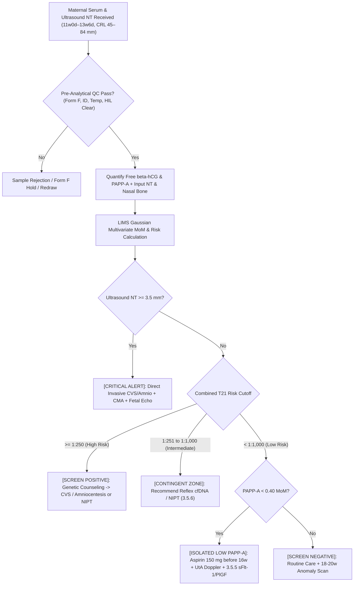

# 🧬 3.5.1 — First-Trimester Maternal Combined Dual Marker Screen (**`PAPP-A` + Free $\beta$-`hCG` + Ultrasound Nuchal Translucency [`NT`] & Nasal Bone `MoM` Risk Algorithm** — $11\text{w }0\text{d}$ to $13\text{w }6\text{d}$, `CRL` $45.0\text{–}84.0\text{ mm}$)

**Department Folder:** `03_Immunoassay_Endocrinology_and_Nutrients`  
**Cluster Folder:** `3.5_Prenatal_Maternal_Screening_and_Preeclampsia_Cluster`  
**Document Tier:** International Reference Laboratory Standard (`ISO 15189:2022` / `NABL 112` / `NABL 153` / `CAP` / `CLSI` / `EFLM` / `IFCC` / `Westgard Six Sigma` / `Indian CPA 2019` / `PC-PNDT Act 1994`)  
**Standard Operating Procedure ID:** `SOP-3-5-1-DUAL-MARKER` (Version 3.0 — Comprehensive Red-Team Upgraded Tier)  
**Effective Date:** October 2026 | **Review Cycle:** Annual | **Next Audit:** September 2027  

---

## 🏛️ Section 1: International Document Control, `LOINC`/`SNOMED`/`ICD-10`/`UCUM` Coding & Hardware-Agnostic Platform Matrix

### 1.1 Document Control & Quality Governance Metadata
| Governance Attribute | Regulatory Standard Specification & Quality Mapping |
| :--- | :--- |
| **Standard Operating Procedure Title** | First-Trimester Maternal Combined Dual Marker Screening (Free $\beta$-hCG + PAPP-A + Ultrasound NT/NB Gaussian MoM Risk Calculation) |
| **Document Control Identifier** | `SOP-3-5-1-DUAL-MARKER` (Version 3.0 — Master Clinical Implementation Tier) |
| **Accreditation Clause Traceability** | `ISO 15189:2022` Clauses 4.1–4.3 (*Governance*), 5.1–5.6 (*Resource Management*), 6.1–6.8 (*Equipment & Reagents*), 7.2 (*Pre-Examination Processes*), 7.3 (*Examination Verification, Linearity & MU*), 7.4 (*Post-Examination Reporting & Urgent Risk Alerts*), 8.5 (`ISO 22367:2020` *Risk Management*); `NABL 112`, `NABL 153` (*Scope Matrix*), `NABL 220D` & `NABL 223` (*Assessor Checklists*); `NABL 131` & `NABL 163` (*Traceability & Uncertainty*); `CAP Chemistry & Reproductive Screening Checklists` (CHM.10000–CHM.34900); Statutory `PC-PNDT Act 1994` & `DPDP Act 2023` |
| **Authorizing Laboratory Authority** | Consultant Fetal Medicine Specialist, Lead Pathologist, Laboratory Director, & Lead Quality Manager (`ISO 15189:2022` Sign-off) |
| **Metrological Traceability Standard** | World Health Organization 1st International Reference Preparation for Free $\beta$-hCG (`WHO 75/551` or `WHO 99/688`) and WHO International Reference Standard for PAPP-A (`WHO IRP 78/610`) |
| **Method Classification & Principle** | Quantitative Automated Two-Site Sandwich TRACE (Time-Resolved Amplified Cryptate Emission) or Automated Flash Chemiluminescence Immunoassay (`CLIA` / `ECLIA`) coupled with Fetal Medicine Foundation (`FMF`) / PRISCA / LifeCycle Multivariate Gaussian Likelihood Ratio Risk Engine |
| **Statutory Indian Regulatory Shield** | Mandatory Statutory Compliance under Pre-Conception and Pre-Natal Diagnostic Techniques (`PC-PNDT`) Act 1994 (Form F, Laboratory Registration, and Absolute Zero-Sex-Disclosure Shield) |

### 1.2 Multi-Terminology Coding & Universal Harmonization
| Terminology Authority | Identification Code | Authorized Nomenclature & Display Definition |
| :--- | :--- | :--- |
| **`LOINC` (Primary Panel)** | `49088-8` | First trimester maternal screen panel - Serum and Ultrasound |
| **`LOINC` (Free $\beta$-hCG MoM)** | `21197-9` | Choriogonadotropin.beta subunit.free [Multiple of the median] in Serum |
| **`LOINC` (Free $\beta$-hCG Mass)** | `21198-7` | Choriogonadotropin.beta subunit.free [Mass/volume] in Serum |
| **`LOINC` (PAPP-A MoM)** | `32046-5` | Pregnancy associated plasma protein A [Multiple of the median] in Serum |
| **`LOINC` (PAPP-A Activity/Mass)** | `2756-5` | Pregnancy associated plasma protein A [Units/volume] in Serum |
| **`LOINC` (Ultrasound NT)** | `11955-2` | Nuchal translucency [Length] in Fetus by US |
| **`LOINC` (Crown-Rump Length)** | `10515-5` | Fetal Crown Rump length [Length] by US |
| **`LOINC` (Trisomy 21 Risk)** | `69941-3` | Trisomy 21 risk in Fetus by 1st trimester maternal screen |
| **`LOINC` (Trisomy 18 Risk)** | `69942-1` | Trisomy 18 risk in Fetus by 1st trimester maternal screen |
| **`LOINC` (Trisomy 13 Risk)** | `69943-9` | Trisomy 13 risk in Fetus by 1st trimester maternal screen |
| **`SNOMED CT` (Specimen Concept)** | `119364003` | Serum specimen (Maternal venous blood) |
| **`SNOMED CT` (Procedure Concept)** | `415080005` | First trimester maternal serum screening (procedure) |
| **`SNOMED CT` (Screen Positive)** | `409712001` | Antenatal screening for Down syndrome screen positive (finding) |
| **`ICD-10-CM` Diagnostic Mapping** | `Z36.0` / `O35.10X0` | Antenatal screening for chromosomal anomalies / Maternal care for suspected fetal chromosomal abnormality |
| **`ICD-11` Diagnostic Mapping** | `QA42.0` / `JA85.0` | Antenatal screening examination / Maternal care related to fetal abnormality |
| **`UCUM` Direct Units** | `ng/mL`, `mIU/L`, `IU/L`, `mm` | Nanograms per milliliter, milli-international units per liter, international units per liter, millimeters |
| **`UCUM` Mathematical Factor** | `MoM` | Multiple of the Median (dimensionless ratio normalized for exact gestational day and maternal covariates) |

### 1.3 Mathematical Unit Interconversion & Platform Matrix
- **Free $\beta$-hCG Standard Interconversion:**
  $$\text{Free }\beta\text{-hCG (IU/L)} \approx \text{Free }\beta\text{-hCG (ng/mL)} \times 1.00 \quad (\text{WHO 75/551 standard reference preparation})$$
- **PAPP-A Standard Interconversion:**
  $$\text{PAPP-A (IU/L)} = \frac{\text{PAPP-A (mIU/L)}}{1000} \quad \Longleftrightarrow \quad \text{PAPP-A (mIU/L)} = \text{PAPP-A (IU/L)} \times 1000$$
- **Multiple of Median (`MoM`) Calculation Equation:**
  $$\text{Raw MoM} = \frac{\text{Measured Patient Serum Concentration of Analyte}}{\text{Gestational-Age Median for Unaffected Pregnancy at Given CRL}}$$
  $$\text{Adjusted MoM} = \frac{\text{Raw MoM}}{\text{CF}_{(\text{Weight})} \times \text{CF}_{(\text{Ethnicity})} \times \text{CF}_{(\text{Smoking})} \times \text{CF}_{(\text{Diabetes})} \times \text{CF}_{(\text{IVF})}}$$
- **Hardware-Agnostic Platform Matrix:**
  * **Primary Operational Platform:** Automated Two-Site TRACE (Time-Resolved Amplified Cryptate Emission; BRAHMS KRYPTOR compact PLUS) or High-Throughput Flash Chemiluminescence (`CLIA` / `ECLIA`) Analyzer coupled with certified Fetal Medicine Foundation (`FMF`) / PRISCA risk-calculation software.
  * **Backup / Redundancy Platform:** Secondary FMF-certified Chemiluminescent Immunoassay System (`CLSI EP31-A` split-sample verification executed monthly, target bias $\le 0.5 \times \text{TE}_a$).
  * **Future Platform Slot:** High-Throughput Total Laboratory Automation (`TLA`) Multi-Analyte Immunoassay Track with Direct Bidirectional Interface to FMF Cloud Calculation Engines.

---

## 🧪 Section 2: Pre-Analytical Phlebotomy, Specimen Integrity, Mandatory Ultrasound/Maternal Demographics & Statutory PC-PNDT Requisition Gate

```
========================================================================================
🚨 CRITICAL PRE-ANALYTICAL GATE: STRICT GESTATIONAL WINDOW & ULTRASOUND REQUIREMENTS
========================================================================================
1. STRICT GESTATIONAL WINDOW: 11 Weeks 0 Days to 13 Weeks 6 Days (CRL 45.0 mm to 84.0 mm).
   - NEVER calculate Dual Marker risk if CRL is < 45.0 mm or > 84.0 mm!
   - Why < 45.0 mm is invalid: Fetal organogenesis is incomplete; normal physiological nuchal
     fluid dynamics have not stabilized; marker distributions overlap excessively.
   - Why > 84.0 mm (>= 14w 0d) is invalid: Fetal posterior cervical lymphatic vessels mature
     and drain into the jugular vein, causing pathological nuchal fluid to spontaneously
     resorb (FALSE-NEGATIVE NT!). Furthermore, Free beta-hCG drops and PAPP-A plateaus,
     rendering first-trimester Gaussian likelihood algorithms clinically invalid!
2. MANDATORY ULTRASOUND NT SCAN CRITERIA (FMF LONDON / ISUOG STANDARDS):
   - Certified Sonographer: Scan must be executed by an FMF-accredited sonographer with a
     valid current annual license audit ID.
   - Strict Mid-Sagittal Section: Fetal spine downward, neutral head posture (no extension/flexion).
   - Magnification: Fetal head and thorax must occupy >= 75% of the total ultrasound screen.
   - Caliper Placement: 'On-to-on' (inner border of nuchal skin to outer border of soft tissue
     overlying cervical spine) placed at the widest translucency space with 0.1 mm precision.
   - Amnion Separation: Must clearly visualize and differentiate fetal skin from amniotic membrane.
   - Nasal Bone Evaluation: Documented as 'Present', 'Absent', or 'Not Visualized'.
3. STATUTORY PC-PNDT ACT 1994 & DPDP ACT 2023 LEGAL MANDATE (GOVERNMENT OF INDIA):
   - Mandatory statutory Form F completed, signed, and thumb-printed by patient.
   - Copy of Government Photo ID (Aadhaar / Voter ID / Passport) attached.
   - Referring Clinician's PNDT Registration Number & Ultrasound Clinic PNDT License Number.
   - ABSOLUTE PROHIBITION OF FETAL SEX DISCLOSURE: Any attempt to determine, calculate,
     infer, or disclose fetal gender is a non-bailable criminal offense under Section 5/6
     of the PC-PNDT Act, punishable by up to 5 years imprisonment and permanent license revocation.
========================================================================================
```

### 2.1 Pre-Analytical Phlebotomy & Covariate Requisition Parameters
| Parameter | Mandatory Technical Standard (`CLSI GP41-A6` / `CLSI GP44-A4` / `CLSI C56-A`) |
| :--- | :--- |
| **Acceptable Specimen Type** | Maternal venous blood collected into Gold-Top SST (Serum Separator Tube with clot activator and polymer gel) or Plain Red-Top glass/plastic tube. |
| **Strict Tube Rejections** | $\text{K}_2\text{-EDTA}$ / $\text{K}_3\text{-EDTA}$ (Lavender Top): Chelates divalent zinc ions required by PAPP-A metalloproteinase, causing severe false depression.<br>Sodium Citrate (Light Blue Top): 10% liquid citrate causes dilutional artifact; alters binding kinetics.<br>Sodium/Lithium Heparin (Green Top): Polyanionic heparin interferes with antibody binding epitopes. |
| **Order of Draw (`CLSI GP41`)** | Sequence: Blood Cultures $\to$ Citrate $\to$ **Serum SST (Tube 3)** $\to$ Heparin $\to$ EDTA $\to$ Fluoride. Invert SST gently 5–6 times immediately after venipuncture to ensure uniform clot activation. |
| **Minimum Specimen Volume** | $4.0\text{ mL}$ whole blood; minimum separated serum volume: $1.0\text{ mL}$ ($0.5\text{ mL}$ absolute analytical dead-volume dead-stop). |
| **Patient Preparation & Fasting** | Non-fasting. Avoid heavy fatty meals prior to collection to minimize lipemia. |
| **High-Dose Biotin Alert** | Patients consuming $> 5.0\text{ mg/day}$ oral Biotin (Vitamin $\text{B}_7$) must withhold supplements for $\ge 24\text{ hours}$ prior to phlebotomy to prevent streptavidin-biotin immunoassay displacement artifacts. |
| **Mandatory Demographic Fields** | **1. Exact Maternal DOB:** Chronological age at EDD establishes baseline prior age risk.<br>**2. Maternal Weight ($\text{kg}$):** Required for plasma volume dilution correction.<br>**3. Gestational Age:** Ultrasonic CRL in $\text{mm}$ (takes precedence over LMP).<br>**4. Conception Method:** Spontaneous vs. IVF/ICSI. If Donor Egg: Biological age of oocyte donor at retrieval!<br>**5. Smoking Status:** Active cigarette smoker vs. non-smoker (PAPP-A is $15\text{–}20\%$ lower in smokers).<br>**6. Maternal Diabetes:** Pre-existing Type 1 or Type 2 Insulin-Dependent Diabetes Mellitus.<br>**7. Maternal Ethnicity:** South Asian / Indian, Caucasian, Afro-Caribbean, East Asian.<br>**8. Pregnancy Type:** Singleton vs. Dichorionic Diamniotic (DCDA) vs. Monochorionic Diamniotic (MCDA) Twins. |

### 2.2 Centrifugation, Thermal Stability & The Free $\beta$-hCG Heat Dissociation Hazard
- **Clotting & Centrifugation Protocol:** Allow serum tubes to clot completely in an upright position for $30\text{ to }60\text{ minutes}$ at room temperature ($18\text{–}25^\circ\text{C}$). Centrifuge at **$1,600\text{ to }2,000 \times g$ for $10\text{ minutes}$** in a swing-out bucket rotor. Separate serum into clean secondary tubes within $< 2\text{ hours}$ of collection.
- **The Free $\beta$-hCG Heat Dissociation Trap:**
  * Intact human chorionic gonadotropin ($\text{hCG}$) is a heterodimer composed of non-covalently linked $\alpha$ and $\beta$ subunits, circulating at $500\times\text{ to }1000\times$ higher concentration than uncombined free $\beta$-hCG.
  * If unseparated whole blood or serum is stored at warm ambient temperatures ($> 25^\circ\text{C}$) for $> 8\text{ hours}$, thermal stress causes **spontaneous dissociation of intact hCG into free $\alpha$ and free $\beta$ subunits in vitro**!
  * This generates massive false elevations in measured Free $\beta$-hCG ($+50\% \text{ to } +200\%$), driving a falsely elevated Free $\beta$-hCG MoM ($> 2.0\text{ MoM}$) and triggering a **false-positive Down syndrome (Trisomy 21) alarm**!
- **Specimen Stability Specifications:**
  * **Ambient Storage ($20\text{–}25^\circ\text{C}$):** Maximum $8\text{ hours}$ from draw to centrifugation and refrigeration.
  * **Refrigerated Storage ($2\text{–}8^\circ\text{C}$):** Stable for up to $7\text{ days}$.
  * **Frozen Storage ($-20^\circ\text{C}$):** Stable for up to $3\text{ months}$ (manual defrost freezer only).
  * **Deep Frozen Storage ($-80^\circ\text{C}$):** Stable for up to $24\text{ months}$.
  * **Freeze-Thaw Cycles:** Maximum 1 cycle. Thaw rapidly at $20\text{–}25^\circ\text{C}$ with gentle inversion prior to testing.

### 2.3 Quantitative Hemolysis, Icterus, Lipemia (`HIL`) Rejection Thresholds
Assess interference objectively using automated spectrophotometric serum indices (`CLSI C56-A` / `CLSI EP07`):
- **Hemolysis (`H-Index`):** Free hemoglobin $\le 200\text{ mg/dL}$ ($2.0\text{ g/L}$). Intracellular erythrocyte proteases release peptidases that degrade PAPP-A; gross hemolysis ($H > 200\text{ mg/dL}$) mandates sample cancellation and redraw.
- **Icterus (`I-Index`):** Conjugated and unconjugated bilirubin $\le 20\text{ mg/dL}$ ($342\text{ }\mu\text{mol/L}$). Optical absorbance of bilirubin does not interfere with time-resolved cryptate or chemiluminescent emission.
- **Lipemia (`L-Index`):** Turbidity equivalent to Intralipid $\le 400\text{ mg/dL}$ ($4.0\text{ g/L}$). Severe lipemia causes steric shielding and non-specific light scattering; ultracentrifuge lipemic samples ($10,000 \times g$ for $15\text{ min}$) if replacement draw is unavailable.

---

## ⚙️ Section 3: Hardware-Agnostic Analytical SOP, Reaction Chemistry, Calibration Hierarchy (`ISO 17511`), `CLSI EP15`/`EP06`/`EP17` Verification & Six Sigma IQC

### 3.1 Reaction Chemistry & Analytical Principles
The First-Trimester Combined Dual Marker assay quantifies two distinct placental glycoproteins using automated non-competitive sandwich immunoassay architectures:

#### 1. Free $\beta$-hCG Immunoassay Architecture
- **Biochemical Specificity:** Uncombined free $\beta$-subunit of hCG contains unique sterically exposed epitopes that are buried when complexed with the common $\alpha$-subunit in intact heterodimeric hCG.
- **Immunological Sandwich Formation:** Patient serum ($20\text{–}50\text{ }\mu\text{L}$) is incubated with a high-affinity mouse monoclonal capture antibody specific for Free $\beta$-hCG (cross-reactivity with intact hCG $< 0.1\%$). A second monoclonal detection antibody labeled with Europium Cryptate (TRACE) or Isoluminol/Acridinium Ester (`CLIA`) binds an independent epitope on the $\beta$-core domain.
- **Signal Transduction:** In TRACE technology, laser excitation at $\lambda = 337\text{ nm}$ excites the donor cryptate; non-radiative energy transfers to the acceptor fluorophore (XL665) only when bound in close proximity ($< 10\text{ nm}$), emitting fluorescence at $\lambda = 665\text{ nm}$. The ratio of $665\text{ nm} / 620\text{ nm}$ signals cancels optical quenching.

#### 2. Pregnancy-Associated Plasma Protein-A (`PAPP-A`) Immunoassay Architecture
- **Biochemical Specificity:** Circulating pregnancy PAPP-A is a $500\text{ kDa}$ heterotetrameric complex ($\text{PAPP-A}_2 \cdot \text{proMBP}_2$). Monoclonal capture antibodies target the active PAPP-A metalloproteinase subunit.
- **Enzymatic Detection & Quantitation:** Monoclonal tracer antibodies bind the PAPP-A catalytic domain. Chemiluminescence or time-resolved fluorescence is directly proportional to active circulating maternal PAPP-A concentration.

### 3.2 Metrological Traceability & Calibration Hierarchy (`ISO 17511:2020`)
- **Free $\beta$-hCG Primary Reference Standard:** World Health Organization 1st International Reference Preparation (`WHO 75/551` or recombinant `WHO 99/688`), maintained by NIBSC (Potters Bar, UK).
- **PAPP-A Primary Reference Standard:** WHO International Reference Standard for Pregnancy-Associated Plasma Protein A (`WHO IRP 78/610`).
- **Calibration Curve Architecture:** 4-Parameter Logistic (`4PL`) or cubic spline master calibration curves stored in analyzer software, verified with a 2-point or multi-point product calibrator set.
- **Recalibration Frequency & Triggers:**
  1. With every new reagent cartridge lot number.
  2. Every $28\text{ days}$ (on-board calibration stability limit).
  3. Following optical, laser, or fluidic syringe maintenance.
  4. Following systematic failure or drift of Internal Quality Control rules (`2:2s` or `4:1s`).

### 3.3 Step-by-Step Bench Operational Protocol
1. **Instrument Conditioning:** Inspect daily fluidics, check liquid waste, verify wash buffers, and ensure reagent carousel temperature is maintained at $4\text{–}10^\circ\text{C}$.
2. **Reagent Homogenization:** Verify on-board microparticle suspensions are fully mixed and bubble-free.
3. **Specimen Loading & Barcode Reading:** Load patient serum tubes into sample racks. Verify bidirectional LIMS query matches patient UHID, sample barcode, and test order code (`DUAL-MARKER`).
4. **Automated Pipetting & Incubation:** Analyzer dispenses serum, assay buffer, and capture/detection reagents into optical reaction wells; incubates at $37.0^\circ\text{C} \pm 0.2^\circ\text{C}$ for assay-specific duration ($15\text{–}29\text{ min}$).
5. **Separation & Measurement:** Unbound conjugate is aspirated and washed with surfactant buffer. Emission signal (RLU or fluorescence ratio) is integrated and interpolated against master calibration.
6. **Data Transfer to Risk Engine:** Raw Free $\beta$-hCG ($\text{ng/mL}$) and PAPP-A ($\text{IU/L}$) values are automatically exported via bidirectional API to the certified prenatal risk calculation software (FMF / PRISCA / LifeCycle).
7. **LIMS Hard-Lock Gate:** Results cannot be finalized or signed out until the reviewing pathologist confirms ultrasound NT scan validity, CRL parameters, and maternal demographic covariates.

### 3.4 Method Verification Protocol (`CLSI EP15-A3`, `EP06-Ed2`, `EP17-A2`, `EP28-A3c`)
Verification executed on primary and backup analyzers prior to clinical release under `ISO 15189:2022` and `NABL 153`:
- **`CLSI EP15-A3` Precision Verification ($5\times 5$ Design, $n=25$ replicates):**
  * **Free $\beta$-hCG Level 1 ($1.5\text{ ng/mL}$ — Low Range):** Repeatability $CV_r \le 3.5\%$; Within-Laboratory $CV_{wl} \le 4.8\%$.
  * **Free $\beta$-hCG Level 2 ($25.0\text{ ng/mL}$ — Mid/High Range):** Repeatability $CV_r \le 2.8\%$; Within-Laboratory $CV_{wl} \le 3.8\%$.
  * **PAPP-A Level 1 ($0.35\text{ IU/L}$ — Low Range):** Repeatability $CV_r \le 3.4\%$; Within-Laboratory $CV_{wl} \le 4.5\%$.
  * **PAPP-A Level 2 ($2.50\text{ IU/L}$ — Normal Range):** Repeatability $CV_r \le 2.6\%$; Within-Laboratory $CV_{wl} \le 3.6\%$.
- **`CLSI EP06-Ed2` Linearity & Reportable Range:**
  * **Free $\beta$-hCG Analytical Measurement Range (`AMR`):** $0.16 \text{ to } 200.0\text{ ng/mL}$ ($0.16 \text{ to } 200.0\text{ IU/L}$). Verified with 7-level gravimetric dilution series; polynomial non-linearity bias $< 5.0\%$. Clinical Reportable Range (`CRR`) extended to $2,000.0\text{ ng/mL}$ with automated $1:10$ dilution.
  * **PAPP-A Analytical Measurement Range (`AMR`):** $0.004 \text{ to } 10.0\text{ IU/L}$ ($4 \text{ to } 10,000\text{ mIU/L}$). Verified across 7 dilution steps; linearity bias $< 5.0\%$. CRR extended to $100.0\text{ IU/L}$ with automated $1:10$ dilution.
- **`CLSI EP17-A2` Detection Capabilities:**
  * **Free $\beta$-hCG:** Limit of Blank ($\text{LoB}$) $= 0.05\text{ ng/mL}$; Limit of Detection ($\text{LoD}$) $= 0.10\text{ ng/mL}$; Limit of Quantitation ($\text{LoQ}$) $= 0.16\text{ ng/mL}$ (at $CV \le 10\%$).
  * **PAPP-A:** Limit of Blank ($\text{LoB}$) $= 0.001\text{ IU/L}$; Limit of Detection ($\text{LoD}$) $= 0.002\text{ IU/L}$; Limit of Quantitation ($\text{LoQ}$) $= 0.004\text{ IU/L}$ (at $CV \le 10\%$).
- **`CLSI EP28-A3c` Reference Median Transference:**
  Gestational median curves transferred and validated across $n=100$ unaffected first-trimester singleton pregnancies in the local North Indian population; observed median MoM confirmed between $0.95\text{ and }1.05\text{ MoM}$.

### 3.5 Internal Quality Control (`IQC`) & Westgard Six Sigma Rules
- **Three-Level IQC:** Run 3 levels of commutable, tri-level maternal screening controls (Bio-Rad Lyphochek Maternal Screening or equivalent; Low, Normal, High) every $8\text{-hour}$ shift, after recalibration, and post-maintenance.
- **Westgard Rules Implementation:**
  * Reject run on $1_{3s}$ (random error) or $2_{2s}$ (systematic error).
  * Hold patient reporting and troubleshoot on $R_{4s}$ (within-run range $> 4\text{ SD}$) or $4_{1s}$ (systematic drift).
  * Recalibrate on $10_x$ (ten consecutive runs on one side of mean).
- **External Quality Assessment (`EQAS`):** Mandatory monthly participation in accredited prenatal screening PT programs (UK NEQAS for First Trimester Screening / CAP Maternal Screening / Bio-Rad EQAS). Target SDI / Z-score: $\lvert Z \rvert < 2.0$.
- **Primary-to-Backup Analyzer Comparability (`CLSI EP31-A`):** Monthly split-sample comparison on $n=5$ patient sera across the AMR. Target bias: $\lvert\text{Bias}\rvert \le 0.5 \times \text{TE}_a$.

---

## 📊 Section 4: Metrological Traceability, `ISO/TS 20914` Measurement Uncertainty Budget, `EFLM` Biological Variation & Inter-Lot Median Stability

### 4.1 `EFLM` Biological Variation & Analytical Performance Specifications
Derived from EFLM Biological Variation pregnancy specifications and international prenatal consensus data:
- **Free $\beta$-hCG Within-Subject Variation ($CV_I$):** **$14.8\%$** (intra-individual variation in MoM units).
- **Free $\beta$-hCG Between-Subject Variation ($CV_G$):** **$34.0\%$** (inter-individual population dispersion).
- **Free $\beta$-hCG Index of Individuality ($\text{II}$):**
  $$\text{II} = \frac{CV_I}{CV_G} = \frac{14.8}{34.0} = \mathbf{0.44}$$
- **PAPP-A Within-Subject Variation ($CV_I$):** **$13.5\%$**.
- **PAPP-A Between-Subject Variation ($CV_G$):** **$31.5\%$**.
- **PAPP-A Index of Individuality ($\text{II}$):**
  $$\text{II} = \frac{CV_I}{CV_G} = \frac{13.5}{31.5} = \mathbf{0.43}$$
- **Analytical Performance Specifications:**
  * Desirable Analytical Imprecision ($CV_A$): $CV_A \le 0.50 \times CV_I \implies \text{Free }\beta\text{-hCG} \le 4.0\%$; $\text{PAPP-A} \le 3.5\%$.
  * Desirable Analytical Bias ($B$): $B \le 0.25 \times \sqrt{CV_I^2 + CV_G^2} \implies \text{Free }\beta\text{-hCG} \le 3.8\%$; $\text{PAPP-A} \le 3.6\%$.
  * Total Allowable Error ($\text{TE}_a$): $\text{TE}_a = 1.65 \times CV_A + \lvert B \rvert \implies \mathbf{\pm 12.0\%}$ (aligned with CAP and EFLM prenatal standards).
- **Six Sigma Metric:**
  $$\text{Sigma} = \frac{\text{TE}_a - \lvert\text{Bias}\rvert}{CV_A} = \frac{12.0\% - 2.5\%}{2.8\%} = \frac{9.5}{2.8} = \mathbf{3.39 \text{ Sigma}}$$

### 4.2 `ISO/TS 20914:2019` Detailed Measurement Uncertainty (`MU`) Budget
Combined uncertainty budget calculated for Free $\beta$-hCG at $25.0\text{ ng/mL}$ and PAPP-A at $1.50\text{ IU/L}$:
| Uncertainty Component | Source of Uncertainty | Probability Distribution | Standard Uncertainty $u(x_i)\%$ | Sensitivity Coefficient $c_i$ | Combined Contribution $u_i(y)\%$ |
| :--- | :--- | :---: | :---: | :---: | :---: |
| **Calibrator Uncertainty $u(cal)$** | Value assignment of WHO 75/551 & WHO 78/610 | Normal | $1.80\%$ | $1.0$ | $1.80\%$ |
| **Intermediate Precision $u(R_w)$** | Within-laboratory long-term precision ($20\text{ days}$) | Normal | $3.10\%$ | $1.0$ | $3.10\%$ |
| **Bias Uncertainty $u(bias)$** | Residual trueness bias from EQAS / PT peer mean | Rectangular | $1.40\% / \sqrt{3} = 0.81\%$ | $1.0$ | $0.81\%$ |
| **Gestational Age / CRL Uncertainty $u(crl)$** | Caliper measurement variance ($\pm 1.0\text{ mm}$ CRL) | Triangular | $2.50\% / \sqrt{6} = 1.02\%$ | $1.0$ | $1.02\%$ |
| **Maternal Weight Covariate $u(wt)$** | Scale calibration and weight entry variance ($\pm 1\text{ kg}$) | Rectangular | $0.80\% / \sqrt{3} = 0.46\%$ | $1.0$ | $0.46\%$ |
| **Volumetric Pipetting $u(vol)$** | Automated pipetting syringe repeatability | Rectangular | $0.50\% / \sqrt{3} = 0.29\%$ | $1.0$ | $0.29\%$ |

- **Combined Standard Uncertainty ($u_c$):**
  $$u_c = \sqrt{(1.80)^2 + (3.10)^2 + (0.81)^2 + (1.02)^2 + (0.46)^2 + (0.29)^2} = \sqrt{3.24 + 9.61 + 0.66 + 1.04 + 0.21 + 0.08} = \sqrt{14.84} = \mathbf{3.85\%}$$
- **Expanded Measurement Uncertainty ($U$ at $95.45\%$ Confidence, $k=2$):**
  $$U = k \times u_c = 2 \times 3.85\% = \mathbf{\pm 7.70\%} \quad (\text{Conservative SOP ceiling: } \mathbf{\pm 8.0\%})$$

### 4.3 Mandatory Monthly Inter-Lot Median Stability Monitoring (The 1.00 MoM Audit)
- **Clinical Hazard of Assay Drift:** In prenatal screening, a mere **$10\%$ systematic calibration shift or inter-lot reagent drift causes a $1.5\text{–}2.0\%$ shift in the overall screen-positive rate**, falsely subjecting hundreds of healthy pregnancies to invasive amniocentesis or missing affected fetuses!
- **Mandatory Quality Protocol:**
  1. The laboratory must calculate and plot the **moving median of patient MoMs** for Free $\beta$-hCG and PAPP-A monthly (minimum $n \ge 50$ unaffected singleton screening results).
  2. The target median MoM must remain between **$0.95\text{ and }1.05\text{ MoM}$**.
  3. If median MoM drifts outside $0.90\text{–}1.10\text{ MoM}$, an immediate investigation is triggered: inspect reagent lot changes, verify water quality, audit sonographer NT measurement trends, and recalibrate if necessary.

---

## 🧬 Section 5: Comprehensive Multi-Stratified Biological Reference Intervals & Gestational Median Progression

### 5.1 First-Trimester Gestational Median Progression Table by CRL ($45.0\text{ to }84.0\text{ mm}$)
Medians established for healthy singleton unaffected pregnancies in the Indian subcontinent (standardized to $60\text{ kg}$ non-smoking female):
| Fetal CRL ($\text{mm}$) | Corresponding Gestational Age | Free $\beta$-hCG Expected Median ($\text{ng/mL}$ or $\text{IU/L}$) | PAPP-A Expected Median ($\text{IU/L}$) | Ultrasound NT 50th Percentile ($\text{mm}$) | Ultrasound NT 95th Percentile ($\text{mm}$) | Ultrasound NT 99th Percentile ($\text{mm}$) |
| :---: | :---: | :---: | :---: | :---: | :---: | :---: |
| **$45.0\text{–}49.9$** | $11\text{w }0\text{d} \text{ – } 11\text{w }3\text{d}$ | $52.4$ | $0.78$ | $1.2$ | $1.8$ | $2.2$ |
| **$50.0\text{–}54.9$** | $11\text{w }4\text{d} \text{ – } 11\text{w }6\text{d}$ | $46.8$ | $1.15$ | $1.3$ | $1.9$ | $2.3$ |
| **$55.0\text{–}59.9$** | $12\text{w }0\text{d} \text{ – } 12\text{w }2\text{d}$ | $41.2$ | $1.65$ | $1.4$ | $2.0$ | $2.5$ |
| **$60.0\text{–}64.9$** | $12\text{w }3\text{d} \text{ – } 12\text{w }5\text{d}$ | $35.6$ | $2.32$ | $1.5$ | $2.1$ | $2.6$ |
| **$65.0\text{–}69.9$** | $12\text{w }6\text{d} \text{ – } 13\text{w }1\text{d}$ | $30.5$ | $3.18$ | $1.6$ | $2.2$ | $2.7$ |
| **$70.0\text{–}74.9$** | $13\text{w }2\text{d} \text{ – } 13\text{w }3\text{d}$ | $26.1$ | $4.25$ | $1.7$ | $2.3$ | $2.8$ |
| **$75.0\text{–}79.9$** | $13\text{w }4\text{d} \text{ – } 13\text{w }5\text{d}$ | $22.4$ | $5.52$ | $1.8$ | $2.4$ | $2.9$ |
| **$80.0\text{–}84.0$** | $13\text{w }6\text{d}$ | $19.2$ | $6.95$ | $1.9$ | $2.5$ | $3.0$ |

*Physiological Note:* Notice the inverse trajectory: Free $\beta$-hCG declines steadily with advancing gestational age (from $52.4\text{ ng/mL}$ at $11\text{w}$ to $19.2\text{ ng/mL}$ at $13\text{w}6\text{d}$), whereas PAPP-A rises exponentially (doubling every $3\text{–}4\text{ days}$, from $0.78\text{ IU/L}$ to $6.95\text{ IU/L}$). This demonstrates why exact gestational dating via ultrasound CRL is mathematically non-negotiable!

### 5.2 Aneuploidy & Placental Pathological Pattern Matrix
| Clinical Entity / Aneuploidy Signature | Free $\beta$-hCG MoM | PAPP-A MoM | Ultrasound NT | Fetal Nasal Bone | Typical Combined Risk Profile & Clinical Action |
| :--- | :---: | :---: | :---: | :---: | :--- |
| **Normal Unaffected Singleton** | $\approx 1.00\text{ MoM}$ ($0.50\text{–}2.00$) | $\approx 1.00\text{ MoM}$ ($\ge 0.40$) | $< 95\text{th}$ percentile ($< 2.5\text{ mm}$) | Present ($98\text{–}99\%$) | **Low Risk ($< 1:1,000$):** Routine antenatal care; 18–20w anomaly scan. |
| **Trisomy 21 (Down Syndrome)** | **Elevated** ($\approx 1.98\text{–}2.10\text{ MoM}$) | **Decreased** ($\approx 0.43\text{–}0.48\text{ MoM}$) | **Increased** ($\ge 2.5\text{–}3.5\text{ mm}$) | Absent ($60\text{–}70\%$) | **High Risk ($\ge 1:250$):** Offer diagnostic CVS / Amniocentesis or cfDNA/NIPT. |
| **Trisomy 18 (Edwards Syndrome)** | **Profoundly Low** ($< 0.25\text{–}0.33\text{ MoM}$) | **Profoundly Low** ($< 0.15\text{–}0.25\text{ MoM}$) | **Increased** ($\ge 3.0\text{ mm}$) | Absent / Hypoplastic | **High Risk ($\ge 1:100$):** Urgent invasive diagnostic testing; detailed structural scan. |
| **Trisomy 13 (Patau Syndrome)** | **Profoundly Low** ($< 0.30\text{–}0.38\text{ MoM}$) | **Profoundly Low** ($< 0.20\text{–}0.28\text{ MoM}$) | **Increased** ($\ge 3.0\text{ mm}$) | Absent / Hypoplastic | **High Risk ($\ge 1:100$):** Holoprosencephaly, exomphalos; urgent diagnostic CVS/amnio. |
| **Turner Syndrome ($45,\text{X}$)** | **Normal / Mildly High** ($\approx 1.10\text{ MoM}$) | **Decreased** ($\approx 0.50\text{ MoM}$) | **Massive** ($\ge 4.0\text{–}10.0\text{ mm}$, hygroma) | Normal / Present | Cystic hygroma, fetal hydrops; invasive testing with karyotype/microarray. |
| **Triploidy: Diandric (Type I — Paternal)** | **Extreme High** ($> 5.0\text{–}10.0\text{ MoM}$) | **Mildly Low** ($\approx 0.70\text{ MoM}$) | **Markedly Increased** | Variable | Partial hydatidiform mole; enlarged multicystic placenta; severe preeclampsia risk. |
| **Triploidy: Digynic (Type II — Maternal)** | **Profoundly Low** ($< 0.10\text{ MoM}$) | **Profoundly Low** ($< 0.10\text{ MoM}$) | Normal or Slightly High | Variable | Small non-cystic placenta, severe early asymmetrical FGR, lethal anomaly. |
| **Isolated Low PAPP-A ($< 0.40\text{ MoM}$)** | Normal ($\approx 1.00\text{ MoM}$) | **Low** ($< 0.40\text{ MoM} \text{ / } < 5\text{th}\%$) | Normal ($< 2.5\text{ mm}$) | Present | **Placental Insufficiency:** Early preeclampsia, FGR, stillbirth; start Aspirin $< 16\text{w}$. |

---

## 🚨 Section 6: NABL & `CLSI GP47` Critical ("Panic") Values, Urgent Action Thresholds & 30-Minute Read-Back Protocol

```
========================================================================================
🚨 NABL / CLSI GP47 MANDATORY PRENATAL CRITICAL ALERT TELEPHONE READ-BACK SCRIPT
========================================================================================
"This is [Technologist / Pathologist Name] from the Prenatal Screening Reference Laboratory.
I have an URGENT NABL / CLSI GP47 CRITICAL PRENATAL ALERT for patient [Full Name],
UHID [Hospital ID], referred by Dr. [Obstetrician Name].

CRITICAL FINDING:
• Screen Parameter: [Combined Trisomy 21 Risk >= 1:50 OR Ultrasound NT >= 3.5 mm OR PAPP-A < 0.15 MoM]
• Exact Result: Posterior Risk = [1:XX], Ultrasound NT = [X.X mm], PAPP-A = [X.XX MoM]
• Gestational Window: CRL is currently [XX.X mm] (Gestational Age: [XXw XXd]).
• Clinical Action Gate: Timely Fetal Medicine consultation is urgently required because the
  window for Chorionic Villus Sampling (CVS, 11w0d to 13w6d) is actively closing!

Please read back the patient's full name, UHID, exact risk ratio, and numerical values."
========================================================================================
```

### 6.1 Critical ("Panic") & Urgent Action Thresholds
| Alert Category | Parameter & Cutoff Value | Clinical Pathophysiological Risk | Mandatory Regulatory Action (`ISO 15189:2022` Clause 7.4.1.6) |
| :--- | :--- | :--- | :--- |
| **Tier-1 Critical HIGH ("Panic")** | **Ultrasound $\text{NT} \ge 3.5\text{ mm}$** ($\ge 99\text{th}$ percentile for CRL) regardless of biochemical MoM | Severe fetal aneuploidy, major congenital heart defects, Noonan syndrome, diaphragmatic hernia, skeletal dysplasia. | **Telephone Read-Back within $\le 30\text{ minutes}$.** Recommend urgent Fetal Medicine consult for diagnostic CVS + Chromosomal Microarray (`CMA`) + fetal echocardiography at 16w. |
| **Tier-1 Critical HIGH (Aneuploidy)** | **Combined Trisomy 21 Risk $\ge 1:50$** OR **Trisomy 18/13 Risk $\ge 1:50$** | High probability of non-disjunction trisomy; urgent decision required before CVS gestational window closes ($14\text{w }0\text{d}$). | **Telephone Read-Back within $\le 30\text{ minutes}$.** Document read-back in NABL Critical Value Register; expedite genetic counseling and diagnostic testing. |
| **Tier-1 Critical LOW (Biochemical)**| **$\text{PAPP-A} < 0.15\text{ MoM}$** OR **Both PAPP-A and Free $\beta$-hCG $< 0.20\text{ MoM}$** | High suspicion of Trisomy 18, Trisomy 13, Digynic Triploidy, or severe catastrophic early placental failure. | **Telephone Read-Back within $\le 30\text{ minutes}$.** Urgent comprehensive anomaly ultrasound and invasive chromosomal evaluation. |
| **Tier-2 Urgent Action Range** | **Screen Positive: Combined T21 Risk $1:51 \text{ to } 1:250$** | Exceeds standard high-risk screening threshold ($1:250$); indicates invasive testing or cfDNA/NIPT. | Expedited electronic report release and SMS alert to referring obstetrician within $< 2\text{ hours}$. |
| **Tier-2 Urgent Action Range** | **Isolated Low $\text{PAPP-A} < 0.40\text{ MoM}$** ($< 5\text{th}$ percentile) with Low Aneuploidy Risk | Impaired trophoblast invasion; independent predictor of early-onset preeclampsia, FGR, and placental abruption. | Conditional pathologist comment auto-appended; recommend Aspirin $150\text{ mg}$ nightly initiated before $16\text{w}$ (ASPRE protocol) and uterine artery Doppler. |

---

## 🔬 Section 7: First-Trimester Dual Marker Biochemistry, Molecular Endocrinology, Kinetic Dynamics & Differential Diagnosis

### 7.1 Free $\beta$-hCG Biochemistry, Genetics & Kinetic Dynamics
- **Molecular Structure & Gene Locus:** Free $\beta$-hCG is the uncombined monomeric $\beta$-subunit of human chorionic gonadotropin, comprising 145 amino acids and approximately $22.2\text{ kDa}$ (core peptide $15.5\text{ kDa}$ plus $6$ carbohydrate chains). It is encoded by a cluster of six non-allelic genes (*CGB1, CGB2, CGB3, CGB5, CGB7, CGB8*) located on Chromosome 19q13.3.
- **Trophoblastic Synthesis & Secretion:** Synthesized predominantly by non-differentiated villous cytotrophoblast cells. In normal early placentation, as cytotrophoblasts differentiate and fuse into multinucleated syncytiotrophoblasts, the synthesis of $\alpha$ and $\beta$ subunits is tightly coupled, producing intact dimeric hCG. Only a small fraction ($< 1\%$) escapes as uncombined Free $\beta$-hCG.
- **Pathophysiology in Trisomy 21 (Down Syndrome):**
  * In Trisomy 21, supernumerary genetic dosage impairs normal syncytiotrophoblast differentiation, leading to persistent cytotrophoblastic immaturity and disordered subunit assembly.
  * Cytotrophoblast cells continue to overexpress and constitutively secrete uncombined free $\beta$-subunits into maternal blood, resulting in a **doubling of circulating maternal Free $\beta$-hCG ($\approx 2.0\text{ MoM}$)**.
  * Free $\beta$-hCG demonstrates significantly superior separation between normal and Down syndrome pregnancies in the first trimester ($11\text{–}13\text{w}$) compared to intact hCG, making Free $\beta$-hCG the international marker of choice.
- **In-Vivo Kinetics & Clearance:** Plasma half-life of Free $\beta$-hCG is approximately **$4\text{ hours}$** (compared to intact hCG half-life of $24\text{–}36\text{ hours}$), reflecting rapid renal glomerular filtration of the uncombined monomer.

### 7.2 PAPP-A Biochemistry, Metalloproteinase Function & Placental Invasion
- **Molecular Complex & Genetics:** Pregnancy-Associated Plasma Protein-A (`PAPP-A`) is a high-molecular-weight zinc metalloproteinase belonging to the metzincin superfamily, encoded by the *PAPPA* gene on Chromosome 9q33.1. In maternal circulation, PAPP-A exists as a $500\text{ kDa}$ covalent heterotetramer composed of two $200\text{ kDa}$ PAPP-A subunits disulfide-linked to two $50\text{–}70\text{ kDa}$ subunits of the proform of eosinophil major basic protein (`proMBP`), which acts as an endogenous physiological inhibitor.
- **The IGFBP-4 / Free IGF-2 Signaling Axis:**
  * Active PAPP-A specifically cleaves Insulin-like Growth Factor-Binding Protein 4 (`IGFBP-4`), releasing bioavailable free **$\text{IGF-2}$ (and $\text{IGF-1}$)**.
  * Free $\text{IGF-2}$ binds to the $\text{IGF-1}$ receptor on extravillous trophoblasts, stimulating deep endovascular and interstitial invasion into the maternal decidua and remodeling uterine spiral arteries into low-resistance, high-capacitance vascular conduits.
- **Pathophysiology in Trisomies & Placental Insufficiency:**
  * In Trisomy 21, placental hypoplasia and delayed villous branching reduce PAPP-A synthesis, resulting in **marked suppression ($\approx 0.43\text{–}0.48\text{ MoM}$)**.
  * In Trisomy 18 and Trisomy 13, severe trophoblastic hypoplasia causes **profound PAPP-A depression ($< 0.15\text{–}0.25\text{ MoM}$)**.
  * **Isolated Low PAPP-A (< 0.40 MoM):** When fetal chromosomes are normal, low PAPP-A directly reflects defective early trophoblastic invasion and failure of spiral artery transformation. This causes chronic placental ischemia later in pregnancy, clinically manifesting as **early-onset preeclampsia, severe fetal growth restriction (`FGR`), placental abruption, and preterm birth**.

### 7.3 Nuchal Translucency (`NT`) Fluid Dynamics & Secondary Sonographic Soft Markers
- **Physiology of Nuchal Fluid:** Subcutaneous fluid behind the fetal neck normally accumulates due to transient physiological imbalance between fetal lymphatic development and systemic venous drainage.
- **Mechanisms of NT Thickening ($\ge 3.0\text{–}3.5\text{ mm}$):**
  1. *Fetal Cardiac Dysfunction:* Overexpression of cardiac genes (e.g., *COL6A1* in T21) or structural defects (AVSD, Coarctation) causes early cardiac failure and systemic venous congestion.
  2. *Extracellular Matrix Abnormalities:* Overexpression of matrix proteins (Collagen Type VI) increases subcutaneous hydration and lymphatic distension.
  3. *Lymphatic Hypoplasia / Delayed Connection:* Jugular lymphatic sacs fail to establish communication with the internal jugular vein.
- **Secondary Sonographic Markers:**
  * **Fetal Nasal Bone:** Absent in $60\text{–}70\%$ of fetuses with Trisomy 21 and only $1\text{–}3\%$ of euploid fetuses (Likelihood Ratio when absent: $\approx 30\text{–}50$; LR when present: $\approx 0.25$).
  * **Ductus Venosus Doppler:** Reversed a-wave indicates elevated right atrial pressure (LR $\approx 4\text{–}6$).
  * **Tricuspid Regurgitation:** Present in $55\%$ of T21 fetuses vs. $1\%$ of euploid fetuses (LR $\approx 55$).

### 7.4 Comprehensive Differential Diagnosis Matrix
| Competing Diagnostic Entity | Free $\beta$-hCG MoM | PAPP-A MoM | Ultrasound NT | Nasal Bone | Key Discriminators & Confirmatory Modalities |
| :--- | :---: | :---: | :---: | :---: | :--- |
| **Trisomy 21 (Down Syndrome)** | **$\uparrow\uparrow \approx 2.0$** | **$\downarrow\downarrow \approx 0.45$** | **$\uparrow\uparrow \ge 2.5\text{ mm}$** | Absent in $65\%$ | CVS / Amnio with QF-PCR & Karyotype shows $47,\text{XX},+21$ or $47,\text{XY},+21$. |
| **Trisomy 18 (Edwards Syndrome)** | **$\downarrow\downarrow\downarrow < 0.25$** | **$\downarrow\downarrow\downarrow < 0.20$** | **$\uparrow\uparrow \ge 3.0\text{ mm}$** | Absent / Small | Severe growth restriction, micrognathia, overlapping fingers, omphalocele; Karyotype $47,+18$. |
| **Trisomy 13 (Patau Syndrome)** | **$\downarrow\downarrow\downarrow < 0.30$** | **$\downarrow\downarrow\downarrow < 0.25$** | **$\uparrow\uparrow \ge 3.0\text{ mm}$** | Absent / Small | Holoprosencephaly, fetal tachycardia ($> 170\text{ bpm}$), polydactyly; Karyotype $47,+13$. |
| **Turner Syndrome ($45,\text{X}$)** | $\approx 1.0\text{–}1.2$ | $\downarrow \approx 0.50$ | **$\uparrow\uparrow\uparrow \ge 5\text{ mm}$** | Normal | Septated cystic hygroma, generalized hydrops; Karyotype $45,\text{X}$. |
| **Diandric Triploidy (Type I)** | **$\uparrow\uparrow\uparrow\uparrow > 5.0$** | $\approx 0.70$ | **$\uparrow\uparrow \ge 3.0\text{ mm}$** | Normal | Partial mole, cystic placenta, symmetrical fetal growth; Karyotype $69,\text{XXY}$. |
| **Digynic Triploidy (Type II)** | **$\downarrow\downarrow\downarrow\downarrow < 0.10$** | **$\downarrow\downarrow\downarrow\downarrow < 0.10$** | Normal / $\uparrow$ | Variable | Severe early asymmetric FGR, tiny dysplastic placenta; Karyotype $69,\text{XXY}$. |
| **Isolated Placental Insufficiency**| Normal ($\approx 1.0$) | **$\downarrow\downarrow < 0.40$** | Normal ($< 2.5\text{ mm}$) | Present | Chromosomes normal; high uterine artery PI; early preeclampsia / FGR risk. |
| **Underestimated Gestational Age** | $\uparrow\uparrow$ (looks high) | $\downarrow\downarrow$ (looks low) | Discordant | Present | Incorrect LMP dating; correct by repeat ultrasound CRL measurement! |

---

## ⚖️ Section 8: The Combined Risk Calculation Engine (FMF Algorithm), Likelihood Ratios & Triaging Strategy

### 8.1 Prior Maternal Age Risk Formulation
The calculation begins with the prior baseline risk derived from maternal age at estimated date of delivery (EDD) and gestational age:
$$\text{Prior Odds} = \frac{\text{Prior Risk}}{1 - \text{Prior Risk}}$$
- In spontaneous conceptions: Prior risk is based on maternal age at EDD.
- **In Donor-Egg IVF Conceptions:** The calculation **MUST utilize the biological age of the Oocyte Donor at egg retrieval**, NOT the recipient mother's chronological age (e.g., a 44-year-old mother using eggs from a 23-year-old donor has the baseline aneuploidy risk of a 23-year-old: $1:1,400$, NOT $1:35$!).

### 8.2 Multivariate Gaussian Likelihood Ratio (`LR`) Integration
Raw analyte concentrations and ultrasound NT are converted into normalized Multiples of the Median (`MoM`), adjusted for maternal weight, ethnicity, smoking, diabetes, and IVF. Posterior odds are calculated by successive multiplication of Likelihood Ratios:
$$\text{Posterior Odds} = \text{Prior Odds} \times \text{LR}_{(\text{NT MoM})} \times \text{LR}_{(\text{Free }\beta\text{-hCG MoM}, \text{ PAPP-A MoM})} \times \text{LR}_{(\text{Nasal Bone})}$$
$$\text{Posterior Risk} = \frac{\text{Posterior Odds}}{1 + \text{Posterior Odds}}$$

```
                                  [ PRIOR AGE RISK ]
                             (Based on Maternal or Donor Age)
                                          |
                                          v
                              x LR (Ultrasound NT MoM)
                                          |
                                          v
                    x LR (Free beta-hCG MoM & PAPP-A MoM Bivariate)
                                          |
                                          v
                            x LR (Fetal Nasal Bone Status)
                                          |
                                          v
                                 [ POSTERIOR RISK ]
```

### 8.3 Triaging Cutoffs & Fetal Medicine Action Matrix
| Risk Category | Posterior Risk Cutoff | Detection Rate / FPR | Mandatory Clinical & Diagnostic Triaging Protocol |
| :--- | :---: | :---: | :--- |
| **High Risk (Screen Positive)** | **$\ge 1:250$** (or $\ge 1:150$ per local protocol) | Detection Rate: **$85\text{–}90\%$** at $5\%$ FPR (**$90\text{–}95\%$** with Nasal Bone) | **1. Urgent Genetic Counseling:** Explain that screen-positive $\ne$ affected fetus.<br>**2. Diagnostic Invasive Testing:** Offer Chorionic Villus Sampling (`CVS`, $11\text{–}14\text{w}$) or Amniocentesis ($\ge 15\text{w}$) for QF-PCR + Chromosomal Microarray (`CMA`).<br>**3. Exception for NT $\ge 3.5\text{ mm}$:** Direct CVS/Amnio with CMA is mandatory! cfDNA/NIPT is NOT recommended as primary standalone because NIPT misses microdeletions and Noonan syndrome. |
| **Intermediate Risk (Contingent Zone)** | **$1:251 \text{ to } 1:1,000$** | Identifies the subtle aneuploidy cohort | **Contingent Cell-Free Fetal DNA (`cfDNA` / `NIPT`, Cluster `3.5.6`):** Highly cost-effective; reflex NIPT captures $> 99\%$ of remaining Down syndrome cases while avoiding unnecessary invasive procedure losses. |
| **Low Risk (Screen Negative)** | **$< 1:1,000$** | Residual risk $< 0.1\%$ | **Routine Antenatal Care:** Reassure patient. Remind that first-trimester screening does not evaluate Open Neural Tube Defects (`ONTD`); recommend routine mid-trimester detailed anomaly ultrasound scan at $18\text{–}20\text{ weeks}$ (plus optional Maternal Serum AFP, Cluster `3.5.4`). |

---

## ⚠️ Section 9: Comprehensive Analytical, Pre-Analytical & Pharmacological Interferences + `ISO 22367:2020` Quantitative FMEA Risk Shield

### 9.1 Analytical, Demographic & Pharmacological Interference Matrix
| Interfering Factor / Condition | Mechanism of Bias | Direction of Bias | Mandatory Laboratory Mitigation Protocol |
| :--- | :--- | :---: | :--- |
| **Specimen Warm Storage ($> 25^\circ\text{C} > 8\text{h}$)** | Heat dissociation of intact hCG into free $\beta$-subunits | $\uparrow\uparrow\uparrow$ False-High Free $\beta$-hCG | Immediate refrigeration at $2\text{–}8^\circ\text{C}$; reject unseparated warm serum stored $> 8\text{ hours}$. |
| **Omission of IVF/ICSI on Requisition** | IVF naturally lowers PAPP-A by $15\%$ and raises Free $\beta$-hCG by $15\%$ | $\uparrow\uparrow$ False-Positive T21 Risk | Mandatory requisition checkbox for IVF; apply IVF-specific MoM correction factor in software. |
| **Omission of Maternal Weight ($\text{kg}$)** | High plasma volume in obese women dilutes markers; low volume in thin women concentrates them | Severe distortion of MoM | Mandatory weight measurement on calibrated medical scale; LIMS locks calculation if weight is omitted. |
| **Active Cigarette Smoking** | Smoking suppresses syncytiotrophoblast PAPP-A synthesis by $15\text{–}20\%$ | $\downarrow\downarrow$ False Low PAPP-A | Mandatory smoking status field; algorithm applies $1.18\times$ adjustment factor to smoker PAPP-A MoM. |
| **Vanishing Twin Syndrome** | Demised co-twin trophoblast continues shedding Free $\beta$-hCG & PAPP-A for up to $8\text{ weeks}$ | Unpredictable MoM distortion | Dual marker biochemistry is unreliable; rely primarily on surviving twin NT + ultrasound, or reflex to NIPT. |
| **High-Dose Biotin ($> 5\text{ mg/day}$)** | Displaces streptavidin-biotinylated reagents in CLIA capture | Variable False-Low / False-High | Instruct patient to withhold biotin supplements for $\ge 24\text{ hours}$ prior to phlebotomy. |
| **Heterophile Antibodies / HAMA** | Bridging mouse monoclonal capture and detection antibodies | False elevation of analytes | Use blocking tubes (HBT); verify with serial dilution linearity check. |

### 9.2 `ISO 22367:2020` Failure Mode and Effects Analysis (`FMEA`) Risk Table
Risk Priority Number ($\text{RPN} = \text{Severity } [S] \times \text{Occurrence } [O] \times \text{Detection } [D]$, scored $1\text{ to }10$):
| Failure Mode Identifier & Clinical Risk Scenario | $S$ | $O$ | $D$ | Pre-CAPA $\text{RPN}$ | Mandatory Corrective & Preventive Action (`CAPA`) & LIMS Hard-Lock Control | Post-CAPA $\text{RPN}$ |
| :--- | :---: | :---: | :---: | :---: | :--- | :---: |
| **`FMEA-3.5.1-A`:** Dual Marker calculated for fetus with $\text{CRL } 42\text{ mm}$ ($10\text{w }3\text{d}$); algorithms invalid, generating false-positive panic. | 8 | 4 | 2 | **64** | **LIMS Boundary Hard-Lock:** Software automatically blocks risk calculation and generates rejection flag if CRL is $< 45.0\text{ mm}$ or $> 84.0\text{ mm}$. | **8** ($8 \times 1 \times 1$) |
| **`FMEA-3.5.1-B`:** Donor-egg IVF pregnancy evaluated using 43-year-old mother's DOB instead of 24-year-old donor's DOB, triggering false $1:25$ risk. | 9 | 4 | 2 | **72** | **Mandatory Conception Gate:** If 'IVF with Donor Egg' is checked, software mandates entry of 'Donor DOB at Retrieval' and locks recipient DOB out of prior risk calculation. | **9** ($9 \times 1 \times 1$) |
| **`FMEA-3.5.1-C`:** Uncertified sonographer performs NT scan; incorrect caliper placement ($+0.8\text{ mm}$ overestimation) drives false high-risk screen. | 8 | 5 | 2 | **80** | **FMF License Audit Verification:** LIMS maintains database of active FMF sonographer license numbers; report prints sonographer accreditation audit ID. | **16** ($8 \times 2 \times 1$) |
| **`FMEA-3.5.1-D`:** Blood sample transported in non-air-conditioned courier van ($38^\circ\text{C}$); intact hCG dissociates, falsely doubling Free $\beta$-hCG. | 9 | 4 | 2 | **72** | **Cold-Chain Logistics:** Mandate insulated specimen transport containers with calibrated temperature data-loggers ($2\text{–}8^\circ\text{C}$). Reject samples arriving at $> 25^\circ\text{C}$. | **9** ($9 \times 1 \times 1$) |
| **`FMEA-3.5.1-E`:** Statutory PC-PNDT Form F incomplete or missing; laboratory exposed to statutory prosecution and facility sealing. | 10 | 3 | 1 | **30** | **Statutory Physical Gate:** Phlebotomy accessioning strictly forbids barcode generation without verified Form F, Government ID, and ultrasound clinic PNDT license. | **10** ($10 \times 1 \times 1$) |
| **`FMEA-3.5.1-F`:** Technologist transposes maternal weight ($85\text{ kg}$ entered as $58\text{ kg}$), falsely raising calculated PAPP-A MoM and masking high-risk T21. | 9 | 3 | 2 | **54** | **Dual Independent Data Verification:** Technologist and Pathologist must independently verify and sign off on all demographic inputs prior to report release. | **9** ($9 \times 1 \times 1$) |

---

## 💬 Section 10: Conditional Band-Specific Pathologist Sign-Out Library & Smart LIMS Reflex Diagnostic Decision Rules

### 10.1 Automated Rules-Based Pathologist Sign-Out Comments
| Result Band Code | Numerical Trigger Criteria | Automated Pathologist Sign-Out Comment |
| :--- | :--- | :--- |
| **`[BAND-LOW-RISK]`** | Combined Trisomy 21 Risk $< 1:1,000$ AND Trisomy 18/13 Risk $< 1:1,000$ (with PAPP-A $\ge 0.40\text{ MoM}$ and NT $< 3.0\text{ mm}$) | *"SCREEN NEGATIVE (LOW RISK) FIRST-TRIMESTER COMBINED DUAL MARKER: The calculated posterior risk for Trisomy 21, Trisomy 18, and Trisomy 13 is significantly lower than the screening decision thresholds. Interpretation Note: This is a statistical screening test and does not guarantee the absence of chromosomal or structural anomalies. First-trimester screening does not evaluate Open Neural Tube Defects (Spina Bifida); a routine detailed mid-trimester Fetal Anomaly Ultrasound Scan at 18–20 weeks (and optional Second-Trimester Maternal Serum AFP, Cluster 3.5.4) is recommended."* |
| **`[BAND-INTERMEDIATE-RISK]`** | Combined Trisomy 21 Risk $1:251 \text{ to } 1:1,000$ (Contingent Grey Zone) | *"[INTERMEDIATE RISK FIRST-TRIMESTER DUAL MARKER (1:251 to 1:1,000)]: This pregnancy falls within the Fetal Medicine Foundation contingent screening intermediate-risk band. To achieve >99% detection without invasive procedure risk, Cell-Free Fetal DNA Non-Invasive Prenatal Testing (cfDNA / NIPT, Cluster 3.5.6) is recommended as the next secondary screening step, or alternatively, integrate second-trimester Quadruple Marker testing (Cluster 3.5.2). Discuss with your obstetrician."* |
| **`[BAND-HIGH-RISK-T21]`** | Combined Trisomy 21 Risk $\ge 1:250$ (with Ultrasound NT $< 3.0\text{ mm}$) | *"[SCREEN POSITIVE (HIGH RISK) FOR TRISOMY 21 / DOWN SYNDROME]: Communicated to treating Obstetrician. Medico-Legal & Clinical Note: A screen-positive result indicates an increased statistical probability and is NOT a definitive diagnosis (the majority of screen-positive fetuses are chromosomally normal). Urgent Fetal Medicine consultation is advised to discuss definitive diagnostic testing via Chorionic Villus Sampling (CVS, 11w0d to 13w6d) or Amniocentesis (>=15w) with QF-PCR and Chromosomal Microarray (CMA). Cell-Free DNA (NIPT, Cluster 3.5.6) may be considered if invasive testing is declined."* |
| **`[BAND-HIGH-RISK-T18-T13]`** | Combined Trisomy 18 or Trisomy 13 Risk $\ge 1:100$ OR Both Markers $< 0.20\text{ MoM}$ | *"[SCREEN POSITIVE (HIGH RISK) FOR TRISOMY 18 / TRISOMY 13]: Markedly depressed PAPP-A and Free beta-hCG levels generate a high risk for Edwards or Patau syndrome. Urgent Fetal Medicine consultation is recommended for targeted high-resolution fetal structural ultrasound and definitive diagnostic testing via CVS or Amniocentesis."* |
| **`[BAND-CRITICAL-NT-ENLARGED]`** | Ultrasound Nuchal Translucency $\text{NT} \ge 3.5\text{ mm}$ ($\ge 99\text{th}$ percentile) | *"[CRITICAL FETAL MEDICINE ALERT — SEVERELY ENLARGED NUCHAL TRANSLUCENCY (NT >= 3.5 mm)]: Communicated immediately by telephone. Markedly increased NT indicates high risk of major chromosomal aneuploidies, submicroscopic microdeletions, Noonan syndrome, and major congenital cardiac malformations. Direct diagnostic testing via CVS/Amniocentesis with Chromosomal Microarray (CMA) is strongly indicated. NIPT alone is insufficient. Dedicated Fetal Echocardiography is recommended at 16–18 weeks."* |
| **`[BAND-LOW-PAPPA-PLACENTA]`** | Isolated Low PAPP-A $< 0.40\text{ MoM}$ ($< 5\text{th}$ percentile) with Low Aneuploidy Risk | *"[ISOLATED LOW MATERNAL PAPP-A (< 0.40 MoM) — PLACENTAL INSUFFICIENCY RISK]: Although chromosomal aneuploidy risk is low, first-trimester PAPP-A < 0.40 MoM reflects impaired early trophoblastic invasion and is an independent clinical predictor of Early-Onset Pre-Eclampsia, Fetal Growth Restriction (FGR), and Preterm Birth. Recommend clinical correlation: initiate Low-Dose Aspirin prophylaxis (150 mg nightly taken at bedtime before 16 weeks gestation, ASPRE protocol), evaluate Uterine Artery Doppler PI, schedule serial third-trimester fetal growth scans, and consider second/third-trimester sFlt-1/PlGF angiogenic ratio screening (Cluster 3.5.5)."* |

### 10.2 Smart LIMS Reflex Diagnostic Flowchart


---

## 📋 Section 11: Master LIMS Copy-Paste Report Block (Physician + Patient Plain-Language Summary + Medico-Legal CPA 2019 / PC-PNDT 1994 Shield)

```text
====================================================================================================
🧬 FIRST-TRIMESTER MATERNAL COMBINED DUAL MARKER SCREENING REPORT (FMF LONDON ALGORITHM)
   PAPP-A + Free beta-hCG + Ultrasound Nuchal Translucency (NT) & Nasal Bone MoM Risk Analysis
====================================================================================================
PATIENT & SPECIMEN METADATA:
• Patient Full Name       : [Patient Full Name]             • Age at EDD / DOB    : [Age] Y ([YYYY-MM-DD])
• Hospital ID (UHID)      : [Hospital Identifier]           • Requisition / Barcode: [Barcode ID]
• Referring Obstetrician  : [Consultant Doctor Name]        • Phlebotomy Date/Time: [YYYY-MM-DD HH:MM]
• Sonographer Name & Lic  : [Sonographer Name] (FMF: [ID])  • Scan Date / CRL     : [YYYY-MM-DD] / [XX.X mm]
• Statutory PC-PNDT Form F: VERIFIED & FILED (No. [PNDT-XX])• Specimen Type / HIL : Serum SST / Clear (H:0,I:0,L:0)
----------------------------------------------------------------------------------------------------
MATERNAL COVARIATE ADJUSTMENTS (MANDATORY FOR MOM NORMALIZATION):
• Maternal Weight         : [ XX.X ] kg                     • Smoking Status      : [ Non-Smoker / Smoker ]
• Conception Mode         : [ Spontaneous / IVF / ICSI ]    • Oocyte Donor Age    : [ N/A or XX Years ]
• Diabetes Mellitus       : [ None / Type 1 IDDM / Type 2 ] • Maternal Ethnicity  : [ South Asian / Indian ]
• Previous Trisomy History: [ None / Previous T21 / T18 ]   • Fetal Number / Chor : [ Singleton / DCDA / MCDA ]
----------------------------------------------------------------------------------------------------
ANALYTICAL MEASUREMENTS, EXPECTED MEDIANS & MULTIPLES OF MEDIAN (MoM):
Analyte Parameter           Measured Value      Expected Median      Calculated MoM      Adjusted MoM
----------------------------------------------------------------------------------------------------
• Maternal Serum PAPP-A   : [  X.XX  ] IU/L      [  X.XX  ] IU/L      [  X.XX  ] MoM      [  X.XX  ] MoM
• Serum Free beta-hCG     : [  XX.X  ] ng/mL     [  XX.X  ] ng/mL     [  X.XX  ] MoM      [  X.XX  ] MoM
• Ultrasound NT Thickness : [  X.XX  ] mm        [  X.XX  ] mm        [  X.XX  ] MoM      [  X.XX  ] MoM
• Fetal Nasal Bone Status : [ PRESENT / ABSENT / NOT VISUALIZED ]     (Likelihood Ratio: [ X.XX ])
----------------------------------------------------------------------------------------------------
STATISTICAL RISK ASSESSMENT (FETAL MEDICINE FOUNDATION MULTIVARIATE ALGORITHM):
Chromosomal Condition         Baseline Prior Age Risk        Screening Decision Cutoff     Calculated Posterior Risk
----------------------------------------------------------------------------------------------------
• Trisomy 21 (Down Syndrome) : 1 in [  XXX  ]                 1 in 250 (High Risk Cutoff)   1 in [  XXXX  ] -> [ RESULT ]
• Trisomy 18 (Edwards)       : 1 in [  XXX  ]                 1 in 100 (High Risk Cutoff)   1 in [  XXXX  ] -> [ RESULT ]
• Trisomy 13 (Patau)         : 1 in [  XXX  ]                 1 in 100 (High Risk Cutoff)   1 in [  XXXX  ] -> [ RESULT ]

FINAL SCREENING CLASSIFICATION: [ SCREEN NEGATIVE (LOW RISK) / SCREEN POSITIVE (HIGH RISK) ]
----------------------------------------------------------------------------------------------------
INTERPRETIVE PATHOLOGIST EVALUATION & CLINICAL GUIDANCE:
[ INSERT BAND-SPECIFIC PATHOLOGIST SIGN-OUT COMMENT FROM SECTION 10 LIBRARY ]

• Quality Specifications: Total Error (TEa): ±12.0% | Expanded Uncertainty: ±8.0% (k=2, 95% CI)
• Analytical Method     : Automated Two-Site Sandwich Immunoassay (TRACE / CLIA; Traceable to WHO 75/551 & 78/610)
----------------------------------------------------------------------------------------------------
PLAIN-LANGUAGE PATIENT EDUCATION SUMMARY:
What Does This Screening Test Mean for You and Your Baby?
This First-Trimester Combined Screen calculates the statistical probability (chance) that your baby
may have certain chromosomal conditions, such as Down syndrome (Trisomy 21), Edwards syndrome
(Trisomy 18), or Patau syndrome (Trisomy 13). It combines two pregnancy hormones in your blood
(PAPP-A and Free beta-hCG) with the 12-week ultrasound measurement of the fluid behind the baby's neck
(Nuchal Translucency) and your age.
• If your result is 'SCREEN NEGATIVE (LOW RISK)': The chance of these chromosomal conditions is very
  low. Routine pregnancy care and your standard 18-to-20 week anatomy ultrasound scan are recommended.
• If your result is 'SCREEN POSITIVE (HIGH RISK)': This does NOT mean your baby has an abnormality.
  Most mothers with a high-risk screen give birth to healthy babies. However, because the statistical
  chance is higher, your doctor will discuss definitive diagnostic tests (like CVS or Amniocentesis)
  or advanced DNA screening (NIPT) to give you clear and certain answers.
• Isolated Low PAPP-A Note: If your PAPP-A hormone is low but chromosomal risk is normal, it indicates
  that your placenta needs extra monitoring. Your doctor may recommend low-dose aspirin and extra
  ultrasound scans later in pregnancy to ensure healthy fetal growth and prevent blood pressure changes.
----------------------------------------------------------------------------------------------------
🛡️ STATUTORY MEDICO-LEGAL QUALITY SHIELD (PC-PNDT ACT 1994, CPA 2019 & DPDP ACT 2023):
1. STATUTORY PC-PNDT ACT 1994 ZERO-SEX-DISCLOSURE COMPLIANCE: In strict accordance with the Pre-
   Conception and Pre-Natal Diagnostic Techniques (Prohibition of Sex Selection) Act, 1994 (Government
   of India), this laboratory does NOT determine, compute, or disclose the sex of the fetus under any
   circumstances. Any communication regarding fetal sex is strictly prohibited by law.
2. NATURE OF SCREENING VS. DIAGNOSIS (CPA 2019): This examination is a statistical risk estimation and
   is NOT a definitive diagnostic test. False-positive and false-negative results are inherent to all
   statistical screening models. A 'Low Risk' result does not guarantee a normal baby, nor does a 'High
   Risk' result confirm an anomaly. Diagnostic confirmation via invasive testing (CVS or amniocentesis)
   with karyotyping / chromosomal microarray is required prior to any irreversible clinical decision.
3. DATA PROTECTION & METROLOGICAL TRACEABILITY: Digital records secured under the DPDP Act 2023. Assay
   verified under ISO 15189:2022 and NABL 112/153. Values valid only for the exact platform utilized.
====================================================================================================
```

---

## 📚 Section 12: Comprehensive Accreditation Cross-Walk, Audit Verification Checklist & Definitive International Bibliographic Citations

### 12.1 Regulatory & Accreditation Clause Mapping
| International Standard / Statutory Body | Regulatory Clause Reference | Specific Compliance Requirement Implemented in this Standard Operating Procedure |
| :--- | :--- | :--- |
| **`ISO 15189:2022`** | **Clause 7.2.1 to 7.2.7** | Pre-examination handling: Strict CRL boundary enforcement ($45.0\text{–}84.0\text{ mm}$), temperature log, and SST centrifugation. |
| **`ISO 15189:2022`** | **Clause 7.3.1 to 7.3.7** | Examination processes: Method verification of precision, trueness, linearity, and measurement uncertainty ($U = \pm 8.0\%$). |
| **`ISO 15189:2022`** | **Clause 7.4.1.6** | Critical result management: Mandatory $\le 30\text{-minute}$ telephone read-back for $\text{NT} \ge 3.5\text{ mm}$ or high risk. |
| **`ISO 15189:2022`** | **Clause 8.5 (`ISO 22367`)**| Quantitative Failure Mode and Effects Analysis (`FMEA`) with risk prioritization and LIMS hard-locks. |
| **`NABL 112` & `NABL 153`** | **Scope Matrix / Reproductive Biochemistry** | Formal scope documentation of Free $\beta$-hCG and PAPP-A with verified AMR, CRR, and clinical risk algorithms. |
| **`NABL 220D` & `NABL 223`** | **Assessor Checklists** | On-site verification of monthly moving median MoM tracking ($0.95\text{–}1.05\text{ MoM}$), EQAS Z-scores, and sonographer audit IDs. |
| **`NABL 131` & `NABL 163`** | **Traceability & Uncertainty** | Unbroken metrological traceability to WHO 75/551 and WHO 78/610; ISO/TS 20914 budget table. |
| **`CAP All-Common & Chemistry`**| **COM.01200 / CHM.14500** | Document control governance, annual SOP review cycles, interference testing, and multi-rule IQC gates. |
| **`Statutory PC-PNDT Act 1994`**| **Sections 4, 5, 6, 29 & Rule 9, 10** | Mandatory statutory Form F, PNDT registration display, and absolute criminal prohibition of fetal sex disclosure. |
| **`Indian CPA 2019` & `DPDP 2023`**| **Consumer Shield & Data Privacy**| Medico-legal protection detailing screening vs. diagnosis limitations; end-to-end encryption of maternal demographic data. |

### 12.2 Bench Assessor Audit Verification Checklist
- [x] **Audit Check 1:** Verify that the LIMS enforces an automated hard-lock preventing Dual Marker calculation if fetal CRL is $< 45.0\text{ mm}$ or $> 84.0\text{ mm}$.
- [x] **Audit Check 2:** Inspect the Prenatal Screening Requisition Form to confirm mandatory fields for Maternal Weight, Smoking, Diabetes, IVF status, and Oocyte Donor Age.
- [x] **Audit Check 3:** Check that the laboratory maintains verified copies of statutory PC-PNDT Form F and Government Photo IDs for every accessioned prenatal sample.
- [x] **Audit Check 4:** Verify that the laboratory centrifuge operates at room temperature ($18\text{–}25^\circ\text{C}$) and serum is separated within $< 2\text{ hours}$ to prevent Free $\beta$-hCG heat dissociation.
- [x] **Audit Check 5:** Review the `CLSI EP15-A3` 25-replicate precision records confirming $CV_{wl} \le 4.8\%$ for Free $\beta$-hCG and $\le 4.5\%$ for PAPP-A across low and normal levels.
- [x] **Audit Check 6:** Inspect the calibration log confirming unbroken traceability to WHO 75/551 (Free $\beta$-hCG) and WHO IRP 78/610 (PAPP-A).
- [x] **Audit Check 7:** Audit the Monthly Median MoM log confirming that the moving median of unaffected singleton MoMs remains within $0.95\text{ to }1.05\text{ MoM}$.
- [x] **Audit Check 8:** Check the NABL Critical Value Register confirming $100\%$ compliance with the $\le 30\text{-minute}$ telephone read-back mandate for $\text{NT} \ge 3.5\text{ mm}$ or Risk $\ge 1:50$.
- [x] **Audit Check 9:** Confirm that the LIMS auto-appends the isolated low PAPP-A clinical alert ($< 0.40\text{ MoM}$) recommending Aspirin prophylaxis ($150\text{ mg}$) and sFlt-1/PlGF correlation.
- [x] **Audit Check 10:** Verify that printed and electronic reports contain zero fetal sex chromosome data and include the statutory anti-sex-selection declaration under the PC-PNDT Act.

### 12.3 Definitive International References & Clinical Guidelines
1. **Nicolaides KH.** Screening for fetal aneuploidies at 11 to 13 weeks. *Prenat Diagn*. 2011;31(1):7-15.
2. **Kagan KO, Wright D, Baker A, Sahota D, Nicolaides KH.** Screening for trisomies 21, 18 and 13 by maternal age, fetal nuchal translucency, fetal heart rate, free $\beta$-hCG and pregnancy-associated plasma protein-A. *Hum Reprod*. 2008;23(9):1968-1975.
3. **Malone FD, Canick JA, Ball RH, et al.** First-trimester or second-trimester screening, or both, for Down's syndrome (FASTER Trial). *N Engl J Med*. 2005;353(19):2001-2011.
4. **Snijders RJ, Noble P, Sebire N, Souka A, Nicolaides KH.** UK multicentre project on assessment of risk of trisomy 21 by maternal age and fetal nuchal-translucency thickness at 10-14 weeks of gestation. *Lancet*. 1998;352(9125):343-346.
5. **American College of Obstetricians and Gynecologists (ACOG).** Screening for Fetal Chromosomal Abnormalities: ACOG Practice Bulletin, Number 226. *Obstet Gynecol*. 2020;136(4):e48-e69.
6. **Salomon LJ, Alfirevic Z, Bilardo CM, et al.** ISUOG Practice Guidelines: performance of first-trimester fetal ultrasound scan. *Ultrasound Obstet Gynecol*. 2013;41(1):102-113.
7. **Rolnik DL, Wright D, Poon LC, et al.** Aspirin versus Placebo in Pregnancies at High Risk for Preterm Preeclampsia (ASPRE Trial). *N Engl J Med*. 2017;377(7):613-622.
8. **Clinical and Laboratory Standards Institute (CLSI).** *User Verification of Precision and Estimation of Bias; Approved Guideline—Third Edition*. CLSI guideline EP15-A3. Wayne, PA: CLSI; 2014.
9. **Clinical and Laboratory Standards Institute (CLSI).** *Evaluation of Linearity of Quantitative Measurement Procedures; Approved Guideline—Second Edition*. CLSI guideline EP06-Ed2. Wayne, PA: CLSI; 2020.
10. **Clinical and Laboratory Standards Institute (CLSI).** *Evaluation of Detection Capability for Clinical Laboratory Measurement Procedures; Approved Guideline—Second Edition*. CLSI document EP17-A2. Wayne, PA: CLSI; 2012.
11. **Clinical and Laboratory Standards Institute (CLSI).** *Defining, Establishing, and Verifying Reference Intervals in the Clinical Laboratory; Approved Guideline—Third Edition*. CLSI document EP28-A3c. Wayne, PA: CLSI; 2010.
12. **Clinical and Laboratory Standards Institute (CLSI).** *Management of Critical- and Significant-Risk Results; Approved Guideline—First Edition*. CLSI guideline GP47-Ed1. Wayne, PA: CLSI; 2015.
13. **International Organization for Standardization (ISO).** *Medical laboratories — Requirements for quality and competence*. ISO 15189:2022. Geneva: ISO; 2022.
14. **International Organization for Standardization (ISO).** *Medical laboratories — Practical guidance for the estimation of measurement uncertainty*. ISO/TS 20914:2019. Geneva: ISO; 2019.
15. **International Organization for Standardization (ISO).** *Medical laboratories — Application of risk management to medical laboratories*. ISO 22367:2020. Geneva: ISO; 2020.
