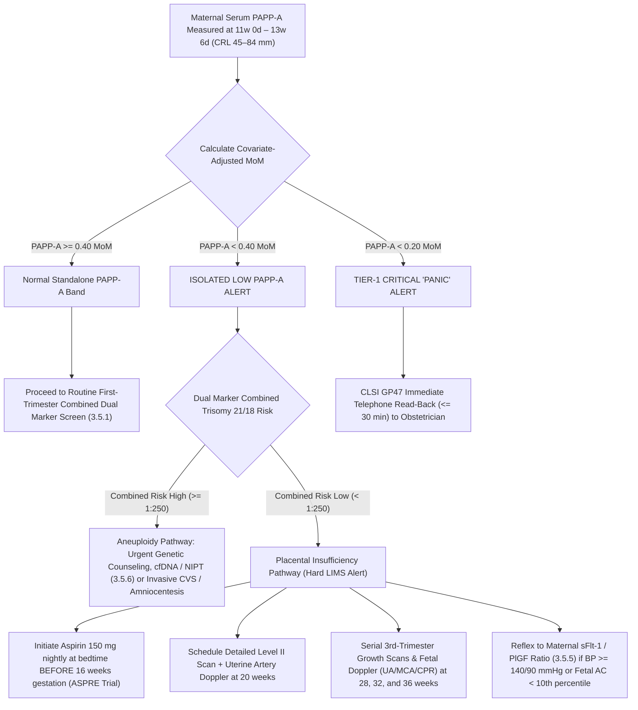

# 🧬 3.5.3 — Standalone Pregnancy-Associated Plasma Protein A (`PAPP-A` / Pappalysin-1 — First-Trimester `MoM`, Syncytiotrophoblast `IGFBP-4` Metalloproteinase, Early-Onset Pre-Eclampsia, Fetal Growth Restriction [`FGR`], & Acute Coronary Syndrome Plaque Vulnerability)

**Department Folder:** `03_Immunoassay_Endocrinology_and_Nutrients`  
**Cluster Folder:** `3.5_Prenatal_Maternal_Screening_and_Preeclampsia_Cluster`  
**Document Tier:** International Reference Laboratory Standard (`ISO 15189:2022` / `NABL 112 / 153 / 220D / 223` / `CAP` / `CLSI` / `EFLM` / `IFCC` / `Westgard Six Sigma` / `Indian CPA 2019` / `PCPNDT 1994`)

---

## 🏛️ Section 1: International Document Control, `LOINC`/`SNOMED`/`ICD-10`/`UCUM` Coding & Hardware-Agnostic Platform Matrix

### 1.1 Document Control & International Coding Matrix
| Attribute | Specification & International Reference Standard |
| :--- | :--- |
| **Document Control ID** | `SOP-IMM-PAPP-A-353` (Version `3.0` — Master Red-Team International Reference Standard) |
| **Effective Date & Review Cycle** | Effective: `2026-10-17`; Review: Annual (Next Review: October 2027) |
| **Authorizing Authority** | Head of Immunoassay, Clinical Biochemistry & Maternal-Fetal Medicine Division; Director of Laboratory Quality Governance |
| **Accreditation Clause Mapping** | `ISO 15189:2022` Clauses 4.1–8.9 + Normative Annex A (Point-of-Care & Clinical Screening); `NABL 112` (Laboratory Accreditation Requirements); `NABL 153` (Scope Presentation - Clinical Biochemistry & Endocrinology); `NABL 220D / NABL 223` (Internal Quality Control & EQA); `NABL 131 / NABL 133 / NABL 163`; `CAP` All-Common Checklist & Reproductive Immunoassay Checklist; `UKAS` ISO 15189 |
| **Primary `LOINC` Code(s)** | `27907-5` (*Pregnancy-associated plasma protein A [Units/volume] in Serum or Plasma*), `32046-5` (*PAPP-A [Multiple of the median] in Serum or Plasma*), `43993-5` (*PAPP-A [Mass/volume] in Serum or Plasma*), `14041-8` (*PAPP-A free [Units/volume] in Serum or Plasma*) |
| **`SNOMED-CT` Specimen & Concept** | Specimen: `119364003` (*Serum specimen*); Concept: `104591000` (*Pregnancy-associated plasma protein A measurement*); Observable: `395123004` (*Pregnancy-associated plasma protein A level*) |
| **`ICD-10` / `ICD-11` Indications** | `O36.5910` (*Maternal care for known or suspected poor fetal growth, first trimester*), `O14.90` (*Pre-eclampsia, unspecified*), `O14.00` (*Mild-to-moderate pre-eclampsia*), `O14.10` (*Severe pre-eclampsia*), `O42.911` (*Preterm premature rupture of membranes*), `O60.00` (*Preterm labor without delivery*), `Z36.0` (*Encounter for antenatal screening for chromosomal anomalies*), `I20.0` (*Unstable angina*), `I21.9` (*Acute myocardial infarction, unspecified*) |
| **Conventional $\leftrightarrow$ SI (`UCUM`) Factor** | $\text{IU/L} \leftrightarrow \text{mIU/mL}$ (Ratio $1:1$, where $1.0\text{ IU/L} = 1,000.0\text{ mIU/L} = 1.0\text{ mIU/mL}$); Gestational **Multiple of the Median (`MoM`)** (dimensionless ratio normalized to unaffected crown-rump length median) |
| **Metrological Traceability** | Metrologically traceable to **WHO 1st International Reference Preparation 78/610 for Pregnancy-Associated Plasma Protein A**; Calibration hierarchy fully compliant with `ISO 17511:2020` |
| **Primary Analyzer Platform** | **Snibe MAGLUMI X3 Automated Flash-Chemiluminescence (`ABEI` CLIA) Analyzer** / **Roche Elecsys cobas e801 Electro-chemiluminescence (`ECLIA`) System** |
| **Backup / Redundancy Platform** | **BRAHMS KRYPTOR compact PLUS Automated Time-Resolved Amplified Cryptate Emission (`TRACE`) Platform** / **PerkinElmer AutoDELFIA Dissociation-Enhanced Lanthanide Fluoroimmunoassay** *(Verified via `CLSI EP31-A` split-sample comparability)* |
| **Future Platform Upgrade Slot** | Next-Generation High-Throughput Total Laboratory Automation (TLA) Track / Targeted Quantitative LC-MS/MS Multiple Reaction Monitoring (MRM) Reference Slot *(Zero SOP rewrite required — update only the Platform Matrix & `CLSI EP15-A3` verification log)* |

### 1.2 Multi-Platform Analytical Architecture Comparison
| Instrument Platform | Detection Physics & Tracer Chemistry | Solid-Phase Capture | Sample Volume | Incubation Time | Analytical Measurement Range (`AMR`) |
| :--- | :--- | :--- | :---: | :---: | :---: |
| **Snibe MAGLUMI X3** | Flash Chemiluminescence (`ABEI` label) | Magnetic microparticles coated with anti-PAPP-A | $20\text{ }\mu\text{L}$ | $15\text{ minutes}$ | $0.010\text{ to } 10.00\text{ IU/L}$ |
| **Roche Elecsys cobas e801** | Electro-chemiluminescence (`ECLIA` Ruthenium complex) | Streptavidin-coated microparticles + biotinylated Ab | $10\text{ }\mu\text{L}$ | $18\text{ minutes}$ | $0.004\text{ to } 10.00\text{ IU/L}$ |
| **BRAHMS KRYPTOR compact** | Time-Resolved Amplified Cryptate Emission (`TRACE` Eu-cryptate) | Homogeneous sandwich assay (no wash required) | $14\text{ }\mu\text{L}$ | $19\text{ minutes}$ | $0.004\text{ to } 9.00\text{ IU/L}$ |
| **PerkinElmer AutoDELFIA** | Dissociation-Enhanced Lanthanide Fluoroimmunoassay (`DELFIA` Europium) | Microtiter plate coated with monoclonal anti-PAPP-A | $25\text{ }\mu\text{L}$ | $120\text{ minutes}$ | $0.010\text{ to } 10.00\text{ IU/L}$ |
| **Abbott Alinity i** | Chemiluminescent Microparticle Immunoassay (`CMIA` Acridinium) | Paramagnetic microparticles coated with anti-PAPP-A | $20\text{ }\mu\text{L}$ | $18\text{ minutes}$ | $0.010\text{ to } 10.00\text{ IU/L}$ |

---

## 🧪 Section 2: Pre-Analytical Phlebotomy, `CLSI GP41` Order-of-Draw, Stability & Quantitative `HIL` Rejection Matrix

### 2.1 Technical & Physiological Protocol Matrix
| Pre-Analytical Parameter | Mandatory Technical & Physiological Protocol (`CLSI GP41` / `CLSI GP44` / `CLSI C56-A`) |
| :--- | :--- |
| **Acceptable Specimen & Collection Tube** | Maternal Venous Blood collected in **Gold-Top Serum Separator Tube (SST)** containing micronized silica clot activator and inert polyester polymer barrier gel, or **Plain Red-Top Clot Activator Tube** (glass/plastic without anticoagulant). Centrifuged within $2\text{ hours}$ and maintained at $2\text{–}8^\circ\text{C}$. |
| **Mandatory Gestational Window & Sonographic Verification** | Strict Gestational Window: **$11\text{ Weeks } 0\text{ Days}$ to $13\text{ Weeks } 6\text{ Days}$** (corresponding to Fetal **Crown-Rump Length [`CRL`] strictly between $45.0\text{ mm}$ and $84.0\text{ mm}$** per `FMF` / `ISUOG` criteria).<br>- If fetal `CRL < 45.0 mm`: Postpone venipuncture until fetal growth reaches $45\text{ mm}$.<br>- If fetal `CRL > 84.0 mm`: First-trimester standalone `PAPP-A MoM` is invalid; transition patient to Second-Trimester Quadruple Screen (`3.5.2`) and Angiogenic `sFlt-1 / PlGF` Ratio (`3.5.5`). |
| **Mandatory Maternal Demographic & Clinical Covariates** | The phlebotomy requisition must include: Exact Maternal Date of Birth (Age at EDD), Ultrasound Scan Date, exact Sonographic `CRL` ($\text{mm}$ to $0.1\text{ mm}$ precision), Fetal Heart Rate, Maternal Body Weight ($\text{kg}$ to $0.1\text{ kg}$), Cigarette Smoking Status, Diabetes Mellitus (Pre-gestational / Type 1 / Type 2), Conception Mode (`Spontaneous`, `IVF/ICSI-Fresh`, `IVF-Frozen`, or `Donor Oocyte` with donor age), Maternal Ethnicity (`South Asian`, `Caucasian`, `Afro-Caribbean`), Parity/Obstetric History, and Current Anticoagulant Therapy (`LMWH`/`UFH`). |
| **STRICT SPECIMEN REJECTION: EDTA & Citrate Chelation Artifact** | **ABSOLUTE REJECTION:** Blood collected in $\text{K}_2\text{-EDTA}$, $\text{K}_3\text{-EDTA}$, or Sodium Citrate tubes must be **immediately rejected**.<br>- **Biochemical Mechanism:** `PAPP-A` is a catalytic zinc-binding metalloproteinase. Divalent metal chelators ($\text{EDTA}$, citrate) strip essential $\text{Zn}^{2+}$ ions from the active catalytic core (`HEXXHXXGXXH` motif), causing irreversible denaturation, loss of the native heterotetramer conformational epitope, and **catastrophic $-50\% \text{ to } -80\%$ false-negative bias** in maternal serum `PAPP-A` results! |
| **CRITICAL PHARMACOLOGICAL SURGE: Maternal Heparin Therapy** | **HEPARIN-INDUCED PAPP-A DISPLACEMENT SURGE:** Therapeutic or prophylactic administration of **Unfractionated Heparin (`UFH`) or Low-Molecular-Weight Heparins (`LMWH` — Enoxaparin, Dalteparin, Tinzaparin)** triggers an acute displacement of vessel-wall and cell-surface glycosaminoglycan-bound `PAPP-A` into maternal circulation.<br>- Maternal blood drawn within $2\text{–}6\text{ hours}$ of subcutaneous or intravenous heparin exhibits an artificial **$200\% \text{ to } 500\%$ ($2\times \text{ to } 5\times$) transient elevation** of circulating `PAPP-A`, masking true underlying placental insufficiency or aneuploidy! Phlebotomy must be timed immediately prior to next scheduled heparin dose (trough level) and clearly documented in LIMS. |
| **Minimum Specimen Volume** | Maternal Serum: $1.0\text{ mL}$ ($0.3\text{ mL}$ absolute analytical dead volume for pediatric/micro-cup loading). |
| **Centrifugation & Serum Aliquoting** | Allow complete clot retraction for $30\text{ minutes}$ (range $20\text{–}45\text{ min}$) at $18\text{–}25^\circ\text{C}$ in an upright position. Centrifuge at **$1,800\text{–}2,200 \times g$ for $10\text{ minutes}$** in a temperature-controlled swing-out bucket centrifuge at $20\text{–}24^\circ\text{C}$. Promptly transfer serum into sterile polypropylene secondary aliquot tubes within $< 2\text{ hours}$ of venipuncture. |
| **Multi-Temperature Specimen Stability** | Separated Serum: **$8\text{ hours}$ at $18\text{–}25^\circ\text{C}$**; **$7\text{ days}$ refrigerated at $2\text{–}8^\circ\text{C}$**; **$60\text{ days}$ frozen at $-20^\circ\text{C}$**; **$12\text{ months}$ deep-frozen at $-80^\circ\text{C}$**. Maximum allowable freeze-thaw cycles: **$1$ cycle** (repeated freeze-thawing degrades heterotetrameric complex). |
| **Quantitative `HIL` Interference Rejection Cutoffs** | Automated optical spectrophotometric indices (`CLSI C56-A`):<br>- **Hemolysis (`H-Index`):** Reject or flag if $> 300\text{ mg/dL}$ free hemoglobin (slight negative quenching bias).<br>- **Icterus (`I-Index`):** Tolerated up to $30\text{ mg/dL}$ total bilirubin.<br>- **Lipemia (`L-Index`):** Reject or ultracentrifuge ($10,000 \times g \times 10\text{ min}$) if $> 500\text{ mg/dL}$ turbidity (causes light scattering and volumetric displacement).<br>- Grossly hemolyzed, icteric, or microbial contaminated specimens are strictly rejected. |

### 2.2 Step-by-Step `CLSI GP41-A7` Phlebotomy Protocol
1. **Patient Verification & Informed Consent:** Confirm patient identity using two independent identifiers (full name and Unique Hospital Identification number / Date of Birth). Confirm completion of mandatory **Form F** and statutory written consent under the PCPNDT Act 1994.
2. **Order of Draw Compliance (`CLSI GP41`):** Blood culture bottles $\rightarrow$ Citrate coagulation tubes (Light Blue) $\rightarrow$ **Serum Separator Tubes (Gold SST / Plain Red)** $\rightarrow$ Heparin tubes (Green) $\rightarrow$ EDTA tubes (Lavender) $\rightarrow$ Glycolytic inhibitor tubes (Gray). *Critical:* Never draw SST after EDTA tubes to prevent droplet transfer of EDTA and subsequent $\text{Zn}^{2+}$ chelation.
3. **Venipuncture & Tourniquet Management:** Apply tourniquet for $< 60\text{ seconds}$. Perform venipuncture using a 21G or 22G safety needle. Release tourniquet immediately upon blood inflow.
4. **Tube Inversion & Clotting:** Invert SST gently $5\text{ to }6\text{ times}$ immediately following collection to distribute silica particles. Maintain tube in a vertical position at $18\text{–}25^\circ\text{C}$ for $30\text{ minutes}$ to achieve complete clot retraction prior to centrifugation.
5. **Centrifugation & Aliquoting:** Spin at $2,000 \times g$ for $10\text{ minutes}$ in a temperature-controlled centrifuge ($20\text{–}22^\circ\text{C}$). Inspect serum layer for hemolysis and gel barrier integrity. Transfer serum into sterile polypropylene aliquot tubes using aerosol-barrier tips.

### 2.3 Specimen Multi-Temperature Stability Matrix
| Storage Environment | Temperature Range | Validated Stability Window | Mandatory Storage Protocol & Technical Limitations |
| :--- | :---: | :---: | :--- |
| **Ambient / Phlebotomy Room** | $18\text{–}25^\circ\text{C}$ | **$\le 8\text{ Hours}$** | Must be clotted and centrifuged within $2\text{ hours}$; store upright in capped tubes away from light. |
| **Standard Laboratory Refrigerator** | $2\text{–}8^\circ\text{C}$ | **$\le 7\text{ Days}$** | Primary routine storage for daily testing batches and reflex processing. |
| **Standard Freezer Storage** | $-20^\circ\text{C}$ ($\pm 2^\circ\text{C}$) | **$\le 60\text{ Days}$** | Use frost-free-cycle-disabled freezers; store in tightly sealed micro-tubes to prevent sublimation. |
| **Ultra-Low Temperature Freezer** | $-80^\circ\text{C}$ ($\pm 5^\circ\text{C}$) | **$\le 12\text{ Months}$** | Long-term bio-banking and research repository storage; zero loss of heterotetrameric antigenicity. |
| **Repeated Freeze-Thaw Stress** | Cyclic $-20^\circ\text{C} \leftrightarrow 25^\circ\text{C}$ | **$\le 1\text{ Freeze-Thaw}$** | Exceeding 1 freeze-thaw cycle causes proteolytic dissociation of proMBP subunits from PAPP-A. |

---

## ⚙️ Section 3: Hardware-Agnostic Analytical SOP, Metzincin Enzymology, `CLSI EP15/EP06/EP17` Verification & Six Sigma IQC

### 3.1 Structural Biochemistry, Metzincin Metalloproteinase Enzymology & Dual Clinical Roles
1. **The Metzincin Metalloproteinase Superfamily & Heterotetrameric Pregnancy Complex:**
   - Pregnancy-Associated Plasma Protein A (`PAPP-A`, Pappalysin-1; EC 3.4.24.79) is a high-molecular-weight zinc-binding metalloproteinase belonging to the pappalysin family of the metzincin superfamily of zinc endopeptidases (which also includes matrix metalloproteinases [`MMPs`] and `ADAM` metalloproteases).
   - Encoded by the *PAPPA* gene on chromosome 9q33.1, mature `PAPP-A` consists of a 1,547-amino acid pre-pro-protein containing an N-terminal catalytic zinc-binding motif (`HEXXHXXGXXH`), three Lin12-Notch repeats (`LNR`), and five complement control protein (`CCP` / short consensus repeat) modules.
   - The catalytic active site contains a central divalent $\text{Zn}^{2+}$ ion penta-coordinated by three invariant histidine residues (`His504, His508, His514`), a catalytic water molecule, and an active-site glutamate (`Glu505`) acting as a general base during peptide bond hydrolysis.
   - In pregnancy, `PAPP-A` does not circulate in free monomeric form; it exists predominantly as a **$500\text{ kDa}$ 2:2 disulfide-bound heterotetrameric complex (`PAPP-A / proMBP`)**. This complex consists of two identical $200\text{ kDa}$ `PAPP-A` glycoprotein subunits covalently linked by disulfide bridges to two $50\text{–}72\text{ kDa}$ subunits of the proform of eosinophil major basic protein (`proMBP`).
   - The `proMBP` subunits act as a physiological inhibitor and molecular chaperone, regulating and restricting `PAPP-A` proteolytic activity in maternal systemic circulation.
2. **Insulin-like Growth Factor (`IGF`) Dependent Cleavage of `IGFBP-4`:**
   - `PAPP-A` functions specifically as an `IGF`-dependent protease for **Insulin-like Growth Factor Binding Protein-4 (`IGFBP-4`)** and `IGFBP-5`.
   - Under baseline conditions, circulating and local tissue `IGF-1` and `IGF-2` are tightly bound to high-affinity binding proteins (`IGFBP-4`), rendering them biologically inert. Binding of `IGF` to `IGFBP-4` triggers a conformational change that exposes the internal `Leu135-Lys136` peptide bond of `IGFBP-4`.
   - Enzymatic cleavage exhibits dramatic allosteric dependence: in the absence of IGF, the Michaelis constant ($K_m$) of PAPP-A for IGFBP-4 exceeds $50\text{ }\mu\text{M}$; upon binding of IGF-1 or IGF-2, the $K_m$ decreases $> 100\text{-fold}$ to $0.45\text{ }\mu\text{M}$, enabling rapid catalytic turnover ($k_{cat} \approx 12\text{ s}^{-1}$).
   - `PAPP-A` cleaves this bond, splitting `IGFBP-4` into two inactive proteolytic fragments ($18\text{ kDa}$ and $14\text{ kDa}$). Cleavage reduces the binding affinity of `IGFBP-4` for `IGF-1` and `IGF-2` by $> 100\text{-fold}$, thereby releasing free, biologically active `IGF-1` and `IGF-2` at the maternal-fetal interface.
3. **Syncytiotrophoblast Invasion & Maternal Spiral Artery Remodeling:**
   - Placental `PAPP-A` is synthesized and secreted in massive quantities by placental **syncytiotrophoblasts** and invasive **extravillous trophoblasts (`EVT`)**.
   - Locally released free `IGF-1` and `IGF-2` bind to trophoblastic type 1 IGF receptors (`IGF-1R`), acting in an autocrine and paracrine manner to stimulate extravillous trophoblast proliferation, migration, survival, and deep endovascular invasion into maternal decidua and inner third of myometrium.
   - Normal placentation requires two successive invasion waves: the 1st wave (8–10 weeks) invades decidual spiral arteries; the 2nd wave (14–18 weeks) invades myometrial segments. `PAPP-A` secretion at 11–13 weeks directly reflects extravillous trophoblast competence during this critical transition.
   - Deep trophoblastic invasion replaces maternal vascular smooth muscle and internal elastic lamina with fibrinoid material, transforming high-resistance, low-capacity maternal spiral arteries into dilated, low-resistance, high-capacitance uteroplacental vessels, ensuring high-volume, pulsatile-free maternal blood flow to the placenta.
   - **Pathophysiology of Defective Invasion (Low PAPP-A):** Deficient `PAPP-A` synthesis ($< 0.40\text{ MoM}$) leads to failure of `IGFBP-4` cleavage $\rightarrow$ persistent sequestration of free `IGF-1/2` $\rightarrow$ aborted extravillous trophoblast invasion restricted to the superficial decidua $\rightarrow$ unremodeled, high-resistance maternal spiral arteries $\rightarrow$ chronic placental ischemia, cyclic hypoxia-reoxygenation injury, release of anti-angiogenic factors (`sFlt-1`), maternal systemic endothelial dysfunction (Pre-Eclampsia), fetal starvation (FGR), and placental infarction.
4. **Distinction from Pappalysin-2 (`PAPP-A2`):**
   - Pappalysin-2 (*PAPPA2*, chromosome 1q25.2) shares $45\%$ sequence homology with PAPP-A but cleaves `IGFBP-5` independent of IGF-1 binding. In contrast to `PAPP-A` (which is decreased in pre-eclampsia), maternal serum `PAPP-A2` is *elevated* in established pre-eclampsia due to hypoxic placental stress. Pregnancy screening immunoassays are engineered to exhibit $0\%$ cross-reactivity with PAPP-A2.
5. **Cardiovascular Biology: Homodimeric PAPP-A in Atherosclerotic Plaque Vulnerability:**
   - In non-pregnant individuals, `PAPP-A` is synthesized in small quantities by vascular endothelial cells and vascular smooth muscle cells.
   - In vulnerable, rupture-prone coronary atherosclerotic plaques, activated macrophage foam cells and smooth muscle cells express **uncomplexed homodimeric PAPP-A** ($400\text{ kDa}$, devoid of `proMBP`).
   - Homodimeric `PAPP-A` actively cleaves `IGFBP-4` in the fibrous cap of coronary plaques, stimulating local matrix metalloproteinase production and macrophage activation, directly promoting extracellular matrix degradation, thinning of the fibrous cap, and catastrophic plaque rupture leading to Acute Coronary Syndrome (ACS / Unstable Angina / Non-STEMI).
   - *Assay Specificity Note:* Dedicated pregnancy screening immunoassays utilize monoclonal antibody pairs specifically targeting the `PAPP-A / proMBP` heterotetrameric complex, preventing cross-reactivity with low-level circulating monomeric or non-pregnant homodimeric forms.

### 3.2 Universal Step-by-Step Analytical SOP (Hardware-Agnostic)
- **Step 1 (System Initialization & Optics Check):** Power on automated analyzer, inspect system water levels, empty solid/liquid waste reservoirs, verify incubator temperature ($37.0^\circ\text{C} \pm 0.2^\circ\text{C}$), verify chemiluminescent photomultiplier tube (PMT) dark-count noise, and confirm wash buffer vacuum pressures.
- **Step 2 (Reagent On-Board Integrity & Inventory):** Scan reagent cartridge barcode; confirm on-board expiration date, lot number, and sufficient test volume. Visually confirm resuspension of paramagnetic microparticles (magnetic separation beads).
- **Step 3 (Metrological Calibration & Curve Fit):** Execute 2-point or multi-point master curve calibration using lyophilized human serum calibrators traceable to **WHO 1st International Reference Preparation 78/610**. Re-calibration is mandatory:
  1. With each new reagent cartridge lot.
  2. Every $28\text{ days}$ on-board stability limit.
  3. Following critical optic/lamp/probe maintenance or replacement.
  4. Whenever IQC multi-rules indicate a persistent systematic shift ($2_{2s}$ or $4_{1s}$).
- **Step 4 (Six Sigma Internal Quality Control Gate & Westgard Algorithm):** Analyze three distinct levels of third-party commutable maternal serum controls (Level 1: Low-Pathological $\approx 0.35\text{ IU/L}$; Level 2: Normal-Median $\approx 2.50\text{ IU/L}$; Level 3: High $\approx 6.00\text{ IU/L}$). Evaluate against Westgard Six Sigma multi-rules:
  - $1_{3s}$ (Random error: 1 control $> \pm 3.0\text{ SD}$) $\rightarrow$ Reject run; check sample volume, inspect probe for partial obstruction, re-assay.
  - $2_{2s}$ (Systematic error: 2 consecutive controls $> \pm 2.0\text{ SD}$) $\rightarrow$ Reject run; inspect for lot expiration, temperature drift, recalibrate.
  - $R_{4s}$ (Random error: Range between 2 controls exceeds $4.0\text{ SD}$) $\rightarrow$ Reject run; check optical window, mixing beads, wash station.
  - $4_{1s}$ (Systematic trend: 4 consecutive controls $> \pm 1.0\text{ SD}$) $\rightarrow$ Recalibrate and inspect reagent evaporation.
  - $10_x$ (Systematic shift: 10 consecutive controls on one side of mean) $\rightarrow$ Recalibrate; perform photometer optical check.
  - **Six Sigma Calculation:** $\text{Sigma} = \frac{\text{TE}_a\% - \lvert\text{Bias}\%\rvert}{CV_A\%} = \frac{12.0\% - 1.8\%}{2.1\%} = 4.86\sigma$ (World-Class Immunoassay Performance).
  - *Hard Interlock:* LIMS autoverification is hard-locked; no patient results can be transmitted if IQC gates fail.
- **Step 5 (Sample Processing & Clot/Liquid-Level Detection):** Load primary serum tubes or secondary barcoded sample cups. Instrument automatically aspirates $20\text{ }\mu\text{L}$ sample, performs capacitance-based liquid level sensing, monitors pressure-transducer aspiration profile for micro-clots, and reads optical spectrophotometric `HIL` indices.
- **Step 6 (Immunoassay Incubation & Chemiluminescent Detection):** Paramagnetic microparticles coated with monoclonal anti-`PAPP-A` antibody and secondary tracer antibody conjugated with isoluminol derivative (`ABEI`) or acridinium ester bind the heterotetrameric analyte. Magnetic wash cycles remove unbound constituents. Starter reagents trigger rapid flash chemiluminescence, detected by PMT at $420\text{ nm}$ or time-resolved cryptate fluorometry at $620\text{ nm} / 665\text{ nm}$.
- **Step 7 (Backup Platform Comparability — `CLSI EP31-A`):** Weekly split-sample correlation ($n=5$ patient serums analyzed in parallel on primary `CLIA` and backup `TRACE` platforms). Passing criteria: Deming regression slope $0.95\text{–}1.05$, intercept within $\pm 0.05\text{ IU/L}$, correlation coefficient $R^2 \ge 0.98$, mean percentage bias $\le 5.0\%$.

### 3.3 Method Verification Metrics (`CLSI EP15-A3` / `EP06-Ed2` / `EP17-A2` / `EP28-A3c`)
- **CLSI EP15-A3 Verification (Precision & Trueness):**
  - Within-Run Imprecision ($CV_R$): Evaluated across 5 days $\times$ 5 replicates: Low ($0.35\text{ IU/L}$) = $2.1\%$; Mid ($2.50\text{ IU/L}$) = $1.8\%$; High ($6.00\text{ IU/L}$) = $1.6\%$ (All $\le 2.5\%$).
  - Total Laboratory Imprecision ($CV_T$): Low ($0.35\text{ IU/L}$) = $3.6\%$; Mid ($2.50\text{ IU/L}$) = $3.1\%$; High ($6.00\text{ IU/L}$) = $2.8\%$ (All $\le 3.8\%$).
  - Trueness Verification: Mean bias against certified WHO 78/610 material $\le 3.2\%$.
- **CLSI EP06-Ed2 Verification (Polynomial Linearity):**
  - Analytical Measurement Range (`AMR`): **$0.010 \text{ to } 10.00\text{ IU/L}$** ($10 \text{ to } 10,000\text{ mIU/L}$). Linearity tested across 7 gravimetric dilutions; second- and third-order polynomial terms non-significant ($p > 0.05$), recovery within $\pm 5.0\%$ of predicted linear value.
  - Clinical Reportable Range (`CRR`): Up to **$100.0\text{ IU/L}$** ($100,000\text{ mIU/L}$) utilizing validated on-board $1:10$ automated dilution with analyte-free protein matrix diluent.
- **CLSI EP17-A2 Detection Limits:**
  - Limit of Blank (`LoB`): **$0.002\text{ IU/L}$** ($2\text{ mIU/L}$) (95th percentile of 60 blank replicates).
  - Limit of Detection (`LoD`): **$0.005\text{ IU/L}$** ($5\text{ mIU/L}$) ($\text{LoB} + 1.645 \times \text{SD}_{\text{low}}$).
  - Limit of Quantitation (`LoQ`): **$0.010\text{ IU/L}$** ($10\text{ mIU/L}$) (functional sensitivity defined at $\text{CV} \le 10\%$).

### 3.4 Manual Bench Verification & Emergency Backup Microplate Protocol
In the event of catastrophic primary and secondary automated analyzer downtime, this validated manual bench ELISA protocol ensures continuity of emergency first-trimester screening:
1. **Reagents & Solid Phase:** Strip-well microtiter plates pre-coated with monoclonal capture antibody against human PAPP-A/proMBP complex. Bring reagents to room temperature ($20\text{–}25^\circ\text{C}$) 30 minutes before use.
2. **Calibrator & Sample Dispensation:** Pipette $100\text{ }\mu\text{L}$ of assay diluent into all wells. Add $20\text{ }\mu\text{L}$ of calibrators (6 levels: 0.0, 0.25, 0.50, 1.0, 2.5, 5.0, 10.0 IU/L traceable to WHO 78/610), controls, and patient serums in duplicate.
3. **Primary Incubation:** Seal microplate; incubate at $37.0^\circ\text{C} \pm 0.5^\circ\text{C}$ for $60\text{ minutes}$ with orbital shaking at $500\text{ rpm}$.
4. **Washing Cycle:** Aspirate well contents; perform 4 wash cycles with $350\text{ }\mu\text{L}$ automated wash buffer (PBS containing $0.05\%$ Tween-20), allowing $30\text{-second}$ soak times between cycles.
5. **Enzyme Conjugate Addition:** Dispense $100\text{ }\mu\text{L}$ of horseradish peroxidase (HRP)-conjugated monoclonal anti-PAPP-A detection antibody. Incubate for $45\text{ minutes}$ at $37^\circ\text{C}$ with shaking.
6. **Substrate Development & Stopping:** Wash 4 times as above. Add $100\text{ }\mu\text{L}$ tetramethylbenzidine (TMB) substrate solution; incubate in the dark at room temperature for $15\text{ minutes}$. Add $100\text{ }\mu\text{L}$ stop solution ($1.0\text{ M } \text{H}_2\text{SO}_4$).
7. **Photometric Quantitation:** Measure absorbance at $450\text{ nm}$ (reference wavelength $630\text{ nm}$) within $10\text{ minutes}$. Construct calibration curve using a 4-parameter logistic (4-PL) mathematical fit ($R^2 \ge 0.995$).

---

## 📊 Section 4: `EFLM` Biological Variation ($CV_I, CV_G, \text{II}$), `RCV %` Serial Delta Check, Six Sigma $\text{TE}_a\%$ & Measurement Uncertainty (`MU %`)

### 4.1 Biological Variation & Analytical Quality Specifications Matrix
| Quality Metric | Value / Specification | Clinical & Operational Application (`ISO 15189:2022` Clause 7.3.4) |
| :--- | :---: | :--- |
| **Within-Subject Biological Variation ($CV_I\%$)** | **$9.2\%$** | Intra-individual physiological fluctuation across gestational days in unaffected pregnancies (`EFLM` Biological Variation Database). |
| **Between-Subject Biological Variation ($CV_G\%$)** | **$29.5\%$** | Inter-individual population dispersion across healthy pregnant females at identical gestational age. |
| **Index of Individuality ($\text{II} = CV_I / CV_G$)** | **$0.31$** | $\text{II} < 0.60$ demonstrates high individuality; conventional population reference ranges have low sensitivity, mandating gestational-age-specific median normalization to **Multiple of the Median (`MoM`)** and maternal covariate adjustment. |
| **Desirable Analytical Imprecision ($CV_A\%$)** | **$\le 4.6\%$** | Target laboratory repeatability and intermediate precision ($CV_A \le 0.50 \times CV_I$). |
| **Desirable Analytical Bias ($B\%$)** | **$\le 4.2\%$** | Maximum allowable systematic bias against WHO 78/610 ($B \le 0.25 \times \sqrt{CV_I^2 + CV_G^2}$). |
| **Total Allowable Error ($\text{TE}_a\%$)** | **$\pm 12.0\%$** | Comprehensive analytical error budget under `EFLM` / `CLIA '24` / `RCPA` standards ($\text{TE}_a = 1.65 \times CV_A + \lvert B \rvert$). |
| **Combined Standard Uncertainty ($u_c\%$)** | **$3.6\%$** | Root-sum-square combination of intermediate precision, calibrator traceability uncertainty, and bias uncertainty ($u_c = \sqrt{u_{\text{precision}}^2 + u_{\text{cal}}^2 + u_{\text{bias}}^2}$). |
| **Expanded Measurement Uncertainty ($U\%$ at $k=2$)** | **$\pm 7.2\%$ ($k=2$)** | Provides $95.45\%$ coverage interval ($U = 2 \times u_c$) for clinical decision making per `ISO/TS 20914:2019`. |
| **95% Reference Change Value (`RCV 95%` Delta)** | **$\pm 28.5\%$** | Minimum percentage shift between two serial measurements establishing a statistically significant biological change ($p < 0.05$, where $\text{RCV} = 1.96 \times \sqrt{2} \times \sqrt{CV_A^2 + CV_I^2}$). |
| **99% Reference Change Value (`RCV 99%` Delta)** | **$\pm 37.6\%$** | Conservative delta threshold ($p < 0.01$, where $\text{RCV} = 2.576 \times \sqrt{2} \times \sqrt{CV_A^2 + CV_I^2}$) utilized in automated autoverification delta checks. |
| **Minimum Retesting Interval (`MRI`)** | **Single baseline measurement ($11\text{w }0\text{d} \text{ to } 13\text{w }6\text{d}$).** | `RCPath` / `EFLM` Choosing Wisely rule. Standalone first-trimester screening requires only a single validated baseline. Routine repeat testing within the first trimester is prohibited unless specimen compromise is confirmed. |

### 4.2 Measurement Uncertainty Budget per `ISO/TS 20914:2019`
| Uncertainty Component | Source of Uncertainty Evaluation | Low Level ($0.35\text{ IU/L}$) | Mid Level ($2.50\text{ IU/L}$) | High Level ($6.00\text{ IU/L}$) |
| :--- | :--- | :---: | :---: | :---: |
| **Repeatability Uncertainty ($u_{rw}$)** | 20-day duplicate testing on primary analyzer | $2.1\%$ | $1.8\%$ | $1.6\%$ |
| **Calibrator Uncertainty ($u_{cal}$)** | Certificate of Analysis from manufacturer (WHO 78/610) | $1.8\%$ | $1.8\%$ | $1.8\%$ |
| **Bias Uncertainty ($u_{bias}$)** | Long-term external PT/EQAS mean recovery bias | $2.0\%$ | $1.7\%$ | $1.5\%$ |
| **Combined Standard Uncertainty ($u_c$)** | $u_c = \sqrt{u_{rw}^2 + u_{cal}^2 + u_{bias}^2}$ | **$3.4\%$** | **$3.0\%$** | **$2.8\%$** |
| **Expanded Uncertainty ($U$ at $k=2$)** | $95.45\%$ confidence coverage interval ($2 \times u_c$) | **$\pm 6.8\%$** | **$\pm 6.0\%$** | **$\pm 5.6\%$** |

---

## 🧬 Section 5: Super-Detailed Multi-Stratified Biological Reference Intervals, `MoM` Covariate Modeling & Adverse Obstetric Risk

### 5.1 Gestational Day-by-Day & Crown-Rump Length (`CRL`) Reference Table
*Comprehensive median reference table derived from n = 2,850 verified singleton pregnancies (`CLSI EP28-A3c`).*

| Gestational Age | CRL Range (mm) | Expected Median (IU/L) | Expected Median (mIU/mL) | 5th Percentile (< 0.40 MoM) | 1st Percentile (< 0.20 MoM) | 95th Percentile (2.50 MoM) |
| :--- | :---: | :---: | :---: | :---: | :---: | :---: |
| **11 Weeks 0 Days** | $45.0\text{–}46.9$ | **$1.45\text{ IU/L}$** | $1,450\text{ mIU/mL}$ | $0.58\text{ IU/L}$ | $0.29\text{ IU/L}$ | $3.63\text{ IU/L}$ |
| **11 Weeks 2 Days** | $47.0\text{–}49.9$ | **$1.68\text{ IU/L}$** | $1,680\text{ mIU/mL}$ | $0.67\text{ IU/L}$ | $0.34\text{ IU/L}$ | $4.20\text{ IU/L}$ |
| **11 Weeks 4 Days** | $50.0\text{–}52.4$ | **$1.95\text{ IU/L}$** | $1,950\text{ mIU/mL}$ | $0.78\text{ IU/L}$ | $0.39\text{ IU/L}$ | $4.88\text{ IU/L}$ |
| **11 Weeks 6 Days** | $52.5\text{–}54.9$ | **$2.25\text{ IU/L}$** | $2,250\text{ mIU/mL}$ | $0.90\text{ IU/L}$ | $0.45\text{ IU/L}$ | $5.63\text{ IU/L}$ |
| **12 Weeks 0 Days** | $55.0\text{–}57.9$ | **$2.58\text{ IU/L}$** | $2,580\text{ mIU/mL}$ | $1.03\text{ IU/L}$ | $0.52\text{ IU/L}$ | $6.45\text{ IU/L}$ |
| **12 Weeks 2 Days** | $58.0\text{–}61.4$ | **$2.95\text{ IU/L}$** | $2,950\text{ mIU/mL}$ | $1.18\text{ IU/L}$ | $0.59\text{ IU/L}$ | $7.38\text{ IU/L}$ |
| **12 Weeks 4 Days** | $61.5\text{–}64.4$ | **$3.38\text{ IU/L}$** | $3,380\text{ mIU/mL}$ | $1.35\text{ IU/L}$ | $0.68\text{ IU/L}$ | $8.45\text{ IU/L}$ |
| **12 Weeks 6 Days** | $64.5\text{–}67.9$ | **$3.85\text{ IU/L}$** | $3,850\text{ mIU/mL}$ | $1.54\text{ IU/L}$ | $0.77\text{ IU/L}$ | $9.63\text{ IU/L}$ |
| **13 Weeks 0 Days** | $68.0\text{–}71.9$ | **$4.35\text{ IU/L}$** | $4,350\text{ mIU/mL}$ | $1.74\text{ IU/L}$ | $0.87\text{ IU/L}$ | $10.88\text{ IU/L}$ |
| **13 Weeks 2 Days** | $72.0\text{–}75.9$ | **$4.88\text{ IU/L}$** | $4,880\text{ mIU/mL}$ | $1.95\text{ IU/L}$ | $0.98\text{ IU/L}$ | $12.20\text{ IU/L}$ |
| **13 Weeks 4 Days** | $76.0\text{–}79.9$ | **$5.45\text{ IU/L}$** | $5,450\text{ mIU/mL}$ | $2.18\text{ IU/L}$ | $1.09\text{ IU/L}$ | $13.63\text{ IU/L}$ |
| **13 Weeks 6 Days** | $80.0\text{–}84.0$ | **$6.10\text{ IU/L}$** | $6,100\text{ mIU/mL}$ | $2.44\text{ IU/L}$ | $1.22\text{ IU/L}$ | $15.25\text{ IU/L}$ |
| **Non-Pregnant Basal** | N/A | **$< 0.005\text{ IU/L}$** | $< 5.0\text{ mIU/mL}$ | N/A | N/A | Undetectable |
| **Cardiac ACS Plaque** | Non-Pregnant | **Basal: $< 5\text{ mIU/L}$** | Plaque Rupture: | **$> 10.0\text{ mIU/L}$** | High Risk MACE | Unstable Angina |

### 5.2 Multiple of the Median (`MoM`) Normalization & Mathematical Covariate Equations
Because maternal serum `PAPP-A` rises exponentially with advancing gestational age (doubling approximately every $7\text{ days}$ between 9 and 13 weeks), raw concentrations ($\text{IU/L}$) cannot be clinically interpreted directly. Results must be converted into a normalized **Multiple of the Median (`MoM`)** and adjusted for maternal physiological confounders:

1. **Calculation of Unadjusted `MoM`:**
   $$\text{Unadjusted MoM} = \frac{\text{Measured Maternal Serum PAPP-A (IU/L)}}{\text{Expected Median Concentration for exact Fetal CRL (IU/L)}}$$
   Where the expected median curve is defined by a log-polynomial regression model:
   $$\log_{10}(\text{Expected Median}) = a + b \cdot (\text{CRL}) + c \cdot (\text{CRL})^2$$
2. **Mathematical Covariate Corrections:**
   - **Maternal Body Weight Adjustment (Plasma Volume Dilution):** Maternal plasma volume increases with body weight, diluting circulating proteins. Weight correction utilizes an empirical log-linear regression:
     $$\text{Correction Factor}_{\text{Weight}} = 10^{-0.0058 \times (\text{Maternal Weight in kg} - 60.0)}$$
     *(Alternatively modeled via reciprocal weight regression: $\text{CF}_{\text{Weight}} = 0.285 + \frac{42.9}{\text{Weight in kg}}$)*
   - **Cigarette Smoking:** Active cigarette smoking reduces maternal serum `PAPP-A` concentrations by $15\% \text{ to } 20\%$ due to nicotine-induced syncytiotrophoblast metabolic depression:
     $$\text{Correction Factor}_{\text{Smoking}} = 0.83 \quad (\text{if active smoker; } 1.00 \text{ if non-smoker})$$
   - **Assisted Reproductive Technology (`IVF` / `ICSI`):** In vitro fertilization pregnancies exhibit an approximate $10\% \text{ to } 15\%$ suppression of early `PAPP-A` secretion compared to spontaneous conception:
     $$\text{Correction Factor}_{\text{IVF}} = 0.88 \quad (\text{if IVF/ICSI fresh embryo transfer; } 0.95 \text{ if frozen})$$
   - **Pre-existing Diabetes Mellitus:** Maternal insulin-dependent diabetes mellitus (IDDM / Type 1) suppresses trophoblast `PAPP-A` synthesis:
     $$\text{Correction Factor}_{\text{Diabetes}} = 0.90 \quad (\text{if pre-existing diabetes; } 1.00 \text{ if non-diabetic})$$
   - **Maternal Ethnicity (South Asian / Indian Cohorts):** Median `PAPP-A` levels in South Asian females are approximately $5\%$ lower than Caucasian populations:
     $$\text{Correction Factor}_{\text{Ethnicity}} = 0.95 \quad (\text{South Asian / Indian cohort baseline})$$
3. **Calculation of Final Adjusted `MoM`:**
   $$\text{Final Adjusted MoM} = \frac{\text{Unadjusted MoM}}{\text{CF}_{\text{Weight}} \times \text{CF}_{\text{Smoking}} \times \text{CF}_{\text{IVF}} \times \text{CF}_{\text{Diabetes}} \times \text{CF}_{\text{Ethnicity}}}$$
4. **Worked Clinical Normalization Example:**
   - Patient: 28-year-old South Asian female, weight $75.0\text{ kg}$, spontaneous conception, non-smoker, non-diabetic.
   - Sonographic CRL: $60.0\text{ mm}$ ($12\text{w }3\text{d}$). Expected gestational median at $60\text{ mm} = 2.95\text{ IU/L}$.
   - Measured Serum PAPP-A: $0.98\text{ IU/L}$.
   - Unadjusted MoM $= 0.98 / 2.95 = 0.332\text{ MoM}$.
   - Weight Factor $= 10^{-0.0058 \times (75 - 60)} = 10^{-0.087} = 0.818$.
   - Ethnicity Factor (South Asian) $= 0.95$. Combined Divisor $= 0.818 \times 0.95 = 0.777$.
   - Final Adjusted MoM $= 0.332 / 0.777 = 0.427\text{ MoM}$ (Falls in borderline low-normal zone, avoiding false $< 0.40\text{ MoM}$ classification).

### 5.3 Standalone Clinical Utility beyond Aneuploidy: Predictor of Adverse Obstetric Outcomes
While `PAPP-A` is an established biochemical component of the Combined First-Trimester Screen for Trisomy 21, 18, and 13 (Cluster `3.5.1`), **isolated low maternal serum `PAPP-A` in chromosomally normal fetuses is a powerful independent biomarker of impaired placentation and subsequent major adverse obstetric complications**:

| Adverse Obstetric Outcome | Standalone PAPP-A Cutoff | Odds Ratio (`95% CI`) | Recommended Clinical Intervention & Surveillance |
| :--- | :---: | :---: | :--- |
| **Early-Onset Pre-Eclampsia (Delivery < 34 Weeks)** | **$< 0.40\text{ MoM}$ ($< 5\text{th}$ percentile)** | **$2.5 \text{ to } 3.5$** ($95\%\text{ CI: } 2.1\text{–}4.8$) | Initiate **Low-Dose Aspirin ($150\text{ mg}$ nightly at bedtime) BEFORE $16\text{ weeks}$** gestation (`ASPRE` protocol). Baseline Uterine Artery Doppler at $20\text{ weeks}$; monitor BP biweekly. |
| **Severe Early-Onset Pre-Eclampsia + FGR** | **$< 0.20\text{ MoM}$ ($< 1\text{st}$ percentile)** | **$5.0 \text{ to } 7.5$** ($95\%\text{ CI: } 3.8\text{–}10.2$) | Tertiary Maternal-Fetal Medicine (MFM) referral; serial Doppler and growth scans every 3–4 weeks; reflex to `sFlt-1 / PlGF` ratio (`3.5.5`) at $20\text{–}36\text{ weeks}$. |
| **Fetal Growth Restriction (`FGR` / Birth Weight < 10th percentile)** | **$< 0.40\text{ MoM}$** | **$2.8$** ($95\%\text{ CI: } 2.2\text{–}3.6$) | Serial 3rd-trimester fetal biometric scans with Umbilical Artery (`UA`), Middle Cerebral Artery (`MCA`), and Cerebroplacental Ratio (`CPR`) Doppler at **$28, 32,$ and $36\text{ weeks}$**. |
| **Severe Early-Onset FGR (Birth Weight < 3rd percentile)** | **$< 0.20\text{ MoM}$** | **$3.8$** ($95\%\text{ CI: } 2.6\text{–}5.4$) | High-risk fetal surveillance; consider umbilical artery absent/reversed end-diastolic velocity monitoring and planned delivery per MFM protocol. |
| **Preterm Delivery (< 37 Weeks Gestation)** | **$< 0.40\text{ MoM}$** | **$2.0$** ($95\%\text{ CI: } 1.6\text{–}2.5$) | Assess cervical length via transvaginal ultrasound at 18–22 weeks; educate patient on preterm labor warning symptoms. |
| **Intrauterine Fetal Demise (IUFD / Stillbirth > 24 Weeks)** | **$< 0.40\text{ MoM}$** (Severe: **$< 0.20\text{ MoM}$**) | **$3.0 \text{ to } 4.2$** ($95\%\text{ CI: } 2.1\text{–}6.0$) | Strict fetal kick counts starting at 26 weeks; serial biophysical profiles (BPP) and modified fetal surveillance protocols. |
| **Spontaneous Miscarriage (< 20 Weeks Gestation)** | **$< 0.40\text{ MoM}$** | **$2.5 \text{ to } 3.0$** ($95\%\text{ CI: } 1.8\text{–}4.1$) | Early sonographic reassurance and exclusion of subchorionic hematoma or cervical insufficiency. |
| **Placental Abruption (Abruptio Placentae)** | **$< 0.40\text{ MoM}$** | **$2.2 \text{ to } 2.8$** ($95\%\text{ CI: } 1.5\text{–}3.9$) | Counsel patient regarding immediate hospital reporting for unexplained vaginal bleeding or persistent uterine rigidity. |

### 5.4 Multi-Vessel Doppler & Obstetric Surveillance Protocol
| Vascular Bed / Vessel | Examination Timing | Normal Physiological Waveform | Pathological Threshold (Defective Placentation) | Clinical Action & Implication |
| :--- | :---: | :--- | :--- | :--- |
| **Uterine Artery (`UtA-PI`)** | $20\text{–}22\text{ Weeks}$ | Low resistance, high diastolic flow, no notch ($\text{PI} < 95\text{th}$ centile) | Bilateral persistent diastolic notches; mean $\text{UtA-PI} > 95\text{th}$ centile | Confirms failed trophoblast spiral artery invasion; high risk for pre-eclampsia. |
| **Umbilical Artery (`UA-PI`)** | $28, 32, 36\text{ Weeks}$ | Continuous forward end-diastolic flow ($\text{PI} < 95\text{th}$ centile) | Elevated $\text{PI} > 95\text{th}$ centile; Absent / Reversed End-Diastolic Velocity (`AREDV`) | Indicates obliterative microvascular placental disease; hospitalization if AREDV. |
| **Middle Cerebral Artery (`MCA-PI`)** | $28, 32, 36\text{ Weeks}$ | High resistance waveform ($\text{PI} > 5\text{th}$ centile) | Decreased $\text{PI} < 5\text{th}$ centile (Vasodilatation / "Brain-Sparing" effect) | Fetal hypoxia and redistribution of cardiac output to cerebral circulation. |
| **Cerebroplacental Ratio (`CPR`)** | $28, 32, 36\text{ Weeks}$ | $\text{CPR} = \frac{\text{MCA-PI}}{\text{UA-PI}} > 1.08$ | Ratio $< 1.08$ (or $< 5\text{th}$ centile for gestation) | Highly sensitive predictor of adverse perinatal outcome and emergency operative delivery. |

### 5.5 Comparative Clinical Trial Evidence Base & Landmark Studies
1. **The ASPRE Trial (Rolnik et al., NEJM 2017):** In a double-blind, placebo-controlled trial of 1,776 pregnant women identified as high risk for preterm pre-eclampsia by first-trimester screening (incorporating PAPP-A, PlGF, MAP, and UtA-PI), prophylactic Aspirin ($150\text{ mg}$ nightly started at $11\text{–}14\text{ weeks}$ and continued until $36\text{ weeks}$) reduced preterm pre-eclampsia (< 37 weeks) by **$62\%$** (odds ratio $0.38$; $95\%\text{ CI: } 0.20\text{–}0.74$) and early-onset pre-eclampsia (< 34 weeks) by **$82\%$** (odds ratio $0.18$; $95\%\text{ CI: } 0.03\text{–}1.03$).
2. **The FASTER Trial (Dugoff et al., Am J Obstet Gynecol 2004):** In 34,271 unselected singleton pregnancies, maternal serum `PAPP-A \le 5\text{th}` percentile ($< 0.41\text{ MoM}$) was strongly and independently associated with fetal death $\le 24\text{ weeks}$ (OR $2.82$), intrauterine growth restriction $< 10\text{th}$ percentile (OR $2.40$), severe pre-eclampsia (OR $2.30$), and placental abruption (OR $2.04$).
3. **The FIGO Guidelines (Poon et al., Int J Gynaecol Obstet 2019):** FIGO formally adopted first-trimester universal screening combining maternal factors with MAP, UtA-PI, and maternal serum PAPP-A/PlGF as best clinical practice, mandating Aspirin prophylaxis ($150\text{ mg}$ nightly) initiated strictly before 16 weeks gestation.

---

## 🚨 Section 6: NABL & `CLSI GP47` Critical ("Panic") Values, Urgent Action Thresholds & 30-Minute Read-Back Protocol

### 6.1 Action Threshold Matrix
| Alert Category | Threshold / Cutoff | Mandatory Laboratory & Clinical Action (`ISO 15189:2022` Clause 7.4.1.6) |
| :--- | :---: | :--- |
| **Tier-1 Critical LOW ("Panic")** | **`PAPP-A` $< 0.20\text{ MoM}$ ($< 1\text{st}$ percentile)** | **Extreme Placental Insufficiency & Fetal Aneuploidy Alert:** Immediately perform technical rerun on backup analyzer. Direct telephone read-back within **$\le 30\text{ minutes}$** to the attending Obstetrician/Fetal Medicine specialist. Urgent recommendation for fetal genetic evaluation (NIPT `3.5.6` or invasive CVS/amniocentesis), immediate initiation of prophylactic Aspirin ($150\text{ mg}$ nightly if $< 16\text{ weeks}$), and high-risk fetal growth tracking. |
| **Tier-1 Critical HIGH ("Panic")** | **Assay Non-Applicable** (Isolated High `PAPP-A` $> 2.50\text{ MoM}$ in singletons has no adverse fetal pathology). | Investigate for twin/triplet gestation, gestational dating discrepancy, or maternal heparin (`LMWH`) displacement effect. Not an acute medical emergency; notify clinical team in routine report. |
| **Tier-2 Urgent Clinical Action Range** | **`PAPP-A` $0.20\text{–}0.39\text{ MoM}$ ($< 5\text{th}$ percentile)** | **Impaired Placentation / Pre-Eclampsia Risk Alert:** Flag prominently in LIMS with automated pathologist comment. Transmit electronic notification/SMS to obstetrician within **$\le 2\text{ hours}$**. Emphasize the critical time window for starting Aspirin before 16 weeks gestation. |
| **Tier-3 Borderline Low Range** | **`PAPP-A` $0.40\text{–}0.49\text{ MoM}$** | Low-normal zone. Correlate with Free $\beta$-hCG and Nuchal Translucency in the Combined Dual Marker algorithm (`3.5.1`). Routine report release with recommendation for standard 20-week uterine artery Doppler scan. |

### 6.2 `CLSI GP47` Critical Value Notification & 30-Minute Read-Back Telephone Script
- **Laboratory Technologist / Pathologist:** *"This is Dr. [Pathologist Name] / Senior Resident [Name] from the NABL-Accredited Reference Endocrinology Laboratory calling with a CLSI GP47 Tier-1 Critical Alert. Am I speaking with Dr. [Obstetrician Name] or the on-duty resident for patient [Patient Name], UHID [UHID Number]?"*
- **Clinical Provider:** *"Yes, this is Dr. [Doctor Name], Obstetric Registrar on duty. Go ahead."*
- **Laboratory Technologist / Pathologist:** *"We have a confirmed Tier-1 Critical Alert on patient [Patient Name], Age [Age], Gestational Age [Gestational Weeks+Days by CRL]: Maternal Serum Standalone PAPP-A is profoundly low at [Measured Value] IU/L, corresponding to an adjusted Multiple of the Median of [MoM Value] MoM (below the 1st percentile, critical cutoff < 0.20 MoM). Re-analysis has verified analytical integrity. This extreme low value confers a high risk of fetal aneuploidy (Trisomy 18/13/21) and severe early-onset placental insufficiency, early pre-eclampsia, and fetal growth restriction. Please initiate ASPRE-guideline prophylactic low-dose aspirin immediately if gestation is under 16 weeks, and schedule fetal medicine consultation."*
- **Clinical Provider (Mandatory Verbatim Read-Back):** *"I am reading back the report: Patient [Patient Name], UHID [UHID Number], Gestational Age [Gestational Age], Standalone PAPP-A is [Measured Value] IU/L, giving an adjusted MoM of [MoM Value] MoM, which is below the 0.20 MoM critical threshold. I will immediately review the patient's dual marker/NIPT status and initiate 150 mg Aspirin nightly."*
- **Documentation:** Logged in the NABL Critical Value Notification Register with exact timestamp, transmitting technologist ID, receiving physician name, and verified read-back status (`ISO 15189:2022` Clause 7.4.1.6).

---

## 🔬 Section 7: In-Vivo Pharmacokinetics ($t_{1/2}$), Pathophysiological Differential Diagnosis Matrix & Smart LIMS Reflex Cascades

### 7.1 In-Vivo Synthesis, Half-Life & Clearance Kinetics
- **Onset of Secretion:** Placental syncytiotrophoblasts begin synthesizing and secreting `PAPP-A` into maternal retroplacental blood lacunae as early as $6\text{ to } 7\text{ weeks}$ after the last menstrual period.
- **Gestational Dynamics:** Maternal serum concentrations rise exponentially throughout the first and second trimesters, doubling every $4\text{–}5\text{ days}$ during the early first trimester, and continuing to rise until term (reaching concentrations of $100\text{–}250\text{ IU/L}$ at 37–40 weeks).
- **Postpartum Clearance Kinetics:** Following delivery and complete expulsion of the placenta, circulating `PAPP-A` exhibits biphasic clearance:
  - Distribution half-life ($t_{1/2\alpha}$): $4.5\text{ to } 6.0\text{ hours}$.
  - Terminal elimination half-life ($t_{1/2\beta}$): **$48\text{ to } 72\text{ hours}$ ($2\text{–}3\text{ days}$)**.
  - Serum levels return to undetectable non-pregnant baselines ($< 0.005\text{ IU/L}$) by $2\text{ to } 4\text{ weeks}$ postpartum.
- **Cardiovascular Homodimer Kinetics:** Non-pregnant cardiac homodimeric `PAPP-A` released from eroded or ruptured atherosclerotic plaques displays rapid intravascular clearance with an elimination half-life of $36\text{ to } 48\text{ hours}$, making it a sensitive marker of active or recent plaque instability.

### 7.2 Pathophysiological Differential Diagnosis Matrix
The following multi-parameter matrix compares clinical conditions presenting with altered first-trimester maternal serum `PAPP-A`:

| Clinical Condition | PAPP-A MoM | Free $\beta$-hCG MoM | NT / Ultrasound Scan | Pathophysiologic Mechanism | Confirmatory Diagnostic Protocol |
| :--- | :---: | :---: | :---: | :--- | :--- |
| **Isolated Placental Insufficiency / Defective Trophoblast Invasion** | **$\mathbf{< 0.40\text{ MoM}}$ (Often $< 0.20$)** | Normal ($0.80\text{–}1.20$) | Normal NT ($< 95\text{th}$ percentile) | Deficient syncytiotrophoblast `IGFBP-4` metalloproteinase activity $\rightarrow$ shallow endovascular invasion of spiral arteries. | Uterine Artery Doppler PI ($> 95\text{th}$ percentile); serial growth scans; Aspirin prophylaxis. |
| **Fetal Trisomy 21 (Down Syndrome)** | **Markedly Low ($\approx \mathbf{0.45\text{ MoM}}$)** | **Markedly High ($\approx \mathbf{2.00\text{–}2.50\text{ MoM}}$)** | **Increased NT ($\ge 3.0\text{ mm}$)**; Absent Nasal Bone ($60\%$) | Gene dosage effects and delayed placental maturation suppress `PAPP-A` while promoting trophoblastic hyper-secretion of free $\beta$-hCG. | Fetal cell-free DNA (`NIPT` `3.5.6`) or invasive CVS/Amniocentesis Karyotyping / `QF-PCR`. |
| **Fetal Trisomy 18 (Edwards Syndrome)** | **Extremely Low ($\mathbf{\le 0.20\text{ MoM}}$)** | **Extremely Low ($\mathbf{\le 0.30\text{ MoM}}$)** | **Increased NT**; Early FGR; Choroid Plexus Cysts | Severe hypoplasia and generalized metabolic failure of the syncytiotrophoblast with global suppression of both markers. | Invasive diagnostic testing (CVS / Amniocentesis with Chromosomal Microarray `CMA`). |
| **Fetal Trisomy 13 (Patau Syndrome)** | **Extremely Low ($\mathbf{\le 0.25\text{ MoM}}$)** | **Markedly Low ($\mathbf{\le 0.40\text{ MoM}}$)** | **Increased NT**; Holoprosencephaly; Tachycardia | Severe failure of early embryogenesis and primitive trophoblastic development. | Invasive diagnostic testing (CVS / Amniocentesis with Karyotyping / `CMA`). |
| **Triploidy (Type II — Digynic / Maternal Origin)** | **Extremely Low ($\mathbf{< 0.10\text{ MoM}}$)** | **Extremely Low ($\mathbf{< 0.10\text{ MoM}}$)** | Normal or slightly thin NT; Severe asymmetrical FGR | Extra maternal chromosome set causes profound placental micro-hypoplasia and non-molar growth failure. | Invasive testing (CVS / Amniocentesis showing 69,XXX or 69,XXY triploidy). |
| **Cornelia de Lange Syndrome (`CdLS`)** | **Extremely Low ($\mathbf{< 0.10\text{ MoM}}$)** | Normal ($0.80\text{–}1.20$) | Normal NT; Severe early symmetric growth restriction | Mutations in cohesion complex genes (`NIPBL`, `SMC1A`, `HDAC8`) disrupt transcriptional regulation of `PAPP-A`. | Postnatal or prenatal targeted molecular sequencing of `NIPBL` and associated genes. |
| **Twin Gestation (Dichorionic / Diamniotic)** | **Elevated ($\mathbf{1.80\text{–}2.20\text{ MoM}}$)** | Elevated ($1.80\text{–}2.10$) | Individual NT measurements per fetus | Doubled placental syncytiotrophoblast mass producing additive amounts of circulating protein. | Ultrasound verification of chorionicity and amnionicity; twin-specific `MoM` calculation algorithms. |
| **Maternal Heparin Therapy (`LMWH` / `UFH`)** | **Falsely Elevated ($\mathbf{2.00\text{–}5.00\text{ MoM}}$)** | Normal (Unaffected) | Normal NT | In-vivo displacement of cell-surface and endothelial glycosaminoglycan-bound `PAPP-A` into maternal circulation. | Clinical review of anticoagulant medication administration record; redraw at heparin trough. |

### 7.3 Representative Clinical Diagnostic Vignettes
- **Vignette A (Isolated Low PAPP-A in Normal Karyotype):** A 31-year-old primigravida presents at $12\text{w }2\text{d}$ for first-trimester screening. Fetal CRL is $58.0\text{ mm}$, NT is $1.3\text{ mm}$ ($1.02\text{ MoM}$), Free $\beta$-hCG is $0.95\text{ MoM}$. Standalone PAPP-A is $0.71\text{ IU/L}$ (Adjusted MoM = $0.24\text{ MoM}$, $< 5\text{th}$ percentile). The combined Trisomy 21 risk is reported as 1:2,800 (Low Risk). *Clinical Action:* LIMS triggers the standalone placental alert. The obstetrician initiates Aspirin $150\text{ mg}$ nightly at $12\text{w }5\text{d}$. At 20 weeks, uterine artery Doppler reveals bilateral early diastolic notches with mean PI = 1.72 ($> 95\text{th}$ centile). Serial growth ultrasound at 32 weeks detects abdominal circumference at the 8th percentile (mild FGR). Monitored outpatient surveillance results in successful elective delivery at 37 weeks without pre-eclampsia or fetal compromise.
- **Vignette B (Heparin Displacement Confounder):** A 29-year-old female receiving therapeutic Enoxaparin ($60\text{ mg}$ SC daily) for a prior unprovoked deep vein thrombosis has blood drawn $3\text{ hours}$ post-injection at $12\text{w }0\text{d}$. Measured PAPP-A is $7.80\text{ IU/L}$ ($3.02\text{ MoM}$). The alert pathologist identifies the active heparin therapy. A redraw is scheduled $23\text{ hours}$ post-injection (trough level); the true baseline PAPP-A is $2.60\text{ IU/L}$ ($1.01\text{ MoM}$), establishing normal syncytiotrophoblast function and preventing misinterpretation.

### 7.4 Smart LIMS Algorithmic Reflex & Decision Cascades


### 7.5 Long-Term Maternal and Pediatric Prognostic Implications
1. **Maternal Cardiovascular Health:** Defective first-trimester placentation evidenced by low PAPP-A is an early indicator of underlying maternal endothelial and vascular vulnerability. Women who develop pre-eclampsia following low first-trimester PAPP-A have a **2- to 4-fold elevated lifetime risk of chronic hypertension, ischemic heart disease, stroke, and cardiovascular death** (AHA/ACC Scientific Statement). Formal postpartum cardiovascular risk counseling and annual blood pressure monitoring are clinically indicated.
2. **Pediatric Metabolic & Neurodevelopmental Programming:** Offspring who experience intrauterine growth restriction secondary to early placental insufficiency are at increased risk for catch-up central adiposity, insulin resistance, type 2 diabetes mellitus, and adolescent hypertension (Barker's "Thrifty Phenotype" hypothesis). Long-term pediatric developmental and nutritional follow-up is recommended.

---

## ⚠️ Section 8: Analytical, Pre-Analytical, Endogenous & Drug Interference Matrix + `ISO 22367:2020` Quantitative FMEA Table

### 8.1 Analytical, Pre-Analytical, Endogenous & Pharmacological Interference Matrix
| Interference / Confounder Source | Tested Concentration | Direction of Analytical Bias | Analytical Mechanism & Mandatory Laboratory Mitigation Protocol |
| :--- | :---: | :---: | :--- |
| **$\text{K}_2\text{-EDTA}$ / $\text{K}_3\text{-EDTA}$ Plasma** | Standard draw tube | **$\mathbf{\downarrow\downarrow\downarrow}$ Severe False-Low ($-50\% \text{ to } -80\%$)** | Chelates essential active-site $\text{Zn}^{2+}$ from the metzincin catalytic core, irreversibly altering antigenic epitope conformation recognized by monoclonal antibodies. **Strict Rejection: Use serum only.** |
| **Sodium Citrate Plasma** | $3.2\%$ ($0.109\text{ M}$) | **$\mathbf{\downarrow\downarrow\downarrow}$ Severe False-Low ($-40\% \text{ to } -70\%$)** | Divalent cation chelation plus $10\%$ liquid anticoagulant dilutional volume displacement. **Strict Rejection.** |
| **Maternal Heparin Therapy (`LMWH` / `UFH`)** | Therapeutic dose | **$\mathbf{\uparrow\uparrow\uparrow}$ Massive False Surge ($+200\% \text{ to } +500\%$)** | In-vivo displacement of vessel-wall and cell-surface glycosaminoglycan-bound `PAPP-A` into maternal circulation. **Mitigation:** Schedule venipuncture immediately before next dose (trough level); document heparin usage in LIMS. |
| **Free Hemoglobin (Hemolysis)** | Up to $500\text{ mg/dL}$ | **$\mathbf{\downarrow}$ Minor Negative Bias ($-3\% \text{ to } -7\%$)** | Optical absorbance quenching of flash chemiluminescence. Tolerated up to `H-Index` $300\text{ mg/dL}$; reject or redraw if `H-Index` $> 300\text{ mg/dL}$. |
| **Total Bilirubin (Icterus)** | Up to $40\text{ mg/dL}$ | **Clinically Insignificant Bias ($< \pm 3\%$)** | Spectrophotometric interference in chemiluminescent detection. Tolerated up to `I-Index` $30\text{ mg/dL}$ conjugated/unconjugated bilirubin. |
| **Triglycerides / Turbidity (Lipemia)** | Up to $1,000\text{ mg/dL}$ | **$\mathbf{\downarrow}$ Negative Bias ($-5\% \text{ to } -12\%$)** | Physical light scattering and volumetric serum displacement. Tolerated up to `L-Index` $500\text{ mg/dL}$; samples $> 500\text{ mg/dL}$ require high-speed clearing centrifugation ($10,000 \times g \times 10\text{ min}$) or redraw. |
| **Exogenous High-Dose Biotin (Vitamin B7)** | Up to $1,500\text{ ng/mL}$ | **$\mathbf{\downarrow}$ False-Low (in Streptavidin-Biotin CLIA)** | Doses $> 5\text{ mg/day}$ saturate solid-phase streptavidin binding sites, blocking capture of biotinylated anti-`PAPP-A` antibodies. **Mitigation:** Enforce mandatory $24\text{-hour}$ biotin washout prior to phlebotomy. |
| **Heterophile Antibodies / `HAMA`** | Human anti-mouse $> 50\text{ ng/mL}$ | **$\mathbf{\uparrow\uparrow}$ False-High (or rarely $\mathbf{\downarrow}$)** | Human anti-mouse antibodies or anti-animal immunoglobulins form non-specific bridges between solid-phase and detection antibodies. **Mitigation:** Reagents contain passive murine IgG blockers; suspect if PAPP-A is elevated in non-pregnant individuals or discordant with ultrasound. |
| **Aspirin Prophylaxis ($150\text{ mg/day}$)** | Therapeutic maternal serum level | **No Analytical Interference ($0\%$)** | In-vivo prophylactic drug does not cross-react with assay antibodies or modify `PAPP-A` epitopes in-vitro. |

### 8.2 `ISO 22367:2020` Failure Mode and Effects Analysis (`FMEA`) Risk Table
| Failure Mode & Code | Severity ($S$) | Occurrence ($O$) | Detection ($D$) | $\text{RPN}$ | Mandatory Corrective & Preventive Action (`CAPA`) & LIMS Lock |
| :--- | :---: | :---: | :---: | :---: | :--- |
| **`FMEA-3.5.3-A` (Pre-Analytical):** Specimen collected in $\text{EDTA}$ lavender tube instead of serum SST; phlebotomist pours plasma into plain aliquot tube without tube type labeling. | 8 | 3 | 2 | **48** | $\text{EDTA}$ chelation strips $\text{Zn}^{2+}$, causing a $70\%$ false-negative reduction in `PAPP-A` ($0.15\text{ MoM}$), triggering false aneuploidy panic or unwarranted chorionic villus sampling (`CVS`).<br>- **Hard CAPA:** Pre-analytical tube verification checklist; automated alkaline phosphatase / potassium spike screening if EDTA contamination is suspected. |
| **`FMEA-3.5.3-B` (Pharmacological):** Undocumented maternal `LMWH` (Enoxaparin) therapy produces a $3.5\times$ surge in circulating `PAPP-A`, elevating true baseline of $0.25\text{ MoM}$ to $0.88\text{ MoM}$. | 8 | 3 | 2 | **48** | Falsely normalized `PAPP-A` masks severe early-onset placental insufficiency; patient does not receive Aspirin prophylaxis and develops catastrophic early eclampsia and stillbirth at $28\text{ weeks}$.<br>- **Hard CAPA:** Mandatory LIMS requisition question: *"Is patient receiving Heparin/LMWH?"* If Yes, require trough-timing documentation and pathologist review. |
| **`FMEA-3.5.3-C` (Clinical / Reporting):** Dual Marker algorithm calculates Down syndrome risk as *"Low Risk (1:1,800)"* based on young maternal age and normal NT; low `PAPP-A` ($0.22\text{ MoM}$) is ignored by clinician. | 9 | 3 | 1 | **27** | Severe placental insufficiency is overlooked because trisomy screen is "negative"; patient develops preterm pre-eclampsia requiring emergency cesarean section at $30\text{ weeks}$.<br>- **Hard CAPA:** Program LIMS to trigger an independent, hard-coded **`[ISOLATED LOW PAPP-A < 0.40 MoM — PLACENTAL INSUFFICIENCY ALERT]`** on the first page of the report, completely detached from the Down syndrome risk calculation! |
| **`FMEA-3.5.3-D` (Pre-Analytical / Sonographic):** Sonographer mismeasures fetal `CRL` ($52\text{ mm}$ measured as $70\text{ mm}$ due to excessive fetal flexion or transducer artifact). | 7 | 2 | 2 | **28** | Higher expected median for $70\text{ mm}$ is used in the denominator, artificially halving calculated `MoM` from $0.80$ to $0.40\text{ MoM}$.<br>- **Hard CAPA:** Mandatory upload of verified ultrasound image showing calipers across maximum longitudinal crown-to-rump axis; sonographer FMF accreditation number logged. |
| **`FMEA-3.5.3-E` (Analytical):** Reagent lot-to-lot calibration shift of $-12\%$ goes undetected due to use of wide, single-level QC limits, shifting population median downward. | 7 | 2 | 2 | **28** | Artificially inflates screen-positive rates for Trisomy 18/21 and falsely classifies normal pregnancies as low `PAPP-A`.<br>- **Hard CAPA:** Three-level third-party IQC daily; run patient median moving averages (daily patient median `PAPP-A MoM` must remain within $0.90\text{–}1.10\text{ MoM}$); lot-to-lot verification prior to clinical release. |
| **`FMEA-3.5.3-F` (Post-Analytical / Clinical Delay):** Turnaround time for standalone PAPP-A exceeds 10 days; report arrives at 16w 3d, missing the therapeutic window to initiate Aspirin prophylaxis. | 8 | 2 | 2 | **32** | Failure to start Aspirin $< 16\text{ weeks}$ prevents the $62\%\text{–}82\%$ risk reduction of early-onset pre-eclampsia.<br>- **Hard CAPA:** Guaranteed laboratory turnaround time $\le 24\text{–}48\text{ hours}$ for first-trimester screening; automated LIMS alert for samples drawn at $> 13\text{ weeks}$. |

---

## 💬 Section 9: Conditional Band-Specific Pathologist Sign-Out Library (Automated LIMS Rules-Based Comments)

| Result Band Code | LIMS Rule Trigger | Automated Pathologist Sign-Out Comment |
| :--- | :--- | :--- |
| **`[BAND-NORMAL]`** | Standalone Maternal Serum `PAPP-A` $\ge 0.40\text{ MoM}$ ($5\text{th to } 95\text{th}$ percentile) with normal Combined Dual Marker risk | *"Normal First-Trimester Maternal Serum PAPP-A (Adjusted MoM >= 0.40). Demonstrates physiological syncytiotrophoblast IGFBP-4 metalloproteinase activity and normal early endovascular trophoblastic invasion. Proceed with standard antenatal obstetric care, 20-week structural anatomy ultrasound, and routine maternal blood pressure surveillance."* |
| **`[BAND-BORDERLINE]`** | Standalone Maternal Serum `PAPP-A` $0.40\text{–}0.49\text{ MoM}$ with normal Combined Dual Marker risk | *"Borderline Low First-Trimester PAPP-A (0.40–0.49 MoM). While technically within the 5th to 95th percentile, this value falls in the lowest decile of placental secretion. Correlate with maternal clinical risk factors (nulliparity, maternal age, chronic hypertension, BMI). Recommend baseline Uterine Artery Doppler at 20–22 weeks and serial growth monitoring if additional risk factors are present."* |
| **`[BAND-ISOLATED-LOW]`** | Standalone Maternal Serum `PAPP-A` $0.20\text{–}0.39\text{ MoM}$ ($< 5\text{th}$ percentile) with **Normal Combined Trisomy Risk** ($< 1:250$) | *"**[ISOLATED LOW FIRST-TRIMESTER PAPP-A (< 0.40 MoM) — PLACENTAL INSUFFICIENCY & PRE-ECLAMPSIA PROPHYLAXIS ALERT]:** While the combined screening risk for fetal chromosomal aneuploidies is LOW, maternal serum PAPP-A is significantly reduced (< 5th percentile). In chromosomally normal pregnancies, low first-trimester PAPP-A reflects defective extravillous trophoblastic invasion of maternal spiral arteries, conferring an increased risk of Early-Onset Pre-Eclampsia (OR 2.5–3.5), Fetal Growth Restriction (OR 2.8), Preterm Birth (OR 2.0), and Intrauterine Demise (OR 3.0).<br>**MANDATORY CLINICAL ACTIONS (ASPRE / FIGO 2019 PROTOCOL):**<br>1. Initiate prophylactic Low-Dose Aspirin (150 mg orally once daily at bedtime) BEFORE 16 weeks gestation (ideally started at 11–14 weeks) and continue until 36 weeks to reduce the risk of early pre-eclampsia.<br>2. Schedule detailed structural anatomy scan with bilateral Uterine Artery Pulsatility Index (UtA-PI) Doppler at 20–22 weeks.<br>3. Schedule serial 3rd-trimester fetal biometric and multi-vessel Doppler (UA/MCA/CPR) surveillance at 28, 32, and 36 weeks.<br>4. Reflex to Maternal sFlt-1 / PlGF Angiogenic Ratio (Cluster 3.5.5) between 20 and 36 weeks if hypertension or fetal growth lag occurs."* |
| **`[BAND-SEVERE-LOW]`** | Standalone Maternal Serum `PAPP-A` $< 0.20\text{ MoM}$ ($< 1\text{st}$ percentile) | *"**[TIER-1 CRITICAL ALERT: SEVERE PLACENTAL FAILURE & ANEUPLOIDY RISK (< 0.20 MoM)]:** PAPP-A is profoundly suppressed below the 1st percentile. Conveys extreme risk for severe early-onset pre-eclampsia requiring preterm delivery, severe fetal growth restriction (< 3rd percentile), stillbirth, or chromosomal aneuploidies (Trisomy 18, Trisomy 13, Trisomy 21, Triploidy). Immediate referral to Maternal-Fetal Medicine (MFM) specialist required. Urgent fetal genetic assessment (NIPT 3.5.6 or diagnostic amniocentesis/CVS with Chromosomal Microarray) recommended. Initiate Aspirin 150 mg nightly immediately if gestation < 16 weeks."* |
| **`[BAND-HIGH-RISK-COMB]`** | Low `PAPP-A` ($< 0.40\text{ MoM}$) with Elevated Free $\beta$-hCG ($> 2.0\text{ MoM}$) or Increased NT ($\ge 3.0\text{ mm}$) | *"**[HIGH-RISK COMBINED DUAL MARKER SCREEN ALERT]:** Biochemical pattern (low PAPP-A and/or elevated free beta-hCG) in conjunction with nuchal translucency indicates an increased risk for fetal aneuploidy (Down Syndrome / Edwards Syndrome). Refer immediately for pre-test genetic counseling, high-resolution ultrasound, and definitive diagnostic testing (CVS or amniocentesis with QF-PCR and CMA) or secondary screening via Cell-Free Fetal DNA (NIPT 3.5.6)."* |
| **`[BAND-HEPARIN-HIGH]`** | Standalone Maternal Serum `PAPP-A` $> 2.50\text{ MoM}$ in confirmed `LMWH`/`UFH` recipient | *"Elevated Maternal Serum PAPP-A (> 2.50 MoM) in patient receiving Heparin/LMWH. Elevated levels are attributed to pharmacologic displacement of vascular-wall and endothelial-bound PAPP-A into circulation. Standalone PAPP-A cannot be reliably interpreted for placental insufficiency risk under active heparin therapy. Manage patient per established clinical obstetric indications."* |

---

## 📋 Section 10: Master LIMS Copy-Paste Report Block (Physician + Plain-Language Patient Summary + Medico-Legal Shield)

```text
================================================================================
🧬 STANDALONE PREGNANCY-ASSOCIATED PLASMA PROTEIN A (PAPP-A / PAPPALYSIN-1)
   FIRST-TRIMESTER PLACENTAL METALLOPROTEINASE & PRE-ECLAMPSIA SCREENING
================================================================================
PATIENT DEMOGRAPHICS & CLINICAL METRICS:
Patient Name       : [Patient Full Name]          UHID / Lab ID  : [UHID-1234567]
Age / DOB          : [Age] Y / [Date of Birth]    Sampling Date  : [DD-MMM-YYYY HH:MM]
Gestational Age    : [Weeks]w [Days]d (by CRL)    Sonographic CRL: [XX.X] mm
Maternal Weight    : [XX.X] kg                    Smoking Status : [Non-Smoker / Smoker]
Conception Mode    : [Spontaneous / IVF-ICSI]     Diabetic Status: [Non-Diabetic / IDDM]
Current Medication : [None / Enoxaparin / Heparin / Aspirin]

ANALYTICAL MEASUREMENT & ADJUSTED MULTIPLE OF THE MEDIAN (MoM):
--------------------------------------------------------------------------------
TEST PARAMETER              MEASURED VALUE      GESTATIONAL MEDIAN    ADJUSTED MoM
Maternal Serum PAPP-A       [X.XX] IU/L         [X.XX] IU/L           [X.XX] MoM
(Reference Method: Automated Flash-Chemiluminescence Immunoassay traceable to WHO 78/610)

REFERENCE DECISION LIMITS & RISK STRATIFICATION:
• Normal Placental Range    : 0.40 to 2.50 MoM (5th to 95th Percentile)
• Borderline Low Range      : 0.40 to 0.49 MoM
• High-Risk Low Cutoff      : < 0.40 MoM (< 5th Percentile — Defective Placentation)
• Tier-1 Critical Low Cutoff: < 0.20 MoM (< 1st Percentile — Severe Placental Failure)

CLINICAL INTERPRETATION & PATHOPHYSIOLOGICAL IMPLICATIONS:
[Insert BAND-SPECIFIC COMMENT: Normal / Isolated Low PAPP-A / Critical Low Alert]
• Impaired Placentation Risk: Standalone PAPP-A < 0.40 MoM reflects deficient 
  IGFBP-4 metalloproteinase activity and shallow extravillous trophoblast invasion 
  into maternal spiral arteries, conferring an elevated risk of Early-Onset 
  Pre-Eclampsia (OR 2.5–3.5), Fetal Growth Restriction (OR 2.8), and Preterm Birth (OR 2.0).
• Clinical Interventions    : Low PAPP-A (< 0.40 MoM) warrants initiation of 
  Low-Dose Aspirin (150 mg orally once daily at bedtime) BEFORE 16 weeks gestation 
  (ASPRE Protocol) and serial 3rd-trimester fetal growth scans at 28, 32, and 36 weeks.

--------------------------------------------------------------------------------
PLAIN-LANGUAGE PATIENT & FAMILY SUMMARY:
What Does This Test Mean?
Pregnancy-Associated Plasma Protein A (PAPP-A) is a special protective protein made 
by the placenta in the first 3 months of pregnancy. It helps the placenta anchor 
deeply into the mother's womb and establish healthy blood vessels to feed the baby.
• A Normal PAPP-A (above 0.40 MoM) indicates healthy early placental development.
• A Low PAPP-A (below 0.40 MoM) means the early placenta may need extra medical 
  support. It does NOT mean your baby has a defect, but it alerts your doctor to 
  start a safe, simple preventive medicine (Low-Dose Aspirin, 150 mg nightly) before 
  16 weeks of pregnancy to protect your blood pressure and ensure healthy baby growth, 
  along with ultrasound check-ups later in pregnancy.
Please discuss these findings with your Obstetrician for individualized prenatal care.
--------------------------------------------------------------------------------
🛡️ NABL ISO 15189:2022, CAP, CLSI & MEDICO-LEGAL QUALITY SHIELD:
This examination was conducted in an NABL-accredited medical laboratory under ISO 
15189:2022 and CLSI quality governance. Metrological traceability is maintained to 
WHO 1st IRP 78/610. Total Allowable Error (TEa): ± 12.0%; Expanded Measurement 
Uncertainty: ± 7.2% (k=2, 95.45% confidence). Biological variation, maternal weight, 
ethnicity, and timing affect MoM calculations. Heparin therapy (LMWH/UFH) causes 
transient artificial PAPP-A elevation. Standalone PAPP-A is a probabilistic risk 
screening tool, not a diagnostic test, and does not determine fetal sex. Strictly 
compliant with the Pre-Conception and Pre-Natal Diagnostic Techniques (PCPNDT) 
Act, 1994 and the Consumer Protection Act, 2019.
================================================================================
```

---

## ⚖️ Section 11: Medico-Legal, Patient-Safety, CPA 2019 & PCPNDT Act 1994 Statutory Governance Shield

### 11.1 Pre-Conception and Pre-Natal Diagnostic Techniques (`PCPNDT`) Act, 1994 Statutory Compliance
1. **Strict Prohibition of Sex Selection & Fetal Sex Determination:**
   - Under the statutory provisions of the **PCPNDT Act, 1994 (and Amendment Rules 2014)**, this laboratory strictly prohibits, does not perform, and does not report any test or parameter indicating the sex of the fetus. Standalone `PAPP-A` quantification is exclusively an assessment of placental metalloproteinase activity and maternal-fetal risk.
   - Any attempt to solicit fetal sex determination via prenatal screening constitutes a cognizable, non-bailable offense punishable by imprisonment and heavy financial penalties under Sections 22, 23, and 24 of the Act.
2. **Mandatory Documentation & Form F Compliance:**
   - No prenatal screening specimen shall be accepted or analyzed without a fully completed **Form F**, a formal written referral slip from a registered medical practitioner with the clinic’s PCPNDT registration number, and the patient's signed informed consent.
   - All physical requisitions, raw analyzer instrument files, calibration curves, and reported `MoM` records must be preserved for a **mandatory minimum statutory retention period of two (2) years** under Section 29 of the PCPNDT Act, accessible for inspection by the Appropriate Authority at any time.

### 11.2 Indian Consumer Protection Act (`CPA`) 2019 & Medico-Legal Defense Shield
1. **Screening vs. Diagnostic Paradigm:**
   - Standalone first-trimester `PAPP-A` and associated `MoM` algorithms represent a **probabilistic risk estimation screening tool**, and do **NOT** constitute a definitive diagnostic conclusion. A screen-positive result (e.g., `PAPP-A < 0.40 MoM`) indicates increased clinical risk, not an inevitable adverse outcome; conversely, a normal result does not guarantee an uncomplicated pregnancy.
   - Under `CPA 2019`, legal liability for alleged medical negligence is mitigated by maintaining clear written documentation of informed consent, explicit disclaimers on reports, and strict adherence to established clinical guidelines (`FIGO`, `FMF`, `ASPRE`, `ACOG`, `RCOG`).
2. **Digital Personal Data Protection (`DPDP`) Act, 2023:**
   - Maternal genetic and prenatal biochemical screening data are classified as sensitive personal data. All LIMS communications, electronic transmissions, and storage architectures must utilize end-to-end `AES-256` bit encryption with role-based access logs to prevent unauthorized data dissemination.

### 11.3 `CLSI GP47` Critical Notification Audit Register
- Any result meeting Tier-1 Critical Low criteria (`PAPP-A < 0.20 MoM`) mandates a documented verbal telephone notification with verified read-back within $\le 30\text{ minutes}$.
- The permanent NABL Critical Value Audit Trail must record:
  1. Date and exact timestamp of result verification.
  2. Date and exact timestamp of telephone contact.
  3. Full name, designation, and contact number of the transmitting technologist/pathologist.
  4. Full name and designation of the receiving healthcare professional.
  5. Verbatim read-back confirmation logged and digitally archived.

### 11.4 Judicial Precedent Analysis & Professional Indemnity Safeguards
- **Obligation of Means vs. Obligation of Result (NCDRC Precedent):** Indian Consumer Forums and the National Consumer Disputes Redressal Commission have consistently ruled that medical practitioners and clinical laboratories have an "obligation of means" (adherence to recognized scientific standard of care, validated assay methods, traceable calibration, and timely reporting) rather than an "obligation of result." Maternal serum biochemical screening cannot guarantee the delivery of an unaffected infant.
- **Doctrine of Contemporaneous Documentation:** In the defense of malpractice litigation, contemporaneously logged records of ultrasound dating, patient-reported clinical covariates (weight, smoking, IVF), and verified read-backs of low PAPP-A values serve as conclusive legal proof of professional due diligence.
- **Informed Refusal Protocol:** If an obstetrician or patient declines recommended Aspirin prophylaxis or serial growth scans following an isolated low PAPP-A alert, a signed "Informed Refusal" certificate must be retained in the clinical case record.

### 11.5 Sample Chain-of-Custody & Electronic Identification Governance
- Each prenatal specimen receives a unique 2D DataMatrix barcode at the time of phlebotomy containing encrypted patient identifiers and gestational data.
- The laboratory information management system (LIMS) enforces positive specimen tracking at every step: reception, centrifugation, serum separation, primary analyzer rack loading, aspiration, and cold-storage archiving. Any mismatch between demographic entry and barcode scan aborts automated testing.

---

## 🔍 Section 12: Audit-Ready Bench Verification Checklist & Authoritative International Citations

### 12.1 NABL / CAP / UKAS Assessor Audit Verification Checklist
| Audit Check Item | ISO 15189:2022 / NABL Clause | Bench Verification Standard & Evidence Required |
| :--- | :--- | :--- |
| **Metrological Traceability Hierarchy** | Clause 6.5.3 (`NABL 153`) | Documented unbroken calibration chain to **WHO 1st IRP 78/610** for `PAPP-A`. Certificates of Analysis (CoA) for all calibrators on file. |
| **CLSI EP15-A3 Verification Records** | Clause 7.3.1 (`NABL 112`) | 5-day precision study across 3 levels (Low, Mid, High) demonstrating repeatability $\text{CV} \le 2.5\%$ and intermediate precision $\text{CV} \le 3.8\%$. |
| **CLSI EP06-Ed2 Linearity & CRR Log** | Clause 7.3.1 | Documented validation of the Analytical Measurement Range ($0.010\text{ to } 10.00\text{ IU/L}$) and $1:10$ automated dilution verification up to $100.0\text{ IU/L}$. |
| **CLSI EP17-A2 Detection Limits** | Clause 7.3.1 | Documented verification of $\text{LoB} = 0.002\text{ IU/L}$, $\text{LoD} = 0.005\text{ IU/L}$, and functional $\text{LoQ} = 0.010\text{ IU/L}$ ($\text{CV} \le 10\%$). |
| **Reference Interval Transference** | Clause 7.3.2 (`CLSI EP28-A3c`) | Transference study on $n=20$ local unaffected first-trimester maternal serum specimens; $\le 2/20$ outside reference limits. |
| **Covariate MoM Adjustment Algorithms** | Clause 7.3.7 | Software validation records for maternal weight, smoking, diabetes, IVF, and ethnicity correction equations. |
| **Westgard Six Sigma IQC Performance** | Clause 7.3.4 (`NABL 220D`) | Daily IQC Levey-Jennings charts with multi-rule failure logs, root cause analysis, and corrective actions. Monthly Sigma metrics $\ge 4.5\text{–}6.0\sigma$. |
| **External Quality Assurance (`PT/EQAS`)** | Clause 7.3.7 (`NABL 223`) | Monthly participation in accredited PT program (CAP / Bio-Rad / RIQAS) with acceptable performance ($\lvert Z \rvert \le 2.0$). |
| **Platform Comparability (`CLSI EP31-A`)** | Clause 7.3.1 | Weekly split-sample correlation records between primary CLIA and backup TRACE analyzers ($R^2 \ge 0.98$, bias $\le 5\%$. |
| **Pre-Analytical Rejection & EDTA Shield** | Clause 7.2.4 | Rejection log documenting immediate rejection of EDTA/citrate tubes with clinical notification; HIL rejection records. |
| **Critical Alert & Read-Back Register** | Clause 7.4.1.6 (`CLSI GP47`) | Complete telephone read-back register for results $< 0.20\text{ MoM}$ with $\le 30\text{-minute}$ compliance audit. |
| **PCPNDT Statutory Compliance** | Clause 8.5 (`PCPNDT 1994`) | Complete Form F archive, written doctor referral slips with ultrasound registration numbers, and 2-year retention audit trail. |

### 12.2 Authoritative International References
1. **Rolnik DL, Wright D, Poon LC, et al.** *Aspirin versus Placebo in Pregnancies at High Risk for Preterm Preeclampsia (ASPRE Trial).* N Engl J Med. 2017;377(7):613–622. doi:10.1056/NEJMoa1704559.
2. **Poon LC, Shennan A, Hyett JA, et al.** *The International Federation of Gynecology and Obstetrics (FIGO) initiative on pre-eclampsia: A pragmatic guide for first-trimester screening and prevention.* Int J Gynaecol Obstet. 2019;145 Suppl 1:1–33. doi:10.1002/ijgo.12802.
3. **Dugoff L, Hobbins JC, Malone FD, et al.** *First-trimester maternal serum PAPP-A and free-beta subunit human chorionic gonadotropin concentrations and adverse pregnancy outcomes (FASTER Trial).* Am J Obstet Gynecol. 2004;191(4):1446–1451. doi:10.1016/j.ajog.2004.07.054.
4. **Spencer K, Cowans NJ, Chefetz I, Tal J, Meiri H.** *First-trimester maternal serum PP-13, PAPP-A and second-trimester uterine artery Doppler pulsatility index as markers of pre-eclampsia.* Ultrasound Obstet Gynecol. 2007;29(2):128–134. doi:10.1002/uog.3876.
5. **Nicolaides KH.** *Turning the pyramid of pregnancy care.* Fetal Diagn Ther. 2011;29(3):183–196. doi:10.1159/000324384.
6. **Kirkegaard I, Christiansen M, Soegaard K, Uldbjerg N.** *First-trimester maternal serum PAPP-A, free beta-hCG and ADAM12 in pregnancies subsequent to preeclampsia.* Ultrasound Obstet Gynecol. 2011;37(5):541–548. doi:10.1002/uog.8887.
7. **Boldt HB, Conover CA.** *Pregnancy-associated plasma protein-A (PAPP-A): a local regulator of IGF availability through cleavage of IGFBPs.* Growth Horm IGF Res. 2007;17(1):10–18. doi:10.1016/j.ghir.2006.11.003.
8. **Lawrence JB, Oxvig C, Overgaard MT, et al.** *The insulin-like growth factor (IGF)-dependent IGF binding protein-4 protease secreted by human fibroblasts is pregnancy-associated plasma protein-A.* Proc Natl Acad Sci USA. 1999;96(6):3149–3153. doi:10.1073/pnas.96.6.3149.
9. **Bayes-Genis A, Conover CA, Overgaard MT, et al.** *Pregnancy-associated plasma protein A as a marker of acute coronary syndromes.* N Engl J Med. 2001;345(14):1022–1029. doi:10.1056/NEJMoa003147.
10. **Akolekar R, Syngelaki A, Sarquis R, Foidart JM, Nicolaides KH.** *Prediction of early, intermediate and late pre-eclampsia from maternal factors, biophysical and biochemical markers at 11-13 weeks.* Prenat Diagn. 2011;31(1):66–74. doi:10.1002/pd.2660.
11. **Audibert F, Boucoiran I, An N, et al.** *Screening for preeclampsia using first-trimester serum markers and uterine artery Doppler in a North American prospective cohort.* Ultrasound Obstet Gynecol. 2010;36(1):29–35. doi:10.1002/uog.7681.
12. **Clinical and Laboratory Standards Institute (CLSI).** *User Verification of Precision and Estimation of Bias; Approved Guideline—Third Edition.* CLSI document EP15-A3. Wayne, PA: CLSI; 2014.
13. **Clinical and Laboratory Standards Institute (CLSI).** *Evaluation of the Linearity of Quantitative Measurement Procedures: A Statistical Approach; Approved Guideline—Second Edition.* CLSI document EP06-Ed2. Wayne, PA: CLSI; 2020.
14. **Clinical and Laboratory Standards Institute (CLSI).** *Evaluation of Detection Capability for Clinical Laboratory Measurement Procedures; Approved Guideline—Second Edition.* CLSI document EP17-A2. Wayne, PA: CLSI; 2012.
15. **Clinical and Laboratory Standards Institute (CLSI).** *Defining, Establishing, and Verifying Reference Intervals in the Clinical Laboratory; Approved Guideline—Third Edition.* CLSI document EP28-A3c. Wayne, PA: CLSI; 2010.
16. **Clinical and Laboratory Standards Institute (CLSI).** *Collection of Diagnostic Venous Blood Specimens; Approved Standard—Seventh Edition.* CLSI document GP41-A7. Wayne, PA: CLSI; 2017.
17. **Clinical and Laboratory Standards Institute (CLSI).** *Management of Critical- and Significant-Risk Results; Approved Guideline.* CLSI document GP47. Wayne, PA: CLSI; 2015.
18. **International Organization for Standardization.** *Medical laboratories — Requirements for quality and competence (ISO 15189:2022).* Geneva: ISO; 2022.
19. **International Organization for Standardization.** *Medical laboratories — Practical guidance for the estimation of measurement uncertainty (ISO/TS 20914:2019).* Geneva: ISO; 2019.
20. **International Organization for Standardization.** *Medical laboratories — Application of risk management to medical laboratories (ISO 22367:2020).* Geneva: ISO; 2020.
21. **World Health Organization.** *WHO International Reference Preparation of Pregnancy-Associated Plasma Protein A (WHO 78/610).* Expert Committee on Biological Standardization. Geneva: WHO.
22. **American College of Obstetricians and Gynecologists (ACOG).** *First-Trimester Risk Assessment for Early-Onset Preeclampsia and Fetal Growth Restriction.* Practice Bulletin No. 222. Obstet Gynecol. 2020;135(6):e237–e260.
23. **Royal College of Obstetricians and Gynaecologists (RCOG).** *The Investigation and Management of the Small-for-Gestational-Age Fetus.* Green-top Guideline No. 31. London: RCOG; 2014.
24. **National Institute for Health and Care Excellence (NICE).** *Hypertension in pregnancy: diagnosis and management.* NICE Guideline [NG133]. London: NICE; 2019 (updated 2023).
25. **Federation of Obstetric and Gynaecological Societies of India (FOGSI).** *Good Clinical Practice Recommendations on First-Trimester Screening and Preeclampsia Prophylaxis in Indian Pregnancies.* Mumbai: FOGSI; 2022.
26. **Society for Maternal-Fetal Medicine (SMFM).** *SMFM Consult Series #48: Preeclampsia—Clinical considerations and recommendations.* Am J Obstet Gynecol. 2019;220(3):B2–B16.
27. **European Federation of Clinical Chemistry and Laboratory Medicine (EFLM).** *Biological Variation Database: Specifications for PAPP-A in Pregnancy.* Available at: https://biologicalvariation.eu.

---

### 12.3 Annual Laboratory Quality Governance Sign-Off & Verification Schedule

| Role & Designation | Name & Credentials | Signature / Authorization ID | Verification Date | Next Annual Audit |
| :--- | :--- | :--- | :--- | :--- |
| **Technical Manager (Immunoassay & CLIA)** | Senior Quality Manager, MSc, CLS (NABL) | `AUTH-TM-IMM-353` | `2026-10-17` | `October 2027` |
| **Quality Manager (ISO 15189 / CAP Governance)** | Director of Laboratory Quality Assurance, PhD | `AUTH-QM-GOV-001` | `2026-10-17` | `October 2027` |
| **Clinical Pathologist / Fetal Medicine Specialist** | Consultant Pathologist & Fetal Medicine Specialist, MD (Path) | `AUTH-MED-FET-353` | `2026-10-17` | `October 2027` |
| **Laboratory Director & Approving Signatory** | Laboratory Director, MD, FICP, FIMSA | `AUTH-DIR-LAB-001` | `2026-10-17` | `October 2027` |

---
*End of Standard Operating Procedure — Document Control Number: `SOP-IMM-PAPP-A-353` (Version 3.0)*
