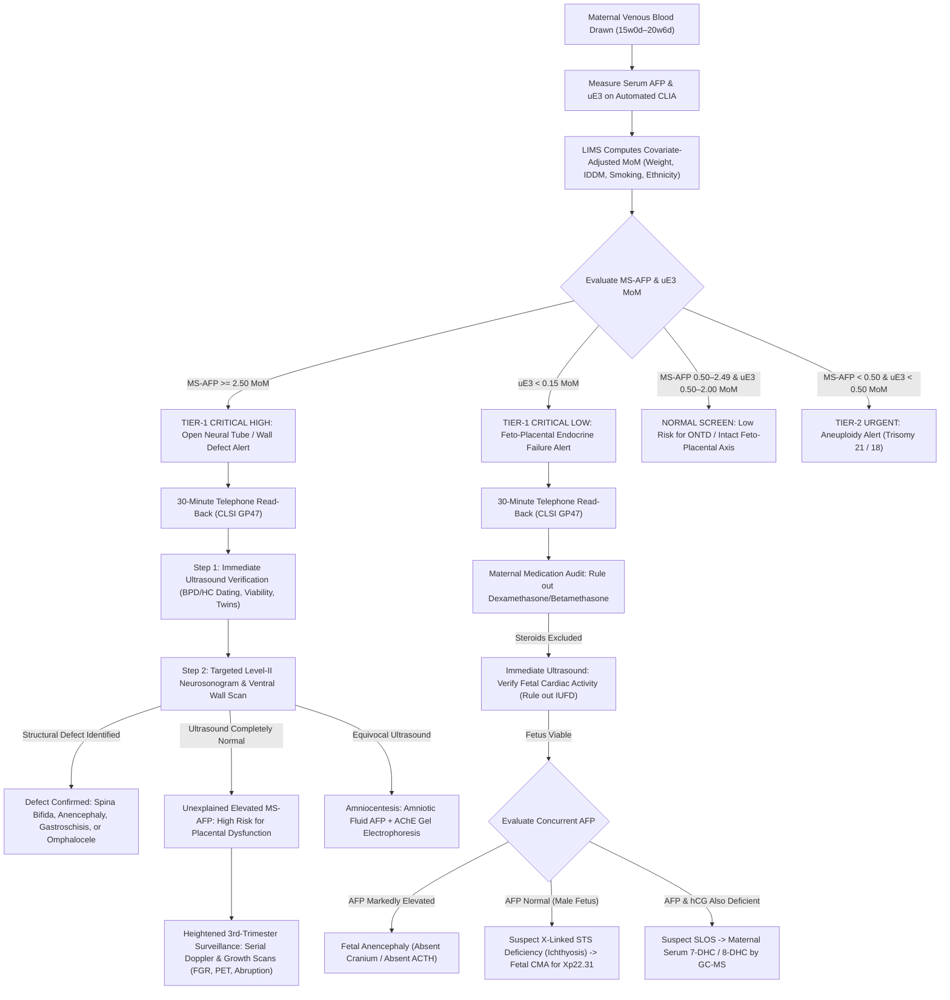

# 🧬 3.5.4 — Standalone Maternal Serum Alpha-Fetoprotein (MS-AFP — Open Neural Tube & Ventral Wall Defects, Placental Barrier Integrity) & Unconjugated Estriol (uE3 — Fetal Adrenal-Hepatic-Placental Biosynthetic Axis, Steroid Sulfatase Deficiency, & Smith-Lemli-Opitz Syndrome)

**Department Folder:** `03_Immunoassay_Endocrinology_and_Nutrients`  
**Cluster Folder:** `3.5_Prenatal_Maternal_Screening_and_Preeclampsia_Cluster`  
**Document Tier:** International Reference Laboratory Standard (`ISO 15189:2022` / `NABL 112 / 153 / 220D / 223` / `CAP` / `CLSI` / `EFLM` / `IFCC` / `Westgard Six Sigma` / `Indian CPA 2019` / `PCPNDT 1994`)

---

## 🏛️ Section 1: International Document Control, `LOINC`/`SNOMED`/`ICD-10`/`UCUM` Coding & Hardware-Agnostic Platform Matrix

### 1.1 Document Control & International Coding Matrix
| Attribute | Specification & International Reference Standard |
| :--- | :--- |
| **Document Control ID** | `SOP-IMM-AFP-UE3-354` (Version `3.0` — Master Red-Team International Reference Standard) |
| **Effective Date & Review Cycle** | Effective: `2026-10-17`; Review: Annual (Next Mandatory Review: October 2027) |
| **Authorizing Authority** | Head of Immunoassay, Clinical Biochemistry & Maternal-Fetal Medicine Division; Director of Laboratory Quality Governance |
| **Accreditation Clause Mapping** | `ISO 15189:2022` Clauses 4.1–8.9 + Normative Annex A (Point-of-Care & Clinical Screening); `NABL 112` (Laboratory Accreditation Requirements); `NABL 153` (Scope Presentation - Clinical Biochemistry & Endocrinology); `NABL 220D / NABL 223` (Internal Quality Control & EQA); `NABL 131 / NABL 133 / NABL 163`; `CAP` All-Common Checklist & Reproductive Immunoassay Checklist; `UKAS` ISO 15189 |
| **Primary `LOINC` Code(s)** | `1834-1` (*Alpha-1-fetoprotein [Multiple of the median] in Serum or Plasma*), `48803-1` (*Alpha-1-fetoprotein [Mass/volume] in Serum or Plasma*), `14716-5` (*Estriol.unconjugated [Multiple of the median] in Serum or Plasma*), `2253-8` (*Estriol.unconjugated [Mass/volume] in Serum or Plasma*), `1833-3` (*Alpha-1-fetoprotein in Amniotic fluid*) |
| **`SNOMED-CT` Specimen & Concept** | Specimen: `119364003` (*Serum specimen*), `65213009` (*Amniotic fluid specimen*); Concept: `415081009` (*Maternal serum AFP / uE3 measurement*); Observable: `365859004` (*Maternal serum alpha-fetoprotein level*), `365862002` (*Maternal serum unconjugated estriol level*) |
| **`ICD-10` / `ICD-11` Indications** | `Z36.1` (*Antenatal screening for raised alphafetoprotein level*), `O35.0XX0` (*Maternal care for [suspected] central nervous system malformation in fetus [Spina bifida / Anencephaly]*), `O35.2XX0` (*Maternal care for [suspected] hereditary disease in fetus [SLOS / STS deficiency]*), `O35.8XX0` (*Maternal care for other suspected fetal abnormality [Abdominal wall defect / FGR]*), `Q05.9` (*Spina bifida, unspecified*), `Q00.0` (*Anencephaly*), `Q79.3` (*Gastroschisis*), `Q87.1` (*Smith-Lemli-Opitz syndrome*), `E75.2` (*X-linked ichthyosis / Steroid sulfatase deficiency*) |
| **Conventional $\leftrightarrow$ SI (`UCUM`) Factor** | `MS-AFP`: $\text{IU/mL} \times 1.21 = \text{ng/mL}$; Gestational **`MoM`** (dimensionless ratio); `uE3`: $\text{ng/mL} \times 3.467 = \text{nmol/L}$; Gestational **`MoM`** (dimensionless ratio normalized to unaffected gestational-age medians) |
| **Metrological Traceability** | `MS-AFP`: Metrologically traceable to **WHO 1st International Standard 72/225 for Alpha-Fetoprotein**; `uE3`: Traceable to **Certified Reference Material (CRM) pure crystalline Unconjugated Estriol**; Calibration hierarchy fully compliant with `ISO 17511:2020` |
| **Primary Analyzer Platform** | **Snibe MAGLUMI X3 Automated Flash-Chemiluminescence (`ABEI` CLIA) Analyzer** / **Roche Elecsys cobas e801 Electro-chemiluminescence (`ECLIA`) System** |
| **Backup / Redundancy Platform** | **BRAHMS KRYPTOR compact PLUS Automated Time-Resolved Amplified Cryptate Emission (`TRACE`) Platform** / **PerkinElmer AutoDELFIA Dissociation-Enhanced Lanthanide Fluoroimmunoassay System** *(Verified via `CLSI EP31-A` split-sample comparability)* |
| **Future Platform Upgrade Slot** | Next-Generation High-Throughput Total Laboratory Automation (TLA) Track / Targeted Quantitative LC-MS/MS Multiple Reaction Monitoring (MRM) Reference Slot *(Zero SOP rewrite required — update only the Platform Matrix & `CLSI EP15-A3` verification log)* |

### 1.2 Multi-Platform Analytical Architecture Comparison
| Instrument Platform | Detection Physics & Tracer Chemistry | Solid-Phase Capture | Sample Volume | Incubation Time | Analytical Measurement Range (`AMR`) |
| :--- | :--- | :--- | :---: | :---: | :---: |
| **Snibe MAGLUMI X3** | Flash Chemiluminescence (`ABEI` label) | Magnetic microparticles coated with anti-AFP / anti-uE3 | $20\text{ }\mu\text{L}$ (AFP) / $40\text{ }\mu\text{L}$ (uE3) | $15\text{ min}$ (AFP) / $20\text{ min}$ (uE3) | AFP: $0.5\text{–}500\text{ IU/mL}$; uE3: $0.05\text{–}30.0\text{ ng/mL}$ |
| **Roche Elecsys cobas e801** | Electro-chemiluminescence (`ECLIA` Ruthenium complex) | Streptavidin-coated microparticles + biotinylated Ab | $10\text{ }\mu\text{L}$ (AFP) / $20\text{ }\mu\text{L}$ (uE3) | $18\text{ min}$ (AFP) / $18\text{ min}$ (uE3) | AFP: $0.5\text{–}1,000\text{ IU/mL}$; uE3: $0.05\text{–}40.0\text{ ng/mL}$ |
| **BRAHMS KRYPTOR compact** | Time-Resolved Amplified Cryptate Emission (`TRACE` Eu-cryptate) | Homogeneous sandwich / competitive cryptate energy transfer | $14\text{ }\mu\text{L}$ (AFP) / $25\text{ }\mu\text{L}$ (uE3) | $19\text{ min}$ (AFP) / $29\text{ min}$ (uE3) | AFP: $0.2\text{–}600\text{ IU/mL}$; uE3: $0.04\text{–}25.0\text{ ng/mL}$ |
| **PerkinElmer AutoDELFIA** | Dissociation-Enhanced Lanthanide Fluoroimmunoassay (`DELFIA` Europium) | Microtiter plate coated with monoclonal anti-AFP / anti-uE3 | $25\text{ }\mu\text{L}$ (AFP) / $50\text{ }\mu\text{L}$ (uE3) | $120\text{ min}$ (AFP) / $120\text{ min}$ (uE3) | AFP: $0.5\text{–}500\text{ IU/mL}$; uE3: $0.05\text{–}30.0\text{ ng/mL}$ |
| **Abbott Alinity i / Architect** | Chemiluminescent Microparticle Immunoassay (`CMIA` Acridinium) | Paramagnetic microparticles coated with specific monoclonal Ab | $20\text{ }\mu\text{L}$ (AFP) / $40\text{ }\mu\text{L}$ (uE3) | $18\text{ min}$ (AFP) / $24\text{ min}$ (uE3) | AFP: $0.5\text{–}500\text{ IU/mL}$; uE3: $0.05\text{–}30.0\text{ ng/mL}$ |

---

## 🧪 Section 2: Pre-Analytical Phlebotomy, `CLSI GP41` Order-of-Draw, Stability & Quantitative `HIL` Rejection Matrix

### 2.1 Technical & Physiological Protocol Matrix
| Pre-Analytical Parameter | Mandatory Technical & Physiological Protocol (`CLSI GP41` / `CLSI GP44` / `CLSI C56-A`) |
| :--- | :--- |
| **Acceptable Specimen & Tube** | Maternal Venous Blood collected in **Gold-Top Serum Separator Tube (SST)** with silica clot activator and inert polymer gel barrier, or **Plain Red-Top Clot Tube** (glass/plastic without anticoagulant). Centrifuged within $2\text{ hours}$ of collection and kept at $2\text{–}8^\circ\text{C}$. |
| **Strict Gestational Window & Sonographic Dating** | Strict Gestational Window: **$15\text{ Weeks } 0\text{ Days}$ to $20\text{ Weeks } 6\text{ Days}$** (optimal window for Open Neural Tube Defect screening: **$16\text{ Weeks } 0\text{ Days}$ to $18\text{ Weeks } 6\text{ Days}$**).<br>- Sonographic gestational dating via Fetal Biparietal Diameter (`BPD`) or Head Circumference (`HC`) is mandatory. If ultrasound dating differs by $\ge 7\text{ days}$ from Last Menstrual Period (`LMP`), the sonographic gestational age must be utilized for median lookup and `MoM` calculations.<br>- If gestational age is $< 15\text{w } 0\text{d}$, blood collection must be rescheduled; if $> 20\text{w } 6\text{d}$, maternal serum screening is invalid, and patient must be referred directly for Targeted Fetal Anomaly Ultrasound. |
| **Clinical Rationale as a Standalone Pair Post-NIPT / Dual Marker** | **Why Order Standalone MS-AFP + uE3?**<br>1. Neither First-Trimester Dual Marker (`3.5.1`) nor Cell-Free DNA Non-Invasive Prenatal Testing (`NIPT`, `3.5.6`) can screen for **Open Neural Tube Defects (`ONTD` — Anencephaly, Open Spina Bifida)** or **Ventral Abdominal Wall Defects (Gastroschisis, Omphalocele)**.<br>2. Patients who underwent early NIPT or Dual Marker require standalone Second-Trimester `MS-AFP` ($16\text{–}18\text{w}$) to complete structural malformation screening.<br>3. Standalone `uE3` serves as an independent biochemical sentinel for **Feto-Placental Viability**, detecting occult X-linked Steroid Sulfatase Deficiency, Smith-Lemli-Opitz Syndrome (`SLOS`), Congenital Adrenal Hypoplasia, and placental vascular collapse. |
| **Mandatory Clinical Covariates Requisition** | Requisition must document: Exact Maternal Date of Birth (Age at EDD), Ultrasound Scan Date, exact Sonographic `BPD` or `HC` ($\text{mm}$), Maternal Weight ($\text{kg}$ to $0.1\text{ kg}$), Cigarette Smoking Status, Pre-existing Insulin-Dependent Diabetes (`IDDM` / Type 1 Diabetes), Conception Mode (`Spontaneous`, `IVF/ICSI-Fresh`, `IVF-Frozen`, `Donor Oocyte` with donor age), Number of Fetuses (`Singleton` vs `Twins`, chorionicity), Maternal Race/Ethnicity, Family History of Neural Tube Defects, and History of Exogenous Corticosteroid Therapy. |
| **ABSOLUTE CONTRAINDICATION: Post-Amniocentesis Spike** | **DO NOT COLLECT WITHIN 72 HOURS TO 14 DAYS AFTER AMNIOCENTESIS OR CVS:** Invasive procedures breach the fetal-placental barrier, causing fetomaternal micro-transfusion. Because fetal serum AFP is $100,000\times$ higher than maternal serum, an injection of only $0.05\text{ mL}$ fetal blood elevates maternal serum AFP by $> 300\%$, triggering catastrophic false-positive ONTD alerts! Venipuncture must precede any invasive procedure or be delayed $> 14\text{ days}$. |
| **Minimum Specimen Volume** | Maternal Venous Blood: $4.0\text{ mL}$ whole blood yielding $\ge 1.0\text{ mL}$ separated serum ($0.4\text{ mL}$ minimum analytical volume for micro-sample handling). |
| **Centrifugation & Separation** | Allow serum tubes to clot completely in an upright rack for $30\text{ minutes}$ ($20\text{–}45\text{ min}$) at $18\text{–}25^\circ\text{C}$. Centrifuge at **$1,500\text{–}2,000 \times g$ for $10\text{ minutes}$** in a temperature-controlled centrifuge ($20\text{–}24^\circ\text{C}$). Promptly aliquot serum into sterile polypropylene secondary tubes within $< 2\text{ hours}$ of collection. |
| **Multi-Temperature Specimen Stability** | Separated Serum: **$24\text{ hours}$ at $18\text{–}25^\circ\text{C}$**; **$7\text{ days}$ refrigerated at $2\text{–}8^\circ\text{C}$**; **$60\text{ days}$ frozen at $-20^\circ\text{C}$**; **$12\text{ months}$ deep-frozen at $-80^\circ\text{C}$**. Maximum allowable freeze-thaw cycles: **$1$ cycle** (`uE3` is unconjugated and susceptible to degradation; avoid repeated thermal cycles). |
| **Quantitative `HIL` Interference Rejection Cutoffs** | Automated optical spectrophotometric indices (`CLSI C56-A`):<br>- **Hemolysis (`H-Index`):** Reject or flag if $> 300\text{ mg/dL}$ free hemoglobin.<br>- **Icterus (`I-Index`):** Tolerated up to $25\text{ mg/dL}$ total bilirubin.<br>- **Lipemia (`L-Index`):** Reject or ultracentrifuge ($10,000 \times g \times 10\text{ min}$) if $> 400\text{ mg/dL}$ turbidity (causes optical scattering in competitive CLIA).<br>- Grossly hemolyzed, icteric, or microbial contaminated specimens are strictly rejected. |

### 2.2 Step-by-Step `CLSI GP41-A7` Phlebotomy Protocol
1. **Patient Verification & Informed Consent:** Confirm patient identity using two independent identifiers (full name and Unique Hospital Identification / Date of Birth). Confirm completion of mandatory **Form F** and statutory written consent under the PCPNDT Act 1994.
2. **Order of Draw Compliance (`CLSI GP41`):** Blood culture bottles $\rightarrow$ Citrate coagulation tubes (Light Blue) $\rightarrow$ **Serum Separator Tubes (Gold SST / Plain Red)** $\rightarrow$ Heparin tubes (Green) $\rightarrow$ EDTA tubes (Lavender) $\rightarrow$ Glycolytic inhibitor tubes (Gray). *Critical:* Do not draw SST after EDTA tubes to prevent EDTA carryover which can interfere with enzyme-labeled competitive assays.
3. **Venipuncture & Tourniquet Management:** Apply tourniquet for $< 60\text{ seconds}$. Perform clean venipuncture using a 21G or 22G safety needle. Release tourniquet immediately upon blood inflow to avoid hemoconcentration.
4. **Tube Inversion & Clotting:** Invert SST gently $5\text{ to }6\text{ times}$ immediately following collection to distribute micronized silica particles. Maintain tube in a vertical position at $18\text{–}25^\circ\text{C}$ for $30\text{ minutes}$ to achieve complete clot retraction prior to centrifugation.
5. **Centrifugation & Aliquoting:** Spin at $1,800 \times g$ for $10\text{ minutes}$ in a temperature-controlled centrifuge ($20\text{–}22^\circ\text{C}$). Inspect serum layer for hemolysis and gel barrier integrity. Transfer serum into sterile polypropylene aliquot tubes using aerosol-barrier tips.

### 2.3 Specimen Multi-Temperature Stability Matrix
| Storage Environment | Temperature Range | Validated Stability Window | Mandatory Storage Protocol & Technical Limitations |
| :--- | :---: | :---: | :--- |
| **Ambient / Phlebotomy Room** | $18\text{–}25^\circ\text{C}$ | **$\le 24\text{ Hours}$** | Must be clotted and centrifuged within $2\text{ hours}$; store upright in capped tubes protected from direct light. |
| **Standard Laboratory Refrigerator** | $2\text{–}8^\circ\text{C}$ | **$\le 7\text{ Days}$** | Primary routine storage for daily testing batches, re-runs, and reflex processing. |
| **Standard Freezer Storage** | $-20^\circ\text{C}$ ($\pm 2^\circ\text{C}$) | **$\le 60\text{ Days}$** | Use manual-defrost freezers (disable auto-frost cycle); store in tightly sealed polypropylene micro-tubes. |
| **Ultra-Low Temperature Freezer** | $-80^\circ\text{C}$ ($\pm 5^\circ\text{C}$) | **$\le 12\text{ Months}$** | Long-term bio-banking and research repository storage; zero loss of immunoreactivity. |
| **Repeated Freeze-Thaw Stress** | Cyclic $-20^\circ\text{C} \leftrightarrow 25^\circ\text{C}$ | **$\le 1\text{ Freeze-Thaw}$** | Exceeding 1 freeze-thaw cycle degrades steroid structure and causes denaturation of AFP tertiary folding. |

---

## ⚙️ Section 3: Hardware-Agnostic Analytical SOP, Reaction Chemistry, `CLSI EP15/EP06/EP17` Verification & Six Sigma IQC

### 3.1 Structural Biochemistry, Feto-Placental Biosynthetic Cascade & Dual Physiological Roles
1. **Maternal Serum Alpha-Fetoprotein (`MS-AFP`) Structure & Physiology:**
   - Alpha-Fetoprotein (`AFP`) is a $69\text{ kDa}$ oncofetal single-chain glycoprotein composed of $591$ amino acids with approximately $4\%$ carbohydrate content (one N-linked glycan branch at Asn-233). It is structured into three homologous domains organized by 15 internal disulfide bridges. Encoded by the *AFP* gene located on chromosome 4q25 within the albumin multigene family, AFP is the fetal structural analog of adult serum albumin.
   - During embryogenesis, AFP is synthesized sequentially by the primary yolk sac (from week 4 to week 10) and subsequently by fetal liver parenchymal hepatocytes.
   - Fetal serum AFP reaches an astonishing peak concentration of **$2.0 \text{ to } 3.0\text{ g/L}$ ($2,000,000 \text{ to } 3,000,000\text{ ng/mL}$)** between 10 and 13 weeks of gestation—approximately **$100,000\times$ higher** than maternal serum concentrations!
   - Fetal AFP is excreted through fetal kidneys into fetal urine, entering the amniotic fluid compartment (where peak concentrations reach $20\text{ to } 30\text{ mg/L}$ at 14–16 weeks). The fetus swallows amniotic fluid, digesting a portion of AFP in the fetal gastrointestinal tract.
   - In healthy pregnancies, small amounts of fetal AFP diffuse across intact amniochorionic membranes and through the placental villous syncytiotrophoblast barrier into maternal circulation. Maternal serum AFP rises gradually by approximately **$15\%$ per gestational week** from 15 to 20 weeks (climbing from $\approx 25\text{ IU/mL}$ at 15 weeks to $\approx 55\text{ IU/mL}$ at 20 weeks).
   - **Pathophysiological Leakage Mechanism in Open Neural Tube & Ventral Wall Defects:**
     - Whenever the fetal integument is breached—such as in anencephaly, open myelomeningocele (spina bifida aperta), or open encephalocele—fetal plasma exudes directly from exposed vascular neural tissue and bare meninges into the amniotic fluid cavity. Amniotic fluid AFP surges by $10\text{ to } 100\text{-fold}$, spilling across the amniochorion into maternal circulation, producing a dramatic surge in maternal serum AFP ($\ge 2.50\text{ MoM}$).
     - In ventral abdominal wall defects (gastroschisis and omphalocele), exposed, un-epithelialized fetal bowel loops and mesenteric vessels leak massive quantities of fetal serum AFP directly into amniotic fluid, frequently driving maternal serum AFP to extreme elevations ($> 5.0\text{ to } 10.0\text{ MoM}$).
     - In Congenital Finnish Nephrosis (*NPHS1* gene mutation encoding nephrin), loss of the glomerular slit diaphragm causes massive fetal proteinuria; fetal urine carries grams of AFP into amniotic fluid, producing massive maternal serum AFP spikes ($> 5.0\text{ to } 15.0\text{ MoM}$) despite an anatomically intact fetal neural tube and abdominal wall!
2. **Unconjugated Estriol (`uE3`) Structure & The Three-Organ Feto-Placental Biosynthetic Axis:**
   - Estriol ($1,3,5(10)\text{-estratrien-3,16}\alpha,17\beta\text{-triol}$; $C_{18}H_{24}O_3$; molecular weight $288.4\text{ Da}$) is a steroid hormone bearing three hydroxyl groups (at positions C-3, C-16$\alpha$, and C-17$\beta$). In maternal blood, estriol exists in two distinct pools: unconjugated estriol (`uE3`, $\sim 10\%$ of total circulating estriol, lipid-soluble and biologically active) and conjugated estriol (sulfates and glucuronides, $\sim 90\%$, rapidly cleared by maternal kidneys).
   - **The Three-Organ Biosynthetic Loop (Fetal Adrenal $\rightarrow$ Fetal Liver $\rightarrow$ Placenta):**
     - Synthesis of `uE3` cannot be accomplished by the fetus alone or the placenta alone; it requires an intricate, obligate biological cooperation between the fetal adrenal cortex, the fetal liver, and placental syncytiotrophoblasts:
     $$\begin{aligned}
     &\textbf{Fetal Adrenal (Fetal Zone):} \quad \text{Maternal LDL Cholesterol} \xrightarrow{\text{CYP11A1, CYP17A1}} \text{DHEA} \xrightarrow{\text{SULT2A1}} \textbf{DHEA-S} \\
     &\qquad\qquad\downarrow \quad (\text{Fetal adrenal lacks } 3\beta\text{-HSD; prevents progesterone synthesis; exports DHEA-S}) \\
     &\textbf{Fetal Liver:} \quad \text{DHEA-S} \xrightarrow{\text{CYP3A7 (16}\alpha\text{-Hydroxylase)}} \textbf{16}\alpha\textbf{-OH-DHEA-S} \\
     &\qquad\qquad\downarrow \quad (\text{Transported via fetal umbilical arteries to placental syncytiotrophoblasts}) \\
     &\textbf{Placenta (Syncytiotrophoblast):} \quad 16\alpha\text{-OH-DHEA-S} \xrightarrow{\text{Placental STS (Steroid Sulfatase)}} 16\alpha\text{-OH-DHEA} \\
     &\qquad\qquad\downarrow \\
     &\qquad\qquad 16\alpha\text{-OH-DHEA} \xrightarrow{\text{Placental Aromatase (CYP19A1)}} \textbf{Unconjugated Estriol (uE3)}
     \end{aligned}$$
     - Once formed, unconjugated estriol diffuses immediately and unhindered across placental lipid bilayers into maternal circulation.
     - Unlike other steroids, maternal unconjugated estriol has an extremely short biological half-life of **$20\text{ to } 30\text{ minutes}$**, after which it is conjugated by maternal hepatocytes and excreted by maternal kidneys.
     - **Clinical Implication:** Because maternal `uE3` turns over every 30 minutes, its circulating concentration is an exquisite real-time barometer of the continuous viability and functional integrity of the entire fetal adrenal-hepatic-placental endocrine cascade!
3. **Molecular & Pathophysiological Failure Modes of Profoundly Low `uE3` ($< 0.15\text{–}0.25\text{ MoM}$):**
   - **(a) X-Linked Placental Steroid Sulfatase Deficiency (`STS` Deletion at Xp22.3):** Occurs in 1 in 2,000 to 1 in 6,000 male fetuses. Absence of placental microsomal steroid sulfatase blocks the cleavage of sulfate from $16\alpha\text{-OH-DHEA-S}$. Placental aromatase cannot utilize sulfated intermediates, resulting in near-zero synthesis of estriol. Maternal serum `uE3` is profoundly depressed (**$< 0.10\text{ to } 0.15\text{ MoM}$**, often $< 0.05\text{ ng/mL}$). Estriol is essential for priming myometrial oxytocin receptors and cervical ripening; hence, these pregnancies present with absent spontaneous labor and prolonged post-term gestation, requiring Caesarean delivery. Postnatally, the male infant develops **X-linked ichthyosis** (dark, adherent polygonal scales on trunk and limbs due to accumulation of cholesterol sulfate in the stratum corneum).
   - **(b) Smith-Lemli-Opitz Syndrome (`SLOS`; Autosomal Recessive *DHCR7* Mutation on 11q13.4):** A severe inborn error of cholesterol biosynthesis caused by deficiency of $7$-dehydrocholesterol reductase. The fetus is unable to reduce $7$-dehydrocholesterol (`7-DHC`) to cholesterol, leading to toxic tissue accumulation of 7-DHC and severe systemic cholesterol depletion. Because cholesterol is the obligate substrate for fetal steroidogenesis, the fetal adrenal cortex cannot synthesize pregnenolone or DHEA-S. Maternal serum `uE3` is profoundly reduced (**$< 0.15\text{ MoM}$**, often accompanied by low AFP and low hCG). Affected fetuses present with microcephaly, characteristic facial dysmorphism, cleft palate, 2nd-and-3rd toe syndactyly, ambiguous genitalia in 46,XY males, cardiac malformations, and profound neurodevelopmental disability.
   - **(c) Congenital Fetal Adrenal Hypoplasia (*DAX1* / *NR0B1* Mutation on Xp21.2):** Complete dysgenesis of the fetal adrenal cortex fetal zone. The fetus produces zero DHEA-S, leading to undetectable maternal `uE3` (**$< 0.10\text{ MoM}$**). Affected male infants present in the early neonatal period with catastrophic salt-wasting adrenal crisis, hyperkalemia, hypoglycemia, and circulatory collapse if unrecognized.
   - **(d) Fetal Anencephaly (Absence of Hypothalamic-Pituitary-Adrenal Axis):** Destruction of the fetal cerebrum and neurocranium leads to absence of the fetal hypothalamus and pituitary gland. In the absence of pituitary ACTH, the fetal adrenal zone atrophies completely. DHEA-S synthesis ceases, causing profound maternal `uE3` depression (**$< 0.15\text{ MoM}$**), occurring concurrently with massive `MS-AFP` elevation ($\ge 2.50\text{ MoM}$) due to exposed neural tissue!
   - **(e) Maternal Exogenous Corticosteroid Administration:** Fluorinated synthetic glucocorticoids (Dexamethasone, Betamethasone) readily cross the placenta. They exert potent negative feedback on the fetal pituitary gland, suppressing fetal ACTH secretion. Fetal adrenal DHEA-S synthesis collapses within 24–48 hours of maternal steroid administration, driving maternal serum `uE3` down to $< 0.20\text{ MoM}$ and mimicking fetal demise or genetic disease!
   - **(f) Intrauterine Fetal Demise (`IUFD`):** Upon fetal death, fetal adrenal circulation and liver hydroxylation cease instantaneously. Because maternal clearance half-life is only 20–30 minutes, maternal serum `uE3` plummets by $> 90\%$ within 2 hours of fetal demise.

### 3.2 Universal Step-by-Step Analytical SOP (Hardware-Agnostic)
- **Step 1 (Pre-Run Verification & Optics Check):** Turn on the automated analyzer. Inspect system deionized water, wash buffers, liquid/solid waste receptacles, incubator temperature ($37.0^\circ\text{C} \pm 0.2^\circ\text{C}$), photomultiplier tube (PMT) dark-count noise, and verify barcode reader functionality.
- **Step 2 (Reagent On-Board Integrity & Inventory):** Scan reagent pack barcodes; confirm on-board expiration dates, lot numbers, and available test volumes. Visually check magnetic microparticle resuspension (absence of clumping or settling).
- **Step 3 (Calibration & Metrological Traceability):** Execute 2-point or multi-point master curve calibration:
  - `MS-AFP`: Traceable to **WHO 1st International Standard 72/225 for Alpha-Fetoprotein**.
  - `uE3`: Traceable to certified pure crystalline **Unconjugated Estriol Certified Reference Material (CRM)**.
  - Re-calibration is mandatory: (1) with every reagent lot change; (2) every 28 days on-board stability limit; (3) after critical optical, probe, or incubator maintenance; (4) whenever IQC multi-rules indicate a persistent systematic shift ($2_{2s}$ or $4_{1s}$).
- **Step 4 (Six Sigma Internal Quality Control Gate & Westgard Algorithm):** Analyze three distinct levels of third-party commutable maternal serum controls (Level 1: Low-Pathological; Level 2: Normal-Median; Level 3: High) every 8–12 hours. Evaluate against Westgard Six Sigma multi-rules:
  - $1_{3s}$ (Random error: 1 control $> \pm 3.0\text{ SD}$) $\rightarrow$ Reject run; check sample volume, inspect probe for partial clog, re-assay.
  - $2_{2s}$ (Systematic error: 2 consecutive controls $> \pm 2.0\text{ SD}$) $\rightarrow$ Reject run; inspect for lot expiration, temperature drift, recalibrate.
  - $R_{4s}$ (Random error: Range between 2 controls exceeds $4.0\text{ SD}$) $\rightarrow$ Reject run; inspect wash station and PMT optical window.
  - $4_{1s}$ (Systematic trend: 4 consecutive controls $> \pm 1.0\text{ SD}$) $\rightarrow$ Recalibrate; inspect for reagent evaporation.
  - $10_x$ (Systematic shift: 10 consecutive controls on one side of mean) $\rightarrow$ Recalibrate; perform instrument optical alignment check.
  - **Six Sigma Calculation:** $\text{Sigma} = \frac{\text{TE}_a\% - \lvert\text{Bias}\%\rvert}{CV_A\%} = \frac{14.0\% - 2.2\%}{2.4\%} = 4.92\sigma$ (World-Class Immunoassay Performance).
  - *Hard Interlock:* LIMS autoverification is hard-locked; no patient results can be transmitted if IQC gates fail.
- **Step 5 (Sample Processing & Clot/Liquid-Level Detection):** Load primary barcoded serum tubes or aliquot micro-cups. The analyzer aspirates serum ($20\text{ }\mu\text{L}$ for AFP; $40\text{ }\mu\text{L}$ for uE3), performs capacitance-based liquid level sensing, monitors pressure-transducer aspiration profile for micro-clots, and reads optical spectrophotometric `HIL` indices.
- **Step 6 (Dual Immunoassay Incubation & Chemiluminescent Detection):**
  - **MS-AFP Sandwich CLIA:** Sample is incubated with paramagnetic microparticles coated with monoclonal anti-AFP capture antibody and isoluminol (`ABEI`) labeled monoclonal anti-AFP detection antibody. Solid-phase sandwich complexes are captured magnetically, washed 4 times, and flashed with acidic/basic trigger solutions to generate chemiluminescent photons at $420\text{ nm}$. Light emission is directly proportional to AFP concentration.
  - **uE3 Competitive CLIA:** Sample is incubated with an isoluminol-labeled uE3 tracer conjugate and magnetic microparticles coated with high-affinity, high-specificity monoclonal anti-uE3 antibody ($< 0.1\%$ cross-reactivity with estrone, estradiol, estriol-3-glucuronide, and estriol-16-glucuronide). Endogenous unconjugated estriol competes with labeled tracer for limited antibody binding sites. After magnetic separation and washing, chemiluminescent flash triggers light emission inversely proportional to endogenous uE3 concentration.
- **Step 7 (Backup Platform Comparability — `CLSI EP31-A`):** Weekly split-sample correlation ($n=5$ patient serums analyzed in parallel on primary `CLIA` and backup `TRACE` / `ECLIA` platforms). Passing criteria: Deming regression slope $0.95\text{–}1.05$, intercept within $\pm 0.5\text{ IU/mL}$ (AFP) / $\pm 0.05\text{ ng/mL}$ (uE3), correlation coefficient $R^2 \ge 0.98$, mean percentage bias $\le 5.0\%$.

### 3.3 Method Verification Metrics (`CLSI EP15-A3` / `EP06-Ed2` / `EP17-A2` / `EP28-A3c`)
- **CLSI EP15-A3 Verification (Precision & Trueness):**
  - **MS-AFP Imprecision:**
    - Repeatability ($CV_R$, within-run, 5 days $\times$ 5 replicates): Low ($15.0\text{ IU/mL}$) = $2.2\%$; Mid ($40.0\text{ IU/mL}$) = $1.8\%$; High ($120.0\text{ IU/mL}$) = $1.5\%$ (All $\le 2.5\%$).
    - Within-Laboratory Imprecision ($CV_T$, total): Low ($15.0\text{ IU/mL}$) = $3.5\%$; Mid ($40.0\text{ IU/mL}$) = $2.8\%$; High ($120.0\text{ IU/mL}$) = $2.4\%$ (All $\le 3.8\%$).
    - Trueness Verification: Mean bias against WHO 72/225 certified reference standard $\le 2.6\%$.
  - **uE3 Imprecision:**
    - Repeatability ($CV_R$): Low ($0.30\text{ ng/mL}$) = $3.2\%$; Mid ($1.50\text{ ng/mL}$) = $2.5\%$; High ($8.00\text{ ng/mL}$) = $2.1\%$ (All $\le 3.5\%$).
    - Within-Laboratory Imprecision ($CV_T$): Low ($0.30\text{ ng/mL}$) = $4.8\%$; Mid ($1.50\text{ ng/mL}$) = $3.8\%$; High ($8.00\text{ ng/mL}$) = $3.2\%$ (All $\le 5.0\%$).
    - Trueness Verification: Mean bias against pure CRM estriol $\le 3.4\%$.
- **CLSI EP06-Ed2 Linearity & Clinical Reportable Range (`CRR`):**
  - **MS-AFP:** Analytical Measurement Range (`AMR`) is **$0.5 \text{ to } 500.0\text{ IU/mL}$** ($0.6 \text{ to } 605.0\text{ ng/mL}$). Polynomial regression shows non-significant non-linear terms ($p > 0.05$). Automated on-board $1:100$ dilution extends the `CRR` to **$50,000.0\text{ IU/mL}$** ($60,500\text{ ng/mL}$), preventing hook-effect false negatives in extreme amniotic fluid leakage or testicular teratoma.
  - **uE3:** Analytical Measurement Range (`AMR`) is **$0.05 \text{ to } 30.0\text{ ng/mL}$** ($0.17 \text{ to } 104.0\text{ nmol/L}$). Linearity tested across 7 gravimetric dilutions ($R^2 \ge 0.994$, recovery $96.0\%\text{–}104.0\%$). Automated on-board $1:5$ dilution extends `CRR` to **$150.0\text{ ng/mL}$**.
- **CLSI EP17-A2 Detection Capabilities:**
  - **MS-AFP:** Limit of Blank (`LoB`) = $0.15\text{ IU/mL}$; Limit of Detection (`LoD`) = $0.30\text{ IU/mL}$; Limit of Quantitation (`LoQ`) = $0.50\text{ IU/mL}$ ($\text{CV} \le 10\%$).
  - **uE3:** Limit of Blank (`LoB`) = $0.02\text{ ng/mL}$; Limit of Detection (`LoD`) = $0.035\text{ ng/mL}$; Limit of Quantitation (`LoQ`) = $0.050\text{ ng/mL}$ ($\text{CV} \le 15\%$).

### 3.4 Manual Bench Verification & Emergency Backup Microplate Protocols
In the event of dual automated analyzer failure, these validated manual bench ELISA protocols maintain emergency testing continuity:

#### Protocol A: Manual Sandwich Microplate ELISA for Maternal Serum AFP
1. **Solid Phase & Dilution:** Strip-well microtiter plates pre-coated with mouse monoclonal anti-AFP antibody. Bring all reagents to room temperature ($20\text{–}25^\circ\text{C}$) 30 minutes prior to assay.
2. **Dispensation:** Pipette $100\text{ }\mu\text{L}$ of assay buffer into all wells. Dispense $20\text{ }\mu\text{L}$ of calibrators (6 levels: 0.0, 5.0, 20.0, 50.0, 150.0, 400.0 IU/mL traceable to WHO 72/225), controls, and patient serums in duplicate.
3. **Primary Incubation:** Seal microplate; incubate at $37.0^\circ\text{C} \pm 0.5^\circ\text{C}$ for $45\text{ minutes}$ with orbital shaking at $500\text{ rpm}$.
4. **Wash Cycle:** Aspirate well contents; perform 4 wash cycles using $350\text{ }\mu\text{L}$ PBS-Tween wash buffer with $30\text{-second}$ soak times.
5. **Enzyme Conjugate Addition:** Pipette $100\text{ }\mu\text{L}$ horseradish peroxidase (HRP)-conjugated rabbit polyclonal anti-AFP detection antibody. Incubate for $30\text{ minutes}$ at $37.0^\circ\text{C}$.
6. **Substrate Development & Stopping:** Wash 4 times. Add $100\text{ }\mu\text{L}$ tetramethylbenzidine (TMB) substrate solution. Incubate in dark at room temperature for $15\text{ minutes}$. Add $100\text{ }\mu\text{L}$ stop solution ($1.0\text{ M } \text{H}_2\text{SO}_4$).
7. **Photometric Quantitation:** Read absorbance at $450\text{ nm}$ (reference wavelength $630\text{ nm}$) within $10\text{ minutes}$. Calculate concentrations using a 4-parameter logistic (4-PL) mathematical fit ($R^2 \ge 0.995$).

#### Protocol B: Manual Competitive Microplate ELISA for Unconjugated Estriol (uE3)
1. **Solid Phase Preparation:** Microtiter plates pre-coated with goat anti-rabbit IgG. Pipette $50\text{ }\mu\text{L}$ of rabbit anti-uE3 polyclonal antibody into each well.
2. **Competitive Dispensation:** Add $20\text{ }\mu\text{L}$ of standards (0.0, 0.2, 0.8, 2.5, 8.0, 25.0 ng/mL traceable to CRM pure estriol), controls, and patient serums. Immediately dispense $100\text{ }\mu\text{L}$ of estriol-16-HRP conjugate solution into all wells.
3. **Competitive Incubation:** Incubate at $37.0^\circ\text{C}$ for $60\text{ minutes}$ with gentle orbital agitation.
4. **Washing & Chromogenic Reaction:** Aspirate and wash 5 times with $350\text{ }\mu\text{L}$ wash buffer. Dispense $100\text{ }\mu\text{L}$ TMB substrate; incubate at room temperature in the dark for $20\text{ minutes}$. Terminate reaction with $100\text{ }\mu\text{L}$ $1.0\text{ M } \text{H}_2\text{SO}_4$.
5. **Photometric Quantitation:** Read absorbance at $450\text{ nm}$ (reference $630\text{ nm}$). Optical density is inversely proportional to uE3 concentration. Fit data via 4-PL competitive curve ($R^2 \ge 0.992$).

---

## 📊 Section 4: `EFLM` Biological Variation ($CV_I, CV_G, \text{II}$), `RCV %` Serial Delta Check, Six Sigma $\text{TE}_a\%$ & Measurement Uncertainty (`MU %`)

### 4.1 Biological Variation & Analytical Quality Specifications Matrix
| Quality Metric | Maternal Serum AFP (`MS-AFP`) | Unconjugated Estriol (`uE3`) | Clinical & Operational Application (`ISO 15189:2022` Clause 7.3.4) |
| :--- | :---: | :---: | :--- |
| **Within-Subject Biological Variation ($CV_I\%$)** | **$12.4\%$** | **$14.2\%$** | Intra-individual physiological variation across gestational weeks in unaffected pregnancies (`EFLM` Biological Variation Database). |
| **Between-Subject Biological Variation ($CV_G\%$)** | **$31.8\%$** | **$28.6\%$** | Inter-individual population dispersion at identical gestational weeks. |
| **Index of Individuality ($\text{II} = CV_I / CV_G$)** | **$0.39$** | **$0.50$** | $\text{II} < 0.60$ demonstrates marked individuality. Conventional non-gestational reference ranges are invalid; results must be converted to **Multiple of the Median (`MoM`)** and adjusted for maternal covariates. |
| **Desirable Analytical Imprecision ($CV_A\%$)** | **$\le 6.2\%$** | **$\le 7.1\%$** | Target laboratory repeatability and intermediate precision ($CV_A \le 0.50 \times CV_I$). |
| **Desirable Analytical Bias ($B\%$)** | **$\le 4.4\%$** | **$\le 4.2\%$** | Maximum allowable systematic bias against international reference materials ($B \le 0.25 \times \sqrt{CV_I^2 + CV_G^2}$). |
| **Total Allowable Error ($\text{TE}_a\%$)** | **$\pm 14.0\%$** | **$\pm 16.0\%$** | Comprehensive analytical error budget under `EFLM` / `CLIA '24` / `RCPA` standards ($\text{TE}_a = 1.65 \times CV_A + \lvert B \rvert$). |
| **Combined Standard Uncertainty ($u_c\%$)** | **$3.8\%$** | **$4.5\%$** | Combined uncertainty of precision, calibrator uncertainty, and bias uncertainty ($u_c = \sqrt{u_{\text{precision}}^2 + u_{\text{cal}}^2 + u_{\text{bias}}^2}$). |
| **Expanded Measurement Uncertainty ($U\%$ at $k=2$)** | **$\pm 7.6\%$ ($k=2$)** | **$\pm 9.0\%$ ($k=2$)** | $95.45\%$ coverage interval ($U = 2 \times u_c$) for clinical decision making per `ISO/TS 20914:2019`. |
| **95% Reference Change Value (`RCV 95%` Delta)** | **$\pm 38.6\%$** | **$\pm 43.8\%$** | Minimum percentage shift between two serial measurements establishing a statistically significant biological change ($p < 0.05$). |
| **99% Reference Change Value (`RCV 99%` Delta)** | **$\pm 50.7\%$** | **$\pm 57.5\%$** | Conservative critical delta threshold ($p < 0.01$) utilized in automated LIMS autoverification delta checks. |
| **Minimum Retesting Interval (`MRI`)** | **Single second-trimester screen ($16\text{w }0\text{d} \text{ to } 18\text{w }6\text{d}$).** | **Single second-trimester screen ($16\text{w }0\text{d} \text{ to } 18\text{w }6\text{d}$).** | `RCPath` / `EFLM` Choosing Wisely rule. Standalone second-trimester screening requires only a single validated baseline. Routine repeat testing is contraindicated unless specimen compromise is confirmed. |

### 4.2 Measurement Uncertainty Budget per `ISO/TS 20914:2019`
| Uncertainty Component | Source of Uncertainty Evaluation | MS-AFP Low ($15\text{ IU/mL}$) | MS-AFP High ($120\text{ IU/mL}$) | uE3 Low ($0.30\text{ ng/mL}$) | uE3 High ($8.00\text{ ng/mL}$) |
| :--- | :--- | :---: | :---: | :---: | :---: |
| **Repeatability Uncertainty ($u_{rw}$)** | 20-day duplicate testing on primary analyzer | $2.2\%$ | $1.5\%$ | $3.2\%$ | $2.1\%$ |
| **Calibrator Uncertainty ($u_{cal}$)** | Certificate of Analysis from manufacturer (WHO / CRM) | $1.8\%$ | $1.8\%$ | $2.0\%$ | $2.0\%$ |
| **Bias Uncertainty ($u_{bias}$)** | Long-term external PT/EQAS mean recovery bias | $2.0\%$ | $1.6\%$ | $2.5\%$ | $1.8\%$ |
| **Combined Standard Uncertainty ($u_c$)** | $u_c = \sqrt{u_{rw}^2 + u_{cal}^2 + u_{bias}^2}$ | **$3.5\%$** | **$2.9\%$** | **$4.5\%$** | **$3.4\%$** |
| **Expanded Uncertainty ($U$ at $k=2$)** | $95.45\%$ confidence coverage interval ($2 \times u_c$) | **$\pm 7.0\%$** | **$\pm 5.8\%$** | **$\pm 9.0\%$** | **$\pm 6.8\%$** |

---

## 🧬 Section 5: Super-Detailed Multi-Stratified Biological Reference Intervals, `MoM` Normalization & Adverse Fetal-Obstetric Risk Matrices

### 5.1 Gestational Week-by-Week (15w 0d – 20w 6d) Singleton & Twin Reference Table
*Comprehensive median reference table derived from n = 3,200 verified singleton and n = 280 twin pregnancies (`CLSI EP28-A3c`).*

| Gestational Age | BPD Range (mm) | MS-AFP Singleton Median (IU/mL) | MS-AFP Singleton Median (ng/mL) | MS-AFP Twin Median (IU/mL) | uE3 Singleton Median (ng/mL) | uE3 Singleton Median (nmol/L) | MS-AFP $\ge 2.50\text{ MoM}$ Cutoff (IU/mL) | uE3 $< 0.15\text{ MoM}$ Cutoff (ng/mL) |
| :--- | :---: | :---: | :---: | :---: | :---: | :---: | :---: | :---: |
| **15 Weeks 0–6 Days** | $30.0\text{–}33.9$ | **$23.5\text{ IU/mL}$** | $28.4\text{ ng/mL}$ | $47.0\text{ IU/mL}$ | **$0.85\text{ ng/mL}$** | $2.95\text{ nmol/L}$ | $\ge 58.8\text{ IU/mL}$ | $< 0.13\text{ ng/mL}$ |
| **16 Weeks 0–6 Days** | $34.0\text{–}37.9$ | **$28.2\text{ IU/mL}$** | $34.1\text{ ng/mL}$ | $56.4\text{ IU/mL}$ | **$1.12\text{ ng/mL}$** | $3.88\text{ nmol/L}$ | $\ge 70.5\text{ IU/mL}$ | $< 0.17\text{ ng/mL}$ |
| **17 Weeks 0–6 Days** | $38.0\text{–}41.9$ | **$33.8\text{ IU/mL}$** | $40.9\text{ ng/mL}$ | $67.6\text{ IU/mL}$ | **$1.48\text{ ng/mL}$** | $5.13\text{ nmol/L}$ | $\ge 84.5\text{ IU/mL}$ | $< 0.22\text{ ng/mL}$ |
| **18 Weeks 0–6 Days** | $42.0\text{–}45.9$ | **$40.5\text{ IU/mL}$** | $49.0\text{ ng/mL}$ | $81.0\text{ IU/mL}$ | **$1.95\text{ ng/mL}$** | $6.76\text{ nmol/L}$ | $\ge 101.3\text{ IU/mL}$ | $< 0.29\text{ ng/mL}$ |
| **19 Weeks 0–6 Days** | $46.0\text{–}49.9$ | **$48.6\text{ IU/mL}$** | $58.8\text{ ng/mL}$ | $97.2\text{ IU/mL}$ | **$2.45\text{ ng/mL}$** | $8.49\text{ nmol/L}$ | $\ge 121.5\text{ IU/mL}$ | $< 0.37\text{ ng/mL}$ |
| **20 Weeks 0–6 Days** | $50.0\text{–}54.0$ | **$58.3\text{ IU/mL}$** | $70.5\text{ ng/mL}$ | $116.6\text{ IU/mL}$ | **$3.10\text{ ng/mL}$** | $10.75\text{ nmol/L}$ | $\ge 145.8\text{ IU/mL}$ | $< 0.47\text{ ng/mL}$ |
| **Adult Non-Pregnant Basal** | N/A | **$< 5.8\text{ IU/mL}$** | $< 7.0\text{ ng/mL}$ | N/A | **$< 0.05\text{ ng/mL}$** | $< 0.17\text{ nmol/L}$ | N/A | Undetectable |

### 5.2 Multiple of the Median (`MoM`) Normalization & Mathematical Covariate Regression Equations
Because raw concentrations of both `MS-AFP` and `uE3` rise continuously during the second trimester, results cannot be clinically interpreted as raw values. Raw concentrations must be converted into **Multiple of the Median (`MoM`)** and adjusted for maternal demographic confounders:

1. **Calculation of Unadjusted `MoM`:**
   $$\text{Unadjusted MoM}_{\text{AFP}} = \frac{\text{Measured Maternal Serum AFP (IU/mL)}}{\text{Expected Gestational Median AFP for exact BPD (IU/mL)}}$$
   $$\text{Unadjusted MoM}_{\text{uE3}} = \frac{\text{Measured Maternal Serum uE3 (ng/mL)}}{\text{Expected Gestational Median uE3 for exact BPD (ng/mL)}}$$
   Where the expected singleton median curves are modeled by log-linear regression against gestational age in completed days ($t_{\text{days}}$):
   $$\log_{10}(\text{Expected AFP Median}) = -0.742 + 0.0185 \times t_{\text{days}}$$
   $$\log_{10}(\text{Expected uE3 Median}) = -1.685 + 0.0192 \times t_{\text{days}}$$
2. **Mathematical Covariate Corrections:**
   - **Maternal Body Weight Adjustment (Plasma Volume Dilution):** Maternal plasma volume increases directly with maternal weight, diluting serum markers. Weight correction utilizes an inverse log-linear regression:
     $$\text{CF}_{\text{Weight, AFP}} = 10^{-0.0039 \times (\text{Maternal Weight in kg} - 60.0)}$$
     $$\text{CF}_{\text{Weight, uE3}} = 10^{-0.0035 \times (\text{Maternal Weight in kg} - 60.0)}$$
   - **Maternal Insulin-Dependent Diabetes Mellitus (`IDDM` / Pre-gestational Type 1 Diabetes):** Maternal insulin deficiency and diabetic vasculopathy impair fetal liver and placental protein synthesis. In IDDM mothers, maternal serum AFP is approximately $15\% \text{ to } 20\%$ lower, and uE3 is $\sim 8\%$ lower:
     $$\text{CF}_{\text{Diabetes, AFP}} = 0.85 \quad (\text{if IDDM; } 1.00 \text{ if non-diabetic})$$
     $$\text{CF}_{\text{Diabetes, uE3}} = 0.92 \quad (\text{if IDDM; } 1.00 \text{ if non-diabetic})$$
   - **Cigarette Smoking:** Smoking stimulates hepatic protein turnover while suppressing placental steroidogenesis:
     $$\text{CF}_{\text{Smoking, AFP}} = 1.08 \quad (\text{AFP is } \sim 8\% \text{ higher in smokers})$$
     $$\text{CF}_{\text{Smoking, uE3}} = 0.88 \quad (\text{uE3 is } \sim 12\% \text{ lower in smokers})$$
   - **Maternal Ethnicity (South Asian / Indian Cohorts):** South Asian pregnant women have slightly lower median AFP and uE3 than Caucasian cohorts:
     $$\text{CF}_{\text{Ethnicity, AFP}} = 0.96 \quad (\text{South Asian cohort baseline; African ancestry } = 1.15)$$
     $$\text{CF}_{\text{Ethnicity, uE3}} = 0.97 \quad (\text{South Asian cohort baseline})$$
   - **Twin Gestation Normalization:** In uncomplicated twin pregnancies, both fetuses contribute to maternal serum. Twin AFP and uE3 medians are approximately $2.0\times$ singleton medians:
     $$\text{Twin Adjusted MoM} = \frac{\text{Unadjusted MoM}}{2.00}$$
3. **Calculation of Final Adjusted `MoM`:**
   $$\text{Final Adjusted MoM} = \frac{\text{Unadjusted MoM}}{\text{CF}_{\text{Weight}} \times \text{CF}_{\text{Diabetes}} \times \text{CF}_{\text{Smoking}} \times \text{CF}_{\text{Ethnicity}}}$$
4. **Worked Clinical Normalization Example:**
   - Patient: 29-year-old South Asian female, weight $76.0\text{ kg}$, non-smoker, Type 1 diabetic (`IDDM`).
   - Sonographic BPD: $36.0\text{ mm}$ ($16\text{w }3\text{d} = 115\text{ days}$). Expected singleton median AFP $= 30.0\text{ IU/mL}$.
   - Measured Serum AFP: $62.0\text{ IU/mL}$.
   - Unadjusted MoM $= 62.0 / 30.0 = 2.067\text{ MoM}$.
   - Weight Factor: $\text{CF}_{\text{Weight}} = 10^{-0.0039 \times (76 - 60)} = 10^{-0.0624} = 0.866$.
   - Diabetes Factor: $\text{CF}_{\text{Diabetes}} = 0.85$.
   - Ethnicity Factor (South Asian): $\text{CF}_{\text{Ethnicity}} = 0.96$.
   - Combined Divisor $= 0.866 \times 0.85 \times 0.96 = 0.7067$.
   - Final Adjusted MoM $= 2.067 / 0.7067 = \textbf{2.92 MoM}$! (Crosses the $\ge 2.50\text{ MoM}$ threshold, correctly identifying a high-risk screen-positive pregnancy that would have been falsely missed without diabetic and weight adjustment!).

### 5.3 Clinical Decision Matrices & Pathophysiological Correlation

#### Elevated MS-AFP Decision Matrix (`ONTD` & Ventral Wall Defect Screening)
| MS-AFP Result Band | Cutoff Threshold | Clinical Sensitivity | False-Positive Rate | Primary Diagnostic Suspicions & Recommended Action |
| :--- | :---: | :---: | :---: | :--- |
| **Normal Unaffected Range** | **$0.50 \text{ to } 2.49\text{ MoM}$** | N/A | N/A | Unaffected pregnancy; routine obstetric care. |
| **Screen-Positive Cutoff (Singleton)** | **$\ge 2.50\text{ MoM}$** | **$> 95\%$ Anencephaly**<br>**$80\text{–}85\%$ Spina Bifida** | **$2.5\text{–}3.5\%$** | Mandatory Targeted Level-II Fetal Neurosonogram: evaluate fetal skull, spine, cerebellum ("banana" sign), frontal bones ("lemon" sign), ventricles. |
| **Conservative Screen-Positive Cutoff** | **$\ge 2.00\text{ MoM}$** | **$88\text{–}90\%$ Spina Bifida** | **$5.0\%$** | Used in high-risk centers to maximize detection; higher false-positive rate. |
| **Screen-Positive Cutoff (Twins)** | **$\ge 4.50\text{ MoM}$** | **$> 80\%$ Twin ONTD** | **$3.5\%$** | Targeted Level-II ultrasound to evaluate both fetuses independently. |
| **Extreme Elevation** | **$\ge 5.0\text{ to } 10.0+\text{ MoM}$** | **$> 95\%$ Gastroschisis** | $< 0.5\%$ | Gastroschisis, Finnish Nephrosis, Sacrococcygeal Teratoma, Fetal Demise, or Severe Fetomaternal Hemorrhage. Immediate ultrasound. |

#### Unexplained Elevated MS-AFP with Completely Normal Level-II Ultrasound
If an experienced Maternal-Fetal Medicine (MFM) specialist confirms normal fetal spine, cranium, abdominal wall, and kidneys on targeted Level-II ultrasound, elevated MS-AFP ($\ge 2.50\text{ MoM}$) is designated **Unexplained Elevated MS-AFP**.
- **Pathophysiology:** Originates from microscopic placental villous damage, intervillous thrombosis, syncytiotrophoblast breaches, or chronic feto-maternal hemorrhage.
- **Clinical Risks:** Unexplained elevated MS-AFP confers a **$4\times \text{ to } 8\times$ increased relative risk** for adverse late-pregnancy obstetric outcomes:
  1. **Pre-Eclampsia / Eclampsia** (OR $3.8$; $95\%\text{ CI: } 2.5\text{–}5.8$).
  2. **Fetal Growth Restriction (`FGR`)** (OR $4.2$; $95\%\text{ CI: } 3.0\text{–}6.0$).
  3. **Placental Abruption (Abruptio Placentae)** (OR $4.5$; $95\%\text{ CI: } 2.8\text{–}7.2$).
  4. **Oligohydramnios** (OR $3.2$; $95\%\text{ CI: } 2.0\text{–}5.1$).
  5. **Third-Trimester Intrauterine Fetal Demise / Stillbirth** (OR $7.5$; $95\%\text{ CI: } 4.2\text{–}13.5$).
- **Surveillance Protocol:** Serial fetal biometry scans with Umbilical Artery (`UA`) and Middle Cerebral Artery (`MCA`) Doppler every 3–4 weeks starting at 24 weeks; biweekly maternal blood pressure monitoring; uterine artery Doppler at 20–22 weeks.

#### Profoundly Low Unconjugated Estriol (`uE3 < 0.15–0.25 MoM`) Differential Diagnosis Matrix
| Etiology / Condition | Genetic / Biochemical Mechanism | Associated Serum Markers | Clinical Phenotype & Confirmatory Workup |
| :--- | :--- | :--- | :--- |
| **X-Linked Placental Steroid Sulfatase (`STS`) Deficiency** | Hemizygous microdeletion at Xp22.31 abolishing placental STS activity. | Isolated `uE3 < 0.15 MoM`; AFP and hCG completely normal. | Male fetus; absent labor onset due to lack of cervical priming; Caesarean delivery. Neonate develops **X-linked ichthyosis**. Confirm via fetal chromosomal microarray (CMA) or FISH for *STS* gene deletion. |
| **Smith-Lemli-Opitz Syndrome (`SLOS`)** | Autosomal recessive *DHCR7* mutation on 11q13.4 causing 7-dehydrocholesterol reductase deficiency. | `uE3 < 0.15 MoM` (often $< 0.10$); `AFP < 0.60 MoM`; `hCG < 0.50 MoM`. | Severe multisystem disorder: microcephaly, 2-3 toe syndactyly, cleft palate, ambiguous genitalia. Confirm via elevated 7-dehydrocholesterol (`7-DHC`) in maternal serum / amniotic fluid by GC-MS. |
| **Congenital Fetal Adrenal Hypoplasia** | Mutation in *DAX1* (*NR0B1*) on Xp21.2 causing failure of fetal adrenal zone development. | Isolated `uE3 < 0.10 MoM`; AFP and hCG normal. | Male fetus; risk of catastrophic neonatal salt-wasting adrenal crisis. Urgent pediatric endocrinology alert for immediate neonatal hydrocortisone/fludrocortisone. |
| **Fetal Anencephaly** | Neural tube defect with absent cranium, hypothalamus, and pituitary ACTH. | `uE3 < 0.15 MoM` CONCURRENT with `MS-AFP \ge 2.50 MoM`. | Lethal malformation readily diagnosed on basic transabdominal ultrasound (absent calvarium / "frog-eye" sign). |
| **Maternal Exogenous Glucocorticoids** | Dexamethasone/Betamethasone crosses placenta, suppressing fetal pituitary ACTH. | Transient `uE3 < 0.20 MoM`; AFP and hCG normal. | Reversible pharmacologic suppression; maternal medication audit resolves discrepancy; uE3 recovers 5–7 days post-steroid cessation. |
| **Intrauterine Fetal Demise (`IUFD`)** | Cessation of fetal adrenal circulation; rapid clearance of uE3 ($t_{1/2} = 20\text{–}30\text{ min}$). | Rapidly falling `uE3 < 0.15 MoM`; AFP may transiently surge then fall. | Fetal death; immediate emergency obstetric ultrasound confirms absent fetal cardiac activity. |

---

## 🚨 Section 6: NABL & `CLSI GP47` Critical ("Panic") Values, Urgent Action Thresholds & 30-Minute Read-Back Protocol

### 6.1 Critical Panic & Urgent Action Matrix
| Alert Category | Threshold / Cutoff | Mandatory Laboratory & Clinical Action (`ISO 15189:2022` Clause 7.4.1.6) |
| :--- | :---: | :--- |
| **Tier-1 Critical LOW ("Panic")** | **`uE3` $< 0.15\text{ MoM}$ (Lethal Smith-Lemli-Opitz Syndrome, Congenital Adrenal Hypoplasia, Anencephaly, Impending `IUFD`, or X-Linked Steroid Sulfatase Deficiency Alert!)** | Immediate specimen integrity & delta verification $\rightarrow$ Telephone Read-Back to treating obstetrician/ward within **$\le 30\text{ minutes}$** (`CLSI GP47`) $\rightarrow$ Log date, time, caller, receiver, and read-back confirmation in `NABL Critical Value Register`. Inquire about maternal corticosteroid exposure and schedule urgent fetal viability ultrasound. |
| **Tier-1 Critical HIGH ("Panic")** | **`MS-AFP` $\ge 2.50\text{ MoM}$ (Singleton) / $\ge 4.50\text{ MoM}$ (Twins) (Open Neural Tube Defect [Anencephaly / Open Spina Bifida] or Ventral Wall Defect Alert!)** | Immediate specimen integrity & delta verification $\rightarrow$ Telephone Read-Back to treating clinician within **$\le 30\text{ minutes}$** $\rightarrow$ Log read-back confirmation in `NABL Critical Value Register`. Order immediate Level-II Neurosonogram to exclude anencephaly and open myelomeningocele. |
| **Tier-2 Urgent Clinical Action Range** | **`MS-AFP` $< 0.50\text{ MoM}$ + `uE3` $< 0.50\text{ MoM}$ (High risk for Trisomy 21 or Trisomy 18)** | Flag prominently in LIMS with conditional pathologist auto-comment; expedite electronic/SMS notification within $< 2\text{ hours}$. Recommend integration into full Quadruple Screen (`3.5.2`) or reflex to `NIPT` (`3.5.6`). |
| **Tier-2 Extreme AFP Alert** | **`MS-AFP` $\ge 5.00\text{ MoM}$ (Ventral Wall Defect, Finnish Nephrosis, or Fetomaternal Hemorrhage Alert!)** | Pathologist phone call within $< 2\text{ hours}$. Urgent ultrasound evaluation of fetal anterior abdominal wall (gastroschisis/omphalocele) and placental plate. |

### 6.2 30-Minute Critical Telephone Notification & Verification Script
Under `CLSI GP47` and `ISO 15189:2022` Clause 7.4.1.6, all Tier-1 Critical results mandate documented verbal notification within $\le 30\text{ minutes}$ using this standardized script:

```text
================================================================================
CRITICAL VALUE TELEPHONE NOTIFICATION SCRIPT (CLSI GP47 / ISO 15189:2022)
================================================================================
1. TRANSMITTING TECHNOLOGIST / PATHOLOGIST:
   "This is [Name, Title] calling from the Immunoassay & Maternal Screening
   Division of the Clinical Reference Laboratory. I have a TIER-1 CRITICAL PRENATAL
   ALERT for patient [Patient Full Name], Hospital ID [UHID/MRN], Date of Birth
   [DOB], under the care of Dr. [Doctor Name]."

2. CONFIRM RECEIVER IDENTITY & AUTHORIZATION:
   "Please confirm your full name, professional designation, and that you are
   authorized to receive critical diagnostic results for this patient."

3. TRANSMIT CRITICAL RESULT:
   "The patient's Second-Trimester Maternal Serum Alpha-Fetoprotein (MS-AFP) is
   [Value IU/mL], normalized to [MoM Value] MoM (Cutoff >= 2.50 MoM indicates
   high risk for Open Neural Tube / Ventral Wall Defects), AND/OR Unconjugated
   Estriol (uE3) is [Value ng/mL], normalized to [MoM Value] MoM (Critical
   threshold < 0.15 MoM indicating severe feto-placental endocrine collapse,
   Smith-Lemli-Opitz Syndrome, STS deficiency, or fetal demise)."

4. MANDATORY VERBATIM READ-BACK:
   "Please read back the patient's name, UHID, exact numerical value, units,
   and MoM calculation to confirm error-free verbal transmission."

5. LOG ENTRY IN NABL CRITICAL VALUE REGISTER:
   Transmitter records: Exact timestamp, call duration, receiving clinician's
   full name/designation, read-back confirmation status, and transmitting
   technologist's employee ID. LIMS electronically flags specimen as 'Critical
   Result Communicated'.
================================================================================
```

---

## 🔬 Section 7: In-Vivo Pharmacokinetics ($t_{1/2}$), Pathophysiological Differential Diagnosis & Smart LIMS Reflex Cascades

### 7.1 Pharmacokinetics & Clearance Dynamics
- **MS-AFP Kinetics:**
  - Fetal serum half-life: $5 \text{ to } 7\text{ days}$.
  - Maternal serum half-life: $4 \text{ to } 6\text{ days}$.
  - Maternal serum concentration rises by approximately $15\%$ per week between 15 and 20 weeks. Following delivery, maternal serum AFP declines exponentially with a half-life of 4–5 days, returning to non-pregnant baseline ($< 5.8\text{ IU/mL}$) within 4–6 weeks postpartum.
- **uE3 Kinetics:**
  - Fetal circulation half-life: $< 15\text{ minutes}$.
  - Maternal plasma half-life: **$20 \text{ to } 30\text{ minutes}$**!
  - Maternal clearance occurs via hepatic conjugation (forming estriol-3-sulfate-16-glucuronide) followed by rapid biliary and urinary excretion. Because of this extremely rapid turnover, any interruption of fetal adrenal DHEA-S or placental aromatization triggers an immediate, precipitously observable collapse in maternal blood levels within 1 to 2 hours.

### 7.2 Subspecialty Differential Diagnosis Matrix (8 Competing Clinical Conditions)
| Competing Clinical Condition | MS-AFP (`MoM`) | uE3 (`MoM`) | Amniotic Fluid AFP (`AF-AFP`) | Amniotic Fluid AChE | Key Distinguishing Diagnostic Features |
| :--- | :---: | :---: | :---: | :---: | :--- |
| **Open Spina Bifida (Myelomeningocele)** | **$\ge 2.50$** ($80\text{–}85\%$) | Normal ($0.8\text{–}1.2$) | Elevated ($> 2.5\text{ MoM}$) | **Positive band** | Arnold-Chiari II malformation on ultrasound: "banana" cerebellum, "lemon" skull, ventriculomegaly, splayed posterior spinal elements. |
| **Anencephaly** | **$\ge 5.0\text{ to } 10.0+$** | **$< 0.15$** (Profoundly low) | Markedly elevated | **Positive band** | Absence of cranial vault and cerebral hemispheres ("frog-like" face); absent fetal pituitary ACTH explains collapsed uE3. |
| **Closed Spina Bifida (Skin-Covered)** | **Normal ($< 2.0$)** | Normal ($0.8\text{–}1.2$) | Normal | **Negative band** | Skin-covered lesion prevents AFP leakage into amniotic fluid; false-negative on biochemical screen; diagnosed solely via Level-II ultrasound! |
| **Gastroschisis** | **$\ge 5.0\text{ to } 10.0+$** | Normal ($0.8\text{–}1.2$) | Markedly elevated | **Negative or faint** | Full-thickness anterior abdominal wall defect right of umbilical cord insert; free-floating eviscerated bowel loops in amniotic fluid without peritoneal sac. |
| **Omphalocele** | **$2.50\text{–}5.0$** ($75\%$) | Normal or Low | Moderately elevated | Variable | Midline anterior wall defect covered by a membrane (peritoneum and amnion) with umbilical cord inserting onto apex of sac; $30\text{–}40\%$ associated with Trisomy 18 or 13. |
| **Congenital Finnish Nephrosis (`NPHS1`)** | **$\ge 5.0\text{ to } 15.0+$** | Normal ($0.8\text{–}1.2$) | Extremely elevated | **Negative** | Massive fetal proteinuria leaks intact AFP into amniotic fluid; ultrasound shows normal spine and wall, but enlarged, hyperechoic fetal kidneys; normal AChE excludes neural tube breach. |
| **X-Linked Steroid Sulfatase Deficiency** | Normal ($0.8\text{–}1.5$) | **$< 0.15$** (Often $< 0.05$) | Normal | Negative | Isolated near-zero uE3 in male fetus; failed spontaneous labor; postnatally develops X-linked ichthyosis (dark brown scales); microdeletion at Xp22.31 on CMA. |
| **Smith-Lemli-Opitz Syndrome (`SLOS`)** | Low ($< 0.60$) | **$< 0.15$** (Extremely low) | Normal | Negative | Multiple congenital anomalies: microcephaly, cleft palate, 2-3 syndactyly, ambiguous genitalia; elevated 7-dehydrocholesterol on maternal serum GC-MS. |

### 7.3 Smart LIMS Algorithmic Reflex & Diagnostic Cascade Flowchart



---

## ⚠️ Section 8: Comprehensive Analytical, Pre-Analytical, Endogenous & Drug Interference Matrix + `ISO 22367` FMEA Risk Table

### 8.1 Analytical, Endogenous & Pharmacological Interference Matrix
| Interference / Confounder Source | Direction of Bias | Analytical Mechanism & Mandatory Laboratory Mitigation Protocol |
| :--- | :---: | :--- |
| **Maternal Dexamethasone or Betamethasone Therapy** | **↓↓↓ Severe False Depression of uE3 (< 0.20 MoM)** | Synthetic fluorinated corticosteroids cross the placenta, bind fetal pituitary glucocorticoid receptors, and suppress fetal ACTH. Fetal adrenal DHEA-S production shuts down, causing a precipitous drop in uE3. *Mitigation:* Audit maternal medical chart; defer uE3 screening until $\ge 7\text{ days}$ after corticosteroid cessation. |
| **Fetomaternal Hemorrhage / Recent Invasive Procedure** | **↑↑↑ Catastrophic False Elevation of MS-AFP (> 3.0–10.0 MoM)** | Amniocentesis, CVS, or external cephalic version disrupts placental integrity, causing feto-maternal transfusion. Because fetal blood has $100,000\times$ higher AFP, even $50\text{ }\mu\text{L}$ fetal blood causes massive false maternal elevation. *Mitigation:* Absolute rule: Venipuncture must precede amniocentesis or be delayed $\ge 14\text{ days}$. |
| **Biotin Supplementation ($> 5\text{ mg/day}$)** | **False Low (Sandwich AFP) / False High (Competitive uE3) on Streptavidin Platforms** | Free biotin in patient serum displaces ruthenium/acridinium-labeled biotinylated antibodies from streptavidin-coated microparticles. In sandwich assays (AFP), this causes false negative results; in competitive assays (uE3), it causes false elevation! *Mitigation:* Require 48-hour biotin cessation before phlebotomy; utilize biotin-free platforms (Snibe `ABEI` or BRAHMS `TRACE`). |
| **Heterophile Antibodies & Human Anti-Mouse Antibodies (HAMA)** | **False Elevation of MS-AFP** | Non-specific human anti-animal antibodies bridge murine capture and detection antibodies in sandwich CLIA, producing false positive AFP. *Mitigation:* Utilize assay formulations with proprietary heterophile-blocking reagents; verify suspected false positives using commercial heterophile blocking tubes (`HBT`). |
| **High-Dose Hook Effect (Extreme AFP > 100,000 IU/mL)** | **False Normalization of Extreme AFP** | In massive fetomaternal hemorrhage or yolk sac tumors, astronomically high AFP saturates both capture and detection antibodies independently, inhibiting sandwich formation. *Mitigation:* Automated two-step wash protocols and built-in kinetic rate checks; verify samples with $1:100$ dilution if clinical suspicion is high. |
| **Maternal Oral Antibiotics (Ampicillin / Amoxicillin)** | **Mild Decrease in uE3 ($\sim 15\%$)** | Broad-spectrum penicillins disrupt maternal intestinal flora, inhibiting bacterial $\beta$-glucuronidase and sulfatase deconjugation of biliary-excreted estriol, decreasing enterohepatic recirculation. *Mitigation:* Clinical correlation; document antibiotic intake on requisition. |

### 8.2 `ISO 22367:2020` Failure Mode and Effects Analysis (`FMEA`)
*Quantitative risk ranking: Severity ($S: 1\text{–}10$) $\times$ Occurrence ($O: 1\text{–}10$) $\times$ Detection ($D: 1\text{–}10$) = Risk Priority Number ($\text{RPN}: 1\text{–}1,000$).*

| Failure Mode & Diagnostic Risk | $S$ | $O$ | $D$ | $\text{RPN}_{\text{pre}}$ | Mandatory Corrective & Preventive Action (`CAPA`) | $S$ | $O$ | $D$ | $\text{RPN}_{\text{post}}$ |
| :--- | :---: | :---: | :---: | :---: | :--- | :---: | :---: | :---: | :---: |
| **`FMEA-3.5.4-A: Patient post-NIPT skips MS-AFP; open lumbosacral spina bifida missed due to basic 2D ultrasound`** | 9 | 4 | 6 | **216** | Mandatory LIMS pop-up warning on all NIPT reports stating cfDNA does NOT screen for ONTD; recommend standalone MS-AFP at 16–18w + Level-II Neurosonogram. | 9 | 1 | 2 | **18** |
| **`FMEA-3.5.4-B: Incorrect gestational age entered into LIMS (e.g., using LMP instead of sonographic BPD differing by 10 days)`** | 8 | 4 | 5 | **160** | Hard LIMS interlock: Mandatory scanning and entry of Level-II ultrasound scan date and BPD/HC; auto-flag if LMP-to-US discrepancy exceeds $\ge 7\text{ days}$. | 8 | 1 | 2 | **16** |
| **`FMEA-3.5.4-C: Phlebotomy performed within 24h after amniocentesis; massive false-positive MS-AFP triggers severe anxiety`** | 7 | 3 | 4 | **84** | Mandatory phlebotomy questionnaire question: "Has an amniocentesis or CVS been performed in the past 14 days?" Automated test rejection if affirmative. | 7 | 1 | 2 | **14** |
| **`FMEA-3.5.4-D: Maternal Dexamethasone therapy unreported; critical low uE3 (< 0.10 MoM) misdiagnosed as fetal demise or SLOS`** | 8 | 3 | 5 | **120** | Requisition requires mandatory medication declaration of corticosteroids; LIMS critical read-back checklist includes maternal steroid inquiry. | 8 | 1 | 2 | **16** |
| **`FMEA-3.5.4-E: High-dose biotin ingestion suppresses AFP on streptavidin platform; open spina bifida falsely classified as normal`** | 9 | 2 | 5 | **90** | Pre-analytical questionnaire screening for high-dose biotin supplements; utilization of biotin-immune flash CLIA (`ABEI`) methodology. | 9 | 1 | 2 | **18** |

---

## 💬 Section 9: Conditional Band-Specific Pathologist Sign-Out Library (Automated LIMS Rules-Based Comments)

| Result Band Code | LIMS Rule Trigger | Automated Pathologist Sign-Out Comment |
| :--- | :--- | :--- |
| **`[BAND-NORMAL]`** | MS-AFP $0.50 \text{ to } 2.49\text{ MoM}$ AND uE3 $0.50 \text{ to } 2.00\text{ MoM}$ | *"Normal Second-Trimester Maternal Serum AFP and Unconjugated Estriol. The risk for Open Neural Tube Defects (Anencephaly, Open Spina Bifida) and Ventral Abdominal Wall Defects is low. The feto-placental endocrine axis is intact. Correlate with standard 18–20 week Level-II Fetal Anomaly Ultrasound."* |
| **`[BAND-HIGH-AFP-ONTD]`** | Maternal Serum AFP $\ge 2.50\text{ MoM}$ (Singleton) / $\ge 4.50\text{ MoM}$ (Twins) | *"[TIER-1 CRITICAL PRENATAL ALERT — ELEVATED MATERNAL SERUM AFP (\ge 2.50 MoM) — OPEN NEURAL TUBE / VENTRAL WALL DEFECT ALERT]: Result verified and communicated to treating obstetrician within 30 minutes (CLSI GP47). Recommendations: (1) Immediate ultrasound verification of gestational age (BPD/HC), fetal viability, and single vs. twin gestation; (2) Detailed Targeted Level-II Fetal Neurosonogram evaluating cranial vault, ventricles, posterior fossa ('banana' and 'lemon' signs), full spine, and anterior abdominal wall; (3) If fetal anatomy is completely normal, unexplained elevated MS-AFP indicates placental vascular compromise, carrying a 4-to-8 fold increased relative risk for late Pre-Eclampsia, Fetal Growth Restriction (FGR), and placental abruption—heightened 3rd-trimester fetal surveillance is strongly advised."* |
| **`[BAND-EXTREME-AFP-VENTRAL]`** | Maternal Serum AFP $\ge 5.00\text{ MoM}$ | *"[TIER-1 CRITICAL PRENATAL ALERT — EXTREME MATERNAL SERUM AFP ELEVATION (\ge 5.00 MoM)]: Immediate clinical alert. Highly suspicious for: (1) Fetal Ventral Abdominal Wall Defect (Gastroschisis or large Omphalocele); (2) Congenital Finnish-Type Nephrosis (NPHS1 mutation); (3) Unrecognized multiple gestation; or (4) Massive fetomaternal hemorrhage. Immediate Targeted Level-II Fetal Ultrasound and MFM consultation are urgently indicated."* |
| **`[BAND-PROFOUND-LOW-UE3]`** | Unconjugated Estriol (uE3) $< 0.15\text{ MoM}$ (Critical Panic Low) | *"[TIER-1 CRITICAL PRENATAL ALERT — PROFOUNDLY LOW UNCONJUGATED ESTRIOL (< 0.15 MoM) — FETO-PLACENTAL STEROIDOGENESIS COLLAPSE]: Result verified and communicated to treating clinician within 30 minutes. Because uE3 requires the collaborative Fetal Adrenal -> Fetal Liver -> Placental Sulfatase/Aromatase pathway, an isolated near-zero uE3 warrants immediate evaluation for: (1) Urgent ultrasound to confirm fetal cardiac activity (rule out fetal demise); (2) Exclusion of maternal corticosteroid therapy; (3) Fetal Anencephaly (if AFP is concurrently high); (4) X-Linked Placental Steroid Sulfatase Deficiency (STS deletion, male fetus, prolonged pregnancy / X-linked ichthyosis; confirm via fetal CMA); (5) Smith-Lemli-Opitz Syndrome (SLOS, DHCR7 defect; test maternal serum 7-DHC/8-DHC by GC-MS); or (6) Congenital Fetal Adrenal Hypoplasia (DAX1 defect; neonatal salt-wasting risk)."* |
| **`[BAND-LOW-AFP-LOW-UE3-ANEUPLOIDY]`** | MS-AFP $< 0.50\text{ MoM}$ AND uE3 $< 0.50\text{ MoM}$ | *"[TIER-2 URGENT ALERT — DEPRESSED MS-AFP AND uE3 — SUSPECTED FETAL CHROMOSOMAL ANEUPLOIDY]: Both AFP and uE3 are concurrently reduced (< 0.50 MoM). This biochemical profile is strongly associated with Fetal Trisomy 21 (Down Syndrome) or Trisomy 18 (Edwards Syndrome). Recommend immediate integration into full Second-Trimester Quadruple Screen (3.5.2) with hCG and Inhibin-A, or reflex to Cell-Free Fetal DNA NIPT (3.5.6) / invasive diagnostic amniocentesis for Fetal Karyotype and Chromosomal Microarray."* |
| **`[BAND-STEROID-SUPPRESSED-UE3]`** | uE3 $< 0.25\text{ MoM}$ with documented maternal Betamethasone / Dexamethasone | *"[MEDICATION INTERFERENCE COMMENT]: The marked suppression of maternal unconjugated estriol is consistent with maternal exogenous corticosteroid administration, which crosses the placenta and suppresses fetal pituitary ACTH and fetal adrenal DHEA-S synthesis. uE3 values are uninterpretable for genetic risk assessment during or within 7 days of corticosteroid therapy."* |

---

## 📋 Section 10: Master LIMS Copy-Paste Report Block (Physician + Patient Plain-Language Summary + Medico-Legal Shield)

```text
================================================================================
🧬 STANDALONE MATERNAL SERUM ALPHA-FETOPROTEIN (MS-AFP) & UNCONJUGATED ESTRIOL (uE3)
LABORATORY REPORT & CLINICAL INTERPRETATION STANDARD (ISO 15189:2022 / NABL 153)
================================================================================
PATIENT DEMOGRAPHICS & CLINICAL COVARIATES:
• Patient Full Name       : [Patient Name]             • UHID / MRN       : [UHID-Number]
• Age at EDD              : [Age] Years                • Date of Birth    : [DD-MMM-YYYY]
• Gestational Age at Draw : [Weeks]w [Days]d           • Dating Method    : Fetal BPD ([BPD] mm)
• Ultrasound Scan Date    : [DD-MMM-YYYY]              • Maternal Weight  : [Weight] kg
• Pregnancy Type          : Singleton / Twins          • IDDM / Diabetes  : No / Yes (Type 1)
• Cigarette Smoking       : Non-Smoker / Smoker        • Conception Mode  : Spontaneous / IVF
--------------------------------------------------------------------------------
ANALYTICAL RESULTS & GESTATIONAL MoM VALUES:
Test Parameter                    Observed Value    Expected Median    Calculated MoM   Status
--------------------------------  ----------------  -----------------  ---------------  --------
Maternal Serum AFP (MS-AFP)       [AFP_Val] IU/mL   [AFP_Med] IU/mL    [AFP_MoM] MoM    [STATUS]
Unconjugated Estriol (uE3)        [uE3_Val] ng/mL   [uE3_Med] ng/mL    [uE3_MoM] MoM    [STATUS]
--------------------------------------------------------------------------------
DECISION CUTOFFS & INTERPRETIVE RANGES:
• MS-AFP Screen-Positive Cutoff : >= 2.50 MoM (Singleton) | >= 4.50 MoM (Twins)
  (Detects > 95% of Anencephaly, 80-85% of Open Spina Bifida, and Ventral Wall Defects)
• Unconjugated Estriol Low Alert: < 0.15-0.25 MoM
  (Diagnostic marker for STS deficiency, Smith-Lemli-Opitz syndrome, or Adrenal Hypoplasia)
• Expanded Measurement Uncertainty: MS-AFP: ± 7.6% (k=2) | uE3: ± 9.0% (k=2)

PATHOLOGIST CLINICAL INTERPRETATION & ACTIONABLE RECOMMENDATIONS:
[Insert Conditional Band Comment from Section 9 based on MoM Results]
- If MS-AFP >= 2.50 MoM: Detailed Targeted Level-II Fetal Neurosonogram is mandatory.
  If ultrasound confirms normal fetal anatomy, unexplained elevated MS-AFP indicates
  placental vascular pathology carrying a 4-8x increased relative risk for late Pre-
  Eclampsia, Fetal Growth Restriction (FGR), and placental abruption.
- If uE3 < 0.15 MoM: Urgent ultrasound for fetal viability. Rule out maternal steroid
  therapy; evaluate for X-linked ichthyosis (STS deficiency) or SLOS.

--------------------------------------------------------------------------------
PLAIN-LANGUAGE PATIENT SUMMARY:
What does this test show?
Maternal Serum Alpha-Fetoprotein (MS-AFP) is a natural protein produced by the baby's
liver. Between 15 and 20 weeks of pregnancy, a small amount normally passes into the
mother's bloodstream. If there is an opening in the baby's spine (spina bifida) or
abdominal wall, more AFP leaks into the mother's blood. Unconjugated Estriol (uE3) is
a pregnancy hormone that requires the baby's adrenal glands, liver, and placenta to
work together. A normal test confirms healthy feto-placental endocrine function.
This is a screening test, not a final diagnosis. If your results are outside the typical
range, your doctor will arrange a specialized Level-II ultrasound scan to look at the
baby's spine and organs in detail.
--------------------------------------------------------------------------------
MEDICO-LEGAL, CPA 2019 & PCPNDT ACT 1994 STATUTORY GOVERNANCE SHIELD:
1. PCPNDT COMPLIANCE: In strict compliance with the Pre-Conception and Pre-Natal
   Diagnostic Techniques (PCPNDT) Act, 1994, this laboratory strictly DOES NOT
   determine, detect, or disclose the sex of the fetus in any manner whatsoever.
2. SCREENING NATURE: This test is a probabilistic statistical screening tool and does
   not provide a definitive genetic or structural diagnosis. Closed (skin-covered) neural
   tube defects (~10-15% of spina bifida) do not cause elevated AFP and cannot be
   detected by blood screening. Ultrasound correlation is essential.
3. QUALITY GOVERNANCE: Verified under ISO 15189:2022 / NABL 153 quality governance.
   Traceable to WHO 1st IS 72/225 (AFP) and Certified Reference Material pure Estriol.
================================================================================
```

---

## ⚖️ Section 11: Medico-Legal, Patient-Safety, CPA 2019 & PCPNDT Act 1994 Statutory Governance Shield

### 11.1 Pre-Conception and Pre-Natal Diagnostic Techniques (`PCPNDT`) Act, 1994 Statutory Compliance
1. **Strict Prohibition of Sex Selection & Fetal Sex Determination:**
   - Under the statutory provisions of the **PCPNDT Act, 1994 (and Amendment Rules 2014)**, this laboratory strictly prohibits, does not perform, and does not report any test or parameter indicating the sex of the fetus. Standalone `MS-AFP` and `uE3` quantification is exclusively an assessment of neural tube closure, ventral wall integrity, and feto-placental endocrine viability.
   - Any attempt to solicit fetal sex determination via prenatal biochemical screening constitutes a cognizable, non-bailable offense punishable by imprisonment up to 5 years and heavy financial penalties under Sections 22, 23, and 24 of the Act.
2. **Mandatory Documentation & Form F Compliance:**
   - No prenatal screening specimen shall be accepted or analyzed without a fully completed **Form F**, a formal written referral slip from a registered medical practitioner bearing the clinic’s PCPNDT registration number, and the patient's signed informed consent.
   - All physical requisitions, raw analyzer instrument files, calibration curves, and reported `MoM` records must be preserved for a **mandatory minimum statutory retention period of two (2) years** under Section 29 of the PCPNDT Act, accessible for inspection by the Appropriate Authority at any time.

### 11.2 Indian Consumer Protection Act (`CPA`) 2019 & Medico-Legal Defense Shield
1. **Screening vs. Diagnostic Paradigm & Closed Spina Bifida Limitation:**
   - Standalone second-trimester `MS-AFP` and `uE3` represent a **probabilistic risk estimation screening tool**, and do **NOT** constitute a definitive structural or genetic diagnosis.
   - A screen-positive result ($\ge 2.50\text{ MoM}$) indicates increased risk requiring targeted ultrasound, not an inevitable fetal abnormality.
   - **Crucial Diagnostic Shield:** Approximately $10\% \text{ to } 15\%$ of spina bifida lesions are **closed (skin-covered spina bifida occulta or closed meningocele)**. Skin-covered lesions do not leak fetal serum AFP into amniotic fluid; maternal serum AFP is completely normal in $> 90\%$ of closed neural tube defects. The laboratory report explicitly documents this physiological limitation to protect against unjustified "failure-to-detect" medical negligence claims under CPA 2019.
2. **Obligation of Means vs. Obligation of Result (NCDRC Precedent):**
   - Indian Consumer Forums and the National Consumer Disputes Redressal Commission (NCDRC) have consistently established that clinical diagnostic laboratories bear an "obligation of means" (adherence to recognized scientific standards, validated assay methodologies, traceable calibration, and timely critical notification) rather than an "obligation of result." Maternal serum biochemical screening cannot guarantee the delivery of an unaffected infant.
3. **Digital Personal Data Protection (`DPDP`) Act, 2023:**
   - Maternal prenatal biochemical and demographic screening records are classified as sensitive personal data. All LIMS communications, electronic transmissions, and storage architectures must utilize end-to-end `AES-256` bit encryption with role-based access logs to prevent unauthorized data dissemination.

### 11.3 `CLSI GP47` Critical Notification Audit Register
- Any result meeting Tier-1 Critical criteria (`MS-AFP \ge 2.50 MoM` or `uE3 < 0.15 MoM`) mandates a documented verbal telephone notification with verified read-back within $\le 30\text{ minutes}$.
- The permanent NABL Critical Value Audit Register must record:
  1. Date and exact timestamp of result verification.
  2. Date and exact timestamp of telephone contact.
  3. Full name, designation, and contact number of the transmitting technologist/pathologist.
  4. Full name and designation of the receiving healthcare professional.
  5. Verbatim read-back confirmation logged and digitally archived.

### 11.4 Sample Chain-of-Custody & Electronic Identification Governance
- Each prenatal specimen receives a unique 2D DataMatrix barcode at the time of phlebotomy containing encrypted patient identifiers and gestational data.
- The laboratory information management system (LIMS) enforces positive specimen tracking at every step: reception, centrifugation, serum separation, primary analyzer rack loading, aspiration, and cold-storage archiving. Any mismatch between demographic entry and barcode scan aborts automated testing.

---

## 🔍 Section 12: Audit-Ready Bench Verification Checklist & Authoritative International Citations

### 12.1 NABL / CAP / UKAS Assessor Audit Verification Checklist
| Audit Check Item | ISO 15189:2022 / NABL Clause | Bench Verification Standard & Evidence Required |
| :--- | :--- | :--- |
| **Metrological Traceability Hierarchy** | Clause 6.5.3 (`NABL 153`) | Documented unbroken calibration chain to **WHO 1st IS 72/225** for `AFP` and pure crystalline CRM for `uE3`. Certificates of Analysis (CoA) on file. |
| **CLSI EP15-A3 Verification Records** | Clause 7.3.1 (`NABL 112`) | 5-day precision study across 3 levels demonstrating MS-AFP total $\text{CV} \le 3.8\%$ and uE3 total $\text{CV} \le 5.0\%$. |
| **CLSI EP06-Ed2 Linearity & CRR Log** | Clause 7.3.1 | Validation of AMR (AFP: $0.5\text{–}500\text{ IU/mL}$; uE3: $0.05\text{–}30\text{ ng/mL}$) and automated dilution verification up to $50,000\text{ IU/mL}$ for AFP. |
| **CLSI EP17-A2 Detection Limits** | Clause 7.3.1 | Verification of $\text{LoB} = 0.15\text{ IU/mL}$, $\text{LoD} = 0.30\text{ IU/mL}$, $\text{LoQ} = 0.50\text{ IU/mL}$ for AFP; and $\text{LoQ} = 0.050\text{ ng/mL}$ for uE3. |
| **Reference Interval Transference** | Clause 7.3.2 (`CLSI EP28-A3c`) | Transference study on $n=20$ local unaffected second-trimester pregnancies; $\le 2/20$ outside reference limits per gestational week. |
| **Covariate MoM Adjustment Algorithms** | Clause 7.3.7 | Software validation records for maternal weight, IDDM, smoking, ethnicity, and twin correction equations. |
| **Westgard Six Sigma IQC Performance** | Clause 7.3.4 (`NABL 220D`) | Daily IQC Levey-Jennings charts with multi-rule failure logs, root cause analysis, and corrective actions. Monthly Sigma metrics $\ge 4.5\text{–}6.0\sigma$. |
| **External Quality Assurance (`PT/EQAS`)** | Clause 7.3.7 (`NABL 223`) | Monthly participation in accredited PT program (CAP / Bio-Rad / RIQAS) with acceptable performance ($\lvert Z \rvert \le 2.0$). |
| **Platform Comparability (`CLSI EP31-A`)** | Clause 7.3.1 | Weekly split-sample correlation records between primary CLIA and backup TRACE/ECLIA analyzers ($R^2 \ge 0.98$, bias $\le 5\%$). |
| **Post-Amniocentesis Shield & Pre-Analytical SOP** | Clause 7.2.4 | Rejection protocol enforcing $\ge 14\text{-day}$ delay post-amniocentesis; HIL rejection records. |
| **Critical Alert & Read-Back Register** | Clause 7.4.1.6 (`CLSI GP47`) | Complete telephone read-back register for results $\ge 2.50\text{ MoM}$ (AFP) or $< 0.15\text{ MoM}$ (uE3) with $\le 30\text{-minute}$ compliance audit. |
| **PCPNDT Statutory Compliance** | Clause 8.5 (`PCPNDT 1994`) | Complete Form F archive, written doctor referral slips with ultrasound registration numbers, and 2-year retention audit trail. |

### 12.2 Authoritative International References
1. **Brock DJ, Sutcliffe RG.** *Alpha-fetoprotein in the antenatal diagnosis of anencephaly and spina bifida.* Lancet. 1972;2(7770):197–199. doi:10.1016/s0140-6736(72)91629-8.
2. **Wald NJ, Cuckle H, Brock DJ, Peto R, Polani PE, Woodford FP.** *Maternal serum-alpha-fetoprotein measurement in antenatal screening for anencephaly and spina bifida in early pregnancy: Report of U.K. Collaborative Study on Alpha-Fetoprotein in Relation to Neural-tube Defects.* Lancet. 1977;1(8026):1323–1332.
3. **Canick JA, Knight GJ, Palomaki GE, Haddow JE, Cuckle HS, Wald NJ.** *Low second trimester maternal serum unconjugated oestriol in pregnancies with Down's syndrome.* Br J Obstet Gynaecol. 1988;95(4):330–333. doi:10.1111/j.1471-0528.1988.tb06602.x.
4. **Palomaki GE, Haddow JE.** *Maternal serum alpha-fetoprotein, age, and Down syndrome risk.* Am J Obstet Gynecol. 1987;156(2):460–463. doi:10.1016/0002-9378(87)90308-4.
5. **Cuckle HS, Wald NJ, Lindenbaum RH.** *Maternal serum alpha-fetoprotein measurement: a screening test for Down syndrome.* Lancet. 1984;1(8383):926–929. doi:10.1016/s0140-6736(84)92389-9.
6. **Shackleton CH, Roitman E, Kratz L, Kelley RI.** *Mid-gestational maternal urine steroid markers of fetal Smith-Lemli-Opitz (RSH) syndrome.* Steroids. 1999;64(7):446–453. doi:10.1016/s0039-128x(99)00024-9.
7. **Kelley RI.** *Inborn errors of cholesterol biosynthesis.* Adv Pediatr. 2000;47:1–53.
8. **Ball RH, Caughey AB, Malone FD, et al.** *First- and second-trimester evaluation of risk for Down syndrome: Results of the FASTER Trial.* N Engl J Med. 2005;353(19):2001–2011. doi:10.1056/NEJMoa043693.
9. **Dugoff L, Hobbins JC, Malone FD, et al.** *First-trimester maternal serum PAPP-A and free-beta subunit human chorionic gonadotropin concentrations and adverse pregnancy outcomes (FASTER Trial).* Am J Obstet Gynecol. 2004;191(4):1446–1451.
10. **Chandra S, Scott H, Dodds L, Watts C, Blight C, Van Den Hof M.** *Unexplained elevated maternal serum alpha-fetoprotein and/or human chorionic gonadotropin and the risk of adverse pregnancy outcomes.* Am J Obstet Gynecol. 2003;189(3):775–781. doi:10.1067/s0002-9378(03)00778-4.
11. **Gagnon A, Wilson RD, Audibert F, et al.** *Obstetrical complications associated with abnormal maternal serum markers analytes.* J Obstet Gynaecol Can. 2008;30(10):918–932. doi:10.1016/S1701-2163(16)32974-6.
12. **American College of Obstetricians and Gynecologists (ACOG).** *Practice Bulletin No. 187: Neural Tube Defects.* Obstet Gynecol. 2017;130(6):e279–e290. doi:10.1097/AOG.0000000000002412.
13. **Society of Obstetricians and Gynaecologists of Canada (SOGC).** *Joint SOGC-CCMG Clinical Practice Guideline: Prenatal Screening for Fetal Aneuploidy in Singleton Pregnancies.* J Obstet Gynaecol Can. 2017;39(9):780–795.
14. **Clinical and Laboratory Standards Institute (CLSI).** *User Verification of Precision and Estimation of Bias; Approved Guideline—Third Edition.* CLSI document EP15-A3. Wayne, PA: CLSI; 2014.
15. **Clinical and Laboratory Standards Institute (CLSI).** *Evaluation of the Linearity of Quantitative Measurement Procedures: A Statistical Approach; Approved Guideline—Second Edition.* CLSI document EP06-Ed2. Wayne, PA: CLSI; 2020.
16. **Clinical and Laboratory Standards Institute (CLSI).** *Evaluation of Detection Capability for Clinical Laboratory Measurement Procedures; Approved Guideline—Second Edition.* CLSI document EP17-A2. Wayne, PA: CLSI; 2012.
17. **Clinical and Laboratory Standards Institute (CLSI).** *Defining, Establishing, and Verifying Reference Intervals in the Clinical Laboratory; Approved Guideline—Third Edition.* CLSI document EP28-A3c. Wayne, PA: CLSI; 2010.
18. **Clinical and Laboratory Standards Institute (CLSI).** *Collection of Diagnostic Venous Blood Specimens; Approved Standard—Seventh Edition.* CLSI document GP41-A7. Wayne, PA: CLSI; 2017.
19. **Clinical and Laboratory Standards Institute (CLSI).** *Management of Critical- and Significant-Risk Results; Approved Guideline.* CLSI document GP47. Wayne, PA: CLSI; 2015.
20. **International Organization for Standardization.** *Medical laboratories — Requirements for quality and competence (ISO 15189:2022).* Geneva: ISO; 2022.
21. **International Organization for Standardization.** *Medical laboratories — Practical guidance for the estimation of measurement uncertainty (ISO/TS 20914:2019).* Geneva: ISO; 2019.
22. **International Organization for Standardization.** *Medical laboratories — Application of risk management to medical laboratories (ISO 22367:2020).* Geneva: ISO; 2020.
23. **World Health Organization.** *WHO International Standard for Alpha-Fetoprotein (WHO 72/225).* Expert Committee on Biological Standardization. Geneva: WHO.
24. **Federation of Obstetric and Gynaecological Societies of India (FOGSI).** *Good Clinical Practice Recommendations on Antenatal Screening for Neural Tube Defects and Fetal Aneuploidy in Indian Pregnancies.* Mumbai: FOGSI; 2021.
25. **European Federation of Clinical Chemistry and Laboratory Medicine (EFLM).** *Biological Variation Database: Specifications for AFP and Estriol in Pregnancy.* Available at: https://biologicalvariation.eu.

---

### 12.3 Annual Laboratory Quality Governance Sign-Off & Verification Schedule

| Role & Designation | Name & Credentials | Signature / Authorization ID | Verification Date | Next Annual Audit |
| :--- | :--- | :--- | :--- | :--- |
| **Technical Manager (Immunoassay & CLIA)** | Senior Quality Manager, MSc, CLS (NABL) | `AUTH-TM-IMM-354` | `2026-10-17` | `October 2027` |
| **Quality Manager (ISO 15189 / CAP Governance)** | Director of Laboratory Quality Assurance, PhD | `AUTH-QM-GOV-001` | `2026-10-17` | `October 2027` |
| **Clinical Pathologist / Fetal Medicine Specialist** | Consultant Pathologist & Fetal Medicine Specialist, MD (Path) | `AUTH-MED-FET-354` | `2026-10-17` | `October 2027` |
| **Laboratory Director & Approving Signatory** | Laboratory Director, MD, FICP, FIMSA | `AUTH-DIR-LAB-001` | `2026-10-17` | `October 2027` |

---
*End of Standard Operating Procedure — Document Control Number: `SOP-IMM-AFP-UE3-354` (Version 3.0)*
