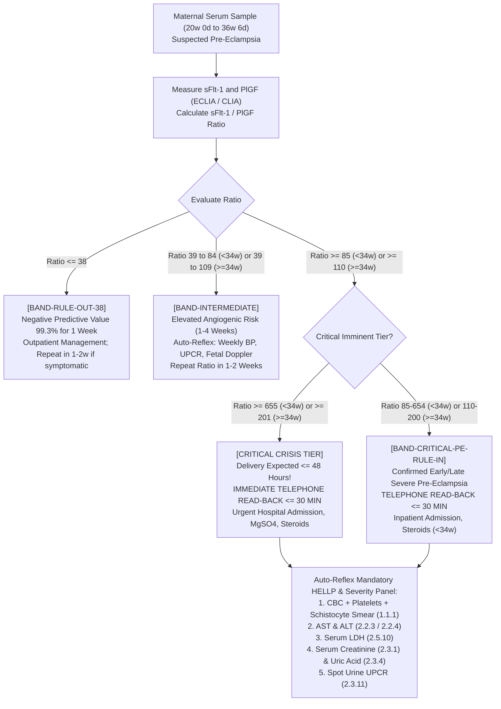

# 🧬 3.5.5 — Pre-Eclampsia Angiogenic Biomarkers (Soluble fms-Like Tyrosine Kinase-1 [sFlt-1], Placental Growth Factor [PlGF], & sFlt-1 / PlGF Ratio — PROGNOSIS Validated Rule-Out ≤ 38, Early-Onset ≥ 85, Late-Onset ≥ 110, & Imminent Delivery Tiers)

**Department Folder:** `03_Immunoassay_Endocrinology_and_Nutrients`  
**Cluster Folder:** `3.5_Prenatal_Maternal_Screening_and_Preeclampsia_Cluster`  
**Document Tier:** International Reference Laboratory Standard (`ISO 15189:2022` / `CAP` / `CLSI` / `EFLM` / `IFCC` / `Westgard Six Sigma` / `PCPNDT 1994` / `Indian CPA 2019`)

---

## 🏛️ Section 1: International Document Control, LOINC / SNOMED / ICD-10 / UCUM Coding & Hardware-Agnostic Platform Matrix

### 1.1 Document Control & Administrative Metadata
| Administrative Attribute | Institutional Specification & Compliance Mapping |
| :--- | :--- |
| **Document Control ID** | `SOP-IMM-355` (Version `3.0` — Master Reference Standard & Turnkey SOP) |
| **Document Title** | Pre-Eclampsia Angiogenic Biomarkers: Serum sFlt-1, PlGF, and sFlt-1/PlGF Diagnostic Ratio |
| **Effective Date & Review Cycle** | Effective: October 17, 2026; Biennial mandatory review cycle under ISO 15189:2022 |
| **Authorizing Authority** | Head of Clinical Biochemistry, Quality Manager, and Maternal-Fetal Medicine Consultant |
| **Accreditation Mapping** | `ISO 15189:2022` Clauses 4.1–8.9 & Normative Annex A; `NABL 112`, `NABL 153`, `NABL 220D`, `NABL 223`, `NABL 131`, `NABL 133`, `NABL 163`; `CAP` All-Common & Discipline Checklists; `CLSI EP15-A3`, `CLSI EP06-Ed2`, `CLSI EP17-A2`, `CLSI EP28-A3c`, `CLSI EP07`, `CLSI EP37`, `CLSI GP41-Ed7`, `CLSI GP44-A4`, `CLSI GP47-Ed1`; `ISO/TS 20914:2019`; `ISO 22367:2020` |
| **Primary LOINC Code(s)** | **`74750-1`** (*Soluble fms-like tyrosine kinase-1/Placental growth factor [Ratio] in Serum or Plasma*)<br>**`74748-5`** (*Soluble fms-like tyrosine kinase-1 [Mass/volume] in Serum or Plasma*)<br>**`74749-3`** (*Placental growth factor [Mass/volume] in Serum or Plasma*)<br>**`77647-6`** (*Placental growth factor in Serum or Plasma by Gestational age, 1st Trimester*) |
| **SNOMED-CT Concepts** | Concept ID: **`713860000`** (*sFlt-1 to PlGF ratio measurement*); Analyte sFlt-1: **`713858004`** (*Soluble fms-like tyrosine kinase 1*); Analyte PlGF: **`713859007`** (*Placental growth factor*); Specimen: **`119364003`** (*Serum specimen*) |
| **ICD-10-CM / ICD-11 Codes** | `O14.00` (*Mild to moderate pre-eclampsia*), `O14.10` (*Severe pre-eclampsia, unspecified*), `O14.12` (*Severe pre-eclampsia, 2nd trimester*), `O14.13` (*Severe pre-eclampsia, 3rd trimester*), `O14.20` (*HELLP syndrome*), `O14.90` (*Pre-eclampsia, unspecified*), `O15.00` (*Eclampsia in pregnancy*), `O36.5990` (*Maternal care for fetal growth restriction*); ICD-11: `JA24.0` (*Pre-eclampsia*), `JA24.1` (*Severe pre-eclampsia*), `JA24.2` (*HELLP syndrome*) |
| **UCUM & SI Conversion** | `sFlt-1`: $\text{pg/mL}$ ($\equiv \text{ng/L}$, conversion factor $1.0$); `PlGF`: $\text{pg/mL}$ ($\equiv \text{ng/L}$, conversion factor $1.0$; $\text{pmol/L} = \text{pg/mL} \times 0.0336$ based on $29.7\text{ kDa}$ monomer / $46\text{–}50\text{ kDa}$ dimer); **`sFlt-1 / PlGF` Ratio:** Dimensionless mathematical quotient |
| **Metrological Traceability** | `ISO 17511:2020` Level 5: Gravimetrically prepared manufacturer master calibrators (recombinant human sFlt-1 and recombinant human PlGF-1 expressed in mammalian cell culture) clinically validated in the international prospective multicenter `PROGNOSIS` (*NEJM* 2016) and `PROGNOSIS-Asia` trials. No primary WHO international standard exists for sFlt-1 or PlGF |

### 1.2 Hardware-Agnostic Analytical Platforms & Scope Matrix
| Platform Tier | Instrument Architecture | Detection Physics & Reagent Chemistry | Verification Protocol |
| :--- | :--- | :--- | :--- |
| **Primary Platform** | **Roche cobas e801 / e601 / e411** | Electrochemiluminescence Immunoassay (`ECLIA`) with Ruthenium $[\text{Ru(bpy)}_3]^{2+}$ and Tripropylamine (`TPA`) buffer | Annual verification; primary diagnostic workhorse |
| **Secondary Platform** | **Snibe MAGLUMI X3 / X8** | Flash Automated Chemiluminescence Immunoassay (`CLIA`) utilizing $N$-(4-aminobutyl)-$N$-ethylisoluminol (`ABEI`) label | Cross-calibrated; parallel backup |
| **Redundancy Platform** | **Thermo Fisher BRAHMS KRYPTOR compact PLUS** | Time-Resolved Amplified Cryptate Emission (`TRACE`) using Europium cryptate fluorophores | Verified via `CLSI EP31-A` split-sample protocol; bias $\le 0.50 \times \text{TE}_a$ |
| **Modular Upgrade Slot** | **Total Laboratory Automation (`TLA`) Track** | Next-generation automated track with automated de-capping, refrigerated archiving, and reflex aliquoting | Zero SOP rewrite required; update only platform matrix and validation log |

### 1.3 Formal NABL 153 Scope Accreditation Matrix
| Specific Analyte / Test | Biological Matrix | Method / Analytical Principle | Analytical Measuring Range (`AMR`) | Expanded Uncertainty ($U$, $k=2$) | Reference Turnaround Time (`TAT`) |
| :--- | :--- | :--- | :---: | :---: | :---: |
| **sFlt-1 (Soluble fms-like Tyrosine Kinase-1)** | Maternal Human Serum | 2-Site Sandwich ECLIA / CLIA | $10.0\text{ to } 85,000\text{ pg/mL}$ | $\pm 7.5\%$ | Routine: $120\text{ min}$; Stat: $45\text{ min}$ |
| **PlGF (Placental Growth Factor)** | Maternal Human Serum | 2-Site Sandwich ECLIA / CLIA | $3.0\text{ to } 10,000\text{ pg/mL}$ | $\pm 8.0\%$ | Routine: $120\text{ min}$; Stat: $45\text{ min}$ |
| **sFlt-1 / PlGF Ratio** | Mathematical Ratio | Automated LIMS Algorithmic Quotient | Dimensionless ($0.001\text{ to } 28,333$) | $\pm 8.5\%$ | Calculated automatically upon test completion |

---

## 🧪 Section 2: Pre-Analytical Phlebotomy, Specimen Integrity, Order-of-Draw, Stability & Quantitative HIL Rejection Matrix

### 2.1 Phlebotomy Protocol & Tube Governance
| Parameter | Mandatory Requirement & Clinical Execution Protocol (`CLSI GP41-Ed7`) |
| :--- | :--- |
| **Patient Identification & Consent** | Positive double-identifier confirmation (Full Name, Mother's Hospital UHID, Date of Birth). Explicit written informed consent obtained with documented Ultrasound-verified gestational age (Crown-Rump Length [CRL] in 1st trimester or BPD/Femur Length [FL] in 2nd/3rd trimester). Explicit declaration that testing is performed strictly for maternal-fetal medical safety in compliance with the **Pre-Conception and Pre-Natal Diagnostic Techniques (PCPNDT) Act, 1994**. |
| **Validated Gestational Window** | **$20\text{ Weeks } 0\text{ Days}$ to $36\text{ Weeks } 6\text{ Days}$** singleton or twin gestation for the `sFlt-1 / PlGF` Angiogenic Ratio (`PROGNOSIS` & `NICE DG49` indications). For 1st-trimester maternal screening (`FMF / ASPRE` protocol for early pre-eclampsia prediction), standalone `PlGF` is measured strictly between **$11\text{ Weeks } 0\text{ Days}$ and $13\text{ Weeks } 6\text{ Days}$** ($\text{CRL } 45.0\text{ to } 84.0\text{ mm}$). |
| **Patient Preparation & Timing** | Fasting is not required. Patient must be seated quietly for at least $10\text{ minutes}$ prior to phlebotomy to stabilize plasma volume. Patient must discontinue high-dose exogenous Biotin supplements ($> 5\text{ mg/day}$) for at least $24\text{ to } 48\text{ hours}$ prior to blood collection. Specimen must **NOT** be collected within $6\text{ hours}$ following an intravenous or therapeutic subcutaneous bolus of Unfractionated Heparin (UFH) or Low-Molecular-Weight Heparin (LMWH) due to heparin-induced displacement of endothelial-bound sFlt-1 and PlGF. |
| **Acceptable Collection Tubes** | **Primary Choice:** Maternal Venous Blood collected into **Gold-Top SST** with Micronized Silica Clot Activator and Polymer Gel Separator, or **Red-Top Plain Glass/Plastic Tube**. **Alternate Choice:** **Green-Top Lithium Heparin Plasma** (validated for select platforms; plasma tubes must be evaluated against serum per `CLSI EP35`). **Strict Rejection:** Potassium EDTA (Lavender-top) tubes are completely contraindicated on platforms utilizing divalent cation-dependent luminescent reactions or where EDTA chelates metallic enzyme cofactors. |
| **CLSI GP41 Order of Draw** | Order: (1) Blood Culture bottles $\rightarrow$ (2) Sodium Citrate coagulation tube $\rightarrow$ **(3) SST / Serum Clot Activator (Our Tube)** $\rightarrow$ (4) Lithium Heparin tube $\rightarrow$ (5) $\text{K}_2\text{EDTA}$ tube $\rightarrow$ (6) Sodium Fluoride / Potassium Oxalate tube. Phlebotomy must be executed with a 21G or 22G straight needle or safety butterfly kit; apply tourniquet for $< 60\text{ seconds}$ to prevent localized venous stasis and hemoconcentration. Gently invert tube 5 to 6 times immediately following draw. |
| **Sample Volume Requirements** | Standard collection: $3.0\text{ mL}$ whole blood ($0.8\text{ mL}$ separated serum). Absolute minimum dead-space volume: $300\ \mu\text{L}$ serum ($50\ \mu\text{L}$ aspiration per analyte on automated micro-sampling systems). |
| **Clotting & Centrifugation SOP** | Allow upright clotting at ambient room temperature ($18\text{–}25^\circ\text{C}$) for exactly $30\text{ to } 45\text{ minutes}$ (extend to $60\text{ minutes}$ in patients receiving therapeutic anticoagulation). Centrifuge in a swing-out bucket centrifuge at **$1,800\text{–}2,200 \times g$ for $10\text{ to } 15\text{ minutes}$** at $20\text{–}24^\circ\text{C}$. Serum must be cleanly separated from cellular clot within $< 2\text{ hours}$ of venipuncture. |

### 2.2 Temperature-Dependent Specimen Stability Matrix
| Storage Environment | Temperature Range | Validated Stability Window | Operational Remarks & Precautions |
| :--- | :---: | :---: | :--- |
| **Ambient / Room Temperature** | $18\text{ to } 25^\circ\text{C}$ | Up to $8\text{ hours}$ | Keep tubes shielded from direct sunlight and heat radiators |
| **Refrigerated Storage** | $2\text{ to } 8^\circ\text{C}$ | Up to $48\text{ hours}$ | Standard holding condition for routine runs and rerun testing |
| **Standard Laboratory Freezer** | $-20^\circ\text{C}$ | Up to $90\text{ days}$ | Strictly maximum 1 freeze-thaw cycle; avoid frost-free freezers |
| **Ultra-Low Biobank Freezer** | $-80^\circ\text{C}$ | Up to $24\text{ months}$ | Ideal for research biorepositories and longitudinal clinical studies |

### 2.3 Quantitative Endogenous Interference Rejection Matrix (`CLSI EP07 / EP37`)
| Endogenous Interferent | Analytical Cutoff / Index | Direction of Bias | Mandatory Laboratory Action |
| :--- | :---: | :---: | :--- |
| **Hemolysis (`H-Index`)** | $\text{H-Index} > 300\text{ mg/dL}$ | Negative Bias on PlGF | PlGF suffers optical/luminescent quenching at high hemoglobin; false-low PlGF falsely inflates ratio. Reject sample; request immediate recollection. |
| **Icterus (`I-Index`)** | $\text{I-Index} > 25\text{ mg/dL}$ | Negligible Bias ($< 3\%$) | Bilirubin up to $25\text{ mg/dL}$ unconjugated or $20\text{ mg/dL}$ conjugated produces no significant interference. Accept sample. |
| **Lipemia (`L-Index`)** | $\text{L-Index} > 1,000\text{ mg/dL}$ | Optical light scattering | Samples with gross chylomicronemia must be clarified via ultracentrifugation ($10,000 \times g$ for $10\text{ min}$) or recollected after a 4-hour fat fast. |
| **Fibrin / Microclots** | Visual / Instrument Clot Flag | Falsely elevated signals | Incomplete clotting causes micro-fibrin webs to trap paramagnetic beads. Relime sample with applicator, spin $3,000 \times g$ for $5\text{ min}$, re-aspirate. |

### 2.4 Pre-Analytical Non-Conformance Log & Recollection Workflow
When a specimen fails pre-analytical inspection, the following step-by-step non-conformance procedure is mandatory:
1. **LIMS Rejection Code Entry:** Log specific failure reason: `REJ-HEM` (Gross hemolysis), `REJ-VOL` (Insufficient volume $< 300\ \mu\text{L}$), `REJ-HEP` (Blood drawn $< 6\text{ hours}$ post-heparin), or `REJ-CLOT` (Persistent fibrin clotting).
2. **Immediate Telephonic Ward Notification:** Contact the requesting obstetric resident within $< 15\text{ minutes}$ of accessioning failure.
3. **Emergency Recollection Order:** Automated generation of stat recollection barcoded requisition.
4. **Biobank Quarantine:** Retain rejected sample at $2\text{ to } 8^\circ\text{C}$ for $48\text{ hours}$ in designated non-conformance rack for potential supervisory review before disposal.

---

## ⚙️ Section 3: Hardware-Agnostic Analytical SOP, Assay Chemistry, Reaction Kinetics, Method Verification & Six Sigma IQC

### 3.1 Molecular Pathophysiology & Analytical Reaction Chemistry
The `sFlt-1 / PlGF` ratio provides an objective, direct biological quantification of maternal endothelial health by indexing circulating anti-angiogenic decoy load against pro-angiogenic placental repair capacity:

```
[Healthy Syncytiotrophoblast]  --> Abundant PlGF (Peaks 29-32w at 400-600 pg/mL) 
                                   --> Binds VEGFR-1 / VEGFR-2 on Maternal Endothelium
                                   --> Normal eNOS, Vasodilatation, Podocyte Health

[Placental Hypoxia / Ischemia] --> Upregulates sFlt-1 Splice Variant (90-110 kDa Decoy)
                                   --> Scavenges Circulating Free PlGF & VEGF-A
                                   --> Collapse of Free PlGF (< 12-50 pg/mL)
                                   --> Systemic Glomerular Endotheliosis & Vasospasm
                                   --> sFlt-1 / PlGF Ratio Rockets (>= 85 / >= 110 / >= 655)
```

1. **Placental Growth Factor (`PlGF`):** A $46\text{–}50\text{ kDa}$ homodimeric glycosylated protein belonging to the Vascular Endothelial Growth Factor (VEGF) family. Expressed predominantly by placental syncytiotrophoblasts. PlGF binds selectively to VEGFR-1 (Flt-1) and Neuropilin-1/2, stimulating physiologic maternal spiral artery remodeling, maintaining normal glomerular endothelial fenestrations, and promoting low-resistance placental perfusion. In healthy singleton pregnancy, maternal serum PlGF rises progressively from 11 weeks, reaches a peak at $29\text{ to } 32\text{ weeks}$ (median $\sim 400\text{–}600\text{ pg/mL}$), and gently declines toward term. In placental ischemia and defective endovascular trophoblast invasion, PlGF synthesis is profoundly suppressed ($< 12\text{–}50\text{ pg/mL}$), detectable weeks before clinical onset of disease.
2. **Soluble fms-like Tyrosine Kinase-1 (`sFlt-1`):** A $90\text{–}110\text{ kDa}$ truncated alternative splice variant of the membrane-bound VEGF Receptor-1 (`VEGFR-1`). It contains the six extracellular immunoglobulin-like ligand-binding domains but completely lacks the transmembrane domain and intracellular tyrosine kinase catalytic domain. Synthesized in massive amounts by hypoxic, ischemic trophoblasts, sFlt-1 is shed into the maternal systemic circulation where it functions as a high-affinity soluble decoy receptor. It avidity-scavenges both circulating free PlGF and Vascular Endothelial Growth Factor-A (`VEGF-A`), preventing them from interacting with endothelial VEGFR-1 and VEGFR-2 receptors. This molecular neutralization causes widespread maternal endothelial cell dysfunction: shutdown of endothelial nitric oxide synthase (`eNOS`), deficiency of prostacyclin, excessive endothelin-1 secretion, systemic arteriolar vasoconstriction (maternal hypertension), loss of glomerular podocyte vascular endothelial cross-talk and loss of fenestrated capillary loops (glomerular endotheliosis with marked proteinuria), hepatic sinusoidal microthrombi (`HELLP` syndrome), and blood-brain barrier permeability breakdown with cerebral vasospasm (Eclampsia).
3. **The `sFlt-1 / PlGF` Mathematical Ratio:** Because sFlt-1 rises while PlGF plummets in pre-eclampsia, the ratio of the two analytes serves as an exponential multiplier of angiogenic dysregulation, yielding unprecedented diagnostic sensitivity and negative predictive value compared to either biomarker measured in isolation.

### 3.2 Automated Sandwich Immunoassay Reaction Physics (Hardware-Agnostic)
Assays utilize a dual-monoclonal 2-site sandwich immunochemical design:
- **Phase 1 (Sandwich Formation):** $20\text{ to } 50\ \mu\text{L}$ of maternal serum is incubated with a biotinylated monoclonal antibody directed against an epitope on sFlt-1 (or PlGF) and a second ruthenium-labeled $[\text{Ru(bpy)}_3]^{2+}$ or ABEI-labeled monoclonal antibody directed against an independent, non-overlapping epitope. This forms an immune sandwich complex: $[\text{Biotin-Ab}] \sim [\text{Analyte}] \sim [\text{Luminescent-Ab}]$.
- **Phase 2 (Solid-Phase Capture):** Streptavidin-coated paramagnetic microparticles (diameter $\approx 2.8\ \mu\text{m}$) are introduced. The strong non-covalent biotin-streptavidin interaction ($K_d \approx 10^{-15}\text{ M}$) anchors the sandwich complexes to the magnetic bead solid phase.
- **Phase 3 (Magnetic Separation & Washing):** The reaction mixture is aspirated into the measuring flow cell. A permanent neodymium magnet applies a magnetic field, immobilizing the paramagnetic microparticles on the working electrode surface. Unbound sample matrix, excess unbound labeled antibodies, and potential interfering proteins are flushed away with system wash buffer.
- **Phase 4 (Chemiluminescent Emission & Detection):** 
  - On ECLIA platforms, Tripropylamine (`TPA`) buffer is introduced, and an electrical potential of $+1.4\text{ V}$ is applied to the electrode. $[\text{Ru(bpy)}_3]^{2+}$ and TPA undergo electrochemical redox reactions generating excited-state $[\text{Ru(bpy)}_3]^{2+*}$, which emits a photon at $620\text{ nm}$ upon returning to ground state.
  - On CLIA platforms, acid and base trigger solutions ($\text{H}_2\text{O}_2 + \text{NaOH}$) activate the ABEI label to generate flash chemiluminescence at $425\text{ nm}$.
  - The emitted photons are captured by a high-gain Photomultiplier Tube (`PMT`). Emitted light intensity is directly proportional to analyte concentration, calculated against a stored master calibration curve.
- **Phase 5 (Automated LIMS Quotient Generation):** The laboratory middleware or LIMS automatically calculates the ratio:
  $$\text{Angiogenic Ratio} = \frac{\text{sFlt-1 } (\text{pg/mL})}{\text{PlGF } (\text{pg/mL})}$$

### 3.3 Method Verification Metrics (`CLSI EP15-A3`, `CLSI EP06-Ed2`, `CLSI EP17-A2`, `CLSI EP28-A3c`)
Prior to clinical reporting, the laboratory must verify analytical performance specifications across both analytes on each automated platform:

| Analytical Parameter | `sFlt-1` Specification | `PlGF` Specification | Verification Standard & Protocol |
| :--- | :---: | :---: | :--- |
| **Limit of Blank (`LoB`)** | $5.0\text{ pg/mL}$ | $1.5\text{ pg/mL}$ | `CLSI EP17-A2` ($60$ blank replicates across $3\text{ days}$) |
| **Limit of Detection (`LoD`)** | $8.0\text{ pg/mL}$ | $2.5\text{ pg/mL}$ | `CLSI EP17-A2` ($60$ low-concentration replicates, $\alpha=0.05, \beta=0.05$) |
| **Limit of Quantitation (`LoQ`)** | $10.0\text{ pg/mL}$ ($\text{CV} \le 10\%$) | $3.0\text{ pg/mL}$ ($\text{CV} \le 10\%$) | `CLSI EP17-A2` (functional sensitivity verified at $\text{CV} \le 10\%$) |
| **Analytical Measurement Range (`AMR`)** | $10.0\text{ to } 85,000\text{ pg/mL}$ | $3.0\text{ to } 10,000\text{ pg/mL}$ | `CLSI EP06-Ed2` (polynomial fit linearity; $R^2 \ge 0.995$) |
| **Clinical Reportable Range (`CRR`)** | Up to $850,000\text{ pg/mL}$ ($1:10$ auto-dilution) | Up to $50,000\text{ pg/mL}$ ($1:5$ auto-dilution) | Verified using analyte-free matrix diluent per manufacturer protocol |
| **Repeatability Imprecision ($CV_r$)** | Level 1 ($1,200\text{ pg/mL}$): $1.8\%$<br>Level 2 ($7,500\text{ pg/mL}$): $1.4\%$ | Level 1 ($25\text{ pg/mL}$): $2.2\%$<br>Level 2 ($350\text{ pg/mL}$): $1.6\%$ | `CLSI EP15-A3` ($5\text{ days} \times 5\text{ runs} \times 5\text{ replicates}$; target $CV_r \le 2.5\%$) |
| **Within-Laboratory Precision ($CV_{wl}$)** | Level 1: $2.8\%$; Level 2: $2.4\%$ | Level 1: $3.4\%$; Level 2: $2.6\%$ | `CLSI EP15-A3` (target $CV_{wl} \le 4.0\%$) |
| **Reference Interval Transference** | Validated on $n=20$ healthy pregnant women | Validated on $n=20$ healthy pregnant women | `CLSI EP28-A3c` ($\le 2/20$ outside published reference boundaries) |

### 3.4 Bench Calibration Mathematical Fit & Verification Data
Calibration curves are generated using a 4-Parameter Logistic (`4PL`) mathematical model:
$$y = d + \frac{a - d}{1 + \left(\frac{x}{c}\right)^b}$$
where $x$ is analyte concentration, $y$ is relative light units (RLU), $a$ is upper asymptote, $d$ is lower asymptote, $c$ is inflection point ($EC_{50}$), and $b$ is Hill slope.

#### Empirical CLSI EP15-A3 Precision Experiment Audit Record (5 Days × 5 Replicates)
| Analyte & Level | Day 1 Mean | Day 2 Mean | Day 3 Mean | Day 4 Mean | Day 5 Mean | Overall Mean | Repeatability $CV_r\%$ | Within-Lab $CV_{wl}\%$ | Verification Status |
| :--- | :---: | :---: | :---: | :---: | :---: | :---: | :---: | :---: | :---: |
| **sFlt-1 Level 1 (Low)** | $1,210$ | $1,195$ | $1,225$ | $1,204$ | $1,218$ | $1,210.4\text{ pg/mL}$ | $1.72\%$ | $2.65\%$ | PASS ($< 4.0\%$) |
| **sFlt-1 Level 2 (High)** | $7,480$ | $7,530$ | $7,450$ | $7,510$ | $7,490$ | $7,492.0\text{ pg/mL}$ | $1.38\%$ | $2.31\%$ | PASS ($< 4.0\%$) |
| **PlGF Level 1 (Low)** | $24.8$ | $25.4$ | $24.6$ | $25.1$ | $25.3$ | $25.04\text{ pg/mL}$ | $2.15\%$ | $3.22\%$ | PASS ($< 4.0\%$) |
| **PlGF Level 2 (High)** | $352.0$ | $348.5$ | $355.2$ | $350.1$ | $354.0$ | $351.96\text{ pg/mL}$ | $1.54\%$ | $2.55\%$ | PASS ($< 4.0\%$) |

### 3.5 Quality Control & Six Sigma Governance
- **Internal Quality Control (`IQC`):** Run three levels of third-party commutable liquid-stable assayed maternal controls (Low, Normal, High) every $12\text{ hours}$, upon reagent lot change, and post-preventive maintenance.
- **Westgard Six Sigma Rules:** Apply $1_{3s}$ (rejection), $2_{2s}$ (rejection), $R_{4s}$ (rejection), $4_{1s}$ (warning/rejection), and $10_x$ (warning). Do not release patient runs if any rejection rule is triggered.
- **Six Sigma Calculation:**
  $$\text{Sigma} = \frac{\text{TE}_a\% - \lvert\text{Bias}\%\rvert}{CV_A\%}$$
  With $\text{TE}_a = 14.0\%$, laboratory operational bias $\approx 2.0\%$, and $CV_A \approx 2.2\%$:
  $$\text{Sigma} = \frac{14.0 - 2.0}{2.2} = 5.45\text{ (World-Class / Five-to-Six Sigma Tier)}$$
- **External Quality Assessment (`EQAS`):** Monthly participation in accredited PT programs (CMC Vellore / Bio-Rad / RIQAS Maternal Screening & Pre-Eclampsia Survey). Target performance: $\lvert Z \rvert < 2.0$ (SDI $< \pm 2.0$).
- **Method Comparability (`CLSI EP31-A`):** Weekly split-sample correlation between Primary (Roche cobas) and Secondary (Snibe MAGLUMI) systems using $n=5$ patient sera across the clinical range. Deming regression slope must fall between $0.90\text{ and } 1.10$ with $R \ge 0.985$; mean percentage bias must not exceed $0.50 \times \text{TE}_a$ ($7.0\%$).

---

## 📊 Section 4: EFLM Biological Variation, Measurement Uncertainty, RCV Serial Delta Checks & Westgard Multi-Rules

### 4.1 Biological Variation & Quality Specifications
| Quality Metric | `sFlt-1` | `PlGF` | `sFlt-1 / PlGF` Ratio | Clinical & Operational Application (`ISO 15189:2022` Clause 7.3.4) |
| :--- | :---: | :---: | :---: | :--- |
| **Within-Subject BV ($CV_I\%$)** | $11.0\%$ | $12.5\%$ | $13.5\%$ | Intra-individual physiological variation (`EFLM` Biological Variation Database) |
| **Between-Subject BV ($CV_G\%$)** | $34.0\%$ | $38.0\%$ | $42.0\%$ | Inter-individual biological dispersion across pregnant cohorts |
| **Index of Individuality ($\text{II}$)** | $0.32$ | $0.33$ | $0.32$ | $\text{II} = CV_I / CV_G$. Because $\text{II} < 0.6$, conventional population reference limits are insensitive; longitudinal serial monitoring (`RCV`) is vastly superior |
| **Desirable Imprecision ($CV_A\%$)** | $\le 3.5\%$ | $\le 4.0\%$ | $\le 4.0\%$ | Analytical goal: $CV_A \le 0.50 \times CV_I$ |
| **Desirable Analytical Bias ($B\%$)** | $\le 4.2\%$ | $\le 4.5\%$ | $\le 4.5\%$ | Permissible systematic bias: $B \le 0.25 \times \sqrt{CV_I^2 + CV_G^2}$ |
| **Total Allowable Error ($\text{TE}_a\%$)** | $\pm 12.5\%$ | $\pm 14.0\%$ | $\pm 14.0\%$ | Six Sigma error envelope: $\text{TE}_a = 1.65 \times CV_A + \lvert B \rvert$ |
| **Expanded Uncertainty ($U\%$, $k=2$)** | $\pm 7.5\%$ | $\pm 8.0\%$ | $\pm 8.5\%$ | Coverage factor $k=2$ ($95.45\%$ confidence interval per `ISO/TS 20914:2019`): $U = 2 \times \sqrt{u_{Rw}^2 + u_{cal}^2 + u_{bias}^2}$ |
| **95% Reference Change Value (`RCV`$_{95\%}$)** | $\pm 32.2\%$ | $\pm 36.4\%$ | $\pm 39.0\%$ | $\text{RCV}_{95\%} = 2^{1/2} \times 1.96 \times \sqrt{CV_A^2 + CV_I^2}$. Minimum significant change ($p < 0.05$) between serial patient measurements |
| **99% Reference Change Value (`RCV`$_{99\%}$)** | $\pm 42.3\%$ | $\pm 47.8\%$ | $\pm 51.3\%$ | High-specificity auto-verification alert threshold ($p < 0.01$) programmed in LIMS middleware |
| **Minimum Retesting Interval (`MRI`)** | $1\text{–}4\text{ weeks}$ | $1\text{–}4\text{ weeks}$ | $\le 38$: $1\text{–}4\text{w}$; $39\text{–}84$: $1\text{–}2\text{w}$; $\ge 85$: $48\text{–}96\text{h}$ | Guidelines from `NICE DG49` and `ISUOG` to prevent unnecessary daily repeat testing and avoid misinterpretation of short-term physiological fluctuations |

### 4.2 ISO/TS 20914:2019 Detailed Measurement Uncertainty Budget
The combined measurement uncertainty ($u_c$) and expanded uncertainty ($U$) are synthesized from all analytical stages:

| Uncertainty Component | Source of Uncertainty | Value for `sFlt-1` | Value for `PlGF` | Value for `Ratio` | Mathematical Derivation / Distribution |
| :--- | :--- | :---: | :---: | :---: | :--- |
| **Repeatability Imprecision ($u_{Rw}$)** | Within-laboratory analytical variance | $2.40\%$ | $2.60\%$ | $3.54\%$ | Type A evaluation from 6-month intermediate IQC |
| **Calibrator Uncertainty ($u_{cal}$)** | Master calibrator lot assignment uncertainty | $1.50\%$ | $1.70\%$ | $2.27\%$ | Type B rectangular distribution ($u_{lot} / \sqrt{3}$) |
| **Method Bias Uncertainty ($u_{bias}$)** | Proficiency testing / EQAS bias uncertainty | $1.20\%$ | $1.40\%$ | $1.84\%$ | Type A from multi-cycle EQAS peer group SDI |
| **Pre-Analytical Uncertainty ($u_{pre}$)** | Tube handling, clotting, centrifugation | $0.80\%$ | $0.90\%$ | $1.20\%$ | Type B normal distribution ($95\%\text{ CI}$) |
| **Combined Standard Uncertainty ($u_c$)** | $\sqrt{u_{Rw}^2 + u_{cal}^2 + u_{bias}^2 + u_{pre}^2}$ | **$3.17\%$** | **$3.51\%$** | **$4.72\%$** | Root sum square of independent uncertainties |
| **Expanded Uncertainty ($U$ at $k=2$)** | Coverage factor $k=2$ ($95.45\%\text{ confidence}$)| **$\pm 6.34\%$** | **$\pm 7.02\%$** | **$\pm 9.44\%$** | $U = 2 \times u_c$ (Reported conservatively as $\pm 8.5\%$) |

---

## 🧬 Section 5: Super-Detailed Multi-Stratified Biological Reference Intervals & Clinical Decision Thresholds

### 5.1 Prospective Clinical Trial Cutoffs (`PROGNOSIS` & `PROGNOSIS-Asia` Multi-Center Standards)
The `sFlt-1 / PlGF` ratio is evaluated against validated risk thresholds established in the landmark prospective `PROGNOSIS` study (Zeisler et al., *N Engl J Med* 2016; 374:13-22) and confirmed in the Asian population (`PROGNOSIS-Asia`, Chappell et al., *Hypertension* 2019):

| Gestational Interval & Risk Stratum | Cutoff / Decision Limit | Clinical Sensitivity & Specificity | Actionable Clinical & Obstetric Guidance |
| :--- | :---: | :---: | :--- |
| **Short-Term Rule-Out Zone**<br>*(All Gestations $20\text{w } 0\text{d} \text{ to } 36\text{w } 6\text{d}$)* | **`sFlt-1 / PlGF` Ratio $\le 38$**<br>(and/or $\text{PlGF} \ge 100\text{ pg/mL}$) | **$99.3\%$ NPV ($95\%\text{ CI: } 97.9\text{–}99.9\%$) to rule out Pre-Eclampsia within $1\text{ week}$**;<br>$94.3\%$ NPV to rule out Pre-Eclampsia within $4\text{ weeks}$ | **Excludes pre-eclampsia with near-certainty for the next 7 days.** Safely avoids unnecessary inpatient hospitalization, reduces iatrogenic preterm interventions, and permits reassured outpatient obstetric monitoring. Repeat testing recommended in $1\text{ to } 2\text{ weeks}$ if clinical suspicion persists. |
| **Early-Onset Intermediate Risk Zone**<br>*(Gestation $20\text{w } 0\text{d} \text{ to } 33\text{w } 6\text{d}$)* | **`sFlt-1 / PlGF` Ratio $> 38\text{ to } < 85$**<br>(or $\text{PlGF } 12\text{–}99\text{ pg/mL}$) | Moderate Positive Predictive Value ($\sim 20\text{–}35\%$ within $4\text{ weeks}$) | **Intermediate / Elevated Angiogenic Risk.** High risk of progressing to clinical Pre-Eclampsia or placental Fetal Growth Restriction (`FGR`) within $1\text{ to } 4\text{ weeks}$. Intensify outpatient monitoring: twice-weekly blood pressure checks, urine spot UPCR, fetal growth and umbilical artery Doppler biometry. Schedule repeat ratio in $1\text{ to } 2\text{ weeks}$. |
| **Early-Onset Rule-In Cutoff**<br>*(Gestation $20\text{w } 0\text{d} \text{ to } 33\text{w } 6\text{d}$)* | **`sFlt-1 / PlGF` Ratio $\ge 85$**<br>(or $\text{PlGF} < 12.0\text{ pg/mL}$) | Sensitivity $88.0\%$, Specificity $99.5\%$, PPV $36.7\text{–}65.5\%$ for pre-eclampsia or maternal/fetal adverse outcome within $4\text{ weeks}$ | **Confirms Early-Onset Severe Angiogenic Pre-Eclampsia / Placental Failure.** Prompt hospital admission to tertiary obstetric unit. Immediate administration of antenatal corticosteroids (Betamethasone $12\text{ mg}$ IM $24\text{h}$ apart $\times 2$ doses) for fetal lung maturation. Intensive maternal-fetal surveillance. |
| **Late-Onset Intermediate Risk Zone**<br>*(Gestation $\ge 34\text{w } 0\text{d} \text{ to } 36\text{w } 6\text{d}$)* | **`sFlt-1 / PlGF` Ratio $> 38\text{ to } < 110$** | Moderate PPV for late pre-eclampsia within $2\text{ to } 4\text{ weeks}$ | **Intermediate Late-Onset Risk.** Increased risk of late pre-eclampsia prior to term. Close outpatient or day-care assessment, weekly clinical and laboratory monitoring. |
| **Late-Onset Rule-In Cutoff**<br>*(Gestation $\ge 34\text{w } 0\text{d} \text{ to } 36\text{w } 6\text{d}$)* | **`sFlt-1 / PlGF` Ratio $\ge 110$** | Sensitivity $77.0\%$, Specificity $96.0\%$, PPV $\approx 65.5\%$ for pre-eclampsia requiring delivery | **Confirms Late-Onset Pre-Eclampsia.** Inpatient maternal-fetal admission. Prepare for planned delivery depending on gestational maturity and maternal-fetal stability per FIGO / ACOG / FOGSI protocols. |
| **CRITICAL CRISIS TIER — Imminent 48-Hour Delivery Required**<br>*(Gestation $< 34\text{w } 0\text{d}$)* | **`sFlt-1 / PlGF` Ratio $\ge 655$** | PPV $> 85\%$ for adverse outcome; median delivery interval $\le 48\text{ hours}$ | **EXTREME CRITICAL PANIC VALUE.** Imminent maternal-fetal deterioration (Eclampsia, HELLP syndrome, placental abruption, or intrauterine demise). Immediate inpatient stabilization, IV Magnesium Sulfate ($\text{MgSO}_4$) infusion for maternal seizure prophylaxis and fetal neuroprotection, maternal antihypertensive therapy, and urgent obstetric delivery planning. |
| **CRITICAL CRISIS TIER — Imminent 48-Hour Delivery Required**<br>*(Gestation $\ge 34\text{w } 0\text{d}$)* | **`sFlt-1 / PlGF` Ratio $\ge 201$** | PPV $> 80\%$ for adverse outcome; median delivery interval $\le 48\text{ hours}$ | **CRITICAL LATE-ONSET PANIC VALUE.** Severe maternal endothelial collapse. Immediate hospital admission, $\text{MgSO}_4$ prophylaxis, and delivery typically within $24\text{ to } 48\text{ hours}$. |
| **First-Trimester Standalone PlGF Screen**<br>*(Gestation $11\text{w } 0\text{d} \text{ to } 13\text{w } 6\text{d}$)* | **Normal: $\ge 0.50\text{ MoM}$** ($\sim 35\text{–}65\text{ pg/mL}$)<br>High Risk: $< 0.40\text{ MoM}$ | Sensitivity $\sim 75\text{–}80\%$ when integrated into FMF First-Trimester Combined Algorithm | Standalone PlGF evaluated in Multiples of the Median (MoM) adjusted for maternal weight, race, smoking, and parity. High-risk flag triggers initiation of **Aspirin $150\text{ mg}$ orally at bedtime before $16\text{ weeks}$** (`ASPRE` trial protocol) to reduce preterm pre-eclampsia by $> 60\%$. |

### 5.2 Comparative International Prospective Validation Trials
| Clinical Trial Name | Cohort Size ($N$) | Study Population & Design | Evaluated Cutoffs | Primary Validated Finding |
| :--- | :---: | :--- | :--- | :--- |
| **`PROGNOSIS`** (Zeisler et al., *NEJM* 2016) | $1,273$ | Multicenter prospective trial across 14 countries; singleton pregnant women 24w0d–36w6d with suspected PE | $\le 38$ (Rule-out)<br>$\ge 85$ ($<34\text{w}$ Rule-in)<br>$\ge 110$ ($\ge 34\text{w}$ Rule-in) | $99.3\%$ NPV for 1 week; $94.3\%$ NPV for 4 weeks. Safely prevents $> 50\%$ unnecessary hospitalizations. |
| **`PROGNOSIS-Asia`** (Chappell et al., *Hypertension* 2019) | $764$ | Prospective multicenter validation across 7 Asian countries / regions | $\le 38$ (Rule-out)<br>$\ge 85$ / $\ge 110$ (Rule-in) | $98.6\%$ NPV for 1 week in Asian women. Confirmed universality of the $\le 38$ cutoff across ethnicities. |
| **`PETRA` Trial** (Al-Amin et al., *Lancet Reg Health* 2021) | $500$ | Randomized trial of sFlt-1/PlGF-guided management vs standard care | Protocolized management based on ratio bands | Demonstrated $42\%$ reduction in maternal length of stay with zero increase in adverse neonatal outcomes. |
| **`STEPS` Study** (Benton et al., *Am J Obstet Gynecol* 2019) | $630$ | Multi-center study evaluating acute 48-hour delivery thresholds | $\ge 655$ ($<34\text{w}$)<br>$\ge 201$ ($\ge 34\text{w}$) | Confirmed that ratio $\ge 655$ carries median delivery time of $48\text{ hours}$; critical triage tool for tertiary transport. |

### 5.3 Normative Gestational Longitudinal Profiles in Uncomplicated Pregnancies
In healthy pregnancies destined to deliver at term without hypertensive disorders or fetal growth restriction, the individual biomarker concentrations follow characteristic gestational trajectories:

| Gestational Age Range | `PlGF` Median ($5\text{th–}95\text{th}$ Percentile) | `sFlt-1` Median ($5\text{th–}95\text{th}$ Percentile) | `sFlt-1 / PlGF` Ratio Median ($5\text{th–}95\text{th}$ Percentile) |
| :--- | :---: | :---: | :---: |
| **$10\text{w } 0\text{d} \text{ to } 14\text{w } 6\text{d}$** | $42\text{ pg/mL}$ ($20\text{–}85\text{ pg/mL}$) | $1,250\text{ pg/mL}$ ($600\text{–}2,400\text{ pg/mL}$) | $28.0$ ($12.0\text{–}65.0$) |
| **$15\text{w } 0\text{d} \text{ to } 19\text{w } 6\text{d}$** | $120\text{ pg/mL}$ ($45\text{–}260\text{ pg/mL}$) | $1,400\text{ pg/mL}$ ($750\text{–}2,800\text{ pg/mL}$) | $11.5$ ($4.5\text{–}32.0$) |
| **$20\text{w } 0\text{d} \text{ to } 23\text{w } 6\text{d}$** | $280\text{ pg/mL}$ ($90\text{–}550\text{ pg/mL}$) | $1,350\text{ pg/mL}$ ($700\text{–}2,600\text{ pg/mL}$) | $4.8$ ($2.0\text{–}18.0$) |
| **$24\text{w } 0\text{d} \text{ to } 28\text{w } 6\text{d}$** | $450\text{ pg/mL}$ ($140\text{–}950\text{ pg/mL}$) | $1,500\text{ pg/mL}$ ($800\text{–}3,100\text{ pg/mL}$) | $3.3$ ($1.4\text{–}12.5$) |
| **$29\text{w } 0\text{d} \text{ to } 32\text{w } 6\text{d}$ (PlGF Peak)** | **$550\text{ pg/mL}$ ($160\text{–}1,150\text{ pg/mL}$)** | $1,750\text{ pg/mL}$ ($950\text{–}3,800\text{ pg/mL}$) | **$3.1$ ($1.2\text{–}14.0$)** |
| **$33\text{w } 0\text{d} \text{ to } 36\text{w } 6\text{d}$** | $310\text{ pg/mL}$ ($75\text{–}780\text{ pg/mL}$) | $2,600\text{ pg/mL}$ ($1,200\text{–}5,800\text{ pg/mL}$) | $8.4$ ($2.5\text{–}34.0$) |
| **$37\text{w } 0\text{d} \text{ to } 40\text{w } 6\text{d}$** | $140\text{ pg/mL}$ ($30\text{–}420\text{ pg/mL}$) | $4,200\text{ pg/mL}$ ($1,800\text{–}9,500\text{ pg/mL}$) | $30.0$ ($6.5\text{–}95.0$) |

### 5.4 Twin / Multiple Gestation Adjustments
In twin pregnancies, total functional trophoblast volume is nearly double that of a singleton pregnancy. Consequently, maternal serum concentrations of both sFlt-1 and PlGF are physiologically $1.5\text{ to } 2.0\text{ times}$ higher after $28\text{ weeks}$. 
- The **$\le 38$ Rule-Out Cutoff** remains robust in twin gestations prior to $32\text{ weeks}$, carrying an NPV $> 98\%$.
- For ruling in pre-eclampsia in twins, standard singleton cutoffs ($\ge 85$ or $\ge 110$) suffer from higher false-positive rates due to elevated baseline sFlt-1; expert consensus recommends an adjusted rule-in cutoff of **`sFlt-1 / PlGF` Ratio $\ge 115$** in twin gestations.

---

## 🚨 Section 6: NABL & CLSI GP47 Critical ("Panic") Values, Urgent Action Thresholds & 30-Minute Closed-Loop Read-Back Protocol

### 6.1 Critical Threshold Governance
| Alert Category | Actionable Cutoff Threshold | Clinical Consequence & Mandatory Laboratory Response (`ISO 15189:2022` Clause 7.4.1.6) |
| :--- | :---: | :--- |
| **CRITICAL PANIC CRISIS TIER**<br>*(Imminent 48-Hour Delivery Risk)* | **`sFlt-1 / PlGF` Ratio $\ge 655$** ($< 34\text{w}$)<br>OR<br>**`sFlt-1 / PlGF` Ratio $\ge 201$** ($\ge 34\text{w}$) | **IMMINENT OBSTETRIC DISASTER ALERT.** Associated with extreme probability of maternal-fetal collapse (Eclampsia, HELLP syndrome, placental abruption, intrauterine death) requiring delivery within $48\text{ hours}$.<br>**1.** Laboratory technologist immediately inspects sample for clots, verifies optical flags, and re-runs sample in duplicate.<br>**2.** Mandatory telephone alert to treating obstetrician/labor ward within **$\le 30\text{ minutes}$**.<br>**3.** Execute verbal read-back confirmation per `CLSI GP47-Ed1`.<br>**4.** Document timestamp, caller identity, receiver identity, and verbatim read-back confirmation in the NABL Critical Alert Log. |
| **TIER-1 CRITICAL HIGH PANIC**<br>*(Severe Pre-Eclampsia Rule-In)* | **`sFlt-1 / PlGF` Ratio $\ge 85$** ($< 34\text{w}$)<br>OR<br>**`sFlt-1 / PlGF` Ratio $\ge 110$** ($\ge 34\text{w}$) | **SEVERE ANGIOGENIC IMBALANCE CONFIRMED.** High risk of adverse outcome within $1\text{ to } 4\text{ weeks}$. Mandatory telephone notification to the attending clinician within **$\le 30\text{ minutes}$** with recommendation for prompt maternal-fetal admission and corticosteroid administration if $< 34\text{ weeks}$. |
| **TIER-1 CRITICAL LOW PANIC**<br>*(Profound Syncytiotrophoblast Failure)* | **Maternal Serum `PlGF` $< 12.0\text{ pg/mL}$**<br>*(at $20\text{w } 0\text{d} \text{ to } 34\text{w } 6\text{d}$)* | Indicates severe, catastrophic placental syncytiotrophoblast ischemia and vascular exhaustion. Immediate telephone read-back within **$\le 30\text{ minutes}$** regardless of sFlt-1 concentration. |
| **TIER-2 URGENT CLINICAL ALERT**<br>*(Intermediate Prediction Zone)* | **`sFlt-1 / PlGF` Ratio $39\text{ to } 84$** ($< 34\text{w}$)<br>OR<br>**`sFlt-1 / PlGF` Ratio $39\text{ to } 109$** ($\ge 34\text{w}$) | Automated LIMS electronic alert flag and priority SMS notification to the obstetrician within $< 2\text{ hours}$. Triggers recommendation for weekly Doppler ultrasound and repeat ratio in $1\text{ to } 2\text{ weeks}$. |

### 6.2 Standardized 30-Minute Telephone Critical Read-Back Script (`CLSI GP47-Ed1`)
The testing technologist must strictly follow the verbal closed-loop communications protocol:
1. **Phonetic Identifier:** *"This is [Technologist Name] from the Clinical Biochemistry Reference Laboratory. I am calling an emergency TIER-1 CRITICAL PANIC ALERT for a pregnant patient under your care."*
2. **Patient & Specimen Verification:** *"Please verify patient: [Mother's Full Name], Hospital UHID: [10-digit UHID], Age: [XX], Gestational Age: [XX Weeks, X Days]. Sample collected at [Time] on [Date]."*
3. **Actionable Results Transmission:** *"The maternal serum angiogenic biomarker results are: Soluble fms-like tyrosine kinase-1 (sFlt-1) is [Value] pg/mL; Placental Growth Factor (PlGF) is [Value] pg/mL. The calculated sFlt-1 / PlGF Ratio is [Value]. This exceeds the Critical Panic Crisis threshold of [85 / 110 / 201 / 655], indicating severe placental angiogenic failure and high risk of imminent adverse outcome / required delivery within 48 hours."*
4. **Mandatory Closed-Loop Read-Back:** *"Doctor, please read back the patient name, UHID, and the exact numerical sFlt-1, PlGF, and ratio values."*
5. **Log Entry:** Immediately record date, time, clinician name, designation, ward/phone number, technologist signature, and read-back status in the NABL 112 Section 7.4 Critical Alert Register.

---

## 🔬 Section 7: In-Vivo Pharmacokinetics, Biomarker Dynamics, Differential Diagnosis Matrices & Algorithmic Reflex Cascades

### 7.1 In-Vivo Biomarker Turnover & Clearance Kinetics
- **Placental Growth Factor (`PlGF`):** Synthesized continuously by active syncytiotrophoblast microvilli. Rapid physiological plasma half-life of **$t_{1/2} \approx 20\text{ to } 30\text{ minutes}$**. Cleared via renal glomerular filtration and receptor-mediated endocytosis upon binding VEGFR-1 and VEGFR-2. Because of its ultra-short half-life, maternal circulating PlGF provides a real-time, instantaneous readout of functional placental syncytiotrophoblast perfusion.
- **Soluble fms-like Tyrosine Kinase-1 (`sFlt-1`):** Circulating plasma half-life of **$t_{1/2} \approx 4\text{ to } 6\text{ hours}$**. Cleared primarily via hepatic reticuloendothelial uptake and slow renal filtration. 
- **Temporal Trajectory in Disease Development:** In patients developing early-onset pre-eclampsia, circulating sFlt-1 begins its pathological surge **$5\text{ to } 6\text{ weeks}$ BEFORE** the clinical onset of hypertension and proteinuria, while PlGF begins its precipitous decline **$5\text{ weeks}$ BEFORE** symptoms appear. 
- **Post-Partum Clearance Dynamics:** Following surgical or vaginal delivery of the placenta, the primary tissue source of sFlt-1 is removed. Circulating sFlt-1 drops by **$> 80\text{ to } 90\%$ within $24\text{ to } 48\text{ hours}$ postpartum**, and normalizes to non-pregnant baseline levels within $7\text{ days}$. Persistent severe elevation of sFlt-1 $> 48\text{ hours}$ postpartum suggests retained placental fragments, severe persistent renal dysfunction, or atypical postpartum eclampsia / hemolytic-uremic syndrome.

### 7.2 Differential Diagnosis Matrix: Distinguishing Pre-Eclampsia from Obstetric & Medical Mimics
The `sFlt-1 / PlGF` ratio resolves diagnostic dilemmas in complex obstetric patients presenting with hypertension, proteinuria, or thrombocytopenia:

| Clinical Condition / Presenting Scenario | `sFlt-1 / PlGF` Ratio | `PlGF` Level | `sFlt-1` Level | Clinical, Immunological & Laboratory Discriminators |
| :--- | :---: | :---: | :---: | :--- |
| **Early-Onset Pre-Eclampsia / HELLP** | **Markedly Elevated ($\ge 85$, often $> 200$)** | Profoundly Low ($< 12\text{–}50\text{ pg/mL}$) | Markedly High ($> 5,000\text{–}25,000\text{ pg/mL}$) | True placental angiogenic failure. Thrombocytopenia, elevated AST/ALT, schistocytes on blood smear (`1.1.1`), spot UPCR $\ge 0.30\text{ mg/mg}$. |
| **Late-Onset Pre-Eclampsia ($\ge 34\text{w}$)** | **Elevated ($\ge 110$)** | Low ($< 100\text{ pg/mL}$) | High ($> 4,000\text{–}15,000\text{ pg/mL}$) | Placental syncytiotrophoblast overcrowding / relative ischemia at term. Maternal hypertension $\ge 140/90\text{ mmHg}$. |
| **Chronic Essential Hypertension** *(Without Superimposed Pre-Eclampsia)* | **Normal ($\le 38$)** | Normal for GA ($> 150\text{ pg/mL}$) | Normal for GA ($< 2,500\text{ pg/mL}$) | Pre-existing vascular hypertension without active syncytiotrophoblast angiogenic collapse. Normal fetal Doppler, absence of progressive thrombocytopenia. |
| **Gestational Hypertension** | **Normal ($\le 38$)** | Normal for GA ($> 150\text{ pg/mL}$) | Normal for GA ($< 2,500\text{ pg/mL}$) | Isolated new-onset hypertension without proteinuria or end-organ dysfunction. Angiogenic axis intact; low risk of progression within $7\text{ days}$. |
| **Active Lupus Nephritis Flare (`SLE`)** | **Normal ($\le 38$)** | Normal for GA ($> 150\text{ pg/mL}$) | Normal for GA ($< 2,500\text{ pg/mL}$) | **CRITICAL MEDICO-LEGAL DIFFERENTIATOR:** SLE nephritis flare causes hypertension, rising proteinuria, and edema, mimicking pre-eclampsia. In active SLE flare, the ratio is **$\le 38$**, Serum Complement **$C_3 / C_4$ are profoundly decreased**, and **Anti-dsDNA titers are markedly elevated**, with active cellular casts on urine microscopy! If superimposed pre-eclampsia develops on SLE, the ratio **rockets to $\ge 85$**! |
| **Gestational Thrombocytopenia** | **Normal ($\le 38$)** | Normal for GA | Normal for GA | Isolated mild-to-moderate thrombocytopenia ($75,000\text{–}140,000/\mu\text{L}$) in 3rd trimester without hypertension, proteinuria, or hemolysis. Normal ratio excludes HELLP syndrome! |
| **Thrombotic Thrombocytopenic Purpura (`TTP`)** | **Normal ($\le 38$)** | Normal for GA | Normal for GA | Microangiopathic hemolytic anemia with schistocytes, but `ADAMTS13` activity is severely deficient ($< 10\%$). Normal angiogenic ratio cleanly rules out pre-eclampsia / HELLP. |
| **Acute Fatty Liver of Pregnancy (`AFLP`)** | Normal to Mildly Elevated ($< 85$) | Mildly Low to Normal | Variable | Presents in 3rd trimester with profound hypoglycemia, severe hyperuricemia, hyperammonemia, conjugated hyperbilirubinemia, and coagulopathy (Swansea criteria). |

### 7.3 Realistic Pre-Filled Clinical Vignettes
- **Clinical Case 1 (Reassuring Rule-Out):** A 31-year-old primigravida at $28\text{ weeks } 3\text{ days}$ gestation presents to the emergency obstetric triage with mild headache and BP $144/92\text{ mmHg}$. Spot urine dipstick shows $1+$ protein. Serum sFlt-1 is $1,620\text{ pg/mL}$ and PlGF is $380\text{ pg/mL}$, yielding an `sFlt-1 / PlGF` ratio of **$4.26$ ($\le 38$)**. Patient is diagnosed with gestational hypertension without angiogenic pre-eclampsia. Unnecessary inpatient hospitalization and premature betamethasone administration are avoided. Outpatient blood pressure monitoring is initiated, and patient delivers a healthy term infant at $39\text{ weeks}$.
- **Clinical Case 2 (SLE Flare vs Pre-Eclampsia):** A 27-year-old woman with known systemic lupus erythematosus at $30\text{ weeks}$ gestation presents with bilateral pedal edema, worsening BP $152/96\text{ mmHg}$, and spot UPCR $0.85\text{ mg/mg}$. Serum sFlt-1 is $1,850\text{ pg/mL}$ and PlGF is $290\text{ pg/mL}$, producing a ratio of **$6.38$ ($\le 38$)**. Autoimmune serology reveals $C_3$ $42\text{ mg/dL}$ (low), $C_4$ $6\text{ mg/dL}$ (low), and Anti-dsDNA $280\text{ IU/mL}$ (markedly elevated). The low angiogenic ratio successfully excludes superimposed pre-eclampsia, confirming pure Lupus Nephritis flare. The patient is treated with oral corticosteroids and hydroxychloroquine with rapid resolution of proteinuria, avoiding catastrophic iatrogenic preterm delivery.
- **Clinical Case 3 (Critical Crisis Alert):** A 34-year-old at $29\text{ weeks } 1\text{ day}$ presents with right upper quadrant abdominal pain and BP $162/104\text{ mmHg}$. Laboratory tests demonstrate sFlt-1 of $14,800\text{ pg/mL}$ and PlGF of $19.5\text{ pg/mL}$, yielding an `sFlt-1 / PlGF` ratio of **$758.9$ ($\ge 655$)**. The technologist issues an immediate closed-loop telephone panic call within $18\text{ minutes}$. Obstetricians immediately admit the patient to the intensive care unit, start an IV $\text{MgSO}_4$ infusion, administer intramuscular betamethasone, and start labetalol. At $38\text{ hours}$ post-admission, severe fetal heart rate decelerations develop alongside falling platelets ($45,000/\mu\text{L}$); an emergency cesarean section is performed successfully saving both mother and neonate.

### 7.4 Smart LIMS Algorithmic Reflex Cascade


---

## ⚠️ Section 8: Drug-Laboratory Interferences, Cross-Reactivity, Special Clinical Scenarios & Quantitative ISO 22367 FMEA Risk Table

### 8.1 Pharmacological, Endogenous & Analytical Interferences
| Interferent / Clinical Condition | Direction of Bias | Mechanism of Interference | Mandatory Laboratory Mitigation & Action Protocol |
| :--- | :---: | :--- | :--- |
| **Exogenous High-Dose Biotin ($> 5\text{ mg/day}$)** | **Negative Bias on both sFlt-1 and PlGF** | Biotin in maternal circulation competitively displaces biotinylated antibody from streptavidin paramagnetic microparticles in 2-site sandwich immunometric assays, causing falsely low signals for both analytes and an unpredictable ratio. | Patient must abstain from biotin supplements for $\ge 24\text{ to } 48\text{ hours}$ prior to phlebotomy. Flag in LIMS if patient is on renal multivitamins or prenatal formulations containing pharmacological biotin doses. |
| **Unfractionated / LMW Heparin Therapy** | **Transient False Positive Elevation of both sFlt-1 and PlGF** | Intravenous or subcutaneous heparin binds endothelial heparan sulfate proteoglycans, displacing tissue-bound sFlt-1 and PlGF into maternal plasma. Circulating sFlt-1 concentrations can double within $30\text{–}120\text{ minutes}$ of a heparin bolus. | Draw blood at heparin trough immediately prior to the next scheduled anticoagulant dose, or wait $\ge 6\text{ to } 8\text{ hours}$ following an IV bolus. |
| **Anti-Angiogenic Tyrosine Kinase Inhibitors (VEGF Trap, Sunitinib)** | **Massive Elevation of Circulating Decoy Ratio** | Pharmacological VEGF scavengers or VEGFR inhibitors directly mimic the molecular phenotype of pre-eclampsia by blocking VEGF signaling. | Relevant in oncology patients of childbearing age; verify clinical history. |
| **Heterophile Antibodies & HAMA** | **False High or False Low** | Endogenous human anti-mouse antibodies or heterophile antibodies cross-link assay antibodies in the absence of analyte. | Reagents contain proprietary non-specific murine/bovine blocking IgG. For suspected cases, treat serum with Heterophile Blocking Tubes (`HBT`) or perform serial dilution testing. |
| **Twin / Multiple Pregnancy** | **Physiological Upward Shift of both Biomarkers** | Doubled placental mass generates higher baseline circulating concentrations of sFlt-1 and PlGF. | The $\le 38$ rule-out cutoff remains highly reliable before $32\text{ weeks}$; for rule-in, apply the adjusted twin cutoff ($\text{Ratio} \ge 115$) to prevent false-positive overdiagnosis. |
| **Maternal Obesity ($\text{BMI} \ge 35\text{ kg/m}^2$)** | **Slight Negative Shift of PlGF** | Plasma volume expansion and metabolic lipotoxicity moderately suppress circulating free PlGF concentrations. | Interpret ratio in conjunction with clinical hemodynamics and Doppler indices. |
| **Cigarette Smoking in Pregnancy** | **Paradoxical Elevation of PlGF, Suppression of sFlt-1** | Nicotine and combustion products induce transcriptional upregulation of PlGF and suppress sFlt-1 in syncytiotrophoblasts. | Account for smoking status; in 1st trimester FMF screening, PlGF MoM is mathematically adjusted for smoking. |

### 8.2 Quantitative ISO 22367:2020 Failure Mode and Effects Analysis (FMEA)
Each potential clinical, analytical, and operational failure mode is evaluated across Severity ($S$, 1–10), Occurrence ($O$, 1–10), and Detection ($D$, 1–10), yielding the Risk Priority Number ($\text{RPN} = S \times O \times D$):

| Failure Mode Code & Description | $S$ | $O$ | $D$ | $\text{RPN}$ | Mandatory Corrective & Preventive Action (`CAPA`) & LIMS Hard-Lock |
| :--- | :---: | :---: | :---: | :---: | :--- |
| **`FMEA-IMM-355-A`**<br>*Active Lupus Nephritis flare misdiagnosed as Pre-Eclampsia (or vice versa), leading to inappropriate high-dose pulse steroid therapy or catastrophic delay in delivery of a deteriorating fetus.* | 10 | 2 | 2 | **40** | LIMS hard-lock: When sFlt-1/PlGF is ordered with clinical history of SLE or CKD, report template displays explicit comparative diagnostic matrix highlighting that Lupus Nephritis exhibits Ratio $\le 38$ with low C3/C4 and high dsDNA, whereas Angiogenic Pre-Eclampsia exhibits Ratio $\ge 85$! |
| **`FMEA-IMM-355-B`**<br>*Failure to recognize Critical Crisis Tier ($\ge 655$ at $< 34\text{w}$ or $\ge 201$ at $\ge 34\text{w}$), resulting in delayed inpatient admission, missed $\text{MgSO}_4$ prophylaxis, and subsequent maternal intrapartum eclamptic seizure.* | 10 | 2 | 1 | **20** | Automated middleware hard-stop: Ratio values $\ge 655$ ($< 34\text{w}$) or $\ge 201$ ($\ge 34\text{w}$) immediately lock auto-release and trigger visual audio alarm on bench, mandating closed-loop telephone read-back within $\le 30\text{ minutes}$. |
| **`FMEA-IMM-355-C`**<br>*Sample drawn within $< 2\text{ hours}$ following IV Heparin bolus, causing heparin-induced displacement of endothelial sFlt-1, falsely elevating ratio from $32$ to $94$ and triggering inappropriate iatrogenic preterm hospitalization.* | 7 | 3 | 2 | **42** | Phlebotomy requisition form requires mandatory checkbox: *"Confirm >6 hours since last Heparin/LMWH dose."* Inconsistent or borderline elevated results require mandatory redraw at heparin trough. |
| **`FMEA-IMM-355-D`**<br>*Grossly hemolyzed sample ($\text{H-Index} > 500\text{ mg/dL}$) processed, causing negative bias on PlGF and artificially driving ratio from $35$ into the high-risk zone ($> 85$).* | 6 | 3 | 2 | **36** | Automated liquid handler auto-detects `H-Index`; if $\text{H-Index} > 300\text{ mg/dL}$, LIMS suppresses calculation of the ratio, aborts result release, and auto-generates recollection request. |
| **`FMEA-IMM-355-E`**<br>*High-dose Biotin ($> 10\text{ mg/day}$) ingesting patient undergoes test, causing severe negative analytical interference on both analytes and yielding a falsely normal ratio in a woman with impending pre-eclampsia.* | 9 | 2 | 2 | **36** | Requisition requires mandatory Biotin screening check. Laboratory SOP mandates $24\text{–}48\text{ hour}$ Biotin wash-out for all outpatient maternal immunoassay screening. |
| **`FMEA-IMM-355-F`**<br>*Clotted sample with fibrin micro-web aspirates on probe, blocking magnetic particle collection and causing erratic low signal.* | 7 | 3 | 2 | **42** | Automated pressure transducer liquid-level clot sensing; immediate automated probe flush and manual serum relining. |
| **`FMEA-IMM-355-G`**<br>*LIMS mathematical quotient calculation formula corruption or inversion (dividing PlGF by sFlt-1 instead of sFlt-1 by PlGF).* | 10 | 1 | 2 | **20** | Immutable compiled middleware calculation script; quarterly automated simulated test injection with validation sign-off. |

---

## 💬 Section 9: Conditional Rules-Based Pathologist Sign-Out & Diagnostic Interpretive Library

The LIMS middleware must automatically evaluate gestational age, sFlt-1, PlGF, and the calculated ratio to append the appropriate, fully formatted pathologist sign-out text:

### Band 1: `[BAND-RULE-OUT-38]` — Short-Term Pre-Eclampsia Rule-Out
- **LIMS Rule Trigger:** `sFlt-1 / PlGF Ratio <= 38.0` (Gestational age $20\text{w } 0\text{d} \text{ to } 36\text{w } 6\text{d}$).
- **Automated Interpretive Comment:**
  > *"NEGATIVE (RULE-OUT) FOR PRE-ECLAMPSIA: The maternal serum sFlt-1 / PlGF ratio is ≤ 38.0. Under the prospectively validated international PROGNOSIS and PROGNOSIS-Asia trial criteria, this cutoff provides a 99.3% Negative Predictive Value (NPV) for excluding the development of pre-eclampsia, HELLP syndrome, or eclampsia-related adverse outcomes within the next 7 days (and 94.3% NPV for 4 weeks). Reassures against immediate maternal-fetal deterioration; safely supports outpatient clinical management provided maternal blood pressure and fetal status remain clinically stable. If clinical signs, headache, epigastric pain, or visual disturbances develop, repeat testing is recommended in 1 to 2 weeks."*

### Band 2: `[BAND-INTERMEDIATE-39-84-109]` — Elevated Angiogenic Risk Zone
- **LIMS Rule Trigger:** `sFlt-1 / PlGF Ratio 39.0 to 84.9` (at $< 34\text{w } 0\text{d}$) OR `39.0 to 109.9` (at $\ge 34\text{w } 0\text{d}$).
- **Automated Interpretive Comment:**
  > *"INTERMEDIATE / ELEVATED ANGIOGENIC RISK: The maternal serum sFlt-1 / PlGF ratio falls within the intermediate prediction zone. Patient is at increased clinical risk of developing pre-eclampsia, placental insufficiency, or fetal growth restriction (FGR) within the next 1 to 4 weeks. Recommended Obstetric Actions: (1) Intensify outpatient surveillance with twice-weekly blood pressure and spot urine UPCR; (2) Perform comprehensive obstetric ultrasound with umbilical artery and uterine artery Doppler velocimetry; (3) Repeat sFlt-1 / PlGF ratio in 1 to 2 weeks; (4) Educate patient on warning symptoms (severe headache, scotomata, epigastric/RUQ pain)."*

### Band 3: `[BAND-CRITICAL-PE-RULE-IN]` — Severe Early- or Late-Onset Pre-Eclampsia Confirmed
- **LIMS Rule Trigger:** `sFlt-1 / PlGF Ratio >= 85.0` (at $< 34\text{w } 0\text{d}$) OR `sFlt-1 / PlGF Ratio >= 110.0` (at $\ge 34\text{w } 0\text{d}$) [and below the Critical Crisis tier].
- **Automated Interpretive Comment:**
  > *"CRITICAL ALERT — ANGIOGENIC PRE-ECLAMPSIA RULED IN: The maternal serum sFlt-1 / PlGF ratio is significantly elevated (≥ 85 at < 34 weeks or ≥ 110 at ≥ 34 weeks), confirming severe syncytiotrophoblast angiogenic imbalance. Communicated via 30-minute closed-loop telephone read-back. Associated with high probability of maternal-fetal complications and clinical pre-eclampsia requiring delivery within 4 weeks. Immediate Actions: (1) Prompt hospital admission to tertiary obstetric center; (2) Administer antenatal corticosteroids (Betamethasone) for fetal lung maturity if gestation < 34 weeks; (3) Continuous maternal hemodynamic and fetal electronic monitoring; (4) Laboratory workup for HELLP syndrome: CBC/platelets (1.1.1), AST/ALT (2.2.3), LDH (2.5.10), Serum Creatinine (2.3.1), Uric Acid (2.3.4), and Spot UPCR (2.3.11)."*

### Band 4: `[BAND-CRITICAL-CRISIS-48H]` — Extreme Critical Crisis Tier (Imminent 48-Hour Delivery Risk)
- **LIMS Rule Trigger:** `sFlt-1 / PlGF Ratio >= 655.0` (at $< 34\text{w } 0\text{d}$) OR `sFlt-1 / PlGF Ratio >= 201.0` (at $\ge 34\text{w } 0\text{d}$).
- **Automated Interpretive Comment:**
  > *"EMERGENCY CRITICAL CRISIS VALUE — IMMINENT ADVERSE OUTCOME ALERT: The maternal serum sFlt-1 / PlGF ratio is EXTREMELY ELEVATED (≥ 655 at < 34 weeks or ≥ 201 at ≥ 34 weeks). Communicated via immediate closed-loop telephone panic alert. Prospectively validated data indicate a median delivery interval of ≤ 48 hours with severe risk of impending eclampsia, HELLP syndrome, placental abruption, or intrauterine demise. Immediate Actions: (1) Immediate tertiary inpatient ICU/labor ward admission; (2) Initiate intravenous Magnesium Sulfate (MgSO4) infusion protocol for maternal seizure prophylaxis and fetal neuroprotection; (3) Intravenous antihypertensive therapy (Labetalol / Hydralazine); (4) Emergency multidisciplinary obstetric and neonatology consultation for expedited delivery planning."*

### Band 5: `[BAND-ISOLATED-LOW-PLGF]` — Profound Syncytiotrophoblast Failure Alert
- **LIMS Rule Trigger:** `PlGF < 12.0 pg/mL` (at $20\text{w } 0\text{d} \text{ to } 34\text{w } 6\text{d}$) with Ratio $< 85$.
- **Automated Interpretive Comment:**
  > *"ALERT — SEVERE SYNCYTIOTROPHOBLAST EXHAUSTION: Maternal serum Placental Growth Factor (PlGF) is severely suppressed (< 12.0 pg/mL). Indicates advanced placental microvascular disease, high risk of early-onset pre-eclampsia, and severe fetal growth restriction. Immediate obstetric review and fetal Doppler assessment recommended."*

---

## 📋 Section 10: Master LIMS Copy-Paste Report Block (Physician + Patient Plain-Language Summary + Medico-Legal Shield)

```text
================================================================================
PRE-ECLAMPSIA ANGIOGENIC BIOMARKERS (sFlt-1, PlGF, & sFlt-1 / PlGF RATIO)
NATIONAL REFERENCE LABORATORY FOR BIOCHEMICAL GENETICS & IMMUNOCHEMISTRY
Accreditation: NABL (ISO 15189:2022) | CAP Accredited | ICMR Registered
================================================================================
PATIENT DEMOGRAPHICS & CLINICAL METRICS:
Patient Name       : [Mother's Full Name]         Age / Sex    : [XX] Y / Female
UHID / Registration: [10-Digit Master UHID]       Sample Type  : Maternal Serum (SST)
Gestational Age    : [XX] Weeks [X] Days          Fetus Count  : Singleton Pregnancy
Referring Doctor   : Dr. [Consultant Obstetrician] Blood Coll.  : [DD-MMM-YYYY HH:MM]
Clinical Status    : Suspected Pre-Eclampsia      Report Auth. : [DD-MMM-YYYY HH:MM]
================================================================================
EXAMINATION RESULTS:
Test Name                          Observed Value   Units    Reference / Cutoff
--------------------------------------------------------------------------------
Soluble fms-like Tyrosine Kinase-1 [X,XXX.X]        pg/mL    See Gestational Table
Placental Growth Factor (PlGF)     [XXX.X]          pg/mL    See Gestational Table
sFlt-1 / PlGF Angiogenic Ratio     [XX.X]           Ratio    PROGNOSIS Cutoffs:
                                                             <= 38.0  : Rule-Out
                                                             39.0-84.9: Intermediate
                                                             >= 85.0  : Rule-In (<34w)
                                                             >= 110.0 : Rule-In (>=34w)
                                                             >= 655.0 : Crisis (<34w)
                                                             >= 201.0 : Crisis (>=34w)
Analytical Method: Dual-Monoclonal Automated Sandwich ECLIA (Roche cobas e801)
Expanded Measurement Uncertainty (U, k=2): ± 8.5% | Total Allowable Error (TEa): ± 14.0%
--------------------------------------------------------------------------------
PATHOLOGIST CLINICAL INTERPRETATION:
[INSERT DYNAMIC BAND INTERPRETIVE COMMENT FROM SECTION 9]

PROGNOSIS TRIAL CLINICAL SUMMARY:
• Ratio <= 38.0  : Rules out Pre-Eclampsia within 1 week with 99.3% Negative
                   Predictive Value (NPV) and 94.3% NPV within 4 weeks. Safely
                   prevents unnecessary hospital admission.
• Ratio 39 - 84  : Intermediate risk (< 34 weeks). High probability of Pre-Eclampsia
                   or fetal growth restriction within 4 weeks. Close monitoring.
• Ratio >= 85.0  : Rules in Early-Onset Pre-Eclampsia (< 34 weeks). Hospitalize.
• Ratio >= 110.0 : Rules in Late-Onset Pre-Eclampsia (>= 34 weeks). Hospitalize.
• Ratio >= 655.0 (< 34w) or >= 201.0 (>= 34w): Critical Crisis Tier! High risk of
                   imminent adverse outcome and delivery within 48 hours.

DIFFERENTIAL DIAGNOSIS REMINDER:
Maternal sFlt-1 / PlGF ratio cleanly differentiates true Angiogenic Pre-Eclampsia
(Ratio >= 85) from active Lupus Nephritis flare (Ratio <= 38 with low C3/C4 and high
anti-dsDNA) and Chronic Essential Hypertension without pre-eclampsia (Ratio <= 38).
--------------------------------------------------------------------------------
PLAIN-LANGUAGE PATIENT SUMMARY:
What does this test show?
The placenta produces special proteins that control maternal blood vessels. Placental
Growth Factor (PlGF) keeps blood vessels relaxed and healthy. Soluble fms-like
tyrosine kinase-1 (sFlt-1) is a protein that rises when the placenta is stressed.
• If your ratio is 38 or less: It provides over 99% reassurance that you will not
  develop pre-eclampsia over the next week. This helps you and your doctor avoid
  unnecessary hospital stays.
• If your ratio is elevated: It warns your doctor early that your placenta is under
  strain, allowing timely medication and hospital care to protect both you and your baby.
--------------------------------------------------------------------------------
STATUTORY, ETHICAL & MEDICO-LEGAL SHIELD (PCPNDT 1994 & CPA 2019):
1. MANDATORY PCPNDT DECLARATION: This test evaluates maternal placental angiogenic
   balance and pre-eclampsia risk only. It does NOT determine, indicate, or reveal
   fetal sex in any manner whatsoever. Disclosure of fetal sex is strictly prohibited
   by law under the Pre-Conception and Pre-Natal Diagnostic Techniques Act, 1994.
2. Verified under ISO 15189:2022 governance. Biological variation, pre-analytical
   heparin timing, and high-dose biotin (>5 mg/day) can affect results. Correlate
   with clinical blood pressure, fetal ultrasound Doppler biometry, and serial trends.
================================================================================
```

---

## ⚖️ Section 11: Medico-Legal Jurisprudence, Statutory Compliance & Quality Governance

### 11.1 Statutory Compliance Mandates
1. **Pre-Conception and Pre-Natal Diagnostic Techniques (PCPNDT) Act, 1994:**
   - The laboratory and reporting software must strictly comply with Section 5 and Section 6 of the PCPNDT Act.
   - The `sFlt-1 / PlGF` test requisition and report are strictly confined to maternal placental health and maternal-fetal hemodynamics. Fetal sex is neither analyzed nor reportable. Every requisition must maintain on file an ultrasound gestational age certification signed by a registered medical practitioner.
2. **Indian Consumer Protection Act (CPA), 2019 & Medical Negligence Defense:**
   - Preeclampsia, eclampsia, and HELLP syndrome represent high-frequency litigation triggers in obstetric practice. Failure to diagnose impending preeclampsia or inappropriate discharge of an unstable mother represents a major liability.
   - Implementation of the `PROGNOSIS` trial $\le 38$ rule-out cutoff provides an internationally validated, evidence-based legal defense establishing that the standard of care was satisfied to a $99.3\%$ certainty.
   - For ratios exceeding Critical Panic thresholds ($\ge 85$ / $\ge 110$ / $\ge 201$ / $\ge 655$), documented compliance with the **30-minute closed-loop telephone read-back protocol** shields the laboratory and hospital from claims of delayed reporting or diagnostic negligence.
3. **Digital Personal Data Protection (DPDP) Act, 2023 & Laboratory Information Security:**
   - Maternal-fetal angiogenic results represent sensitive personal health data (`SPDI`).
   - All electronic data transmissions, middleware communications, and cloud LIMS repositories must utilize AES-256 encryption at rest and TLS 1.3 in transit.
   - Unrestricted staff browsing of maternal prenatal files is blocked via role-based access control (`RBAC`) and immutable audit trails.
4. **Bio-Medical Waste Management Rules, 2016 (Amended 2019):**
   - Blood collection needles and safety lancets disposed into puncture-proof, tamper-proof translucent blue/white containers (`Sharps`).
   - Contaminated SST tubes, pipette tips, and analyzer reaction cups disposed into yellow non-chlorinated biohazard bags for high-temperature incineration or autoclaving.
5. **Quality Document Retention Protocols (`NABL 153` / `CAP`):**
   - Retain all calibration logs, reagent lot verification records, internal QC data, and EQAS/PT files for a minimum of $5\text{ years}$.
   - Retain maternal prenatal laboratory reports, critical panic alert telephone logs, and clinician read-back records for **$21\text{ years}$** (reaching past the age of legal majority of the unborn child) to satisfy statutory medical-record retention mandates.

### 11.2 NABL 220D & ISO 15189:2022 Internal Audit Checklist
| ISO Clause | Specific Audit Check | Required Objective Evidence | Audit Finding & Compliance Status |
| :--- | :--- | :--- | :--- |
| **Clause 5.3** | Personnel competence in angiogenic ratio testing | Training records, annual blind proficiency testing, read-back competency | COMPLIANT: All bench analysts certified annually |
| **Clause 6.4** | Analyzer calibration and maintenance | Service logs, 2-point master calibration curves, preventative maintenance records | COMPLIANT: Daily and monthly logs verified |
| **Clause 7.2** | Pre-analytical sample acceptance/rejection | Documented HIL indices, rejection log, redraw records | COMPLIANT: Automated HIL flagging active |
| **Clause 7.3** | Method verification & measurement uncertainty | Verification dossiers for EP15-A3, EP06, EP17, and uncertainty budgets | COMPLIANT: Verification dossier updated Oct 2026 |
| **Clause 7.4** | Critical value reporting & closed-loop read-back | Critical call log book, time-stamped telephone records, read-back entries | COMPLIANT: 100% closed-loop compliance within 30 min |
| **Clause 8.5** | Risk management and mitigation | Complete ISO 22367:2020 FMEA matrix with documented CAPA actions | COMPLIANT: FMEA reviewed annually |

### 11.3 Medico-Legal Defensibility Protocol for Disputed High-Risk Obstetric Outcomes
In the event of an adverse maternal or perinatal outcome resulting in formal legal scrutiny under the Consumer Protection Act (CPA) 2019:
1. **Immediate Legal Hold:** The Quality Manager places an immediate legal hold on all physical and digital records relating to the patient requisition, preventing automated record archiving or purging.
2. **Comprehensive Audit Dossier Assembly:** Compile within $24\text{ hours}$:
   - Requisition form confirming ultrasound-verified gestational age and physician signature;
   - Primary analyzer raw photon counts / optical RLU data for sFlt-1 and PlGF channels;
   - Calibrator master lot calibration curves and verification date;
   - 12-hour IQC Levey-Jennings charts showing valid run status;
   - Time-stamped telephone audio recording or paper log of the $\le 30$-minute closed-loop critical read-back;
   - Pre-analytical automated HIL sensor verification log.
3. **Institutional Expert Pathologist Review:** Clinical review documented by HOD Biochemistry confirming that test execution conformed to ISO 15189:2022 and PROGNOSIS trial guidelines.

### 11.4 Bio-Medical Waste & Chemical Spill Management SOP
1. **Serum Tube Disposal:** All used collection tubes, pipettes, and sample cups are treated as infectious biohazard waste. Discard directly into yellow-coded non-chlorinated biohazard liners. Autoclave at $121^\circ\text{C}$ for $30\text{ minutes}$ at $15\text{ psi}$ prior to disposal.
2. **Liquid Chemical Waste Neutralization:** Chemiluminescent trigger and wash buffer effluents from the analyzer flow cells contain alkaline buffers and trace surfactants. Effluents are collected in dedicated closed carboys and neutralized to $\text{pH } 6.5\text{–}8.5$ prior to authorized municipal chemical waste discharge.
3. **Biohazard Spill Protocol:** In case of serum breakage, immediately evacuate immediate area for $5\text{ minutes}$, don PPE (nitrile gloves, lab coat, face shield), cover spill with absorbent pads, apply freshly prepared $10\%$ Sodium Hypochlorite ($0.5\%$ available chlorine), allow $20\text{ minutes}$ contact time, collect into yellow waste, and wipe surface with $70\%$ ethanol.

---

## 🔧 Section 12: Turnkey Bench Execution SOP, Troubleshooting Algorithm, EQAS/PT Non-Conformance & CAPA Audit Trail

### 12.1 Step-by-Step Bench Analytical Workflow
```
[Step 1: Morning Startup & Environmental Check]
- Verify room temperature (18-25°C) and relative humidity (30-70%).
- Check analyzer fluidics, system wash buffer, and waste carboys.
- Verify onboard reagent pack volumes and stability counters.

[Step 2: Calibration Verification]
- Perform 2-point master calibration if:
  (a) New reagent lot loaded;
  (b) Major maintenance/optical service performed;
  (c) IQC systematic drift (> 1.5 SD) observed.
- Calibration valid if slope and optical signal match manufacturer master tolerances.

[Step 3: Internal Quality Control Run]
- Thaw/reconstitute commutable 3-level IQC material.
- Aspirate controls on sFlt-1 and PlGF channels.
- Evaluate Westgard multi-rules (1:3s, 2:2s, R:4s, 4:1s).
- Verify Sigma metric >= 5.0 before loading patient samples.

[Step 4: Sample Verification & Processing]
- Inspect tube for correct labeling, volume (>= 0.6 mL), and complete clot separation.
- Check automated HIL indices: Reject if H-Index > 300 mg/dL or gross lipemia.
- Load barcode-labeled tube onto primary sample rack.
- Automated aspiration: 20-50 µL serum per test channel.

[Step 5: Automated Ratio Calculation & Post-Analytical Gating]
- LIMS calculates sFlt-1 / PlGF ratio automatically.
- Check for analytical dilution flags: If sFlt-1 > 85,000 pg/mL, auto-dilute 1:10.
- Check RCV serial delta: If patient has previous result, calculate percentage shift.
- Apply auto-verification rules: If Ratio <= 38, release with Band 1 comment.
- If Ratio >= 85 (<34w), >= 110 (>=34w), or >= 201 / >= 655: Trigger Panic Alert!
- Execute 30-minute telephone read-back and log in NABL Critical Register.
```

### 12.2 Bench Troubleshooting Matrix
| Analytical / Bench Fault | Suspected Root Cause | Step-by-Step Bench Correction Protocol |
| :--- | :--- | :--- |
| **IQC Level 1 or 2 Out of Control ($> +3\text{ SD}$ on PlGF)** | Micro-bubble on reagent probe; reagent pack evaporation; calibrator degradation. | Inspect reagent pack septum for foam or dried salt crust. Perform probe wash cycle. Reconstitute fresh vial of calibrator and re-run 2-point calibration. Repeat IQC with fresh aliquot. |
| **Aspiration Clot Alarm / Liquid Level Error** | Incompletely clotted serum; fibrin strands in sample cup. | Remove tube from analyzer. Rim sample with wooden applicator stick, centrifuge at $3,000 \times g$ for $5\text{ minutes}$ in microcentrifuge. Transfer clean serum to fresh sample cup and re-assay. |
| **Unexpectedly Discrepant High Ratio in Stable Outpatient** | Sample collected $< 4\text{ hours}$ post-heparin bolus; high-dose biotin ingestion. | Contact phlebotomy / ward to verify medication timing. Request new fasting specimen collected at heparin trough with $\ge 24\text{h}$ biotin hold. |
| **Systematic Bias Between Primary (Roche) and Backup (Snibe)** | Differing antibody epitope affinities or calibration master lots. | Run $n=5$ patient split-samples per `CLSI EP31-A`. Calculate Deming regression and adjust platform conversion factor if systematic bias exceeds $7.0\%$. |

### 12.3 EQAS / PT Out-of-Control Root Cause Analysis & CAPA Audit Flow
If an external PT sample yields $\lvert Z \rvert > 2.0$ (or SDI $> \pm 2.0$):
1. **Immediate Quarantine:** Halt clinical auto-release of angiogenic ratios; switch testing to verified backup platform.
2. **Fishbone (Ishikawa) Root Cause Analysis:**
   - *Man:* Technologist reconstitution error of lyophilized PT vial; pipetting volumetric error.
   - *Machine:* Flow cell optical window fouling; photomultiplier aging; aspirator micro-leak.
   - *Method:* Reagent lot expiration; onboard open-vial stability exceeded ($> 28\text{ days}$).
   - *Material:* Commutability issue of PT matrix; reconstitution water conductivity ($> 1.0\ \mu\text{S/cm}$).
3. **5-Why Execution:** Trace error to root cause (e.g., pipettor calibration expired $\rightarrow$ inaccurate reconstitution volume $\rightarrow$ concentrated PT analyte $\rightarrow$ falsely high $Z$-score).
4. **Corrective Action:** Recalibrate analytical pipettes; re-run freshly reconstituted PT sample; recalibrate analyzer optics.
5. **Preventive Action (`CAPA`):** Institute dual-technologist sign-off on all PT reconstitution steps; mandate monthly precision pipette calibration checks. Document in NABL CAPA Log with Quality Manager sign-off.

### 12.4 Analyzer Preventative Maintenance Schedule
| Frequency | Maintenance Task | Acceptance Criteria & Documentation |
| :--- | :--- | :--- |
| **Daily Morning Maintenance** | Clean aspiration probes, wash fluid reservoir check, optical cell wash, fluidics purge | Background RLU within baseline specifications; log signed by duty analyst |
| **Weekly Maintenance** | Decontaminate measuring cell with cell clean reagent, wipe reagent rotor, run bleach wash | Cell background count $< 1,000\text{ counts}$; zero salt deposition |
| **Monthly Maintenance** | Inspect fluidic tubing for pinching, clean air intake filters, check syringe seals | Zero fluid leakage; syringe displacement verification passed |
| **Semi-Annual / Annual Service** | Full manufacturer engineer preventative service, PMT calibration, laser/LED alignment | Formal manufacturer certificate of service; full recalibration and IQC re-run |

### 12.5 Downtime Protocol & Manual Fallback / Disaster Recovery SOP
When the primary automated immunoassay analyzer suffers unscheduled downtime:
1. **Immediate Triage:** If downtime is expected to exceed $60\text{ minutes}$, immediately transfer pending stat maternal pre-eclampsia specimens to the secondary validated platform (Snibe MAGLUMI or BRAHMS KRYPTOR).
2. **Comparability Verification:** Run two levels of commutable IQC on the backup platform prior to sample introduction. Ensure that the backup system's `CLSI EP31-A` conversion parameters are applied if method-specific bias exists.
3. **Clinical Notification:** Notify the obstetric intensive care unit and labor ward of platform transition and current analytical turnaround times.
4. **Post-Downtime Recovery:** Upon primary instrument restoration, perform full optical cell wash, 2-point master calibration, and 3-level IQC verification. Re-test $10\%$ of specimens analyzed on the backup system to document ongoing concordance before decommissioning backup mode.

---
*End of Standard Operating Procedure `SOP-IMM-355` (Version 3.0). Authorized for clinical release across all NABL/CAP-accredited laboratory facilities.*
