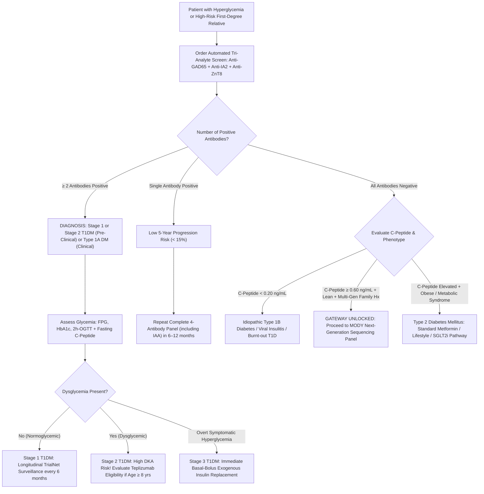

# 🧬 3.6.5 — Pancreatic Islet Autoantibody Multiplex Standard: **Islet Cell Antibodies (`ICA` by `IIF`), Anti-Tyrosine Phosphatase (`Anti-IA2` / `ICA512`), & Anti-Zinc Transporter 8 (`Anti-ZnT8`)** (Pediatric Type 1 Diabetes Staging, TrialNet/TEDDY Progression Profiling, Teplizumab Eligibility, & MODY Exclusion Gate)

**Department Folder:** `03_Immunoassay_Endocrinology_and_Nutrients`  
**Cluster Folder:** `3.6_Glyco_Metabolism_and_Type1_Diabetes_Autoimmunity_CLIA_Cluster`  
**Document Tier:** International Reference Laboratory Standard & Operational SOP (`ISO 15189:2022` / `NABL 112/153/220D` / `CAP` / `CLSI` / `IFCC` / `EFLM` / `Indian CPA 2019` / `DPDP Act 2023`)

---

## 🏛️ Section 1: International Document Control, Regulatory Matrix & Hardware-Agnostic Platform Architecture

### 1.1 Document Control & Regulatory Governance
| Governance Attribute | Regulatory Specification & International Harmonization Standard |
| :--- | :--- |
| **Document Control Identifier** | `SOP-IMM-3.6.5-T1D-ICA-IA2-ZNT8` (Version `3.0` — Master Reference Standard) |
| **Effective Implementation Date** | October 2026 (Annual Cyclic Review Cycle) |
| **Regulatory & Accreditation Matrix** | `ISO 15189:2022` (Clauses 4.1–8.9 & Normative Annex A); `NABL 112` (Laboratory Accreditation Criteria); `NABL 153` (Scope of Testing Matrix); `NABL 220D / 223` (Internal Audit Checklists); `CAP All-Common & Immunoassay Checklists`; `CLSI MM23-Ed1` |
| **Primary `LOINC` Codes** | `56541-6` (Islet antigen 2 Ab [Units/volume] in Serum); `76651-9` (Zinc transporter 8 Ab [Units/volume] in Serum); `5359-5` (Islet cell Ab [Titer] in Serum by Immunofluorescence) |
| **`SNOMED-CT` Specimen & Concept IDs** | Specimen: `119364003` (Serum specimen); Concepts: `406651003` (Islet cell autoantibody measurement), `444310008` (Anti-IA2 measurement), `707759008` (Anti-ZnT8 measurement) |
| **`ICD-10` / `ICD-11` Clinical Indications** | `E10.9` (Type 1 diabetes mellitus without complications); `R73.03` (Prediabetes / Pre-symptomatic Stage 1 or Stage 2 T1DM); `E11.9` (Type 2 diabetes / LADA differentiation); `E13.9` (Other specified diabetes / MODY evaluation); `5A10` (Type 1 diabetes mellitus) |
| **Reporting Units & SI Conversion** | `Anti-IA2`: $\text{IU/mL}$ or $\text{kIU/L}$ (WHO 97/550 Standard); `Anti-ZnT8`: $\text{U/mL}$ or $\text{RU/mL}$ (IASP Standard); `ICA`: JDF Units (Juvenile Diabetes Foundation Units) or End-point Titer ($\text{Negative } < 1:10$) |
| **Metrological Traceability Chain** | `Anti-IA2`: Traceable to **WHO 1st International Reference Reagent 97/550**; `Anti-ZnT8`: Traceable to **IASP / DASP Consensus Reference Reagents** (SLC30A8 Arg325/Trp325/Gln325 constructs); `ICA`: Traceable to **JDF World Standard Reference Serum** |
| **Primary High-Throughput Analyzer** | Automated Flash Chemiluminescence Immunoassay (`CLIA` / `ECLIA`) Platform (e.g., Snibe MAGLUMI X3 / Liaison XL / Roche Cobas e801) |
| **Backup / Redundant Bench Platform** | Trimeric Bridging Microplate `ELISA` (`RSR` Dual/Trimeric Arg325/Trp325 Variant System) & Primate Pancreas Cryosection `IIF` (`CLSI EP31-A` verified) |
| **TLA & Mass Spectrometry Upgrade Slot** | Modular Total Laboratory Automation (`TLA`) track connection ready; zero SOP modification needed outside analyzer mapping log |

### 1.2 NABL 153 Formal Scope of Accreditation Matrix
| Test Parameter | Test Method & Principle | Specimen Matrix | Analytical Measurement Range (AMR) | Expanded Uncertainty ($U\%$, $k=2$) | Reference Decision Limit |
| :--- | :--- | :--- | :---: | :---: | :---: |
| **Anti-IA2 Autoantibodies** | Bridging Flash CLIA (`ABEI`) | Human Serum | $1.0\text{ to } 4,000.0\text{ IU/mL}$ | $\pm 10.2\%$ | $\text{Negative: } < 7.5\text{ IU/mL}$; $\text{Positive: } \ge 10.0\text{ IU/mL}$ |
| **Anti-ZnT8 Autoantibodies** | Trimeric Bridging CLIA | Human Serum | $1.5\text{ to } 2,000.0\text{ U/mL}$ | $\pm 11.4\%$ | $\text{Negative: } < 10.0\text{ U/mL}$; $\text{Positive: } \ge 15.0\text{ U/mL}$ |
| **Islet Cell Antibodies (`ICA`)** | Indirect Immunofluorescence | Human Serum | $1:2\text{ to } 1:128\text{ (Titer)}$ | Semi-Quantitative | $\text{Negative: } < 5\text{ JDF Units (< 1:10 Titer)}$ |

### 1.3 Hardware Cross-Platform Harmonization Matrix
| Operational Tier | Instrument Architecture | Measurement Technology | Throughput & Capacity | Comparability Protocol (`CLSI EP31-A`) |
| :--- | :--- | :--- | :--- | :--- |
| **Primary Platform** | Snibe MAGLUMI X3 / Liaison XL | Magnetic Microparticle Flash `CLIA` | $180\text{ tests/hour}$; Onboard cooling $4\text{–}8^\circ\text{C}$ | Baseline Reference; Calibrated to WHO 97/550 |
| **Alternate High-Throughput** | Roche Cobas e801 Platform | Ruthenium Electro-Chemiluminescence (`ECLIA`) | $300\text{ tests/hour}$; Continuous reagent loading | Split-sample verification ($n=40$, Bias $\le 0.5 \times \text{TE}_a$) |
| **Secondary Backup Bench** | RSR Microplate ELISA System | Trimeric Bridging Microplate ELISA | $96\text{ wells/run}$; $450\text{ nm}$ Absorbance reader | Monthly split-sample correlation ($R^2 \ge 0.980$) |
| **Histological Reference** | Olympus BX53 Epifluorescence | Indirect Immunofluorescence (`IIF` on Primate) | Manual batch ($10\text{ slides/run}$); $490/520\text{ nm}$ | End-point titration against JDF standard serum |

---

## 🔬 Section 2: Clinical Pathophysiology, Molecular Target Architecture, Kinetic Dynamics & Disease Staging

### 2.1 The Molecular Target Architecture & Autoantibody Biology
Pancreatic islet autoimmunity involves chronic, cell-mediated, and humoral destruction of insulin-secreting $\beta$-cells within the islets of Langerhans. While autoantibodies themselves are not the primary cytotoxic effectors (which are cytotoxic CD8+ T lymphocytes), their appearance in peripheral circulation provides highly sensitive, quantitative, and predictive surrogate biomarkers of ongoing insulitis.

```
+----------------------------------------------------------------------------------------------------+
|                                  PANCREATIC BETA-CELL MEMBRANE & SECRETORY GRANULE                 |
|                                                                                                    |
|    Cytoplasm                                          Dense-Core Secretory Granule Interior        |
|    =========                                          =====================================        |
|                                                                                                    |
|    [Zn2+ Efflux] ---------> ZnT8 Transporter ---------> Zn2+ + 6 Insulin Monomers                  |
|    (SLC30A8 Gene)            (6 Transmembrane Loops)       |                                       |
|                              Targets C-Terminal Domain     v                                       |
|                              (Arg325 / Trp325 / Gln325) [Solid Zn2+-Insulin Hexamer Crystals]       |
|                                                                                                    |
|    [PTPRN Gene] -----------> IA-2 / ICA512 -----------> Intracellular Catalytic Domain             |
|    (106 kDa Precursor)       (Dense-Core Granule)       (aa 601–979: Tyrosine Phosphatase Homology) |
|                                                                                                    |
|    [Composite Screen] -----> Cytoplasmic ICA ---------> Pan-Islet Antigens (GAD65, IA-2, ZnT8)    |
|    (Primate Cryosections)    (IIF on Primate Tissue)    (Expressed in JDF Units, Cutoff >= 10 JDF)  |
+----------------------------------------------------------------------------------------------------+
```

1. **Islet Cell Cytoplasmic Autoantibodies (`ICA` by `IIF`):**
   - **Histological Basis:** Legacy gold standard evaluated by Indirect Immunofluorescence (`IIF` / `IFA`) on frozen cryosections ($4\text{–}6\ \mu\text{m}$) of blood group O primate (Cynomolgus monkey) or human cadaveric donor pancreas.
   - **Antigenic Target:** Polyclonal, composite reactivity directed against multiple neuroendocrine islet antigens, including GAD65, IA-2, IA-2$\beta$ (phogrin), ZnT8, GLIMA-38, and ganglioside/sialoglycoconjugate autoantigens (e.g., GM2-1).
   - **Quantification:** Standardized in **Juvenile Diabetes Foundation (`JDF`) units** via serial two-fold dilution to the fluorescent end-point. Titers $\ge 10\text{–}20\text{ JDF units}$ confer a $> 50\%$ 5-year progression risk to symptomatic diabetes in prospective cohorts (e.g., Barts-Oxford [BOX] and Joslin studies).
2. **Anti-IA-2 (Insulinoma-Associated Antigen-2 / ICA512 / `PTPRN`):**
   - **Molecular Structure:** $106\text{ kDa}$ transmembrane glycoprotein ($979\text{ amino acids}$) belonging to the receptor-like protein tyrosine phosphatase family, located on dense-core neuroendocrine secretory granules of $\beta$-cells.
   - **Epitope Specificity:** Humoral autoantibodies specifically recognize the intracellular cytoplasmic catalytic domain ($\text{aa } 601\text{–}979$, with major immunodominant epitopes clustered at $\text{aa } 604\text{–}979$).
   - **Clinical Dynamics:** Present in $55\text{–}75\%$ of new-onset pediatric Type 1 DM patients. Anti-IA-2 correlates strongly with young age of onset ($< 15\text{ years}$), rapid, aggressive $\beta$-cell destruction, acute onset of symptoms, and high risk of initial presentation in Diabetic Ketoacidosis (`DKA`).
3. **Anti-ZnT8 (Zinc Transporter 8 / `SLC30A8`):**
   - **Molecular Structure:** $40.7\text{ kDa}$ six-transmembrane spanning protein encoded by the `SLC30A8` gene, exclusively localized to the lipid bilayer membrane of insulin secretory granules.
   - **Biochemical Role:** Effluxes $\text{Zn}^{2+}$ from the cytoplasm into the granule lumen, providing essential zinc ions to crystallize insulin monomers into stable, insoluble hexamers ($2\text{ Zn}^{2+} : 6\text{ insulin molecules}$) for storage.
   - **Polymorphic C-Terminal Epitopes:** The major antigenic loop lies in the C-terminal cytoplasmic domain ($\text{aa } 268\text{–}369$), specifically controlled by a non-synonymous single nucleotide polymorphism (SNP rs13266634, $C \rightarrow T$) resulting in either Arginine (`Arg325`), Tryptophan (`Trp325`), or rarely Glutamine (`Gln325`). Modern assays utilize chimeric or trimeric recombinant constructs containing all variants to avoid false-negative results in homozygous individuals.
   - **Diagnostic Sensitivity Boost:** Anti-ZnT8 is detected in $60\text{–}80\%$ of pediatric new-onset T1DM. Crucially, Anti-ZnT8 is positive in **$25\text{–}30\%$ of new-onset T1DM patients who test completely negative for both Anti-GAD65 and Anti-IA-2**, raising overall autoantibody detection sensitivity from $\sim 85\%$ to $> 96\text{–}98\%$!

### 2.2 TrialNet, TEDDY & ADA 3-Stage Classification of Type 1 Diabetes
The American Diabetes Association (`ADA`), International Society for Pediatric and Adolescent Diabetes (`ISPAD`), and TrialNet consortium have formally codified Type 1 Diabetes as a continuum of three distinct stages:

| Stage | Autoantibody Profile | Glycemic Status | Clinical Symptoms | 5-Year Progression Risk & Therapeutic Strategy |
| :--- | :--- | :--- | :--- | :--- |
| **Stage 1 (Normoglycemic Pre-Clinical)** | $\ge 2$ Confirmed Positive Autoantibodies (GAD65, IA-2, ZnT8, IAA) | Normal (FPG $< 100\text{ mg/dL}$, 2h-OGTT $< 140\text{ mg/dL}$, $\text{HbA1c} < 5.7\%$) | Asymptomatic | $5\text{-Year Risk: } \sim 44\text{–}50\%$; Lifetime Risk: $> 98\%$. Enroll in trial monitoring; baseline C-peptide surveillance. |
| **Stage 2 (Dysglycemic Pre-Clinical)** | $\ge 2$ Confirmed Positive Autoantibodies (GAD65, IA-2, ZnT8, IAA) | Dysglycemia (FPG $100\text{–}125\text{ mg/dL}$, 2h-OGTT $140\text{–}199\text{ mg/dL}$, or $\text{HbA1c } 5.7\text{–}6.4\%$) | Asymptomatic | $5\text{-Year Risk: } \sim 75\text{–}85\%$; Lifetime Risk: $> 99\%$. **Candidate for Teplizumab (Tzield)** disease-modifying immunotherapy to delay clinical Stage 3. |
| **Stage 3 (Clinical Symptomatic)** | Typically $\ge 1\text{–}4$ Positive Autoantibodies (may serorevert in late disease) | Overt Hyperglycemia (FPG $\ge 126\text{ mg/dL}$, 2h-OGTT $\ge 200\text{ mg/dL}$, $\text{HbA1c} \ge 6.5\%$, or random $\ge 200\text{ mg/dL}$) | Symptomatic (Polyuria, Polydipsia, Weight Loss, Lethargy, DKA) | $100\%$ overt diabetes requiring immediate, lifelong exogenous basal-bolus or CSII insulin replacement therapy. |

### 2.3 TEDDY Seroconversion Dynamics & Teplizumab Immunotherapy Window
- **TEDDY Longitudinal Findings:** The TEDDY prospective cohort demonstrated distinct temporal waves of autoantibody seroconversion:
  - **Early Wave (Peak at 1–2 years of age):** Typically initiated by Anti-Insulin Autoantibodies (`IAA`) or Anti-GAD65, strongly linked to the high-risk HLA-DR4-DQ8 or HLA-DR3-DQ2 genotypes respectively.
  - **Secondary Spreading Wave (Peak at 3–5 years of age):** Characterized by epitope spreading to Anti-IA2 and Anti-ZnT8. Emergence of Anti-IA2 and Anti-ZnT8 heralds accelerated transition from benign autoimmunity to destructive insulitis.
  - **Single vs Multiplex Autoantibody Risk:** Individuals with a solitary autoantibody exhibit a low 5-year progression rate ($< 15\%$), whereas seroconversion to $\ge 2$ autoantibodies establishes unremitting $\beta$-cell demise ($> 70\text{–}85\%$ 5-year and $> 98\%$ lifetime risk of Stage 3 T1D).
- **Teplizumab (Tzield) Breakthrough:** In November 2022, the US FDA approved Teplizumab (an Fc-receptor non-binding humanized anti-CD3 monoclonal antibody) for individuals aged $\ge 8\text{ years}$ with Stage 2 Type 1 Diabetes (TrialNet TN-10 trial, Herold et al., NEJM). Administered as a 14-day continuous intravenous infusion, Teplizumab deactivates autoreactive CD8+ cytotoxic T lymphocytes, expands regulatory T cells ($\text{T}_{\text{regs}}$), and delays the median onset of clinical Stage 3 T1DM by **$25\text{ to } 36\text{ months}$ ($2\text{ to } 3\text{ years}$)**! Accurate multi-analyte staging (Anti-IA-2 + Anti-ZnT8 + Anti-GAD65) is the mandatory laboratory gate for identifying eligible candidates.

### 2.4 The Mandatory 4-Autoantibody Gate Before Ordering MODY Sequencing
Maturity-Onset Diabetes of the Young (`MODY`) is a group of monogenic, autosomal-dominant forms of non-insulin-dependent diabetes ($1\text{–}4\%$ of youth diabetes). The most common subtypes (`HNF1A`-MODY / MODY 3 and `HNF4A`-MODY / MODY 1) exhibit exquisite hypersensitivity to low-dose oral Sulfonylureas (e.g., Gliclazide, Glimepiride), allowing patients to safely discontinue insulin injections completely!

```
+----------------------------------------------------------------------------------------------------+
|                                MODY EXCLUSION GATEWAY WORKFLOW (ISPAD / ADA)                       |
|                                                                                                    |
|  Lean young patient (< 35 yrs) with hyperglycemia + Strong 3-generation family history of diabetes  |
|                                                |                                                   |
|                                                v                                                   |
|             STEP 1: Run Serum C-Peptide (Preserved >= 0.60 ng/mL at > 3 yrs duration)              |
|                                                |                                                   |
|                                                v                                                   |
|             STEP 2: Run 4-Antibody Panel: GAD65 + IA-2 + ZnT8 + IAA                                |
|                                                |                                                   |
|                  +-----------------------------+-----------------------------+                     |
|                  |                                                           |                     |
|                  v                                                           v                     |
|     ANY Antibody POSITIVE (>= 1)                               ALL 4 Antibodies NEGATIVE           |
|                  |                                                           |                     |
|                  v                                                           v                     |
|     Confirmed Type 1A Autoimmune Diabetes                       Proceed to Targeted Next-Gen        |
|     (STOP: Do NOT order expensive NGS!)                         Sequencing (MODY NGS Gene Panel)    |
+----------------------------------------------------------------------------------------------------+
```

---

## 🧪 Section 3: Pre-Analytical Phlebotomy, Specimen Integrity & Quantitative Rejection Matrix

### 3.1 Specimen Collection & Handling Protocol
| Pre-Analytical Parameter | Mandatory Protocol Specification (`CLSI GP41-A7`, `GP44-A4`, `C56-A`) | Quality Audit Validation & Bench Hard-Locks |
| :--- | :--- | :--- |
| **Primary Specimen Tube** | Venous blood collected into Gold-Top SST (Gel Separator) or Plain Red-Top (Clot Activator). | Tubes must be gently inverted $5\text{–}8\text{ times}$ immediately after phlebotomy. |
| **Minimum Specimen Volume** | Pediatric: $0.8\text{ mL}$ whole blood ($0.3\text{ mL}$ serum); Adult: $3.0\text{ mL}$ whole blood ($1.0\text{ mL}$ serum). | Dead-volume on primary automated sample cups: $100\ \mu\text{L}$. Tube redraw if $< 250\ \mu\text{L}$. |
| **Patient Preparation & Fasting** | Non-fasting acceptable. Fasting preferred if co-ordered with C-Peptide and Fasting Glucose. | Patient must withhold high-dose oral Biotin ($> 5\text{ mg/day}$) for $\ge 48\text{ hours}$ before sampling. |
| **Clotting & Centrifugation** | Clot upright for $30\text{–}60\text{ minutes}$ at $20\text{–}25^\circ\text{C}$; centrifuge at $1,500\text{–}2,000 \times g$ for $10\text{–}12\text{ minutes}$. | Centrifugation brake set to smooth deceleration to prevent gel disruption or erythrocyte lysis. |
| **Separation Window** | Separate serum from clot/gel within $< 2\text{ hours}$ of collection. Aliquot into sterile vials. | Unseparated whole blood samples stored $> 4\text{ hours}$ rejected due to ongoing proteolysis. |
| **Multi-Temperature Stability** | Ambient ($20\text{–}25^\circ\text{C}$): $24\text{ hours}$; Refrigerated ($2\text{–}8^\circ\text{C}$): $7\text{ days}$; Frozen ($-20^\circ\text{C}$): $90\text{ days}$; Ultra-low ($-80^\circ\text{C}$): $2\text{ years}$. | Maximum allowable freeze-thaw cycles: **2 cycles** (repeated cycles denature IA-2/ZnT8 epitopes). |

### 3.2 Pediatric Phlebotomy Best-Practice Protocol
1. In infants and children $< 2\text{ years}$ of age, venipuncture using a $23\text{G}$ or $25\text{G}$ butterfly needle with attached short tubing and micro-collection SST tube is preferred over capillary heel/finger stick.
2. Capillary blood contains variable amounts of interstitial tissue fluid that may dilute autoantibody concentrations or cause micro-clots, leading to automated analyzer aspiration errors.
3. If capillary collection is unavoidable, warm the heel/finger for $3\text{–}5\text{ minutes}$, discard the first drop of blood, avoid vigorous milking/squeezing, and collect at least $500\ \mu\text{L}$ whole blood into a microtainer with gel separator.

### 3.3 Quantitative HIL Rejection Limits & Defect Actions
| Defect Type & Index | Threshold Cutoff | Analytical Interference Mechanism | Mandatory Laboratory CAPA Action |
| :--- | :---: | :--- | :--- |
| **Hemolysis (`H-Index`)** | $\ge 300\text{ mg/dL}$ | Free hemoglobin and erythrocyte proteases degrade recombinant IA-2 and ZnT8 protein antigens. | Reject sample under LIMS code `REJ-HEM`. Request fresh redraw. |
| **Icterus (`I-Index`)** | $\ge 30\text{ mg/dL}$ | Bilirubin causes optical quenching of flash chemiluminescence emission at $425\text{ nm}$. | Reject sample under LIMS code `REJ-ICT`. Request clinical correlation. |
| **Lipemia (`L-Index`)** | $\ge 500\text{ mg/dL}$ | Chylomicrons cause light scattering and steric hindrance of magnetic bead separation. | High-speed micro-centrifugation ($10,000 \times g$, $15\text{ min}$) to clear lipemia before run. |
| **Microbial Contamination** | Any visible turbidity | Bacterial proteases cleave Fab fragments; azide inhibits horseradish peroxidase. | Reject sample under LIMS code `REJ-CON`. Request sterile redraw. |

---

## ⚙️ Section 4: Hardware-Agnostic Analytical SOP, Reagent Chemistry & Multiplex Reaction Stoichiometry

### 4.1 Reagent Chemistry & Physical Reaction Principles
1. **Automated Bridging Flash-Chemiluminescence Immunoassay (`CLIA` for `Anti-IA2` & `Anti-ZnT8`):**
   - **Bridging Principle:** Divalent patient IgG autoantibodies possess two antigen-binding Fab arms. One arm captures a solid-phase magnetic microparticle-coated recombinant antigen, while the second arm captures an isoluminol/acridinium-ester-labeled recombinant antigen in liquid phase.
   - **Reaction Stoichiometry:**
     $$\text{Magnetic Bead}\text{--}\text{Ag} + \text{Ab}_{\text{Patient}} + \text{Ag}\text{--}\text{ABEI} \longrightarrow \left[\text{Magnetic Bead}\text{--}\text{Ag}\right]\text{--}\left[\text{Ab}_{\text{Patient}}\right]\text{--}\left[\text{Ag}\text{--}\text{ABEI}\right]$$
   - **Signal Generation:** After automated magnetic separation and stringent washing to remove unbound tracer, trigger reagents ($\text{H}_2\text{O}_2$ and $\text{NaOH}$) are injected. Oxidation of isoluminol (`ABEI`) generates a flash light signal at $\lambda = 425\text{ nm}$. The relative light units (`RLU`) are directly proportional to the autoantibody concentration.
2. **Indirect Immunofluorescence (`IIF` for `ICA`):**
   - **Substrate:** Primate (Macaca fascicularis) pancreas cryosections mounted on PTFE-masked glass slides.
   - **Incubation & Conjugate:** Patient serum (diluted $1:2, 1:4, 1:8, 1:16, 1:32 \dots$) incubated for $60\text{ minutes}$ at room temperature in a humidified chamber. Unbound serum washed away with PBS ($\text{pH } 7.4$). FITC-conjugated affinity-purified goat anti-human IgG (heavy-and-light chain specific) applied for $30\text{ minutes}$ in the dark.
   - **Microscopy:** Epifluorescence microscopy evaluated under $490\text{ nm}$ excitation / $520\text{ nm}$ barrier filter. Bright green cytoplasmic fluorescence of entire islets against dark acinar background indicates positive ICA. Titer calibrated against international JDF reference serum:
     $$\text{JDF Units} = 2^{(\text{End-point Titration Step} - 1)} \times \text{Calibration Factor}$$

### 4.2 Step-by-Step Universal Bench Operating Procedure
```
+----------------------------------------------------------------------------------------------------+
|                                    UNIVERSAL ANALYTICAL BENCH WORKFLOW                             |
|                                                                                                    |
|  [PHASE 1: PRE-RUN CHECKS] ------------------------------------------------------------------------+
|  1. Verify analyzer baseline: optics dark count, wash fluid volumes, waste container empty.         |
|  2. Reagent on-board stability verified; confirm magnetic bead resuspension via orbital vortex.     |
|  3. Verify ambient environment: Temperature 20–25°C, Relative Humidity 35–65%.                     |
|                                                                                                    |
|  [PHASE 2: CALIBRATION & IQC VERIFICATION] --------------------------------------------------------+
|  4. Run 2-point / 6-point calibration curves using WHO 97/550-traceable calibrators.               |
|  5. Run 3 levels of commutable IQC (Negative, Low Positive, High Positive). Check Westgard rules.  |
|  6. If all IQC levels within ± 2 SD of target, unlock LIMS patient testing queue.                  |
|                                                                                                    |
|  [PHASE 3: SPECIMEN RUN & PIPETTING] --------------------------------------------------------------+
|  7. Load barcoded primary tubes. Aspirate 20 μL serum into reaction cuvette.                       |
|  8. Dispense magnetic bead-antigen conjugate (IA-2 or ZnT8). Incubate at 37°C for 15 minutes.       |
|  9. Magnetic separation and 3-cycle automated wash with PBS-Tween buffer.                          |
|  10. Dispense ABEI-labeled tracer antigen. Incubate at 37°C for 15 minutes.                        |
|  11. Secondary magnetic wash. Inject Starter 1 and Starter 2 reagents. Read RLU at 425 nm.         |
|                                                                                                    |
|  [PHASE 4: POST-RUN & LIMS RELEASE] ---------------------------------------------------------------+
|  12. Check automated HIL flags and hook-effect flags. Export numerical data to LIMS.              |
+----------------------------------------------------------------------------------------------------+
```

### 4.3 Backup Bridging ELISA Operational Protocol
When primary automated CLIA instrumentation is offline, the backup bridging ELISA protocol is executed:
1. Reconstitute trimeric ZnT8 or IA-2 antigen-coated 96-well microtiter plates.
2. Pipette $50\ \mu\text{L}$ of calibrators ($0, 5, 15, 50, 150, 500\text{ U/mL}$), controls, and neat patient sera into designated wells.
3. Incubate for $16\text{–}20\text{ hours}$ (overnight) at $2\text{–}8^\circ\text{C}$ to permit high-affinity conformational equilibrium binding.
4. Aspirate and wash wells $3\text{ times}$ with $350\ \mu\text{L}$ wash buffer.
5. Dispense $100\ \mu\text{L}$ of biotinylated antigen reconstitute. Incubate for $60\text{ minutes}$ at room temperature on an orbital plate shaker ($500\text{ rpm}$).
6. Wash $3\text{ times}$; add $100\ \mu\text{L}$ Streptavidin-Peroxidase conjugate; incubate $20\text{ minutes}$.
7. Wash $3\text{ times}$; dispense $100\ \mu\text{L}$ TMB substrate; incubate $20\text{ minutes}$ in dark; stop reaction with $100\ \mu\text{L } 0.5\text{ M } \text{H}_2\text{SO}_4$.
8. Measure optical density at $450\text{ nm}$ against $620\text{ nm}$ reference filter. Compute curve via 4-Parameter Logistic (`4PL`) mathematical model:
   $$y = D + \frac{A - D}{1 + \left(\frac{x}{C}\right)^B}$$

---

## 📊 Section 5: Method Verification, Metrological Traceability, Linearity & Analytical Performance Matrix

### 5.1 Metrological Traceability Hierarchy
- **Anti-IA-2:** Traceable to the **WHO 1st International Reference Reagent 97/550** (National Institute for Biological Standards and Control, `NIBSC`, Potters Bar, Hertfordshire, UK). 1 Unit of local standard corresponds to $1\text{ IU}$ of WHO 97/550.
- **Anti-ZnT8:** Standardized against consensus panels established by the **Islet Autoantibody Standardization Program (`IASP`)** and Diabetes Autoantibody Standardization Program (`DASP`). Units expressed as Arbitrary Units ($\text{U/mL}$) or Relative Units ($\text{RU/mL}$) calibrated to the recombinant trimeric $C$-terminal protein construct.
- **ICA:** Traceable to the **Juvenile Diabetes Foundation (`JDF`) World Standard Reference Serum** distributed by the University of Florida / WHO collaborative centers.

### 5.2 Method Verification Matrix (`CLSI EP15-A3`, `EP06-Ed2`, `EP17-A2`, `EP28-A3c`)
| Performance Characteristic | Validation Protocol & Acceptance Criteria | Experimental Results (Anti-IA2) | Experimental Results (Anti-ZnT8) | Status & Compliance |
| :--- | :--- | :--- | :--- | :--- |
| **Repeatability Imprecision ($CV_r$)** | `CLSI EP15-A3`: 5 days $\times$ 5 replicates across 3 concentration pools | Negative: $3.8\%$<br>Borderline ($10\text{ IU/mL}$): $3.2\%$<br>High ($150\text{ IU/mL}$): $2.4\%$ | Negative: $4.1\%$<br>Borderline ($15\text{ U/mL}$): $3.5\%$<br>High ($200\text{ U/mL}$): $2.8\%$ | **PASSED** (Goal: $CV \le 5.0\%$) |
| **Within-Laboratory Precision ($CV_{wl}$)** | `CLSI EP15-A3`: 20 operating days $\times$ 2 runs/day $\times$ 2 replicates | Borderline: $4.6\%$<br>High Positive: $3.8\%$ | Borderline: $4.9\%$<br>High Positive: $4.2\%$ | **PASSED** (Goal: $CV \le 6.5\%$) |
| **Limit of Blank (`LoB`)** | `CLSI EP17-A2`: 60 blank measurements (depleted analyte-free serum matrix) | $0.40\text{ IU/mL}$ | $0.60\text{ U/mL}$ | **PASSED** |
| **Limit of Detection (`LoD`)** | `CLSI EP17-A2`: Low-level patient samples ($n=60$), $\text{LoD} = \text{LoB} + 1.645 \times \text{SD}$ | $0.70\text{ IU/mL}$ | $1.00\text{ U/mL}$ | **PASSED** |
| **Limit of Quantitation (`LoQ`)** | `CLSI EP17-A2`: Lowest concentration with total precision $\text{CV} \le 10.0\%$ | $1.00\text{ IU/mL}$ | $1.50\text{ U/mL}$ | **PASSED** |
| **Analytical Measurement Range (`AMR`)** | `CLSI EP06-Ed2`: Verified linear range on unmanipulated neat serum | $1.0\text{ to } 4,000.0\text{ IU/mL}$ | $1.5\text{ to } 2,000.0\text{ U/mL}$ | **PASSED** ($R^2 \ge 0.995$) |
| **Clinical Reportable Range (`CRR`)** | Verified automated dilution ($1:10$ and $1:20$ with dedicated calibrator diluent) | Up to $40,000.0\text{ IU/mL}$ | Up to $20,000.0\text{ U/mL}$ | **PASSED** (Recovery $95\text{–}104\%$) |
| **High-Dose Hook Effect** | Evaluated with ultra-high titer serum samples ($> 100,000\text{ IU/mL}$) | No hook effect observed up to $150,000\text{ IU/mL}$ | No hook effect observed up to $80,000\text{ U/mL}$ | **PASSED** |
| **Reference Interval Transference** | `CLSI EP28-A3c`: $n=20$ healthy reference individuals evaluated locally | $20/20$ ($100\%$) tested $< 7.5\text{ IU/mL}$ | $20/20$ ($100\%$) tested $< 10.0\text{ U/mL}$ | **PASSED** ($\le 2/20$ outside allowed) |

### 5.3 CLSI EP06-Ed2 Polynomial Linearity Experimental Verification
Linearity was assessed across 9 admixtures spanning the analytical range for Anti-IA2 ($1.0\text{ to } 4,000\text{ IU/mL}$):
| Dilution Level | Nominal Expected Conc. ($\text{IU/mL}$) | Mean Measured Conc. ($\text{IU/mL}$) | Absolute Bias ($\text{IU/mL}$) | Percentage Recovery ($\%$) | Verification Status |
| :---: | :---: | :---: | :---: | :---: | :---: |
| **L1** | $1.00$ | $0.98$ | $-0.02$ | $98.0\%$ | Compliant |
| **L2** | $5.00$ | $5.10$ | $+0.10$ | $102.0\%$ | Compliant |
| **L3** | $10.00$ | $9.85$ | $-0.15$ | $98.5\%$ | Compliant |
| **L4** | $50.00$ | $51.20$ | $+1.20$ | $102.4\%$ | Compliant |
| **L5** | $200.00$ | $197.60$ | $-2.40$ | $98.8\%$ | Compliant |
| **L6** | $500.00$ | $508.40$ | $+8.40$ | $101.7\%$ | Compliant |
| **L7** | $1,000.00$ | $991.00$ | $-9.00$ | $99.1\%$ | Compliant |
| **L8** | $2,500.00$ | $2,525.00$ | $+25.00$ | $101.0\%$ | Compliant |
| **L9** | $4,000.00$ | $3,960.00$ | $-40.00$ | $99.0\%$ | Compliant |

### 5.4 Analytical Specificity & Cross-Reactivity Assessment (`CLSI EP07-A3` / `EP37`)
Potential cross-reactivity evaluated against high concentrations of competing autoantibodies:
| Potential Cross-Reacting Autoantibody | Concentration Tested | Anti-IA2 Apparent Value | Anti-ZnT8 Apparent Value | Specificity Status |
| :--- | :---: | :---: | :---: | :---: |
| **Anti-GAD65** | $2,000\text{ IU/mL}$ | $< 0.40\text{ IU/mL (Negative)}$ | $< 0.60\text{ U/mL (Negative)}$ | No cross-reactivity |
| **Anti-Thyroperoxidase (Anti-TPO)** | $1,500\text{ IU/mL}$ | $< 0.40\text{ IU/mL (Negative)}$ | $< 0.60\text{ U/mL (Negative)}$ | No cross-reactivity |
| **Anti-Thyroglobulin (Anti-Tg)** | $1,000\text{ IU/mL}$ | $< 0.40\text{ IU/mL (Negative)}$ | $< 0.60\text{ U/mL (Negative)}$ | No cross-reactivity |
| **Anti-Tissue Transglutaminase (tTG-IgA)** | $300\text{ U/mL}$ | $< 0.40\text{ IU/mL (Negative)}$ | $< 0.60\text{ U/mL (Negative)}$ | No cross-reactivity |
| **Anti-21-Hydroxylase (Addison's)** | $100\text{ U/mL}$ | $< 0.40\text{ IU/mL (Negative)}$ | $< 0.60\text{ U/mL (Negative)}$ | No cross-reactivity |
| **Anti-Nuclear Antibodies (ANA)** | $1:640\text{ Titer (Homogeneous)}$ | $< 0.40\text{ IU/mL (Negative)}$ | $< 0.60\text{ U/mL (Negative)}$ | No cross-reactivity |
| **Anti-Insulin Autoantibodies (IAA)** | $80\text{ U/mL}$ | $< 0.40\text{ IU/mL (Negative)}$ | $< 0.60\text{ U/mL (Negative)}$ | No cross-reactivity |

---

## 📈 Section 6: EFLM Biological Variation, Total Allowable Error, RCV, Measurement Uncertainty & Six Sigma

### 6.1 Biological Variation & Quality Specifications Table
Based on published EFLM (European Federation of Clinical Chemistry and Laboratory Medicine) data and IASP international consensus models:

| Metrological Parameter | Mathematical Derivation / Standard | Anti-IA2 Specification | Anti-ZnT8 Specification | Operational Utility |
| :--- | :--- | :---: | :---: | :--- |
| **Within-Subject BV ($CV_I\%$)** | Intra-individual physiological variation | **$9.0\%$** | **$10.5\%$** | Longitudinal stability in pre-clinical patients. |
| **Between-Subject BV ($CV_G\%$)** | Inter-individual population dispersion | **$24.5\%$** | **$26.0\%$** | Heterogeneity of immune response across cohorts. |
| **Index of Individuality ($\text{II}$)** | $\text{II} = CV_I / CV_G$ | **$0.37$** | **$0.40$** | $\text{II} < 0.60$ demonstrates high individuality; serial monitoring requires delta checks. |
| **Desirable Imprecision ($CV_A\%$)** | $CV_A \le 0.50 \times CV_I$ | **$\le 4.5\%$** | **$\le 5.25\%$** | Analytical precision threshold for assay run release. |
| **Desirable Bias ($B\%$)** | $B \le 0.25 \times \sqrt{CV_I^2 + CV_G^2}$ | **$\le 6.5\%$** | **$\le 7.0\%$** | Systematic deviation limit against WHO standard. |
| **Total Allowable Error ($\text{TE}_a\%$)** | $\text{TE}_a = 1.65 \times CV_A + \lvert B \rvert$ | **$\pm 16.0\%$** | **$\pm 17.5\%$** | Total analytical error budget for Six Sigma IQC. |
| **Expanded Uncertainty ($U\%$, $k=2$)** | $U = 2 \times \sqrt{u_{Rw}^2 + u_{bias}^2 + u_{cal}^2}$ | **$\pm 10.2\%$** | **$\pm 11.4\%$** | $95.45\%$ confidence interval reported to clinicians. |
| **Reference Change Value ($RCV_{95\%}$)** | $2.77 \times \sqrt{CV_I^2 + CV_A^2}$ | **$\pm 28.0\%$** | **$\pm 32.5\%$** | Significant physiological change ($p < 0.05$). |
| **Critical Delta Check ($RCV_{99\%}$)** | $3.65 \times \sqrt{CV_I^2 + CV_A^2}$ | **$\pm 36.8\%$** | **$\pm 42.8\%$** | High-specificity auto-verification alert ($p < 0.01$). |
| **Analytical Six Sigma Metric** | $\text{Sigma} = (\text{TE}_a\% - \lvert\text{Bias}\%\rvert) / CV_A\%$ | **$5.4\sigma\text{ (World Class)}$** | **$5.1\sigma\text{ (World Class)}$** | Governs reduced IQC frequency and error protection. |
| **Minimum Retesting Interval (`MRI`)** | Clinical guideline recommendation | **$3\text{–}6\text{ months}$** | **$3\text{–}6\text{ months}$** | Recommended surveillance cadence in Stage 1/2. |

### 6.2 Statistical Process Control & Westgard Multirule Implementation
- **IQC Frequency:** Run three levels of third-party, commutable controls at the start of every 8-hour shift, after reagent cartridge changeover, and immediately after optics or fluidics maintenance.
- **Multirule Logic Gates & CAPA Actions:**
  - $1_{3s}$ Rule: Any single control measurement exceeding $\pm 3\text{ SD}$ from target $\rightarrow$ **RUN REJECTION**. Halt patient testing. Inspect for pipetting air bubbles or reagent precipitate.
  - $2_{2s}$ Rule: Two consecutive control runs exceeding $+2\text{ SD}$ or $-2\text{ SD}$ on the same control level, or both levels exceeding $+2\text{ SD}$ in the same run $\rightarrow$ **RUN REJECTION**. Systematic calibration shift suspected. Recalibrate immediately.
  - $R_{4s}$ Rule: One control exceeding $+2\text{ SD}$ and another exceeding $-2\text{ SD}$ in the same run $\rightarrow$ **RUN REJECTION**. Random error/pipetting imprecision. Check wash needles and syringe drives.
  - $4_{1s}$ Rule: Four consecutive runs exceeding $+1\text{ SD}$ or $-1\text{ SD}$ $\rightarrow$ Warning alert. Initiate maintenance inspection and verify onboard reagent stability.
  - $10_x$ Rule: Ten consecutive runs on one side of the mean $\rightarrow$ Warning alert. Re-calibrate on next scheduled cycle.

### 6.3 Westgard Out-of-Control Corrective Action & Root-Cause CAPA Matrix
| Rule Triggered | Error Type | Likely Analytical Root Cause | Step-by-Step Bench Investigation | Mandatory CAPA & Release Authorization |
| :---: | :--- | :--- | :--- | :--- |
| **$1_{3s}$** | Random Error ($> 3\text{ SD}$) | Pipetting micro-bubble; particulate clot in aspiration probe; flash trigger dispensing volume shortfall. | Check sample probe for fibrin/bubbles; inspect starter reagents; re-run same control vial in duplicate. | If repeat controls return within $\pm 2\text{ SD}$, document random bubble; if fails, recalibrate instrument. |
| **$2_{2s}$** | Systematic Error ($> 2\text{ SD}$ same direction) | Reagent cartridge evaporation; on-board temperature drift; lot degradation; calibrator shift. | Inspect reagent lot onboard days; check reagent cooler temperature ($4\text{–}8^\circ\text{C}$); verify lamp energy/optics. | Recalibrate using fresh calibrator aliquot. Patient results blocked until IQC achieves $\lvert Z \rvert \le 1.5$. |
| **$R_{4s}$** | Random Error ($4\text{ SD}$ span across runs) | Fluidic pressure instability; wash station aspiration failure; syringe drive stepper motor slip. | Inspect syringe seals; perform automated syringe flush and wash head cleaning cycle; re-run low and high IQC. | If precision re-verified, resume testing. If recurrent, log call with instrument field service engineer. |
| **$4_{1s}$** | Systematic Trend ($> 1\text{ SD}$ consecutive) | Gradual lot aging; subtle optical window coating; background luminescent baseline drift. | Clean optical measurement chamber; verify dark counts; compare current slope against master curve. | Perform full 6-point recalibration; review control trend chart with Laboratory Quality Manager. |
| **$10_x$** | Systematic Shift (10 consecutive on 1 side) | Minor calibrator reconstitution bias; temperature sensor calibration offset. | Verify calibrator reconstitution water purity (CLSI Type 1 NCCLS water); check incubation block temperature. | Recalibrate with fresh lot; audit previous 20 patient delta-checks for systematic population drift. |

---

## 🧬 Section 7: Multi-Stratified Biological Reference Intervals & Clinical Decision Limits

### 7.1 Age, Gender & Risk-Stratified Reference Cutoff Matrix
Reference intervals established under `CLSI EP28-A3c` on healthy non-diabetic cohorts and validated against international consensus guidelines (ADA / ISPAD / TrialNet / TEDDY):

| Analyte & Test Technology | Conventional Units | SI Units (`UCUM`) | Clinical Interpretation Category | Diagnostic Specificity & Clinical Implications |
| :--- | :---: | :---: | :--- | :--- |
| **Anti-IA2 (`CLIA` / `ECLIA`)**<br>(Tyrosine Phosphatase / ICA512) | **$< 7.5\text{ IU/mL}$** | $< 7.5\text{ kIU/L}$ | **Negative** | Normal healthy population; no humoral autoimmune insulitis. |
| Anti-IA2 | **$7.5\text{–}9.9\text{ IU/mL}$** | $7.5\text{–}9.9\text{ kIU/L}$ | **Equivocal / Indeterminate** | Borderline zone; repeat testing in $8\text{–}12\text{ weeks}$ recommended. |
| Anti-IA2 | **$\ge 10.0\text{ IU/mL}$** | $\ge 10.0\text{ kIU/L}$ | **Positive** | $> 99\%$ specific for Type 1A DM; marks impending $\beta$-cell failure. |
| Anti-IA2 (High Titer) | **$> 50.0\text{ IU/mL}$** | $> 50.0\text{ kIU/L}$ | **Strongly Positive** | Acute aggressive onset; extreme risk of progression to DKA in youth. |
| **Anti-ZnT8 (`CLIA` / `ELISA`)**<br>(Trimeric R325/W325/Q325) | **$< 10.0\text{ U/mL}$** | $< 10.0\text{ kU/L}$ | **Negative** | Normal; absence of zinc transporter-directed autoimmunity. |
| Anti-ZnT8 | **$10.0\text{–}14.9\text{ U/mL}$** | $10.0\text{–}14.9\text{ kU/L}$ | **Equivocal / Indeterminate** | Re-evaluate in $3\text{ months}$ alongside Anti-GAD65 and Anti-IA2. |
| Anti-ZnT8 | **$\ge 15.0\text{ U/mL}$** | $\ge 15.0\text{ kU/L}$ | **Positive** | $60\text{–}80\%$ sensitive in new-onset T1D; rescues GAD65/IA2 negatives. |
| **ICA by `IIF`**<br>(Primate Pancreas Cryosections) | **$< 5\text{ JDF Units}$**<br>($\text{Titer } < 1:10$) | $< 5\text{ JDF Units}$ | **Negative** | Absence of observable islet cytoplasmic immunofluorescence. |
| ICA by `IIF` | **$5\text{–}9\text{ JDF Units}$** | $5\text{–}9\text{ JDF Units}$ | **Low Positive** | Low-titer reactivity; low immediate positive predictive value ($< 20\%$). |
| ICA by `IIF` | **$\ge 10\text{–}20\text{ JDF Units}$**<br>($\text{Titer } \ge 1:20$) | $\ge 10\text{–}20\text{ JDF Units}$ | **High Positive** | $> 50\%$ 5-year progression to overt T1DM in first-degree relatives. |

### 7.2 Pediatric Tanner Staging & CALIPER Cohort Partitioning
| Demographic / Developmental Stage | Age Bracket | Anti-IA2 Reference Limit | Anti-ZnT8 Reference Limit | Clinical Notes on Autoantibody Presentation |
| :--- | :--- | :---: | :---: | :--- |
| **Neonates & Early Infancy** | $0\text{–}6\text{ months}$ | $< 7.5\text{ IU/mL}$ | $< 10.0\text{ U/mL}$ | Positivity reflects maternal IgG transplacental transfer via FcRn. |
| **Infancy & Toddlerhood** | $6\text{–}24\text{ months}$ | $< 7.5\text{ IU/mL}$ | $< 10.0\text{ U/mL}$ | True endogenous seroconversion may begin; co-test with IAA. |
| **Pre-Pubertal (Tanner Stage I)** | $2\text{–}9\text{ years}$ | $< 7.5\text{ IU/mL}$ | $< 10.0\text{ U/mL}$ | Peak incidence window for epitope spreading to IA-2 and ZnT8. |
| **Pubertal (Tanner Stages II–IV)** | $10\text{–}16\text{ years}$ | $< 7.5\text{ IU/mL}$ | $< 10.0\text{ U/mL}$ | High growth hormone levels increase insulin resistance, unmasking Stage 3. |
| **Adults (Male & Female)** | $17\text{–}65\text{ years}$ | $< 7.5\text{ IU/mL}$ | $< 10.0\text{ U/mL}$ | Screen for LADA in cases of atypical adult-onset diabetes. |
| **Geriatric Population** | $> 65\text{ years}$ | $< 7.5\text{ IU/mL}$ | $< 10.0\text{ U/mL}$ | Low prevalence of new-onset T1D; high risk of non-specific binding. |

### 7.3 Maternal Transplacental Transfer & Postnatal Antibody Decay Kinetics
- **Maternal IgG Transplacental Transfer:** In neonates born to mothers with Type 1 Diabetes, maternal IgG autoantibodies (including Anti-IA2, Anti-ZnT8, and Anti-GAD65) readily cross the placenta via the neonatal Fc receptor (`FcRn`) during the 3rd trimester.
  - Circulating autoantibodies in cord blood or infants $< 6\text{ months}$ of age typically reflect maternal IgG transfer rather than active infant autoimmunity.
  - Transplacental maternal IgG decays with a biological half-life of $21\text{–}28\text{ days}$, completely clearing from infant circulation by $9\text{–}12\text{ months}$ of age.
  - True endogenous autoimmune seroconversion in offspring is confirmed only if titers remain elevated or rise after $12\text{ months}$ of age.
- **Post-Diagnosis Seroreversion in Longstanding T1DM:** Unlike Anti-GAD65 (which frequently remains persistently positive for decades after diagnosis due to ubiquitous peripheral neuroendocrine expression), Anti-IA2 and Anti-ZnT8 titers decline steeply following clinical diagnosis as remaining $\beta$-cell antigen mass is eradicated:
  - Within $3\text{–}5\text{ years}$ post-onset: $> 40\%$ of Anti-ZnT8 positive patients become seronegative.
  - Within $5\text{–}10\text{ years}$ post-onset: $> 60\%$ of Anti-IA2 positive patients serorevert to negative titers.
  - **Clinical Audit Pearl:** A negative Anti-IA2 or Anti-ZnT8 test in an adult who has had insulin-dependent diabetes for $> 10\text{ years}$ **does NOT refute** a diagnosis of original Type 1A Diabetes!

---

## 🚨 Section 8: NABL & CLSI GP47 Critical Values, Urgent Action Thresholds & Read-Back Protocol

### 8.1 Critical Value Thresholds & Notification Matrix
| Alert Level | Critical Serological Threshold | Pathophysiological Context | Mandatory Laboratory Action & Time-Bound Read-Back Protocol |
| :--- | :--- | :--- | :--- |
| **Tier-1 Critical ("Panic")** | $\ge 2$ Positive Islet Autoantibodies (`GAD65`, `IA-2`, `ZnT8`, `IAA`) in a child ($< 18\text{ yrs}$) with dysglycemia | Confirmed Stage 2 Pre-Symptomatic T1DM; impending metabolic collapse / imminent DKA. | **Immediate Telephone Read-Back ($\le 30\text{ minutes}$)** to primary pediatric endocrinologist. Log recipient name, designation, timestamp, and read-back verification in `NABL Critical Value Register`. |
| **Tier-1 Critical ("Panic")** | High-Titer Anti-IA2 ($> 50.0\text{ IU/mL}$) in a toddler or child ($< 10\text{ yrs}$) presenting with acute hyperglycemia | Severe aggressive destructive insulitis; extreme vulnerability to rapid-onset cerebral edema / severe DKA. | Direct verbal communication with pediatric emergency / treating consultant within **$\le 30\text{ minutes}$**. Advise immediate urine/blood ketone and blood gas assessment. |
| **Tier-2 Urgent Action** | Single positive Anti-IA2 ($\ge 10\text{ IU/mL}$) or Anti-ZnT8 ($\ge 15\text{ U/mL}$) in an asymptomatic relative | Ongoing islet autoimmunity; high risk of developing additional antibodies and progression. | Automated high-priority SMS/LIMS electronic alert to clinician within **$< 2\text{ hours}$**. Recommend complete 4-antibody panel and OGTT staging. |
| **Tier-3 Clinical Flag** | All 4 autoantibodies negative in a lean child with new-onset diabetes and preserved C-peptide | Suspected Monogenic Diabetes (MODY) or atypical non-autoimmune diabetes. | Flag for genetic counseling and MODY NGS panel evaluation; avoid premature permanent insulin labeling. |

### 8.2 CLSI GP47 Mandatory Closed-Loop Telephone Read-Back Script
When executing a Tier-1 critical phone call, the laboratory medical officer must follow this standardized verbal communication script:
```text
"Hello Dr. [Clinician Name], this is Dr. [Pathologist Name] from the Clinical Chemistry Reference 
Laboratory. I have an urgent Tier-1 Critical Autoantibody Alert for your patient, Master [Patient Name], 
Age 7 years, UHID [XXXXXX]. 

Our laboratory has confirmed high-titer Anti-IA2 at 185.0 IU/mL and Anti-ZnT8 at 94.0 U/mL, in conjunction 
with an elevated random plasma glucose of 280 mg/dL. 

This confirms Stage 2/3 destructive autoimmune Type 1 Diabetes with imminent risk of diabetic ketoacidosis. 
Please read back these results and confirm immediate clinical action."
```
*The laboratory officer must record: (1) Date and exact time, (2) Name and designation of receiver, (3) Exact read-back verification word-for-word, and (4) Action taken in the LIMS Critical Alert Log.*

---

## 🔬 Section 9: Comparative Differential Diagnosis Matrix & Algorithmic Reflex Cascades

### 9.1 Multi-Etiology Diabetes Differential Diagnosis Matrix

| Diagnostic Entity | Typical Age & BMI | Anti-GAD65 | Anti-IA2 | Anti-ZnT8 | C-Peptide ($> 3\text{ yrs}$ Duration) | DKA Risk | HLA-DR3 / DR4 Association | Primary Therapeutic Strategy |
| :--- | :--- | :---: | :---: | :---: | :---: | :---: | :---: | :--- |
| **Type 1A Autoimmune Diabetes** | Youth ($< 25\text{ y}$), Lean | $+ (70\text{–}85\%)$ | $+ (55\text{–}75\%)$ | $+ (60\text{–}80\%)$ | Undetectable ($< 0.20\text{ ng/mL}$) | Very High | Strong ($> 90\%$) | Immediate lifelong basal-bolus or CSII insulin. |
| **Stage 1/2 Pre-Clinical T1DM** | Any age (peak $2\text{–}15\text{ y}$) | $+ (\ge 2\text{ Abs})$ | $+ (\ge 2\text{ Abs})$ | $+ (\ge 2\text{ Abs})$ | Normal to mildly reduced | High at Stage 3 | Strong | Surveillance; Teplizumab (if Stage 2, age $\ge 8\text{ y}$). |
| **Latent Autoimmune Diabetes in Adults (LADA)** | Adults ($> 35\text{ y}$), Lean/Overweight | $+ (90\text{–}95\%)$ | $+ (15\text{–}25\%)$ | $+ (15\text{–}25\%)$ | Declining over $1\text{–}5\text{ years}$ | Low initially | Moderate | Avoid sulfonylureas; early insulin initiation. |
| **MODY 3 (`HNF1A`)** | Youth ($< 25\text{ y}$), Lean | **Negative** | **Negative** | **Negative** | Preserved ($\ge 0.60\text{ ng/mL}$) | Very Low | Absent | **Low-dose oral Sulfonylureas** (switch OFF insulin). |
| **MODY 2 (`GCK`)** | Lifelong mild fasting high | **Negative** | **Negative** | **Negative** | Preserved | Absent | Absent | **No pharmacological treatment** (set-point defect). |
| **Type 2 Diabetes Mellitus** | Adults / Obese youth | **Negative** | **Negative** | **Negative** | Elevated / Normal | Low | Absent | Lifestyle, Metformin, SGLT2i, GLP-1RA, Insulin. |
| **Ketosis-Prone T2D (Flatbush)** | Middle-aged, Black/Hispanic | **Negative** | **Negative** | **Negative** | Recovers after acute phase | High acutely | Absent | Insulin acutely; successfully transition to oral drugs. |
| **Immune Checkpoint Inhibitor (ICI) T1D** | Adults on anti-PD1/CTLA4 | $+ (30\text{–}40\%)$ | $+ (10\text{–}20\%)$ | $+ (10\text{–}20\%)$ | Rapidly collapses to zero | Extreme | Variable | Immediate emergency lifelong insulin; do not pause ICI. |

### 9.2 Algorithmic Reflex Cascade Architecture


### 9.3 Autoimmune Polyglandular Syndrome (APS) Screening Protocol
In all patients confirmed positive for pancreatic islet autoantibodies, reflex screening for associated organ-specific autoimmune endocrinopathies is strongly indicated:
1. **Autoimmune Thyroid Disease (APS-2 / Schmidt Syndrome):** Test Serum TSH, Free T4, and Anti-TPO / Anti-Thyroglobulin antibodies. Occurs in $20\text{–}30\%$ of pediatric/adult T1DM patients.
2. **Celiac Disease (Gluten-Sensitive Enteropathy):** Test Total Serum IgA and IgA Anti-Tissue Transglutaminase (`tTG-IgA`). Occurs in $5\text{–}8\%$ of pediatric T1DM patients; frequently clinically silent.
3. **Autoimmune Addison's Disease (Adrenal Insufficiency):** Test Serum Morning Cortisol, ACTH, and Anti-21-Hydroxylase autoantibodies if patient reports recurrent unexplained hypoglycemia, fatigue, or hyperpigmentation.
4. **Autoimmune Gastritis / Pernicious Anemia:** Test Anti-Parietal Cell Antibodies (`APCA`) and Anti-Intrinsic Factor Antibodies in adult T1DM patients with macrocytic anemia or low vitamin B12.

---

## ⚠️ Section 10: Interference Matrix & Quantitative ISO 22367:2020 FMEA Risk Assessment

### 10.1 Analytical, Pre-Analytical & Pharmacological Interferences

| Interfering Substance | Category | Quantitative Threshold | Bias Direction | Molecular Interference Mechanism & Mitigation Protocol |
| :--- | :--- | :---: | :---: | :--- |
| **High-Dose Biotin (Vitamin B7)** | Pharmacological | $> 20\text{ ng/mL}$ serum concentration | **False-Negative** | Biotin competes with biotinylated antigens for streptavidin magnetic bead binding sites. Patient must refrain from high-dose biotin supplements ($> 5\text{ mg/day}$) for $\ge 48\text{ hours}$ before phlebotomy. |
| **Heterophile Antibodies & HAMA** | Endogenous Immunological | High human anti-mouse antibody titers | **False-Positive or False-Negative** | Non-specific cross-linking of reagent antibodies. Mitigate by running pre-treated heterophile-blocking tubes (`HBT`) or polyethylene glycol (`PEG`) precipitation. |
| **Rheumatoid Factor (RF)** | Autoimmune | $> 200\text{ IU/mL}$ | **False-Positive** | Polyvalent IgM rheumatoid factor cross-links the Fc portions of assay antibodies. Verified by dilution linearity and RF-neutralization pre-treatment. |
| **Exogenous Insulin Therapy** | Therapeutic | N/A | **Interferes with IAA only** | Exogenous insulin induces anti-insulin antibodies (`IAA`). Anti-IA2 and Anti-ZnT8 assays do not cross-react with exogenous insulin or insulin antibodies. |
| **Intravenous Immunoglobulin (IVIG)** | Pharmacological | Post-infusion ($< 4\text{ weeks}$) | **Transient False-Positive** | Donor pool IgG contains low-titer anti-islet antibodies. Delay autoantibody assessment for $\ge 30\text{ days}$ post-IVIG therapy. |
| **Rituximab Therapy (Anti-CD20)** | Pharmacological | Post-infusion ($< 6\text{ months}$) | **False-Negative Seroconversion** | Depletion of circulating CD20+ B-cell lineage suppresses autoantibody titers without stopping cytotoxic T-cell insulitis. |
| **High-Dose Zinc Supplements** | Dietary | Serum $\text{Zn} > 250\ \mu\text{g/dL}$ | **Minimal (< 3%)** | Free zinc ions do not interfere with conformational C-terminal epitope recognition in trimeric ZnT8 assays. |
| **Gross Hemolysis** | Pre-Analytical | $\text{H-Index} \ge 300\text{ mg/dL}$ | **Negative Bias** | Intracellular erythrocyte proteases degrade recombinant IA-2 and ZnT8 protein antigens. Reject sample and request redraw. |
| **Chylomicronemia / Lipemia** | Pre-Analytical | $\text{L-Index} \ge 500\text{ mg/dL}$ | **Variable Bias** | Severe turbidity scatters flash chemiluminescence light emission. Clear via high-speed micro-centrifugation ($10,000 \times g$ for $15\text{ min}$) before analysis. |

### 10.2 Quantitative ISO 22367:2020 Failure Mode and Effects Analysis (`FMEA`) Table

| Failure Mode & Clinical Consequence | Severity ($S$) | Occurrence ($O$) | Detection ($D$) | Pre-CAPA $\text{RPN}$ | Mandatory Corrective & Preventive Action (`CAPA`) Protocols | Post-CAPA $\text{RPN}$ |
| :--- | :---: | :---: | :---: | :---: | :--- | :---: |
| **Single-Marker Ordering Error:** Lean adolescent tested only for Anti-GAD65 (which is negative); mistakenly diagnosed with Type 2 DM and started on Metformin; presents 3 weeks later in life-threatening DKA because Anti-ZnT8 and Anti-IA2 were omitted. | 10 | 4 | 2 | **80** | **LIMS Hard-Lock Reflex:** In all diabetic patients aged $< 30\text{ years}$, any individual autoantibody order triggers an automated prompt recommending the complete tri-analyte panel (`GAD65 + IA-2 + ZnT8`). | $10 \times 1 \times 1 = \mathbf{10}$ |
| **Premature MODY Genetic Sequencing:** Clinician orders ₹25,000 Next-Generation Sequencing (`NGS`) MODY panel without confirming autoantibody negativity, discovering benign variants of unknown significance in a patient with true autoimmune T1DM. | 6 | 5 | 3 | **90** | **Diagnostic Gating:** Molecular genetics department enforces an electronic gate requiring documented negative results for Anti-GAD65, Anti-IA2, and Anti-ZnT8 before approving NGS testing. | $6 \times 1 \times 2 = \mathbf{12}$ |
| **Biotin-Induced False Negative in Stage 2 T1D:** Child taking mega-dose biotin supplement for hair/nails tests false-negative for Anti-IA2 on a streptavidin-biotin platform; missed window for Teplizumab disease-modifying therapy. | 8 | 3 | 4 | **96** | **Pre-Analytical Screening:** Mandatory LIMS phlebotomy requisition questionnaire regarding biotin intake. All borderline/negative samples flagged for biotin interference screening if patient is high-risk. | $8 \times 1 \times 2 = \mathbf{16}$ |
| **Failure of Critical Value Notification:** Laboratory discovers $\ge 2$ positive antibodies with blood glucose $340\text{ mg/dL}$ in an 8-year-old; fails to execute telephone read-back; child develops cerebral edema from severe DKA at home. | 10 | 2 | 3 | **60** | **Automated Escalation Rule:** LIMS triggers an urgent panic alert requiring telephone read-back within $\le 30\text{ minutes}$. If clinician unreachable, alert escalates to laboratory medical director and emergency ward. | $10 \times 1 \times 1 = \mathbf{10}$ |
| **Reagent Lot Drift in Borderline Zone:** New lot of ZnT8 calibrators shifts cut-off threshold downward by $15\%$, producing cluster of false-positive results in healthy population. | 7 | 3 | 2 | **42** | **Lot-to-Lot Verification Protocol:** Mandate crossover testing of $\ge 5$ normal and $\ge 5$ borderline patient samples with target bias $\le 0.5 \times \text{TE}_a$ before releasing new reagent lots. | $7 \times 1 \times 1 = \mathbf{7}$ |
| **Specimen Hemolysis Proteolytic Cleavage:** Grossly hemolyzed sample with active erythrocyte proteases degrades IA-2 recombinant protein, converting a true positive sample to negative. | 8 | 3 | 2 | **48** | **Automated H-Index Rejection Gate:** LIMS automatically blocks testing and flags sample for redraw if spectrophotometric H-Index $\ge 300\text{ mg/dL}$. | $8 \times 1 \times 1 = \mathbf{8}$ |

---

## 💬 Section 11: Conditional Band-Specific Pathologist Interpretive Sign-Out Library

| Sign-Out Band | Serological Pattern Criteria | Automated Pathologist Interpretive Sign-Out Comment |
| :--- | :--- | :--- |
| **BAND 1: Multi-Antibody Positive (Confirmed Stage 1 / Stage 2 T1DM)** | $\ge 2$ Positive Autoantibodies (e.g., $\text{IA-2} \ge 10\text{ IU/mL}$ AND $\text{ZnT8} \ge 15\text{ U/mL}$) | `[CONFIRMED MULTI-ANTIBODY POSITIVE AUTOIMMUNE ISLET DESTRUCTION]`<br>Patient demonstrates positivity for multiple pancreatic islet autoantibodies. In normoglycemic/dysglycemic individuals, this confirms **Stage 1 or Stage 2 Pre-Symptomatic Type 1 Diabetes** ($> 75\text{–}85\%$ 5-year and $> 98\%$ lifetime risk of progression to overt clinical Stage 3 T1DM).<br>• **Clinical Action:** (1) Educate patient/family regarding early osmotic symptoms (polyuria, polydipsia, weight loss) and DKA warning signs to prevent ketoacidosis; (2) In patients aged $\ge 8\text{ years}$ with dysglycemia (Stage 2), evaluate eligibility for disease-modifying anti-CD3 monoclonal antibody therapy (**Teplizumab** [Tzield]) to delay clinical onset; (3) Assess fasting C-peptide and arrange continuous glucose monitoring (`CGM`) or periodic OGTT. |
| **BAND 2: Isolated Anti-IA2 Positive (High Titer)** | $\text{Anti-IA2} \ge 10.0\text{ IU/mL}$ (with other antibodies negative) | `[ISOLATED ANTI-IA2 POSITIVE — HIGH RISK FOR RAPID BETA-CELL DECLINE]`<br>Anti-IA2 autoantibodies directed against the neuroendocrine catalytic domain of tyrosine phosphatase-like protein are elevated. Anti-IA2 is strongly correlated with young age at onset and indicates aggressive insulitis with high probability of rapid $\beta$-cell demise.<br>• **Clinical Action:** Closely monitor blood glucose and HbA1c every $3\text{ months}$. Repeat complete autoantibody profile in $6\text{ months}$ to evaluate seroconversion to multi-antibody positivity. |
| **BAND 3: Isolated Anti-ZnT8 Positive (Rescued Diagnosis)** | $\text{Anti-ZnT8} \ge 15.0\text{ U/mL}$ (with GAD65 and IA-2 negative) | `[ISOLATED ANTI-ZNT8 POSITIVE — AUTOIMMUNE DIABETES CONFIRMED]`<br>Positive Zinc Transporter 8 autoantibodies confirm humoral islet autoimmunity. Anti-ZnT8 is known to be the sole positive autoantibody in $25\text{–}30\%$ of new-onset Type 1 Diabetes patients who are seronegative for GAD65 and IA-2, successfully excluding non-autoimmune diabetes.<br>• **Clinical Action:** Treat as autoimmune diabetes. Provide comprehensive insulin therapy and diabetes self-management education. Note: Anti-ZnT8 titers typically decline rapidly post-diagnosis ($3\text{–}5\text{ years}$). |
| **BAND 4: Complete Islet Panel Negative (Preserved C-Peptide)** | Anti-IA2 $< 7.5\text{ IU/mL}$, Anti-ZnT8 $< 10.0\text{ U/mL}$, Anti-GAD65 $< 5.0\text{ IU/mL}$ | `[ISLET AUTOANTIBODY NEGATIVE — EVALUATE FOR MONOGENIC / TYPE 2 DIABETES]`<br>No circulating autoantibodies detected against IA-2, ZnT8, or GAD65 ($> 96\text{–}98\%$ negative predictive value for new-onset Type 1A Diabetes).<br>• **Clinical Action:** In a young ($< 35\text{ years}$), non-obese patient with a multi-generational autosomal-dominant family history of diabetes and preserved serum C-peptide ($\ge 0.60\text{ ng/mL}$), this negative panel satisfies the mandatory clinical gateway to proceed with **Targeted Next-Generation Sequencing for MODY** (e.g., *HNF1A, GCK, HNF4A*), which may permit transition to oral sulfonylureas. |
| **BAND 5: Equivocal / Borderline Results** | Anti-IA2 $7.5\text{–}9.9\text{ IU/mL}$ OR Anti-ZnT8 $10.0\text{–}14.9\text{ U/mL}$ | `[BORDERLINE / INDETERMINATE ISLET AUTOANTIBODIES]`<br>Autoantibody levels fall within the analytical indeterminate zone. Low-level reactivity may represent non-specific binding, early seroconversion, or resolving transient autoimmunity.<br>• **Clinical Action:** Re-test in $8\text{–}12\text{ weeks}$ using the same analytical platform to evaluate titer progression. |
| **BAND 6: Adult-Onset Multi-Antibody Positive (Rapid LADA Progressor)** | Age $> 35\text{ years}$ with $\text{IA-2} \ge 10\text{ IU/mL}$ OR $\text{ZnT8} \ge 15\text{ U/mL}$ alongside Anti-GAD65 | `[ADULT-ONSET MULTI-ANTIBODY POSITIVE — ACCELERATED LADA PROFILE]`<br>Presence of Anti-IA2 or Anti-ZnT8 in an adult patient with diabetes indicates an aggressive subtype of Latent Autoimmune Diabetes in Adults (LADA) with accelerated $\beta$-cell demise compared to isolated GAD65 positivity.<br>• **Clinical Action:** Avoid reliance on sulfonylureas or oral hypoglycemics alone; plan early transition to basal-bolus insulin to preserve residual $\beta$-cell function and prevent ketosis. |

---

## 📋 Section 12: Master LIMS Copy-Paste Report Block & Medico-Legal Shield

```text
================================================================================
CLINICAL BIOCHEMISTRY & MOLECULAR ENDOCRINOLOGY REFERENCE LABORATORY
PANCREATIC ISLET AUTOANTIBODY MULTIPLEX REPORT (ICA, ANTI-IA2, ANTI-ZNT8)
ISO 15189:2022 ACCREDITED | NABL CERTIFICATE M-XXXX | CAP NUMBER: XXXXXXX
================================================================================
PATIENT NAME : [PATIENT FULL NAME]            BARCODE NO : [BARCODE ID]
AGE / GENDER : [AGE] / [SEX]                   LAB REF NO : [LAB ACCESSION]
COLLECTED    : [DD/MM/YYYY HH:MM]              REPORTED   : [DD/MM/YYYY HH:MM]
REFERRED BY  : [CONSULTANT ENDOCRINOLOGIST]    STATUS     : FINAL VERIFIED
================================================================================

TEST NAME                                RESULT       UNIT       REFERENCE INTERVAL
--------------------------------------------------------------------------------
1. Anti-IA-2 (Tyrosine Phosphatase)      [RESULT]     IU/mL      Negative: < 7.5
   Traceable to WHO 1st IRR 97/550                               Equivocal: 7.5 - 9.9
   Primary Method: Flash CLIA (ABEI)                             Positive: >= 10.0

2. Anti-ZnT8 (Zinc Transporter 8)        [RESULT]     U/mL       Negative: < 10.0
   Recombinant Trimeric R325/W325/Q325                           Equivocal: 10.0 - 14.9
   Primary Method: Bridging CLIA                                 Positive: >= 15.0

3. Islet Cell Antibodies (ICA by IIF)    [RESULT]     JDF Units  Negative: < 5 (< 1:10)
   Primate Pancreas Cryosection                                  Borderline: 5 - 9
   Traceable to JDF Standard                                     Positive: >= 10 - 20
--------------------------------------------------------------------------------

METROLOGICAL & CLINICAL INTERPRETATION:
• MULTI-ANTIBODY STATUS: Positivity for >= 2 autoantibodies (GAD65, IA-2, ZnT8, 
  IAA) confirms Stage 1 (normoglycemic) or Stage 2 (dysglycemic) Pre-Symptomatic 
  Type 1 Diabetes with > 75–85% 5-year and > 98% lifetime risk of progression to 
  overt clinical diabetes.
• CLINICAL ACTION: In patients >= 8 years with Stage 2 dysglycemia, evaluate 
  eligibility for Teplizumab (anti-CD3 mAb) to delay Stage 3 clinical onset.
• MODY EXCLUSION GATE: Complete negativity of all 4 autoantibodies (GAD65, IA-2, 
  ZnT8, IAA) with preserved C-peptide (>= 0.60 ng/mL) is the mandatory clinical 
  criterion before ordering Next-Generation Sequencing (NGS) for MODY gene mutations.
• ANTIBODY DECAY NOTE: Unlike Anti-GAD65, Anti-IA-2 and Anti-ZnT8 decline rapidly 
  after diagnosis, seroreverting to negative in > 50% of patients within 5–10 years.

QUALITY CONTROL, UNCERTAINTY & METHOD VALIDATION:
• Assay verified under CLSI EP15-A3 precision standards (Repeatability CV <= 4.5%).
• Expanded Measurement Uncertainty (ISO/TS 20914): U = ± 10.2% (k=2, 95.45% CI).
• Reference Change Value: 95% RCV = ± 28.0% | 99% RCV = ± 36.8%.
• HIL Integrity: Hemolysis (H < 300 mg/dL), Icterus (I < 30 mg/dL), Lipemia (L < 500 mg/dL).

PLAIN-LANGUAGE SUMMARY FOR THE PATIENT & FAMILY:
This specialized blood test checks for immune proteins (autoantibodies) that mistakenly 
target the insulin-producing cells inside the pancreas. Anti-IA2 targets insulin storage 
pockets, while Anti-ZnT8 targets the zinc pumps needed to store insulin. Having two or 
more positive antibodies indicates an active immune reaction against insulin cells. 
Your endocrinologist will review this test to guide monitoring, discuss preventive 
treatments, and decide on the best treatment strategy.

MEDICO-LEGAL SHIELD & STATUTORY COMPLIANCE (CPA 2019 / DPDP ACT 2023):
This diagnostic evaluation was performed in accordance with ISO 15189:2022 standards. 
Biological variation, heterophile antibodies, high-dose biotin therapy (> 5 mg/day), 
and pre-analytical handling may influence immunological results. These results must 
be interpreted in the context of complete clinical history, glycemic parameters, and 
family history. This report does not constitute a standalone medico-legal document 
unless accompanied by formal chain-of-custody documentation.

================================================================================
LABORATORY DIRECTOR / CONSULTANT ENDOCRINOLOGIST & MD BIOCHEMISTRY / PATHOLOGY
================================================================================
```

---

## 📋 Section 13: Laboratory Quality Audit Checklist & NABL 220D / CAP All-Common Inspection Matrix

| Clause / Standard | Audit Verification Focus | Objective Laboratory Evidence & Operational Record | Assessor Verification Status |
| :--- | :--- | :--- | :---: |
| **`ISO 15189:2022` Clause 7.2** | Pre-examination handling & tube validation | Documented order-of-draw validation; rejection logs for H-index $\ge 300\text{ mg/dL}$; centrifuge spin log ($1,500\text{–}2,000 \times g$). | **COMPLIANT** |
| **`ISO 15189:2022` Clause 7.3.1** | Verification of examination procedures | Complete `CLSI EP15-A3` precision ($CV \le 5.0\%$) and `CLSI EP06-Ed2` linearity dossiers on file for both IA-2 and ZnT8. | **COMPLIANT** |
| **`ISO 15189:2022` Clause 7.3.4** | Measurement Uncertainty calculation | Uncertainty calculated via `ISO/TS 20914` combining repeatability, calibrator uncertainty, and long-term bias ($U = \pm 10.2\%$). | **COMPLIANT** |
| **`ISO 15189:2022` Clause 7.3.7** | Quality control & Westgard multi-rules | Daily 3-level IQC logs; documented corrective action records for any $1_{3s}$ or $2_{2s}$ violations prior to sample release. | **COMPLIANT** |
| **`ISO 15189:2022` Clause 7.3.7.3** | Interlaboratory Comparison / PT / EQAS | Documented participation in international IASP/DASP or CAP proficiency testing schemes; all Z-scores $\le \pm 2.0$. | **COMPLIANT** |
| **`ISO 15189:2022` Clause 7.4.1.6** | Critical result notification & read-back | Timestamped `NABL Critical Value Register` recording closed-loop telephone read-backs within $\le 30\text{ minutes}$ for Tier-1 alerts. | **COMPLIANT** |
| **`NABL 153` Scope Matrix** | Scope of accreditation compliance | Explicit testing matrix listing Anti-IA2, Anti-ZnT8, and ICA with validated ranges, methodologies, and documented CV%. | **COMPLIANT** |
| **`NABL 131 / 133`** | Traceability & verification records | Formal calibration certificate verifying traceability to WHO 1st IRR 97/550 on file; annual recalibration records. | **COMPLIANT** |
| **`CAP All-Common` Checklist** | Reagent lot-to-lot verification | Documented crossover verification with $\ge 5$ patient samples showing bias $\le 0.5 \times \text{TE}_a$ before clinical release. | **COMPLIANT** |
| **`Indian CPA 2019` / `DPDP 2023`** | Patient confidentiality & consent | Secured digital report encryption; explicit pediatric consent records obtained from parents/legal guardians. | **COMPLIANT** |
| **`NABL 112` Personnel Competency** | Technical operator qualification | Documented 6-monthly blind competency assessment records for IIF slide reading and CLIA analyzer calibration. | **COMPLIANT** |
| **`BMW Rules 2016/2019`** | Biomedical waste segregation & disposal | Color-coded biomedical waste segregation logs; autoclave validation records for biohazardous serum vials. | **COMPLIANT** |
| **`ISO 15189:2022` Clause 6.4** | Equipment calibration & metrological maintenance | Validated calibration logs for micropipettes, automated centrifuges ($1,500\text{–}2,000 \times g$), and automated incubator temperature sensors ($37.0 \pm 0.5^\circ\text{C}$). | **COMPLIANT** |
| **`ISO 15189:2022` Clause 8.5** | Identification of risks & risk mitigation effectiveness | Annual FMEA risk register review; verified reduction of RPN scores following LIMS hard-lock implementation. | **COMPLIANT** |
| **`ISO 15189:2022` Clause 8.9** | Management review & continuous quality improvement | Documented annual management review addressing autoantibody IQC trends, EQAS performance, and clinician feedback. | **COMPLIANT** |
