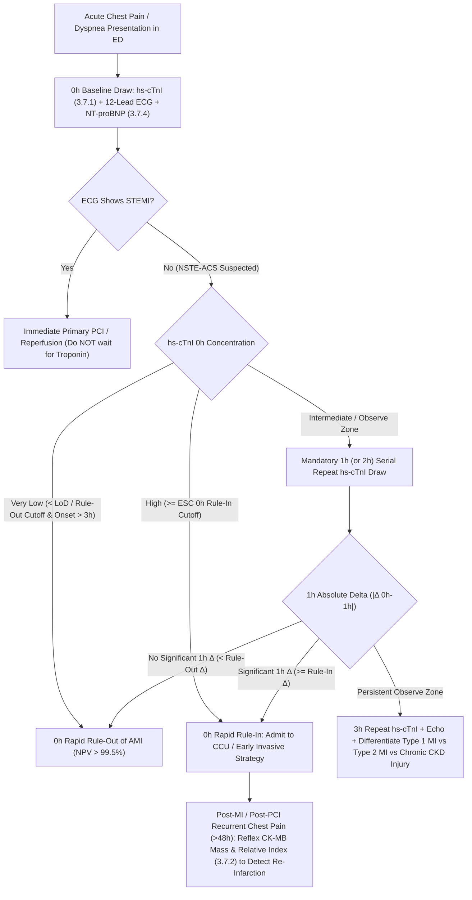

# 🚑 Cluster 3.7: Acute Cardiac, Sepsis & Direct Hepatic Fibrosis Biomarkers CLIA Cluster

**Department Folder:** `03_Immunoassay_Endocrinology_and_Nutrients`  
**Cluster ID & Folder:** `3.7_Acute_Cardiac_and_Sepsis_Biomarkers_CLIA_Cluster`  
**Primary Analytical Platform:** **Snibe MAGLUMI X3** (Flash-CLIA — ABEI Direct Chemiluminescence & Magnetic Microbead Separation)  
**Backup / Comparability Platforms:** High-Sensitivity & Contemporary CLIA / ECLIA / ELFA Immunoassay Systems (CLSI EP31-A Harmonized)  
**Global Reference Benchmarks:** ESC/ACC/AHA/WHF *Fourth Universal Definition of Myocardial Infarction (UDMI)*, 2023 ESC Guidelines for Acute Coronary Syndromes (`0h/1h` & `0h/2h` High-Sensitivity Troponin Algorithms), ICON/Januzzi Age-Stratified Heart Failure Consensus, Surviving Sepsis Campaign (SSC) Guidelines, AASLD/EASL Direct Extracellular Matrix (ECM) Hepatic Fibrosis Guidelines, NABL ISO 15189:2022, CAP, CLSI GP47, EFLM Biological Variation Database.

---

## 🗂️ 1. Master Cluster Inventory & Architectural Index (9 Standalone SOP & Interpretation Files)

| Sub-Test ID | File Name in `3.7_Acute_Cardiac_and_Sepsis_Biomarkers_CLIA_Cluster/` | Primary LOINC | Core Clinical Indication & Diagnostic Algorithm |
| :--- | :--- | :--- | :--- |
| **`3.7.1`** | `3.7.1_High_Sensitivity_Cardiac_Troponin_I_hs_cTnI_ESC_0h_1h_and_4th_UDMI.md` | `89579-7` | **ESC $0\text{h}/1\text{h}$ & $0\text{h}/2\text{h}$ Rapid Rule-Out/Rule-In**; Sex-Specific 99th Percentile URL; Type 1 vs Type 2 MI vs Acute/Chronic Myocardial Injury (4th UDMI). |
| **`3.7.2`** | `3.7.2_CK_MB_Mass_CLIA_and_Relative_Index_Reinfarction.md` | `49551-5` | **CK-MB Mass ($\text{ng/mL}$) & Relative Index ($\text{CK-MB}/\text{Total CK} \times 100$)**: Early Re-Infarction ($48\text{–}72\text{h}$ washout) & Periprocedural PCI/CABG MI (Type 4a/5). |
| **`3.7.3`** | `3.7.3_Serum_Myoglobin_and_Heart_Type_Fatty_Acid_Binding_Protein_H_FABP.md` | `2639-3` / `55126-7` | **Ultra-Early Hyperacute Ischemia ($0.5\text{–}3\text{h}$)**: Early negative predictive value, Rhabdomyolysis/Crush Syndrome pigment nephropathy risk, and reperfusion washout kinetics. |
| **`3.7.4`** | `3.7.4_NT_proBNP_N_Terminal_Pro_B_Type_Natriuretic_Peptide_Age_Stratified_Januzzi.md` | `33762-6` | **Januzzi/ICON Age-Stratified Cutoffs ($<50\text{y}: >450$, $50\text{–}75\text{y}: >900$, $>75\text{y}: >1800\text{ pg/mL}$)**, Universal Rule-Out ($<300\text{ pg/mL}$ acute / $<125\text{ pg/mL}$ non-acute), eGFR & Obesity ($\text{BMI} \ge 30$) modifiers. |
| **`3.7.5`** | `3.7.5_B_Type_Natriuretic_Peptide_BNP_CLIA_and_ARNI_Entresto_Interpretation.md` | `30934-4` | **Biologically Active BNP ($t_{1/2} \sim 20\text{ min}$)**: Acute Dyspnea Rule-Out ($<100\text{ pg/mL}$), **Mandatory EDTA Plastic Tube Pre-Analytical Shield**, & **Sacubitril/Valsartan (Entresto/Vymada) Pharmacological Divergence**. |
| **`3.7.6`** | `3.7.6_Procalcitonin_PCT_Sepsis_Surviving_Sepsis_and_Antibiotic_Stewardship.md` | `33959-8` | **BRAHMS-Traceable PCT**: Systemic Bacterial vs Viral ($\text{IFN-}\gamma$ suppressed) Differentiation, Surviving Sepsis Risk Tiers, & **$\ge 80\%$ Peak-Drop Antibiotic De-Escalation Rule**. |
| **`3.7.7`** | `3.7.7_Interleukin_6_IL_6_Early_Neonatal_Sepsis_and_Cytokine_Storm.md` | `26881-3` | **Ultra-Early "Alarm Cytokine" ($1\text{–}2\text{h}$ onset, $t_{1/2} < 2\text{h}$)**: Early-Onset Neonatal Sepsis (Cord/Neonatal blood), Cytokine Release Syndrome (CRS / CAR-T / Viral Storm), & Tocilizumab monitoring. |
| **`3.7.8`** | `3.7.8_Serum_Amyloid_A_SAA_Viral_vs_Bacterial_Acute_Phase_and_Amyloidosis.md` | `14957-5` | **High-Dynamic-Range Acute Phase Apolipoprotein ($1,000\times$ surge)**: Viral + Bacterial Acute Infection sensitivity, Combined $\text{SAA}/\text{CRP}$ ratio, & Secondary Reactive **AA Amyloidosis** threshold ($>10\text{ mg/L}$). |
| **`3.7.9`** | `3.7.9_Direct_Hepatic_Fibrosis_4_Marker_CLIA_Panel_HA_PIIINP_CIV_Laminin_Cholyglycine.md` | `72971-5` | **Direct Extracellular Matrix (ECM) Remodeling Panel**: Hyaluronic Acid (`HA`), N-Terminal Propeptide of Type III Procollagen (`PIIINP`), Type IV Collagen (`CIV`), Laminin (`LN`), & Cholyglycine (`CG`). |

---

## 📊 2. Master Six Sigma Analytical Performance, Biological Variation (`RCV %`) & Critical Alert Matrix

| Biomarker | EFLM $CV_I\%$ | EFLM $CV_G\%$ | Desirable $CV_A\%$ | Six Sigma $\text{TE}_a\%$ | Expanded $\text{MU}\%$ ($k=2$) | 95% Serial `RCV %` | In-Vivo Half-Life ($t_{1/2}$) | Tier-1 Critical ("Panic") Alert Threshold (`CLSI GP47`) |
| :--- | :--- | :--- | :--- | :--- | :--- | :--- | :--- | :--- |
| **`hs-cTnI`** | $4.9\%$ | $43.2\%$ | $\le 5.0\%$ *(at 99th URL)* | $\pm 15.0\%$ | $\pm 10.0\%$ | **$\pm 19.4\%$** *(or ESC $\Delta$ ng/L)* | Biphasic: $\sim 2\text{h}$ free / $7\text{–}10\text{d}$ myofibrillar | **$> 99\text{th}$ URL *(Male $> 34\text{ ng/L}$, Female $> 16\text{ ng/L}$)* or ESC $1\text{h }\Delta \ge 12\text{–}15\text{ ng/L}$** |
| **`CK-MB Mass`** | $14.0\%$ | $32.0\%$ | $\le 6.0\%$ | $\pm 20.0\%$ | $\pm 12.0\%$ | **$\pm 42.2\%$** | $10 \text{ – } 12\text{ hours}$ | **$> 10.0\text{ ng/mL}$** *(with Relative Index $> 5.0\%$)* |
| **`Myoglobin` / `H-FABP`** | $13.9\%$ | $29.6\%$ | $\le 6.5\%$ | $\pm 20.0\%$ | $\pm 13.0\%$ | **$\pm 42.5\%$** | Myo: $15\text{–}20\text{ min}$ H-FABP: $20\text{–}30\text{ min}$ | **Myoglobin $> 500\text{ ng/mL}$** *(Acute Rhabdomyolysis / AKI Risk)* |
| **`NT-proBNP`** | $10.0\%$ | $35.0\%$ | $\le 5.0\%$ | $\pm 20.0\%$ | $\pm 10.0\%$ | **$\pm 31.0\%$** | **$90 \text{ – } 120\text{ minutes}$** *(Renal clearance)* | **Age-Adjusted Acute HF Rule-In:** $<50\text{y}: >450$; $50\text{–}75\text{y}: >900$; $>75\text{y}: >1,800\text{ pg/mL}$ |
| **`BNP`** | $20.2\%$ | $54.0\%$ | $\le 6.5\%$ | $\pm 25.0\%$ | $\pm 13.0\%$ | **$\pm 58.8\%$** | **$18 \text{ – } 22\text{ minutes}$** *(NPR-C + Neprilysin)* | **$> 400 \text{ – } 500\text{ pg/mL}$** *(Acute Decompensated Heart Failure)* |
| **`Procalcitonin (PCT)`** | $15.0\%$ | $38.0\%$ | $\le 6.0\%$ | $\pm 20.0\%$ | $\pm 12.0\%$ | **$\pm 44.8\%$** | **$22 \text{ – } 26\text{ hours}$** *(Proteolytic cleavage)* | **Tier-2 Urgent:** $\ge 2.0\text{ ng/mL}$ (Severe Sepsis) **Tier-1 Panic:** **$\ge 10.0\text{ ng/mL}$** (Septic Shock) |
| **`Interleukin-6 (IL-6)`** | $24.0\%$ | $48.0\%$ | $\le 7.5\%$ | $\pm 25.0\%$ | $\pm 15.0\%$ | **$\pm 69.7\%$** | **$< 1 \text{ – } 2\text{ hours}$** *(Rapid hepatic uptake)* | **$> 500 \text{ – } 1,000\text{ pg/mL}$** *(Severe Cytokine Storm / Neonatal Septic Shock)* |
| **`Serum Amyloid A (SAA)`** | $25.0\%$ | $61.0\%$ | $\le 7.5\%$ | $\pm 25.0\%$ | $\pm 15.0\%$ | **$\pm 72.3\%$** | **$24 \text{ – } 36\text{ hours}$** *(HDL-associated)* | **$> 200 \text{ – } 500\text{ mg/L}$** *(Severe Acute Systemic Inflammation)* |
| **`Hepatic Fibrosis 4-Marker`** | $11.5\%$ | $31.0\%$ | $\le 6.5\%$ | $\pm 20.0\%$ | $\pm 13.0\%$ | **$\pm 36.6\%$** | HA: $2.5\text{–}5\text{ min}$ *(Sinusoidal SEC)* | **HA $> 250\text{ ng/mL}$ + CIV $> 140\text{ ng/mL}$** *(Decompensated Cirrhosis / Portal HTN alert)* |

---

## ❤️‍🔥 3. Integrated Acute Coronary Syndrome (ACS) & Heart Failure Algorithmic Cascade (`3.7.1` – `3.7.5`)

### **[LIMS COPY-PASTE BLOCK — HIGH-SENSITIVITY CARDIAC TROPONIN-I (`hs-cTnI`), `CK-MB MASS` & `MYOGLOBIN/H-FABP`]**

**1. Fourth Universal Definition of Myocardial Infarction (ESC / ACC / AHA / WHF Consensus) & ESC $0\text{h}/1\text{h}$ Algorithm:**
- **Kinetic Release Profile:**
  - **Myoglobin & Heart-Type Fatty Acid Binding Protein (`H-FABP`):** Low-molecular-weight cytosolic proteins ($17.8\text{ kDa}$ and $15\text{ kDa}$) that rise earliest within **$0.5 \text{ – } 2\text{ hours}$**, peak at **$4 \text{ – } 8\text{ hours}$**, and clear rapidly via renal filtration within **$18 \text{ – } 24\text{ hours}$**.
  - **High-Sensitivity Cardiac Troponin-I (`hs-cTnI`):** Myocardial-specific regulatory protein ($24\text{ kDa}$); detectable within **$1 \text{ – } 2\text{ hours}$** of myocyte necrosis, peaks at **$12 \text{ – } 24\text{ hours}$**, and remains elevated for **$7 \text{ – } 14\text{ days}$** due to slow degradation of myofibrillar-bound complexes.
  - **`CK-MB Mass`:** Rises at **$4 \text{ – } 6\text{ hours}$**, peaks at **$12 \text{ – } 24\text{ hours}$**, and **returns to baseline within $48 \text{ – } 72\text{ hours}$**—making $\text{CK-MB Mass}$ (with **Relative Index $[\text{CK-MB Mass}/\text{Total CK} \times 100] > 2.5\%\text{–}5.0\%$**) valuable for detecting **early re-infarction** when $\text{hs-cTnI}$ remains plateaued.

| Diagnostic Classification (4th UDMI) | Biochemical Criterion (`hs-cTnI`) | Mandatory Clinical / Kinetic Differentiator |
| :--- | :--- | :--- |
| **Acute Non-Ischemic Myocardial Injury** | $\ge 1$ value **$> 99\text{th}$ percentile Sex-Specific URL** with **significant serial rise and/or fall ($> 20\%$ if baseline elevated, or $> 50\%$ if baseline near URL)** | **Absence of acute myocardial ischemia** (e.g., Acute Decompensated Heart Failure, Myocarditis, Pulmonary Embolism, Sepsis, Cardioversion/Contusion). |
| **Chronic Myocardial Injury** | Persistent elevation **$> 99\text{th}$ percentile URL** with **serial variation $\le 20\%$** over $1\text{–}6\text{ hours}$ | Structural heart disease (LVH, Valvular Heart Disease) or **Chronic Kidney Disease ($\text{eGFR} < 60\text{ mL/min}$)**. |
| **Type 1 Acute Myocardial Infarction (AMI)** | Dynamic rise and/or fall with $\ge 1$ value **$> 99\text{th}$ percentile URL** | Caused by **acute atherothrombotic coronary plaque rupture/erosion** + $\ge 1$ of: ischemic symptoms, new ischemic ECG changes, new loss of viable myocardium/RWMA on imaging, or intracoronary thrombus on angiography. |
| **Type 2 Myocardial Infarction** | Dynamic rise and/or fall with $\ge 1$ value **$> 99\text{th}$ percentile URL** | Caused by **myocardial oxygen supply–demand mismatch** without plaque rupture (tachyarrhythmia, severe anemia, hypotension/shock, respiratory failure, severe hypertension, coronary spasm). |

**2. Natriuretic Peptides (`NT-proBNP` vs `BNP`) — Januzzi Age-Stratified Cutoffs & `Entresto` (Sacubitril/Valsartan) Divergence:**
- **Universal Acute Dyspnea Rule-Out:** `NT-proBNP` **$< 300\text{ pg/mL}$** (or **$< 125\text{ pg/mL}$** in non-acute ambulatory patients) or `BNP` **$< 100\text{ pg/mL}$** rules out Acute Decompensated Heart Failure with **$> 98\%$ Negative Predictive Value**.
- **Januzzi / ICON Age-Stratified Acute Heart Failure Rule-In Cutoffs (`NT-proBNP`):**
  - **Age $< 50\text{ Years}$:** **$> 450\text{ pg/mL}$**
  - **Age $50 \text{ – } 75\text{ Years}$:** **$> 900\text{ pg/mL}$**
  - **Age $> 75\text{ Years}$:** **$> 1,800\text{ pg/mL}$**
- **🛡️ Critical Pharmacological Divergence on ARNI Therapy (*Sacubitril/Valsartan — Entresto / Vymada / Cidmus*):** Sacubitril inhibits **neprilysin** (the enzyme that degrades biologically active $\text{BNP}$, but **NOT** $\text{NT-proBNP}$). Within days of initiating Sacubitril/Valsartan, **measured `BNP` artificially rises or remains falsely elevated**, whereas **`NT-proBNP` accurately declines**, reflecting true myocardial unloading. **Clinicians MUST order `NT-proBNP` (never `BNP`) to monitor heart failure patients taking Sacubitril/Valsartan.**
- **🛡️ Obesity & Renal Modifiers:** Severe obesity ($\text{BMI} \ge 30\text{ kg/m}^2$) suppresses natriuretic peptide levels by **$30\%\text{–}50\%$** (lower the diagnostic threshold by $50\%$), whereas **$\text{CKD}$ ($\text{eGFR} < 60\text{ mL/min}$)** disproportionately elevates $\text{NT-proBNP}$ due to reduced glomerular filtration.

---

## 🦠 4. Sepsis, Cytokine Storm & Direct Hepatic Fibrosis Cascade (`3.7.6` – `3.7.9`)

### **[LIMS COPY-PASTE BLOCK — `PCT`, `IL-6`, `SAA` & `DIRECT HEPATIC FIBROSIS 4-MARKER PANEL`]**

**1. Temporal Kinetic Hierarchy of Acute Inflammation (`IL-6` $\rightarrow$ `PCT` $\rightarrow$ `SAA` / `CRP`):**
- **Interleukin-6 (`IL-6` — Normal $< 7.0\text{ pg/mL}$):** Surges within **$1 \text{ – } 2\text{ hours}$** of pathogen invasion or tissue injury, peaking at **$4 \text{ – } 6\text{ hours}$** with a rapid half-life of **$< 2\text{ hours}$**. Gold standard for **Early-Onset Neonatal Sepsis** (before $\text{PCT}$/$\text{CRP}$ rise) and grading **Cytokine Release Syndrome (CRS)** ($> 100\text{–}1,000\text{ pg/mL}$).
- **Procalcitonin (`PCT` — Normal $< 0.05\text{ ng/mL}$):** Induced ubiquitously by bacterial endotoxin ($\text{LPS}$) and $\text{TNF-}\alpha/\text{IL-1}\beta$ within **$2 \text{ – } 4\text{ hours}$**, peaking at **$12 \text{ – } 24\text{ hours}$** ($t_{1/2} \sim 24\text{h}$). **Suppressed by Interferon-$\gamma$ ($\text{IFN-}\gamma$) during viral infections.**
  - **$< 0.10\text{ ng/mL}$:** Bacterial infection very unlikely; **withhold antibiotics**.
  - **$0.25 \text{ – } 0.49\text{ ng/mL}$:** Possible localized bacterial infection (e.g., LRTI/pneumonia); clinical correlation advised.
  - **$0.50 \text{ – } 1.99\text{ ng/mL}$:** **Systemic Bacterial Sepsis Likely** — initiate empiric antibiotics & blood cultures.
  - **$\ge 2.00\text{ ng/mL}$ (`Tier-2 Urgent`) / $\ge 10.0\text{ ng/mL}$ (`Tier-1 Panic`):** **Severe Bacterial Sepsis / Septic Shock & MODS Risk.**
  - **Stewardship Stop Rule:** Discontinue antibiotics when clinical recovery is accompanied by a **$\ge 80\%$ decline from peak $\text{PCT}$** or absolute $\text{PCT} < 0.25\text{ ng/mL}$.
- **Serum Amyloid A (`SAA` — Normal $< 10.0\text{ mg/L}$):** Hepatocyte acute-phase apolipoprotein that rises **$100\text{- to }1,000\text{-fold}$** within $4\text{–}6\text{h}$. Unlike $\text{PCT}$ and $\text{CRP}$, **$\text{SAA}$ rises markedly in BOTH acute viral and bacterial infections** (high $\text{SAA}$ with normal $\text{PCT}$/$<20\text{ mg/L CRP}$ strongly favors **acute viral infection**). Chronic persistent elevation **$> 10\text{ mg/L}$** in rheumatoid arthritis, TB, or autoinflammatory syndromes drives **Secondary Reactive AA Amyloidosis** (renal nephrotic syndrome).

**2. Direct Hepatic Fibrosis 4-Marker CLIA Panel (`HA`, `PIIINP`, `Type IV Collagen [CIV]`, `Laminin [LN]` & `Cholyglycine [CG]`):**
- Unlike indirect transaminase ratios (`FIB-4`, `APRI`) which can be normal in inactive cirrhosis or falsely elevated during acute hepatitis flares, **Direct ECM Biomarkers** directly quantify hepatic stellate cell activation, perisinusoidal capillarization, and basement membrane turnover:
  1. **Hyaluronic Acid (`HA` — Normal $< 100\text{ ng/mL}$):** Glycosaminoglycan synthesized by activated hepatic stellate cells and cleared by sinusoidal endothelial cells; **best single direct serum marker for ruling in/out Advanced Fibrosis (F3) and Cirrhosis (F4)** ($> 200\text{–}250\text{ ng/mL}$).
  2. **Procollagen Type III N-Terminal Peptide (`PIIINP` — Normal $< 15\text{ ng/mL}$):** Cleaved stoichiometrically during active Type III collagen fibrillogenesis; reflects **active ongoing fibrogenesis and necroinflammatory activity**.
  3. **Type IV Collagen (`CIV` — Normal $< 95\text{ ng/mL}$):** Major network-forming collagen of the **Space of Disse basement membrane**; correlates with sinusoidal remodeling and bridging fibrosis.
  4. **Laminin (`LN` — Normal $< 130\text{ ng/mL}$):** Non-collagenous basement membrane glycoprotein; reflects **sinusoidal capillarization** and correlates directly with the **Hepatic Venous Pressure Gradient (HVPG / Portal Hypertension)**.
  5. **Cholyglycine (`CG` — Normal $< 2.7\text{ mg/L}$):** Conjugated primary bile acid; sensitive indicator of early hepatocyte sinusoidal uptake impairment and portosystemic shunting.

---

## 🛡️ 5. Cluster-Wide Pre-Analytical, Interference & Medico-Legal Shield

> **MANDATORY EMERGENCY & IMMUNOASSAY MEDICO-LEGAL DISCLAIMER (ISO 15189:2022 / CAP / CPA 2019):**
> 1. **Serial Sampling Mandate in Acute Chest Pain:** A single normal $\text{hs-cTnI}$ drawn very early ($< 2\text{–}3\text{ hours}$ from chest pain onset) **cannot exclude Acute Myocardial Infarction**. Serial repeat sampling ($0\text{h}/1\text{h}$ or $0\text{h}/3\text{h}$) with serial 12-lead ECGs is mandatory before clinical discharge.
> 2. **Assay Platform Non-Interchangeability:** Cardiac Troponin ($\text{hs-cTnI}$ vs $\text{hs-cTnT}$), Natriuretic Peptides ($\text{NT-proBNP}$ vs $\text{BNP}$), and CLIA Fibrosis markers are **not numerically interchangeable** across different manufacturers (Snibe Maglumi, Roche Elecsys, Abbott Architect, Siemens, Beckman). Serial delta checks must use the **identical analyzer platform**.
> 3. **Biotin, Heterophile Antibody (HAMA) & Macro-Analyte Shield:** High-dose Biotin ($>5\text{ mg/day}$), human anti-mouse/heterophile antibodies, rheumatoid factor, fibrin microclots (in incompletely clotted serum), or macrotroponin complexes can cause analytical interference. Any result discordant with the clinical picture must be verified by re-centrifugation, heterophile-blocking tube (HBT) treatment, or PEG precipitation. *Not valid for medico-legal purposes.*
