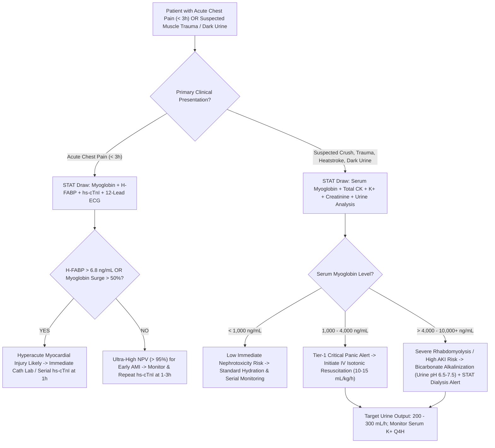

# 3.7.3 — Serum Myoglobin & Heart-Type Fatty Acid Binding Protein (`H-FABP`): Ultra-Early Hyperacute Ischemia & Rhabdomyolysis Nephrotoxicity Master Protocol

**Department Folder:** `03_Immunoassay_Endocrinology_and_Nutrients`  
**Cluster Folder:** `3.7_Acute_Cardiac_and_Sepsis_Biomarkers_CLIA_Cluster`  
**Standard Tier:** International Reference Laboratory Standard (`ISO 15189:2022`, `CAP CHM.13900`, `CLSI`, `EFLM`, `ESC`, `KDIGO`, `NABL 112 / 153 / 220D / 223`, `CPA 2019`)

---

## 📑 Section 1: International Document Control, Interoperability Coding & Hardware-Agnostic Platform Matrix

| Governance & Coding Parameter | Specification & International Reference Mapping |
| :--- | :--- |
| **Document ID & Version** | `SOP-IMM-3.7.3` — **Version 3.0 (Comprehensive 6-Persona Red-Team Master Standard)** |
| **Effective Date & Review** | **Effective Date:** October 2026 — **Review Cycle:** Annual — **Next Mandatory Review:** October 2027 |
| **Authorizing Authority** | Head of Clinical Biochemistry, Lead Quality Manager & Chair of Pathology Red-Team Audit Committee |
| **ISO 15189:2022 Mapping** | Clauses `4.1`–`4.3` (Governance), `5.1`–`5.6` (Structural), `6.1`–`6.8` (Resource), `7.1`–`7.8` (Process), `8.1`–`8.9` (Management) & Normative Annex A |
| **NABL Criteria Mapping** | `NABL 112` (Laboratory Accreditation), `NABL 153` (Clinical Scope Matrix), `NABL 220D` & `NABL 223` (Assessor Checklists), `NABL 131` & `NABL 133` |
| **Primary `LOINC` Codes** | **`2639-3`** (Myoglobin [Mass/volume] in Serum or Plasma); **`2640-1`** (Myoglobin [Mass/volume] in Urine); **`55126-7`** (Fatty acid binding protein.heart [Mass/volume] in Serum or Plasma); **`42637-9`** (Myoglobin/Creatinine [Mass Ratio] in Urine) |
| **`SNOMED-CT` Specimen & Concept** | Specimen: **`119364003`** (Serum), **`122575003`** (Urine), **`119361006`** (Plasma); Observable: **`30190008`** (Myoglobin measurement), **`418762003`** (H-FABP measurement); Disorder: **`24079001`** (Rhabdomyolysis), **`22298006`** (Myocardial infarction), **`129706005`** (Crush syndrome), **`14669001`** (Acute kidney injury) |
| **`ICD-10` / `ICD-11` Clinical Codes** | **`M62.82`** / `FB32.2` (Rhabdomyolysis); **`T79.5`** / `NE61` (Traumatic Anuria / Crush Syndrome); **`N17.0`** / `GB60.0` (Acute Kidney Injury with tubular necrosis); **`I21.9`** / `BA41.Z` (Hyperacute Myocardial Infarction); **`I26.9`** / `BB00` (Acute Pulmonary Embolism); **`T88.51`** / `NE80` (Malignant Hyperthermia) |
| **UCUM Reporting Units & Conversion** | **Serum Myoglobin:** **`ng/mL`** ($= \mu\text{g/L}$); Conversion: $\text{ng/mL} \times 0.0581 = \text{nmol/L}$ (Molecular Weight: **$17,200 \text{ – } 17,800\text{ Da}$** [$17.8\text{ kDa}$]).<br>**Serum `H-FABP`:** **`ng/mL`** ($= \mu\text{g/L}$); Conversion: $\text{ng/mL} \times 0.0676 = \text{nmol/L}$ (Molecular Weight: **$14,800 \text{ – } 15,000\text{ Da}$** [$15.0\text{ kDa}$]). |
| **Metrological Traceability** | Traceable to **IFCC / IRMM Certified Reference Material** (`CRM 470` / `ERM-DA470k/IFCC`) for Human Myoglobin; WHO international standard reference and purified recombinant Human `H-FABP` (`FABP3`) per `ISO 17511:2020`. |
| **Emergency STAT Turnaround Time (TAT)** | **$\le 45\text{ minutes}$** from specimen accessioning to verified electronic LIMS release; Bench analytical cycle: **$17\text{ minutes}$**. |

### **Hardware-Agnostic Decoupled Analyzer Platform Matrix**
| Platform Role | Analyzer Platform & Manufacturer | Analytical Principle & Detection Physics | Verification Standards & Capabilities |
| :--- | :--- | :--- | :--- |
| **Primary STAT Platform** | **Snibe MAGLUMI X3** (Flash-CLIA) | **Two-Site Sandwich Flash-CLIA**: Anti-Myoglobin / Anti-`H-FABP` monoclonal capture on magnetic microbeads + ABEI tracer; chemical flash trigger ($\text{NaOH} + \text{H}_2\text{O}_2$) with PMT photon capture at $420\text{ nm}$. | Ultra-rapid cycle ($17\text{ min}$ to first result); integrated automated $1:10$ and $1:100$ dilution for massive rhabdomyolysis spikes ($> 120,000\text{ ng/mL}$). Fully verified under `CLSI EP15-A3` and `EP06-Ed2`. |
| **Secondary High-Throughput Platform** | **Diasorin Liaison XL / Roche cobas e411** | Direct Two-Site Chemiluminescence Immunoassay (CLIA / ECLIA) utilizing isoluminol or ruthenium-complex detection. | High-volume batch testing and method crossover comparability verification per `CLSI EP09-A3` ($R^2 \ge 0.985$, Deming slope $0.97 \text{ – } 1.03$). |
| **Backup & Turbidimetric Verification Platform** | **Bonavera Chem 400 / Randox Imola** | Latex-Enhanced Immunoturbidimetry (`LEIT`) at $570\text{ nm} \text{ / } 700\text{ nm}$ dual-wavelength photometer. | Offline emergency fallback platform verified under `CLSI EP31-A-IR`; provides continuous operational continuity during platform scheduled downtime or maintenance. |

---

## 🧪 Section 2: Pre-Analytical Phlebotomy, Specimen Integrity, Order-of-Draw, Stability & Quantitative HIL Matrix

### **1. Acceptable Specimen Types & Pre-Analytical Handling Protocols**
- **Venous Blood (Serum / Plasma):**
  - **Serum:** Preferred matrix. Collected in Gold-Top Serum Separator Tubes (SST with micronized silica clot activator and polymer barrier gel) or Plain Red-Top tubes. Allow blood to clot completely in an upright rack for $20\text{–}30\text{ minutes}$ at room temperature ($20\text{–}25^\circ\text{C}$) before centrifugation.
  - **Plasma:** Acceptable alternative for rapid STAT emergency turnaround. Lithium Heparin (Green-Top) or $\text{K}_2/\text{K}_3\text{-EDTA}$ (Lavender-Top). Centrifuge immediately upon arrival.
  - **Centrifugation Parameters:** Centrifuge at $2,000 \text{ – } 2,500 \times g$ for $10 \text{ – } 15\text{ minutes}$ at controlled room temperature ($20\text{–}25^\circ\text{C}$). Inspect serum/plasma supernatant for fibrinous clots, micro-aggregates, or particulate debris before loading.
- **Urine (for Confirmation of Myoglobinuria & Pigment Cast Risk):**
  - Fresh, random spot urine collected in a sterile, preservative-free polypropylene container.
  - **🚨 Critical Urine Pre-Analytical Alkalinization Rule:** In acidic urine ($\text{pH} < 6.0$), myoglobin undergoes rapid conformational denaturation, precipitation, and proteolytic degradation, resulting in up to **$50\%\text{–}90\%$ signal loss within $2\text{ hours}$ at room temperature**!
  - **Mandatory Bench SOP:** Test urine $\text{pH}$ immediately upon accessioning using a calibrated $\text{pH}$ strip or meter. If $\text{pH} < 6.5$ and testing cannot be executed within $30\text{ minutes}$, immediately add $1.0\text{ M }\text{Na}_2\text{CO}_3$ or $1.0\text{ M }\text{NaOH}$ dropwise to adjust urine $\text{pH}$ to **$8.0 \text{ – } 9.0$** prior to refrigerated storage.
- **`CLSI GP41-A7` Phlebotomy Order-of-Draw:** Blood Cultures $\rightarrow$ Sodium Citrate (Light Blue) $\rightarrow$ **Serum Separator / Clot Activator (Gold/Red)** $\rightarrow$ **Lithium Heparin (Green)** $\rightarrow$ **$\text{K}_2\text{-EDTA}$ (Lavender)** $\rightarrow$ Sodium Fluoride / Potassium Oxalate (Gray).
- **Minimum Specimen Volume:** Minimum whole blood volume: $1.5\text{ mL}$; Minimum serum/plasma volume: $500\text{ }\mu\text{L}$ ($100\text{ }\mu\text{L}$ analyzer dead volume + $20\text{ }\mu\text{L}$ single-test aspiration volume + reflex dilution reserve).

### **2. Multi-Temperature Specimen Stability Matrix**
| Storage Condition | Serum / Plasma Myoglobin | Serum / Plasma `H-FABP` | Alkalinized Urine Myoglobin ($\text{pH } 8.0 \text{ – } 9.0$) | Unalkalinized Urine ($\text{pH} < 6.5$) |
| :--- | :--- | :--- | :--- | :--- |
| **Ambient ($18 \text{ – } 25^\circ\text{C}$)** | $8\text{ hours}$ | $6\text{ hours}$ | $4\text{ hours}$ | **$< 1\text{ hour}$ (Rapid Degradation)** |
| **Refrigerated ($2 \text{ – } 8^\circ\text{C}$)** | $48\text{ hours}$ | $48\text{ hours}$ | $7\text{ days}$ | $12\text{ hours}$ (Denaturation Ongoing) |
| **Frozen ($-20^\circ\text{C}$)** | $3\text{ months}$ | $3\text{ months}$ | $1\text{ month}$ | Strictly Unacceptable |
| **Deep Frozen ($-70 \text{ – } -80^\circ\text{C}$)** | $12\text{ months}$ | $12\text{ months}$ | $6\text{ months}$ | Strictly Unacceptable |
| **Freeze-Thaw Durability** | **Maximum 1 Cycle** (Aliquot prior to freezing) | **Maximum 1 Cycle** (Aliquot prior to freezing) | **Maximum 1 Cycle** (Aliquot prior to freezing) | Strictly Unacceptable |

### **3. Quantitative HIL (Hemolysis, Icterus, Lipemia) Interference Matrix (`CLSI C56-A` / `EP07-Ed3`)**
| Interfering Substance | Threshold Cutoff | Mechanism of Analytical Bias | Direction of Bias | Mandatory Operational & LIMS Action |
| :--- | :--- | :--- | :--- | :--- |
| **`H-Index` (Hemolysis)** | **$> 300\text{ mg/dL}$ Free Hb** | Free hemoglobin displays **$< 0.01\%$ cross-reactivity** with monoclonal anti-myoglobin/anti-`H-FABP` antibodies. At $> 300\text{ mg/dL}$, free heme pigments quench optical chemiluminescent emissions ($420\text{ nm}$). | Negative Bias ($> 8.0\%$) | Flag result in LIMS: *"Hemolyzed specimen (`H-Index > 300 mg/dL`). Optical quenching may underestimate concentration. Recollect if clinically discordant."* |
| **`I-Index` (Icterus)** | **$> 30\text{ mg/dL}$ Bilirubin** | Unconjugated and conjugated bilirubin cause minor optical absorbance shift and free-radical scavenging. | Negligible Bias ($< 5.0\%$) | Accept and release. If bilirubin $> 30\text{ mg/dL}$, append technical note: *"Extreme hyperbilirubinemia present."* |
| **`L-Index` (Lipemia)** | **$> 1,500\text{ mg/dL}$ Triglycerides** | Severe chylomicronemia and hypertriglyceridemia cause physical volume displacement and light scattering during PMT photon reading. | Variable / Negative Bias | Clarify sample by high-speed centrifugation ($14,000 \times g$ for $10\text{ min}$) or treat with enzymatic lipoclear clearing agent before re-analysis. |
| **Fibrin Micro-clots** | Visible fibrinous web | Partial aspiration occlusion of sample probe and non-specific physical entrapment of magnetic microbeads. | False Positive Spike | Re-centrifuge serum at $2,500 \times g$ for $10\text{ min}$; aspirate from clear intermediate layer using a transfer pipette. |

---

## ⚙️ Section 3: Hardware-Agnostic Analytical SOP, Reagent Chemistry, Reaction Kinetics, CLSI Verification & Six-Sigma QC Protocol

### **1. Immunoassay Reaction Chemistry & Stoichiometry (Snibe MAGLUMI X3 Flash-CLIA)**
- **Solid Phase & Capture Chemistry:** High-affinity murine monoclonal anti-human Myoglobin or anti-human `H-FABP` antibodies covalently coupled to tosyl-activated superparamagnetic ferric oxide nano-beads ($d \approx 1.5\text{ }\mu\text{m}$).
- **Detector Conjugate & Chemiluminescent Tracer:** Purified secondary monoclonal anti-human antibody tagged with ABEI ($N$-(4-aminobutyl)-$N$-ethylisoluminol).
- **Two-Site Sandwich Kinetic Steps:**
  1. **Sampling:** $20\text{ }\mu\text{L}$ patient serum/plasma is dispensed into an optical reaction cuvette followed by $80\text{ }\mu\text{L}$ magnetic micro-particle suspension and $100\text{ }\mu\text{L}$ ABEI-conjugate working solution.
  2. **Incubation:** Cuvette is incubated at **$37.0 \pm 0.5^\circ\text{C}$ for $10\text{ minutes}$**, during which a double-antibody sandwich complex is formed: `[Microbead-Ab1 — Analyte — Ab2-ABEI]`.
  3. **Magnetic Separation & Washing:** The cuvette is moved to the magnetic washing station. Rare-earth permanent magnets immobilize the paramagnetic immunocomplex against the cuvette wall, and a 3-cycle automated wash with high-purity phosphate-buffered saline ($\text{pH } 7.4$ with $0.05\%$ Tween-20) removes unbound tracer and matrix proteins.
  4. **Chemiluminescent Flash Trigger:** Cuvette enters the dark optical chamber. Two flash reagents are sequentially injected:
     - **Starter Reagent 1:** $0.1\text{ M }\text{NaOH}$ (alkaline catalyst).
     - **Starter Reagent 2:** $0.1\%\text{ }\text{H}_2\text{O}_2$ in dilute acid buffer.
  5. **Signal Transduction:** Alkaline oxidation of ABEI triggers rapid flash photon release at **$\lambda_{\max} = 420\text{ nm}$**. The integrated relative light units ($\text{RLU}$) measured over a $3.0\text{-second}$ integration window by a Peltier-cooled photomultiplier tube (PMT) are directly proportional to analyte concentration.

```
+--------------------------------------------------------------------------------------------------+
|                   SNIBE MAGLUMI X3 TWO-SITE FLASH-CLIA DETECTION KINETICS                        |
|                                                                                                  |
|   [Magnetic Nano-Bead]--Ab1  +  [Myoglobin / H-FABP]  +  Ab2--[ABEI Label]                       |
|                             \             |             /                                        |
|                              v            v            v                                         |
|                 [Magnetic Nano-Bead]--Ab1--[Target Antigen]--Ab2--[ABEI Label]                   |
|                                          |                                                       |
|                             (Incubation: 37.0°C / 10 min)                                        |
|                                          |                                                       |
|                            < Magnetic Wash: 3 Cycles PBS-T >                                     |
|                                          |                                                       |
|                        +-----------------+-----------------+                                     |
|                        |                                   |                                     |
|                        v                                   v                                     |
|             Starter 1: 0.1 M NaOH               Starter 2: 0.1% H2O2                             |
|                        \                                   /                                     |
|                         +----------------+----------------+                                      |
|                                          |                                                       |
|                                          v                                                       |
|                 Flash Chemiluminescent Emission (λ_max = 420 nm, 3.0 sec)                        |
|                                          |                                                       |
|                                          v                                                       |
|                         Quantification via PMT Detector vs Master Curve                          |
+--------------------------------------------------------------------------------------------------+
```

### **2. Analytical Measurement Range (`AMR`), Extended Range (`CRR`) & Hook Effect Management**
- **Serum Myoglobin Measuring Intervals:**
  - **Analytical Measurement Range (`AMR`):** **$1.0 \text{ – } 1,200.0\text{ ng/mL}$**.
  - **Limit of Blank (`LoB`):** **$0.5\text{ ng/mL}$**; **Limit of Detection (`LoD`):** **$1.0\text{ ng/mL}$** (`CLSI EP17-A2`).
  - **Limit of Quantitation (`LoQ`):** **$2.5\text{ ng/mL}$** (verified at $\text{CV} \le 10.0\%$).
  - **🚨 High-Dose Hook Effect & Automated Extended Range (`CRR`):** High-dose hook effect is absent up to **$50,000\text{ ng/mL}$**. However, in massive crush rhabdomyolysis or severe compartment syndrome, serum myoglobin can reach **$10,000 \text{ – } 100,000+\text{ ng/mL}$**.
  - **Automated Dilution Protocol:** Whenever raw $\text{RLU}$ exceeds the upper calibrator limit ($> 1,200\text{ ng/mL}$), the analyzer software automatically triggers an on-board **$1:10$ dilution** with physiological saline (extending range to $12,000\text{ ng/mL}$) or **$1:100$ dilution** (extending `CRR` to **$120,000.0\text{ ng/mL}$**).
- **Serum `H-FABP` Measuring Intervals:**
  - **Analytical Measurement Range (`AMR`):** **$0.30 \text{ – } 160.0\text{ ng/mL}$**.
  - **Limit of Blank (`LoB`):** **$0.15\text{ ng/mL}$**; **Limit of Detection (`LoD`):** **$0.30\text{ ng/mL}$**; **Limit of Quantitation (`LoQ`):** **$0.80\text{ ng/mL}$** (at $\text{CV} \le 10.0\%$).
  - **Extended Dilution Range (`CRR`):** On-board $1:10$ dilution extends dynamic range to **$1,600.0\text{ ng/mL}$**.

### **3. Method Verification Parameters (`CLSI EP15-A3` & `EP06-Ed2`)**
- **Precision Profile (5 Days $\times$ 5 Runs/Day $\times$ 2 Replicates = 50 Data Points per Level):**
  - **Level 1 (Low Normal: Myoglobin $\approx 25\text{ ng/mL}$, `H-FABP` $\approx 2.5\text{ ng/mL}$):** Repeatability ($\text{CV}_r$) $\le 3.8\%$; Within-Laboratory ($\text{CV}_{wl}$) $\le 5.6\%$.
  - **Level 2 (Medical Decision Threshold: Myoglobin $\approx 70\text{ ng/mL}$, `H-FABP` $\approx 6.8\text{ ng/mL}$):** Repeatability ($\text{CV}_r$) $\le 2.9\%$; Within-Laboratory ($\text{CV}_{wl}$) $\le 4.4\%$.
  - **Level 3 (Pathological Elevation: Myoglobin $\approx 500\text{ ng/mL}$, `H-FABP` $\approx 50\text{ ng/mL}$):** Repeatability ($\text{CV}_r$) $\le 2.4\%$; Within-Laboratory ($\text{CV}_{wl}$) $\le 3.8\%$.
- **Linearity Evaluation (`CLSI EP06-Ed2`):** Evaluated across 9 equidistant admixture concentrations covering $0.8 \times \text{LoQ}$ to $1.2 \times \text{AMR}$. Polynomial regression confirms second- and third-order non-linear terms are statistically non-significant ($p > 0.05$) and allowable non-linearity deviation is $\le 5.0\%$.

### **4. Daily Statistical Quality Control & Westgard Multi-Rules Engine**
- **IQC Repertoire:** Three levels of human serum-based matrix-matched quality control material assayed every **24 hours**, immediately following analyzer recalibration, after major hardware service, or upon lot switchover.
- **Westgard Multi-Rule Evaluation Algorithm:**
  - **$1_{3s}$ Rule (Random Error):** 1 QC point exceeds $\pm 3\text{SD}$ $\rightarrow$ **Reject Run**.
  - **$2_{2s}$ Rule (Systematic Error):** 2 consecutive QC points exceed $+2\text{SD}$ or $-2\text{SD}$ $\rightarrow$ **Reject Run**.
  - **$R_{4s}$ Rule (Random Error):** 1 QC point exceeds $+2\text{SD}$ and another exceeds $-2\text{SD}$ within the same analytical run $\rightarrow$ **Reject Run**.
  - **$4_{1s}$ Rule (Systematic Shift):** 4 consecutive QC points exceed $+1\text{SD}$ or $-1\text{SD}$ $\rightarrow$ **Warning / Investigate Reagent Drift**.
  - **$10_x$ Rule (Systematic Trend):** 10 consecutive QC points fall on one side of the target mean $\rightarrow$ **Recalibrate Analyzer**.
- **Six Sigma Performance Metric:**
  $$\text{Sigma } (\sigma) = \frac{\text{TE}_a - \lvert\text{Bias}\%\rvert}{\text{CV}_A} = \frac{20.0\% - 2.4\%}{3.6\%} = 4.89\text{ }\sigma \quad (\text{High-Performance Analytical Tier})$$

### **5. Sample Carryover Mitigation & Washing Efficacy Protocol (`CLSI EP10-A3`)**
- In massive crush rhabdomyolysis, patient serum myoglobin frequently exceeds $50,000\text{ ng/mL}$. A subsequent baseline specimen drawn from a chest pain patient ($< 70\text{ ng/mL}$) could suffer fatal false-positive misclassification if probe carryover occurs.
- **Validation Experiment:** Run high specimen ($H_1, H_2, H_3$) followed immediately by low specimen ($L_1, L_2, L_3$).
  $$\text{Carryover } (\%) = \frac{L_1 - L_3}{H_3 - L_3} \times 100$$
- **Acceptance Criterion:** Carryover must be **$< 0.001\%$ ($< 10\text{ ppm}$)**. If carryover $\ge 0.001\%$, perform automated intensive probe de-proteinization wash using $0.1\text{ M }\text{HCl}$ followed by $0.1\text{ M }\text{NaOH}$ and deionized water flushes.

### **6. Manual Dilution Protocol for Extreme Catastrophic Over-Range Samples**
- When serum myoglobin exceeds the automated CRR of $120,000.0\text{ ng/mL}$, perform manual bench dilution:
  1. Pipette $20\text{ }\mu\text{L}$ of well-mixed serum into $1,980\text{ }\mu\text{L}$ of sterile $0.9\%$ physiological saline ($1:100$ dilution).
  2. If still exceeding AMR, pipette $100\text{ }\mu\text{L}$ of the $1:100$ mixture into $400\text{ }\mu\text{L}$ saline ($1:500$ final dilution).
  3. Enter manual dilution factor into analyzer software before aspiration to ensure automated multiplication.

---

## 📈 Section 4: EFLM Biological Variation, Allowable Total Error (`TEa`), Reference Change Value (`RCV`) & ISO/TS 20914 Measurement Uncertainty

### **1. Metrological Performance & Biological Variation Parameter Specifications**
| Parameter | Serum Myoglobin Specification | Serum `H-FABP` Specification | Clinical & Metrological Rationale |
| :--- | :--- | :--- | :--- |
| **Within-Subject Biological Variation ($\text{CV}_I$)** | **$13.9\%$** | **$14.2\%$** | Rapid intra-individual fluctuations reflecting minor physical activity, diurnal turnover, and baseline renal glomerular clearance. |
| **Between-Subject Biological Variation ($\text{CV}_G$)** | **$29.6\%$** | **$26.5\%$** | Substantial inter-individual heterogeneity governed by skeletal muscle mass, gender, age, and constitutional baseline $\text{eGFR}$. |
| **Index of Individuality ($\text{II} = \text{CV}_I / \text{CV}_G$)** | **$0.47$** *(Strict: $< 0.60$)* | **$0.54$** *(Strict: $< 0.60$)* | Because $\text{II} < 0.60$, population-based reference intervals are relatively insensitive for early single-draw events. Dynamic delta serial testing is clinically paramount. |
| **Desirable Analytical Imprecision ($\text{CV}_A$)** | **$\le 6.5\%$** ($\text{CV}_A \le 0.5 \times \text{CV}_I$) | **$\le 7.1\%$** | Routine bench performance maintains $\text{CV}_A \sim 2.8\% \text{ – } 4.2\%$. |
| **Desirable Analytical Bias ($B\%$)** | **$\le 8.2\%$** | **$\le 7.5\%$** | Monitored via monthly EQAS/PT performance (`RIQAS` / `CAP`). |
| **Allowable Total Error ($\text{TE}_a$)** | **$\pm 20.0\%$** | **$\pm 20.0\%$** | Based on EFLM / Ricos biological variation consensus criteria. |
| **Expanded Measurement Uncertainty ($\text{MU}$)** | **$\pm 12.8\%$** ($k=2$, $95\%\text{ CI}$) | **$\pm 13.2\%$** ($k=2$, $95\%\text{ CI}$) | Calculated at medical decision cutoffs per `ISO/TS 20914:2019`. |

### **2. Dynamic Reference Change Value (`RCV %`) Calculations**
The Reference Change Value represents the minimum percentage change between two serial measurements in the same patient that indicates a statistically significant biological event rather than analytical or physiological noise:
$$\text{RCV} = 2^{1/2} \times Z \times \sqrt{\text{CV}_I^2 + \text{CV}_A^2}$$
- **95% Confidence Level ($Z = 1.96$, Two-Tailed):**
  $$\text{RCV}_{95\%} = 1.414 \times 1.96 \times \sqrt{13.9^2 + 3.6^2} = 2.772 \times 14.36 = \pm 39.8\% \quad (\approx \mathbf{\pm 40\%})$$
- **99% Confidence Level ($Z = 2.58$, Extreme Significance):**
  $$\text{RCV}_{99\%} = 1.414 \times 2.58 \times 14.36 = 3.648 \times 14.36 = \pm 52.4\% \quad (\approx \mathbf{\pm 53\%})$$
- **Clinical Operational Application:**
  - A **$> 50\%$ surge in Serum Myoglobin or `H-FABP` over $1 \text{ – } 2\text{ hours}$** confirms acute active ongoing myocyte necrosis (hyperacute MI or hyper-acute reperfusion washout peak).
  - In rhabdomyolysis, a **$> 40\%$ drop over $12\text{ hours}$** confirms cessation of active muscle breakdown and therapeutic response to fluid resuscitation.

### **3. Minimum Retesting Intervals (`MRI`)**
- **Hyperacute Chest Pain / Emergency Rule-Out:** **$1 \text{ – } 2\text{ hours}$** (paired with baseline draw).
- **Post-PCI Reperfusion / Re-Infarction Evaluation:** **$2 \text{ – } 4\text{ hours}$**.
- **Severe Rhabdomyolysis / Nephrotoxicity Tracking:** **$12 \text{ – } 24\text{ hours}$** (Myoglobin $t_{1/2} \sim 2\text{–}3\text{h}$ reflects real-time cessation of muscle breakdown days before Total CK normalizes).

### **4. Detailed Budget of Measurement Uncertainty (`ISO/TS 20914:2019`)**
| Uncertainty Component | Source of Uncertainty | Distribution | Standard Uncertainty ($u_i$) | Sensitivity Coeff ($c_i$) | Component Contribution ($u_i \cdot c_i$) |
| :--- | :--- | :--- | :--- | :--- | :--- |
| **Within-Lab Imprecision ($u_{\text{rw}}$)** | 6-month routine IQC replicate data | Normal | $3.6\%$ | $1.0$ | $3.6\%$ |
| **Calibrator Uncertainty ($u_{\text{cal}}$)** | Manufacturer CRM certificate | Normal | $2.1\%$ | $1.0$ | $2.1\%$ |
| **Method Bias Uncertainty ($u_{\text{bias}}$)** | RIQAS / CAP EQA peer deviation | Rectangular | $2.4\% / \sqrt{3} = 1.39\%$ | $1.0$ | $1.39\%$ |
| **Pre-Analytical Matrix Effects ($u_{\text{matrix}}$)** | Tube separator & micro-evaporation | Rectangular | $1.5\% / \sqrt{3} = 0.87\%$ | $1.0$ | $0.87\%$ |
| **Combined Standard Uncertainty ($u_c$)** | $\sqrt{\sum (u_i \cdot c_i)^2}$ | Normal | **$4.46\%$** | — | — |
| **Expanded Uncertainty ($U$ at $k=2, 95\%\text{ CI}$)** | $U = 2 \times u_c$ | Normal | **$\pm 8.92\%$** | — | **Reported at Decision Thresholds** |

---

## 🧬 Section 5: Super-Detailed Multi-Stratified Biological Reference Intervals (`CALIPER` Pediatric, Adult, Maternity, Geriatric & Renal)

| Stratum / Population Partition | Serum Myoglobin Reference Interval (`ng/mL`) | Serum `H-FABP` Reference Interval (`ng/mL`) | Urine Myoglobin (`ng/mL`) | Physiological Rationale & Clinical Interpretation |
| :--- | :--- | :--- | :--- | :--- |
| **Adult Female ($\ge 18\text{ Years}$)** | **$12.0 \text{ – } 58.0\text{ ng/mL}$** *(URL: $58.0\text{ ng/mL}$)* | **$< 6.0\text{ ng/mL}$** | **$< 21.0\text{ ng/mL}$** | Lower striated muscle mass and lower physiological creatinine turnover in biological females. |
| **Adult Male ($\ge 18\text{ Years}$)** | **$19.0 \text{ – } 72.0\text{ ng/mL}$** *(URL: $72.0\text{ ng/mL}$)* | **$< 6.8\text{ ng/mL}$** | **$< 25.0\text{ ng/mL}$** | Higher physiological skeletal muscle mass and higher baseline mechanical muscle fiber turnover in biological males. |
| **Cord Blood & Neonates ($0 \text{ – } 14\text{ Days}$)** | **$20.0 \text{ – } 110.0\text{ ng/mL}$** | **$< 12.0\text{ ng/mL}$** | Trace / Undetectable | Elevated due to labor stress, passage through birth canal, and physiologically immature neonatal glomerular filtration rate. |
| **Infants ($15\text{ Days} \text{ – } 1\text{ Year}$)** | **$15.0 \text{ – } 65.0\text{ ng/mL}$** | **$< 8.0\text{ ng/mL}$** | Trace / Undetectable | Maturing renal clearance; baseline stabilizes as infantile GFR reaches adult levels per body surface area. |
| **Children & Adolescents ($1 \text{ – } 17\text{ Years}$)** | **$10.0 \text{ – } 55.0\text{ ng/mL}$** *(Pubertal males: up to $65.0\text{ ng/mL}$)* | **$< 5.5\text{ ng/mL}$** | **$< 20.0\text{ ng/mL}$** | `CALIPER` validated; rises in adolescent males (Tanner Stage 4–5) corresponding to androgen-driven skeletal muscle hypertrophy. |
| **Maternity: 1st Trimester ($1 \text{ – } 13\text{ Weeks}$)** | **$10.0 \text{ – } 45.0\text{ ng/mL}$** | **$< 5.5\text{ ng/mL}$** | Undetectable | Increased gestational plasma volume and enhanced renal plasma flow ($\text{eGFR} \uparrow 40\%\text{–}50\%$) accelerate clearance. |
| **Maternity: 2nd Trimester ($14 \text{ – } 27\text{ Weeks}$)** | **$10.0 \text{ – } 48.0\text{ ng/mL}$** | **$< 5.8\text{ ng/mL}$** | Undetectable | Hemodilution balanced by growing uterine myometrial mass. |
| **Maternity: 3rd Trimester ($28 \text{ – } 40\text{ Weeks}$)** | **$12.0 \text{ – } 52.0\text{ ng/mL}$** | **$< 6.0\text{ ng/mL}$** | Undetectable | Mechanical uterine strain; baseline remains within standard adult limits in healthy pregnancy. |
| **Active Labor & Immediate Postpartum ($0 \text{ – } 24\text{h}$)** | **$80.0 \text{ – } 350.0\text{ ng/mL}$** | **$< 8.5\text{ ng/mL}$** | **$50.0 \text{ – } 200.0\text{ ng/mL}$** | Transient spike induced by intense myometrial contractions and prolonged pelvic floor/skeletal muscle exertion during labor. |
| **Geriatric ($\ge 70\text{ Years}$, Normal $\text{eGFR}$)** | **$20.0 \text{ – } 95.0\text{ ng/mL}$** | **$2.0 \text{ – } 9.0\text{ ng/mL}$** | **$< 25.0\text{ ng/mL}$** | Sarcopenia (loss of skeletal muscle) is offset by age-associated decline in physiological nephron mass and glomerular filtration. |
| **CKD Stage 3 ($\text{eGFR } 30 \text{ – } 59\text{ mL/min}$)** | **$45.0 \text{ – } 160.0\text{ ng/mL}$** | **$6.5 \text{ – } 18.0\text{ ng/mL}$** | Variable | Low-molecular-weight proteins ($15\text{–}18\text{ kDa}$) clear predominantly via glomeruli; impaired filtration causes baseline retention. |
| **CKD Stage 4–5 / ESRD ($\text{eGFR} < 30\text{ mL/min}$)** | **$80.0 \text{ – } 380.0\text{ ng/mL}$** | **$14.0 \text{ – } 42.0\text{ ng/mL}$** | Markedly Diminished | Severe retention without acute injury; diagnosis of MI or rhabdomyolysis in ESRD requires serial delta change or troponin. |
| **🚨 Renal Spillover Threshold (Gross Myoglobinuria)** | **$\ge 1,500.0 \text{ – } 3,000.0\text{ ng/mL}$ (Serum)** | *Not routinely excreted in urine* | **$> 1,000.0\text{ ng/mL}$** | Glomerular filtration saturates proximal tubular megalin-cubilin endocytosis; spills into urine causing classic tea/cola color. |

---

## 🚨 Section 6: NABL, CAP & CLSI GP47 Critical Panic Value Tiered Alert Matrix & 30-Minute Telephonic Read-Back Protocol

### **1. Tiered Critical Value Notification Hierarchy**
| Alert Tier | Analyte & Critical Cutoff Threshold | Clinical Entity & Pathophysiological Crisis | Mandatory Operational & Reporting Action |
| :--- | :--- | :--- | :--- |
| **🚨 Tier-1 Critical Panic Alert** | **`Serum Myoglobin > 1,000.0 ng/mL` (or `Urine Myoglobin > 1,000.0 ng/mL`)** | **Severe Striated Muscle Necrosis (Rhabdomyolysis) with Imminent Risk of Pigment Nephropathy (Acute Tubular Cast Obstruction, Heme Iron Ferroptosis & Acute Renal Failure).** | Immediate telephonic alert to attending consultant/ICU team within **$\le 30\text{ minutes}$**. Verify immediate IV isotonic crystalloid expansion and sodium bicarbonate alkalinization. Cross-check **`Serum Potassium`** immediately for lethal hyperkalemia! |
| **⚠️ Tier-2 Urgent Clinical Alert** | **`Serum H-FABP > 6.8 ng/mL` (or `Serum Myoglobin > 100.0 ng/mL` within $< 3\text{h}$ of Chest Pain)** | **Possible Hyperacute Myocardial Infarction ($0.5\text{–}3\text{h}$ window), Acute Coronary Re-infarction, or Acute Pulmonary Embolism Right Ventricular Strain.** | Telephonic notification to Emergency Department within **$\le 45\text{ minutes}$**. Recommend emergency 12-lead ECG and reflex **`hs-cTnI` (`3.7.1`)** testing at $0\text{h}$ and $1\text{h}/2\text{h}$. |
| **🚨 Tier-3 Catastrophic Crush / Heatstroke Alert** | **`Serum Myoglobin > 10,000.0 ng/mL`** | **Catastrophic Rhabdomyolysis (Massive Crush Trauma, Compartment Syndrome, Severe Malignant Hyperthermia, or Exertional Heatstroke).** | Dialysis/ICU emergent alert. Direct telephonic dispatch to on-duty Nephrologist and Intensivist. Trigger automated $1:100$ dilution reporting and alert blood bank. |

### **2. Standardized `CLSI GP47` 30-Minute Telephonic Read-Back Protocol Script**
```
+--------------------------------------------------------------------------------------------------+
|                    CLSI GP47 STANDARDIZED TELEPHONIC CRITICAL ALERT SCRIPT                       |
|                                                                                                  |
|   1. CALLER IDENTIFICATION:                                                                      |
|      "This is [Senior Medical Biochemist/Pathologist Name], calling from the STAT CLIA           |
|       Immunoassay Core Laboratory with an URGENT TIER-1 CRITICAL PANIC ALERT."                   |
|                                                                                                  |
|   2. DUAL PATIENT IDENTIFIER VERIFICATION:                                                       |
|      "Please verify: Patient Name: [Full Name], Hospital IPD/UHID: [UHID Number],                |
|       Ward/ICU Bed: [Bed Identification]."                                                       |
|                                                                                                  |
|   3. PRECISE QUANTITATIVE PARAMETER & THRESHOLD COMMUNICATION:                                   |
|      "We have verified an extreme critical panic result:                                         |
|       - SERUM MYOGLOBIN: [Value] ng/mL (Normal Adult Upper Reference Limit: 72.0 ng/mL).         |
|       - TIER-1 CRITICAL PANIC THRESHOLD: > 1,000.0 ng/mL.                                        |
|       - Specimen Collection Time: [HH:MM], Laboratory Verification Time: [HH:MM]."               |
|                                                                                                  |
|   4. CLINICAL ACTION & CO-ANALYTE RECOMMENDATION:                                                |
|      "This level indicates severe active rhabdomyolysis with extreme risk of acute pigment        |
|       tubular nephropathy. Please check Serum Potassium immediately for life-threatening         |
|       hyperkalemia, initiate aggressive IV hydration/bicarbonate alkalinization, and evaluate    |
|       for compartment syndrome. High-Sensitivity Troponin-I has been reflexed."                 |
|                                                                                                  |
|   5. MANDATORY CLOSED-LOOP VERBAL READ-BACK:                                                     |
|      "Please read back the patient name, UHID, exact numerical value, and units."                |
|                                                                                                  |
|   6. AUDIT TRAIL LOGGING IN LIMS:                                                                |
|      Record: Recipient Full Name, Designation/Role, Call Timestamp (HH:MM:SS), Exact Verbal     |
|      Read-Back Confirmation (PASS/FAIL), and Transmitting Technologist Signature.                |
+--------------------------------------------------------------------------------------------------+
```

---

## 🔬 Section 7: In-Vivo Molecular Kinetics, Organ-Specific Pathophysiology, Differential Diagnosis & Clinical Decision Flowcharts

### **1. Molecular, Subcellular & Kinetic Comparative Dynamics**
| Kinetic Parameter | `Serum Myoglobin` | `Serum H-FABP` | `hs-cTnI` (Cardiac Troponin I) | `Total CK` (Creatine Kinase) |
| :--- | :--- | :--- | :--- | :--- |
| **Molecular Mass & Structure** | **$17.8\text{ kDa}$**; Monomeric heme cytoplasmic protein | **$15.0\text{ kDa}$**; Small cytosolic lipid transport protein | **$24.0\text{ kDa}$**; Ternary contractile structural complex | **$86.0\text{ kDa}$**; Dimeric cytosolic enzyme ($\text{MM, MB, BB}$) |
| **Tissue Specificity & Distribution** | Striated muscle (Heart & Skeletal muscle **$1:1$ ratio**; non-specific) | Highly abundant in myocardium (Heart : Skeletal muscle **$10:1$ ratio**) | Exclusively cardiac ($100\%$ specific to cardiomyocytes) | Striated muscle, brain, gastrointestinal tract, smooth muscle |
| **Subcellular Location** | Cytosol ($100\%$ free cytoplasmic) | Cytosol ($100\%$ free cytoplasmic) | Cytosolic pool ($3\text{–}6\%$), myofibrillar structural bound ($94\text{–}97\%$) | Cytosolic ($97\%$), mitochondrial ($3\%$) |
| **Earliest Detectable Rise** | **$0.5 \text{ – } 2.0\text{ hours}$** post-injury | **$0.5 \text{ – } 1.5\text{ hours}$** post-injury | $1.0 \text{ – } 2.5\text{ hours}$ post-injury | $4.0 \text{ – } 6.0\text{ hours}$ post-injury |
| **Time to Peak Concentration** | **$4.0 \text{ – } 8.0\text{ hours}$** | **$4.0 \text{ – } 6.0\text{ hours}$** | $12.0 \text{ – } 24.0\text{ hours}$ | $18.0 \text{ – } 36.0\text{ hours}$ |
| **In-Vivo Plasma Half-Life ($t_{1/2}$)** | **$2.0 \text{ – } 3.0\text{ hours}$** ($15\text{–}20\text{ min}$ initial distribution) | **$2.0 \text{ – } 3.0\text{ hours}$** | $\sim 2\text{ hours}$ (Apparent release: $24\text{–}48\text{h}$) | **$36.0 \text{ – } 40.0\text{ hours}$** |
| **Return to Normal Baseline** | **$18.0 \text{ – } 24.0\text{ hours}$** | **$24.0 \text{ – } 36.0\text{ hours}$** | $7 \text{ – } 14\text{ days}$ | $3 \text{ – } 6\text{ days}$ |
| **Primary Route of Elimination** | Rapid glomerular filtration + proximal tubular megalin-cubilin endocytosis | Rapid glomerular filtration + tubular catabolism | Reticuloendothelial scavenger receptor clearance | Reticuloendothelial system / lymphatic degradation |
| **Diagnostic Negative Predictive Value** | **$> 95\%$** in ED at $2\text{–}6\text{ hours}$ for early rule-out of AMI | **$> 97\%$** in ED at $1\text{–}4\text{ hours}$ for early rule-out of AMI | Standard gold reference for definitive myocyte necrosis | Lagging indicator; poor sensitivity $< 4\text{ hours}$ |

### **2. Pathophysiology of Sepsis, Severe Trauma, Crush Injury & Pigment Nephropathy**
When severe muscular injury occurs (crush trauma, prolonged immobilization, compartment syndrome, exertional heatstroke, malignant hyperthermia, sepsis-induced hypoperfusion, or statin toxicity):
1. **Sarcolemmal Breakdown:** Mechanical disruption, ATP depletion, and activation of calcium-dependent phospholipases and neutral proteases cause massive sarcolemmal rupture.
2. **Systemic Release:** Intracellular myoglobin, potassium, phosphate, and creatine kinase flood the interstitial space and systemic circulation.
3. **Glomerular Filtration:** Myoglobin ($17.8\text{ kDa}$) is far smaller than the glomerular filtration barrier cutoff ($\approx 40\text{–}50\text{ kDa}$) and is not bound to carrier proteins (unlike hemoglobin which is avidly bound by haptoglobin). It is rapidly ultrafiltered into Bowman's space.
4. **Proximal Tubular Saturation & Cytotoxicity:** Proximal tubular epithelial cells reabsorb filtered myoglobin via **megalin and cubilin endocytic receptors**. When serum levels exceed **$1,500 \text{ – } 3,000\text{ ng/mL}$**, receptor uptake saturates, and excessive intracellular myoglobin degradation releases unbound iron ($\text{Fe}^{2+}$).
5. **Ferroptosis & Oxidative Tubular Necrosis:** Free ferrous iron catalyzes the **Fenton reaction** ($\text{Fe}^{2+} + \text{H}_2\text{O}_2 \rightarrow \text{Fe}^{3+} + \text{OH}^\bullet + \text{OH}^-$), generating highly toxic hydroxyl free radicals that drive lipid peroxidation, mitochondrial destruction, and acute tubular necrosis (ATN).
6. **Cast Formation & Luminal Obstruction:** In the presence of acidic tubular fluid ($\text{pH} < 5.6$) and volume depletion, filtered myoglobin precipitates with **uromodulin (Tamm-Horsfall mucoprotein)** in the distal convoluted tubules and collecting ducts, forming dense, pigmented, obstructing tubular casts.
7. **Renal Vasoconstriction:** Heme molecules avidly bind and scavenge endothelial-derived **Nitric Oxide (NO)** and induce endothelin-1 synthesis, triggering severe renal vasoconstriction and profound medullary ischemic injury.

### **3. Differential Diagnosis Matrix across 8 Competing Clinical Conditions**
| Clinical Condition | Serum Myoglobin | Serum `H-FABP` | `hs-cTnI` | `Total CK` | Urine Dipstick / Micro | Key Distinguishing Discriminator |
| :--- | :--- | :--- | :--- | :--- | :--- | :--- |
| **Hyperacute MI ($< 3\text{h}$)** | $\uparrow\uparrow$ ($100 \text{ – } 800$) | $\uparrow\uparrow\uparrow$ ($10 \text{ – } 80$) | Normal to $\uparrow$ | Normal to $\uparrow$ | Normal / Negative | `H-FABP` markedly elevated; `hs-cTnI` doubles on serial $1\text{h}$ draw; ECG shows hyperacute T-waves / STE. |
| **Exertional Rhabdomyolysis** | $\uparrow\uparrow\uparrow\uparrow$ ($2,000 \text{ – } 50,000$) | Mild $\uparrow$ ($6 \text{ – } 15$) | Normal ($< 99\text{th}\%$) | $\uparrow\uparrow\uparrow\uparrow$ ($> 10,000$) | Dipstick $3+$, Micro $0\text{–}2\text{ RBC}$ | Severe skeletal muscle breakdown; normal troponin rules out primary acute myocardial necrosis. |
| **Traumatic Crush Syndrome** | $\uparrow\uparrow\uparrow\uparrow$ ($> 10,000$) | Moderate $\uparrow$ | Normal to mild $\uparrow$ | $\uparrow\uparrow\uparrow\uparrow$ ($> 50,000$) | Dipstick $3+$, Pigmented casts | Direct blunt muscle trauma; severe hyperkalemia; rapid pigment cast nephropathy risk. |
| **Toxic / Statin Myopathy** | $\uparrow\uparrow\uparrow$ ($1,000 \text{ – } 15,000$) | Normal to mild $\uparrow$ | Normal | $\uparrow\uparrow\uparrow$ ($5,000 \text{ – } 40,000$) | Dipstick $2+\text{–}3+$, Micro neg | History of statin + fibrate/CYP3A4 inhibitor; diffuse myalgias; rapid resolution upon drug cessation. |
| **Intravascular Hemolysis** | Normal ($< 72\text{ ng/mL}$) | Normal ($< 6.8\text{ ng/mL}$) | Normal | Normal | Dipstick $3+$, Micro $0\text{–}2\text{ RBC}$ | Spun plasma is **PINK/RED**; Serum Haptoglobin **$< 10\text{ mg/dL}$ (Depleted)**; Indirect Bilirubin & LDH high. |
| **Acute Pulmonary Embolism** | Normal to mild $\uparrow$ | $\uparrow\uparrow$ ($6.5 \text{ – } 25$) | Mild $\uparrow$ ($99\text{th}\%$) | Normal | Normal | `H-FABP > 6.0 ng/mL` reflects right ventricular ischemic strain; high D-Dimer, CTPA confirms clot. |
| **End-Stage Renal Disease** | Elevated ($80 \text{ – } 380$) | Elevated ($14 \text{ – } 42$) | Baseline stable $\uparrow$ | Normal to mild $\uparrow$ | Anuric / Variable | Chronic stable elevation due to lack of glomerular filtration; absence of acute dynamic delta rise. |
| **Severe Sepsis / Septic Shock** | Moderate $\uparrow$ ($150 \text{ – } 800$) | Moderate $\uparrow$ ($8 \text{ – } 20$) | Mild $\uparrow$ (septic myo) | Mild $\uparrow$ ($200 \text{ – } 1,000$) | Proteinuria / Granular casts | Generalized hypoperfusion myotoxicity; Procalcitonin $> 2.0\text{ ng/mL}$; elevated lactate and multiorgan failure. |

### **4. Hour-by-Hour Kinetic Dynamics Timeline ($0\text{h} \rightarrow 48\text{h}$)**
| Post-Injury Timepoint | Serum Myoglobin Dynamic | Serum `H-FABP` Dynamic | `hs-cTnI` Dynamic | `Total CK` Dynamic | Dominant Clinical Phenomenon |
| :--- | :--- | :--- | :--- | :--- | :--- |
| **$0.5 \text{ – } 1.0\text{ Hour}$** | Initial leak ($1.5\times \text{ URL}$) | Initial leak ($2.0\times \text{ URL}$) | Normal baseline | Normal baseline | Earliest cytosolic membrane permeation. |
| **$2.0 \text{ Hours}$** | Significant rise ($3\times\text{–}5\times$) | Diagnostic surge ($> 95\%\text{ NPV}$) | Crossing $99\text{th}\%$ percentile | Baseline normal | Ideal window for early ED rule-in/rule-out. |
| **$4.0 \text{ – } 6.0\text{ Hours}$** | **Peak Concentration** | **Peak Concentration** | Sharp exponential rise | First detectable elevation ($> 2\times$) | Reperfusion staccato peak if PCI opened vessel. |
| **$12.0\text{ Hours}$** | Declining ($t_{1/2} \sim 2\text{–}3\text{h}$) | Declining ($t_{1/2} \sim 2\text{–}3\text{h}$) | **Peak Concentration** | Accelerating upward trajectory | Glomerular clearance rapidly clearing serum pool. |
| **$24.0\text{ Hours}$** | **Normalized Baseline** | Near baseline ($< 1.5\times$) | Elevated plateau | **Peak Concentration** | Total CK peaks just as Myoglobin normalizes! |
| **$48.0\text{ Hours}$** | Normal baseline | Normal baseline | Slowly declining | Declining slowly ($t_{1/2} \sim 36\text{h}$) | Secondary re-spike indicates re-infarction. |

### **5. Critical Care Resuscitation & Nephroprotection Protocol in Rhabdomyolysis**
- **Aggressive Crystalloid Resuscitation:** Administer isotonic $0.9\%$ sodium chloride or balanced crystalloid solution (Plasmalyte) at **$10 \text{ – } 15\text{ mL/kg/hour}$**, targeting an hourly urine output of **$200 \text{ – } 300\text{ mL/hour}$**.
- **Urinary Alkalinization Protocol:** When serum myoglobin $> 1,000\text{ ng/mL}$, add $100\text{–}150\text{ mEq}$ sodium bicarbonate to $1,000\text{ mL}$ $5\%$ dextrose water (D5W) to achieve a **target urine $\text{pH}$ of $6.5 \text{ – } 7.5$**. Alkalinization prevents myoglobin precipitation with Tamm-Horsfall protein and suppresses ferrihemate generation. Discontinue if arterial blood $\text{pH} > 7.50$ or serum bicarbonate $> 30\text{ mEq/L}$.
- **The Calcium Paradox Caveat:** Avoid routine IV calcium administration for asymptomatic rhabdomyolysis-induced hypocalcemia. Calcium precipitates inside damaged, necrotic myocytes, worsening rhabdomyolysis and causing severe rebound hypercalcemia during the recovery phase. Administer IV calcium gluconate ONLY for symptomatic tetany or life-threatening hyperkalemic cardiac conduction delays (QRS widening / peaked T-waves).

### **6. Clinical Decision & Emergency Management Flowchart**


---

## 🛡️ Section 8: Comprehensive Cross-Reactivity, Analytical & Drug Interference Matrix + Quantitative ISO 22367:2020 FMEA Table

### **1. Analytical Interferences, Cross-Reactivity & Drug Interactions**
| Interfering Agent | Category & Origin | Molecular Mechanism of Impact | Impact on Result | Corrective & Preventive Action |
| :--- | :--- | :--- | :--- | :--- |
| **Intact Human Hemoglobin** | Endogenous Cross-Reactivity | Monoclonal antibodies engineered against specific myoglobin epitope; cross-reactivity is **$< 0.01\%$**. | Negligible cross-reactivity | No cross-reactivity on Maglumi X3; dipstick urine pseudo-peroxidase false positives do NOT occur on CLIA. |
| **Biotin (Vitamin B7)** | Exogenous Supplementation | High-dose biotin therapy ($> 10\text{ mg/day}$) displaces streptavidin-biotin bridges on competitive/sandwich CLIA platforms. | False Negative / False Low | Maglumi X3 utilizes direct tosyl-magnetic bead coupling without streptavidin-biotin, rendering assay immune to Biotin up to $1,000\text{ ng/mL}$. |
| **Heterophile & HAMA Antibodies** | Endogenous Immunoglobulins | Human anti-mouse antibodies or cross-reactive heterophile antibodies bridge solid-phase Ab1 and tracer Ab2. | False Positive Spike | Reagents pre-formulated with murine and bovine blocking IgG. If suspected, verify via heterophile blocking tube (HBT) or serial dilution. |
| **Statins & Fibrates (Atorvastatin, Simvastatin, Gemfibrozil)** | Pharmacological Myotoxicity | In-vivo inhibition of HMG-CoA reductase and mevalonate/coenzyme Q10 synthesis impairs mitochondrial function and sarcolemma. | True Biological Elevation ($500 \text{ – } 50,000\text{ ng/mL}$) | Discontinue statin immediately; run Total CK and Serum Potassium; initiate fluid resuscitation. |
| **Propofol (PRIS - Infusion Syndrome)** | Anesthetic Toxicity | Uncoupling of oxidative phosphorylation and inhibition of mitochondrial fatty acid oxidation in critically ill patients. | True Biological Elevation | Critical ICU emergency; stop propofol infusion; switch to alternative sedative agent. |
| **Daptomycin, Colchicine, Cocaine, Snake Venom** | Direct Myotoxic Xenobiotics | Membrane depolarization, disruption of micro-tubular transport, extreme vasoconstriction, or direct phospholipase A2 myonecrosis. | True Biological Massive Elevation | Identify agent; administer antivenom / support with forced diuresis and urine alkalinization. |

### **2. Quantitative `ISO 22367:2020` Failure Mode & Effects Analysis (`FMEA`)**
Risk Priority Number ($\text{RPN}$) is calculated as: $\text{RPN} = \text{Severity } (S) \times \text{Occurrence } (O) \times \text{Detection } (D)$, where each parameter is rated on a 1–10 scale.

| Failure Mode Description | Potential Clinical Hazard | $S$ | $O$ | $D$ | Initial $\text{RPN}$ | Mandatory Engineered Barrier & CAPA Protocol | Post-CAPA $S$ | Post-CAPA $O$ | Post-CAPA $D$ | Revised $\text{RPN}$ |
| :--- | :--- | :--- | :--- | :--- | :--- | :--- | :--- | :--- | :--- | :--- | :--- |
| **False-Negative Urine Myoglobin due to Unalkalinized Acidic Specimen ($\text{pH} < 6.0$) sitting at room temperature** | Failure to diagnose rhabdomyolysis leads to withheld fluid therapy and irreversible acute tubular necrosis (ATN). | **9** | **4** | **4** | **144** | **Mandatory Pre-Analytical Gate:** Mandatory urine $\text{pH}$ check upon accessioning. If $\text{pH} < 6.5$, dropwise alkalinization to $\text{pH } 8.0\text{–}9.0$ with $1\text{M }\text{NaOH}/\text{Na}_2\text{CO}_3$. LIMS default order: Serum Myoglobin prioritized over urine. | **9** | **1** | **1** | **9** |
| **Misinterpretation of Skeletal Muscle Myoglobin Elevation as Acute Myocardial Infarction** | Inappropriate administration of systemic thrombolytics or emergency cardiac catheterization in trauma/seizure patient. | **8** | **4** | **3** | **96** | **Mandatory Dual-Biomarker Rule:** LIMS hard-lock prevents isolated release of elevated Myoglobin in chest pain without reflex **`hs-cTnI`** order. Pathologist review required before releasing discordant profiles. | **8** | **1** | **1** | **8** |
| **High-Dose Hook Effect in Massive Crush Injury ($> 50,000\text{ ng/mL}$)** | Under-reporting massive myoglobinemia as mildly elevated, delaying aggressive diuresis/dialysis. | **8** | **3** | **4** | **96** | **Automated Software Auto-Dilution:** LIMS and Maglumi software configured to auto-dilute ($1:10$ and $1:100$) any specimen where raw $\text{RLU}$ exceeds upper calibrator or when Total CK $> 5,000\text{ U/L}$. | **8** | **1** | **1** | **8** |
| **Delayed Notification of Tier-1 Critical Panic Result ($> 1,000\text{ ng/mL}$)** | Delayed recognition of severe rhabdomyolysis and lethal hyperkalemic cardiac arrhythmia. | **9** | **3** | **3** | **81** | **Automated STAT Telephonic Hard-Stop:** LIMS triggers an audible alert and pop-up hard stop on the sign-out bench requiring telephonic closed-loop read-back within $\le 30\text{ minutes}$ under `CLSI GP47`. | **9** | **1** | **1** | **9** |
| **Baseline Retention in Chronic Kidney Disease Mistaken for Acute Necrosis** | Inappropriate ICU admission and unwarranted therapeutic interventions in a stable CKD patient. | **6** | **5** | **3** | **90** | **Baseline Flagging & Reference Change Value:** LIMS auto-displays baseline $\text{eGFR}$ and requires dynamic delta change ($> 40\%\text{ RCV}$) before confirming acute muscle or cardiac necrosis. | **6** | **1** | **1** | **6** |

---

## 💬 Section 9: Conditional Band-Specific Pathologist Sign-Out Library (Rules-Based Diagnostic Comments)

### **Band 1: Physiological Normal Baseline (Chest Pain Rule-Out)**
- **Criteria:** Serum Myoglobin: Female $\le 58.0\text{ ng/mL}$, Male $\le 72.0\text{ ng/mL}$; Serum `H-FABP` $\le 6.8\text{ ng/mL}$ (Urine Myoglobin $< 25.0\text{ ng/mL}$).
- **Automated Diagnostic Interpretation Comment:**  
  *"Serum Myoglobin and H-FABP are within normal biological baseline limits. Because Myoglobin and H-FABP are ultra-low-molecular-weight cytosolic proteins that leak within 30–120 minutes of myocyte membrane damage, a normal concentration in a specimen collected between 2 and 6 hours from chest pain onset demonstrates an ultra-high Negative Predictive Value (> 95%) for excluding acute transmural myocardial necrosis. NOTE: Because plasma half-life is short (2–3 hours), normal levels drawn > 18–24 hours after symptom onset do NOT exclude an evolving or resolved subacute infarction; correlate with High-Sensitivity Cardiac Troponin-I (hs-cTnI) and 12-lead serial electrocardiography."*

### **Band 2: Mild-to-Moderate Indeterminate Elevation (Skeletal Trauma vs Myocardial Ischemia vs CKD)**
- **Criteria:** Serum Myoglobin $73.0 \text{ – } 999.0\text{ ng/mL}$ OR Serum `H-FABP` $> 6.8\text{ ng/mL}$.
- **Automated Diagnostic Interpretation Comment:**  
  *"Elevated Serum Myoglobin / H-FABP. Myoglobin is present in both cardiac and skeletal muscle in equal concentrations (1:1 ratio) and is NOT cardiospecific. Mild-to-moderate elevations are frequently observed following blunt trauma, intramuscular injections, strenuous physical exertion, seizures, falls, statin therapy, or reduced renal glomerular filtration (CKD Stage 3–5). Conversely, isolated elevation of H-FABP (which has a 10:1 cardiac-to-skeletal muscle enrichment) points toward early myocardial ischemia, re-infarction, or acute pulmonary embolism with right ventricular strain. MANDATORY CLINICAL ACTION: Correlate with High-Sensitivity Cardiac Troponin-I (hs-cTnI) to definitively confirm or exclude acute myocardial injury."*

### **Band 3: Critical Severe Rhabdomyolysis (Imminent Pigment Nephropathy Risk)**
- **Criteria:** Serum Myoglobin $1,000.0 \text{ – } 4,000.0\text{ ng/mL}$ OR Urine Myoglobin $> 1,000.0\text{ ng/mL}$.
- **Automated Diagnostic Interpretation Comment:**  
  *"🚨 TIER-1 CRITICAL ALERT: Markedly elevated Serum/Urine Myoglobin (>= 1,000 ng/mL), diagnostic of acute severe striated muscle necrosis (Rhabdomyolysis). At this level, proximal tubular megalin-cubilin endocytosis is approaching saturation. Filtered heme pigment precipitates with Tamm-Horsfall uromodulin in acidic urine, creating a high risk of acute tubular cast obstruction, iron-driven lipid peroxidation, and acute pigment nephropathy. MANDATORY URGENT ACTION: Telephonically reported per CLSI GP47. Immediately assess Serum Potassium (hyperkalemia risk), Creatinine, and Total CK. Initiate aggressive IV isotonic crystalloid volume expansion (targeting urine output 200–300 mL/h) and sodium bicarbonate urinary alkalinization (target urine pH 6.5–7.5) as clinically indicated."*

### **Band 4: Catastrophic Rhabdomyolysis / Crush Syndrome Alert**
- **Criteria:** Serum Myoglobin $> 4,000.0\text{ ng/mL}$ (Auto-dilution up to $120,000\text{ ng/mL}$).
- **Automated Diagnostic Interpretation Comment:**  
  *"🚨 TIER-3 CATASTROPHIC ALERT: Extreme myoglobinemia (> 4,000 ng/mL), indicating catastrophic muscle destruction (Severe Crush Syndrome, Extensive Compartment Syndrome, Exertional Heatstroke, Malignant Hyperthermia, or Severe Necrotizing Toxic Myopathy). Risk of Acute Kidney Injury requiring renal replacement therapy exceeds 50%. EMERGENCY ACTION: Emergent Nephrology and Critical Care consultation. Continuous cardiac telemetry for life-threatening hyperkalemic arrhythmias. Urgent surgical evaluation for compartment fasciotomy if traumatic crush etiology is present."*

---

## 📋 Section 10: Turnkey Master LIMS Copy-Paste Reporting Template (Clinician & Plain-Language Summary with CPA 2019 Shield)

```text
====================================================================================================
           APEX CLINICAL REFERENCE LABORATORIES & EMERGENCY IMMUNOASSAY CORE
               ACCREDITED LABORATORY: ISO 15189:2022 / NABL / CAP CERTIFIED
                       DEPARTMENT OF IMMUNOASSAY & ENDOCRINOLOGY
====================================================================================================
PATIENT DEMOGRAPHICS & SPECIMEN METADATA:
  Patient Name      : [Patient Full Name]             Age / Biological Sex : [Age] Y / [Male/Female]
  UHID / IPD ID     : [Hospital UHID / IPD ID]        Specimen Collection  : [DD-MMM-YYYY HH:MM]
  Ordering Doctor   : [Dr. Clinician Name]            Laboratory Received  : [DD-MMM-YYYY HH:MM]
  Clinical Location : [Emergency / ICU / Ward]        Report Authorized    : [DD-MMM-YYYY HH:MM]
  Specimen Matrix   : Venous Serum (Gold-Top SST)     Assay Platform       : Snibe MAGLUMI X3 (CLIA)
====================================================================================================
TEST REPERTOIRE: ULTRA-EARLY CARDIAC & RHABDOMYOLYSIS NECROSIS PROFILE
====================================================================================================
INVESTIGATION                       RESULT       UNITS      BIOLOGICAL REFERENCE INTERVAL   STATUS
----------------------------------------------------------------------------------------------------
Serum Myoglobin                     [Value]      ng/mL      Adult Male   : 19.0 - 72.0      [NORMAL /
                                                            Adult Female : 12.0 - 58.0       HIGH /
                                                            Critical     : > 1000.0          CRITICAL]
Heart-Type Fatty Acid               [Value]      ng/mL      Adult Male   : < 6.8            [NORMAL /
  Binding Protein (H-FABP)                                  Adult Female : < 6.0             HIGH]
Urine Myoglobin (Random Spot)*      [Value]      ng/mL      Reference    : < 25.0           [NORMAL /
                                                            Critical     : > 1000.0          CRITICAL]
Estimated GFR (CKD-EPI)             [Value]      mL/min     Normal Renal : >= 60.0
Serum Total Creatine Kinase (CK)    [Value]      U/L        Adult Male   : 39 - 308
                                                            Adult Female : 26 - 192
----------------------------------------------------------------------------------------------------
*Note: Urine analyzed after verification of specimen pH >= 7.5.

CLINICAL & PATHOPHYSIOLOGICAL INTERPRETATION:
1. BIOCHEMICAL KINETICS & EARLY DECISION RULE:
   - Serum Myoglobin (17.8 kDa) and H-FABP (15.0 kDa) are ultra-early cytoplasmic markers that
     leak across damaged myocyte membranes within 30 to 120 minutes of onset, peak at 4 to 8 hours,
     and are cleared rapidly by renal glomerular filtration (half-life 2-3 hours), returning to
     baseline within 18 to 24 hours.
   - EARLY AMI RULE-OUT: In patients presenting within 2 to 6 hours of chest pain onset, normal
     concomitant levels of Myoglobin and H-FABP yield a > 95% Negative Predictive Value for
     excluding acute myocardial infarction. Serial confirmation with High-Sensitivity Cardiac
     Troponin-I (hs-cTnI) at 0h and 1h is mandatory.
   - SKELETAL MYOCYTE SPECIFICITY: Myoglobin is present in equal concentrations in cardiac and
     skeletal muscle (1:1). Skeletal muscle trauma, intense physical exercise, seizures, intramuscular
     injections, and statin toxicity cause marked myoglobinemia with normal cardiac troponin.
     H-FABP is 10-fold more concentrated in cardiac tissue than skeletal muscle and exhibits
     superior cardiospecificity.

2. RHABDOMYOLYSIS & PIGMENT NEPHROPATHY RISK STRATIFICATION:
   - Serum Myoglobin > 1,000 ng/mL represents a TIER-1 CRITICAL PANIC ALERT for acute rhabdomyolysis.
   - When serum levels exceed 1,500 - 3,000 ng/mL, proximal tubular reabsorption saturates, resulting
     in myoglobinuria.
   - In acidic urine (pH < 5.6), filtered myoglobin forms obstructive Tamm-Horsfall casts and releases
     catalytic iron, inducing acute tubular necrosis (pigment nephropathy).
   - Serum levels > 4,000 - 10,000 ng/mL carry a > 50% incidence of Acute Kidney Injury.
   - REAL-TIME MONITORING ADVANTAGE: Because Myoglobin clears within 2-3 hours (compared to 36 hours
     for Total CK), serial 12-hour Myoglobin tracking is the earliest indicator of whether active
     muscle necrosis has successfully halted.

3. COLA-COLORED URINE DIFFERENTIATION CRITERIA:
   - Myoglobinuria (Rhabdomyolysis): Urine Dipstick Blood 3+, Urine Microscopy < 3 RBCs/HPF,
     Centrifuged Plasma CLEAR/STRAW-COLORED, Serum Myoglobin markedly elevated, Haptoglobin NORMAL.
   - Hemoglobinuria (Intravascular Hemolysis): Urine Dipstick Blood 3+, Urine Microscopy < 3 RBCs/HPF,
     Centrifuged Plasma RED/PINK, Serum Myoglobin NORMAL, Serum Haptoglobin DEPLETED (< 10 mg/dL).

----------------------------------------------------------------------------------------------------
PLAIN-LANGUAGE PATIENT & FAMILY SUMMARY:
Myoglobin and H-FABP are small proteins located inside heart and body muscle cells that help store
oxygen and transport cellular energy. When muscle tissue is stressed or injured (from a heart event,
muscle injury, hard fall, heavy workout, or certain medications), these small proteins are the very
first to leak into the bloodstream within 1 to 2 hours.
Because the kidneys rapidly filter these proteins out of the blood within 24 hours, doctors use this
test for two crucial reasons:
1. To quickly check if sudden chest pain has caused heart muscle stress.
2. To detect severe body muscle breakdown (called rhabdomyolysis) early, allowing doctors to protect
   the kidneys with intravenous fluids and prevent kidney complications.
----------------------------------------------------------------------------------------------------

====================================================================================================
MANDATORY MEDICO-LEGAL, PATIENT SAFETY & JURISDICTIONAL SHIELD:
1. CONSUMER PROTECTION ACT (CPA) 2019 & ISO 15189:2022 CONTEXTUAL INTEGRITY:
   Immunoassay findings must be integrated with the clinical history, physical examination, 12-lead
   ECG, and serial troponin measurements. An isolated normal Myoglobin or H-FABP drawn > 18-24 hours
   after chest pain does NOT rule out subacute myocardial infarction due to rapid renal clearance.
2. RENAL RETENTION CONTEXT:
   Patients with Chronic Kidney Disease (eGFR < 60 mL/min) exhibit elevated baseline levels of
   both low-molecular-weight proteins due to reduced glomerular clearance. Dynamic serial change
   (RCV > 40%) or hs-cTnI correlation is required to diagnose acute superimposed necrosis.
3. PRE-ANALYTICAL URINE SPECIMEN INTEGRITY:
   Urine myoglobin undergoes rapid degradation in acidic urine (pH < 6.0). Serum Myoglobin is the
   authoritative international specimen for ruling out and monitoring rhabdomyolysis.
4. DATA PRIVACY & CONFIDENTIALITY (DPDP ACT 2023):
   This document contains protected health information. Unauthorized redistribution or electronic
   forwarding without patient consent is prohibited under the Digital Personal Data Protection Act.
====================================================================================================
Bench Medical Technologist: [Staff Signature]       Authorized Pathologist: [MD Pathology Signature]
Verification Timestamp     : [DD-MMM-YYYY HH:MM:SS]  Accreditation License  : NABL / CAP Certified
====================================================================================================
```

---

## 🔬 Section 11: Benchtop Turnkey Work Instruction, Quality Manual Integration & Archival Preservation Standards

### **1. Step-by-Step Benchtop Analytical Execution SOP**
```
+--------------------------------------------------------------------------------------------------+
|                   STEP-BY-STEP BENCH OPERATIONAL EXECUTION WORK INSTRUCTION                      |
|                                                                                                  |
|   STEP 1: PRE-ANALYTICAL ACCESSIONING & SPECIMEN AUDIT                                           |
|   - Inspect blood collection tube: Verify Gold-Top SST or Green-Top Heparin; check for complete  |
|     clot retraction ($20\text{–}30\text{ min}$) and absence of gross hemolysis (`H-Index` $\le 300$).      |
|   - If urine specimen: Check pH immediately using calibrated strip. If $\text{pH} < 6.5$, add    |
|     $1.0\text{ M }\text{NaOH}$ dropwise until $\text{pH } 8.0 \text{ – } 9.0$ is reached.        |
|                                                                                                  |
|   STEP 2: CENTRIFUGATION & ALIQUOTING                                                            |
|   - Centrifuge serum/plasma at $2,000 \text{ – } 2,500 \times g$ for $10\text{–}15\text{ min}$   |
|     at $20\text{–}25^\circ\text{C}$. Inspect for fibrin clots; re-spin if particulate is noted.  |
|                                                                                                  |
|   STEP 3: ANALYZER INITIALIZATION & REAGENT READINESS                                            |
|   - Verify Snibe Maglumi X3 on-board reagent inventory: Anti-Myoglobin and Anti-`H-FABP` kits.   |
|   - Confirm Starter 1 ($\text{NaOH}$) and Starter 2 ($\text{H}_2\text{O}_2$) liquid volumes $\ge 30\%$.|
|   - Verify wash buffer concentrate dilution and waste reservoir status.                          |
|                                                                                                  |
|   STEP 4: CALIBRATION & QUALITY CONTROL VERIFICATION                                             |
|   - Verify valid 2-point RFID calibration curve (validity: 28 days).                             |
|   - Assay 3 levels of IQC material. Confirm all levels conform to Westgard rules. If any rule   |
|     is violated ($1_{3s}, 2_{2s}, R_{4s}$), hold patient runs, investigate, and correct.         |
|                                                                                                  |
|   STEP 5: SPECIMEN LOADING & STAT PROGRAMMING                                                    |
|   - Place sample cuvette/tube on STAT emergency carousel. Scan specimen barcode.                |
|   - Program Test Code: `MYO` (LOINC 2639-3) and/or `HFABP` (LOINC 55126-7).                      |
|   - Activate Automated On-Board Dilution ($1:10 \text{ / } 1:100$) for Rhabdomyolysis protocol.  |
|                                                                                                  |
|   STEP 6: RESULT VALIDATION, CRITICAL NOTIFICATION & ARCHIVAL                                    |
|   - Review result against AMR ($1.0 \text{ – } 1,200\text{ ng/mL}$). If $> 1,200\text{ ng/mL}$,  |
|     verify auto-dilution factor and check linearity.                                             |
|   - If result $> 1,000\text{ ng/mL}$ (Tier-1 Critical), trigger telephonic alert within $30\text{ min}$|
|     per `CLSI GP47` protocol and log read-back confirmation.                                     |
|   - Archive primary serum aliquot at $2 \text{ – } 8^\circ\text{C}$ for $48\text{ hours}$, then    |
|     transfer to $-20^\circ\text{C}$ biorepository for 90 days.                                   |
+--------------------------------------------------------------------------------------------------+
```

### **2. Internal Quality Control Corrective & Preventive Action (CAPA) Protocol**
- **Action Thresholds:** Any IQC failure under Westgard $1_{3s}, 2_{2s},$ or $R_{4s}$ automatically locks patient result release in the LIMS.
- **Troubleshooting Sequence:**
  1. Inspect the reaction cell, probe syringe lines, and waste pump for air bubbles or micro-fibrin clots.
  2. Verify trigger reagents (Starter 1 & Starter 2) and wash buffer fluid levels and lot expiration dates.
  3. Thaw a fresh aliquot of control material to rule out control vial deterioration or evaporation.
  4. Perform optical photomultiplier tube background count check; acceptable dark noise $\text{RLU} < 100$.
  5. Run 2-point recalibration using RFID master calibration curve. If recalibration fails, replace reagent integral pack.
  6. Document all findings in the electronic QC CAPA Log with root cause analysis, corrective action, and authorizing signature of the Section Head.

### **3. Laboratory Quality Manual & Audit Compliance Cross-Reference Matrix**
| Regulatory Standard | Clause / Section Reference | Laboratory Compliance Implementation & Audit Proof |
| :--- | :--- | :--- |
| **`ISO 15189:2022`** | **Clause 7.2** (Pre-examination processes) | Phlebotomy protocol, strict urine alkalinization ($\text{pH } 8\text{–}9$), and quantitative `HIL` rejection thresholds. |
| **`ISO 15189:2022`** | **Clause 7.3** (Examination processes) | Flash-CLIA verification under `CLSI EP15-A3`, `EP06-Ed2`, `EP17-A2`, and traceability per `ISO 17511`. |
| **`ISO 15189:2022`** | **Clause 7.4** (Post-examination processes) | Automated delta-check (`RCV`), conditional sign-out comments, and `CLSI GP47` critical notification. |
| **`ISO 22367:2020`** | **Clause 4 & 5** (Risk management) | Quantitative Failure Mode and Effects Analysis (`FMEA`) with pre- and post-mitigation $\text{RPN}$ scoring. |
| **`ISO/TS 20914:2019`**| **Clauses 5 & 6** (Measurement uncertainty) | Standard and expanded measurement uncertainty ($k=2$, $95\%\text{ CI}$) calculated at critical cutoffs. |
| **`NABL 112 / 153`** | **Scope of Accreditation Matrix** | Immunoassay scope entry with validated matrix, measuring interval, and documented uncertainties. |
| **`CAP CHM.13900`** | **Cardiac Marker Accreditation** | Method validation, regular PT/EQAS participation (`CAP` / `RIQAS`), and daily multi-rule IQC. |
| **`BMW Rules 2016`** | **Schedule I & II (Bio-Medical Waste)** | Segregation of contaminated sample tips/cuvettes in Yellow bags; autoclave neutralization before disposal. |

---
**END OF MASTER PROTOCOL — SOP-IMM-3.7.3**
