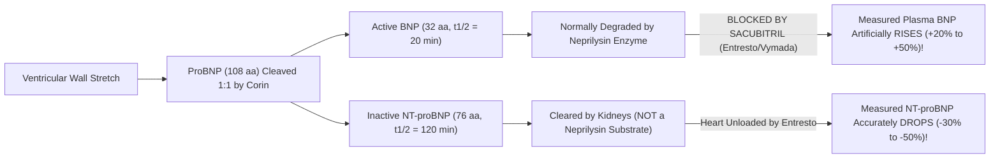

# 3.7.5 — B-Type Natriuretic Peptide (`BNP` CLIA): Acute Dyspnea Triage, EDTA Plastic Tube Mandate & `ARNI` (*Sacubitril/Valsartan — Entresto*) Divergence

**Department Folder:** `03_Immunoassay_Endocrinology_and_Nutrients`  
**Cluster Folder:** `3.7_Acute_Cardiac_and_Sepsis_Biomarkers_CLIA_Cluster`  
**Standard Tier:** International Reference Laboratory Standard (ISO 15189:2022 / CAP / CLSI / EFLM / ESC / AHA / CPA 2019)

---

## 📑 Section 1: International Document Control, Interoperability Coding & Hardware-Agnostic Platform Matrix

| Governance & Coding Parameter | Specification & International Reference Mapping |
| :--- | :--- |
| **Document ID & Version** | `SOP-IMM-3.7.5` — **Version 2.0 (International Reference Laboratory Tier)** |
| **ISO 15189:2022 & CAP Mapping** | Clauses `7.2` (Strict EDTA Plastic Pre-Analytical Control), `7.3`, `7.4`; `CAP CHM.13900` |
| **Primary `LOINC` Codes** | **`30934-4`** (Natriuretic peptide B [Mass/volume] in Blood or Plasma — `pg/mL`); **`33762-6`** (Paired `NT-proBNP` cross-reference) |
| **`SNOMED-CT` Specimen & Concept** | Specimen: **`445295009`** (EDTA Plasma in Plastic Tube); Observable: **`390917008`** (Brain natriuretic peptide measurement) |
| **`ICD-10` / `ICD-11` Clinical Codes** | **`I50.9`** / `BD10` (Heart Failure); **`I50.1`** (Left ventricular failure, acute pulmonary edema); **`R06.02`** (Acute dyspnea) |
| **UCUM Reporting Units & Conversion** | **Primary Unit:** **`pg/mL`** ($= \text{ng/L}$). **SI Unit:** **`pmol/L`**. **Exact Conversion:** $\text{pg/mL} \times 0.289 = \text{pmol/L}$ ($\text{pmol/L} \times 3.464 = \text{pg/mL}$). Molecular Weight of active `BNP-32` ($32\text{ amino acids}$, aa 77–108 with 17-aa disulfide ring): **$3,464\text{ Da}$** ($\sim 3.5\text{ kDa}$). |
| **Metrological Traceability** | Traceable to synthetic human **$\text{BNP (1–32)}$ Reference Material** (Breathing Not Properly Study / ESC / AHA harmonized $100\text{ pg/mL}$ cutoff). |

### **Hardware-Agnostic Decoupled Analyzer Matrix**
| Platform Tier | Analyzer Model & Manufacturer | Analytical Principle & Detection Chemistry | Epitope Specificity & Pre-Analytical Requirement |
| :--- | :--- | :--- | :--- |
| **Primary Platform** | **Snibe MAGLUMI X3** (Flash-CLIA) | **Two-Site Sandwich Flash-CLIA**: Monoclonal capture antibody targeting the conserved **17-amino-acid disulfide ring (aa 10–26 of BNP-32)** on magnetic microbeads + ABEI-labeled C-terminal/ring tracer | **Mandatory Specimen:** **Chilled/Separated $\text{K}_2\text{-}$ or $\text{K}_3\text{-EDTA}$ Plasma in a PLASTIC Tube ONLY** (Serum and glass tubes are strictly rejected!). |
| **Backup Platform** | Harmonized CLIA / CMIA Immunoassay System | Direct Chemiluminescence (`CMIA` / `CLIA`) | Verified per `CLSI EP31-A`; non-interchangeable with `NT-proBNP` (`3.7.4`). |
| **Future Upgrade Slot** | Next-Gen Modular CLIA | Ring-specific monoclonal sandwich | Verified per `CLSI EP15-A3` & `EP06-Ed2`. |

---

## 🧪 Section 2: Pre-Analytical Phlebotomy, `CLSI GP41` Order-of-Draw, Stability & Quantitative `HIL` Rejection Matrix

> [!CAUTION]
> **CRITICAL PRE-ANALYTICAL REJECTION RULE FOR ACTIVE `BNP` (`3.7.5`):**  
> Unlike `NT-proBNP` (`3.7.4`), biologically active **`BNP-32` is rapidly degraded in vitro by plasma kallikrein and neutral endopeptidases** and **irreversibly adsorbs to glass surfaces** (losing $> 40\%$ within $2\text{ hours}$!).  
> - **ONLY $\text{K}_2\text{-EDTA}$ or $\text{K}_3\text{-EDTA}$ Plasma collected in a PLASTIC Lavender-Top tube is acceptable.**  
> - **REJECT all Serum (Red/Gold SST), Lithium Heparin, Citrate, or Glass tubes immediately!**

- **`CLSI GP41` Order-of-Draw:** Citrate $\rightarrow$ Serum $\rightarrow$ Heparin $\rightarrow$ **Plastic $\text{K}_2/\text{K}_3\text{-EDTA}$ (Lavender-Top)**.
- **Minimum Volume:** **$1.0\text{ mL}$** EDTA whole blood ($0.4\text{ mL}$ separated EDTA plasma in a **plastic** secondary aliquot tube).
- **Centrifugation & Strict Cold-Chain Stability Matrix:**
  - Centrifuge within **$\le 1\text{–}2\text{ hours}$** of collection at **$1,500 \text{ – } 2,000 \times g$ for $10\text{ minutes}$** (preferably refrigerated at $4^\circ\text{C}$) and immediately transfer EDTA plasma into a **polypropylene plastic aliquot tube**.
  - **Room Temperature ($18\text{–}25^\circ\text{C}$):** **Maximum $4\text{ hours}$ ONLY!** *(If courier transit from a collection center exceeds $4\text{ hours}$ at RT, order **`NT-proBNP` [`3.7.4`]** instead, which is stable for $72\text{ hours}$ at RT!).*
  - **Refrigerated ($2\text{–}8^\circ\text{C}$):** **$24\text{ hours}$** (separated EDTA plasma in plastic tube).
  - **Frozen ($-20^\circ\text{C}$ / $-70^\circ\text{C}$):** **$3\text{ months}$** at $-20^\circ\text{C}$; **$12\text{ months}$** at $-70^\circ\text{C}$ (Maximum **1 freeze-thaw cycle**).

### **Quantitative `HIL` (Hemolysis, Icterus, Lipemia) Spectral & Proteolytic Interference Matrix (`CLSI C56-A`)**
| Index | Analyte Equivalent Cutoff | Direction & Mechanism of Bias | Mandatory LIMS & Technical Action |
| :--- | :--- | :--- | :--- |
| **`H-Index` (Hemolysis)** | **$> 150\text{ mg/dL}$ Free Hb** | **False Decrease ($\downarrow$):** Intracellular erythrocyte proteases released during hemolysis rapidly cleave the C-terminus and disulfide ring of active `BNP-32`. | **Reject & Redraw** if `H-Index > 150 mg/dL` (or switch order to `NT-proBNP`, which tolerates up to $500\text{ mg/dL}$ Hb). |
| **`I-Index` (Icterus)** | **$> 30\text{ mg/dL}$ Bilirubin** | Negligible interference up to $30\text{ mg/dL}$. | Flag if `I-Index > 30 mg/dL`. |
| **`L-Index` (Lipemia)** | **$> 1,000\text{ mg/dL}$ Triglycerides** | Steric hindrance in magnetic microbead capture. | Ultracentrifuge in plastic micro-tube before assaying. |

---

## ⚙️ Section 3: Hardware-Agnostic Analytical SOP, `CLSI` Verification, Calibration & Six Sigma QC

1. **Immunological Reaction Principle (Snibe Maglumi X3 Two-Site Sandwich Flash-CLIA):**
   - Biologically active `BNP-32` ($32\text{ aa}$) contains a central 17-amino-acid ring closed by a disulfide bond between $\text{Cys}^{10}$ and $\text{Cys}^{26}$, which is essential for binding to the guanylyl cyclase-linked Natriuretic Peptide Receptor-A (`NPR-A`).
   - EDTA plasma ($100\text{ }\mu\text{L}$) is incubated at $37^\circ\text{C}$ with magnetic microbeads coated with monoclonal anti-BNP antibody and ABEI-labeled anti-BNP monoclonal conjugate. After magnetic separation and washing, Starter 1+2 generates a 3-second flash chemiluminescence signal ($\text{RLU}$) proportional to `BNP` concentration ($\text{pg/mL}$).
2. **Calibration & Traceability:** 2-point recalibration every **28 days**, on new reagent lot, or upon Westgard QC violation.
3. **Internal Quality Control (IQC):** Run 2–3 levels of EDTA-matrix `BNP` control ($\text{Level 1} \sim 80\text{ pg/mL}$ near the $100\text{ pg/mL}$ cutoff; $\text{Level 2} \sim 450\text{ pg/mL}$) every $12\text{ hours}$ under Westgard $1_{3s} / 2_{2s} / R_{4s}$ rules.
4. **Analytical Measurement Range (`AMR`), `LoD / LoQ`, & Auto-Dilution (`CRR`):**
   - **Limit of Detection (`LoD`):** **$2.0\text{ pg/mL}$** | **Limit of Quantitation (`LoQ`):** **$5.0\text{ pg/mL}$**
   - **Linear `AMR`:** **$2.0 \text{ – } 5,000.0\text{ pg/mL}$**
   - **Auto-Dilution (`CRR`):** Automatic $1:5$ on-board dilution for samples $> 5,000\text{ pg/mL}$ extends the reportable range to **$25,000.0\text{ pg/mL}$**.

---

## 📈 Section 4: EFLM Biological Variation, Reference Change Value (`RCV %`), Six Sigma (`TEa`) & Measurement Uncertainty (`MU`)

| Metrological & Biological Variation Parameter | Value & Source (EFLM Biological Variation DB / CLIA '24) | Clinical & LIMS Operational Application |
| :--- | :--- | :--- |
| **Within-Subject Biological Variation ($CV_I$)** | **$20.2\%$** *(Week-to-week; short-term pulsatile $CV_I \sim 15\%\text{–}25\%$)* | Because active `BNP` has a very short $20\text{-minute}$ half-life, its biological variation is **twice as wide** as `NT-proBNP` ($10.0\%$). |
| **Between-Subject Biological Variation ($CV_G$)** | **$54.0\%$** | Wide inter-individual dispersion across age, sex, and BMI. |
| **Index of Individuality ($\text{II} = CV_I / CV_G$)** | **$0.37$** *(Low: $< 0.60$)* | Serial changes must exceed the large biological `RCV %` to be clinically meaningful. |
| **Desirable Analytical Imprecision ($CV_A$)** | **$\le 6.5\%$** | Achieved $CV_A \sim 3.8\%\text{–}5.2\%$ on Maglumi X3. |
| **Desirable Analytical Bias ($B\%$)** | **$\le 12.0\%$** | Monitored via external proficiency testing. |
| **Total Allowable Error ($\text{TE}_a$)** | **$\pm 25.0\%$** (EFLM / CAP / RCPA) | Six Sigma target $\ge 4.0\text{ }\sigma$ at $100\text{ pg/mL}$. |
| **Expanded Measurement Uncertainty ($\text{MU}$ at $k=2$)** | **$\pm 13.0\%$** | Applied at the $100\text{ pg/mL}$ and $400\text{ pg/mL}$ decision thresholds. |
| **95% & 99% Reference Change Value (`RCV %`)** | **95% RCV: $\pm 58.8\%$ \| 99% RCV: $\pm 77.5\%$** | Due to high biological pulsatility, active `BNP` must change by **$\ge 40\%\text{–}58\%$** between serial measurements to confirm a true hemodynamic change! |
| **Minimum Retesting Interval (`MRI`)** | **Acute Hemodynamic Shifts:** **$12 \text{ – } 24\text{ hours}$** **Routine Inpatient:** Admission & Pre-Discharge | Because $t_{1/2} \sim 20\text{ min}$, active `BNP` equilibrates to acute wedge pressure drops within $2\text{–}4\text{ hours}$ (faster than `NT-proBNP`), provided the patient is **NOT** on Sacubitril/Valsartan. |

---

## 🧬 Section 5: Super-Detailed Multi-Stratified Biological Reference Intervals (ESC/AHA Cutoffs, Age/Sex, Obesity & CKD)

### **1. ESC / AHA / "Breathing Not Properly" Diagnostic Decision Cutoffs (`BNP` in `pg/mL`)**
| Clinical Setting / Diagnostic Zone | `BNP` Cutoff (`pg/mL` = `ng/L`) | Diagnostic Interpretation & Clinical Action |
| :--- | :--- | :--- |
| **Outpatient / Non-Acute Ambulatory Rule-Out** | **$< 35.0\text{ pg/mL}$** | **Chronic Heart Failure Unlikely** ($\text{NPV} > 98\%$). |
| **Emergency Department Acute Dyspnea Rule-Out** | **$< 100.0\text{ pg/mL}$** | **Acute Decompensated Heart Failure Unlikely** ($\text{NPV} = 96\%\text{–}98\%$); evaluate pulmonary/non-cardiac causes of dyspnea. |
| **Equivocal / Grey Zone** | **$100.0 \text{ – } 400.0\text{ pg/mL}$** | **Indeterminate Zone:** Consider mild/compensated LV dysfunction, HFpEF, Cor Pulmonale / COPD, Pulmonary Embolism, Atrial Fibrillation, or CKD ($> 200\text{ pg/mL}$ cutoff if $\text{eGFR} < 60\text{ mL/min}$). Perform **2D-Echocardiography**. |
| **Acute Decompensated Heart Failure Rule-In** | **$> 400.0\text{ pg/mL}$** | **Acute Heart Failure Highly Likely** ($\text{PPV} > 90\%$). |
| **Severe / Decompensated Heart Failure** | **$> 1,000.0\text{ pg/mL}$** | Severe ventricular wall stress and high short-term mortality risk. |

### **2. Demographic, Obesity, Renal & Obstetric Partitioning**
| Population Partition / Clinical Modifier | `BNP` Reference Interval (`pg/mL`) | Physiological & Clinical Interpretation Notes |
| :--- | :--- | :--- |
| **Healthy Adults $< 45\text{ Years}$** | Female: **$< 35.0\text{ pg/mL}$** \| Male: **$< 25.0\text{ pg/mL}$** | Estrogens mildly stimulate natriuretic peptide synthesis, giving healthy females $30\%\text{–}40\%$ higher baseline `BNP` than age-matched males. |
| **Healthy Adults $45 \text{ – } 69\text{ Years}$** | Female: **$< 60.0\text{ pg/mL}$** \| Male: **$< 45.0\text{ pg/mL}$** | Gradual age-related increase in myocardial stiffness. |
| **Geriatric ($\ge 70\text{ Years}$)** | **$< 100.0\text{ pg/mL}$** | Standard acute rule-out cutoff remains $< 100\text{ pg/mL}$. |
| **Pediatric (`CALIPER` — $1\text{ Month} \text{ – } 17\text{ Years}$)** | **$< 35.0 \text{ – } 50.0\text{ pg/mL}$** *(Neonate $0\text{–}7\text{d}$: up to $650\text{ pg/mL}$)* | Transitional neonatal circulatory adaptation elevates `BNP` in the first week of life. |
| **Maternity (1st, 2nd & 3rd Trimesters)** | **$< 50.0\text{ pg/mL}$** *(Rule-Out $< 100\text{ pg/mL}$)* | **`BNP > 100 pg/mL` during pregnancy or postpartum** is abnormal and warrants urgent echocardiography for **Peripartum Cardiomyopathy (PPCM)** or **Severe Preeclampsia**. |
| **Severe Obesity ($\text{BMI} \ge 30 \text{ – } 35\text{ kg/m}^2$)** | **Rule-Out Cutoff Lowered to $< 50.0 \text{ – } 54.0\text{ pg/mL}$** | Adipocyte `NPR-C` receptor overexpression accelerates `BNP` clearance, lowering circulating `BNP` by **$30\%\text{–}50\%$**! Nearly $20\%$ of morbidly obese patients with true ADHF/HFpEF have a `BNP` between $50\text{ and }100\text{ pg/mL}$. |
| **Chronic Kidney Disease ($\text{eGFR} < 60\text{ mL/min}$)** | **Rule-Out Cutoff Raised to $< 200.0\text{ pg/mL}$** | Although `BNP` is cleared mainly via `NPR-C` receptors and neprilysin (and is **less dependent on GFR than `NT-proBNP`**), chronic volume overload and uremic cardiomyopathy in CKD still raise baseline `BNP` to $100\text{–}200\text{ pg/mL}$. |

---

## 🚨 Section 6: NABL & `CLSI GP47` Critical ("Panic") Values & 30-Minute Read-Back Protocol

| Alert Tier | Parameter & Threshold | Clinical Implication & Mandatory Laboratory Action |
| :--- | :--- | :--- |
| **🚨 Tier-1 Critical Panic Alert** | **New-Onset `BNP > 400.0 – 500.0 pg/mL`** *(or **$> 100.0\text{ pg/mL}$ in Pregnancy/Postpartum**)* | **Acute Decompensated Heart Failure, Cardiogenic Pulmonary Edema, or Peripartum Cardiomyopathy:** Notify ordering physician/ED within **$\le 30\text{ minutes}$** with documented read-back. |

---

## 🔬 Section 7: In-Vivo Pharmacokinetics & The `ARNI` (*Sacubitril/Valsartan — Entresto / Vymada*) Divergence

### **1. Why `BNP` & `NT-proBNP` Diverge on `Sacubitril/Valsartan` (`Entresto` / `Vymada` / `Cidmus`)**

- **Mechanism of Divergence:**
  - **Sacubitril** (the active prodrug sacubitrilat in *Sacubitril/Valsartan*) therapeutically inhibits **Neprilysin (Neutral Endopeptidase 24.11)** so that endogenous active **`BNP`** is protected from enzymatic breakdown, promoting natriuresis, diuresis, and vasodilation.
  - Because commercial `BNP` immunoassays measure this accumulated circulating `BNP` (plus glycosylated proBNP cross-reactants), **a patient who is clinically improving on Sacubitril/Valsartan will show a rising or persistently elevated `BNP` level**, which can mislead an unaware clinician into thinking the patient's heart failure is worsening!
  - Conversely, **`NT-proBNP` (`3.7.4`) is completely impervious to neprilysin** and falls rapidly as left ventricular wall tension decreases. **Mandatory Clinical Rule:** Always switch to **`NT-proBNP` (`3.7.4`)** for any patient prescribed *Sacubitril/Valsartan* (or *Nesiritide* recombinant BNP).

---

## 🛡️ Section 8: Comprehensive Analytical, Pre-Analytical, Endogenous & Drug Interference Matrix + `ISO 22367` FMEA

| Interference / Confounder | Direction & Magnitude of Bias | Root Cause & Laboratory Mitigation |
| :--- | :--- | :--- |
| **Serum Tube, Glass Tube, or Delayed Separation ($> 4\text{h}$ at RT)** | **Severe False Decrease ($\downarrow 30\%\text{–}70\%$)** | Active `BNP` adsorbs to glass and is cleaved by coagulation proteases (kallikrein/plasmin) activated during blood clotting in serum tubes. **Strictly enforce Plastic $\text{K}_2/\text{K}_3\text{-EDTA}$ Plasma separated within $2\text{h}$!** |
| **`Sacubitril/Valsartan` (*Entresto / Vymada / Cidmus*) or `Nesiritide`** | **Pharmacological Elevation ($\uparrow$)** | Neprilysin inhibition blocks `BNP` degradation (or exogenous recombinant `BNP` infusion directly measures as `BNP`). **Reflex or recommend `NT-proBNP` (`3.7.4`).** |
| **Circulating Intact `proBNP (1–108)` Cross-Reactivity** | **Analytical Cross-Reactivity** | In severe advanced heart failure, up to $50\%$ of immunoreactive "BNP" in plasma is actually unprocessed, $O$-glycosylated **intact `proBNP (1–108)`** (which shares the 17-aa ring structure but has only $10\%$ biological activity), explaining why some patients with very high measured `BNP` remain sodium-avid ("BNP paradox"). |

### **`ISO 22367` Risk Management & Failure Modes (`FMEA`)**
1. **Failure Mode 1 — Running `BNP` on a Serum Tube (SST) or Unchilled Sample Delayed $> 6\text{h}$ in Transit, Producing a False-Negative Result ($< 100\text{ pg/mL}$) in Acute Pulmonary Edema (Severity: 10/10):** Mitigated by hard LIMS specimen-type lock (**Plastic EDTA Plasma Only**) and automatic conversion of peripheral courier orders to **`NT-proBNP` (`3.7.4`)**.
2. **Failure Mode 2 — Escalating Diuretics or Admitting a Stable Patient on `Entresto/Vymada` Because Their `BNP` Rose After Starting Therapy (Severity: 8/10):** Mitigated by a prominent `Entresto/Vymada` drug warning in every `BNP` LIMS report.
3. **Failure Mode 3 — Directly Comparing a `BNP` Value ($\text{pg/mL}$) to a Previous `NT-proBNP` Value ($\text{pg/mL}$) (Severity: 9/10):** Because `NT-proBNP` has a $6\times$ longer half-life, its numerical concentration in $\text{pg/mL}$ is typically **$4\times \text{ to } 8\times$ higher** than `BNP` in the same patient! Mitigated by explicit non-equivalence warnings.

---

## 💬 Section 9: Conditional Band-Specific Pathologist Sign-Out Library (Automated LIMS Rules-Based Comments)

- **`[BAND-NORMAL-OUTPATIENT: < 35.0 pg/mL]`:**  
  *"Plasma BNP is < 35.0 pg/mL, ruling out both chronic ambulatory and acute decompensated heart failure with > 98% Negative Predictive Value. Note: Severe obesity (BMI >= 30 kg/m2) lowers circulating BNP by 30%–50%."*
- **`[BAND-ACUTE-RULE-OUT: 35.0 – 99.0 pg/mL]`:**  
  *"Plasma BNP is below the acute emergency dyspnea rule-out threshold (< 100.0 pg/mL), making Acute Decompensated Heart Failure unlikely (NPV > 96%). However, values between 35 and 99 pg/mL may be seen in stable chronic heart failure, HFpEF, atrial fibrillation, cor pulmonale, or obesity-suppressed heart failure (use a < 50 pg/mL threshold if BMI >= 30 kg/m2). Correlate with 2D-Echocardiography."*
- **`[BAND-GREY-ZONE: 100.0 – 400.0 pg/mL]`:**  
  *"Equivocal / Grey-Zone Plasma BNP elevation (100–400 pg/mL). Differential diagnosis includes mild/moderate Heart Failure, Atrial Fibrillation, COPD/Cor Pulmonale, Acute Pulmonary Embolism (right ventricular strain), or Chronic Kidney Disease (if eGFR < 60 mL/min, the acute HF rule-out cutoff increases to ~200 pg/mL). IMPORTANT DRUG NOTE: If the patient is taking Sacubitril/Valsartan (Entresto/Vymada), BNP is pharmacologically elevated by neprilysin inhibition—order NT-proBNP instead."*
- **`[BAND-CRITICAL-RULE-IN: > 400.0 pg/mL]`:**  
  *"CRITICAL ALERT: Markedly elevated Plasma BNP (> 400.0 pg/mL), strongly supporting Acute Decompensated Heart Failure / Ventricular Overload (PPV > 90%). Correlate urgently with 2D-Echocardiography and clinical status. Note: BNP and NT-proBNP numerical values are NOT interchangeable. If the patient is receiving Sacubitril/Valsartan (Entresto/Vymada), use NT-proBNP for serial therapeutic monitoring."*

---

## 📋 Section 10: Master LIMS Copy-Paste Report Block (Physician + Patient Summary + Multi-Jurisdictional Shield)

### **[LIMS COPY-PASTE BLOCK — B-TYPE NATRIURETIC PEPTIDE (`BNP` — EDTA PLASMA) INTERPRETATION]**

**Clinical & Analytical Overview (Snibe Maglumi Flash-CLIA; Specimen: Plastic EDTA Plasma; Units: $\text{pg/mL}$):**  
B-Type Natriuretic Peptide ($\text{BNP}$, $32\text{ amino acids}$) is the **biologically active hormone** secreted by ventricular myocytes in response to **myocardial wall stretch and elevated filling pressures**. With a short biological half-life of **$\sim 20\text{ minutes}$**, $\text{BNP}$ promotes natriuresis, diuresis, and vasodilation while antagonizing the Renin-Angiotensin-Aldosterone System (RAAS).

**ESC / AHA Diagnostic Decision Cutoffs for Plasma `BNP` ($\text{pg/mL}$):**
| Clinical Setting / Result Band | `BNP` Cutoff ($\text{pg/mL}$) | Clinical Interpretation |
| :--- | :--- | :--- |
| **Non-Acute Outpatient Dyspnea Rule-Out** | **$< 35.0\text{ pg/mL}$** | **Chronic Heart Failure Unlikely** ($\text{NPV} > 98\%$). |
| **Acute ED Dyspnea Rule-Out** | **$< 100.0\text{ pg/mL}$** | **Acute Heart Failure Unlikely** ($\text{NPV} = 96\%\text{–}98\%$); evaluate pulmonary causes. |
| **Equivocal / Grey Zone** | **$100.0 \text{ – } 400.0\text{ pg/mL}$** | Consider mild HF/HFpEF, Atrial Fibrillation, Pulmonary Embolism, COPD, or CKD ($\text{eGFR} < 60\text{ mL/min}$ cutoff $\sim 200\text{ pg/mL}$); confirm with **2D-Echo**. |
| **Acute Heart Failure Rule-In** | **$> 400.0\text{ pg/mL}$** | **Acute Decompensated Heart Failure Highly Likely** ($\text{PPV} > 90\%$). |

**Plain-Language Patient Summary:**  
*BNP is an active hormone released by the heart chambers when they are stretched by fluid overload or high pressure. A level below 100 pg/mL makes acute heart failure very unlikely, while levels above 400 pg/mL point strongly toward heart strain. If you take the heart failure medication Sacubitril/Valsartan (Entresto/Vymada), your doctor should order the sister test "NT-proBNP" instead, because that medication naturally raises active BNP levels.*

> **🛡️ MANDATORY `ENTRESTO` DRUG, OBESITY & PRE-ANALYTICAL SHIELD (ISO 15189:2022 / ESC / AHA / CPA 2019):**  
> 1. **Sacubitril/Valsartan (*Entresto / Vymada / Cidmus*) Warning:** Sacubitril inhibits neprilysin (the enzyme that degrades active $\text{BNP}$), causing **pharmacological elevation of measured `BNP`** even when heart failure is clinically improving! **Order `NT-proBNP` (not `BNP`) for all patients on Sacubitril/Valsartan.**  
> 2. **Strict Non-Interchangeability (`BNP` $\neq$ `NT-proBNP`):** `BNP` ($t_{1/2} \sim 20\text{ min}$) and `NT-proBNP` ($t_{1/2} \sim 120\text{ min}$) have completely different numerical reference ranges and clearance pathways and **must never be compared directly**.  
> 3. **Obesity & Pre-Analytical Stability Caveats:** Obesity ($\text{BMI} \ge 30\text{ kg/m}^2$) lowers `BNP` by $30\%\text{–}50\%$ (use $< 50\text{ pg/mL}$ rule-out cutoff). Active `BNP` requires **Plastic EDTA Plasma separated within $\le 4\text{ hours}$**; delayed separation or glass/serum tubes cause false-low results. *Not valid for medico-legal purposes.*
