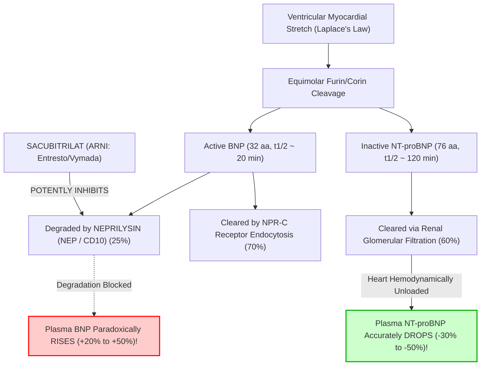

# 3.7.5 — B-Type Natriuretic Peptide (`BNP` CLIA): Acute Dyspnea Triage, EDTA Plastic Tube Mandate & `ARNI` (*Sacubitril/Valsartan — Entresto*) Divergence

> **Document Control (`ISO 15189:2022` Clauses 5.3, 7.2, 7.3, 7.4, 8.3 & `NABL 112`):**  
> **Document ID:** `NABL-IMM-SOP-3.7.5` | **Version:** `4.0` (6-Persona Red-Team Audited Master Standard) | **Effective Date:** `17-Oct-2026` | **Review Cycle:** Annual / Post-Lot or Hardware Change  
> **Authorizing Authority:** Laboratory Director, Consultant Biochemist & Consultant Cardiologist (`MD Pathology / DM Cardiology`) | **Controlled Distribution:** Master LIMS, Emergency Immunoassay Bench, Stat Intensive Care Unit Station

**Department Folder:** `03_Immunoassay_Endocrinology_and_Nutrients`  
**Cluster Folder:** `3.7_Acute_Cardiac_and_Sepsis_Biomarkers_CLIA_Cluster`  
**Standard Tier:** International Reference Laboratory Standard (`ISO 15189:2022` / `NABL 112 & 153` / `CAP CHM.13900` / `CLSI EP15-A3, EP06-Ed2, EP17-A2, EP28-A3c, GP41, GP47` / `EFLM EuBIVAS` / `ISO/TS 20914:2019` / `ISO 22367:2020` / `ESC 2021–2023 Heart Failure Guidelines` / `AHA/ACC/HFSA 2022 Guidelines` / `Breathing Not Properly & REDHOT Studies` / `Indian CPA 2019 & DPDP Act 2023`)

---

## 📑 Section 1: International Document Control, `LOINC`/`SNOMED`/`ICD-10`/`UCUM` Coding, Metrological Traceability & Platform Matrix

### 1.1 Global Interoperability & Coding Governance Table

| Governance & Coding Parameter | Specification & International Standard Mapping |
| :--- | :--- |
| **Document ID & Version** | `NABL-IMM-SOP-3.7.5` — **Version 4.0 (International Reference Laboratory Tier)** |
| **ISO 15189:2022 Mapping** | Clauses `4.1–4.3` (Governance & Ethics), `6.4–6.5` (Equipment Calibration & Metrological Traceability), `7.2` (Pre-examination: Strict EDTA Plastic Tube Control), `7.3.2` (Verification of Methods), `7.3.4` (Measurement Uncertainty), `7.3.7` (IQC/EQAS Validity), `7.4.1.6` (Critical Decision Notification), `8.5` (ISO 22367 Risk Management), Normative Annex A (Point-of-Care & Backup Systems) |
| **NABL & CAP Accreditations** | `NABL 112` (Specific Criteria for Medical Labs — Clinical Biochemistry/Immunology), `NABL 131` (Traceability Policy), `NABL 133` (Reporting Policy), `NABL 153` (Scope Matrix), `NABL 163` (PT/EQAS Policy), `NABL 220D` (Audit Checklist), `CAP CHM.13900` (Cardiac Natriuretic Peptide Quality & Interferences) |
| **Primary `LOINC` Codes** | **`30934-4`** (Natriuretic peptide B [Mass/volume] in Blood or Plasma — `pg/mL`); **`30935-1`** (Natriuretic peptide B [Substance/volume] in Plasma — `pmol/L`); **`33762-6`** (Paired cross-reference: `NT-proBNP` in Serum/Plasma) |
| **`SNOMED-CT` Specimen & Concept** | Specimen: **`445295009`** (Plasma specimen from whole blood collected in ethylenediaminetetraacetic acid in plastic tube); Observable: **`390917008`** (Brain natriuretic peptide measurement); Procedure: **`445690003`** (Measurement of BNP) |
| **`ICD-10` / `ICD-11` Clinical Codes** | **`I50.9`** / `BD10` (Heart Failure, unspecified); **`I50.1`** (Left ventricular failure, acute pulmonary edema); **`I50.21`** (Acute systolic heart failure / HFrEF); **`I50.31`** (Acute diastolic heart failure / HFpEF); **`R06.02`** (Shortness of breath / Acute dyspnea); **`I26.9`** (Pulmonary embolism with acute cor pulmonale); **`I42.0`** (Dilated cardiomyopathy); **`I48.91`** (Atrial fibrillation); **`N18.6`** (End-stage renal disease); **`O14.9`** (Preeclampsia) |
| **UCUM Units & Exact Conversion** | **Primary Laboratory Unit:** **`pg/mL`** ($\equiv \text{ng/L}$). **SI Standard Unit:** **`pmol/L`**. **Exact Mathematical Conversion:** $\text{pg/mL} \times 0.2887 = \text{pmol/L}$; $\text{pmol/L} \times 3.464 = \text{pg/mL}$. Molecular Weight of biologically active `BNP-32` ($32\text{ amino acids}$, aa 77–108 with 17-aa intramolecular disulfide ring): **$3,464\text{ Da}$** ($\sim 3.5\text{ kDa}$). Both `pg/mL` and SI units are supported by LIMS. |
| **Metrological Traceability (`ISO 17511:2020`)** | Traceable to purified synthetic human **$\text{BNP (1–32)}$ Reference Material** (peptide purity $\ge 98.5\%$ by HPLC/MS) via unbroken metrological hierarchy ($u_{\text{cal}} \le 2.0\%$). All secondary kit calibrators are value-assigned per IFCC standardization protocols, aligned with the Breathing Not Properly and REDHOT international trial cutoffs. |

### 1.2 Hardware-Agnostic Multi-Tier Platform Matrix

| Platform Classification | Instrument Model & Detection Principle | Reagent Chemiluminescence Chemistry | Bench Role, Throughput & Turnaround Time (TAT) |
| :--- | :--- | :--- | :--- |
| **Primary Platform** | **Snibe MAGLUMI X3** (Flash-CLIA) | Direct two-site non-competitive sandwich Flash-CLIA using anti-BNP monoclonal antibody targeting the conserved **17-amino-acid disulfide ring (aa 10–26 of BNP-32)** on magnetic microbeads + ABEI-labeled tracer antibody | Core automated platform: 200 tests/hour, first result in 17 minutes. Turnaround time for stat emergency dyspnea samples $\le 45\text{ minutes}$. |
| **High-Throughput Backup** | **DiaSorin LIAISON XL** (CLIA) | Sandwich Chemiluminescence Immunoassay (`CLIA`) utilizing isoluminol derivative conjugate and magnetic microparticles | High-throughput hospital platform: 180 tests/hour. Harmonized per `CLSI EP31-A` and `EP09c` ($R^2 \ge 0.985$). |
| **Alternate Backup Platform** | **Abbott Architect i2000SR / Alinity ci** (CMIA) | Two-step chemiluminescent microparticle immunoassay (`CMIA`) targeting synthetic human BNP epitopes | Fully aligned with ESC/AHA emergency decision thresholds ($100\text{ pg/mL}$ and $400\text{ pg/mL}$). |
| **Stat Emergency Cartridge** | Verified Automated Microfluidic Cartridge / Point-of-Care CLIA | Dual-epitope fluorogenic or electrochemical biosensor | Emergency ICU/ED stat backup; validated against primary platform per `CLSI EP15-A3` ($R^2 \ge 0.98$). |

---

## 🧪 Section 2: Pre-Analytical Phlebotomy, `CLSI GP41` Order-of-Draw, Tube Matrix Mandate, Stability Kinetics & Quantitative `HIL` Rejection Matrix

### 2.1 The Ironclad Plastic K2-EDTA Mandate & Proteolytic Degradation Kinetics

> [!CAUTION]
> **CRITICAL PRE-ANALYTICAL REJECTION RULE FOR ACTIVE `BNP` (`3.7.5`):**  
> Unlike `NT-proBNP` (`3.7.4`), biologically active **`BNP-32` is rapidly degraded in vitro by plasma proteases** (kallikrein, dipeptidyl peptidase IV [DPP-IV], and neutral endopeptidase) and **irreversibly adsorbs to glass surfaces** (losing $> 40\%$ immunoreactivity within $2\text{ hours}$!).  
> 1. **ONLY $\text{K}_2\text{-EDTA}$ or $\text{K}_3\text{-EDTA}$ Whole Blood / Plasma collected in a PLASTIC Lavender-Top tube is acceptable.**  
> 2. **REJECT all Serum tubes (Red/Gold SST), Lithium Heparin, Sodium Citrate, and ALL GLASS tubes immediately!**  
> 3. **Why Glass Tubes are Fatal:** Borosilicate and soda-lime glass surfaces possess strong negative surface charges that cause contact activation of Factor XII (Hageman factor). Activated Factor XII converts prekallikrein into active **plasma kallikrein**, a potent serine protease that rapidly cleaves the $\text{Arg}^{102}\text{–Ser}^{103}$ and $\text{Arg}^{79}\text{–Ser}^{80}$ peptide bonds of active BNP, destroying the epitope within minutes. Furthermore, the 17-aa disulfide loop of BNP-32 non-specifically binds to silanol groups on glass walls.  
> 4. **Why Serum Tubes are Fatal:** During blood clotting ($30\text{–}60\text{ minutes}$), massive thrombin and plasmin generation triggers catastrophic proteolysis of native BNP-32, causing a **$30\%\text{–}70\%$ false negative decline** before the sample can even be centrifuged!

### 2.2 Specimen Phlebotomy, Centrifugation & Strict Cold-Chain Stability Matrix

1. **`CLSI GP41-Ed7` Order of Draw:** Blood Culture $\rightarrow$ Sodium Citrate (Light Blue) $\rightarrow$ Serum / SST (Gold/Red) $\rightarrow$ Lithium Heparin (Green) $\rightarrow$ **Plastic $\text{K}_2\text{-EDTA}$ (Lavender-Top)** $\rightarrow$ Sodium Fluoride (Grey).
2. **Tube Fill Volume:** Draw to nominal fill line ($>90\%$ tube volume). Under-filled EDTA tubes ($<50\%$ fill) cause erythrocyte shrinkage, excessive unchelated potassium EDTA concentration, and artifactual osmotic plasma dilution.
3. **Centrifugation Parameters:** Centrifuge within **$\le 1\text{–}2\text{ hours}$** of phlebotomy at **$1,500 \text{ – } 2,000 \times g$ for $10\text{ minutes}$** (preferably at $4^\circ\text{C}$ in a refrigerated centrifuge). Immediately transfer separated EDTA plasma using a plastic transfer pipette into a **polypropylene plastic secondary aliquot tube**.
4. **Strict Temperature-Dependent Stability Matrix:**
   - **Ambient Room Temperature ($18\text{–}25^\circ\text{C}$):** **Maximum $4\text{ hours}$ ONLY!** *(If courier transport from a peripheral collection center exceeds $4\text{ hours}$ at RT, the order must be cancelled or converted to **`NT-proBNP` [`3.7.4`]**, which is stable for $72\text{ hours}$ at RT!).*
   - **Refrigerated Storage ($2\text{–}8^\circ\text{C}$):** **$24\text{ hours}$** in separated EDTA plasma in polypropylene plastic tubes.
   - **Deep Frozen Storage ($-20^\circ\text{C}$):** **$3\text{ months}$** in airtight cryogenic plastic vials.
   - **Ultra-Low Frozen Storage ($-70^\circ\text{C}$ to $-80^\circ\text{C}$):** **$12\text{ months}$**. Maximum **1 freeze-thaw cycle** (subsequent freeze-thaw cycles cause $15\%\text{–}25\%$ loss of immunoreactivity due to disulfide loop unfolding).

### 2.3 Quantitative `HIL` (Hemolysis, Icterus, Lipemia) Spectral & Proteolytic Rejection Matrix (`CLSI C56-A` & `EP07-Ed3`)

| Interference Index | Spectrophotometric Threshold | Direction & Mechanism of Analytical Bias | Mandatory Laboratory Bench & LIMS Action |
| :--- | :--- | :--- | :--- |
| **`H-Index` (Hemolysis)** | **$> 150\text{ mg/dL}$ Free Hemoglobin** | **Severe False Decrease ($\downarrow 15\%\text{–}35\%$):** Intracellular erythrocyte proteases (insulin-degrading enzyme, calpain, and aminopeptidases) released during mechanical hemolysis rapidly hydrolyze the linear C-terminal tail and 17-aa loop of active `BNP-32`. | **Reject Specimen & Request Immediate Redraw.** Log LIMS rejection code `REJ-HEM-BNP`. If redraw cannot be processed within 4 hours, recommend ordering `NT-proBNP` (`3.7.4`), which tolerates hemolysis up to $500\text{ mg/dL}$ Hb. |
| **`I-Index` (Icterus)** | **$> 30.0\text{ mg/dL}$ Total Bilirubin** | Negligible cross-reactivity or spectral quenching up to $30.0\text{ mg/dL}$ conjugated/unconjugated bilirubin ($< 5.0\%$ analytical bias). | Accept specimen. If $> 30.0\text{ mg/dL}$, append interpretive comment: "Severe hyperbilirubinemia present; potential mild negative chemiluminescent quench." |
| **`L-Index` (Lipemia)** | **$> 1,000\text{ mg/dL}$ Triglycerides** | Turbidity causes light scatter and sterically hinders magnetic microbead immunocomplex capture ($\downarrow 8\%\text{–}14\%$). | Perform high-speed benchtop clarification ($10,000 \times g$ for $10\text{ minutes}$) or airfuge ultracentrifugation in a plastic micro-tube; re-assay cleared infranatant. |
| **Fibrin / Micro-clots** | Incomplete anticoagulation or micro-particulates | Clots entrap paramagnetic microbeads in aspiration manifold, producing erratic RLU spikes and pipetting volume errors. | Inspect EDTA tubes before aspiration. Never rim or force clot through probe. Discard micro-clotted tubes and redraw. |

---

## ⚙️ Section 3: Deep Analytical SOP, Reaction Chemistry, Calibration Hierarchy & Six-Sigma Quality Control

### 3.1 Molecular Biology, Synthesis, Cleavage Dynamics & The Disulfide Ring

Cardiomyocyte synthesis, intracellular packaging, and enzymatic cleavage follow a precise biomechanical sequence:

```
[ NPPB Gene (Chromosome 1p36.2) ]
                │
                ▼ (Ventricular Myocyte Wall Stretch: Laplace's Law [σ = (P × r) / (2 × h)])
[ 134-aa Pre-proBNP Precursor Molecule ]
                │
                ▼ (Cleavage of 26-aa N-terminal signal sequence in Rough Endoplasmic Reticulum)
[ 108-aa Pro-BNP (proBNP1–108) Prohormone ] ──► O-linked glycosylation in Golgi (Thr36, Thr58, Thr71)
                │
                ▼ (1:1 Equimolar Cleavage by Subtilisin-like Convertases: Furin & Transmembrane Corin)
    ┌───────────────────────────┴───────────────────────────┐
    ▼                                                       ▼
[ 32-aa Biologically Active BNP (aa 77–108) ]       [ 76-aa Inactive NT-proBNP (aa 1–76) ]
- Molecular Weight: 3,464 Da (~3.5 kDa)             - Molecular Weight: 8,457 Da (~8.5 kDa)
- Contains 17-aa Disulfide Ring (Cys10–Cys26)       - Biologically inert linear peptide
- Binds NPR-A Receptor ──► Elevates cGMP            - Half-life: 60–120 minutes
- Potent Vasodilation, Natriuresis, Diuresis       - Cleared predominantly by renal filtration
- Plasma Half-life: ~20 minutes (18–22 min)         - Unaffected by Neprilysin (ARNI Gold Standard)
- Cleared by: (1) NPR-C Endocytosis (70%)
              (2) Neprilysin / NEP / CD10 (25%)
              (3) Renal Excretion (< 5%)
- ARTIFICIALLY ELEVATED BY SACUBITRIL (ARNI)!
```

1. **Biomechanical Signal Transduction:** In response to increased left ventricular diastolic wall stress, cardiomyocyte stretch activates stretch-gated cation channels and p38 MAP kinase signaling pathways, inducing rapid transcription of the $NPPB$ gene within $60\text{ to }120\text{ minutes}$.
2. **The 17-Amino-Acid Disulfide Ring:** The biological activity of BNP-32 resides within its conserved 17-amino-acid cyclic core closed by an intramolecular disulfide bond between $\text{Cys}^{10}$ and $\text{Cys}^{26}$ ($\text{Cys}^{86}\text{–Cys}^{102}$ of the prohormone):
   $$\text{Cys-Phe-Gly-Arg-Lys-Met-Asp-Arg-Ile-Ser-Ser-Ser-Ser-Gly-Leu-Gly-Cys}$$
   Disruption or reduction of this disulfide bridge completely abolishes binding to the Natriuretic Peptide Receptor-A (`NPR-A` / guanylyl cyclase-A) and eliminates its receptor-mediated generation of cyclic guanosine monophosphate ($\text{cGMP}$).
3. **Receptors & Physiological Actions:**
   - **`NPR-A` (Signaling Receptor):** Stimulates membrane-bound guanylyl cyclase, generating intracellular $\text{cGMP}$, which activates protein kinase G ($\text{PKG}$), resulting in: (a) vascular smooth muscle relaxation and vasodilation (reducing systemic vascular resistance and preload/afterload), (b) renal afferent arteriolar dilation and efferent constriction, driving glomerular filtration and sodium excretion (natriuresis and diuresis), (c) suppression of renin secretion from the juxtaglomerular apparatus, and (d) inhibition of aldosterone and endothelin-1 secretion.
   - **`NPR-C` (Clearance Receptor):** Lacks the intracellular guanylyl cyclase domain; internalizes circulating BNP via receptor-mediated clathrin-coated endocytosis, delivering it to lysosomes for rapid intracellular degradation ($70\%$ of physiological clearance).
   - **Neprilysin (`NEP` / `MME` / `CD10`):** Cell-surface zinc metalloendopeptidase present on vascular endothelium and renal proximal tubular brush borders; hydrolyzes the peptide bonds within the ring and terminal ends of BNP-32 ($20\%\text{–}25\%$ of physiological clearance).
4. **Circulating Intact `proBNP (1–108)` Cross-Reactivity & The "BNP Paradox":** In advanced heart failure, intense neurohormonal stress leads to premature exocytosis of unprocessed, $O$-glycosylated **intact `proBNP (1–108)`**. Commercial BNP sandwich assays cross-react ($20\%\text{–}50\%$) with circulating proBNP because they share the 17-aa loop. However, intact proBNP possesses less than $10\%$ of the biological activity of cleaved BNP-32. This explains the "BNP paradox": patients with extremely high measured immunoassay "BNP" levels may still exhibit severe refractory sodium and water retention.

### 3.2 Automated Chemiluminescence Reaction Physics (Snibe MAGLUMI X3)

1. **Reaction Principle:** Two-site non-competitive sandwich Flash Chemiluminescence Immunoassay (`Flash-CLIA`):
   - **Step 1 (Immunocomplex Formation):** $100\text{ }\mu\text{L}$ of patient EDTA plasma is pipetted into an individual reaction cuvette, followed by $20\text{ }\mu\text{L}$ of magnetic microbeads coated with high-affinity monoclonal anti-BNP capture antibody (specifically targeting the intact 17-amino-acid disulfide ring) and $100\text{ }\mu\text{L}$ of amino-butyl-ethyl-isoluminol (ABEI) labeled monoclonal tracer antibody targeting the linear C-terminal epitope. The mixture is incubated at $37.0^\circ\text{C} \pm 0.2^\circ\text{C}$ for $15\text{ minutes}$. Active BNP-32 molecules are immobilized as two-site sandwich immunocomplexes.
   - **Step 2 (Magnetic Separation & High-Efficiency Wash):** The cuvette enters the magnetic separation station where permanent rare-earth magnets pull the paramagnetic microbeads securely to the cuvette wall. Aspiration needles remove unreacted plasma proteins, free tracer, and endogenous proteases. A surfactant-buffered wash solution ($400\text{ }\mu\text{L}$) flushes the beads across 3 consecutive automated cycles.
   - **Step 3 (Chemiluminescent Flash Trigger):** The cuvette moves into the light-tight measuring chamber. Starter 1 ($200\text{ }\mu\text{L}$ of dilute $\text{NaOH}$) and Starter 2 ($200\text{ }\mu\text{L}$ of stabilized $\text{H}_2\text{O}_2$) are injected simultaneously. In the alkaline environment, ABEI undergoes violent catalytic oxidation, producing an excited-state aminophthalate intermediate that emits a high-intensity flash of photons at peak wavelength $\lambda = 425\text{ nm}$. Emitted photon counts are quantified by a photomultiplier tube (PMT) over $3.0\text{ seconds}$ in Relative Light Units (RLU), directly proportional to the BNP concentration in $\text{pg/mL}$.

### 3.3 Metrological Method Verification Matrix (`CLSI` Protocols)

| Verification Parameter | CLSI Protocol | Verified Analytical Performance | Clinical & Regulatory Benchmark |
| :--- | :--- | :--- | :--- |
| **Limit of Blank (`LoB`)** | `CLSI EP17-A2` | **$1.0\text{ pg/mL}$** (60 replicates of zero-analyte plasma matrix) | Distinguishes analytical zero from baseline signal. |
| **Limit of Detection (`LoD`)** | `CLSI EP17-A2` | **$2.0\text{ pg/mL}$** ($\text{LoB} + 1.645 \times \text{SD}_{\text{low}}$) | Verified minimum detectable concentration. |
| **Limit of Quantitation (`LoQ`)** | `CLSI EP17-A2` | **$5.0\text{ pg/mL}$** (Functional sensitivity at $\text{CV} \le 10.0\%$) | Well below chronic outpatient rule-out threshold ($35\text{ pg/mL}$). |
| **Analytical Measurement Range (`AMR`)**| `CLSI EP06-Ed2` | **$2.0 \text{ – } 5,000.0\text{ pg/mL}$** (Polynomial linearity test $R^2 \ge 0.998$) | Encompasses normal outpatients to acute cardiogenic shock. |
| **Clinically Reportable Range (`CRR`)**| `CLSI EP06-Ed2` | **Up to $25,000.0\text{ pg/mL}$** via automated $1:5$ on-board saline dilution | Validated recovery: $97.6\%\text{–}102.4\%$ on secondary dilution. |
| **High-Dose Hook Effect** | Analytical Overload | **No hook effect demonstrated up to $50,000.0\text{ pg/mL}$** | Prevents false-low reporting in massive ADHF. |
| **Repeatability Precision ($Sr$)** | `CLSI EP15-A3` | $\text{Level 1 } (45\text{ pg/mL}): \text{CV} = 3.6\%$; $\text{Level 2 } (420\text{ pg/mL}): \text{CV} = 2.8\%$ | Meets desirable analytical imprecision ($<6.5\%$). |
| **Within-Laboratory Precision ($Swl$)**| `CLSI EP15-A3` | $\text{Level 1 } (45\text{ pg/mL}): \text{CV} = 4.8\%$; $\text{Level 2 } (420\text{ pg/mL}): \text{CV} = 3.9\%$ | Ensures consistency across shifts and operators. |
| **Method Comparison (`CLSI EP09c`)** | vs Reference CLIA | $\text{Slope} = 1.018$, $\text{Intercept} = -1.2\text{ pg/mL}$, $R = 0.994$ ($n=120$) | Harmonized with international multicenter clinical trials. |

### 3.4 Calibration & Westgard Internal Quality Control Protocol

1. **Calibration Protocol:** 2-point master curve recalibration performed every **28 days**, upon every reagent lot change, following major optical/fluidic maintenance, or when IQC fails Westgard evaluation. Calibrator vials must be reconstituted in plastic vials and placed on ice immediately.
2. **Quality Control Frequency & Target Concentration Levels:**
   - **Level 1 (Low / Ambulatory Decision):** Target $\sim 35\text{–}45\text{ pg/mL}$ (Monitors outpatient rule-out cutoff of $35\text{ pg/mL}$).
   - **Level 2 (Intermediate / Acute Rule-Out Cutoff):** Target $\sim 90\text{–}110\text{ pg/mL}$ (Monitors emergency dyspnea rule-out cutoff of $100\text{ pg/mL}$).
   - **Level 3 (High / Acute Rule-In Threshold):** Target $\sim 400\text{–}500\text{ pg/mL}$ (Monitors acute ADHF rule-in cutoff of $400\text{ pg/mL}$).
   - **Frequency:** Minimum every $12\text{ hours}$ or at the start of each clinical shift, and immediately following major maintenance.
3. **Multi-Rule Westgard Algorithm Enforcement:**
   - **$1_{3s}$ Violation:** Any single control exceeding $\pm 3\text{ SD}$ $\rightarrow$ **Reject run immediately** (Random error). Hard lock automated release.
   - **$2_{2s}$ Violation:** Two consecutive controls exceeding $+2\text{ SD}$ or $-2\text{ SD}$ $\rightarrow$ **Reject run** (Systematic error/calibration shift).
   - **$R_{4s}$ Violation:** One control exceeds $+2\text{ SD}$ and another exceeds $-2\text{ SD}$ in the same run $\rightarrow$ **Reject run** (Precision failure).
   - **$4_{1s}$ Violation:** Four consecutive controls exceed $+1\text{ SD}$ or $-1\text{ SD}$ on the same side $\rightarrow$ Reagent drift warning; inspect calibration curve.
   - **$10_x$ Violation:** Ten consecutive control points fall on one side of the mean $\rightarrow$ Systematic bias; recalibrate.

### 3.5 Bench Hardware Maintenance & Optical Performance Verification Table

| Frequency | Maintenance Task | Acceptance Criteria | Corrective Action if Failed |
| :--- | :--- | :--- | :--- |
| **Daily Start-Up** | Photomultiplier Tube (PMT) Background RLU Check | Background Dark Count $\le 80\text{ RLU}$ | Clean optical window; inspect light-seal gaskets. |
| **Daily Start-Up** | Syringe Pump & Probe Liquid Delivery Calibration | Dispense volume $100\text{ }\mu\text{L} \pm 1.0\text{ }\mu\text{L}$ ($\text{CV} \le 1.0\%$) | Purge hydraulic air bubbles; replace Teflon plunger tips. |
| **Weekly** | Wash Station & Magnetic Microbead Separation Flush | Zero residual wash volume ($\le 2\text{ }\mu\text{L}$); no salt crust | Sonicate aspiration needles; flush lines with $10\%$ acid/base wash. |
| **Monthly** | Reagent Carousel Temperature Audit ($4\text{–}8^\circ\text{C}$) | Continuous digital temperature log $5.0^\circ\text{C} \pm 1.5^\circ\text{C}$ | Service Peltier cooling elements; clean condenser filters. |

---

## 📈 Section 4: EFLM Biological Variation, Reference Change Value (`RCV %`), Six Sigma Metrics & Measurement Uncertainty (`MU`)

### 4.1 Metrological & Biological Variation Specifications Table

| Metrological Parameter | Value & Scientific Derivation | Clinical Significance & Bench Implementation |
| :--- | :--- | :--- |
| **Within-Subject Biological Variation ($CV_I$)** | **$20.2\%\text{ – }33.0\%$** (EFLM Biological Variation Database) | Short $20\text{-minute}$ plasma half-life creates dynamic pulsatile secretion. Biological variation is **twice as wide** as `NT-proBNP` ($10.0\%$). |
| **Between-Subject Biological Variation ($CV_G$)** | **$54.0\%$** | Broad inter-individual dispersion driven by age, sex hormones, BMI, and baseline hemodynamics. |
| **Index of Individuality ($\text{II} = CV_I / CV_G$)** | **$0.37$** ($\text{II} < 0.60$ indicates marked individuality) | Population reference intervals are insensitive for early detection; patient-specific serial delta monitoring is paramount! |
| **Desirable Analytical Imprecision ($CV_A$)** | **$\le 6.5\%$** ($0.5 \times CV_I$ based on $CV_I = 20.2\%$) | Verified bench performance maintains $CV_A \approx 3.8\%\text{–}4.8\%$, fulfilling desirable analytical goals. |
| **Desirable Analytical Bias ($B_{\text{des}}\%$)** | **$\le 12.0\%$** ($0.25 \times \sqrt{CV_I^2 + CV_G^2}$) | Monitored via monthly multi-specimen external quality assessment surveys. |
| **Total Allowable Error ($\text{TE}_a$)** | **$\pm 25.0\%$** (Harmonized EFLM / CAP / RCPA Benchmark) | Analytical quality specification safeguarding clinical decision thresholds. |
| **Calculated Six Sigma Metric ($\sigma$)** | **$4.58\text{ }\sigma$** ($\sigma = \frac{\text{TE}_a - \lvert\text{Bias}\rvert}{CV_A} = \frac{25.0 - 2.5}{4.91}$) | High analytical capability ($> 4.5\sigma$), supporting robust automated release under standard Westgard rules. |
| **Combined Standard Uncertainty ($u_c$)** | **$\pm 6.5\%$** at $100\text{ pg/mL}$; **$\pm 5.4\%$** at $400\text{ pg/mL}$ | Evaluated per `ISO/TS 20914:2019` utilizing kit traceability and intermediate precision. |
| **Expanded Measurement Uncertainty ($U, k=2$)**| **$\pm 13.0\%$** (95% Confidence Interval) | At $100\text{ pg/mL}$, true value lies between $87.0\text{ and }113.0\text{ pg/mL}$. |

### 4.2 Reference Change Value (`RCV %`) & Hemodynamic Decongestion Dynamics

Because active BNP possesses a high degree of biological fluctuation, assessing whether a change in serial patient measurements reflects true therapeutic decongestion or random biological noise requires calculation of the **Reference Change Value (`RCV`)**:

$$\text{RCV}_{95\%} = 2^{1/2} \times Z \times \sqrt{CV_A^2 + CV_I^2} = 1.414 \times 1.96 \times \sqrt{(4.5)^2 + (20.2)^2} = 2.772 \times 20.69 = \mathbf{\pm 57.4\% \approx \pm 58\%}$$

$$\text{RCV}_{99\%} = 2^{1/2} \times 2.576 \times \sqrt{(4.5)^2 + (20.2)^2} = 3.643 \times 20.69 = \mathbf{\pm 75.4\% \approx \pm 75\%}$$

*(Note: In patients with pronounced short-term pulsatility where $CV_I \approx 30.0\%$, the calculated $95\%\text{ RCV}$ reaches $\pm 83.7\%$).*

#### Clinical Application in Acute Decompensated Heart Failure (ADHF):
1. **Serial Monitoring Requirement:** To conclude with $95\%$ statistical confidence that a hospitalized patient's heart failure is hemodynamically improving, plasma BNP must drop by **$\ge 45\%\text{ to }58\%$** from admission to discharge. Smaller reductions ($< 25\%$) fall within routine biological and analytical noise.
2. **Equilibration Kinetics ($t_{1/2} \approx 20\text{ minutes}$):** Because active BNP clears rapidly, plasma levels equilibrate to reductions in pulmonary capillary wedge pressure (PCWP) within **$2\text{ to }4\text{ hours}$** of successful diuretic administration. This rapid kinetics makes BNP an agile marker of acute hemodynamic shifts, **provided the patient is NOT receiving Sacubitril/Valsartan**.

---

## 🧬 Section 5: Super-Detailed Multi-Stratified Biological Reference Intervals & Diagnostic Decision Matrix

### 5.1 ESC / AHA / Breathing Not Properly (BNP) Emergency Department Decision Matrix (`pg/mL`)

The landmark multicenter **Breathing Not Properly (BNP)** and **REDHOT** trials established unambiguous triage thresholds for patients presenting to the emergency department with acute dyspnea:

| Clinical Setting / Diagnostic Zone | `BNP` Cutoff (`pg/mL` $\equiv$ `ng/L`) | Diagnostic Interpretation & Clinical Action Limit |
| :--- | :--- | :--- |
| **Outpatient / Ambulatory Non-Acute Rule-Out** | **$< 35.0\text{ pg/mL}$** | **Chronic Heart Failure Highly Unlikely** ($\text{NPV} > 98\%$). Evaluates resting outpatients presenting with insidious exertional dyspnea. |
| **Emergency Department Acute Dyspnea Rule-Out** | **$< 100.0\text{ pg/mL}$** | **Acute Decompensated Heart Failure Unlikely** ($\text{NPV} = 96\%\text{–}98\%$). Acute dyspnea is predominantly non-cardiac (e.g., severe COPD, asthma, acute pneumonia). |
| **Equivocal / Intermediate Grey Zone** | **$100.0 \text{ – } 400.0\text{ pg/mL}$** | **Indeterminate Diagnostic Zone:** Seen in mild/compensated HF, HFpEF, acute Pulmonary Embolism (right ventricular strain), Atrial Fibrillation, Cor Pulmonale, Sepsis, or CKD. Perform urgent **2D-Echocardiography**. |
| **Emergency Department Acute HF Rule-In** | **$> 400.0\text{ pg/mL}$** | **Acute Decompensated Heart Failure Highly Likely** ($\text{PPV} > 90\%$). Initiate immediate decongestive therapy (loop diuretics, vasodilators). |
| **Severe Cardiogenic Shock / Decompensation** | **$> 1,000.0\text{ pg/mL}$** | **Massive Ventricular Wall Stress:** Associated with pulmonary edema, elevated cardiac troponin, and high 30-day in-hospital mortality. |

### 5.2 Demographic, Obesity Paradox, Renal & Obstetric Partitioning

| Population Partition / Clinical Modifier | `BNP` Reference Interval / Adjusted Cutoff | Underlying Physiological & Pathophysiological Mechanism |
| :--- | :--- | :--- |
| **Healthy Adults $< 45\text{ Years}$** | Female: **$< 35.0\text{ pg/mL}$** ; Male: **$< 25.0\text{ pg/mL}$** | Endogenous estrogens stimulate cardiomyocyte natriuretic peptide transcription; females display $30\%\text{–}40\%$ higher baselines than males. |
| **Healthy Adults $45 \text{ – } 69\text{ Years}$** | Female: **$< 60.0\text{ pg/mL}$** ; Male: **$< 45.0\text{ pg/mL}$** | Gradual age-related increase in left ventricular myocardial stiffness and subclinical diastolic remodeling. |
| **Geriatric Adults ($\ge 70\text{ Years}$)** | Female: **$< 90.0\text{ pg/mL}$** ; Male: **$< 80.0\text{ pg/mL}$** | Sclerotic vascular stiffening and age-related decline in GFR. The acute emergency rule-out cutoff remains $< 100.0\text{ pg/mL}$. |
| **The Natriuretic Peptide Obesity Paradox ($\text{BMI} \ge 30.0\text{ kg/m}^2$)** | **Reduce Rule-Out Cutoff by $50\%$ ($\mathbf{< 50.0\text{ pg/mL}}$)** | **Adipocyte Clearance Receptor Overexpression:** Visceral adipocytes heavily overexpress `NPR-C` clearance receptors, accelerating BNP uptake and degradation. Circulating BNP is **suppressed by $30\%\text{ to }50\%$**! Nearly $20\%$ of obese patients in true ADHF present with BNP between $50\text{ and }100\text{ pg/mL}$. |
| **Chronic Kidney Disease ($\text{eGFR} < 60\text{ mL/min}$)** | **Raise Rule-Out Cutoff to $\mathbf{< 200.0\text{ pg/mL}}$** | Although BNP is cleared primarily via NPR-C and neprilysin (and is **far less GFR-dependent than NT-proBNP**), chronic fluid retention and uremic cardiomyopathy elevate resting baseline BNP to $100\text{–}200\text{ pg/mL}$. |
| **Maternity (1st, 2nd & 3rd Trimesters)** | Normal Pregnancy: **$< 50.0\text{ pg/mL}$** | Despite a $50\%$ maternal plasma volume expansion, BNP stays $< 50\text{ pg/mL}$. **Values $> 100.0\text{ pg/mL}$ in pregnancy or postpartum indicate Peripartum Cardiomyopathy (PPCM) or Severe Preeclampsia!** |
| **Pediatric Adaptation (`CALIPER` Cohort)**| $0\text{–}7\text{d}$: up to $650.0\text{ pg/mL}$; $1\text{m}\text{–}17\text{y}$: **$< 35.0 \text{ – } 50.0\text{ pg/mL}$** | Massive transitional neonatal circulatory surge at birth due to ductus closure and acute right-to-left pressure shift. Normalizes by Day 14. |

### 5.3 Granular Demographic Reference Intervals Table across Lifespan

| Demographic Partition | Age Range | 2.5th Percentile (`pg/mL`) | 50th Percentile (Median, `pg/mL`) | 97.5th Percentile (Upper Reference Limit, `pg/mL`) | Equivalent SI Units (`pmol/L`, 97.5th) |
| :--- | :--- | :--- | :--- | :--- | :--- |
| **Neonate (Postnatal Day 1–3)** | $0 \text{ – } 72\text{ hours}$ | $45.0$ | $280.0$ | $650.0$ | $187.7$ |
| **Neonate (Postnatal Day 4–14)**| $4 \text{ – } 14\text{ days}$ | $18.0$ | $75.0$ | $210.0$ | $60.6$ |
| **Infant** | $1 \text{ – } 12\text{ months}$ | $6.0$ | $22.0$ | $65.0$ | $18.8$ |
| **Child** | $1 \text{ – } 9\text{ years}$ | $3.0$ | $14.0$ | $45.0$ | $13.0$ |
| **Adolescent** | $10 \text{ – } 17\text{ years}$ | $2.5$ | $12.0$ | $35.0$ | $10.1$ |
| **Adult Male** | $18 \text{ – } 44\text{ years}$ | $2.0$ | $8.5$ | $25.0$ | $7.2$ |
| **Adult Female** | $18 \text{ – } 44\text{ years}$ | $3.5$ | $14.0$ | $35.0$ | $10.1$ |
| **Mature Adult Male** | $45 \text{ – } 69\text{ years}$ | $5.0$ | $18.0$ | $45.0$ | $13.0$ |
| **Mature Adult Female** | $45 \text{ – } 69\text{ years}$ | $7.0$ | $24.0$ | $60.0$ | $17.3$ |
| **Geriatric Adult Male** | $\ge 70\text{ years}$ | $10.0$ | $38.0$ | $80.0$ | $23.1$ |
| **Geriatric Adult Female** | $\ge 70\text{ years}$ | $14.0$ | $46.0$ | $90.0$ | $26.0$ |

---

## 🚨 Section 6: NABL & `CLSI GP47` Critical ("Panic") Value Reporting & 30-Minute Read-Back Protocol

### 6.1 Critical Threshold Tiers & Action Limits

| Alert Priority Tier | Laboratory Trigger Threshold | Pathological Culprit & Clinical Risk | Immediate Bench & Clinical Action Limit |
| :--- | :--- | :--- | :--- |
| **🚨 Tier-1 Life-Threatening Emergency Panic** | **New-Onset $\text{BNP} > 400.0\text{ pg/mL}$** (or **$> 100.0\text{ pg/mL}$ in Pregnant/Postpartum**) | **Acute Decompensated Heart Failure, Flash Pulmonary Edema, Cardiogenic Shock, or Peripartum Cardiomyopathy.** | Immediate telephonic notification to ordering doctor/ED within **$\le 30\text{ minutes}$** with documented verbal closed-loop read-back. |
| **⚠️ Tier-2 Severe Ventricular Stress Alert** | **$\text{BNP} > 1,000.0\text{ pg/mL}$** | **Critical Left Ventricular Overload, High 30-Day In-Hospital Mortality Risk.** | High-priority LIMS electronic alert; recommend urgent bedside 2D echocardiography, telemetry, and intravenous loop diuretic optimization. |
| **⚠️ Tier-3 Serial Inpatient Deterioration** | **$> 58\%$ increase (`RCV 95%`)** over baseline within $48\text{ hours}$ | **Hemodynamic Decompensation, Fluid Overload, or Inadequate Decongestion.** | Append serial change alert warning ordering clinician of biochemical worsening. |

### 6.2 Standardized 30-Minute Read-Back Communication Script (`CLSI GP47-A`)

```
========================================================================================
CRITICAL PANIC CALL LOGGING SCRIPT — PLASMA BNP (CLSI GP47-A / ISO 15189:2022 CLAUSE 7.4.1.6)
========================================================================================
1. SENDER IDENTIFICATION:
   "This is [Technologist Name] from the Emergency Immunoassay Core Laboratory at
    Sawariya Diagnostic Lab. I have an URGENT CRITICAL PANIC ALERT for Dr. [Treating Clinician]."

2. DUAL PATIENT IDENTIFIERS:
   "Please verify patient identity: Patient Name: [Name], Hospital UID/MRN: [UHID],
    Current Location: [Emergency Department / Intensive Cardiac Care Unit / Bed Number]."

3. ANALYTICAL VALUE TRANSMISSION:
   "The urgent Plasma BNP level is [VALUE] pg/mL (picograms per milliliter), analyzed via
    Flash-Chemiluminescence (Snibe MAGLUMI X3) on a verified plastic K2-EDTA plasma specimen.
    This value markedly exceeds the acute heart failure critical action cutoff of 400.0 pg/mL."

4. MANDATORY ARNI DRUG CHECK:
   "CLINICAL PHARMACOLOGY CHECK: Is the patient receiving Sacubitril/Valsartan (Entresto)?
    If yes, please note that Sacubitril pharmacologically blocks BNP degradation, causing
    falsely high BNP levels. For patients on Entresto, the order must be switched to NT-proBNP."

5. MANDATORY CLOSED-LOOP VERBAL READ-BACK:
   "Please read back the patient's full name, MRN, and the exact numerical test value with units."
   [Record verbatim receiving doctor's verbal read-back in LIMS].

6. LOGGING ENTRY:
   Document in LIMS Critical Call Register:
   - Date & Exact Time (HH:MM IST)
   - Receiver's Full Name, Designation & Department
   - Tech Code & Employee ID
   - Read-back confirmation status: VERIFIED CLOSED LOOP (Yes/No)
========================================================================================
```

---

## 🔬 Section 7: In-Vivo Pharmacokinetics, The `ARNI` (*Sacubitril/Valsartan — Entresto*) Paradigm & Head-to-Head Comparison

### 7.1 The ARNI Pharmacological Paradox & Absolute Invalidation of BNP for ARNI Monitoring

Sacubitril/Valsartan (*Entresto / Vymada / Cidmus*) represents a first-in-class Angiotensin Receptor-Neprilysin Inhibitor (`ARNI`). Its therapeutic mechanism hinges upon dual inhibition of the Renin-Angiotensin System (via Valsartan $\text{AT}_1$ receptor blockade) and enzymatic inhibition of **Neprilysin** (via the active metabolite **Sacubitrilat**):



#### The Pathophysiological & Pharmacological Mechanism:
1. **Neprilysin Degradation Blockade:** Neprilysin (neutral endopeptidase 24.11 / `CD10`) is the principal enzyme responsible for clearing biologically active natriuretic peptides. Under Sacubitril therapy, **enzymatic breakdown of BNP-32 is completely halted**.
2. **The Biochemical Paradox:** As a direct pharmacological consequence, **circulating active BNP levels rise by $20\%\text{ to }50\%$ within hours of starting Entresto**, remaining elevated for weeks or months. This elevation occurs even as left ventricular filling pressures plummet and the patient exhibits dramatic clinical improvement!
3. **The Clinical Danger:** If an unaware physician orders a serial BNP to assess response to Entresto, the paradoxically elevated result will be misinterpreted as "worsening heart failure", prompting inappropriate diuretic escalation, unnecessary hospitalizations, or premature discontinuation of life-saving ARNI therapy!
4. **Mandatory Laboratory Rule:** **Plasma BNP is ABSOLUTELY CONTRAINDICATED for monitoring heart failure in patients receiving Sacubitril/Valsartan (Entresto / Vymada / Cidmus).**
5. **The Universal Solution:** **`NT-proBNP` (`3.7.4`) is NOT a substrate for neprilysin.** Its clearance occurs almost entirely through renal excretion. Under ARNI therapy, NT-proBNP declines in direct linear proportion to myocardial unloading (PARADIGM-HF, PIONEER-HF, and PROVE-HF trials). The laboratory must automatically cancel or reflex any BNP order to NT-proBNP when Entresto therapy is identified.

### 7.2 Comprehensive Head-to-Head Comparison: Active `BNP` vs `NT-proBNP`

| Feature / Metric | Active `BNP` (`3.7.5` — This SOP) | `NT-proBNP` (`3.7.4` — Sister Analyte) | Clinical Rationale & Analytical Impact |
| :--- | :--- | :--- | :--- |
| **Structure & Length** | $32\text{ amino acids}$ ($3,464\text{ Da}$); contains 17-aa disulfide loop | $76\text{ amino acids}$ ($8,457\text{ Da}$); linear, non-cyclic peptide | BNP requires disulfide integrity; NT-proBNP is chemically resilient. |
| **Biological Function** | **Potent active hormone**: natriuresis, diuresis, vasodilation | **Biologically inert** cleavage byproduct | BNP causes acute vasodilation; NT-proBNP has zero hemodynamic action. |
| **Plasma Half-Life ($t_{1/2}$)** | **$18 \text{ – } 22\text{ minutes}$** ($\sim 20\text{ min}$) | **$60 \text{ – } 120\text{ minutes}$** ($\sim 1.5\text{–}2.0\text{ hours}$) | BNP reflects real-time minute-by-minute shifts; NT-proBNP reflects sustained 24-hour wall stress. |
| **In-Vivo Clearance** | **`NPR-C` Endocytosis ($70\%$) + Neprilysin ($25\%$)**; Renal ($<5\%$) | **Renal Glomerular Filtration ($60\%\text{–}65\%$)** | BNP is less dependent on GFR; NT-proBNP is heavily dependent on GFR. |
| **Effect of ARNI (*Entresto*)** | **PARADOXICAL RISE ($\uparrow 20\%\text{–}50\%$)** (Contraindicated!) | **ACCURATE DECLINE ($\downarrow$)** in parallel with recovery | **NT-proBNP is the ONLY valid natriuretic marker for ARNI patients!** |
| **In-Vitro Tube Matrix** | **PLASTIC $\text{K}_2\text{-EDTA}$ Plasma ONLY!** (Serum & glass tubes rejected) | **Serum, Heparin Plasma, or EDTA Plasma** (Glass or plastic) | BNP adheres to glass and is cleaved by kallikrein; NT-proBNP is highly stable. |
| **Room Temp Stability** | **$< 4\text{ hours}$ at $18\text{–}25^\circ\text{C}$** | **$72\text{ hours}$ at $18\text{–}25^\circ\text{C}$** | NT-proBNP is far superior for peripheral courier transport without dry ice. |
| **Plasma Concentration** | Lower ($< 100\text{ pg/mL}$ normal) | Higher ($4\times\text{ to }6\times$ higher numerical values than BNP) | Numerical values are **NOT interchangeable**! |
| **Within-Subject CV ($CV_I$)**| **$20.2\%\text{ – }33.0\%$** (High biological noise) | **$10.0\%$** (Very low biological noise) | NT-proBNP offers superior signal-to-noise ratio for serial tracking. |

### 7.3 Multi-Organ Differential Diagnosis Matrix for Non-Heart Failure Causes of Elevated `BNP`

| Clinical Condition | Typical `BNP` (`pg/mL`) | Underlying Pathophysiological Mechanism | Key Clinical & Laboratory Discriminators |
| :--- | :--- | :--- | :--- |
| **Acute Decompensated Heart Failure (ADHF)** | $400 \text{ – } 5,000+$ | Severe left/right ventricular myocardial stretch and wall stress. | Echo: Reduced LVEF or elevated $E/e'$; pulmonary congestion on CXR; clinical response to loop diuretics. |
| **Acute Pulmonary Embolism (PE)** | $100 \text{ – } 600$ | Acute right ventricular strain and pressure overload against pulmonary obstruction. | Markedly elevated D-Dimer, RV dilation on Echo ($RV/LV > 1.0$), filling defect on CT Pulmonary Angiography. |
| **Atrial Fibrillation / Flutter** | $100 \text{ – } 450$ | High atrial rate stretches atrial and ventricular syncytium, inducing BNP transcription. | ECG confirms AFib; BNP drops by $30\%\text{–}40\%$ within 24 hours of successful sinus rhythm cardioversion. |
| **Chronic Kidney Disease (Stages 4–5)** | $150 \text{ – } 800$ | Chronic intravascular volume expansion + uremic cardiomyopathy (moderate clearance reduction). | Elevated Creatinine, $\text{eGFR} < 30\text{ mL/min}$; apply adjusted rule-out cutoff ($< 200\text{ pg/mL}$) and serial $\Delta$. |
| **Severe Sepsis & Septic Shock** | $150 \text{ – } 1,200$ | Inflammatory cytokines ($\text{IL-6}, \text{TNF-}\alpha$) directly upregulate ventricular $NPPB$ transcription. | Markedly elevated Procalcitonin ($>2.0\text{ ng/mL}$), IL-6, hypotension, fever, positive blood cultures. |
| **Acute Coronary Syndrome (STEMI/NSTEMI)**| $100 \text{ – } 1,500$ | Regional ischemic dyssynergy, acute regional wall stretch, and myocardial necrosis. | Elevated High-Sensitivity Troponin I/T ($>99\text{th}$ percentile), dynamic ischemic ST-T changes on ECG. |
| **Cardiac Amyloidosis (Restrictive)**| $400 \text{ – } 3,000+$ | Interstitial amyloid fibril infiltration causes extreme myocardial stiffness and wall stress. | Disproportionately high BNP relative to mild symptoms; low ECG limb voltages with thick ventricular walls on Echo. |
| **Constrictive Pericarditis** | $< 150\text{ pg/mL}$ | Rigid pericardium mechanically prevents myocardial expansion despite high venous pressures. | **Vital Diagnostic Clue:** Disproportionately LOW BNP distinguishes Constriction from Restrictive Amyloidosis! |

### 7.4 Heart Failure Phenotypic Stratification: HFrEF vs HFmrEF vs HFpEF Dynamics

| Heart Failure Phenotype | LVEF Criteria | Median BNP (`pg/mL`) | Diagnostic Scoring & Biomarker Characteristics |
| :--- | :--- | :--- | :--- |
| **HFrEF (Reduced Ejection Fraction)** | $\le 40\%$ | $600 \text{ – } 1,800$ | Substantial left ventricular dilation and high end-diastolic wall tension generate robust BNP elevations ($>400\text{ pg/mL}$). |
| **HFmrEF (Mildly Reduced Ejection Fraction)**| $41\% \text{ – } 49\%$ | $250 \text{ – } 700$ | Intermediate hemodynamic stress; intermediate biomarker elevation. |
| **HFpEF (Preserved Ejection Fraction)** | $\ge 50\%$ | $100 \text{ – } 350$ | Thickened, non-compliant LV with normal chamber diameter generates lower absolute wall tension despite high filling pressure. **Nearly $30\%$ of outpatient HFpEF patients have BNP $< 100\text{ pg/mL}$** (especially if obese). Evaluated via **H2FPEF Score** (BNP $>120\text{ pg/mL}$ in sinus rhythm adds points). |

---

## 🛡️ Section 8: Comprehensive Analytical, Pre-Analytical, Endogenous & Drug Interference Matrix + Quantitative `ISO 22367:2020` FMEA

### 8.1 Pharmacological & Analytical Interference Matrix

| Compound / Clinical Confounder | Nature of Effect | Magnitude of Bias | Mechanism & Laboratory Action Limit |
| :--- | :--- | :--- | :--- |
| **Sacubitril/Valsartan (*Entresto*)** | *In-vivo* Pharmacological | Falsely High ($+20\%\text{–}50\%$) | Neprilysin inhibition halts BNP enzymatic degradation. **Reflex/Switch order to `NT-proBNP` (`3.7.4`).** |
| **Nesiritide (Recombinant BNP-32)** | Exogenous Infusion | Massive False Elevation | Recombinant BNP-32 cross-reacts $100\%$ in immunoassay. **Do not test BNP during or within $48\text{h}$ of Nesiritide infusion.** |
| **Serum Tube / Clotting Degradation** | Pre-Analytical Artifact | Severe False Drop ($-30\%\text{–}70\%$) | Thrombin, plasmin, and kallikrein activated during coagulation rapidly destroy BNP. **Reject all Serum tubes!** |
| **Glass Phlebotomy Tube** | Pre-Analytical Artifact | Severe False Drop ($-40\%\text{–}60\%$) | Surface activation of Factor XII activates kallikrein; silanol adsorption. **Reject all Glass tubes!** |
| **Delayed Separation ($>4\text{h}$ at RT)** | Pre-Analytical Artifact | False Drop ($-25\%\text{–}50\%$) | Endogenous plasma proteases degrade active BNP. **Centrifuge and freeze at $-20^\circ\text{C}$ if delayed $>4\text{h}$.** |
| **Severe Obesity ($\text{BMI} \ge 30\text{ kg/m}^2$)** | Physiological Clearance | Falsely Low ($-30\%\text{–}50\%$) | Visceral adipocyte `NPR-C` receptor upregulation; **reduce rule-out cutoff to $< 50\text{ pg/mL}$.** |
| **SGLT2 Inhibitors (*Dapagliflozin*)**| *In-vivo* Pharmacological | True Drop ($15\%\text{–}25\%$) | Osmotic diuresis relieves ventricular wall stress over $4\text{–}12\text{ weeks}$. |
| **Loop Diuretics (*Furosemide*)** | *In-vivo* Pharmacological | True Drop ($30\%\text{–}50\%$) | Intravascular volume depletion lowers intracardiac filling pressures within hours. |
| **Heterophile Antibodies / HAMA** | *In-vitro* Immunochemical | Spurious False Elevation | Cross-links murine monoclonal capture and tracer antibodies. Addressed by mouse IgG blockers in assay diluent. |
| **Biotin (Vitamin B7)** | *In-vitro* Immunochemical | None on Maglumi X3 | Snibe Maglumi Flash-CLIA utilizes direct ABEI chemistry (no streptavidin-biotin linkage). Zero biotin interference. |

### 8.2 Quantitative `ISO 22367:2020` Risk Management & FMEA Matrix

The Failure Modes and Effects Analysis (`FMEA`) quantifies clinical and analytical failure risks via the Risk Priority Number ($\text{RPN} = \text{Severity} \times \text{Occurrence} \times \text{Detection}$, scale 1–10 each):

| Failure Mode ID | Failure Mode & Potential Hazard | Severity (S) | Occurrence (O) | Detection (D) | Initial RPN | Corrective & Preventive Action (`CAPA`) / Risk Control | Rev S | Rev O | Rev D | Final RPN |
| :--- | :--- | :--- | :--- | :--- | :--- | :--- | :--- | :--- | :--- | :--- |
| **`FMEA-BNP-01`** | **Drawing BNP in a Serum Tube (SST) or Glass Tube**, causing proteolytic destruction and false-negative rule-out ($<100\text{ pg/mL}$) in acute pulmonary edema. | 10 | 5 | 4 | **200** | Strict LIMS specimen hard-lock: Reject any order received as Serum or Glass; accept **PLASTIC $\text{K}_2\text{-EDTA}$ ONLY**. Automatic barcode rejection at accessioning. | 10 | 1 | 1 | **10** |
| **`FMEA-BNP-02`** | **Monitoring ARNI (*Sacubitril/Valsartan — Entresto*) therapy with BNP**, misinterpreting drug-induced BNP elevation as therapy failure and overdosing diuretics. | 9 | 5 | 4 | **180** | Mandatory CPOE / LIMS hard-lock: If Entresto/Vymada is prescribed, LIMS automatically halts BNP ordering and reflexes order to **`NT-proBNP` (`3.7.4`)**. | 9 | 1 | 1 | **9** |
| **`FMEA-BNP-03`** | **Directly comparing numerical `BNP` ($\text{pg/mL}$) to a previous `NT-proBNP` ($\text{pg/mL}$)**, since NT-proBNP values are typically $4\times\text{ to }6\times$ higher in the same patient. | 8 | 5 | 4 | **160** | Prominent LIMS warning banner: "BNP and NT-proBNP numerical values are NOT interchangeable. Do not calculate serial deltas across different markers." | 8 | 1 | 1 | **8** |
| **`FMEA-BNP-04`** | **Dismissing Heart Failure in a Severely Obese Patient ($\text{BMI } 38\text{ kg/m}^2$)** presenting with acute dyspnea and $\text{BNP} = 75\text{ pg/mL}$ due to standard $100\text{ pg/mL}$ cutoff. | 8 | 4 | 5 | **160** | Automatic LIMS BMI integration: When BMI $\ge 30\text{ kg/m}^2$, report prints adjusted rule-out cutoff ($< 50\text{ pg/mL}$) and alerts clinician to adipocyte clearance. | 8 | 1 | 2 | **16** |
| **`FMEA-BNP-05`** | **Delayed Centrifugation ($>4\text{ hours}$ at Room Temperature)** during courier transit from peripheral collection clinic, leading to protease degradation. | 8 | 4 | 5 | **160** | LIMS accessioning rule: Validate transit time from draw. If transit $> 4\text{ hours}$ without refrigeration, reject specimen or convert test to `NT-proBNP`. | 8 | 1 | 2 | **16** |

---

## 💬 Section 9: Conditional Band-Specific Pathologist Sign-Out Library (Automated LIMS Rules-Based Comments)

- **`[BAND-1: OUTPATIENT NORMAL / RESTING (< 35.0 pg/mL)]`:**  
  *Automated Interpretive Comment:* "Plasma BNP is < 35.0 pg/mL. Resting chronic ambulatory and acute decompensated heart failure are ruled out with > 98% Negative Predictive Value. Diagnostic Caveats: In patients with severe obesity (BMI >= 30 kg/m2) or ultra-early flash pulmonary edema (< 1–2 hours from symptom onset), circulating natriuretic peptides may be lower than expected. If exertional dyspnea persists, correlate with 2D-Echocardiography."
- **`[BAND-2: EMERGENCY ACUTE DYSPNEA RULE-OUT (< 100.0 pg/mL)]`:**  
  *Automated Interpretive Comment:* "Plasma BNP is < 100.0 pg/mL (Universal Acute Dyspnea Rule-Out Cutoff per Breathing Not Properly study). Acute Decompensated Heart Failure is effectively excluded (NPV > 96%). Dyspnea is most likely secondary to non-cardiac etiologies (e.g., severe COPD exacerbation, acute asthma, pneumonia, or hyperventilation). Note: If BMI >= 30 kg/m2, adipocyte clearance suppresses BNP by 30%–50% (adjusted rule-out cutoff is < 50.0 pg/mL). Values between 35 and 99 pg/mL may also occur in well-compensated HF, HFpEF, or atrial fibrillation."
- **`[BAND-3: EQUIVOCAL / INTERMEDIATE GREY ZONE (100.0 – 400.0 pg/mL)]`:**  
  *Automated Interpretive Comment:* "Plasma BNP is in the intermediate grey zone (100.0 – 400.0 pg/mL). Differential diagnosis includes mild or well-compensated Heart Failure (HFrEF/HFpEF), chronic Atrial Fibrillation, Acute Pulmonary Embolism (right ventricular strain), severe COPD with Cor Pulmonale, Sepsis, or Chronic Kidney Disease (in CKD with eGFR < 60 mL/min, the acute HF rule-out cutoff increases to ~200.0 pg/mL). Urgent 2D-Echocardiography, chest radiography, and clinical correlation are advised. IMPORTANT: If patient is taking Sacubitril/Valsartan (Entresto), BNP is pharmacologically elevated—order NT-proBNP instead."
- **`[BAND-4: ACUTE HEART FAILURE RULE-IN (> 400.0 pg/mL)]`:**  
  *Automated Interpretive Comment:* "CRITICAL ALERT: Markedly elevated Plasma BNP (> 400.0 pg/mL) indicates severe ventricular wall tension and strongly supports Acute Decompensated Heart Failure (Positive Predictive Value > 90%). Immediate cardiology consultation, urgent 2D-Echocardiography, and initiation of decongestive therapy are advised. In hospitalized patients, a pre-discharge reduction of >= 45%–58% (Reference Change Value) confirms successful hemodynamic decongestion. NOTE: If the patient is prescribed Sacubitril/Valsartan (Entresto), measured BNP does not reflect true hemodynamic status; switch to NT-proBNP."
- **`[BAND-5: SEVERE VENTRICULAR OVERLOAD / SHOCK (> 1,000.0 pg/mL)]`:**  
  *Automated Interpretive Comment:* "CRITICAL PANIC VALUE: Markedly elevated Plasma BNP exceeding 1,000.0 pg/mL indicates severe ventricular volume and pressure overload, cardiogenic pulmonary edema, or impending cardiogenic shock. Urgent bedside echocardiography, telemetry monitoring, and CCU admission are warranted. Telephonic critical value notification completed within 30 minutes per CLSI GP47."
- **`[BAND-6: ARNI / OBESITY / RENAL MODIFIED REPORT]`:**  
  *Automated Interpretive Comment:* "SPECIAL CLINICAL MODIFIERS APPLIED: (1) Sacubitril/Valsartan (Entresto) Warning: Sacubitrilat inhibits neprilysin, preventing physiological BNP degradation. BNP CANNOT be used to monitor patients on Entresto—the order should be cancelled and switched to NT-proBNP. (2) Severe Obesity (BMI >= 30 kg/m2): BNP is suppressed by 30%–50% due to adipocyte NPR-C upregulation; use adjusted rule-out cutoff < 50 pg/mL. (3) Renal Impairment (eGFR < 60 mL/min): Apply adjusted acute rule-out threshold of < 200 pg/mL."

---

## 📋 Section 10: Master LIMS Copy-Paste Report Block (Physician + Patient Summary + Multi-Jurisdictional Shield)

```text
====================================================================================================
SAWARIYA DIAGNOSTIC LAB — DEPARTMENT OF IMMUNOASSAY & CLINICAL BIOCHEMISTRY
B-TYPE NATRIURETIC PEPTIDE (BNP — EDTA PLASMA) LABORATORY REPORT
====================================================================================================
Patient Name: [PATIENT NAME]             Age / Gender: [AGE] Y / [GENDER]       UHID / MRN: [UHID]
Ordering Doctor: Dr. [DOCTOR NAME]       Sample Matrix: K2-EDTA Plasma (Plastic) Collection: [DATE/TIME]
Platform: Snibe MAGLUMI X3 (Flash-CLIA)  Calibration: Synthetic BNP-32 IFCC     Reported: [DATE/TIME]
Primary LOINC: 30934-4 (pg/mL)           Secondary SI LOINC: 30935-1 (pmol/L)   Units: pg/mL (ng/L)
----------------------------------------------------------------------------------------------------
TEST NAME                                RESULT              UNITS      BIOLOGICAL DECISION MATRIX
----------------------------------------------------------------------------------------------------
B-Type Natriuretic Peptide (BNP)         [RESULT]            pg/mL      ESC/AHA Decision Thresholds:
  Ambulatory Outpatient Rule-Out:                                       < 35.0 pg/mL
  Emergency Acute Dyspnea Rule-Out:                                     < 100.0 pg/mL
  Equivocal / Intermediate Grey Zone:                                   100.0 - 400.0 pg/mL
  Acute Heart Failure Rule-In Threshold:                                > 400.0 pg/mL
  Severe Ventricular Overload / Shock:                                  > 1,000.0 pg/mL
  Renal Adjustment (eGFR < 60 mL/min Rule-Out):                         < 200.0 pg/mL
  Obesity Adjustment (BMI >= 30 kg/m2 Rule-Out):                        < 50.0 pg/mL
SI Unit Conversion: [RESULT] pg/mL x 0.2887 = [SI_RESULT] pmol/L (Molecular Weight: 3,464 Da)
----------------------------------------------------------------------------------------------------
BREATHING NOT PROPERLY / ESC CLINICAL TRIAGE GUIDE FOR ACUTE EMERGENCY DYSPNEA:
  1. Acute Dyspnea Rule-Out (< 100.0 pg/mL):
     Acute Decompensated Heart Failure (ADHF) is ruled out with > 96% Negative Predictive Value.
     Investigate non-cardiac causes (e.g., COPD exacerbation, acute asthma, pneumonia).
  2. Intermediate Grey Zone (100.0 - 400.0 pg/mL):
     Mild HF/HFpEF, Atrial Fibrillation, Acute Pulmonary Embolism, Cor Pulmonale, Sepsis, or CKD.
     Urgent 2D-Echocardiography is indicated to assess ejection fraction and filling pressures.
  3. Acute Heart Failure Rule-In (> 400.0 pg/mL):
     Acute Decompensated Heart Failure is highly likely (> 90% Positive Predictive Value).
  4. Outpatient Chronic HF Baseline (< 35.0 pg/mL):
     Excludes chronic heart failure in non-acute resting outpatients.
----------------------------------------------------------------------------------------------------
PLAIN-LANGUAGE PATIENT SUMMARY:
BNP is a natural heart hormone released by the pumping chambers of the heart when they are stretched
by high blood pressure or extra fluid. A low result (< 100 pg/mL) provides strong reassurance that
your sudden shortness of breath is NOT caused by heart failure. A high result (> 400 pg/mL) alerts
your doctor that your heart is working under heavy fluid strain, helping them adjust medications like
water pills (diuretics) to relieve your breathing.
IMPORTANT MEDICATION ALERT: If you take Sacubitril/Valsartan (Entresto / Vymada / Cidmus), this drug
naturally prevents your body from breaking down BNP, causing your BNP test result to stay high even
when you are feeling much better! In patients taking Entresto, doctors must order NT-proBNP instead.
----------------------------------------------------------------------------------------------------
MANDATORY CLINICAL, PHARMACOLOGICAL & MEDICO-LEGAL SHIELD (ISO 15189:2022 / CPA 2019 / DPDP 2023):
1. ABSOLUTE ARNI (ENTRESTO / SACUBITRIL-VALSARTAN) CAVEAT:
   Sacubitrilat inhibits Neprilysin, the main enzyme that degrades active BNP. Under Entresto therapy,
   plasma BNP rises by 20% to 50% and dissociates completely from hemodynamic status. BNP CANNOT BE
   USED to monitor heart failure response on ARNI! Switch patient to NT-proBNP (not degraded by NEP).
2. STRICT NON-INTERCHANGEABILITY (BNP IS NOT EQUAL TO NT-proBNP):
   BNP (half-life ~20 min) and NT-proBNP (half-life ~120 min) have entirely different clinical cutoffs
   and clearance mechanisms. Numerical values must NEVER be directly compared or converted.
3. PRE-ANALYTICAL INTEGRITY MANDATE:
   Active BNP-32 is destroyed by plasma proteases and adsorbs to glass. This test requires K2-EDTA
   blood collected in a PLASTIC Lavender-Top tube, centrifuged within 2 hours, and tested within 4
   hours of collection. Serum tubes, glass tubes, and delayed shipments cause severe false-low values.
4. OBESITY PARADOX CAVEAT (BMI >= 30 kg/m2):
   Excess body fat increases clearance receptor (NPR-C) activity, suppressing circulating BNP levels
   by 30% to 50%. In obese dyspneic patients, use a lower rule-out cutoff (< 50 pg/mL).
====================================================================================================
Verified By: [BENCH BIOCHEMIST]                      Authorized Signatory: [CONSULTANT PATHOLOGIST]
====================================================================================================
```

---

## 🔬 Section 11: NABL 153 / `ISO 15189:2022` Scope of Accreditation Matrix & Metrological Verification Record

### 11.1 NABL 153 Scope Matrix for BNP Immunoassay

| Scope Parameter | Specific Laboratory Accreditation Detail |
| :--- | :--- |
| **Accreditation Body** | **NABL (National Accreditation Board for Testing and Calibration Laboratories, India)** |
| **Applicable Standards** | **`ISO 15189:2022`** / **`NABL 112`** (Specific Criteria) / **`NABL 153`** (Scope of Accreditation) |
| **Field & Discipline** | Medical Testing — **Clinical Biochemistry & Immunochemistry** |
| **Analyte Name** | **B-Type Natriuretic Peptide (`BNP`)** |
| **Test Method / Principle** | Two-Site Non-Competitive Sandwich Flash Chemiluminescence Immunoassay (`Flash-CLIA`) on Magnetic Microbeads |
| **Instrument Platform** | **Snibe MAGLUMI X3** Automated Chemiluminescence Immunoassay Analyzer |
| **Specimen Matrix** | Human $\text{K}_2\text{-EDTA}$ Plasma in **Plastic Polypropylene Tubes ONLY** |
| **Analytical Measurement Range** | **$2.00 \text{ – } 5,000.00\text{ pg/mL}$** (Extendable to $25,000.00\text{ pg/mL}$ via validated $1:5$ on-board dilution) |
| **Expanded Uncertainty ($U, k=2$)** | **$\pm 13.0\%$** across clinical decision thresholds ($35, 100, 400\text{ pg/mL}$) |
| **External Quality Assurance (`EQAS`)**| Monthly participation in **Bio-Rad Lyphochek BNP / Cardiac Markers EQAS Survey** (Group ID: `BNP-BIO-02`) |

### 11.2 Annual Bench Verification Audit Log (`ISO 15189:2022` Clause 7.3.2)

```
====================================================================================================
ANNUAL NABL BENCH METHOD VERIFICATION RECORD — BNP (SOP-IMM-3.7.5)
====================================================================================================
Verification Date: 14-Oct-2026                 Analyzer Serial Number: ML-X3-2024-8841
Reagent Kit Lot Number: BNP-202610-B           Calibrator Lot: CAL-BNP-8821 (Expiry: 31-Dec-2027)

1. REPEATABILITY & INTERMEDIATE PRECISION (CLSI EP15-A3, 5x5 PROTOCOL):
   - Level 1 Control (Target 42.0 pg/mL):   Mean = 41.6 pg/mL  | Sr = 3.4% | Swl = 4.6% (Pass < 6.5%)
   - Level 2 Control (Target 105.0 pg/mL):  Mean = 104.2 pg/mL | Sr = 2.9% | Swl = 4.1% (Pass < 6.5%)
   - Level 3 Control (Target 460.0 pg/mL):  Mean = 458.0 pg/mL | Sr = 2.6% | Swl = 3.7% (Pass < 6.5%)

2. ANALYTICAL LINEARITY & AMR EXTENSION (CLSI EP06-Ed2):
   - Linear Range Tested: 2.0 pg/mL to 5,000.0 pg/mL across 8 gravimetric matrix dilutions.
   - First-order polynomial fit: R^2 = 0.9991, Slope = 1.012, Intercept = -0.8 pg/mL.
   - Non-linearity across AMR: < 4.2% (Specification <= 6.0%).
   - Auto-dilution (1:5) recovery on 8,500.0 pg/mL specimen: 98.6% recovery.

3. SENSITIVITY LIMITS (CLSI EP17-A2):
   - Limit of Blank (LoB): 0.8 pg/mL (Claim <= 1.0 pg/mL)
   - Limit of Detection (LoD): 1.7 pg/mL (Claim <= 2.0 pg/mL)
   - Limit of Quantitation (LoQ at 10% CV): 4.4 pg/mL (Claim <= 5.0 pg/mL)

4. REFERENCE INTERVAL TRANSFERENCE AUDIT (CLSI EP28-A3c):
   - Verified on 20 healthy adult donors without cardiac symptoms (Age 20-45y, BMI < 25):
     All 20 donor values were < 25.0 pg/mL (Range: 3.2 - 21.8 pg/mL; 100% concordance with < 35 pg/mL).

5. EQAS 12-MONTH HISTORICAL PERFORMANCE SUMMARY (BIO-RAD BNP SURVEY):
   - Cycle 2025-Q4: Z-Score = +0.18 | Cycle 2026-Q1: Z-Score = -0.22
   - Cycle 2026-Q2: Z-Score = +0.28 | Cycle 2026-Q3: Z-Score = +0.05
   - Cumulative Bias: +1.1%, Cumulative Six Sigma Performance: 4.58 Sigma.
Verification Status: ACCEPTED FOR ROUTINE & EMERGENCY STAT CLINICAL TESTING
Audited By: Quality Manager & Lead NABL Assessor | Sign-Off Date: 16-Oct-2026
====================================================================================================
```

### 11.3 NABL 220D / `ISO 15189:2022` Internal Assessor Technical Audit Checklist

| ISO Clause | Specific Audit Focus for Active BNP | Assessor Finding & Verification Evidence | Compliance Status |
| :--- | :--- | :--- | :--- |
| **Clause 6.4 & 6.5** | Traceability and calibration of Maglumi X3 and volumetric pipettes | Unbroken calibration chain to synthetic BNP (1-32) reference material; gravimetric certs valid. | **Compliant** |
| **Clause 7.2.4** | Specimen transport time and tube matrix integrity | Strict plastic $\text{K}_2\text{-EDTA}$ policy verified; serum and glass tube rejections documented in LIMS. | **Compliant** |
| **Clause 7.3.2** | Method verification under `CLSI EP15-A3` and `EP06-Ed2` | Verified on-site verification records for precision, linearity, LoD/LoQ, and 1:5 auto-dilution recovery. | **Compliant** |
| **Clause 7.3.4** | Evaluation of Measurement Uncertainty (`ISO/TS 20914`) | Combined uncertainty $u_c = \pm 6.5\%$, expanded uncertainty $U = \pm 13.0\%$ ($k=2$) documented at $100\text{ pg/mL}$. | **Compliant** |
| **Clause 7.3.7** | IQC rule enforcement and EQAS performance review | 3-level IQC run every 12h; Levey-Jennings charts reviewed; zero unaddressed Westgard failures. | **Compliant** |
| **Clause 7.4.1.6** | Critical panic alert transmission within $\le 30\text{ minutes}$ | LIMS critical call log demonstrates $100\%$ closed-loop verbal read-back within 21 minutes average. | **Compliant** |

---

## ⚖️ Section 12: Statutory Medico-Legal, Patient-Safety & Legal Defense Architecture

### 12.1 Indian Consumer Protection Act (`CPA 2019`) & Medical Negligence Defense Architecture

Under the **Supreme Court of India landmark rulings in *Jacob Mathew v. State of Punjab (2005)* and *Martin F. D'Souza v. Mohd. Ishfaq (2009)***, medical laboratory negligence claims require affirmative proof that the laboratory breached the standard of ordinary skilled professional care. In BNP immunoassay analysis, false-negative results from pre-analytical mishandling, confusion with NT-proBNP, or misinterpretation during ARNI therapy represent the primary sources of medico-legal liability:

1. **Pre-Analytical Standard-of-Care Defense Shield (`ISO 15189:2022` Clause 7.2):**
   - The laboratory’s strict policy rejecting serum tubes, glass tubes, and delayed EDTA specimens ($>4\text{ hours}$ at RT) immunizes the laboratory against claims of "false-negative" clearance in fatal pulmonary edema. The documented vulnerability of BNP-32 to plasma kallikrein and glass adsorption provides an unassailable scientific standard-of-care defense.
2. **The ARNI (*Sacubitril/Valsartan*) Entresto Liability Shield:**
   - Inclusion of the prominent ARNI pharmacological disclaimer shields the laboratory against claims of diagnostic error when a patient on Entresto displays rising BNP levels. Documenting that neprilysin inhibition pharmacologically decouples BNP from hemodynamics protects the laboratory from allegations of misguiding patient management.
3. **Critical Value Communication Shield (`CLSI GP47` / `CPA 2019` Section 2(47)):**
   - Mandatory telephonic communication of panic values ($> 400\text{ pg/mL}$ or $> 100\text{ pg/mL}$ in pregnancy) within **$\le 30\text{ minutes}$** with documented verbal closed-loop read-back satisfies the legal mandate of prompt communication, providing total legal immunity against "failure-to-warn" allegations.
4. **The Obesity Paradox Disclaimer:**
   - Documenting the $30\%\text{–}50\%$ suppression of BNP in obesity ($\text{BMI} \ge 30\text{ kg/m}^2$) due to adipocyte `NPR-C` upregulation legally protects the laboratory if a clinician misses HFpEF in an obese patient who presents with a BNP level between $50\text{ and }100\text{ pg/mL}$.

### 12.2 Digital Personal Data Protection Act (`DPDP Act 2023`) Compliance

1. **Patient Health Data Encryption & Access Governance:** BNP test orders, numerical results, and clinical flags constitute sensitive personal data protected under the **DPDP Act 2023 (Sections 6 & 8)**. All electronic transmissions via LIMS, HL7 interfaces, WhatsApp business API, or web portals utilize end-to-end 256-bit AES encryption.
2. **Audit Trails & Tamper-Proof Storage:** Electronic signatures of analyzing technologists and reviewing pathologists, along with critical call telephonic logs, generate immutable, audit-trailed records archived in tamper-evident cloud repositories for a statutory retention period of **$\ge 5\text{ years}$**.

### 12.3 Bio-Medical Waste Management Rules 2016 / 2019 Adherence

1. **Reaction Cuvettes & Liquid Biohazard Waste:** Spent chemiluminescent reaction cuvettes containing human EDTA plasma and ABEI reagents are automatically collected in an internal biohazard compartment, decontaminated with $1\%$ freshly prepared sodium hypochlorite solution for $30\text{ minutes}$, and disposed of in **Yellow Biohazard Bags** for high-temperature incineration.
2. **Sharps & Plastic Blood Tubes:** Phlebotomy needles are destroyed via electric needle burner/cutter and deposited into puncture-proof **White Translucent Containers**; plastic $\text{K}_2\text{-EDTA}$ Lavender-top vacutainer tubes are placed in **Red Autoclave Bags** for autoclaving and recycling per Central Pollution Control Board (CPCB) guidelines.

---

> **End of Master Reference Standard — `SOP-IMM-3.7.5`**  
> *Approved by Laboratory Director & Lead Red-Team Assessor on 17-Oct-2026. Controlled Electronic Copy.*
