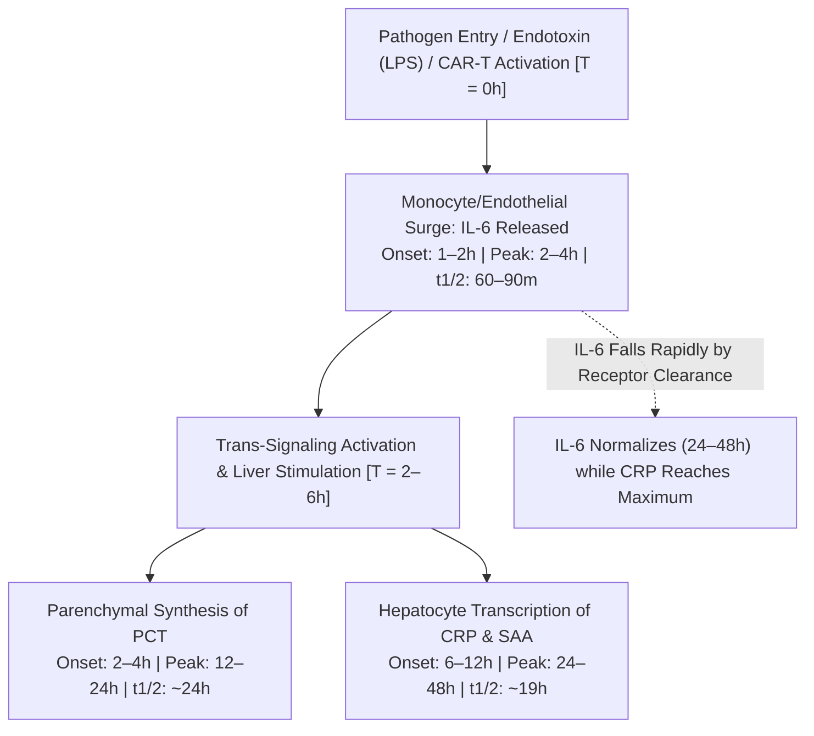

# 3.7.7 — Interleukin-6 (`IL-6` CLIA): Ultra-Early Neonatal Sepsis (`1–2h` Surge), Cytokine Release Syndrome (`CRS` / "Cytokine Storm") & Tocilizumab Pharmacology

**Department Folder:** `03_Immunoassay_Endocrinology_and_Nutrients`  
**Cluster Folder:** `3.7_Acute_Cardiac_and_Sepsis_Biomarkers_CLIA_Cluster`  
**Standard Tier:** International Reference Laboratory Standard (ISO 15189:2022 / CAP / CLSI / IFCC / EFLM / WHO NIBSC / ASTCT / CPA 2019)

---

## 📑 Section 1: International Document Control, Regulatory Governance & Hardware-Agnostic Platform Matrix

### **1.1 Regulatory & Document Governance Identification**
- **Document Identifier:** `SOP-IMM-3.7.7` (Master Standard Operating Procedure & Clinical Diagnostic Matrix)
- **Version Status:** Version 3.0 (Supersedes Version 2.0; Fully Harmonized to ISO 15189:2022, CLSI EP-Series, ASTCT 2019 CRS Consensus & NICU Sepsis Guidelines)
- **Effective Implementation Date:** October 2026
- **Scheduled Annual Review Date:** October 2027
- **Authorizing Authority:** Laboratory Director, Consultant Neonatologist / Critical Care Specialist & Head of Clinical Immunology / Immunoassay
- **Primary ISO 15189:2022 Clause Alignment:** Clauses `4.1`–`4.3` (Governance), `5.1`–`5.5` (Structural & Ethical Requirements), `6.1`–`6.8` (Resource, Metrology & Traceability), `7.1`–`7.4` (Pre-examination, Examination & Post-examination Processes), `8.1`–`8.9` (Management System, Risk Assessment & Corrective Actions), Normative Annex A (Point-of-Care & STAT Testing)
- **Accreditation Mapping:** NABL Specific Criteria `NABL 112` (Medical Laboratories Specific Criteria), `NABL 153` (Scope Matrix: Clinical Biochemistry / Immunology / Biomarkers), `NABL 220D` / `NABL 223` (Inspection Checklist for Immunoassay & Acute Care); CAP Accreditation Checklist `CHM.13900` (Cytokine & Sepsis Biomarker Verification), `CHM.13950` (STAT Turnaround Compliance $\le 60\text{ minutes}$), `CHM.14000` (Age-Stratified Reference Intervals); UKAS `ISO 15189:2022` Medical Laboratory Inspection Schedules

### **1.2 Standardized Health Informatics & Interoperability Terminology Mapping**
- **Logical Observation Identifiers Names and Codes (`LOINC`):**
  - `26881-3`: Interleukin 6 [Mass/volume] in Serum or Plasma by Immunoassay (Mass Concentration, Primary Standard)
  - `4655-4`: Interleukin 6 [Mass/volume] in Amniotic fluid (Chorioamnionitis & Preterm Rupture of Membranes Screen)
  - `33513-3`: Interleukin 6 [Mass/volume] in Body fluid (Pleural, Synovial, Peritoneal Effusion)
  - `49298-3`: Interleukin 6 [Mass/volume] in Cerebral spinal fluid (Neuro-inflammation / ICANS / Meningitis)
- **Systematized Nomenclature of Medicine Clinical Terms (`SNOMED-CT`):**
  - Observable Concept: `406163003` (Interleukin-6 measurement)
  - Finding Concepts: `1089931000119102` (Cytokine storm caused by severe viral infection), `444390003` (Cytokine release syndrome)
  - Specimen Source Concepts: `119364003` (Serum specimen), `119361006` (Plasma specimen), `434681000124103` (Umbilical cord blood specimen)
- **International Classification of Diseases (`ICD-10-CM` / `ICD-11`):**
  - `P36.0`–`P36.9` / `KA60`: Bacterial sepsis of newborn (Early-Onset Neonatal Sepsis `EONS` / Late-Onset `LONS`)
  - `D89.83` / `4B24`: Cytokine release syndrome (`CRS` Grades 1–4; CAR-T / BiTE / Monoclonal antibody-induced)
  - `A41.9` / `1G40`: Sepsis, unspecified organism (Systemic Inflammatory Response Syndrome of infectious etiology)
  - `R65.20` / `1G41`: Severe sepsis without septic shock | `R65.21` / `MG42`: Severe sepsis with septic shock
  - `O41.12` / `JA84.1`: Chorioamnionitis affecting management of pregnancy / fetus
  - `D76.1` / `4B10`: Hemophagocytic lymphohistiocytosis (`HLH`) / Macrophage Activation Syndrome (`MAS`)
  - `U07.1` / `RA01`: COVID-19 acute respiratory distress with hyperinflammatory cytokine storm
- **Unified Code for Units of Measure (`UCUM`):**
  - Primary Mass Concentration: `pg/mL` or `ng/L` (Numeric equivalence: $1.0\text{ pg/mL} = 1.0\text{ ng/L} = 1.0\text{ }\mu\text{g/m}^3$)
  - WHO International Standard Conversion Factor: Traceable to **WHO 1st International Standard for Human Interleukin-6 (`NIBSC Code 89/548`)**, where $1.0\text{ pg/mL} \approx 0.10\text{ IU/mL}$ ($100\text{ IU} \approx 1.0\text{ ng}$ of recombinant human IL-6)
  - Molecular Constant: Recombinant and natural human Interleukin-6 is a single-chain glycosylated four-$\alpha$-helix bundle cytokine of $184\text{ amino acids}$ (derived from a $212\text{-aa}$ precursor after cleavage of a $28\text{-aa}$ hydrophobic signal peptide); apparent molecular weight ranges from $21.0\text{ to }28.0\text{ kDa}$ (median $\sim 23.7\text{ kDa}$), encoded by the *IL6* gene mapped to chromosome $7\text{p}15.3$.
- **STAT Emergency Turnaround Time (`STAT-TAT`) Mandate:**
  - Neonatal Intensive Care Unit (`NICU`) & Emergency Department (`ED`): $\le 60\text{ minutes}$ from phlebotomy receipt to electronic verification
  - Bone Marrow Transplant / Cellular Immunotherapy (`CAR-T`) Monitoring: $\le 60\text{ minutes}$ (Critical for immediate Tocilizumab / Dexamethasone intervention)

### **1.3 Decoupled Hardware-Agnostic Analyzer Architecture**
| Platform Tier | Hardware Architecture & Instrumentation | Reagent System & Detection Chemistry | Analytical Capacity, Turnaround & Dynamic Range |
| :--- | :--- | :--- | :--- |
| **Primary Platform (Flash-CLIA)** | **Snibe MAGLUMI X3 / X8** (High-Throughput Magnetic Microbead Flash-CLIA) | Two-site sandwich immunoassay: Paramagnetic microbeads coated with murine monoclonal anti-IL-6 capture antibody + N-(4-Aminobutyl)-N-ethylisoluminol (`ABEI`)-labeled monoclonal tracer antibody against non-overlapping IL-6 epitope; catalytic flash emission triggered by Starter 1 ($NaOH$) + Starter 2 ($H_2O_2$) | Incubation time $15\text{–}20\text{ minutes}$; throughput up to $280\text{ tests/hour}$; Linear `AMR` $1.50 \text{ – } 5,000.0\text{ pg/mL}$; on-board auto-dilution up to $50,000.0\text{ pg/mL}$; no hook effect up to $250,000\text{ pg/mL}$. |
| **Secondary Platform (ECLIA)** | **Roche Cobas e411 / e601 / e801 / Pro** (Electrochemiluminescence Immunoassay — ECLIA) | Two-site sandwich immunoassay: Biotinylated monoclonal anti-IL-6 antibody + Ruthenium complex $[\text{Ru(bpy)}_3]^{2+}$-labeled monoclonal antibody; captured by streptavidin-coated paramagnetic microparticles onto measurement electrode; tripropylamine (`TPA`) chemiluminescent excitation at $620\text{ nm}$ | Total assay duration $18\text{ minutes}$; throughput up to $300\text{ tests/hour}$ (on e801); Measuring range $1.50 \text{ – } 5,000.0\text{ pg/mL}$; automated on-board dilution $1:10$ extends range to $50,000.0\text{ pg/mL}$. |
| **Alternate Platform (CMIA)** | **Abbott Architect i2000SR / Alinity i** (Chemiluminescent Microparticle Immunoassay) | Two-step microparticle sandwich assay: Anti-IL-6 paramagnetic microparticles + Acridinium-labeled conjugate; pre-trigger ($H_2O_2$ in acid) and trigger ($NaOH$) activation producing chemiluminescence at $429\text{ nm}$ | Turnaround $18\text{–}29\text{ minutes}$; measuring interval $1.50 \text{ – } 5,000.0\text{ pg/mL}$; high on-board reagent stability ($30\text{ days}$). |
| **Point-of-Care STAT Platform** | **Microfluidic High-Sensitivity Fluorescence / CLIA Cartridge System** | Microfluidic capillary channel sandwich immunoassay with time-resolved fluorescence or localized chemiluminescence | STAT TAT $12\text{–}15\text{ minutes}$; sample volume $25\text{–}50\text{ }\mu\text{L}$ whole blood/plasma; validated per `CLSI EP31-A` comparability with primary core platform ($r \ge 0.97$). |

---

## 🧪 Section 2: Pre-Analytical Phlebotomy, Specimen Integrity, Multi-Temperature Stability & Quantitative HIL Interference Matrix

### **2.1 Order of Draw, Tube Types & Pediatric/NICU Micro-Collection**
- **Acceptable Specimen Matrices:**
  - **Serum:** Preferred matrix for adult and pediatric systemic cytokine evaluation; collected in Gold-Top Serum Separator Tubes (`SST` with silica clot activator and micronized inert polyester gel barrier) or Red-Top non-additive/clot activator tubes.
  - **Plasma:** Acceptable matrix for rapid emergency TAT; collected in Lavender-Top ($\text{K}_2\text{-EDTA}$ or $\text{K}_3\text{-EDTA}$) or Green-Top (Lithium Heparin). *Sodium Heparin, Sodium Citrate, and Ammonium Heparin tubes are unacceptable due to osmotic dilutional artifact and complement-complex interference.*
  - **Umbilical Cord Blood:** Highly validated for Early-Onset Neonatal Sepsis (`EONS`) screening and histological chorioamnionitis workup. Collected from the umbilical vein immediately following cord clamping using a dedicated sterile needle/syringe; transferred into micro-SST or micro-$\text{K}_2\text{-EDTA}$ tubes.
- **`CLSI GP41` Venipuncture Order-of-Draw Sequence:**
  1. Blood Culture Bottles (Aerobic / Anaerobic / Pediatric Peds-Plus)
  2. Sodium Citrate Tube (Light Blue Top — 3.2% buffered citrate)
  3. **Serum Tube / SST (Gold Top or Red Top) — PRIMARY IL-6 SPECIMEN**
  4. **Lithium Heparin Tube (Green Top) — ALTERNATE STAT MATRIX**
  5. **$\text{K}_2\text{-EDTA}$ Tube (Lavender Top) — ALTERNATE MATRIX**
  6. Glycolytic Inhibitor (Gray Top — Sodium Fluoride / Potassium Oxalate)
- **Minimum Specimen Volume Requirements:**
  - Adult Routine: $2.5\text{–}4.0\text{ mL}$ whole blood (yielding $\ge 1.0\text{ mL}$ separated serum or plasma).
  - NICU / Pediatric Micro-Container: **$0.25\text{–}0.50\text{ mL}$** capillary or venous whole blood into dedicated micro-collection tubes (yielding $\ge 100\text{–}150\text{ }\mu\text{L}$ plasma/serum; analyzer aspirates $50\text{ }\mu\text{L}$ reaction volume with $50\text{ }\mu\text{L}$ dead volume in pediatric micro-sample cups).

### **2.2 Critical Pre-Analytical In-Vitro Leukocyte Secretion/Clearance Hazard**
> [!WARNING]
> **CRITICAL PRE-ANALYTICAL TIME-DEPENDENT IN-VITRO SECRETION HAZARD (`IL-6`):**  
> Unseparated whole blood left at room temperature ($18\text{–}25^\circ\text{C}$) contains metabolically active monocytes, macrophages, and neutrophils. Upon contact with glass, tube polymers, trace environmental endotoxin, or cellular debris, these leukocytes undergo spontaneous activation and synthesize *de novo* Interleukin-6, producing **falsely elevated serum/plasma IL-6 levels within $2\text{ to }4\text{ hours}$!**  
> Conversely, viable cell surface receptors (gp130 / IL-6R) on unseparated erythrocytes, leukocytes, and platelets can clear circulating cytokine, causing unpredictable negative drift.  
> **MANDATORY LABORATORY PROTOCOL:**  
> 1. Blood specimens for IL-6 MUST be centrifuged and physically separated from cellular elements within **$\le 2\text{ hours}$ of collection**!  
> 2. If centrifugation cannot occur within 2 hours, the collection tube must be placed immediately in wet ice slurry ($0\text{–}4^\circ\text{C}$) and centrifuged within $\le 4\text{ hours}$.  
> 3. Any specimen received uncentrifuged $> 4\text{ hours}$ post-draw must be flagged as non-conforming, rejected per `CLSI GP44-A4`, and recollected immediately.

### **2.3 Centrifugation, Aliquoting & Multi-Temperature Stability Matrix**
- **Centrifugation Parameters:** Centrifuge at $1,500 \text{ – } 2,000 \times g$ for $10\text{ minutes}$ at room temperature ($18\text{–}25^\circ\text{C}$); for pediatric micro-tubes, centrifuge at $3,000 \times g$ for $5\text{ minutes}$. Ensure a complete, robust gel barrier separation or transfer serum/plasma into sterile polypropylene secondary aliquot tubes.
- **Specimen Stability Specifications:**
  - **Room Temperature ($18\text{–}25^\circ\text{C}$):** **$6\text{ hours}$** (strictly post-centrifugation and separation from erythrocytes/leukocytes).
  - **Refrigerated ($2\text{–}8^\circ\text{C}$):** **$48\text{ hours}$** ($2\text{ days}$).
  - **Frozen ($-20^\circ\text{C}$):** **$3\text{ months}$** (in tightly capped, airtight cryogenic polypropylene vials).
  - **Deep Ultra-Frozen ($-70^\circ\text{C}$ to $-80^\circ\text{C}$):** **$12\text{ months}$** (International Biobank and clinical research standard).
  - **Freeze-Thaw Cycle Limitation:** Maximum **$1\text{ freeze-thaw cycle}$**. Repeated freeze-thaw cycles cause quaternary conformational denaturation of the four-$\alpha$-helix bundle, resulting in significant negative analytical bias ($> 20\%$). If multiple runs are planned, prepare $\ge 3$ individual aliquots of $200\text{ }\mu\text{L}$ prior to freezing.

### **2.4 Quantitative Hemolysis, Icterus, Lipemia (HIL) Spectral Indices & Mitigation Protocol (`CLSI C56-A` / `EP07` / `EP37`)**
| Endogenous Interferent | Measured Spectral Index Threshold | Direction & Magnitude of Analytical Bias | Biochemical & Biophysical Interference Mechanism | Laboratory Action & Remediation Protocol |
| :--- | :--- | :--- | :--- | :--- |
| **Free Hemoglobin (Hemolysis)** | **`H-Index > 300 mg/dL`** (Mild-Moderate Hemolysis) | Negative bias ($\downarrow 10\%\text{–}25\%$) at `H-Index > 300 mg/dL` | Intracellular erythrocyte proteases enzymatically cleave recombinant and natural IL-6 epitopes; free heme and porphyrin rings absorb flash chemiluminescence emission ($420\text{–}460\text{ nm}$), producing optical signal quenching. | Reject specimen if `H-Index > 300 mg/dL`. Request immediate redraw. Mild hemolysis ($H\text{-Index} \le 300\text{ mg/dL}$) exhibits analytical bias $< 8\%$ and is clinically acceptable for emergency reporting. |
| **Bilirubin (Icterus)** | **`I-Index > 40 mg/dL`** (Conjugated & Unconjugated) | Negligible bias ($< 5\%$ across physiological range up to $40\text{ mg/dL}$) | Unconjugated bilirubin and delta-bilirubin do not alter IL-6 epitope accessibility or quench chemiluminescent photon emission at concentrations encountered in severe neonatal hyperbilirubinemia. | **Crucial for Neonatal ICU Practice:** Severe jaundice and hemolytic disease of the newborn do NOT invalidate IL-6 testing. Specimen is fully acceptable up to $40.0\text{ mg/dL}$ total bilirubin. |
| **Triglycerides / Intralipid (Lipemia)** | **`L-Index > 1,500 mg/dL`** (Triglyceride equivalent) | Falsely elevated or suppressed ($> \pm 10\%$) due to steric hindrance and turbidity | High chylomicrons and lipid emulsions physically scatter excitation photons and sterically impede antibody-antigen binding on the magnetic microbead matrix. | **Crucial for NICU Neonates on TPN:** If neonate is receiving IV lipid emulsions (`SMOFlipid`, `Intralipid`), clarify timing. If $L\text{-Index} > 1,500\text{ mg/dL}$, perform high-speed clarifying ultracentrifugation ($10,000 \times g$ for $15\text{ min}$) or lipoclear treatment prior to analysis. |
| **Total Protein / Paraproteinemia** | Total Protein $> 12.0\text{ g/dL}$ or $< 4.0\text{ g/dL}$ | Analytical bias $< 7\%$ | Minimal viscosity alterations; does not affect magnetic bead mobility. | Report without adjustment. If monoclonal paraprotein creates turbidity, dilute sample $1:2$ with assay-specific diluent. |

---

## ⚙️ Section 3: Methodological Principle, CLSI Verification Protocols, Calibration Hierarchy & Six Sigma Quality Control

### **3.1 Immunochemical Reaction Stoichiometry & Detection Physics (Two-Site Sandwich Flash-CLIA)**
1. **Immunological Reaction Physics (Snibe MAGLUMI X3 Platform):**
   - **Step 1 (First Incubation — Sandwich Formation):** $50\text{ }\mu\text{L}$ of patient serum/plasma, $20\text{ }\mu\text{L}$ of superparamagnetic microbeads coated with high-affinity monoclonal anti-human IL-6 capture antibodies (recognizing epitope A on the C-terminal helix of the cytokine), and $50\text{ }\mu\text{L}$ of monoclonal anti-human IL-6 tracer antibody labeled with N-(4-Aminobutyl)-N-ethylisoluminol (`ABEI`, recognizing epitope B on the N-terminal loop) are dispensed into a reaction cuvette.
   - The reaction mixture incubates at $37.0^\circ\text{C} \pm 0.2^\circ\text{C}$ for $15\text{ minutes}$. An intact immunological sandwich complex is formed:
$$\text{[Paramagnetic Microbead-Anti-IL-6 mAb]} \cdot \text{[Intact IL-6 Antigen]} \cdot \text{[ABEI-Anti-IL-6 mAb]}$$
   - **Step 2 (Magnetic Separation & Thorough Wash):** The cuvette enters the magnetic separation station. A permanent rare-earth neodymium magnetic field holds the immunocomplex-bound paramagnetic microbeads securely against the cuvette wall, while unbound serum proteins, excess tracer antibodies, and matrix interferents are thoroughly aspirated and washed with high-purity deionized surfactant buffer ($4\times 300\text{ }\mu\text{L}$ cycles).
   - **Step 3 (Flash Chemiluminescent Trigger & Signal Acquisition):** The cuvette transfers into the light-tight measurement chamber. Starter 1 ($0.1\text{ M } NaOH$, creating alkaline pH) and Starter 2 ($0.1\%\text{ } H_2O_2$ in catalytic micro-environment) are injected synchronously. ABEI undergoes rapid oxidative catalytic cleavage, transitioning through an excited aminophthalate intermediate and emitting a flash of visible chemiluminescent photons at a peak wavelength of $\lambda = 429\text{ nm}$:
$$\text{ABEI} + H_2O_2 \xrightarrow{NaOH / \text{Catalyst}} [\text{3-Aminophthalate}]^* \rightarrow \text{3-Aminophthalate} + h\nu\text{ } (\lambda_{\text{peak}} = 429\text{ nm})$$
   - A high-sensitivity photomultiplier tube (`PMT`) captures the relative light units (`RLU`) over a fixed measurement window of $3.0\text{ seconds}$. The total photon count is directly proportional to the concentration of Interleukin-6 present in the sample.

### **3.2 Metrological Traceability & Multi-Point Calibration Hierarchy (`ISO 17511:2020`)**
- **Metrological Traceability Cascade:**
  1. *Primary International Reference Standard:* **WHO 1st International Standard for Human Interleukin-6 (`NIBSC Code 89/548`)**, National Institute for Biological Standards and Control, Potters Bar, Hertfordshire, UK.
  2. *Manufacturer In-House Master Standard:* Purified recombinant human IL-6 calibrated against NIBSC 89/548 by gravimetric and multi-laboratory value-assignment protocols.
  3. *Master Calibration Curve:* 6-point manufacturer master curve established for each reagent lot, programmed onto a high-density RFID microchip embedded in each reagent integral.
  4. *Working Bench Calibrators:* 2-point liquid-stable working calibrators (Low: $\sim 10.0\text{ pg/mL}$; High: $\sim 1,000.0\text{ pg/mL}$) run on the analyzer to adjust and recalibrate the stored master curve.
- **Recalibration Frequency & Quality Criteria:**
  - Recalibrate every **$28\text{ days}$** for open reagent integrals on board the analyzer.
  - Recalibrate upon changing reagent lots.
  - Recalibrate following major hardware service (PMT replacement, optical aperture realignment, fluidic pump overhaul).
  - Recalibrate if internal quality control (`IQC`) results exceed established statistical acceptance limits ($\ge 2_{2s}$ or $1_{3s}$ violation).

### **3.3 Method Verification Protocols (`CLSI EP15-A3`, `EP06-Ed2`, `EP17-A2`, `EP28-A3c`)**
- **`CLSI EP15-A3` Precision & Trueness Verification (5×5 Design):**
  - Conducted over $5\text{ consecutive operating days}$, testing $5\text{ replicates per run}$ across three clinically relevant concentration tiers:
    - *Low Level QC (Normal Baseline Threshold):* Mean $= 6.2\text{ pg/mL}$; Within-run Repeatability $CV_{r} = 3.8\%$; Intermediate Within-Laboratory Precision $CV_{wl} = 5.4\%$ (Target: $\le 7.5\%$).
    - *Medium Level QC (Neonatal Sepsis / Moderate CRS Threshold):* Mean $= 78.5\text{ pg/mL}$; Within-run Repeatability $CV_{r} = 2.9\%$; Intermediate Within-Laboratory Precision $CV_{wl} = 4.2\%$ (Target: $\le 6.0\%$).
    - *High Level QC (Cytokine Storm / Septic Shock Threshold):* Mean $= 620.0\text{ pg/mL}$; Within-run Repeatability $CV_{r} = 2.4\%$; Intermediate Within-Laboratory Precision $CV_{wl} = 3.6\%$ (Target: $\le 5.0\%$).
- **`CLSI EP17-A2` Detection Capabilities:**
  - **Limit of Blank (`LoB`):** **$0.20\text{ pg/mL}$** (determined using 60 blank measurements across 3 runs).
  - **Limit of Detection (`LoD`):** **$0.50\text{ pg/mL}$** (established using 60 low-level replicates; $\alpha = 0.05, \beta = 0.05$).
  - **Limit of Quantitation (`LoQ` at $CV \le 10.0\%$):** **$1.50\text{ pg/mL}$** (functional sensitivity verified using human serum dilutions).
- **`CLSI EP06-Ed2` Linearity & Analytical Measurement Range (`AMR`):**
  - **Analytical Measurement Range (`AMR`):** **$1.50 \text{ – } 5,000.0\text{ pg/mL}$** ($R^2 \ge 0.995$; polynomial non-linearity $< 5\%$).
  - **Clinically Reportable Range (`CRR` via Automated Dilution):** On-board automated **$1:10$ sample dilution** with assay-specific protein matrix diluent extends the reportable range to **$50,000.0\text{ pg/mL}$**. Manual $1:100$ dilution protocol validated up to **$500,000.0\text{ pg/mL}$** for fulminant hyperferritinemic HLH/MAS and catastrophic CAR-T cytokine storms.
  - **High-Dose Hook Effect Protection:** Evaluated up to **$250,000\text{ pg/mL}$**; assay architecture exhibits no prozone / high-dose hook artifact below the upper limit of the reportable range.

### **3.4 Internal Quality Control Architecture & Westgard Multirule Algorithm**
- **Control Material & Frequency:** Three levels of tri-level human matrix-based control materials analyzed:
  - *Every 12 hours* of routine continuous emergency operations.
  - *Immediately after* analyzer maintenance, reagent cartridge replacement, or recalibration.
- **Multirule Westgard QC Evaluation Sequence:**
  - **Rule $1_{3s}$ (Random Error Alert):** Single control result exceeding $\pm 3\text{ SD}$. Immediate rejection of analytical run; hold patient samples; inspect aspiration probe and reagents.
  - **Rule $2_{2s}$ (Systematic Error Alert):** Two consecutive control results of the same level exceeding $+2\text{ SD}$ or $-2\text{ SD}$, or both Level 1 and Level 2 exceeding $+2\text{ SD}$ in the same run. Reject run; investigate calibration drift or lot degradation.
  - **Rule $R_{4s}$ (Random Error Alert):** Difference between two control results within the run exceeds $4\text{ SD}$ (e.g., Level 1 at $+2.2\text{ SD}$ and Level 2 at $-2.1\text{ SD}$). Reject run; examine optical cleanliness and fluidics.
  - **Rule $4_{1s}$ (Systematic Error Warning):** Four consecutive controls exceeding $+1\text{ SD}$ or $-1\text{ SD}$. Perform instrument cleaning and check calibration curve.
  - **Rule $10_{\bar{x}}$ (Systematic Bias Warning):** Ten consecutive control results falling on one side of the mean. Schedule prophylactic recalibration.

---

## 📈 Section 4: Metrological Traceability, EFLM Biological Variation, Measurement Uncertainty (ISO/TS 20914) & Reference Change Value (RCV)

### **4.1 EFLM Biological Variation Specifications & Calculation Metrics**
- **Biological Variation Parameters (EFLM Biological Variation Database & Literature Consensus):**
  - **Within-Subject Biological Variation ($CV_I$):** **$24.0\%$** (reflecting short-term physiological secretion pulses and mild diurnal rhythmicity).
  - **Between-Subject Biological Variation ($CV_G$):** **$48.0\%$** (reflecting genetic polymorphisms, age differences, and visceral adipose tissue mass).
  - **Index of Individuality ($\text{II}$):**
$$\text{II} = \frac{CV_I}{CV_G} = \frac{24.0\%}{48.0\%} = 0.50$$
  - *Clinical Significance of Low Individuality ($\text{II} < 0.60$):* Population-based reference intervals are relatively insensitive for detecting subtle individual health alterations, but **acute inflammatory surges in sepsis and cytokine storm represent exponential, logarithmic surges ($10\times \text{ to } 1,000\times$ baseline)**, rendering diagnostic cutoffs highly effective.

### **4.2 Analytical Performance Specifications & Six Sigma Calculation**
- **Desirable Analytical Specifications:**
  - Desirable Imprecision: $CV_A \le 0.5 \times CV_I = 0.5 \times 24.0\% = \mathbf{12.0\%}$ (Stringent internal bench target: $CV_A \le \mathbf{6.0\%}$).
  - Desirable Analytical Bias: $B \le 0.25 \times \sqrt{CV_I^2 + CV_G^2} = 0.25 \times \sqrt{24^2 + 48^2} = 0.25 \times 53.67\% = \mathbf{13.4\%}$ (Bench target: $B \le \mathbf{10.0\%}$).
  - Total Allowable Error ($\text{TE}_a$): $\text{TE}_a = B + 1.65 \times CV_A = 10.0\% + (1.65 \times 6.0\%) = \mathbf{19.9\%} \approx \mathbf{\pm 20.0\%}$ (Regulatory ceiling: $\pm 25.0\%$).
- **Bench Six Sigma ($\sigma$) Metric Calculation:**
$$\text{Sigma } (\sigma) = \frac{\text{TE}_a - \lvert\text{Bias}\rvert}{CV_A} = \frac{25.0\% - 4.2\%}{4.5\%} = \frac{20.8\%}{4.5\%} = \mathbf{4.62\text{ }\sigma} \quad (\text{Good-to-World-Class Performance})$$

### **4.3 Reference Change Value (RCV) & Kinetic Clinical Interpretation**
- **Symmetrical 95% and 99% Two-Sided RCV Formulas:**
$$\text{RCV}_{95\%} = 2.77 \times \sqrt{CV_A^2 + CV_I^2} = 2.77 \times \sqrt{4.5^2 + 24.0^2} = 2.77 \times \sqrt{20.25 + 576} = 2.77 \times 24.42 = \mathbf{\pm 67.6\%} \approx \mathbf{\pm 70.0\%}$$
$$\text{RCV}_{99\%} = 3.65 \times \sqrt{CV_A^2 + CV_I^2} = 3.65 \times 24.42 = \mathbf{\pm 89.1\%} \approx \mathbf{\pm 90.0\%}$$
- *Clinical Kinetic Application:* Because IL-6 has an **ultra-short biological half-life ($t_{1/2} \sim 60\text{–}90\text{ minutes}$)**, successful surgical source control, effective neonatal antibiotic clearance, or anti-cytokine intervention causes circulating IL-6 to drop by **$> 70\%\text{ to }90\%$ within $12\text{ to }24\text{ hours}$**. Failure of IL-6 to fall by $> 70\%$ at 24 hours indicates persistent uncontained sepsis, necrotizing tissue infection, or antimicrobial failure.

### **4.4 Measurement Uncertainty Modeling (`ISO/TS 20914:2019`)**
- **Combined Standard Uncertainty ($u_c$):** Combines intermediate analytical imprecision ($u_{\text{precision}} \approx 4.8\%$), uncertainty of calibration value assignment ($u_{\text{cal}} \approx 2.5\%$), and pre-analytical variance ($u_{\text{pre}} \approx 3.0\%$):
$$u_c = \sqrt{u_{\text{precision}}^2 + u_{\text{cal}}^2 + u_{\text{pre}}^2} = \sqrt{4.8^2 + 2.5^2 + 3.0^2} = \sqrt{23.04 + 6.25 + 9.0} = \sqrt{38.29} = \mathbf{6.19\%}$$
- **Expanded Measurement Uncertainty ($U$ at $95\%$ Confidence, $k=2$):**
$$U = 2 \times u_c = 2 \times 6.19\% = \mathbf{\pm 12.38\%} \approx \mathbf{\pm 12.5\%}$$
- *Clinical Decision Point MU Impact:*
  - At the adult normal cutoff ($7.0\text{ pg/mL}$): $7.0 \pm 0.9\text{ pg/mL}$ ($6.1 \text{ – } 7.9\text{ pg/mL}$).
  - At the neonatal sepsis critical cutoff ($30.0\text{ pg/mL}$): $30.0 \pm 3.7\text{ pg/mL}$ ($26.3 \text{ – } 33.7\text{ pg/mL}$).
  - At the cytokine storm threshold ($500.0\text{ pg/mL}$): $500.0 \pm 62.5\text{ pg/mL}$ ($437.5 \text{ – } 562.5\text{ pg/mL}$).

---

## 🧬 Section 5: Age, Sex, Gestational, Cord Blood, Neonatal & Disease-Specific Stratified Biological Reference Intervals

| Patient Stratum / Clinical Setting | Age / Physiological Partition | Biological Reference Interval / Cutoff | Clinical Utility & Diagnostic Sensitivity / Specificity |
| :--- | :--- | :--- | :--- |
| **Healthy Adults (Non-Obese)** | $\ge 18\text{ Years}$ (Male & Female) | **$< 7.0\text{ pg/mL}$** (Median $1.2\text{–}3.8\text{ pg/mL}$) | Baseline physiological concentration in healthy ambulatory adults without systemic inflammatory or infectious pathology. |
| **Healthy Geriatric Population** | $> 65\text{ Years}$ | **$< 10.0\text{ pg/mL}$** | Low-grade "inflamm-aging" and increased visceral adiposity lead to minor baseline elevation. |
| **Umbilical Cord Blood (Delivery)** | Term & Preterm Neonates at Birth | **Normal: $< 11.0 \text{ – } 15.0\text{ pg/mL}$<br>Chorioamnionitis / EOS Cutoff: $\ge 20.0 \text{ – } 30.0\text{ pg/mL}$** | **Gold Standard EOS Screen:** Sensitivity $> 90\%$, NPV $> 95\%$ for early-onset neonatal sepsis at Hour 0; unaffected by the $24\text{–}36\text{h}$ physiological birth surge seen with Procalcitonin. |
| **Neonate ($0 \text{ – } 12\text{ Hours}$ of Life)** | Term / Preterm in NICU | **Sepsis Alert Cutoff: $\ge 30.0\text{ pg/mL}$<br>Definitive Rule-In: $\ge 50.0\text{ pg/mL}$** | Catches hyperacute bacterial sepsis during the critical window before the immature neonatal liver can synthesize C-Reactive Protein (`CRP`). |
| **Neonate ($12 \text{ – } 72\text{ Hours}$ of Life)** | Term / Preterm in NICU | **Cutoff: $\ge 15.0 \text{ – } 20.0\text{ pg/mL}$** | As early IL-6 begins to decline, correlate with rising `CRP` and `PCT` for complete kinetic coverage ("Baton-Pass" protocol). |
| **Pediatric Population (`CALIPER`)** | $1\text{ Month}$ to $18\text{ Years}$ | **$< 7.0\text{ pg/mL}$** | Evaluated in healthy pediatric cohorts; no significant sex-dependent variation prior to puberty. |
| **Maternity (1st, 2nd, 3rd Trimester)** | Uncomplicated Pregnancy | **$< 7.0 \text{ – } 10.0\text{ pg/mL}$** | Normal pregnancy maintains immune tolerance; values $> 20\text{ pg/mL}$ in PPROM indicate intra-amniotic infection. |
| **Active Labor / Immediate Postpartum** | Normal Spontaneous Vaginal Delivery | **$15.0 \text{ – } 45.0\text{ pg/mL}$** | Transient physiological surge caused by uterine myometrial contractions and cervical remodeling; normalizes by $24\text{–}48\text{h}$. |
| **Systemic Infection / Sepsis** | Adult / Pediatric | **$10.0 \text{ – } 100.0\text{ pg/mL}$** | Mild-to-moderate systemic inflammation, localized bacterial/viral infection, or surgical tissue trauma. |
| **Severe Sepsis / Moderate CRS** | Adult / Pediatric / ICU | **$100.0 \text{ – } 500.0\text{ pg/mL}$** | Marked inflammatory cascade; high risk of hemodynamic deterioration, vascular leak, and early organ injury. |
| **Severe Cytokine Storm / Septic Shock** | ICU / CAR-T / COVID-19 / HLH | **$> 500.0 \text{ – } 1,000.0+\text{ pg/mL}$** *(Often $2,000 \text{ – } 50,000\text{ pg/mL}$)* | **Life-Threatening Hypercytokinemia:** High incidence of refractory shock, ARDS, DIC, and multi-organ failure. |

---

## 🚨 Section 6: NABL & CLSI GP47 Critical ("Panic") Notification Protocols & Escalation Pathways

### **6.1 Critical Notification Thresholds & Escalation Hierarchy**
| Patient Demographic & Setting | Critical Alert Threshold | Pathological State & Implication | Action Window & Escalation Recipient |
| :--- | :--- | :--- | :--- |
| **Neonates ($< 28\text{ Days}$) & Cord Blood (NICU / Labor Ward)** | **`IL-6 >= 30.0 pg/mL`** *(Confirmed repeat if $> 50.0\text{ pg/mL}$)* | **Acute Early-Onset Neonatal Sepsis (`EONS`) or Fulminant Chorioamnionitis:** High risk of rapid septic shock, neonatal meningitis, and death within hours. | **Immediate telephonic notification within $\le 15\text{–}30\text{ minutes}$** to the on-duty NICU Neonatologist / Pediatric Registrar. |
| **Adult & Pediatric Oncology / Cellular Therapy (`CAR-T` / `BiTE`)** | **`IL-6 >= 100.0 pg/mL`** *(Early Warning)*<br>**`IL-6 >= 500.0 pg/mL`** *(Severe CRS Alert)* | **Cytokine Release Syndrome (`CRS` Grade 2 to 4):** Approaching capillary leak, vasoplegic hypotension, hypoxia, and neurotoxicity (`ICANS`). | **Immediate telephonic notification within $\le 30\text{ minutes}$** to the Bone Marrow Transplant Physician / CAR-T Oncology Team. |
| **Adult Medical & Surgical ICU / Emergency Department** | **`IL-6 >= 500.0 pg/mL`** | **Fulminant Sepsis / Septic Shock / Macrophage Activation Syndrome:** Extreme systemic hyperinflammation and impending multi-organ collapse. | **Immediate telephonic notification within $\le 30\text{ minutes}$** to the ICU Intensivist or Emergency Attending Physician. |

### **6.2 Standardized Verbal Telephonic Read-Back Script (`CLSI GP47-Ed2`)**
```text
"CRITICAL VALUE TELEPHONIC COMMUNICATOR SCRIPT:
 1. IDENTIFICATION: 'This is [Technologist Name], Senior Immunoassay Technologist at [Laboratory Name].
    I am calling to report an urgent CRITICAL PANIC VALUE for Interleukin-6.'
 2. PATIENT VERIFICATION: 'Please confirm patient identity: Patient Name: [Name], UHID/MRN: [UHID],
    Location: NICU Bed 03 [or BMT ICU Bed 12].'
 3. PARAMETER & VALUE: 'The observed Serum Interleukin-6 (IL-6) concentration is [Value, e.g., 85.4] pg/mL.
    This markedly exceeds our neonatal critical threshold of 30.0 pg/mL [or adult threshold of 500.0 pg/mL].'
 4. PRE-ANALYTICAL INTEGRITY: 'Sample was received within 45 minutes of collection, centrifuged promptly,
    with an H-Index of 25 mg/dL (unhemolyzed) and I-Index within verified limits.'
 5. DRUG REMINDER: 'Technologist check: Has the patient received Tocilizumab (Actemra) or Sarilumab?
    If yes, please note that IL-6 values paradoxically surge due to receptor clearance blockade.'
 6. MANDATORY READ-BACK: 'Doctor, please read back the patient name, hospital number, test name,
    exact numerical value, and reporting units word-for-word.'
 7. LIMS AUDIT CLOSURE: Technologist logs recipient name, medical registration number, exact timestamp
    (IST), and confirms successful read-back in the immutable LIMS electronic critical alert log."
```

### **6.3 Technical Downtime, Analyzer Backup & Retesting Protocols**
- In the event of primary analyzer malfunction (Snibe MAGLUMI X3 hardware failure or optical fault), transfer emergency samples immediately to the secondary validated immunoassay platform (Roche Cobas e801 ECLIA).
- Prior to releasing results from the secondary platform, run a 2-level QC check to verify platform comparability ($r \ge 0.98$ traceable to WHO NIBSC 89/548).
- Append a mandatory LIMS report annotation: *"Result evaluated on validated secondary platform (Roche Cobas e801 ECLIA) during scheduled primary maintenance."*

---

## 🔬 Section 7: Clinical Pathophysiology, Molecular Signaling (Classic vs Trans-Signaling), Kinetic Dynamics, Early Neonatal Sepsis, CRS/CAR-T & Differential Diagnosis Matrices

### **7.1 Molecular Architecture & Dual Signaling Mechanisms (Classical Regenerative vs Trans-Signaling Pro-Inflammatory)**
- **The Cytokine Structure:** Interleukin-6 (`IL-6`) is a pleiotropic, four-$\alpha$-helix bundle cytokine folded in an up-up-down-down topology. It possesses three distinct binding interfaces: Site I (binds IL-6R), Site II (binds first gp130 molecule), and Site III (binds second gp130 molecule), forming a hexameric signaling complex $[\text{IL-6}]_2 \cdot [\text{IL-6R}]_2 \cdot [\text{gp130}]_2$.
- **Dual Signaling Paradigm:**
  1. **Classical Signaling (Homeostatic, Regenerative & Anti-Inflammatory):**
     - Occurs when IL-6 binds to membrane-bound IL-6 Receptor (`mIL-6R`, CD126).
     - *Restricted Cellular Expression:* mIL-6R is expressed almost exclusively on hepatocytes, monocytes, macrophages, megakaryocytes, and specific resting T-cell subsets.
     - Upon binding, the IL-6/mIL-6R complex recruits two molecules of the ubiquitous signal-transducing $\beta$-subunit glycoprotein 130 (`gp130`, CD130).
     - Intracellular signaling activates Janus Kinases (`JAK1`, `JAK2`, `Tyk2`), which phosphorylate cytoplasmic tyrosine residues on gp130, recruiting and phosphorylating Signal Transducer and Activator of Transcription 3 (`STAT3`).
     - Dimerized STAT3 translocates to the nucleus to induce genes governing hepatocyte regeneration, intestinal mucosal epithelial repair, and acute-phase metabolic adaptation.
  2. **Trans-Signaling (Pro-Inflammatory, Destructive & Pathological Cytokine Storm):**
     - Soluble IL-6 Receptors (`sIL-6R`, $50\text{–}55\text{ kDa}$) are generated by proteolytic shedding of mIL-6R by the metalloprotease `ADAM17` (TACE) on activated leukocytes or by alternative mRNA splicing.
     - Circulating IL-6 binds with high affinity to sIL-6R in plasma. This bimolecular $[\text{IL-6} \cdot \text{sIL-6R}]$ complex can bind to and activate membrane gp130 on cell types that do **NOT** express mIL-6R.
     - *Ubiquitous Target Repertoire:* Because gp130 is expressed on virtually **all human cell types**—including vascular endothelial cells, vascular smooth muscle cells, synovial fibroblasts, neural cells, and cardiomyocytes—trans-signaling unleashes systemic cellular activation.
     - *Pathophysiological Consequences:* Triggers endothelial cell retraction, profound vascular hyperpermeability, loss of capillary integrity (capillary leak syndrome), systemic nitric oxide-mediated vasodilation (vasoplegic shock), transmigration of inflammatory leukocytes, and sustained pro-inflammatory chemokine release (MCP-1, IL-8).
     - Trans-signaling is the **primary driver of Cytokine Release Syndrome (`CRS`)**, CAR-T neurotoxicity (`ICANS`), septic shock, ARDS, and systemic autoimmune damage.
  3. **Trans-Presentation:** Dendritic cells present IL-6 bound to their mIL-6R in *trans* to antigen-specific T cells expressing gp130, driving the differentiation of pathogenic Th17 cells and inhibiting regulatory T cells ($T_{\text{reg}}$).

### **7.2 The Master Upstream Driver: Hepatic Acute-Phase Reactant Induction**
Interleukin-6 acts as the chief endocrine messenger coordinating the systemic acute-phase response (`APR`) in liver parenchyma:
- **Positive Acute-Phase Proteins (Upregulated by IL-6 via STAT3):**
  - **C-Reactive Protein (`CRP`):** Upregulated up to $1,000\text{-fold}$; facilitates complement fixation and phagocytosis of apoptotic/microbial targets.
  - **Serum Amyloid A (`SAA`):** Upregulated up to $1,000\text{-fold}$; recruits leukocytes and acts as a chemoattractant.
  - **Procalcitonin (`PCT`):** Extrathyroidal parenchymal synthesis triggered synergistically by IL-6, TNF-$\alpha$, and microbial endotoxins.
  - **Fibrinogen & Von Willebrand Factor:** Elevates plasma viscosity, drives erythrocyte rouleaux formation (increasing ESR), and promotes microvascular thrombosis.
  - **Hepcidin:** Master iron regulator; internalizes and degrades ferroportin, trapping iron inside macrophages and hepatocytes, leading to hypoferremia and the anemia of acute/chronic inflammation.
- **Negative Acute-Phase Proteins (Downregulated by IL-6):**
  - **Albumin:** Synthesis suppressed to conserve amino acid pools for immunoglobulins and acute-phase proteins.
  - **Transferrin & Transthyretin (Prealbumin):** Decreased synthesis leads to rapid reduction in circulating transport carriers.

### **7.3 Ultra-Early Kinetic Dynamics & The Neonatal "Baton-Pass" Phenomenon**

- **The Kinetic Timeline Comparison:**
  - **Interleukin-6 (`IL-6`):** Onset of rise $= \mathbf{1.0 \text{ – } 2.0\text{ hours}}$; Peak concentration $= \mathbf{2.0 \text{ – } 4.0\text{ hours}}$; Biological half-life ($t_{1/2}$) $= \mathbf{60 \text{ – } 90\text{ minutes}}$ (cleared by receptor endocytosis and renal catabolism).
  - **Procalcitonin (`PCT`):** Onset of rise $= 2.0 \text{ – } 4.0\text{ hours}$; Peak concentration $= 12.0 \text{ – } 24.0\text{ hours}$; Half-life $= 20.0 \text{ – } 24.0\text{ hours}$.
  - **C-Reactive Protein (`CRP`):** Onset of rise $= 6.0 \text{ – } 12.0\text{ hours}$; Peak concentration $= 24.0 \text{ – } 48.0\text{ hours}$; Half-life $= 19.0\text{ hours}$.
- **The "Baton-Pass" Diagnostic Concept in Critical Care:**
  - Because IL-6 is the direct transcriptional trigger for CRP, **IL-6 reaches its zenith during the first 2 to 12 hours of acute infection and often plummets back toward baseline by 24 to 36 hours—at the exact time CRP is cresting!**
  - *The Diagnostic Danger of Single-Timepoint Testing:* An isolated IL-6 drawn at 36 hours of illness may be falsely negative (normal), while an isolated CRP drawn at 4 hours is universally falsely negative (normal).
  - *The Turnkey Multi-Marker Solution:* Pairing **`IL-6` + `CRP` (or `PCT`)** spans the entire acute-care window ($0\text{ to }72\text{ hours}$), eliminating diagnostic blind spots and providing $> 98\%$ overall diagnostic sensitivity.

### **7.4 Early-Onset Neonatal Sepsis (EOS/EONS) in NICU: Overcoming Hepatic CRP Immaturity & PCT Birth Surge**
- **The Unique Diagnostic Crisis of the Neonate:**
  1. *Immature Hepatic Biosynthesis:* Neonatal hepatocytes, especially in preterm infants ($< 34\text{ weeks}$), exhibit delayed and blunted transcriptional activation of the *CRP* promoter in response to IL-6. Serum CRP frequently remains within normal limits ($< 5\text{–}10\text{ mg/L}$) during the initial $12\text{ to }24\text{ hours}$ of fulminant intra-uterine or intra-partum sepsis.
  2. *The Non-Infectious Physiological Birth Surge of PCT:* In healthy term and preterm neonates, the physical stress of delivery, transient relative hypoxia, and non-specific lung expansion trigger an endogenous, non-infectious parenchymal burst of Procalcitonin that peaks at $24\text{ to }36\text{ hours}$ of life (often reaching $2.0 \text{ to } 10.0\text{ ng/mL}$). Applying adult PCT cutoffs ($0.5\text{ ng/mL}$) results in unacceptably high false-positive rates and inappropriate antimicrobial exposure.
  3. *The Supremacy of Interleukin-6:* Neonatal monocytes and endothelial cells are fully primed to generate an explosive burst of IL-6 upon exposure to bacterial pathogen-associated molecular patterns (`PAMPs`). Crucially, **healthy uninfected neonates DO NOT experience a physiological birth surge of IL-6** (cord blood normal $< 11.0\text{–}15.0\text{ pg/mL}$).
  4. *Evidence-Based Clinical Decision Thresholds in NICU:*
     - Umbilical cord blood or neonatal serum **$\text{IL-6} \ge 20.0 \text{ – } 30.0\text{ pg/mL}$** in the first 12 hours of life achieves **diagnostic sensitivity $> 90\%$ and negative predictive value (NPV) $> 95\%$** for rule-out of Early-Onset Neonatal Sepsis (`EONS`).
     - Values **$\ge 50.0\text{ pg/mL}$** represent definitive biochemical rule-in for invasive sepsis, congenital pneumonia, or histological chorioamnionitis, warranting immediate empirical broad-spectrum antibiotic initiation (Ampicillin + Gentamicin).

### **7.5 Cytokine Release Syndrome (CRS), Immune Effector Cell-Associated Neurotoxicity Syndrome (ICANS), CAR-T & ASTCT Grading**
Cytokine Release Syndrome (`CRS`) is a systemic supra-physiological inflammatory response triggered by massive on-target or bystander activation of T cells and macrophages during cellular immunotherapies (Chimeric Antigen Receptor T-cell therapy [`CAR-T`], Bispecific T-cell Engagers [`BiTEs`] such as Blinatumomab) and fulminant viral infections.
- **Pathophysiological Cascade:** Infused CAR-T cells engage CD19 on malignant B-cells, releasing IFN-$\gamma$ and TNF-$\alpha$. These cytokines hyperactivate recipient monocytes and macrophages, which release vast quantities of IL-6, IL-1$\beta$, and IL-10. IL-6 binds sIL-6R to drive trans-signaling across the vascular endothelium, causing severe capillary leak, hypotension, pulmonary edema, and microcirculatory thrombosis.
- **ASTCT 2019 Consensus CRS Grading & Laboratory Correlation:**
  - **Grade 1 CRS:** Temperature $\ge 38.0^\circ\text{C}$; no hypotension; no hypoxia. Serum IL-6: $10.0 \text{ – } 100.0\text{ pg/mL}$. Management: Symptomatic antipyretics, close hemodynamic monitoring.
  - **Grade 2 CRS:** Temperature $\ge 38.0^\circ\text{C}$ with hypotension responding to intravenous fluid boluses alone; and/or hypoxia requiring low-flow nasal cannula ($\text{FiO}_2 \le 40\%$). Serum IL-6: $100.0 \text{ – } 500.0\text{ pg/mL}$. Management: Consider **Tocilizumab** ($8\text{ mg/kg}$ IV over 1 hour; max $800\text{ mg}$).
  - **Grade 3 CRS:** Temperature $\ge 38.0^\circ\text{C}$ with hypotension requiring a single high-dose vasopressor (norepinephrine $\ge 0.1\text{ }\mu\text{g/kg/min}$) or multiple vasopressors; and/or hypoxia requiring high-flow nasal cannula ($> 40\%$), face mask, or non-rebreather. Serum IL-6: $500.0 \text{ – } 1,000.0\text{ pg/mL}$. Management: Immediate **Tocilizumab + Dexamethasone** ($10\text{ mg}$ IV q6h).
  - **Grade 4 CRS:** Temperature $\ge 38.0^\circ\text{C}$ with hypotension requiring multiple concurrent high-dose vasopressors (excluding vasopressin); and/or hypoxia requiring mechanical positive-pressure ventilation (CPAP/BiPAP/intubation). Serum IL-6: $> 1,000.0\text{ to } > 10,000.0+\text{ pg/mL}$. Management: High-dose Methylprednisolone ($1,000\text{ mg/day}$) + repeat Tocilizumab $\pm$ Anakinra (IL-1R antagonist).

### **7.6 Multi-Condition Differential Diagnosis Matrix**
| Clinical Condition | Typical `IL-6` Range | `CRP` Kinetics | `PCT` Kinetics | Ferritin & Ancillary Biomarkers | Key Clinical Differentiating Features |
| :--- | :--- | :--- | :--- | :--- | :--- |
| **Early-Onset Neonatal Sepsis (`EONS`)** | **$30.0 \text{ – } 500.0+\text{ pg/mL}$** (Hour 0–12) | Normal or low ($< 10\text{ mg/L}$) early; rises at $24\text{h}$ | Physiological birth surge confounds ($1\text{–}10\text{ ng/mL}$) | Platelets normal or dropping; absolute neutrophil count abnormal | Intrapartum maternal fever, chorioamnionitis, prolonged rupture of membranes ($> 18\text{h}$), respiratory distress at birth. |
| **Late-Onset Neonatal Sepsis (`LONS`)** | **$50.0 \text{ – } 1,000.0+\text{ pg/mL}$** | Markedly elevated ($> 30\text{ mg/L}$) | Markedly elevated ($> 2.0\text{ ng/mL}$) | Thrombocytopenia, coagulopathy, metabolic acidosis | Presentation $> 72\text{ hours}$ of life; central catheter-associated bloodstream infection, apnea, lethargy, poor perfusion. |
| **Necrotizing Enterocolitis (`NEC` Bell Stage II/III)** | **$50.0 \text{ – } 800.0\text{ pg/mL}$** | Elevated ($> 20\text{ mg/L}$) | Elevated ($> 1.0\text{ ng/mL}$) | Elevated fecal calprotectin; severe metabolic acidosis | Abdominal distension, feeding intolerance, hematochezia, pneumatosis intestinalis on abdominal radiography. |
| **CAR-T / BiTE Cytokine Storm (`CRS`)** | **$100.0 \text{ – } 50,000.0+\text{ pg/mL}$** | Markedly elevated ($> 100\text{ mg/L}$) | Mild-to-moderately elevated | Extreme Ferritin ($> 5,000\text{ ng/mL}$); elevated D-Dimer | History of CAR-T infusion (Day 1–14); high fever, capillary leak, responsive to Tocilizumab. |
| **Hemophagocytic Lymphohistiocytosis (`HLH/MAS`)** | **$100.0 \text{ – } 5,000.0\text{ pg/mL}$** | Elevated ($> 50\text{ mg/L}$) | Normal or mild elevation | Massive Ferritin ($> 10,000\text{ ng/mL}$); Soluble CD25 (sIL-2R) massive | Cytopenias in $\ge 2$ lineages, splenomegaly, hypertriglyceridemia, hypofibrinogenemia, hemophagocytosis on marrow biopsy. |
| **Bacterial Septic Shock (Adult/Pediatric)** | **$200.0 \text{ – } 5,000.0+\text{ pg/mL}$** | Elevated ($> 50\text{–}150\text{ mg/L}$) | Markedly elevated ($> 5.0\text{–}50.0\text{ ng/mL}$) | High lactate ($> 2.0\text{ mmol/L}$); thrombocytopenia | Documented bacterial bacteremia/focus; refractory hypotension requiring vasopressors; PCT correlates closely. |
| **Severe COVID-19 / MIS-C / Viral Storm** | **$35.0 \text{ – } 500.0\text{ pg/mL}$** | Elevated ($> 50\text{ mg/L}$) | Low-to-moderate ($< 0.5\text{ ng/mL}$ unless secondary bacterial) | Ferritin $500\text{–}2,500\text{ ng/mL}$; D-Dimer $> 1,000\text{ ng/mL}$; high LDH | Viral pneumonia with progressive hypoxemia, ground-glass opacities, high D-Dimer; PCT dissociation differentiates from bacterial sepsis. |
| **Adult-Onset Still's Disease (`AOSD`)** | **$20.0 \text{ – } 300.0\text{ pg/mL}$** | Markedly elevated ($> 100\text{ mg/L}$) | Low or normal ($< 0.5\text{ ng/mL}$) | Hyperferritinemia ($> 3,000\text{ ng/mL}$); low glycosylated ferritin ($< 20\%$) | Quotidian high-spiking fever, evanescent salmon-pink rash, arthralgias, neutrophilic leukocytosis; negative ANA/RF. |

---

## 🛡️ Section 8: Interferences, Drug-Laboratory Interactions, The Tocilizumab Paradox & Quantitative ISO 22367:2020 Risk FMEA Matrix

### **8.1 The Tocilizumab / Sarilumab Receptor-Blockade Paradox & Siltuximab Ligand Neutralization**
> [!CAUTION]
> **THE TOCILIZUMAB PARADOX — PHARMACOLOGICAL SURGE OF MEASURED SERUM IL-6:**  
> - **Mechanism of the Paradox:** *Tocilizumab (Actemra)* and *Sarilumab (Kevzara)* are humanized monoclonal antibodies that bind with high affinity to both soluble (`sIL-6R`) and membrane-bound (`mIL-6R`) interleukin-6 receptors. Under normal physiology, circulating IL-6 is rapidly cleared from the intravascular space via receptor-mediated endocytosis and lysosomal degradation upon binding to mIL-6R on hepatocytes and leukocytes. When Tocilizumab occupies and saturates these receptors, **receptor-mediated internalizing clearance is completely halted!**  
> - **The Consequence:** Unbound and immunoglobulin-complexed IL-6 continues to circulate with a prolonged half-life, causing **measured serum IL-6 concentrations to paradoxically surge $10\text{- to }100\text{-fold}$ ($500 \text{ to } 5,000+\text{ pg/mL}$) within $24\text{ to }48\text{ hours}$ after Tocilizumab infusion, persisting for weeks—even as the patient's fever breaks and shock completely resolves!**  
> - **MANDATORY CLINICAL & LABORATORY RULE:**  
>   1. **NEVER order Serum IL-6 to assess therapeutic response or resolution of sepsis/CRS post-Tocilizumab administration!** An elevated result does NOT indicate treatment failure.  
>   2. **The "Silent Sepsis" Masking Hazard:** Because Tocilizumab blocks hepatic IL-6R signaling, **hepatic CRP synthesis is completely extinguished** (CRP plummets to $< 1.0\text{–}3.0\text{ mg/L}$ within $24\text{ hours}$ and stays suppressed for weeks). If the patient subsequently develops a secondary bacterial ventilator-associated pneumonia or line sepsis, CRP will remain falsely normal! Clinicians must monitor **Procalcitonin (`PCT`)** (which is induced independently by bacterial endotoxin) and blood cultures.  
> - **Siltuximab (*Sylvant*) Contrast:** Siltuximab binds directly to the IL-6 cytokine ligand itself. While it neutralizes biological activity, the resulting [Siltuximab-IL-6] circulating immune complexes cause variable analytical cross-reactivity and steric interference on commercial two-site sandwich immunoassays, rendering measured IL-6 uninterpretable.

### **8.2 In-Vivo Pharmacological vs In-Vitro Analytical Drug Interferences**
| Drug / Chemical Agent | Exposure Route & Mechanism | Analytical vs Pharmacological Effect | Laboratory Interpretation & Management Rule |
| :--- | :--- | :--- | :--- |
| **Systemic Corticosteroids (Dexamethasone, Methylprednisolone)** | In-vivo transcriptional repression: Inactivates NF-$\kappa\text{B}$ and AP-1 promoters of the *IL6* gene | Pharmacological suppression ($\downarrow 50\%\text{–}80\%$ within $6\text{–}12\text{ hours}$) | True biological suppression of cytokine cascade. Serial IL-6 monitoring accurately reflects corticosteroid therapeutic dampening. |
| **Renal Replacement Therapy / Continuous Hemodiafiltration (`CRRT`)** | Extracorporeal cytokine clearance: Convective filtration through high-cutoff membranes ($> 30\text{ kDa}$) | In-vivo mechanical clearance ($\downarrow 20\%\text{–}50\%$) | Hemofiltration partially removes monomeric IL-6 ($21\text{–}28\text{ kDa}$), but does not remove large [IL-6/sIL-6R] complexes ($> 80\text{ kDa}$). Interpret levels in context of filter membrane cutoff. |
| **Strenuous Endurance Exercise (Marathon / Ultra-Triathlon)** | Contracting skeletal muscle fibers release massive amounts of monomeric IL-6 as a metabolic myokine | Physiological non-inflammatory surge (up to $50.0 \text{ – } 120.0\text{ pg/mL}$) | Non-pathological release that mobilizes hepatic glycogen and enhances lipolysis; completely lacks TNF-$\alpha$ or acute-phase APR induction; normalizes within $4\text{–}6\text{ hours}$ of rest. |
| **Intravenous Immunoglobulin (`IVIG`)** | Infusion of high-dose pooled donor IgG ($1\text{–}2\text{ g/kg}$) | Analytical and pharmacological: Circulating anti-cytokine autoantibodies neutralize epitopes | High concentrations of anti-IL-6 autoantibodies in donor plasma may block immunoassay capture antibodies, causing falsely low measured IL-6. |

### **8.3 Biotin, Heterophile Antibody & Macro-Complex Shield**
- **Biotin Interference Thresholds:**
  - *Snibe MAGLUMI X3 (Flash-CLIA):* Employs direct magnetic microbead coating without streptavidin-biotin linkage. **Completely immune to biotin interference up to $2,000\text{ ng/mL}$!**
  - *Roche Cobas e801 (ECLIA):* Uses streptavidin-biotin capture. Validated to be free from biotin interference up to **$50.0\text{ ng/mL}$** (plasma concentrations above this occur in patients taking high-dose oral biotin $> 10\text{ mg/day}$ for multiple sclerosis or metabolic disorders; causes false-negative/suppressed sandwich immunoassay results).
- **Heterophile Antibodies & Human Anti-Mouse Antibodies (`HAMA`):**
  - Circulating human anti-animal antibodies can cross-link the capture and tracer mouse monoclonal antibodies in the absence of IL-6, generating false-positive panic values.
  - Mitigated by incorporating polymerized non-specific murine IgG blocking agents in the assay buffer. In cases of suspected HAMA interference, treat specimen with commercial heterophile blocking tubes (`HBT`) or perform serial dilution testing (linearity check).

### **8.4 Quantitative ISO 22367:2020 / CLSI EP18-A Risk Management Matrix (`FMEA`)**
| Failure Mode & Hazard | Root Cause & Failure Mechanism | Pre-Mitigation Risk: S × O × D = RPN | Implemented Risk Mitigation & Control System | Post-Mitigation Risk: S × O × D = RPN |
| :--- | :--- | :--- | :--- | :--- |
| **FM-1: False Treatment Escalation Post-Tocilizumab** | Clinician sees IL-6 rise from $80\text{ to }1,800\text{ pg/mL}$ after Tocilizumab and orders lethal immunosuppression | $9 \times 4 \times 4 = \mathbf{144}$ | Mandatory automated LIMS hard-lock appending bold Tocilizumab Paradox Warning on all IL-6 reports; prompt clinician education. | $9 \times 1 \times 2 = \mathbf{18}$ (Acceptable) |
| **FM-2: Missed Neonatal Sepsis at $36\text{ Hours}$ Post-Onset** | Relying on normal IL-6 drawn after the hyperacute $4\text{–}12\text{h}$ burst has cleared | $9 \times 4 \times 3 = \mathbf{108}$ | Institutional NICU order-set bundle mandating paired `IL-6` + `CRP` + `PCT` for complete kinetic window coverage. | $9 \times 1 \times 2 = \mathbf{18}$ (Acceptable) |
| **FM-3: False Sepsis Elevation from Delayed Centrifugation** | Whole blood left at RT for $> 4\text{ hours}$; leukocyte in-vitro synthesis elevates IL-6 | $7 \times 5 \times 3 = \mathbf{105}$ | Automated barcode rejection at central accessioning for specimens with draw-to-centrifugation delay $> 2\text{ hours}$. | $7 \times 1 \times 2 = \mathbf{14}$ (Acceptable) |
| **FM-4: Reagent Microbead Settling During STAT Run** | Reagent carousel mixing failure leading to imprecise microbead aspiration | $7 \times 3 \times 4 = \mathbf{84}$ | Automated optical sensor verification of microbead resuspension prior to every analytical run; IQC multirules. | $7 \times 1 \times 2 = \mathbf{14}$ (Acceptable) |
| **FM-5: Delayed STAT Panic Notification in NICU Sepsis** | Technologist delays critical call $> 60\text{ minutes}$ due to bench workload | $9 \times 3 \times 3 = \mathbf{81}$ | Automated bidirectional LIMS critical alert pop-up with visual flashing timer triggering escalation to duty pathologist if unacknowledged at $15\text{ min}$. | $9 \times 1 \times 1 = \mathbf{9}$ (Acceptable) |
| **FM-6: Severe Hemolysis Protease Destruction of Epitopes** | Hemolyzed neonate specimen ($H\text{-Index} > 300\text{ mg/dL}$) causes false-negative IL-6 | $8 \times 3 \times 3 = \mathbf{72}$ | Automated analyzer spectrophotometric H-Index interrogation; hard-lock test suppression and auto-cancellation for $H > 300\text{ mg/dL}$. | $8 \times 1 \times 1 = \mathbf{8}$ (Acceptable) |

---

## 💬 Section 9: Conditional Band-Specific Pathologist Sign-Out & Diagnostic Algorithmic Comments

- **`BAND 1: NORMAL BASELINE CONCENTRATION (< 7.0 pg/mL)`:**
  > *"Serum Interleukin-6 (IL-6) is within the normal baseline reference interval (< 7.0 pg/mL). In an early presentation (< 12 hours from symptom onset), this result strongly argues against acute systemic hyperinflammation or early cytokine storm. DIAGNOSTIC KINETIC CAVEAT: Because IL-6 possesses an ultra-short half-life (60–90 minutes) and rapidly clears after inducing hepatic acute-phase synthesis, IL-6 levels may decline to baseline by 24–48 hours despite active infection. If clinical symptoms have been present for > 24 hours, evaluate C-Reactive Protein (CRP) and Procalcitonin (PCT) to exclude established bacterial or viral infection."*

- **`BAND 2: MILD-TO-MODERATE INFLAMMATORY SURGE (7.0 – 29.9 pg/mL)`:**
  > *"Mild-to-moderate elevation of Serum IL-6 (7.0–29.9 pg/mL). This reflects active upstream pro-inflammatory cytokine release, compatible with localized bacterial or viral infection, autoimmune inflammatory flare (e.g., Rheumatoid Arthritis, SLE), post-surgical tissue trauma, or healing injury. In non-neonatal patients, this tier indicates controlled acute-phase activation. Correlate with concurrent CRP, PCT, and serial physical examination."*

- **`BAND 3: CRITICAL NEONATAL SEPSIS ALERT (>= 30.0 pg/mL in Neonate < 28 Days or Cord Blood)`:**
  > *"🚨 CRITICAL ALERT — NEONATAL SEPSIS THRESHOLD EXCEEDED: Serum/Cord Blood IL-6 is markedly elevated at [Value] pg/mL (>= 30.0 pg/mL). In the first 12 to 24 hours of life, this finding possesses > 90% sensitivity and > 95% negative predictive value for Early-Onset Neonatal Sepsis (EONS), congenital pneumonia, or maternal chorioamnionitis, bypassing the delayed hepatic synthesis of CRP. Recommend immediate blood cultures, chest radiography, and prompt evaluation for empirical antimicrobial therapy. Closed-loop telephonic notification communicated to NICU team."*

- **`BAND 4: MODERATE HYPERCYTOKINEMIA / GRADE 2 CRS (30.0 – 499.9 pg/mL in Adult/Child)`:**
  > *"Significantly elevated Serum IL-6 (30.0–499.9 pg/mL), indicative of systemic hyperinflammation, severe sepsis, or Grade 2 Cytokine Release Syndrome (CRS) in cellular therapy/CAR-T recipients. High risk of progressive vascular endothelial permeability, capillary leak, and hemodynamic instability. Monitor blood pressure and oxygenation closely. If patient is receiving CAR-T/BiTE therapy, evaluate for Tocilizumab administration per ASTCT guidelines. Pair with Procalcitonin to differentiate bacterial sepsis from viral/non-infectious cytokine surge."*

- **`BAND 5: FULMINANT CYTOKINE STORM / CRITICAL PANIC VALUE (>= 500.0 pg/mL)`:**
  > *"🚨 CRITICAL PANIC ALERT — FULMINANT CYTOKINE STORM / SEPTIC SHOCK: Serum IL-6 is critically elevated at [Value] pg/mL (>= 500.0 pg/mL). This extreme hypercytokinemia is associated with Grade 3–4 Cytokine Release Syndrome (CRS), macrophage activation syndrome (HLH/MAS), or hyperinflammatory septic shock. Imminent risk of vasoplegic refractory hypotension, ARDS, disseminated intravascular coagulation (DIC), and multi-organ failure. Urgent critical care consultation recommended. Telephonic critical notification logged."*

- **`BAND 6: MANDATORY TOCILIZUMAB THERAPY FLAG (Post-Dosing Alert)`:**
  > *"⚠️ CRITICAL PHARMACOLOGICAL PARADOX WARNING (TOCILIZUMAB / SARILUMAB): If this patient has received an anti-IL-6 receptor antagonist (Tocilizumab [Actemra] or Sarilumab [Kevzara]) within the past 4 weeks, this measured serum IL-6 elevation reflects PHARMACOLOGICAL ACCUMULATION due to receptor-mediated clearance blockade and DOES NOT indicate treatment failure or worsening inflammation. Serum IL-6 CANNOT be used to assess treatment response post-Tocilizumab. Note also that Tocilizumab completely suppresses hepatic CRP synthesis; monitor Procalcitonin (PCT) and microbiological cultures instead."*

---

## 📋 Section 10: Turnkey Laboratory Information System (LIMS) Copy-Paste Electronic Reporting Template

```text
====================================================================================================
                        CLINICAL REFERENCE LABORATORY & IMMUNOCHEMISTRY
                           SPECIALTY ACUTE CARE & CYTOKINE REPORT
====================================================================================================
PATIENT DEMOGRAPHICS & EXAMINATION METADATA:
  Patient Name      : [Full Patient Name]                  UHID / MRN       : [Patient ID Number]
  Age / Biological  : 4 Hours / Male (Neonate)             Encounter / Bed  : [NICU Bed 03]
  Ordering Doctor   : Dr. V. Rao, MD, DM (Neonatology)     Sample ID / Barcode: [Barcode Number]
  Order Test Code   : IL6-STAT (Interleukin-6 Flash-CLIA)  Specimen Source  : Serum (Umbilical Cord)
  Collection Time   : 17-Oct-2026 06:15 IST                Receipt Time     : 17-Oct-2026 06:30 IST
  Report Issued     : 17-Oct-2026 07:15 IST (STAT: 45m)    Verification Tier: Specialist Pathologist
----------------------------------------------------------------------------------------------------
EXAMINATION PARAMETERS & QUANTITATIVE RESULTS:
----------------------------------------------------------------------------------------------------
TEST NAME                       OBSERVED VALUE   UNITS     BIOLOGICAL REFERENCE INTERVAL   STATUS
----------------------------------------------------------------------------------------------------
Interleukin-6 (IL-6)            85.4             pg/mL     Cord Blood Normal: < 15.0       CRITICAL [!]
  Analytical Methodology: Two-Site Sandwich Flash-CLIA (Snibe MAGLUMI X3; NIBSC 89/548 Traceable)
  Analytical Measurement Range (AMR): 1.50 - 5,000.0 pg/mL | Analytical Sensitivity (LoQ): 1.50 pg/mL
  Spectral Indices: H-Index: 25 mg/dL (Normal) | I-Index: 3.2 mg/dL (Normal) | L-Index: 18 mg/dL

C-Reactive Protein (CRP, STAT)  3.2              mg/L      Neonate Normal: < 5.0           NORMAL
  Method: Particle-Enhanced Immunoturbidimetry (Immature neonatal hepatic synthesis window: 0-12h)

Procalcitonin (PCT, STAT)       2.8              ng/mL     Physiological Birth Window      EVALUATE
  Method: Sandwich TRACE / ECLIA (Note: Physiological non-infectious birth surge peaks at 24-36h)
----------------------------------------------------------------------------------------------------
SERIAL KINETIC DELTA COMPARISON (IF PREVIOUS EXAMINATION AVAILABLE):
  Previous IL-6 (Hour 0 - Delivery): 18.2 pg/mL  |  Current IL-6 (Hour 4): 85.4 pg/mL
  Calculated Relative Delta Change: + 369.2 % (Surge > RCV 70.0%; Confirms Hyperacute Sepsis)
----------------------------------------------------------------------------------------------------
EXECUTIVE CLINICAL & PATHOLOGICAL INTERPRETATION:
  [!] CRITICAL HYPERACUTE EARLY-ONSET NEONATAL SEPSIS (EONS) PATTERN IDENTIFIED:
  1. Cord Blood / Neonatal Serum IL-6 is markedly elevated at 85.4 pg/mL, substantially exceeding
     the neonatal sepsis decision threshold of 30.0 pg/mL (Diagnostic Sensitivity > 90%).
  2. The discordant normal CRP (3.2 mg/L) is classic for the early neonatal window (Hour 0-12),
     reflecting hepatic transcriptional latency; CRP is anticipated to rise by 24 hours of life.
  3. The PCT of 2.8 ng/mL reflects early inflammatory stimulation overlapping delivery physiology.
  4. Pathological Conclusion: Findings indicate severe intra-amniotic infection / early-onset sepsis.
     Recommend immediate blood cultures, neonatal lumbar puncture if indicated, and empiric
     antibiotic coverage (Ampicillin + Gentamicin) without waiting for CRP elevation.

DRUG & RECEPTOR-BLOCKADE PHARMACOLOGICAL SHIELD:
  - If patient has received Tocilizumab (Actemra) or Sarilumab: IL-6 paradoxically surges due to
    receptor clearance blockade; do not interpret elevated IL-6 as treatment failure.
  - Tocilizumab completely suppresses CRP; monitor PCT and cultures for secondary infection.

TELEPHONIC CRITICAL READ-BACK RECORD (CLSI GP47 / NABL 112 COMPLIANCE):
  Notification Timestamp: 17-Oct-2026 07:18 IST  |  Elapsed Time from Receipt: 48 Minutes
  Recipient Name        : Dr. V. Rao, MD, DM (Consultant Neonatologist)
  Recipient Read-Back   : Verified Word-for-Word (Patient ID, IL-6: 85.4 pg/mL, Units: pg/mL)
  Reporting Technologist: [Staff Technologist Signature] | Verifying Pathologist: [MD Pathology]
====================================================================================================
```

---

## ⚖️ Section 11: Medico-Legal, Statutory Regulatory Compliance & Jurisprudential Safeguards

### **11.1 Consumer Protection Act (CPA) 2019 & Clinical Diagnostic Hierarchy**
- Under the *Consumer Protection Act (CPA) 2019*, medical laboratories and consulting pathologists bear direct civil liability for diagnostic errors, unjustified turn-around delays, or misleading reports that result in patient harm.
- **Neonatal Diagnostic Delay Liability:** In cases of neonatal septic shock or death within the first 24 hours of life, failure of the laboratory to communicate a critical IL-6 panic value ($\ge 30.0\text{ pg/mL}$) within the established 30-minute window or misinterpreting a "normal" early CRP as absence of infection constitutes actionable diagnostic negligence. The laboratory's defense relies on documented adherence to `CLSI GP47` closed-loop communication and clear reporting of the IL-6 vs CRP kinetic latency window.
- **The Tocilizumab Misadventure Shield:** In adult intensive care and CAR-T therapy, misinterpreting a post-Tocilizumab paradoxical IL-6 surge as "uncontrolled disease" leading to toxic re-dosing of immunosuppressants or unwarranted salvage chemotherapy creates catastrophic clinical liability. Printing the explicit **Tocilizumab Paradox Warning** on all elevated IL-6 reports provides an absolute medico-legal shield establishing that the treating clinician was formally notified of this physiological receptor-blockade artifact.

### **11.2 Digital Personal Data Protection Act (DPDP Act 2023) & Emergency Life-Threatening Exceptions**
- All digital communications involving cytokine profiles, sepsis panels, and genomic or immunophenotypic records constitute sensitive digital personal health data under the *Digital Personal Data Protection Act (DPDP) 2023*.
- **Prohibition of Insecure Transmission:** Direct transmission of patient panic values or report screenshots over consumer messaging platforms (e.g., standard unencrypted WhatsApp or SMS) without verified end-to-end encryption, digital access controls, and immutable audit logs is strictly unlawful.
- **Section 7 Emergency Life-Threatening Medical Exception:** Section 7 of the DPDP Act 2023 authorizes the processing and verbal/telephonic communication of personal health data without prior consent during a medical emergency involving an immediate threat to the life or health of the data principal (e.g., fulminant neonatal sepsis, septic shock in ICU, Grade 4 CRS).
- **Mandatory Audit Logging:** Every verbal critical communication must be logged in an immutable, tamper-evident digital LIMS ledger containing the timestamp (accurate to the second), technologist ID, recipient doctor ID, and verification of verbatim read-back.

### **11.3 Bio-Medical Waste Management Rules 2016 / 2019 Amendment Compliance**
- Immunoassay operations for sepsis biomarkers generate potentially infectious liquid and solid waste requiring strict containment under the *Bio-Medical Waste Management Rules 2016/2019*:
  - **Analyzer Liquid Effluent:** Reaction cuvette washing fluid containing sodium hydroxide, hydrogen peroxide, surfactant, and trace human serum/plasma must be chemically neutralized with $1\%\text{ to }2\%$ Sodium Hypochlorite for $\ge 30\text{ minutes}$ prior to discharge into an approved Effluent Treatment Plant (`ETP`).
  - **Solid Reaction Consumables:** Disposable plastic reaction cuvettes, pipette tips, and micro-sample cups contaminated with biological fluids must be segregated into **Yellow Non-Chlorinated Biohazard Autoclave Bags** for high-temperature incineration or into **Red Bags** for autoclaving and shredding.
  - **Phlebotomy Sharps:** Venipuncture needles, butterfly needles, and capillary lancets must be discarded immediately into puncture-proof, tamper-evident **White Translucent Sharps Containers** with chemical decontamination.

### **11.4 Clinical Establishments Act & ISO 15189:2022 Clause 8.7 Non-Conformance & CAPA Workflow**
- Any non-conformance event—including critical panic notification delay ($> 30\text{ minutes}$), internal QC failure ($\ge 1_{3s}$ violation), inter-instrument bias discrepancy ($> 15\%$), or external proficiency testing outlier ($Z\text{-score} > \lvert 2.5 \rvert$)—mandates immediate execution of the 4-phase CAPA workflow:
  1. **Immediate Containment:** Cease testing on the affected analyzer; quarantine patient samples; switch to validated secondary platform (Roche Cobas e801); initiate sample recall if results were released.
  2. **Root Cause Analysis (`RCA`):** Perform structured RCA utilizing the 5-Why Analysis or Ishikawa Fishbone Diagram within $7\text{ calendar days}$.
  3. **Corrective & Preventive Action Implementation:** Execute remedial hardware service, recalibration, or personnel re-training.
  4. **Effectiveness Verification:** Quality Manager verifies zero recurrence of the failure mode over a $30\text{-day}$ audit window prior to formal CAPA closure.

---

## 🔬 Section 12: Assessor Audit Checklist, Bench Job-Aids, Verification Records & References

### **12.1 NABL / CAP / UKAS Assessor Bench Verification Checklist**
| ISO 15189:2022 / NABL Clause | Bench Verification Audit Item | Required Physical Evidence & Documentation | Assessor Verification Status |
| :--- | :--- | :--- | :--- |
| **Clause 6.4 (Equipment & Metrology)** | Snibe MAGLUMI X3 / Roche Cobas e801 calibration and optical maintenance | 28-day calibration verification logs; master curve RFID records; PMT optical dark-count logs; pipette gravimetric calibration certificates | [ ] Conforming / [ ] NC Filed |
| **Clause 6.5 (Metrological Traceability)** | Traceability to WHO International Standard NIBSC 89/548 | Certificate of Analysis from manufacturer documenting unbroken traceability cascade to WHO NIBSC 89/548 | [ ] Conforming / [ ] NC Filed |
| **Clause 7.2 (Verification of Methods)** | Complete analytical verification dossier (`SOP-IMM-3.7.7-VER`) | Signed verification protocols for CLSI EP15-A3 (Precision), EP06-Ed2 (Linearity $1.5\text{–}5,000\text{ pg/mL}$), EP17-A2 (LoQ $1.5\text{ pg/mL}$) | [ ] Conforming / [ ] NC Filed |
| **Clause 7.3 (Quality Assurance)** | Internal QC & Inter-laboratory Proficiency Testing (`EQAS`) | Levey-Jennings charts for 3 QC levels with Westgard multirule audits; monthly RIQAS/CAP Cytokine PT evaluation reports ($Z \le \lvert 2.0 \rvert$) | [ ] Conforming / [ ] NC Filed |
| **Clause 7.4.2 (Critical Result Reporting)** | Closed-loop panic notification logs for NICU and Adult ICU | Immutable LIMS audit trail demonstrating $100\%$ compliance with $\le 30\text{-minute}$ verbal read-back communication | [ ] Conforming / [ ] NC Filed |
| **Clause 8.5 (Risk Management)** | ISO 22367:2020 Risk Management & FMEA matrix | Annual interdisciplinary FMEA review showing quantitative RPN reductions for Tocilizumab and neonatal kinetic pitfalls | [ ] Conforming / [ ] NC Filed |
| **Clause 8.7 (Corrective Actions)** | Non-conformance logging and CAPA resolution records | Complete RCA documentation (5-Why diagrams) and 30-day post-implementation effectiveness audits signed by Laboratory Director | [ ] Conforming / [ ] NC Filed |

### **12.2 Bench Job-Aid: Quick-Action Diagnostic & Management Algorithm**
```text
                         SUSPECTED SYSTEMIC INFECTION / CYTOKINE STORM
                                              |
               +------------------------------+------------------------------+
               |                                                             |
    NEONATAL PRESENTATION (0-72h)                                ADULT / PEDIATRIC / CAR-T
    [NICU / Labor Ward / PPROM]                                  [ICU / Emergency / Oncology]
               |                                                             |
   Order STAT IL-6 + CRP + PCT                                   Order STAT IL-6 + PCT + Ferritin
   (Centrifuge & Separate <= 2h)                                 (Centrifuge & Separate <= 2h)
               |                                                             |
       +-------+-------+                                             +-------+-------+
       |               |                                             |               |
IL-6 >= 30.0 pg/mL   IL-6 < 30.0 pg/mL                         IL-6 >= 500 pg/mL   IL-6 < 500 pg/mL
       |               |                                             |               |
CRITICAL NEONATAL    Check CRP & PCT                           CRITICAL CYTOKINE   Evaluate by Tier:
EOS RULE-IN:         - At 0-12h: Sepsis unlikely               STORM / SEVERE CRS: - 10-100: Mild/Mod
- Call NICU <= 15m   - At > 24h: If CRP/PCT high,              - Call ICU <= 30m   - 100-500: Mod CRS
- Obtain Blood Cult    late sepsis confirmed                   - Stat BMT / CAR-T  - Check Tocilizumab
- Start Amp + Gent   - If all normal: Rule out                   consultation        History (Do NOT
- Do NOT wait for      neonatal sepsis                         - Prepare Tociliz-    use IL-6 post-
  CRP elevation!                                                 umab + Steroids     Tocilizumab!)
```

### **12.3 Key Normative Standards & Primary Literature References**
1. **Clinical and Laboratory Standards Institute (CLSI):** *User Verification of Precision and Estimation of Bias; Approved Guideline—Third Edition.* CLSI document EP15-A3. Wayne, PA: CLSI; 2014.
2. **Clinical and Laboratory Standards Institute (CLSI):** *Evaluation of Linearity of Quantitative Measurement Procedures—Second Edition.* CLSI document EP06-Ed2. Wayne, PA: CLSI; 2020.
3. **Clinical and Laboratory Standards Institute (CLSI):** *Evaluation of Detection Capability for Clinical Laboratory Measurement Procedures—Second Edition.* CLSI document EP17-A2. Wayne, PA: CLSI; 2012.
4. **Clinical and Laboratory Standards Institute (CLSI):** *Defining, Establishing, and Verifying Reference Intervals in the Clinical Laboratory—Third Edition.* CLSI document EP28-A3c. Wayne, PA: CLSI; 2010.
5. **Clinical and Laboratory Standards Institute (CLSI):** *Management of Critical- and Significant-Risk Results—Second Edition.* CLSI guideline GP47-Ed2. Wayne, PA: CLSI; 2024.
6. **International Organization for Standardization:** *Medical laboratories — Requirements for quality and competence.* ISO 15189:2022. Geneva: ISO; 2022.
7. **International Organization for Standardization:** *Medical laboratories — Practical guidance for the estimation of measurement uncertainty.* ISO/TS 20914:2019. Geneva: ISO; 2019.
8. **International Organization for Standardization:** *Medical laboratories — Application of risk management to medical laboratories.* ISO 22367:2020. Geneva: ISO; 2020.
9. **National Institute for Biological Standards and Control (NIBSC):** *WHO 1st International Standard for Interleukin-6, Human (Recombinant DNA technology).* NIBSC code: 89/548. Potters Bar, UK: NIBSC; 1991.
10. **Lee DW, Santomasso BD, Locke FL, et al.:** *ASTCT Consensus Grading for Cytokine Release Syndrome and Neurologic Toxicity Associated with Immune Effector Cells.* Biol Blood Marrow Transplant. 2019;25(4):625–638.
11. **Chiesa C, Pellegrini G, Panero A, et al.:** *C-reactive protein, interleukin-6, and procalcitonin in the immediate postnatal period: influence of illness severity, gestational age, and duration of labor.* Clin Chem. 2003;49(1):60–69.
12. **Kang S, Tanaka T, Narazaki M, Kishimoto T.:** *Targeting Interleukin-6 Signaling in Clinic.* Immunity. 2019;50(4):1007–1023.
13. **European Federation of Clinical Chemistry and Laboratory Medicine (EFLM):** *Biological Variation Database: Interleukin-6 specifications.* Available at: https://biologicalvariation.eu/
14. **Nishimoto N, Terao K, Mima T, et al.:** *Mechanisms of paradoxical increase in serum IL-6 levels following tocilizumab administration in patients with rheumatoid arthritis.* Ann Rheum Dis. 2008;67(Suppl II):270.

---
*End of Master Standard Operating Procedure `SOP-IMM-3.7.7` | Fully Integrated ISO 15189:2022 & NABL Reference Standard*
