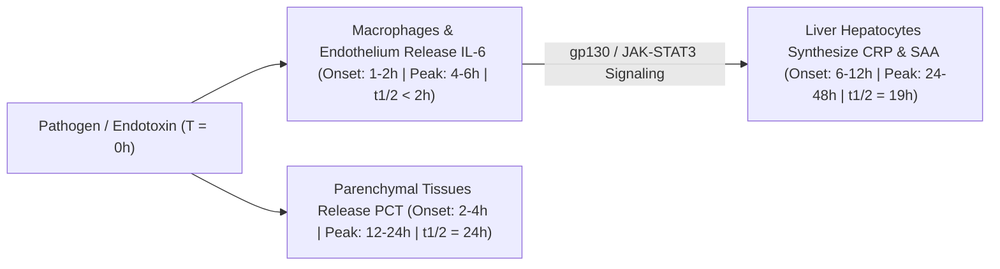

# 3.7.7 — Interleukin-6 (`IL-6` CLIA): Ultra-Early Neonatal Sepsis (`1–2h` Surge), Cytokine Release Syndrome (`CRS` / "Cytokine Storm") & Tocilizumab Pharmacology

**Department Folder:** `03_Immunoassay_Endocrinology_and_Nutrients`  
**Cluster Folder:** `3.7_Acute_Cardiac_and_Sepsis_Biomarkers_CLIA_Cluster`  
**Standard Tier:** International Reference Laboratory Standard (ISO 15189:2022 / CAP / CLSI / EFLM / WHO NIBSC / ASTCT CRS / CPA 2019)

---

## 📑 Section 1: International Document Control, Interoperability Coding & Hardware-Agnostic Platform Matrix

| Governance & Coding Parameter | Specification & International Reference Mapping |
| :--- | :--- |
| **Document ID & Version** | `SOP-IMM-3.7.7` — **Version 2.0 (International Reference Laboratory Tier)** |
| **ISO 15189:2022 & CAP Mapping** | Clauses `7.2`, `7.3`, `7.4` (Critical Cytokine Storm / Neonatal Sepsis Alerts); `CAP CHM.13900` |
| **Primary `LOINC` Codes** | **`26881-3`** (Interleukin 6 [Mass/volume] in Serum or Plasma — `pg/mL`); **`4655-4`** (Amniotic fluid / Body fluid `IL-6` for Chorioamnionitis) |
| **`SNOMED-CT` Specimen & Concept** | Specimen: **`119364003`** (Serum) / **`119361006`** (Plasma); Observable: **`406163003`** (Interleukin-6 measurement) |
| **`ICD-10` / `ICD-11` Clinical Codes** | **`P36.9`** / `KA60` (Bacterial sepsis of newborn — Early-Onset Neonatal Sepsis `EONS`); **`D89.83`** (Cytokine Release Syndrome `CRS` Grades 1–4); **`A41.9`** (Systemic Sepsis); **`O41.12`** (Chorioamnionitis) |
| **UCUM Reporting Units & Conversion** | **Primary Unit:** **`pg/mL`** ($= \text{ng/L}$). **WHO International Standard Conversion:** $1\text{ pg/mL} \approx 0.1\text{ IU/mL}$ (Molecular Weight of glycosylated human `IL-6`: **$21,000 \text{ – } 26,000\text{ Da}$** [$\sim 23.7\text{ kDa}$, $184\text{ amino acids}$]). |
| **Metrological Traceability** | Traceable to **WHO 1st International Standard for Human Interleukin-6 (`NIBSC Code 89/548`)**. |

### **Hardware-Agnostic Decoupled Analyzer Matrix**
| Platform Tier | Analyzer Model & Manufacturer | Analytical Principle & Detection Chemistry | Clinical Turnaround & Dynamic Range |
| :--- | :--- | :--- | :--- |
| **Primary Platform** | **Snibe MAGLUMI X3** (Flash-CLIA) | **Two-Site Sandwich Flash-CLIA**: Anti-human `IL-6` monoclonal capture antibody on magnetic microbeads + ABEI-labeled anti-`IL-6` monoclonal tracer | **STAT Turnaround $< 20\text{ minutes}$**; wide linear range up to **$5,000\text{ pg/mL}$** (auto-dilutable to $50,000\text{ pg/mL}$) to capture fulminant Cytokine Storm without saturation. |
| **Backup Platform** | Harmonized CLIA / ECLIA Immunoassay System | Electrochemiluminescence (`ECLIA`) | Verified per `CLSI EP31-A` comparability ($r \ge 0.98$, traceable to `NIBSC 89/548`). |
| **Future Upgrade Slot** | Next-Gen High-Throughput Modular CLIA | Dual-epitope cytokine sandwich CLIA | Verified per `CLSI EP15-A3` & `EP06-Ed2`. |

---

## 🧪 Section 2: Pre-Analytical Phlebotomy, `CLSI GP41` Order-of-Draw, Stability & Quantitative `HIL` Rejection Matrix

> [!WARNING]
> **CRITICAL PRE-ANALYTICAL CELLULAR SECRETION HAZARD (`IL-6`):**  
> If whole blood is left uncentrifuged at room temperature for $> 2\text{ hours}$, viable peripheral blood **monocytes and leukocytes stimulated by even trace endotoxin or tube contact will synthesize or leak `IL-6` in vitro** (or conversely, cellular receptors will bind and clear `IL-6`)!  
> - **Separate Serum or EDTA/Heparin Plasma from blood cells within $\le 2\text{ hours}$ of collection!**

- **Acceptable Specimen Types:** **Serum** (Gold-Top SST or Red-Top), **$\text{K}_2/\text{K}_3\text{-EDTA}$ Plasma** (Lavender-Top), or **Lithium Heparin Plasma** (Green-Top). **Umbilical Cord Blood** is highly validated for Early-Onset Neonatal Sepsis (`EONS`).
- **`CLSI GP41` Order-of-Draw:** Blood Cultures $\rightarrow$ Citrate $\rightarrow$ **Serum/SST** $\rightarrow$ **Heparin** $\rightarrow$ **EDTA**.
- **Minimum Volume:** Adult: **$0.5\text{ mL}$** serum/plasma ($100\text{ }\mu\text{L}$ dead volume + $50\text{ }\mu\text{L}$ reaction volume). **NICU / Umbilical Cord Micro-Sample:** **$0.25\text{ mL}$** whole blood ($120\text{ }\mu\text{L}$ plasma).
- **Centrifugation & Multi-Temperature Stability Matrix:**
  - Centrifuge within **$\le 2\text{ hours}$** at **$1,500 \text{ – } 2,000 \times g$ for $10\text{ minutes}$**.
  - **Room Temperature ($18\text{–}25^\circ\text{C}$):** **$6\text{ hours}$** (separated serum/plasma).
  - **Refrigerated ($2\text{–}8^\circ\text{C}$):** **$48\text{ hours}$** ($2\text{ days}$).
  - **Frozen ($-20^\circ\text{C}$ / $-70^\circ\text{C}$):** **$3\text{ months}$** at $-20^\circ\text{C}$; **$12\text{ months}$** at $-70^\circ\text{C}$ (Maximum **1 freeze-thaw cycle**).

### **Quantitative `HIL` (Hemolysis, Icterus, Lipemia) Spectral & Analytical Interference Matrix (`CLSI C56-A`)**
| Index | Analyte Equivalent Cutoff | Direction & Mechanism of Bias | Mandatory LIMS & Technical Action |
| :--- | :--- | :--- | :--- |
| **`H-Index` (Hemolysis)** | **$> 300\text{ mg/dL}$ Free Hb** | Intracellular proteases and heme luminescence quenching at severe hemolysis ($\downarrow$). | Reject & redraw if `H-Index > 300 mg/dL`. |
| **`I-Index` (Icterus)** | **$> 40\text{ mg/dL}$ Bilirubin** | Essential for neonatal jaundice/sepsis workups: unaffected by neonatal hyperbilirubinemia up to **$40\text{ mg/dL}$**! | Safe to report in icteric neonates up to $40\text{ mg/dL}$. |
| **`L-Index` (Lipemia)** | **$> 1,500\text{ mg/dL}$ Triglycerides** | Relevant in NICU neonates receiving IV lipid emulsions (`SMOFlipid`/`Intralipid`): unaffected up to $1,500\text{ mg/dL}$. | Ultracentrifuge if `L-Index > 1,500 mg/dL`. |

---

## ⚙️ Section 3: Hardware-Agnostic Analytical SOP, `CLSI` Verification, Calibration & Six Sigma QC

1. **Immunological Reaction Principle (Snibe Maglumi X3 Two-Site Sandwich Flash-CLIA):**
   - Interleukin-6 (`IL-6`) is a $184\text{-aa}$ pleiotropic four-$\alpha$-helix bundle cytokine secreted by monocytes, macrophages, T-cells, endothelial cells, and fibroblasts in response to Pathogen-Associated Molecular Patterns (`PAMPs` via Toll-Like Receptors) and Damage-Associated Molecular Patterns (`DAMPs`).
   - Sample ($50\text{ }\mu\text{L}$), magnetic microbeads coated with anti-`IL-6` monoclonal antibody, and ABEI-labeled anti-`IL-6` monoclonal tracer antibody incubate at $37^\circ\text{C}$ to form a sandwich complex. After magnetic separation and washing, Starter 1+2 triggers flash chemiluminescence ($\text{RLU}$).
2. **Calibration & Traceability:** 2-point recalibration every **28 days**, on reagent lot change, or upon Westgard QC violation.
3. **Internal Quality Control (IQC):** Run 2–3 levels of control ($\text{Level 1} \sim 6.0\text{ pg/mL}$ near the $7.0\text{ pg/mL}$ adult URL; $\text{Level 2} \sim 80.0\text{ pg/mL}$; $\text{Level 3} \sim 500.0\text{ pg/mL}$) every $12\text{ hours}$ under Westgard $1_{3s} / 2_{2s} / R_{4s}$ rules.
4. **Analytical Measurement Range (`AMR`), `LoD / LoQ`, & High-Dose Hook-Effect Auto-Dilution (`CRR`):**
   - **Limit of Detection (`LoD`):** **$0.50\text{ pg/mL}$** | **Limit of Quantitation (`LoQ`):** **$1.50\text{ pg/mL}$**
   - **Linear `AMR`:** **$1.50 \text{ – } 5,000.0\text{ pg/mL}$**
   - **Auto-Dilution (`CRR`):** Automatic **$1:10$ on-board dilution** for samples $> 5,000.0\text{ pg/mL}$ extends the reportable range to **$50,000.0\text{ pg/mL}$** (capturing extreme Cytokine Release Syndrome spikes). No high-dose hook effect up to $200,000\text{ pg/mL}$.

---

## 📈 Section 4: EFLM Biological Variation, Reference Change Value (`RCV %`), Six Sigma (`TEa`) & Measurement Uncertainty (`MU`)

| Metrological & Biological Variation Parameter | Value & Source (EFLM Biological Variation DB / RCPA) | Clinical & LIMS Operational Application |
| :--- | :--- | :--- |
| **Within-Subject Biological Variation ($CV_I$)** | **$24.0\%$** | High physiological pulsatility and diurnal variation (peaks in late night/early morning). |
| **Between-Subject Biological Variation ($CV_G$)** | **$48.0\%$** | Influenced by age, visceral adiposity (adipocytes secrete $15\%\text{–}30\%$ of basal `IL-6`), and physical activity. |
| **Index of Individuality ($\text{II} = CV_I / CV_G$)** | **$0.50$** *(Low: $< 0.60$)* | Serial changes are assessed on a **logarithmic (fold-change) scale** ($10\times \text{ to } 1,000\times$ baseline). |
| **Desirable Analytical Imprecision ($CV_A$)** | **$\le 7.5\%$** | Achieved $CV_A \sim 4.0\%\text{–}5.5\%$ on Maglumi X3. |
| **Desirable Analytical Bias ($B\%$)** | **$\le 12.0\%$** | Monitored via external proficiency testing. |
| **Total Allowable Error ($\text{TE}_a$)** | **$\pm 25.0\%$** | Six Sigma $\ge 4.2\text{ }\sigma$ at $7.0\text{ pg/mL}$ and $100.0\text{ pg/mL}$. |
| **Expanded Measurement Uncertainty ($\text{MU}$ at $k=2$)** | **$\pm 15.0\%$** | Applied at clinical decision cutoffs ($7.0, 35.0, 100.0, 1,000.0\text{ pg/mL}$). |
| **95% & 99% Reference Change Value (`RCV %`)** | **95% RCV: $\pm 69.7\%$ \| 99% RCV: $\pm 91.9\%$** | Because `IL-6` has an **ultra-short half-life ($t_{1/2} < 1\text{–}2\text{ hours}$)**, effective source control or antibiotic therapy causes **`IL-6` to plummet by $> 70\%\text{–}90\%$ within $12\text{–}24\text{ hours}$**—far faster than `PCT` ($t_{1/2} \sim 24\text{h}$) or `CRP` ($t_{1/2} \sim 19\text{h}$)! |
| **Minimum Retesting Interval (`MRI`)** | **Hyperacute Sepsis / CRS Triage: $6 \text{ – } 12\text{ hours}$ ICU Sepsis Resolution: $12 \text{ – } 24\text{ hours}$** | Do not use `IL-6` to assess clinical improvement **after** administering *Tocilizumab* (`Actemra`)—see Section 8! |

---

## 🧬 Section 5: Super-Detailed Multi-Stratified Biological Reference Intervals (Adult, Neonatal EONS, Cord Blood, Maternity & CRS Grading)

| Population Partition / Clinical Stratum | `IL-6` Reference Interval / Decision Cutoff (`pg/mL` = `ng/L`) | Physiological & Clinical Interpretation Notes |
| :--- | :--- | :--- |
| **Healthy Adults ($\ge 18\text{ Years}$ — Male & Female)** | **$< 7.0\text{ pg/mL}$** | Basal `IL-6` is typically $0.5\text{–}4.5\text{ pg/mL}$ in healthy non-obese adults. |
| **Umbilical Cord Blood (At Birth — Chorioamnionitis / EONS Screen)** | **Normal: $< 11.0 \text{ – } 15.0\text{ pg/mL}$ EONS Rule-In Cutoff: $> 35.0 \text{ – } 50.0\text{ pg/mL}$** | **Gold Standard for Early-Onset Neonatal Sepsis (`EONS`):** Because neonatal `PCT` has a physiological birth surge ($0\text{–}48\text{h}$) and `CRP` lags by $12\text{–}24\text{ hours}$, **Cord/Neonatal `IL-6 > 35–50 pg/mL` has $> 90\%$ sensitivity at Hour 0 of life**! |
| **Neonate ($0 \text{ – } 7\text{ Days}$) & Infant/Child (`CALIPER`)** | **Normal: $< 7.0 \text{ – } 10.0\text{ pg/mL}$ Neonatal Sepsis Cutoff: $> 35.0 \text{ – } 50.0\text{ pg/mL}$** | **Crucial NICU Window:** Because `IL-6` rises at $1\text{–}2\text{h}$ and falls rapidly by $24\text{–}36\text{h}$ as it induces hepatic `CRP`, **always order `IL-6` + `CRP` (or `PCT`) together** in suspected neonatal sepsis to achieve $98\%\text{–}100\%$ combined sensitivity across both early ($<12\text{h}$) and late ($>24\text{h}$) windows! |
| **Maternity (1st, 2nd & 3rd Trimesters — Uncomplicated)** | **$< 7.0 \text{ – } 10.0\text{ pg/mL}$** *(Active Labor surges transiently to $15\text{–}40\text{ pg/mL}$)* | Maternal serum `IL-6 > 20–35 pg/mL` (or amniotic fluid `IL-6 > 2,600 pg/mL`) in preterm premature rupture of membranes (`PPROM`) strongly predicts **histological chorioamnionitis and imminent preterm delivery**. |
| **Systemic Inflammatory Response / Localized Infection** | **$7.0 \text{ – } 50.0\text{ pg/mL}$** | Mild-to-moderate acute phase response, rheumatoid arthritis flare, Castleman disease, or viral URI. |
| **Severe Sepsis / Moderate Cytokine Release Syndrome (`CRS` Grade 2)** | **$50.0 \text{ – } 500.0\text{ pg/mL}$** | Significant systemic hyperinflammation; evaluate for sepsis or severe viral pneumonia (`COVID-19` / Influenza / Dengue shock). |
| **🚨 Septic Shock / Fulminant "Cytokine Storm" (`CRS` Grade 3–4)** | **$> 500.0 \text{ – } 1,000.0+\text{ pg/mL}$** *(Often reaches $5,000\text{–}50,000\text{ pg/mL}$)* | **Life-Threatening Hypercytokinemia:** High risk of vasopressor-refractory shock, ARDS, DIC, HLH/MAS, and multi-organ failure. |

---

## 🚨 Section 6: NABL & `CLSI GP47` Critical ("Panic") Values & 30-Minute Read-Back Protocol

| Alert Tier | Parameter & Threshold | Clinical Implication & Mandatory Laboratory Action |
| :--- | :--- | :--- |
| **🚨 Tier-1 Critical Panic Alert (NICU / Neonates $< 28\text{ Days}$)** | **Neonatal / Cord Blood `IL-6 > 50.0 pg/mL`** | **Acute Early-Onset or Late-Onset Neonatal Sepsis (`EONS` / `LONS`):** Immediately call NICU neonatologist within **$\le 15\text{–}30\text{ minutes}$** with read-back verification so blood cultures and empiric neonatal antibiotics can be started before clinical shock develops. |
| **🚨 Tier-1 Critical Panic Alert (Adult / Pediatric ICU)** | **Serum `IL-6 > 500.0 – 1,000.0 pg/mL`** | **Fulminant Septic Shock or Severe Cytokine Release Syndrome ("Cytokine Storm"):** Immediately notify ICU/attending physician within **$\le 30\text{ minutes}$** with documented read-back. |

---

## 🔬 Section 7: In-Vivo Pharmacokinetics & The Temporal Inflammatory Cascade (`IL-6` $\rightarrow$ `PCT` $\rightarrow$ `CRP`)

### **1. The "Alarm Hormone" Kinetic Timeline (Why `IL-6` is the Earliest Biomarker in Medicine)**

- **Onset of Rise:** **$1.0 \text{ – } 2.0\text{ hours}$** after pathogen invasion, endotoxin exposure, or surgical trauma (**$2\text{–}3\text{ hours}$ earlier than `PCT` and $6\text{–}10\text{ hours}$ earlier than `CRP`**!).
- **Time to Peak Concentration:** **$4.0 \text{ – } 6.0\text{ hours}$**.
- **Biological Half-Life ($t_{1/2}$):** **$< 1.0 \text{ – } 2.0\text{ hours}$** (rapidly bound by hepatic `IL-6R`/`gp130` receptors and cleared by receptor-mediated endocytosis and renal filtration).
- **The Neonatal "Baton-Pass" Phenomenon (`IL-6` + `CRP` Synergy):**
  - Because `IL-6` directly triggers hepatocyte transcription of C-Reactive Protein (`CRP`), **`IL-6` peaks in the first $4\text{–}12\text{ hours}$ of neonatal sepsis and may already be falling back toward normal by $24\text{–}36\text{ hours}$—at the exact moment `CRP` is finally rising!**
  - Therefore, a single late `IL-6` (>24h) can be falsely low, while a single early `CRP` (<12h) is frequently falsely normal. **Combining `IL-6` + `CRP` (or `PCT`) covers the entire $0\text{–}72\text{h}$ sepsis timeline with $> 98\%$ sensitivity.**

---

## 🛡️ Section 8: Comprehensive Analytical, Pre-Analytical & Drug Interference Matrix (`Tocilizumab` Paradox!) + `ISO 22367` FMEA

| Interference / Drug Confounder | Direction & Magnitude of Effect | Mechanism & Mandatory Clinical Rule |
| :--- | :--- | :--- |
| **🚨 Anti-IL-6 Receptor Monoclonal Antibodies (*Tocilizumab [Actemra] / Sarilumab [Kevzara]*)** | **MASSIVE PHARMACOLOGICAL SURGE ($\uparrow 10\times \text{ to } 100\times$!) in Measured Serum `IL-6`** | **Crucial Pharmacological Trap:** *Tocilizumab* binds to soluble and membrane-bound **IL-6 Receptors (`IL-6R`)**, blocking receptor-mediated clearance of `IL-6`. Consequently, **free and receptor-bound `IL-6` accumulates massively in serum ($500\text{–}5,000\text{ pg/mL}$) for weeks after Tocilizumab infusion even as the patient's fever and `CRP` completely resolve!** **MANDATORY RULE:** **NEVER order Serum `IL-6` to monitor treatment response after administering Tocilizumab**—monitor clinical status and `PCT` instead! *(Note: Conversely, Tocilizumab completely shuts off hepatic `CRP` synthesis, making `CRP` falsely normal even if secondary bacterial sepsis occurs!)* |
| **Anti-IL-6 Direct Ligand Antibody (*Siltuximab [Sylvant]*)** | **Analytical Interference** | Siltuximab binds directly to circulating `IL-6` ligand, forming immune complexes that interfere with `IL-6` immunoassays. |
| **Delayed Centrifugation ($> 2\text{h}$ at RT) or Hemolysis** | **In-Vitro Artifact ($\uparrow$ or $\downarrow$)** | Leukocyte activation in unseparated whole blood alters `IL-6` levels. Separate serum/plasma within $2\text{ hours}$. |
| **Strenuous Exercise ("Myokine Effect")** | **Physiological Surge ($\uparrow$ up to $20\text{–}100\text{ pg/mL}$)** | Contracting skeletal muscle fibers release non-inflammatory `IL-6` (acting as a metabolic myokine to mobilize hepatic glucose) during prolonged endurance exercise; normalizes within $4\text{–}6\text{ hours}$ of rest. |

### **`ISO 22367` Risk Management & Failure Modes (`FMEA`)**
1. **Failure Mode 1 — Panic Re-Dosing of Tocilizumab or Immunosuppressants Because Serum `IL-6` Rose from $150\text{ pg/mL}$ to $2,500\text{ pg/mL}$ $48\text{ Hours}$ After First Dose of Tocilizumab (Severity: 9/10):** Mitigated by the mandatory **Tocilizumab Receptor-Blockade Paradox Warning** printed on every elevated `IL-6` report.
2. **Failure Mode 2 — Ruling Out Neonatal Sepsis at $36\text{ Hours}$ of Symptom Onset Based on a Normal `IL-6` Alone (After the Early `IL-6` Peak Has Already Subsided) (Severity: 9/10):** Mitigated by recommending paired **`IL-6` + `CRP` + `PCT`** testing for complete temporal coverage.
3. **Failure Mode 3 — False-Positive `IL-6` Elevation from Whole Blood Left Uncentrifuged Overnight at Room Temperature (Severity: 7/10):** Mitigated by strict $\le 2\text{h}$ separation SOP.

---

## 💬 Section 9: Conditional Band-Specific Pathologist Sign-Out Library (Automated LIMS Rules-Based Comments)

- **`[BAND-NORMAL: < 7.0 pg/mL]`:**  
  *"Serum Interleukin-6 (IL-6) is within the normal reference interval (< 7.0 pg/mL). Because IL-6 is the earliest acute-phase cytokine (rising within 1–2 hours and peaking at 4–6 hours with a rapid half-life < 2 hours), a normal result in early presentation argues against hyperacute systemic inflammation. CAVEAT: If symptoms have been present for > 24–36 hours, IL-6 may have already declined after inducing hepatic CRP; correlate with CRP and Procalcitonin (PCT)."*
- **`[BAND-MILD-MODERATE: 7.0 – 49.9 pg/mL]`:**  
  *"Mild-to-moderately elevated Serum IL-6 (7.0–49.9 pg/mL), indicating active pro-inflammatory cytokine release (early bacterial/viral infection, autoimmune flare, tissue trauma, or post-surgical stress). In neonates/cord blood, values > 35.0–50.0 pg/mL are strongly associated with Early-Onset Neonatal Sepsis (EONS). Correlate with PCT, CRP, and clinical findings."*
- **`[BAND-HIGH: 50.0 – 499.9 pg/mL]`:**  
  *"Significantly elevated Serum IL-6 (50.0–499.9 pg/mL), consistent with systemic hyperinflammation, sepsis, Early-Onset Neonatal Sepsis (if neonatal), or moderate Cytokine Release Syndrome (CRS). Recommend pairing with Procalcitonin (PCT) to differentiate bacterial sepsis from viral hyperinflammation. IMPORTANT DRUG WARNING: If the patient has recently received Tocilizumab (Actemra) or Sarilumab, measured serum IL-6 is pharmacologically elevated due to IL-6 receptor blockade and CANNOT be used to assess clinical response."*
- **`[BAND-CRITICAL-CYTOKINE-STORM: >= 500.0 pg/mL (or > 50.0 pg/mL in Neonate)]`:**  
  *"CRITICAL ALERT: Markedly elevated Serum IL-6 (>= 500.0 pg/mL; or > 50.0 pg/mL in a neonate), indicative of severe Systemic Sepsis / Septic Shock or severe Cytokine Release Syndrome ('Cytokine Storm'). High risk of hemodynamic instability, ARDS, and multi-organ dysfunction. Correlate urgently with Procalcitonin (PCT), Serum Ferritin, D-Dimer, Lactate, and blood cultures. Note: Recent Tocilizumab administration pharmacologically blocks IL-6R clearance and causes massive accumulation of serum IL-6 despite clinical improvement."*

---

## 📋 Section 10: Master LIMS Copy-Paste Report Block (Physician + Patient Summary + Multi-Jurisdictional Shield)

### **[LIMS COPY-PASTE BLOCK — INTERLEUKIN-6 (`IL-6` — EARLY SEPSIS & CYTOKINE STORM) INTERPRETATION]**

**Clinical & Analytical Overview (Snibe Maglumi Flash-CLIA; WHO NIBSC 89/548 Traceable; Units: $\text{pg/mL}$):**  
Interleukin-6 ($\text{IL-6}$) is the primary early pro-inflammatory "alarm cytokine" secreted by macrophages, T-cells, and endothelial cells within **$1 \text{ – } 2\text{ hours}$** of infection or tissue injury, peaking at **$4 \text{ – } 6\text{ hours}$** with an ultra-short biological half-life of **$< 2\text{ hours}$**. $\text{IL-6}$ directly stimulates the liver to synthesize $\text{CRP}$, $\text{SAA}$, Ferritin, and Fibrinogen—rising **$6\text{–}12\text{ hours}$ earlier than $\text{CRP}$**.

**Clinical Reference & Risk Stratification Matrix (`IL-6` in $\text{pg/mL}$):**
| Clinical Setting / Severity Tier | `IL-6` Concentration ($\text{pg/mL}$) | Diagnostic & Clinical Interpretation |
| :--- | :--- | :--- |
| **Healthy Adult Baseline** | **$< 7.0\text{ pg/mL}$** | Normal baseline; absence of acute hypercytokinemia. |
| **Neonatal / Cord Blood Sepsis (`EONS`) Cutoff** | **$> 35.0 \text{ – } 50.0\text{ pg/mL}$** *(Normal $< 11\text{ pg/mL}$)* | **Ultra-early marker of Neonatal Sepsis ($0\text{–}24\text{h}$)** before $\text{CRP}$ rises and without the $48\text{h}$ physiological birth surge seen with $\text{PCT}$. |
| **Mild-to-Moderate Systemic Inflammation** | **$7.0 \text{ – } 99.0\text{ pg/mL}$** | Localized infection, viral syndrome, autoimmune flare (RA/Still's/Castleman), or post-operative trauma. |
| **Severe Sepsis / Moderate Cytokine Storm (`CRS`)** | **$100.0 \text{ – } 499.0\text{ pg/mL}$** | Marked systemic inflammatory response; correlate with $\text{PCT}$ (`3.7.6`) for bacterial vs viral etiology. |
| **Critical Septic Shock / Fulminant Cytokine Storm** | **$\ge 500.0 \text{ – } 1,000.0+\text{ pg/mL}$** | **Critical Hypercytokinemia:** High risk of vasoplegic shock, ARDS, DIC, and multi-organ failure. |

**Plain-Language Patient Summary:**  
*Interleukin-6 (IL-6) is the body's fastest immune "alarm bell," rising within 1 to 2 hours of an infection or inflammation—much earlier than standard markers like CRP. Doctors use IL-6 to catch infections very early (especially in newborn babies) and to measure severe immune overreactions ("cytokine storms").*

> **🛡️ MANDATORY `TOCILIZUMAB` DRUG PARADOX & KINETIC WINDOW SHIELD (ISO 15189:2022 / CAP / CPA 2019):**  
> 1. **Tocilizumab (*Actemra*) / Sarilumab Receptor-Blockade Paradox:** Anti-$\text{IL-6R}$ monoclonal antibodies (*Tocilizumab*) block the $\text{IL-6}$ receptor responsible for clearing $\text{IL-6}$ from blood, causing **measured Serum `IL-6` to surge $10\text{- to }100\text{-fold}$ for weeks after drug administration even when the patient is clinically recovering!** **Do NOT use Serum `IL-6` (or `CRP`, which Tocilizumab suppresses) to monitor infection after giving Tocilizumab—use `Procalcitonin (PCT)` instead.**  
> 2. **Rapid Washout Caveat ($t_{1/2} < 2\text{h}$):** Because $\text{IL-6}$ peaks at $4\text{–}6\text{h}$ and clears rapidly by $24\text{–}36\text{h}$, a normal $\text{IL-6}$ drawn late in the course of illness does not exclude infection; always pair with **$\text{CRP}$** and **$\text{PCT}$** for full kinetic coverage. *Not valid for medico-legal purposes.*
