# 3.7.9 — Direct Hepatic Fibrosis 4-Marker CLIA Panel (`HA`, `PIIINP`, `Type IV Collagen [CIV]`, `Laminin [LN]` & `Cholyglycine [CG]`): Extracellular Matrix (`ECM`) Remodeling, Cirrhosis & Portal Hypertension

**Department Folder:** `03_Immunoassay_Endocrinology_and_Nutrients`  
**Cluster Folder:** `3.7_Acute_Cardiac_and_Sepsis_Biomarkers_CLIA_Cluster`  
**Standard Tier:** International Reference Laboratory Standard (ISO 15189:2022 / CAP / CLSI / EFLM / EASL / AASLD / APASL / CPA 2019)

---

## 📑 Section 1: International Document Control, Interoperability Coding & Hardware-Agnostic Platform Matrix

| Governance & Coding Parameter | Specification & International Reference Mapping |
| :--- | :--- |
| **Document ID & Version** | `SOP-IMM-3.7.9` — **Version 2.0 (International Reference Laboratory Tier)** |
| **ISO 15189:2022 & CAP Mapping** | Clauses `7.2`, `7.3`, `7.4`; `CAP CHM.13900` |
| **Primary `LOINC` Codes** | **Hyaluronic Acid (`HA`):** **`2436-2`** (`ng/mL`); **Procollagen III N-Terminal Peptide (`PIIINP`):** **`33952-3`** (`ng/mL`); **Type IV Collagen (`CIV`):** **`32150-5`** (`ng/mL`); **Laminin (`LN`):** **`32151-3`** (`ng/mL`); **Cholyglycine (`CG` / Glycocholic Acid):** **`14650-6`** (`mg/L`) |
| **`SNOMED-CT` Specimen & Concept** | Specimen: **`119364003`** (Fasting Serum); Observable: **`442525008`** (Hepatic fibrosis biomarker panel) |
| **`ICD-10` / `ICD-11` Clinical Codes** | **`K74.0`** / `DB93.0` (Hepatic Fibrosis); **`K74.60`** / `DB93.1` (Cirrhosis of liver); **`K76.0`** / `DB92` (MASLD / NAFLD / MASH); **`K70.3`** (Alcoholic cirrhosis); **`B18.1` / `B18.2`** (Chronic Viral Hepatitis B / C); **`K76.6`** (Portal Hypertension); **`O26.6`** (Intrahepatic Cholestasis of Pregnancy `ICP` — Cholyglycine) |
| **UCUM Reporting Units & Conversion** | **`HA`, `PIIINP`, `CIV`, `LN`:** **`ng/mL`** ($= \mu\text{g/L}$). **`Cholyglycine (CG)`:** **`mg/L`** ($= \mu\text{g/mL}$; Molecular Weight of Glycocholic Acid $\text{C}_{26}\text{H}_{43}\text{NO}_6$: **$465.62\text{ Da}$**; $\text{mg/L} \times 2.148 = \mu\text{mol/L}$). |
| **Metrological Traceability** | Traceable to purified human Extracellular Matrix (`ECM`) Reference Standards (`HA` Binding Protein / Human `PIIINP` / Pepsin-solubilized Human Placental `CIV` / `Laminin P1` / NIST-grade Glycocholic Acid) on the **Snibe Maglumi X3** platform. |

### **Hardware-Agnostic Decoupled Analyzer Matrix**
| Platform Tier | Analyzer Model & Manufacturer | Analytical Principle & Detection Chemistry | Panel Components & Clinical Synergy |
| :--- | :--- | :--- | :--- |
| **Primary Platform** | **Snibe MAGLUMI X3** (Flash-CLIA) | **Flash-CLIA**: Competitive / Sandwich ABEI Chemiluminescence on Magnetic Microbeads (`HA` via specific HA-binding protein; `PIIINP`, `CIV`, `LN`, `CG` via monoclonal antibodies) | Directly quantifies **Space of Disse Extracellular Matrix (`ECM`) synthesis and sinusoidal remodeling**—complementing indirect `FIB-4`/`APRI` scores (`2.2.1`) and FibroScan elastography. |
| **Backup Platform** | Harmonized CLIA Immunoassay Analyzer | Automated Chemiluminescence | Verified per `CLSI EP31-A` comparability ($r \ge 0.97$). |
| **Paired Indirect Score Engine** | **Bonavera Chem 400 (`AST`, `ALT`, `Platelets` for `FIB-4` / `APRI`)** | Integrated LIMS Calculation | Combines Direct ECM markers (`HA`, `PIIINP`, `CIV`, `LN`) with Indirect `FIB-4` for $>92\%$ diagnostic accuracy in F3–F4 fibrosis. |

---

## 🧪 Section 2: Pre-Analytical Phlebotomy, `CLSI GP41` Order-of-Draw, Stability & Quantitative `HIL` Rejection Matrix

> [!IMPORTANT]
> **MANDATORY OVERNIGHT FASTING REQUIREMENT ($\ge 8\text{–}10\text{ Hours}$) FOR `HA` & `CHOLYGLYCINE (CG)`:**  
> 1. **Hyaluronic Acid (`HA`) Post-Prandial Surge:** Food intake increases splanchnic and thoracic duct lymphatic flow, washing intestinal `HA` into systemic circulation and **falsely elevating Serum `HA` by $30\%\text{–}80\%$ within $1\text{–}3\text{ hours}$ after a meal** (especially in cirrhotic patients)!  
> 2. **Cholyglycine (`CG`) Enterohepatic Surge:** Gallbladder contraction after a meal causes a **$2\text{- to }5\text{-fold}$ post-prandial surge** in serum conjugated bile acids (`CG`).  
> - **All specimens for the Direct Hepatic Fibrosis & Cholyglycine Panel MUST be collected in the morning after an $8\text{–}10\text{ hour}$ overnight fast!**

- **Acceptable Specimen Types:** **Fasting Serum** (Gold-Top SST or Red-Top Clot Activator) or **EDTA/Heparin Plasma**.
- **`CLSI GP41` Order-of-Draw:** Citrate $\rightarrow$ **Serum/SST** $\rightarrow$ Heparin $\rightarrow$ EDTA.
- **Minimum Volume:** **$1.0\text{ mL}$** fasting serum ($100\text{ }\mu\text{L}$ dead volume + $25\text{–}50\text{ }\mu\text{L}$ per analyte across the 5-marker panel).
- **Centrifugation & Multi-Temperature Stability Matrix:**
  - Centrifuge at **$1,500 \text{ – } 2,000 \times g$ for $10\text{ minutes}$** within $2\text{ hours}$ of collection.
  - **Room Temperature ($18\text{–}25^\circ\text{C}$):** **$8\text{ hours}$**.
  - **Refrigerated ($2\text{–}8^\circ\text{C}$):** **$48\text{ hours}$** ($2\text{ days}$).
  - **Frozen ($-20^\circ\text{C}$):** **$3\text{ months}$** (Maximum **1 freeze-thaw cycle**; collagen propeptides degrade with repeated freeze-thaw).

### **Quantitative `HIL` (Hemolysis, Icterus, Lipemia) Spectral & Analytical Interference Matrix (`CLSI C56-A`)**
| Index | Analyte Equivalent Cutoff | Direction & Mechanism of Bias | Mandatory LIMS & Technical Action |
| :--- | :--- | :--- | :--- |
| **`H-Index` (Hemolysis)** | **$> 300\text{ mg/dL}$ Free Hb** | Intracellular proteases and heme quenching at severe hemolysis. | Reject & redraw if `H-Index > 300 mg/dL`. |
| **`I-Index` (Icterus)** | **$> 40\text{ mg/dL}$ Bilirubin** | Essential in jaundiced liver patients: Maglumi magnetic wash separation eliminates bilirubin spectral interference up to **$40\text{ mg/dL}$**! | Safe to report in icteric cirrhosis/hepatitis up to $40\text{ mg/dL}$ Bilirubin. |
| **`L-Index` (Lipemia)** | **$> 1,500\text{ mg/dL}$ Triglycerides** | Relevant in MASLD/NAFLD hypertriglyceridemic patients: unaffected up to $1,500\text{ mg/dL}$. | Ultracentrifuge if `L-Index > 1,500 mg/dL`. |

---

## ⚙️ Section 3: Hardware-Agnostic Analytical SOP, `CLSI` Verification, Calibration & Six Sigma QC

1. **Immunological Reaction Principles on Snibe Maglumi X3 (Flash-CLIA):**
   - **Hyaluronic Acid (`HA`):** Competitive or Sandwich binding using purified specific **Hyaluronic Acid Binding Protein (`HABP` / Aggrecan G1-link domain)** on magnetic microbeads and ABEI-labeled tracer at $37^\circ\text{C}$.
   - **Procollagen Type III N-Terminal Peptide (`PIIINP`), Type IV Collagen (`CIV`), & Laminin (`LN`):** Two-site sandwich or competitive Flash-CLIA using high-affinity monoclonal antibodies specific to human `PIIINP`, the $7\text{S}$/triple-helical domain of `Type IV Collagen`, and the `P1` fragment of `Laminin`.
   - **Cholyglycine (`CG` — Glycocholic Acid):** Competitive Flash-CLIA using anti-Cholyglycine monoclonal antibody and ABEI-labeled CG antigen derivative.
2. **Calibration & Traceability:** 2-point recalibration every **28 days**, on reagent lot change, or upon Westgard QC violation.
3. **Internal Quality Control (IQC):** Run 2 levels of multi-analyte liver fibrosis control ($\text{Level 1}$ Normal; $\text{Level 2}$ Pathological/Cirrhotic) every $12\text{–}24\text{ hours}$ under Westgard $1_{3s} / 2_{2s} / R_{4s}$ rules.
4. **Analytical Measurement Range (`AMR`), `LoD`, & Auto-Dilution (`CRR`):**
   - **`HA` `AMR`:** **$10.0 \text{ – } 2,000.0\text{ ng/mL}$** (`CRR` with $1:10$ dilution: **$20,000.0\text{ ng/mL}$**)
   - **`PIIINP` `AMR`:** **$1.5 \text{ – } 200.0\text{ ng/mL}$** (`CRR` with $1:10$ dilution: **$2,000.0\text{ ng/mL}$**)
   - **`Type IV Collagen (CIV)` `AMR`:** **$5.0 \text{ – } 1,000.0\text{ ng/mL}$** (`CRR` with $1:10$ dilution: **$10,000.0\text{ ng/mL}$**)
   - **`Laminin (LN)` `AMR`:** **$5.0 \text{ – } 1,000.0\text{ ng/mL}$** (`CRR` with $1:10$ dilution: **$10,000.0\text{ ng/mL}$**)
   - **`Cholyglycine (CG)` `AMR`:** **$0.05 \text{ – } 50.0\text{ mg/L}$** (`CRR` with $1:10$ dilution: **$500.0\text{ mg/L}$**)

---

## 📈 Section 4: EFLM Biological Variation, Reference Change Value (`RCV %`), Six Sigma (`TEa`) & Measurement Uncertainty (`MU`)

| Biomarker | EFLM $CV_I\%$ | EFLM $CV_G\%$ | Index of Individuality ($\text{II}$) | Desirable $CV_A\%$ | Six Sigma $\text{TE}_a\%$ | Expanded $\text{MU}\%$ ($k=2$) | 95% Serial `RCV %` (Fibrosis Progression / Regression Delta) |
| :--- | :--- | :--- | :--- | :--- | :--- | :--- | :--- |
| **`Hyaluronic Acid (HA)`** *(Fasting)* | $12.5\%$ | $36.0\%$ | $0.35$ | $\le 6.0\%$ | $\pm 20.0\%$ | $\pm 12.0\%$ | **$\pm 38.4\%$** |
| **`PIIINP`** | $10.8\%$ | $28.5\%$ | $0.38$ | $\le 5.5\%$ | $\pm 18.0\%$ | $\pm 11.0\%$ | **$\pm 33.6\%$** |
| **`Type IV Collagen (CIV)`** | $11.2\%$ | $29.0\%$ | $0.39$ | $\le 6.0\%$ | $\pm 20.0\%$ | $\pm 12.0\%$ | **$\pm 35.2\%$** |
| **`Laminin (LN)`** | $11.5\%$ | $30.5\%$ | $0.38$ | $\le 6.0\%$ | $\pm 20.0\%$ | $\pm 12.0\%$ | **$\pm 35.9\%$** |
| **`Cholyglycine (CG)`** *(Fasting)* | $18.5\%$ | $42.0\%$ | $0.44$ | $\le 6.5\%$ | $\pm 22.0\%$ | $\pm 13.0\%$ | **$\pm 54.4\%$** |

- **Minimum Retesting Interval (`MRI`):**
  - **Chronic Liver Fibrosis Surveillance (`MASLD`, `HBV`, `HCV`, `ALD`):** Every **$6 \text{ – } 12\text{ months}$** to monitor fibrosis regression on antiviral/metabolic therapy or progression toward cirrhosis.
  - **Cholyglycine in Intrahepatic Cholestasis of Pregnancy (`ICP`):** Every **$1 \text{ – } 2\text{ weeks}$** in the 3rd trimester alongside Total Bile Acids (`2.2.11`).

---

## 🧬 Section 5: Super-Detailed Multi-Stratified Biological Reference Intervals & Metavir Fibrosis Stage Correlation

### **1. Adult Reference Intervals & Metavir Histological Fibrosis Stage Stratification (`F0` to `F4 Cirrhosis`)**
| Biomarker (Units) | Healthy Adult Reference Interval (`F0 – F1` No/Minimal Fibrosis) | Significant Fibrosis (`F2` Periportal) | Advanced Bridging Fibrosis (`F3`) | Compensated / Decompensated Cirrhosis (`F4` & Portal HTN) |
| :--- | :--- | :--- | :--- | :--- |
| **`Hyaluronic Acid (HA)`** ($\text{ng/mL}$) | **$< 100.0\text{ ng/mL}$** *(Strict $< 50\text{y}$: $< 75\text{ ng/mL}$)* | $100.0 \text{ – } 160.0\text{ ng/mL}$ | $160.0 \text{ – } 240.0\text{ ng/mL}$ | **$> 240.0 \text{ – } 250.0\text{ ng/mL}$** *(NPV $> 98\%$ for ruling out cirrhosis if $< 60\text{ ng/mL}$!)* |
| **`PIIINP` (Procollagen III Peptide)** ($\text{ng/mL}$) | **$< 15.0\text{ ng/mL}$** *(or $< 30.0\text{ ng/mL}$ method-specific)* | $15.0 \text{ – } 25.0\text{ ng/mL}$ | $25.0 \text{ – } 40.0\text{ ng/mL}$ | **$> 40.0\text{ ng/mL}$** *(Highest during active fibrogenesis/steatohepatitis)* |
| **`Type IV Collagen (CIV)`** ($\text{ng/mL}$) | **$< 95.0\text{ ng/mL}$** *(Strict: $< 85.0\text{ ng/mL}$)* | $95.0 \text{ – } 120.0\text{ ng/mL}$ | $120.0 \text{ – } 145.0\text{ ng/mL}$ | **$> 145.0 \text{ – } 150.0\text{ ng/mL}$** *(Space of Disse basement membrane deposition)* |
| **`Laminin (LN)`** ($\text{ng/mL}$) | **$< 130.0\text{ ng/mL}$** *(Strict: $< 50.0\text{–}130.0\text{ ng/mL}$)* | $130.0 \text{ – } 155.0\text{ ng/mL}$ | $155.0 \text{ – } 185.0\text{ ng/mL}$ | **$> 185.0 \text{ – } 200.0\text{ ng/mL}$** *(Correlates with **HVPG $> 12\text{ mmHg}$ Portal Hypertension** & Esophageal Varices!)* |
| **`Cholyglycine (CG)`** (Fasting, $\text{mg/L}$) | **$< 2.70\text{ mg/L}$** ($< 5.8\text{ }\mu\text{mol/L}$) | $2.70 \text{ – } 5.0\text{ mg/L}$ | $5.0 \text{ – } 15.0\text{ mg/L}$ | **$> 15.0 \text{ – } 20.0\text{ mg/L}$** *(Portosystemic shunting & impaired hepatocyte uptake)* |

### **2. Pediatric (`CALIPER` GrowthModifier), Geriatric & Maternity Reference Partitions**
| Population Partition | Specific Biomarker Behaviour & Adjusted Interpretation |
| :--- | :--- |
| **Children & Adolescents ($0 \text{ – } 17\text{ Years}$ — somatic bone/soft-tissue growth)** | **⚠️ Crucial Pediatric Growth Caveat:** **`PIIINP` and `Type IV Collagen` are physiologically elevated $2\times \text{ to } 5\times$ adult levels in healthy growing children and pubertal adolescents** ($PIIINP$ up to $40\text{–}120\text{ ng/mL}$) due to active somatic bone and connective tissue growth! In pediatric liver disease (e.g., Biliary Atresia, Wilson Disease), rely primarily on **`Hyaluronic Acid (HA)`** and **`Cholyglycine (CG)`**. |
| **Maternity (3rd Trimester — Placental ECM & ICP)** | **`Laminin` and `Type IV Collagen`** rise mildly ($+20\%\text{–}35\%$) in the 3rd trimester due to placental basement membrane remodeling. **Fasting `Cholyglycine (CG) > 2.7–5.0 mg/L`** in the 2nd/3rd trimester with pruritus is a highly sensitive marker of **Intrahepatic Cholestasis of Pregnancy (`ICP`)** (fetal distress risk increases markedly when `CG > 15–20 mg/L` / Total Bile Acids $> 40\text{ }\mu\text{mol/L}$). |
| **Geriatric ($\ge 70\text{ Years}$)** | Upper reference limit for **`HA`** increases slightly to **$< 120.0\text{ ng/mL}$** due to age-related osteoarthritis and synovial joint turnover. |

---

## 🚨 Section 6: NABL & `CLSI GP47` Critical ("Panic") Values & High-Risk Portal Hypertension Thresholds

| Alert Tier | Parameter & Threshold | Clinical Implication & Mandatory Laboratory Action |
| :--- | :--- | :--- |
| **🚨 Tier-1 Obstetric Fetal-Risk Alert (`Cholyglycine`)** | **Pregnant Patient: Fasting `Cholyglycine (CG) > 15.0 – 20.0 mg/L`** *(Equivalent to Severe ICP / Bile Acids $> 40\text{ }\mu\text{mol/L}$)* | **Severe Intrahepatic Cholestasis of Pregnancy (`ICP`) with High Risk of Fetal Arrhythmia, Meconium Passage & Stillbirth:** Immediately notify obstetrician within **$\le 30\text{ minutes}$** with documented read-back. |
| **⚠️ Tier-2 Hepatology / Portal Hypertension Alert** | **`Hyaluronic Acid (HA) > 250.0 ng/mL` PLUS `Laminin (LN) > 185.0 ng/mL` (or `CIV > 150.0 ng/mL`)** | **High Probability of Histological Cirrhosis (`F4`), Sinusoidal Capillarization & Clinically Significant Portal Hypertension (`HVPG > 10–12 mmHg`):** Append urgent hepatology comment recommending **Upper GI Endoscopy (for esophageal varices screening)**, **6-monthly Liver Ultrasound + `AFP`/`PIVKA-II` (`3.8.6`/`3.8.7`) HCC surveillance**, and **FibroScan**. |

---

## 🔬 Section 7: In-Vivo Pharmacokinetics & Pathophysiology of the Space of Disse ("Sinusoidal Capillarization")

```mermaid
flowchart TD
    A["Chronic Liver Injury (MASLD/MASH, Alcohol, HBV, HCV)"] --> B["Kupffer Cell TGF-β1 & PDGF Activation of Hepatic Stellate Cells (Ito Cells)"]
    B --> C["1. Active Fibrillar Collagen Synthesis -> Elevated PIIINP (Active Fibrogenesis)"]
    B --> D["2. Basement Membrane Deposition in Space of Disse ('Sinusoidal Capillarization')"]
    D --> E["Loss of Sinusoidal Fenestrations -> Elevated Type IV Collagen (CIV) & Laminin (LN -> Portal HTN)"]
    D --> F["Impaired Sinusoidal Endothelial Cell (SEC) Clearance + Stellate Synthesis -> Exponential Surge in Hyaluronic Acid (HA)"]
    E --> G["Impaired Hepatocyte Basolateral NTCP/OATP Bile Acid Uptake + Portosystemic Shunting -> Elevated Cholyglycine (CG)"]
```

### **Why Each of the 5 Markers Captures a Distinct Stage of Hepatic Pathobiology:**
1. **Hyaluronic Acid (`HA` — $t_{1/2} = 2.5 \text{ – } 5.0\text{ minutes}$ in normal liver!):**
   - `HA` is a high-MW glycosaminoglycan synthesized by **activated hepatic stellate cells (HSCs)** and normally cleared within **$2.5\text{–}5\text{ minutes}$** via receptor-mediated endocytosis by **hepatic sinusoidal endothelial cells (`SECs`)**.
   - In advanced fibrosis (`F3`) and cirrhosis (`F4`), **both** stellate cell synthesis increases **AND** sinusoidal capillarization destroys `SEC` clearance receptors—causing **Serum `HA` to rise exponentially**! Thus, **`HA` is the single most accurate direct biomarker for diagnosing/excluding Cirrhosis (`F4`)**.
2. **Procollagen Type III N-Terminal Peptide (`PIIINP` — $t_{1/2} \sim 1\text{–}2\text{ hours}$):**
   - Cleaved in a $1:1$ stoichiometric ratio when newly synthesized procollagen type III is secreted into the extracellular space to form collagen fibrils.
   - Unlike FibroScan (which measures accumulated static scar), **`PIIINP` measures the real-time *velocity* of active fibrogenesis** and drops rapidly within weeks of successful antiviral (`HBV`/`HCV`), abstinence, or MASH therapy!
3. **Type IV Collagen (`CIV`):**
   - A healthy liver sinusoid has **fenestrated endothelium without a basement membrane**, allowing free exchange between plasma and hepatocytes across the Space of Disse. During fibrogenesis, **Type IV Collagen** forms a continuous subendothelial basement membrane (**"Sinusoidal Capillarization"**), directly reflecting **advanced bridging fibrosis (`F3–F4`)**.
4. **Laminin (`LN`):**
   - Major non-collagenous cross-linking glycoprotein of the newly formed sinusoidal basement membrane. Serum **`Laminin` correlates directly with intrahepatic vascular resistance and the Hepatic Venous Pressure Gradient (`HVPG`)**; `LN > 185–200 ng/mL` predicts **Portal Hypertension (`HVPG > 12 mmHg`) and gastroesophageal varices**.
5. **Cholyglycine (`CG` — Conjugated Primary Bile Acid):**
   - Normally, $> 90\%\text{–}95\%$ of portal venous `Cholyglycine` reabsorbed from the ileum is extracted on first pass by hepatocyte basolateral `NTCP` transporters. Even subtle early hepatocyte injury, cholestasis, or portosystemic shunting causes immediate spill-over of `CG` into systemic blood—often rising **before `Total Bilirubin` becomes abnormal**!

---

## 🛡️ Section 8: Comprehensive Extrahepatic Confounders & `ISO 22367` FMEA Risk Matrix

| Extrahepatic Confounder | Affected Biomarkers | Mechanism & Diagnostic Differentiation |
| :--- | :--- | :--- |
| **Post-Prandial (Non-Fasting) Blood Draw** | **`HA` ($\uparrow 30\%\text{–}80\%$) & `CG` ($\uparrow 200\%\text{–}500\%$)** | Food intake stimulates intestinal lymph flow (`HA`) and gallbladder contraction (`CG`). **Enforce strict $8\text{–}10\text{h}$ overnight fasting!** |
| **Active Rheumatoid Arthritis, Severe Osteoarthritis, Systemic Sclerosis (Scleroderma), Psoriatic Arthritis** | **`HA` ($\uparrow$), `PIIINP` ($\uparrow$), `CIV` ($\uparrow$)** | Inflamed synovial joints release large quantities of synovial Hyaluronic Acid (especially during the first $1\text{–}2\text{ hours}$ after morning waking stiffness as joint movement pumps `HA` into lymphatics!), and systemic connective tissue diseases increase `PIIINP`/`CIV`. **Draw blood $\ge 2\text{ hours}$ after waking in patients with severe arthritis and correlate with `FIB-4` / FibroScan.** |
| **Idiopathic Pulmonary Fibrosis (`IPF`), Renal Interstitial Fibrosis / CKD, & Paget's Bone Disease / Healing Fractures** | **`PIIINP` ($\uparrow$), `CIV` ($\uparrow$), `LN` ($\uparrow$)** | Extracellular matrix remodeling is **process-specific to fibrosis, not strictly organ-specific to the liver**. Active pulmonary fibrosis, renal fibrosis, or healing bone fractures elevate `PIIINP` and `CIV`. |
| **Chronic Kidney Disease (`eGFR < 45 mL/min`)** | **`PIIINP` ($\uparrow$)** & Low-MW **`HA`** fragments | Impaired renal clearance of low-MW collagen peptides mildly elevates baseline `PIIINP`. |

### **`ISO 22367` Risk Management & Failure Modes (`FMEA`)**
1. **Failure Mode 1 — Misdiagnosing Cirrhosis Based on a Non-Fasting Afternoon Sample with `HA = 220 ng/mL` and `Cholyglycine = 8.5 mg/L` (Severity: 8/10):** Mitigated by mandatory fasting verification at phlebotomy and prominent post-prandial elevation warnings in the LIMS report.
2. **Failure Mode 2 — Misinterpreting Physiologically High `PIIINP` ($65\text{ ng/mL}$) in a Healthy 13-Year-Old Adolescent as Severe Liver Fibrosis (Severity: 8/10):** Mitigated by the mandatory pediatric somatic growth shield in Section 5 and Section 10.
3. **Failure Mode 3 — Misinterpreting High `HA` ($180\text{ ng/mL}$) Drawn Immediately Upon Waking in a Patient with Active Rheumatoid Arthritis as Liver Fibrosis (Severity: 7/10):** Mitigated by documenting synovial `HA` morning washout and recommending correlation with `FIB-4` and liver elastography.

---

## 💬 Section 9: Conditional Band-Specific Pathologist Sign-Out Library (Automated LIMS Rules-Based Comments)

- **`[BAND-NORMAL-F0-F1: HA < 100 ng/mL, PIIINP < 15 ng/mL, CIV < 95 ng/mL, LN < 130 ng/mL, CG < 2.7 mg/L]`:**  
  *"All components of the Direct Hepatic Fibrosis & Cholyglycine Panel (HA, PIIINP, Type IV Collagen, Laminin, and Cholyglycine) are within normal fasting reference intervals, indicating absence of active extracellular matrix (ECM) fibrogenesis or sinusoidal capillarization. An HA < 60–100 ng/mL rules out advanced hepatic fibrosis (F3) and cirrhosis (F4) with > 98% Negative Predictive Value."*
- **`[BAND-ACTIVE-FIBROGENESIS-F2: Elevated PIIINP (> 15 ng/mL) and/or CIV (> 95 ng/mL) with HA 100–160 ng/mL]`:**  
  *"Mild-to-moderate elevation of direct extracellular matrix biomarkers (PIIINP / Type IV Collagen / HA), consistent with active hepatic stellate cell fibrogenesis and early-to-moderate periportal fibrosis (Metavir F2 equivalent). Because PIIINP reflects dynamic ongoing collagen synthesis, serial monitoring every 6 months can track fibrosis regression in response to antiviral, metabolic (MASLD/MASH), or alcohol-cessation therapy. Note: Ensure specimen was collected fasting; extrahepatic connective tissue disorders (rheumatoid arthritis, pulmonary/renal fibrosis) and pediatric bone growth can also elevate ECM markers."*
- **`[BAND-ADVANCED-FIBROSIS-CIRRHOSIS-F3-F4: HA > 200–250 ng/mL + CIV > 140 ng/mL + LN > 180 ng/mL + CG > 5.0 mg/L]`:**  
  *"SIGNIFICANT HEPATOLOGY ALERT: Marked concordant elevation of Hyaluronic Acid (HA > 200–250 ng/mL), Type IV Collagen (CIV), Laminin (LN), and Cholyglycine (CG). This profile strongly indicates Advanced Bridging Fibrosis (F3) or Histological Cirrhosis (F4) with Space of Disse basement membrane capillarization and impaired hepatocyte bile acid clearance. Elevated Laminin (> 185 ng/mL) and HA (> 250 ng/mL) correlate with clinically significant Portal Hypertension (HVPG > 10–12 mmHg). RECOMMENDED ACTION: Correlate with FibroScan/Ultrasound, screen for gastroesophageal varices via Upper GI Endoscopy, and initiate 6-monthly HCC surveillance (Serum AFP + PIVKA-II)."*

---

## 📋 Section 10: Master LIMS Copy-Paste Report Block (Physician + Patient Summary + Multi-Jurisdictional Shield)

### **[LIMS COPY-PASTE BLOCK — DIRECT HEPATIC FIBROSIS 4-MARKER PANEL (`HA`, `PIIINP`, `CIV`, `LN`) & `CHOLYGLYCINE`]**

**Clinical & Analytical Overview (Snibe Maglumi Flash-CLIA; Specimen: Morning Fasting Serum):**  
Unlike routine liver transaminases (`ALT`, `AST`), which measure acute hepatocyte lysis and can be completely normal in inactive cirrhosis, the **Direct Hepatic Fibrosis Panel** directly quantifies **Extracellular Matrix (`ECM`) collagen synthesis, Space of Disse basement membrane remodeling ("Sinusoidal Capillarization"), and portal hypertension**:

| Direct Biomarker | Normal Fasting Adult Range | Cirrhosis (`F4`) / High-Risk Cutoff | Pathophysiological Role in Liver Disease |
| :--- | :--- | :--- | :--- |
| **1. Hyaluronic Acid (`HA`)** | **$< 100.0\text{ ng/mL}$** | **$> 240.0\text{ ng/mL}$** | Synthesized by activated stellate cells and cleared by sinusoidal endothelial cells; **best single direct marker to rule out/in Advanced Fibrosis (`F3`) & Cirrhosis (`F4`)** ($\text{NPV} > 98\%$). |
| **2. Procollagen III Peptide (`PIIINP`)** | **$< 15.0\text{ ng/mL}$** | **$> 40.0\text{ ng/mL}$** | Cleaved during active Type III collagen fibril synthesis; measures **real-time velocity of active fibrogenesis** and necroinflammation. |
| **3. Type IV Collagen (`CIV`)** | **$< 95.0\text{ ng/mL}$** | **$> 145.0\text{ ng/mL}$** | Principal network collagen of the Space of Disse basement membrane; reflects **bridging fibrosis and sinusoidal remodeling**. |
| **4. Laminin (`LN`)** | **$< 130.0\text{ ng/mL}$** | **$> 185.0\text{ ng/mL}$** | Basement membrane glycoprotein; reflects **sinusoidal capillarization** and correlates with **Portal Hypertension (`HVPG > 12 mmHg`) & Esophageal Varices**. |
| **5. Cholyglycine (`CG`)** | **$< 2.70\text{ mg/L}$** | **$> 15.0\text{ mg/L}$** | Conjugated primary bile acid; sensitive early marker of **impaired hepatocyte sinusoidal uptake, cholestasis (including Cholestasis of Pregnancy), and portosystemic shunting**. |

**Plain-Language Patient Summary:**  
*While standard liver enzymes (ALT and AST) measure temporary liver cell irritation, the Direct Liver Fibrosis Panel measures the actual "scar tissue" building blocks (collagens and hyaluronic acid) in the liver. Low levels reassure your doctor that there is no significant liver scarring (cirrhosis), whereas elevated levels help track liver scarring and monitor how well treatment is helping the liver heal.*

> **🛡️ MANDATORY FASTING, PEDIATRIC GROWTH & EXTRAHEPATIC ECM SHIELD (ISO 15189:2022 / EASL / AASLD / CPA 2019):**  
> 1. **Strict Fasting Requirement:** Non-fasting blood draws falsely elevate **Hyaluronic Acid (`HA`)** by $30\%\text{–}80\%$ (via intestinal lymph flow) and **Cholyglycine (`CG`)** by $200\%\text{–}500\%$ (via gallbladder contraction).  
> 2. **Extrahepatic Connective Tissue & Pediatric Growth Caveats:** Because ECM proteins are present throughout the body, **active Rheumatoid/Osteoarthritis (especially within $2\text{h}$ of morning waking), Systemic Sclerosis, Pulmonary/Renal Fibrosis, Healing Fractures, and normal Pediatric/Adolescent Bone Growth (`PIIINP`/`CIV`)** can elevate these markers without liver disease. Always correlate with liver elastography (`FibroScan`), ultrasound, and clinical findings. *Not valid for medico-legal purposes.*
