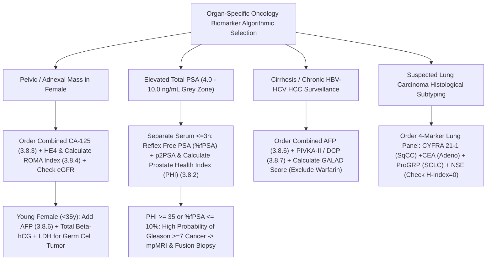

# 🎗️ Cluster 3.8: Complete Oncology Tumor Markers CLIA Cluster

**Department Folder:** `03_Immunoassay_Endocrinology_and_Nutrients`  
**Cluster ID & Folder:** `3.8_Oncology_Tumor_Markers_CLIA_Cluster`  
**Primary Analytical Platform:** **Snibe MAGLUMI X3** (Flash-CLIA — ABEI Direct Chemiluminescence & Magnetic Microbead Sandwich Immunoassay)  
**Backup / Comparability Platforms:** Contemporary Two-Site CLIA / ECLIA / ELFA Immunoassay Systems (CLSI EP31-A Governed — Strict Non-Interchangeability Enforced)  
**Global Reference Benchmarks:** ASCO (American Society of Clinical Oncology) Tumor Marker Guidelines, NCCN (National Comprehensive Cancer Network) Clinical Practice Guidelines in Oncology, EGTM (European Group on Tumor Markers), AUA/EAU Prostate Cancer Guidelines, ACOG/RCOG Ovarian Adnexal Mass (`RMI` & `ROMA`) Guidelines, AASLD/EASL/APASL Hepatocellular Carcinoma (`GALAD`) Guidelines, IMWG Multiple Myeloma (`ISS`/`R-ISS`) Criteria, NABL ISO 15189:2022, CAP, EFLM Biological Variation Database.

---

## 🗂️ 1. Master Cluster Inventory & Architectural Index (16 Standalone SOP & Interpretation Files)

| Sub-Test ID | File Name in `3.8_Oncology_Tumor_Markers_CLIA_Cluster/` | Primary LOINC | Primary Malignancy / Organ System & Algorithmic Index |
| :--- | :--- | :--- | :--- |
| **`3.8.1`** | `3.8.1_Universal_Oncology_Tumor_Marker_Surveillance_and_Non_Screening_Legal_Shield.md` | `LP29693-6` | **Master Oncology Governance SOP**: ASCO/EGTM Non-Screening Legal Shield, Serial Velocity (`RCV %`), Post-Op Half-Life Decay Kinetics, Hook-Effect Protocol & Platform Non-Equivalence. |
| **`3.8.2`** | `3.8.2_Total_PSA_Free_PSA_fPSA_tPSA_Ratio_and_p2PSA_Prostate_Health_Index.md` | `2857-1` / `10886-0` | **Prostate Adenocarcinoma**: Total PSA (Oesterling Age Ranges), Free PSA, `%fPSA` ($4\text{–}10\text{ ng/mL}$ Grey Zone), `[-2]proPSA (p2PSA)`, **Prostate Health Index (`PHI`)**, & $5\alpha\text{-RI}$ ($\times 2$) Rule. |
| **`3.8.3`** | `3.8.3_CA_125_MUC16_Ovarian_Peritoneal_and_Benign_Gynecological_Elevations.md` | `10334-1` | **Epithelial Ovarian, Fallopian Tube & Primary Peritoneal Carcinoma**: Risk of Malignancy Index (`RMI`), GCIG Doubling Criteria, & **Mandatory Endometriosis/Menstruation/Peritoneal TB Shield**. |
| **`3.8.4`** | `3.8.4_HE4_Human_Epididymis_Protein_4_and_ROMA_Index_Pre_and_Postmenopausal.md` | `55180-4` | **Epithelial Ovarian Cancer (`WFDC2`)**: Superior Specificity over CA-125 in Endometriosis, **Pre- & Postmenopausal `ROMA` Logarithmic Equations**, & **Mandatory CKD/eGFR False-Positive Shield**. |
| **`3.8.5`** | `3.8.5_Carcinoembryonic_Antigen_CEA_Colorectal_and_Smoker_Adjusted_Ranges.md` | `2039-6` | **Colorectal, Gastric, Pancreatic, Breast & Medullary Thyroid Carcinoma**: Smoker ($<5.0\text{ ng/mL}$) vs Non-Smoker ($<3.0\text{ ng/mL}$) Partitioning & Post-Curative Resection Surveillance. |
| **`3.8.6`** | `3.8.6_Alpha_Fetoprotein_AFP_Oncology_HCC_and_Germ_Cell_Tumors.md` | `1834-1` | **Hepatocellular Carcinoma (HCC) & Non-Seminomatous Germ Cell Tumors (NSGCT)**: $5\text{–}7\text{ day}$ Post-Orchiectomy Decay Curve, **Neonatal Decay Table ($0\text{–}12\text{ months}$)**, & Pregnancy Modifier. |
| **`3.8.7`** | `3.8.7_PIVKA_II_DCP_Des_Gamma_Carboxy_Prothrombin_and_GALAD_HCC_Score.md` | `30349-5` | **AFP-Negative Early HCC Detection**: Des-$\gamma$-Carboxy Prothrombin (`DCP`), **$\text{GALAD}$ Score Equation** (Gender, Age, AFP-L3, AFP, DCP), & **Mandatory Warfarin / Vitamin K Deficiency / Obstructive Jaundice Shield**. |
| **`3.8.8`** | `3.8.8_CA_19_9_Sialyl_Lewis_a_CA_50_and_CA_242_Pancreaticobiliary_Markers.md` | `24108-3` | **Pancreatic Ductal Adenocarcinoma & Cholangiocarcinoma**: **Lewis-Negative ($\text{Le}^{a-b-}$, *FUT3*-null $7\%\text{–}10\%$) Non-Secretor Shield**, **Obstructive Jaundice False-Positive Shield**, & Complementary `CA 50` / `CA 242`. |
| **`3.8.9`** | `3.8.9_CA_72_4_TAG_72_and_Pepsinogen_I_Pepsinogen_II_PGI_PGII_Gastric_Panel.md` | `17842-6` | **Gastric Adenocarcinoma & Mucinous Ovarian Cancer**: `CA 72-4` (`TAG-72`) + **"Serological Gastric Biopsy"** (`Pepsinogen I < 70 ng/mL` & `PGI/PGII Ratio < 3.0` for Chronic Atrophic Gastritis). |
| **`3.8.10`** | `3.8.10_CA_15_3_MUC1_CA_27_29_and_Serum_HER2_neu_Breast_Cancer.md` | `6875-9` | **Metastatic Breast Cancer Surveillance**: `CA 15-3` / `CA 27.29` (`MUC1`), **Chemotherapy "Tumor Flare" Phenomenon**, & Shed Extracellular Domain **`Serum HER2/neu` ($<15.0\text{ ng/mL}$)** Trastuzumab tracking. |
| **`3.8.11`** | `3.8.11_CYFRA_21_1_Cytokeratin_19_Fragment_NSCLC_Lung_and_Bladder.md` | `19172-6` | **Non-Small Cell Lung Cancer (NSCLC — Squamous Cell) & Muscle-Invasive Bladder Carcinoma**: Soluble Cytokeratin-19 fragments & **Saliva/Skin Epithelial Contamination Shield**. |
| **`3.8.12`** | `3.8.12_Neuron_Specific_Enolase_NSE_SCLC_Neuroblastoma_and_Hemolysis_Shield.md` | `2692-2` | **Small-Cell Lung Cancer (SCLC), Neuroblastoma & Post-Cardiac Arrest Coma Prognosis**: $\gamma\gamma$-Enolase & **ZERO-TOLERANCE `H-Index = 0` Hemolysis Rejection Rule** (RBCs/Platelets rich in NSE). |
| **`3.8.13`** | `3.8.13_ProGRP_Pro_Gastrin_Releasing_Peptide_SCLC_Hemolysis_Resistant.md` | `48418-8` | **Small-Cell Lung Cancer (SCLC) & Medullary Thyroid Carcinoma**: **Superior SCLC Sensitivity over NSE + 100% Resistant to In-Vitro Hemolysis**, Thrombin Serum Tube Preference, & CKD Modifier. |
| **`3.8.14`** | `3.8.14_Squamous_Cell_Carcinoma_Antigen_SCCA_Cervical_Head_Neck_Esophageal.md` | `19176-7` | **Squamous Cell Carcinoma of Uterine Cervix, Head & Neck, Esophagus & Lung**: Serpin B3/B4, **Mandatory Dermatology (Psoriasis/Eczema/Pemphigus) & Saliva/Sweat Contamination Shield**. |
| **`3.8.15`** | `3.8.15_S_100_Protein_Malignant_Melanoma_and_Traumatic_Brain_Injury_TBI.md` | `47275-3` | **Stage III/IV Malignant Melanoma Surveillance & Mild Traumatic Brain Injury (mTBI)**: Astroglial/Melanocytic `S100B` ($t_{1/2} \sim 30\text{–}60\text{ min}$) & **Scandinavian Neurotrauma `< 0.10 µg/L` Head CT Rule-Out**. |
| **`3.8.16`** | `3.8.16_Serum_and_Urine_Beta_2_Microglobulin_B2M_Multiple_Myeloma_ISS_Staging.md` | `1952-1` | **Multiple Myeloma (`ISS` & `R-ISS` Staging: $<3.5$ vs $\ge 5.5\text{ mg/L}$), CLL/Lymphoma & Proximal Renal Tubular Injury**: MHC Class I Light Chain & **Mandatory Urine $\text{pH } 6.0\text{–}8.0$ Alkalinization Rule**. |

---

## 📊 2. Master Six Sigma Quality, Biological Variation (`RCV %`), Half-Life ($t_{1/2}$) & Interference Matrix

| Tumor Marker | Standard Adult URL | EFLM $CV_I\%$ | EFLM $CV_G\%$ | Desirable $CV_A\%$ | Six Sigma $\text{TE}_a\%$ | 95% Serial `RCV %` | In-Vivo Half-Life ($t_{1/2}$) | Critical Pre-Analytical / Analytical Pitfall Shield |
| :--- | :--- | :--- | :--- | :--- | :--- | :--- | :--- | :--- |
| **`Total PSA` / `Free PSA`** | $< 4.0\text{ ng/mL}$ *(Age-stratified)* | $6.8\%$ | $42.0\%$ | $\le 3.4\%$ | $\pm 15.0\%$ | **$\pm 21.0\%$** | **tPSA: $2.2 \text{ – } 3.2\text{ days}$ fPSA: $1.5 \text{ – } 2.0\text{ hours}$** | **Separate serum $\le 3\text{h}$** (rapid in-vitro fPSA decay); Finasteride/Dutasteride lowers PSA by $50\%$; Ejaculation/UTI/Biopsy elevates. |
| **`CA-125` (`MUC16`)** | $< 35.0\text{ U/mL}$ | $9.1\%$ | $36.0\%$ | $\le 4.6\%$ | $\pm 20.0\%$ | **$\pm 28.2\%$** | **$5 \text{ – } 6\text{ days}$** | **Avoid drawing during menses**; Markedly elevated in **Endometriosis, 1st Trimester Pregnancy, Cirrhosis/Ascites, & Peritoneal TB**. |
| **`HE4` (`WFDC2`)** | Pre-M: $< 70\text{ pmol/L}$ Post-M: $< 140\text{ pmol/L}$ | $7.8\%$ | $25.0\%$ | $\le 3.9\%$ | $\pm 18.0\%$ | **$\pm 24.2\%$** | **$1.5 \text{ – } 3.0\text{ hours}$** *(Renal filtration)* | **Not elevated in Endometriosis**, but **markedly falsely elevated in Chronic Kidney Disease ($\text{eGFR} < 60\text{ mL/min}$)** and smokers ($+20\%$). |
| **`CEA`** | Non-Smoker: $< 3.0\text{ ng/mL}$ Smoker: $< 5.0\text{ ng/mL}$ | $8.9\%$ | $45.0\%$ | $\le 4.5\%$ | $\pm 18.0\%$ | **$\pm 27.6\%$** | **$3 \text{ – } 5\text{ days}$** *(Hepatic Kupffer clearance)* | Tobacco/Bidi/Hookah smoking raises baseline; Cholestasis/Cirrhosis delays clearance; **Post-op normalization requires $4\text{–}6\text{ weeks}$**. |
| **`AFP`** | Adult: $< 7.0 \text{ – } 10.0\text{ ng/mL}$ | $12.2\%$ | $45.6\%$ | $\le 5.0\%$ | $\pm 20.0\%$ | **$\pm 36.6\%$** | **$5.0 \text{ – } 7.0\text{ days}$** | **Healthy Neonates $> 10,000\text{–}100,000\text{ ng/mL}$** (takes $8\text{–}12\text{m}$ to reach adult range); Post-orchiectomy must decay by $50\%$ every $5\text{–}7\text{d}$. |
| **`PIVKA-II` (`DCP`)** | $< 40.0\text{ mAU/mL}$ *(or $< 28.4\text{ ng/mL}$)* | $10.5\%$ | $34.0\%$ | $\le 5.0\%$ | $\pm 20.0\%$ | **$\pm 32.2\%$** | **$40 \text{ – } 72\text{ hours}$** | **Invalidated ($>1,000\text{ mAU/mL}$ false-positive) by Warfarin/Acenocoumarol**, Severe Vitamin K Deficiency, Obstructive Jaundice, or broad-spectrum antibiotics. |
| **`CA 19-9`** | $< 37.0\text{ U/mL}$ | $11.9\%$ | $64.0\%$ | $\le 5.5\%$ | $\pm 20.0\%$ | **$\pm 36.4\%$** | **$1.0 \text{ – } 3.0\text{ days}$** *(Biliary excretion)* | **1. Lewis-Negative ($\text{Le}^{a-b-}$) $7\%\text{–}10\%$ have $0\text{ U/mL}$ despite cancer** (reflex `CA 50`/`CA 242`/`CEA`). **2. Benign Obstructive Jaundice** causes massive false elevations ($>1,000\text{ U/mL}$). |
| **`CA 72-4` & `PGI/PGII`** | CA 72-4: $< 6.9\text{ U/mL}$ PGI/II Ratio: $> 3.0$ | $14.5\%$ | $52.0\%$ | $\le 6.0\%$ | $\pm 22.0\%$ | **$\pm 43.5\%$** | **$3 \text{ – } 5\text{ days}$** | **PPIs (Omeprazole/Pantoprazole) artificially elevate both PGI & PGII** (hold PPIs for $1\text{–}2\text{ weeks}$ before Atrophic Gastritis screening). |
| **`CA 15-3` & `sHER2`** | CA 15-3: $< 30.0\text{ U/mL}$ sHER2: $< 15.0\text{ ng/mL}$ | $6.1\%$ | $32.4\%$ | $\le 4.0\%$ | $\pm 16.0\%$ | **$\pm 20.3\%$** | **$5 \text{ – } 7\text{ days}$** | **Transient "Tumor Flare" surge during first $4\text{–}6\text{ weeks}$ of effective chemotherapy/endocrine therapy** due to rapid tumor cell lysis. |
| **`CYFRA 21-1`** | $< 3.3\text{ ng/mL}$ | $13.5\%$ | $38.0\%$ | $\le 5.5\%$ | $\pm 20.0\%$ | **$\pm 40.4\%$** | **$2 \text{ – } 4\text{ hours}$** | **Saliva & skin epithelial contamination** of pipette tips or open tubes causes massive false elevations; elevated in CKD & interstitial lung disease. |
| **`NSE`** | $< 16.3\text{ ng/mL}$ | $10.9\%$ | $20.3\%$ | $\le 5.0\%$ | $\pm 20.0\%$ | **$\pm 33.3\%$** | **$24 \text{ – } 30\text{ hours}$** | **🚨 ZERO-TOLERANCE HEMOLYSIS (`H-Index = 0`): Erythrocytes and platelets contain abundant $\gamma$-enolase; even invisible trace hemolysis ($>15\text{ mg/dL Hb}$) invalidates NSE!** |
| **`ProGRP`** | Serum: $< 65.0\text{ pg/mL}$ Plasma: $< 68.0\text{ pg/mL}$ | $8.2\%$ | $26.0\%$ | $\le 4.5\%$ | $\pm 18.0\%$ | **$\pm 25.9\%$** | **$19 \text{ – } 28\text{ hours}$** | **100% Immune to Hemolysis** (superior to NSE for SCLC), but degraded by endogenous proteases if serum sits unseparated $> 3\text{h}$; elevated in CKD. |
| **`SCCA`** | $< 1.5 \text{ – } 2.5\text{ ng/mL}$ | $15.0\%$ | $35.0\%$ | $\le 6.0\%$ | $\pm 20.0\%$ | **$\pm 44.8\%$** | **$\sim 20\text{ minutes}$ to $2.2\text{ hours}$** | **Gloves & Mask Mandatory during Phlebotomy/Pipetting**: Human sweat, saliva, sneezes, and dander contain massive SCCA; elevated in **Psoriasis/Eczema**. |
| **`S-100` (`S100B`)** | $< 0.105\text{ }\mu\text{g/L}$ ($\text{ng/mL}$) | $11.0\%$ | $28.0\%$ | $\le 5.0\%$ | $\pm 20.0\%$ | **$\pm 33.6\%$** | **$30 \text{ – } 60\text{ minutes}$** *(Renal clearance)* | For **Mild TBI Head CT Rule-Out ($<0.10\text{ }\mu\text{g/L}$)**, blood MUST be drawn **within $< 3\text{–}6\text{ hours}$ of head injury**; Extracranial fractures/adipose trauma cause false positives. |
| **`Beta-2 Microglobulin`** | Serum: $0.8 \text{ – } 2.4\text{ mg/L}$ Urine: $< 0.30\text{ mg/L}$ | $5.9\%$ | $15.5\%$ | $\le 3.5\%$ | $\pm 15.0\%$ | **$\pm 19.0\%$** | **$1.5 \text{ – } 2.0\text{ hours}$** *(Glomerular filtration)* | **Urine B2M degrades irreversibly within minutes if Urine $\text{pH} < 6.0$ — MUST alkalinize urine immediately to $\text{pH } 6.0\text{–}8.0$ with $1\text{M NaOH}$!** |

---

## 🧬 3. Organ-Specific Multi-Marker Diagnostic & Surveillance Algorithms

---

## 🛡️ 4. Universal Oncology Tumor Marker Medico-Legal Shield (ASCO / NCCN / EGTM / ISO 15189:2022)

> [!CAUTION]
> **Mandatory Footer for ALL 16 Oncology Biomarker Reports (`3.8.1` to `3.8.16`):**  
> Attach this core legal shield to every tumor marker report in the LIMS to prevent catastrophic clinical misinterpretation—either patient panic/unnecessary surgery over a benign inflammatory elevation, or false reassurance over a normal marker in early-stage malignancy.

### **[LIMS COPY-PASTE BLOCK — UNIVERSAL ONCOLOGY TUMOR MARKER LEGAL SHIELD]**

> **MANDATORY ONCOLOGY BIOMARKER DISCLAIMER (ASCO / NCCN / EGTM / ISO 15189:2022 / CPA 2019):**
> 1. **NOT A STANDALONE CANCER SCREENING OR DIAGNOSTIC TEST:** Serum tumor markers are normal cellular or mucin proteins whose synthesis or shedding increases not only in malignancy, but also in **numerous benign inflammatory, infectious, hepatobiliary, renal, dermatological, and physiological conditions** (including pregnancy, menstruation, smoking, benign prostatic hyperplasia, endometriosis, peritoneal tuberculosis, cholestasis, and chronic kidney disease). **An elevated tumor marker is NEVER diagnostic of cancer on its own; definitive diagnosis of malignancy strictly requires histopathological/cytopathological tissue biopsy and radiological correlation.**
> 2. **A NORMAL VALUE DOES NOT EXCLUDE MALIGNANCY:** Early-stage, localized, small-volume, or poorly differentiated tumors—as well as specific genetic non-secretor phenotypes (e.g., **Lewis-negative [$\text{Le}^{a-b-}$] individuals who cannot synthesize $\text{CA 19-9}$**)—frequently exhibit completely normal serum tumor marker concentrations.
> 3. **VALIDATED CLINICAL UTILITY (SURVEILLANCE & SERIAL VELOCITY):** Tumor markers are primarily validated for **monitoring response to systemic therapy/surgery, evaluating post-operative kinetic decay ($t_{1/2}$), and detecting preclinical recurrence** in patients with an already-established histological diagnosis of cancer, interpreted via the **Reference Change Value (`RCV %`)** across serial timepoints.
> 4. **STRICT ASSAY PLATFORM NON-INTERCHANGEABILITY (ISBT / EGTM DIRECTIVE):** Different commercial immunoassay analyzers (**Snibe Maglumi Flash-CLIA**, Roche Elecsys ECLIA, Abbott Architect CMIA, Beckman Access, Siemens Atellica) utilize proprietary monoclonal antibody pairs targeting distinct heterogenous glycoprotein epitopes. **Results obtained from different laboratories or different analyzer platforms CANNOT be directly compared.** If a patient switches laboratories, a **new parallel baseline** must be established.
> 5. **HIGH-DOSE HOOK EFFECT & HETEROPHILE INTERFERENCE SHIELD:** Although automated high-concentration hook-effect dilution protocols are active, extreme antigen excess ($> 100,000\text{–}1,000,000\text{ units}$), high-dose Biotin ($> 5\text{ mg/day}$), or endogenous heterophile/human anti-mouse antibodies (`HAMA`) may rarely cause paradoxical readings. Please alert the laboratory immediately for serial dilution or heterophile-blocking verification if a result is discordant with the clinical or radiological picture. *Not valid for medico-legal purposes.*
