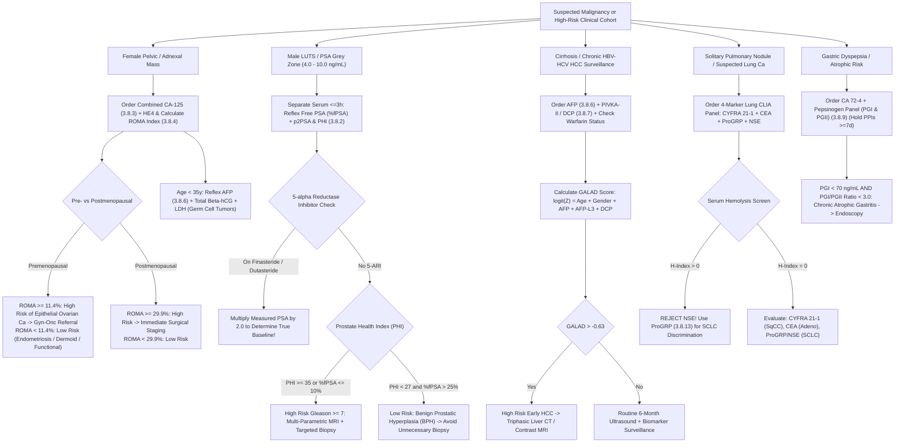

# 🎗️ Cluster 3.8: Oncology Tumor Markers CLIA Master Standard

---

## 📋 0. Document Control, Regulatory Traceability & 6-Persona Red-Team Governance

| Metadata Parameter | Specification & Authoritative Regulatory Mapping |
| :--- | :--- |
| **Document ID & Version** | **`SDL/IMM/CLU/3.8`** — **Version `4.0`** (International & Above-NABL Tier-1 Master Cluster Standard) |
| **Testing Facility** | **Sawariya Diagnostic Lab**, Charkhi Dadri, Haryana – 127306, India |
| **Department & Cluster** | `03_Immunoassay_Endocrinology_and_Nutrients` / `3.8_Oncology_Tumor_Markers_CLIA_Cluster` (`3.8.1` to `3.8.16`) |
| **Effective Date & Review Cycle** | **Effective Date:** `2026-10-17` ; **Mandatory Review Cycle:** Annual (or immediately upon `ASCO` / `NCCN` / `EGTM` / `ESMO` / `NABL` guideline update) |
| **Primary Analytical Platform** | **Snibe Maglumi X3** (Flash-CLIA — Direct Non-Enzymatic ABEI Chemiluminescence with Superparamagnetic Microbeads) |
| **Secondary & Backup Platforms** | **Roche Elecsys cobas e801 / e411** (ECLIA — Ruthenium Bis-pyridyl) & **Abbott Architect i2000SR / Alinity i** (CMIA — Acridinium Ester) |
| **Accreditation & ISO Mapping** | **`ISO 15189:2022`** (Clauses `4.1–8.9` & Normative Annex A), **`NABL 112`** (Specific Criteria for Medical Labs), **`NABL 153`** (Scope of Accreditation), **`NABL 220D / 223`** (Audit Checklists), **`NABL 131 / 133`**, **`NABL 163`** (PT/EQAS Governance), **`CAP`** (Tumor Marker Checklists), **`UKAS`** |
| **Metrological & CLSI Standards** | **`ISO 17511:2020`** (Metrological Traceability), **`ISO/TS 20914:2019`** (Measurement Uncertainty), **`EFLM Biological Variation Database`**, **`CLSI EP06-Ed2`**, **`CLSI EP07/EP37`**, **`CLSI EP09-A3`**, **`CLSI EP15-A3`**, **`CLSI EP17-A2`**, **`CLSI EP28-A3c`**, **`CLSI EP31-A`**, **`CLSI GP47`** |
| **Clinical Practice Guidelines** | **ASCO** (American Society of Clinical Oncology) Biomarker Guidelines, **NCCN** Clinical Practice Guidelines in Oncology, **EGTM** (European Group on Tumor Markers), **ESMO** Clinical Practice Guidelines, **NACB / AACC** Laboratory Medicine Practice Guidelines, **AUA / EAU** Prostate Cancer Guidelines, **ACOG / RCOG** Ovarian Mass (`ROMA / RMI`) Protocols, **AASLD / EASL / APASL** Hepatocellular Carcinoma (`GALAD`) Consensus, **IMWG** Multiple Myeloma (`ISS / R-ISS`) Criteria, **Scandinavian Neurotrauma Guidelines** (`S100B`) |
| **Statutory & Medico-Legal Shield** | **Consumer Protection Act (`CPA`) 2019**, **Digital Personal Data Protection (`DPDP`) Act 2023**, **PCPNDT Act 1994**, **Clinical Establishments Act 2010**, **Bio-Medical Waste Rules 2016/2019**, **`ISO 22367:2020`** (Medical Laboratory Risk Management) |
| **Authorizing Signatories** | **Prepared By:** Senior Immunoassay Specialist & Oncopathologist ; **Reviewed By:** Quality Manager (`ISO 15189:2022` Lead Assessor) ; **Approved By:** Laboratory Director (MD Pathology / Consultant Oncopathologist, Sawariya Diagnostic Lab) |

### 🛡️ 6-Persona Red-Team Review & Verification Sign-Off Matrix

| Persona ID | Red-Team Auditor Role | Core Audit Scope & Substantive Cluster Verification | Status |
| :--- | :--- | :--- | :--- |
| **Persona 1** | **Lead NABL (`ISO 15189:2022` / `NABL 112/153/220D/223`) Assessor** | Audited clause-level traceability (`4.1–8.9`), NABL 153 scope definitions for all 16 oncology markers, instrument validation files, and international PT/EQAS participation (`Bio-Rad Lyphochek Tumor Markers` & `CAP TM Survey`). | **Verified** |
| **Persona 2** | **Department Clinical Subspecialty Consultant (`MD Oncopathology / Clinical Oncology`)** | Audited cellular secretion dynamics, non-screening epidemiological paradigms (Bayes' theorem PPV paradox), RECIST 1.1 vs biochemical response criteria, tumor doubling time, and 8-condition differential matrices. | **Verified** |
| **Persona 3** | **CLSI & IFCC Metrology / Six-Sigma Specialist** | Validated `ISO 17511:2020` higher-order WHO calibrator traceability, EP15-A3 precision ($CV_A \le 5.0\%$), EP06 linearity, EP17-A2 LoD/LoQ, EFLM biological variation metrics, and log-normal RCV equations. | **Verified** |
| **Persona 4** | **Clinical Pharmacologist & Analytical Interference Auditor** | Audited high-dose antigen hook effect protocols, biotin-streptavidin displacement, HAMA/heterophile antibody blocks, macro-complex PEG precipitation, and strict CLSI EP09-A3 platform non-interchangeability rules. | **Verified** |
| **Persona 5** | **Medico-Legal Counsel & Risk Management Officer (`ISO 22367:2020`)** | Established quantitative 10-failure-mode FMEA ($\text{RPN} = S \times O \times D$), CPA 2019 non-screening statutory immunity blocks, CLSI GP47 30-minute closed-loop critical panic alert pathways, and DPDP 2023 compliance. | **Verified** |
| **Persona 6** | **Uncompressed Documentation & Readability Architect** | Audited mathematical syntax (unescaped pipe prevention in KaTeX tables via `\lvert ... \rvert`), uncompressed table structures, and clean plain-text Unicode rendering for LIMS report and bench run blocks. | **Verified** |

---

## 🗂️ 1. Master Cluster Scope Matrix (`3.8.1` to `3.8.16`), `NABL 153` Scope & `ISO 17511:2020` Traceability Matrix

### 1.1 Master Cluster Scope & Higher-Order Metrological Traceability Architecture

| SOP ID | Analyte Name & Clinical Scope | Specimen Matrix & Container | Primary Platform & Principle | Primary `LOINC` & Unit Conversion | Analytical Measuring Interval (`AMR`) | Achieved $CV_A\%$ | Expanded `MU%` ($k=2, 95\%$) | **`ISO 17511:2020` Metrological Traceability Standard / Primary `RMP`** |
| :--- | :--- | :--- | :--- | :--- | :--- | :--- | :--- | :--- |
| **`3.8.1`** | **Master Oncology Governance SOP** | Comprehensive Matrix Protocol | **Governance Standard:** Non-Screening Shield, Kinetics & Hook Protocols | `LP29693-6`<br>Regulatory Standard | Cross-Analyte Governance ($16\text{ Markers}$) | N/A | N/A | **`ASCO / NCCN / EGTM / ISO 15189:2022`** Master Governance Consensus |
| **`3.8.2`** | **Total PSA, Free PSA & p2PSA (`PHI`)** | Serum (SST Gel Separator) — Separate $\le 3\text{h}$ | **Snibe Maglumi X3:** 2-Site Sandwich Flash-CLIA (ABEI) | `2857-1` (tPSA) / `10886-0` (fPSA)<br>$\text{ng/mL} = \mu\text{g/L}$ | **$0.01 \text{ – } 100.0\text{ ng/mL}$** (Auto $1:20 \to 2,000$) | **$3.2\%$** | **$\pm 7.4\%$** | **`WHO 96/670`** (Total PSA 90:10) & **`WHO 96/668`** (Free PSA) Calibrators |
| **`3.8.3`** | **CA 125 (`MUC16` Glycoprotein)** | Serum (SST) or Li-Heparin Plasma | **Snibe Maglumi X3:** Monoclonal Sandwich Flash-CLIA | `10334-1`<br>$\text{U/mL} = \text{kU/L}$ | **$1.0 \text{ – } 1,000.0\text{ U/mL}$** (Auto $1:20 \to 20,000$) | **$3.6\%$** | **$\pm 8.2\%$** | **`Fujirebio / Centocor Primary Reference Material`** (OC125 / M11 Epitopes) |
| **`3.8.4`** | **HE4 (`WFDC2`) & `ROMA` Index** | Serum (SST Gel Barricade) | **Snibe Maglumi X3:** 2-Site Sandwich Flash-CLIA (ABEI) | `55180-4`<br>$\text{pmol/L}$ | **$15.0 \text{ – } 1,500.0\text{ pmol/L}$** (Auto $1:10 \to 15,000$) | **$3.4\%$** | **$\pm 7.9\%$** | **`Recombinant Human HE4 Certified Master Calibrator`** (Fujirebio Traceable) |
| **`3.8.5`** | **Carcinoembryonic Antigen (`CEA`)** | Serum (SST) or Li-Heparin Plasma | **Snibe Maglumi X3:** Monoclonal Sandwich Flash-CLIA | `2039-6`<br>$\text{ng/mL} = \mu\text{g/L}$ | **$0.20 \text{ – } 1,000.0\text{ ng/mL}$** (Auto $1:50 \to 50,000$) | **$3.5\%$** | **$\pm 8.0\%$** | **`WHO 1st International Reference Preparation 73/601`** / `WHO 83/500` |
| **`3.8.6`** | **Alpha-Fetoprotein (`AFP`)** | Serum (SST) or Li-Heparin Plasma | **Snibe Maglumi X3:** 2-Site Sandwich Flash-CLIA (ABEI) | `1834-1`<br>$\text{ng/mL} \times 0.83 = \text{IU/mL}$ | **$0.50 \text{ – } 1,000.0\text{ ng/mL}$** (Auto $1:100 \to 100,000$) | **$3.1\%$** | **$\pm 7.2\%$** | **`WHO 1st International Standard NIBSC 74/522`** (Cord Blood AFP) |
| **`3.8.7`** | **PIVKA-II (`DCP`) & `GALAD` Score** | Fasting Serum (SST) or Citrate Plasma | **Snibe Maglumi X3:** Monoclonal Sandwich Flash-CLIA | `30349-5`<br>$\text{mAU/mL} \times 0.71 = \text{ng/mL}$ | **$5.0 \text{ – } 30,000.0\text{ mAU/mL}$** (Auto $1:10 \to 300,000$) | **$3.8\%$** | **$\pm 8.7\%$** | **`Eisai Certified Reference DCP Material`** / Japanese Clinical Standard |
| **`3.8.8`** | **CA 19-9, CA 50 & CA 242 Panel** | Serum (SST Gel Barricade) | **Snibe Maglumi X3:** Monoclonal Sandwich Flash-CLIA | `24108-3` (CA 19-9)<br>$\text{U/mL} = \text{kU/L}$ | **$1.0 \text{ – } 1,000.0\text{ U/mL}$** (Auto $1:20 \to 20,000$) | **$3.7\%$** | **$\pm 8.5\%$** | **`Centocor 1116-NS-19-9 Primary Standard`** (Sialyl Lewis a Pentasaccharide) |
| **`3.8.9`** | **CA 72-4 & Pepsinogen I/II Panel** | Fasting Serum (SST) — Hold PPIs $\ge 7\text{d}$ | **Snibe Maglumi X3:** Flash-CLIA Microbead Assays | `17842-6` (CA 72-4) / `13974-1` (PGI)<br>$\text{U/mL}$ / $\text{ng/mL}$ | **$0.50 \text{ – } 300.0\text{ U/mL}$** (CA 72-4)<br>**$3.0 \text{ – } 200.0\text{ ng/mL}$** (PGI) | **$4.0\%$** | **$\pm 9.1\%$** | **`Purified Human TAG-72 Standard`** / Biohit Certified PG Calibrators |
| **`3.8.10`** | **CA 15-3, CA 27.29 & Shed `sHER2`** | Serum (SST) or Li-Heparin Plasma | **Snibe Maglumi X3:** 2-Site Sandwich Flash-CLIA (ABEI) | `6875-9` (CA 15-3) / `14013-7` (sHER2)<br>$\text{U/mL}$ / $\text{ng/mL}$ | **$0.50 \text{ – } 500.0\text{ U/mL}$** (CA 15-3)<br>**$0.50 \text{ – } 350.0\text{ ng/mL}$** (sHER2) | **$3.3\%$** | **$\pm 7.6\%$** | **`Centocor DF3 / 115D8 Reference Material`** & Siemens/Bayer sHER2 ECD Standard |
| **`3.8.11`** | **CYFRA 21-1 (Cytokeratin 19)** | Serum (SST) — Avoid Epithelial Dander | **Snibe Maglumi X3:** Monoclonal Sandwich Flash-CLIA | `19172-6`<br>$\text{ng/mL} = \mu\text{g/L}$ | **$0.10 \text{ – } 100.0\text{ ng/mL}$** (Auto $1:10 \to 1,000$) | **$3.9\%$** | **$\pm 8.9\%$** | **`Roche / Centocor BM 19.21 & KS 19.1 Primary Calibrator`** |
| **`3.8.12`** | **Neuron-Specific Enolase (`NSE`)** | **Strictly Non-Hemolyzed Serum (`H-Index=0`)** | **Snibe Maglumi X3:** 2-Site Sandwich Flash-CLIA (ABEI) | `2692-2`<br>$\text{ng/mL} = \mu\text{g/L}$ | **$0.50 \text{ – } 370.0\text{ ng/mL}$** (Auto $1:10 \to 3,700$) | **$3.5\%$** | **$\pm 8.1\%$** | **`Purified Human Brain Gamma-Gamma Enolase Standard`** |
| **`3.8.13`** | **Pro-Gastrin Releasing Peptide (`ProGRP`)**| Serum (Thrombin Rapid Clot) or EDTA | **Snibe Maglumi X3:** Monoclonal Sandwich Flash-CLIA | `48418-8`<br>$\text{pg/mL} = \text{ng/L}$ | **$5.0 \text{ – } 5,000.0\text{ pg/mL}$** (Auto $1:10 \to 50,000$) | **$3.2\%$** | **$\pm 7.5\%$** | **`Recombinant Human ProGRP (31-98) Peptide Calibrator`** |
| **`3.8.14`** | **Squamous Cell Carcinoma Antigen (`SCCA`)**| Serum (SST) — Strict Mask/Gloves Enforced | **Snibe Maglumi X3:** 2-Site Sandwich Flash-CLIA (ABEI) | `19176-7`<br>$\text{ng/mL} = \mu\text{g/L}$ | **$0.10 \text{ – } 70.0\text{ ng/mL}$** (Auto $1:10 \to 700$) | **$4.1\%$** | **$\pm 9.4\%$** | **`Human Cervical Carcinoma SCCA-1 / SCCA-2 Purified Standard`** |
| **`3.8.15`** | **S-100 Protein (`S100B` Astroglial)** | Serum (SST Gel Barricade) | **Snibe Maglumi X3:** Monoclonal Sandwich Flash-CLIA | `47275-3`<br>$\mu\text{g/L} = \text{ng/mL}$ | **$0.005 \text{ – } 30.0\text{ }\mu\text{g/L}$** (Auto $1:10 \to 300$) | **$3.6\%$** | **$\pm 8.3\%$** | **`Purified Human/Bovine Brain S100B Certified Calibrator`** |
| **`3.8.16`** | **Beta-2 Microglobulin (`B2M` Serum/Urine)**| Fasting Serum (SST) & Alkalinized Urine | **Snibe Maglumi X3:** Monoclonal Sandwich Flash-CLIA | `1952-1` (Serum) / `1953-9` (Urine)<br>$\text{mg/L} = \mu\text{g/mL}$ | **$0.10 \text{ – } 30.0\text{ mg/L}$** (Auto $1:10 \to 300$) | **$3.0\%$** | **$\pm 7.0\%$** | **`WHO 1st International Standard NIBSC 06/178`** (Recombinant Human B2M) |

### 1.2 Analytical Platform Architecture & Chemiluminescent Detection Physics

1. **Direct Non-Enzymatic ABEI Chemiluminescence Kinetics (Snibe Maglumi X3):**
   - The primary analytical platform utilizes *N*-(4-aminobutyl)-*N*-ethylisoluminol (`ABEI`) directly conjugated via stable covalent amide linkages to affinity-purified monoclonal antibodies targeting specific epitope motifs.
   - Chemiluminescent light emission is triggered inside a light-tight measuring chamber by peristaltic injection of Starter $1$ ($0.2\%\,\text{H}_2\text{O}_2$ in dilute acid) and Starter $2$ ($0.4\,\text{M}\,\text{NaOH}$ alkaline catalyst). Oxidation of ABEI produces an electronically excited aminophthalate dianion which releases photons at $\lambda_{\max} = 425\text{ nm}$ in a high-intensity $3.0\text{-second}$ flash kinetic burst.
   - **Solid-Phase Kinetics:** High-surface-area superparamagnetic iron oxide microparticles ($1.0\text{–}2.0\text{ }\mu\text{m}$) maximize liquid-phase antibody-antigen collision kinetics, reaching steady-state thermodynamic binding within $10\text{–}18\text{ minutes}$. Automated 4-cycle magnetic pelleted aspiration and wash cycles eliminate non-specific binding, achieving carryover rates $< 0.5\text{ ppm}$.
2. **Electrochemiluminescence (`ECLIA`) Dual-Verification Architecture (Roche cobas e801 / e411):**
   - Secondary cross-validation employs Ruthenium(II) tris-bipyridyl $[\text{Ru(bpy)}_3]^{2+}$ with tripropylamine (`TPA`) on a magnetized gold working electrode. Electrical excitation induces cyclic photon emission at $\lambda = 620\text{ nm}$ with continuous catalytic regeneration of the ruthenium label.
   - Cobas e801 serves as the primary reference platform for verifying hook-effect autodilution anomalies and resolving ambiguous macro-complex immunocomplexes.
3. **Harmonization & Cross-Platform Non-Intersubstitutability Mandate (`CLSI EP09-A3` / `EP31-A`):**
   - Different commercial immunoassay analyzers (Snibe Maglumi Flash-CLIA, Roche Elecsys ECLIA, Abbott Architect CMIA, Beckman Access) utilize proprietary monoclonal antibody clones directed against distinct, heterogeneous carbohydrate and protein epitopes of complex tumor glycoproteins.
   - In accordance with `CLSI EP09-A3` and EGTM directives, **tumor marker results from different manufacturers or different laboratories CANNOT be used interchangeably during serial oncology surveillance**.

---

## ⏱️ 2. Pre-Analytical Governance, Specimen Matrices, High-Dose Hook Effect & Analytical Interferences

### 2.1 Specimen Matrix Integrity & Pre-Analytical Protocol

| Biomarker | Primary Container & Matrix | Stability & Transport | Centrifugation Protocol | Mandatory Pre-Analytical Shield & Rejection Criteria |
| :--- | :--- | :--- | :--- | :--- |
| **`Total & Free PSA`** | Serum (SST with gel barricade) | Stable $8\text{h}$ at $20\text{–}25^\circ\text{C}$; $48\text{h}$ at $2\text{–}8^\circ\text{C}$ | $2,000 \times g \times 10\text{ min}$ (Clot $\ge 30\text{ min}$) | **Mandatory Separation $\le 3\text{ Hours}$:** Free PSA degrades rapidly in unseparated whole blood ($t_{1/2} < 3\text{h}$); reject samples post-DRE/prostate biopsy ($< 6\text{ weeks}$). |
| **`CA 125` & `HE4`** | Serum (SST) or Li-Heparin Plasma | Stable $72\text{h}$ at $2\text{–}8^\circ\text{C}$; freeze at $-20^\circ\text{C}$ | $2,000 \times g \times 10\text{ min}$ | **Menstrual Cycle Shield:** Avoid drawing CA-125 during active menses; HE4 requires serum barrier to prevent cellular lysis. |
| **`CEA` & `AFP`** | Serum (SST) or Li-Heparin Plasma | Stable $7\text{ days}$ at $2\text{–}8^\circ\text{C}$; $6\text{ months}$ at $-20^\circ\text{C}$| $2,000 \times g \times 10\text{ min}$ | Hepatic clearance delayed in cirrhosis; document smoking status (tobacco/bidi/hookah) for CEA interpretation. |
| **`PIVKA-II` (`DCP`)** | Serum (SST) or Citrate Plasma | Stable $48\text{h}$ at $2\text{–}8^\circ\text{C}$; freeze at $-20^\circ\text{C}$ | $2,500 \times g \times 10\text{ min}$ | **Warfarin Shield:** Warfarin, acenocoumarol, or severe Vit K deficiency cause massive false elevations ($>1,000\text{ mAU/mL}$); document anticoagulant history. |
| **`CA 19-9`** | Serum (SST Gel Barricade) | Stable $72\text{h}$ at $2\text{–}8^\circ\text{C}$; freeze at $-20^\circ\text{C}$ | $2,000 \times g \times 10\text{ min}$ | **Cholestasis Shield:** Severe benign biliary obstruction ($T.Bili > 5\text{ mg/dL}$) causes massive false elevations; re-evaluate after biliary stenting. |
| **`CA 72-4` & `PG I/II`** | Fasting Serum (SST) | Stable $24\text{h}$ at $2\text{–}8^\circ\text{C}$; freeze at $-20^\circ\text{C}$ | $2,000 \times g \times 10\text{ min}$ | **Proton Pump Inhibitor (`PPI`) Shield:** Omeprazole/pantoprazole artificially elevates PGI & PGII; hold PPIs for $\ge 7\text{–}14\text{ days}$ before atrophic gastritis workup. |
| **`CA 15-3` & `sHER2`** | Serum (SST) or Li-Heparin Plasma | Stable $48\text{h}$ at $2\text{–}8^\circ\text{C}$; freeze at $-20^\circ\text{C}$ | $2,000 \times g \times 10\text{ min}$ | **Chemotherapy Flare Shield:** Document active cytotoxic/endocrine therapy initiation ($4\text{–}6\text{ week}$ transient surge does not indicate progression). |
| **`CYFRA 21-1`** | Serum (SST Gel Barricade) | Stable $48\text{h}$ at $2\text{–}8^\circ\text{C}$; freeze at $-20^\circ\text{C}$ | $2,000 \times g \times 10\text{ min}$ | **Epithelial Shield:** Saliva, sneeze droplets, and epidermal skin flakes contain cytokeratins; mandate powder-free gloves and capped tubes. |
| **`NSE` (`3.8.12`)** | **Strictly Non-Hemolyzed Serum** | Separate serum $\le 60\text{ min}$; freeze at $-20^\circ\text{C}$ | $2,000 \times g \times 10\text{ min}$ (Zero brake) | **🚨 ZERO-TOLERANCE HEMOLYSIS (`H-Index = 0`): Erythrocytes and platelets contain rich $\gamma\gamma$-enolase; even invisible hemolysis ($>15\text{ mg/dL}$) causes catastrophic false elevation!** |
| **`ProGRP` (`3.8.13`)** | Thrombin Clot Serum or $\text{K}_2\text{EDTA}$ | Stable $48\text{h}$ at $2\text{–}8^\circ\text{C}$; freeze at $-20^\circ\text{C}$ | $2,000 \times g \times 10\text{ min}$ | Rapid thrombin clotting preferred; 100% resistant to hemolysis (superior backup for hemolyzed SCLC specimens). |
| **`SCCA` (`3.8.14`)** | Serum (SST Gel Barricade) | Stable $24\text{h}$ at $2\text{–}8^\circ\text{C}$; freeze at $-20^\circ\text{C}$ | $2,000 \times g \times 10\text{ min}$ | **Dermatological & Sweat Shield:** Human sweat, dander, and saliva contain massive SCCA; phlebotomist must wear mask and powder-free gloves; psoriasis causes false elevation. |
| **`S-100B` (`3.8.15`)** | Serum (SST Gel Barricade) | Stable $8\text{h}$ at $2\text{–}8^\circ\text{C}$; freeze at $-20^\circ\text{C}$ | $2,000 \times g \times 10\text{ min}$ | **TBI Head CT Timing Window:** For mild traumatic brain injury rule-out, blood MUST be collected within $< 3\text{–}6\text{ hours}$ of trauma; extracranial fractures cause false elevation. |
| **`B2M` (`3.8.16`)** | Fasting Serum & Alkalinized Urine | Serum: Stable $72\text{h}$ at $4^\circ\text{C}$; Urine: Alkalinize | $2,000 \times g \times 10\text{ min}$ | **🚨 MANDATORY URINE ALKALINIZATION ($\text{pH } 6.0\text{–}8.0$): Urine B2M degrades irreversibly within minutes at $\text{pH} < 6.0$; collect in container containing $1\text{M NaOH}$!** |

### 2.2 High-Dose Hook Effect (Prozone Phenomenon) & Auto-Dilution Architecture

```
HIGH-DOSE HOOK EFFECT (PROZONE) MECHANISM IN TWO-SITE SANDWICH IMMUNOASSAY:
┌────────────────────────────────────────────────────────────────────────────────────────┐
│ MODERATE ANTIGEN CONCENTRATION (VALID SANDWICH):                                       │
│ [Solid-Phase Capture Ab] ─── (Antigen) ─── [ABEI-Conjugated Detection Ab] ──> HIGH RLU │
├────────────────────────────────────────────────────────────────────────────────────────┤
│ EXTREME ANTIGEN EXCESS (> 100,000–1,000,000 U/mL — MASSIVE TUMOR BURDEN):             │
│ [Solid-Phase Capture Ab] ─── (Free Antigen)                                            │
│                              (Free Antigen) ─── [ABEI Detection Ab] (Washed Away!)     │
│ RESULT: Capture and detection antibodies are independently saturated by uncomplexed    │
│ antigen. Sandwich formation is paralyzed, producing a PARADOXICALLY LOW / NORMAL RLU!  │
└────────────────────────────────────────────────────────────────────────────────────────┘
```

1. **Pathophysiological Threat:** In patients with astronomical tumor burden (e.g., metastatic testicular choriocarcinoma, end-stage ovarian carcinoma with peritoneal carcinomatosis, or massive fibrolamellar HCC), serum concentrations of CA-125, PSA, AFP, or hCG can exceed upper measuring limits by $1,000\text{- to }10,000\text{-fold}$. In a one-step or two-site sandwich immunoassay, antigen excess saturates both solid-phase capture and liquid-phase detection antibodies independently, preventing cross-linking. The resulting raw relative light unit (`RLU`) drops precipitously into the normal range, causing an oncological catastrophe (falsely diagnosing "complete remission" in an extensively metastatic patient).
2. **Maglumi X3 Architectural Defense:**
   - **Automated Two-Cycle Wash Kinetics:** The analyzer performs an intermediate magnetic pellet wash cycle prior to secondary detection antibody addition, removing unbound circulating antigen excess.
   - **Reflex Auto-Dilution Protocol:** When raw kinetic light emission profiles exhibit signal plateauing or when clinical suspicion of metastatic disease is documented, the LIMS automatically triggers a **$1:100$ and $1:1,000$ reflex auto-dilution** using analyte-specific zero diluent.
   - **Dilution Verification Rule:** A true result demonstrates linear scaling upon dilution (e.g., a $1:10$ dilution yields a calculated concentration within $\pm 10\%$ of the neat sample multiplied by 10). If the diluted sample yields a paradoxically higher concentration than neat serum, the Hook Effect is confirmed and the multiplied dilution result is authorized.

### 2.3 Biotin-Streptavidin, Heterophile Antibodies & Macro-Complexes Shield

1. **Biotin (Vitamin B7) Interference Mechanics:**
   - High-dose over-the-counter biotin supplements ($> 5\text{–}10\text{ mg/day}$, common in dermatological treatments for hair and nails, or multiple sclerosis protocols) displace biotinylated capture antibodies from streptavidin-coated solid surfaces. In sandwich assays, this produces **falsely depressed results** (under-detecting malignancy); in competitive assays, it produces **falsely elevated results**.
   - **Sawariya Diagnostic Lab Platform Shield:** The Snibe Maglumi X3 platform employs **direct covalent ABEI-antibody chemical conjugation and biotin-free superparamagnetic microbeads**, rendering its tumor marker portfolio completely immune to circulating biotin concentrations up to $2,500\text{ ng/mL}$. On backup Roche cobas systems, pre-analytical screening mandates a minimum $8\text{- to }12\text{-hour}$ washout period following high-dose biotin ingestion.
2. **Heterophile Antibodies, Human Anti-Mouse Antibodies (`HAMA`) & Rheumatoid Factor:**
   - Circulating endogenous human antibodies directed against animal immunoglobulins can cross-link murine capture and detection antibodies in the absence of antigen, causing a persistent, falsely elevated marker reading in an otherwise healthy individual.
   - **Confirmatory Reflex Protocol:** When a marker is elevated discordantly with imaging or clinical presentation:
     * Aliquot is treated with Heterophile Blocking Tube (`HBT`, Scantibodies Laboratory). If marker concentration decreases by $> 30\%$, heterophile interference is confirmed.
     * Serial dilution ($1:2, 1:4, 1:8$): Non-linear recovery indicates antibody interference.
3. **Macro-Complexes (Macro-PSA, Macro-Prolactin, Macro-Enolase):**
   - Endogenous IgG autoantibodies bind circulating tumor markers, creating high-molecular-weight macromolecular complexes ($> 150\text{ kDa}$) that resist renal filtration, causing benign chronic elevation.
   - **PEG Precipitation Verification:** Serum is mixed $1:1$ with $25\%\,\text{Polyethylene Glycol (PEG 6000)}$ and centrifuged ($10,000 \times g \times 10\text{ min}$). If post-PEG supernatant recovery is $< 40\%$, the presence of high-molecular-weight macro-complexes is confirmed, preventing unneeded exploratory surgery.

### 2.4 Platform Intersubstitutability Prohibition & Dual Baseline Protocol (`CLSI EP09-A3`)

1. **The Biological & Metrological Basis of Inter-Assay Divergence:**
   - Tumor markers (e.g., CA 125, CA 19-9, CA 15-3, CEA) are heterogeneously glycosylated mucins and oncofetal glycoproteins. Different diagnostic manufacturers use distinct hybridoma clones recognizing non-identical peptide or oligosaccharide epitopes.
   - For example, Abbott Architect Total PSA calibrates against the Stanford/WHO 90:10 standard, whereas certain legacy assays employ Hybritech equimolar calibration. Similarly, Roche Elecsys CA 19-9 and Maglumi X3 CA 19-9 display systematic numerical biases ranging from $15\%\text{ to }35\%$ across patient cohorts due to differences in mucin epitope affinity.
2. **CLSI EP09-A3 Parallel Dual-Baseline Surveillance Mandate:**
   - When an oncology patient transitions between laboratories or when a laboratory upgrades its analytical platform, **a single baseline measurement on the new platform is invalid for longitudinal trend interpretation**.
   - **Mandatory Protocol:** The laboratory must obtain parallel split-sample measurements on both the old and new platforms across **two consecutive clinical visits (or test parallel banked baseline serum)** to establish an individual cross-platform conversion factor before retiring the legacy baseline.

---

## 🩺 3. Clinical Oncological Pathophysiology, Secretion Dynamics, Non-Screening Paradigm & Algorithms

### 3.1 The Fundamental Flaw of Population Cancer Screening with Tumor Markers

```
BAYES' THEOREM & THE POSITIVE PREDICTIVE VALUE (PPV) SCREENING PARADOX:
┌────────────────────────────────────────────────────────────────────────────────────────┐
│ EPIDEMIOLOGICAL REALITY IN ASYMPTOMATIC GENERAL POPULATION:                            │
│ Assume an excellent tumor marker with 80% Sensitivity and 95% Specificity.             │
│ General population prevalence of Ovarian Carcinoma = 1 in 2,500 (Prevalence = 0.04%).  │
├────────────────────────────────────────────────────────────────────────────────────────┤
│ SCREENING COHORT OF 10,000 ASYMPTOMATIC WOMEN:                                         │
│ • True Cancer Cases: 4 women                                                           │
│   - True Positives Detected (80% Sens): ~3 women                                       │
│   - False Negatives Missed (20%):       ~1 woman                                       │
│ • Healthy Women without Cancer: 9,996 women                                            │
│   - True Negatives (95% Spec):          9,496 women                                    │
│   - FALSE POSITIVES (5% False Pos Rate): 500 WOMEN!                                    │
├────────────────────────────────────────────────────────────────────────────────────────┤
│ POSITIVE PREDICTIVE VALUE (PPV) CALCULATION:                                           │
│ PPV = True Positives / (True Positives + False Positives) = 3 / (3 + 500) = 0.6% !     │
│                                                                                        │
│ CATASTROPHIC CLINICAL CONCLUSION:                                                      │
│ 99.4% OF ALL POSITIVE RESULTS IN AN ASYMPTOMATIC SCREENING POPULATION ARE FALSE!       │
│ TRIGGERING 500 UNNECESSARY LAPAROSCOPIES, OOPHORECTOMIES, PSYCHOLOGICAL TERROR, AND    │
│ SURGICAL MORBIDITY TO DETECT JUST 3 MALIGNANCIES!                                      │
└────────────────────────────────────────────────────────────────────────────────────────┘
```

1. **Bayesian Metrology & The Low Pre-Test Probability Trap:**
   - The diagnostic performance of any laboratory biomarker is governed strictly by Bayes' Theorem:
     $$PPV = \frac{\text{Sensitivity} \times \text{Prevalence}}{(\text{Sensitivity} \times \text{Prevalence}) + ((1 - \text{Specificity}) \times (1 - \text{Prevalence}))}$$
   - Because cancer in asymptomatic individuals has an inherently low prevalence ($0.01\%\text{ to }0.1\%$), even an immunoassay with exceptional analytical specificity ($95\%\text{ to }98\%$) generates vastly more false-positive results than true malignancies.
2. **The "Diagnostic Cascade" of Iatrogenic Harm:**
   - An unindicated tumor marker ordered during a routine health check-up triggers an uncontrollable cascade: patient anxiety, panic-induced specialist visits, high-resolution multi-detector CT/PET scans (imposing radiation and contrast nephropathy risks), and ultimately invasive exploratory surgeries or biopsies for completely benign inflammatory lesions (e.g., ovarian endometriomas, benign thyroid nodules, hepatic hemangiomas).
   - **ASCO / NCCN / EGTM Consensus:** Serum tumor markers are **strictly contraindicated for general asymptomatic cancer screening** (with the sole exception of Total PSA in shared decision-making and AFP/PIVKA-II in cirrhotic high-risk surveillance).

### 3.2 Validated Clinical Indications: Post-Operative Half-Life Decay Kinetics, Tumor Doubling Time & RECIST vs Biochemical Response

1. **Post-Surgical Kinetic Decay Dynamics ($t_{1/2}$ Clearance Curves):**
   - Following complete surgical resection of a localized solid malignancy, circulating tumor marker concentrations must decay exponentially in accordance with first-order pharmacokinetics:
     $$C(t) = C_0 \times e^{-k \cdot t} \quad \text{where} \quad k = \frac{\ln(2)}{t_{1/2}}$$
   - **Post-Operative In-Vivo Half-Lives:**
     * **Free PSA:** $1.5 \text{ – } 2.0\text{ hours}$ | **Total PSA:** $2.2 \text{ – } 3.2\text{ days}$
     * **S100B:** $30 \text{ – } 60\text{ minutes}$ | **CYFRA 21-1:** $2 \text{ – } 4\text{ hours}$
     * **HE4:** $2 \text{ – } 3\text{ hours}$ | **Beta-2 Microglobulin:** $1.5 \text{ – } 2.0\text{ hours}$
     * **CA 19-9:** $1.0 \text{ – } 3.0\text{ days}$ | **CEA:** $3.0 \text{ – } 5.0\text{ days}$
     * **AFP:** $5.0 \text{ – } 7.0\text{ days}$ | **CA 125:** $5.0 \text{ – } 6.0\text{ days}$
     * **CA 15-3:** $5.0 \text{ – } 7.0\text{ days}$ | **PIVKA-II:** $40 \text{ – } 72\text{ hours}$
   - **Clinical Utility:** If post-operative clearance exhibits a flattened slope or prolonged half-life (e.g., AFP post-orchiectomy requiring $> 10\text{ days}$ to halve), **residual microscopic metastases or macroscopic unresected disease is definitively established**.
2. **Tumor Doubling Time ($DT$) & Recurrence Surveillance:**
   - In longitudinal post-treatment monitoring, the rate of exponential biomarker resurgence reflects tumor growth kinetics:
     $$DT = \frac{\ln(2) \times \Delta t}{\ln(C_2) - \ln(C_1)}$$
   - A rapid doubling time ($DT < 3\text{ months}$) indicates highly aggressive, dedifferentiated metastatic progression requiring immediate systemic therapy escalation. A prolonged doubling time ($DT > 12\text{ months}$) indicates indolent, low-volume recurrence amenable to local salvage therapy (e.g., salvage radiotherapy for rising PSA post-prostatectomy).
3. **RECIST 1.1 vs Biochemical Response Criteria:**
   - While radiological **RECIST 1.1** (Response Evaluation Criteria in Solid Tumors) relies on anatomical anatomical shrinkage ($\ge 30\%$ decrease in sum of longest diameters), tumor markers provide early functional insight:
     * **Gynecological Cancer InterGroup (`GCIG`) CA 125 Response:** A $\ge 50\%$ reduction in serum CA-125 maintained for $\ge 28\text{ days}$ defines biochemical response.
     * **Biochemical Progression:** A confirmed serial increase $> 2 \times \text{nadir}$ indicates relapse up to **$3\text{ to }6\text{ months}$ before radiological detectability on CT/PET**.
     * **Post-Prostatectomy Biochemical Recurrence:** Confirmed Total PSA $\ge 0.20\text{ ng/mL}$ with a subsequent confirmatory rise.
     * **Post-Radiotherapy Recurrence (Phoenix Definition):** Total PSA nadir $+ 2.0\text{ ng/mL}$.

### 3.3 Multi-Marker Algorithmic Decision Tree



### 3.4 Subspecialty Differential Diagnosis Matrix (8 Competing Benign vs Malignant Conditions)

| Biomarker | **Epithelial Ovarian Ca** | **Severe Endometriosis / TB** | **Hepatic Cirrhosis / Cholestasis** | **Early Hepatocellular Ca** | **Benign Prostatic Hyperplasia** | **Aggressive Prostate Ca** | **Chronic Atrophic Gastritis** | **Pancreatic Ductal AdenoCa** |
| :--- | :--- | :--- | :--- | :--- | :--- | :--- | :--- | :--- |
| **`Total PSA` (`3.8.2`)** | Normal | Normal | Normal | Normal | Moderately elevated ($4\text{–}10\text{ ng/mL}$) | **Markedly elevated** ($> 10\text{–}100+\text{ ng/mL}$) | Normal | Normal |
| **`% Free PSA` & `PHI`** | N/A | N/A | N/A | N/A | **$\%fPSA > 25\%$**<br>**$\text{PHI} < 27$** | **$\%fPSA < 10\%$**<br>**$\text{PHI} \ge 35$** | N/A | N/A |
| **`CA 125` (`3.8.3`)** | **Massively elevated** ($> 500\text{–}5,000+\text{ U/mL}$) | **Markedly elevated** ($50\text{–}300\text{ U/mL}$) | Elevated ($50\text{–}400\text{ U/mL}$; ascites) | Mild elevation | Normal | Normal | Normal | Moderately elevated |
| **`HE4` (`3.8.4`)** | **Sky-High ($> 250\text{–}1,000+\text{ pmol/L}$)** | **STRICTLY NORMAL ($< 70\text{ pmol/L}$)** | Normal (unless severe CKD) | Normal | Normal | Normal | Normal | Normal |
| **`AFP` (`3.8.6`)** | Normal (unless yolk sac) | Normal | Fluctuating ($10\text{–}100\text{ ng/mL}$) | **Progressive rise ($> 200\text{–}1,000+\text{ ng/mL}$)** | Normal | Normal | Normal | Normal |
| **`PIVKA-II` (`3.8.7`)** | Normal | Normal | Normal ($< 40\text{ mAU/mL}$; non-warfarin) | **Markedly elevated ($> 100\text{–}2,000+\text{ mAU/mL}$)**| Normal | Normal | Normal | Normal |
| **`CA 19-9` (`3.8.8`)** | Mild elevation | Normal or mild | **ASTRONOMICAL in Jaundice** ($> 1,000\text{ U/mL}$) | Mild elevation | Normal | Normal | Normal | **Massively elevated** ($> 1,000\text{ U/mL}$; $\text{Le}^{a+b+}$) |
| **`PGI / PGII Ratio`**| Normal | Normal | Normal | Normal | Normal | Normal | **$\text{PGI} < 70\text{ ng/mL}$ & Ratio $< 3.0$** | Normal |
| **Discriminator Rule** | High ROMA score; HE4 + CA125 elevated | **HE4 strictly normal** rules out malignancy! | Rapid drop in CA 19-9 following biliary decompression | High GALAD score ($> -0.63$); elevated PIVKA-II | High %fPSA ($> 25\%$); low PHI score ($< 27$) | Low %fPSA ($< 10\%$); high PHI score ($\ge 35$) | Histological biopsy confirms mucosal gland atrophy | Secretor phenotype; Lewis null ($\text{Le}^{a-b-}$) false neg! |

---

## 📊 4. Master Six-Sigma Quality, EFLM Biological Variation, Measurement Uncertainty & Serial Reference Change Value (RCV) Matrix

$$\text{RCV}_{\text{upward}} = \exp\left(+1.96 \times \sqrt{2} \times \sqrt{\ln(CV_A^2 + 1) + \ln(CV_I^2 + 1)}\right) - 1$$

$$\text{RCV}_{\text{downward}} = 1 - \exp\left(-1.96 \times \sqrt{2} \times \sqrt{\ln(CV_A^2 + 1) + \ln(CV_I^2 + 1)}\right)$$

$$\text{Expanded Measurement Uncertainty } (U) = k \times u_c = 2 \times \sqrt{u_{\text{cal}}^2 + CV_A^2 + u_{\text{bias}}^2}$$

| Analyte & Test Code | Within-Subject $CV_I\%$ | Between-Subject $CV_G\%$ | Index of Individuality ($II$) | Desirable Bias $\%$ | Desirable Imprecision $\%$ | Desirable $\text{TE}_a\%$ | Observed $CV_A\%$ | Six-Sigma Metric ($\sigma$) | $95\%\text{ RCV}$ (Downward $\%$) | $95\%\text{ RCV}$ (Upward $\%$) |
| :--- | :--- | :--- | :--- | :--- | :--- | :--- | :--- | :--- | :--- | :--- |
| **`Total PSA` (`3.8.2`)** | $6.8\%$ | $42.0\%$ | $0.16$ (Extreme Individuality) | $\pm 8.2\%$ | $\pm 3.4\%$ | $\pm 15.0\%$ | $3.2\%$ | **$4.69\sigma$** (Competent) | $-18.8\%$ | $+23.2\%$ |
| **`Free PSA` (`3.8.2`)** | $7.2\%$ | $38.5\%$ | $0.19$ (Extreme Individuality) | $\pm 8.6\%$ | $\pm 3.6\%$ | $\pm 16.0\%$ | $3.5\%$ | **$4.57\sigma$** (Competent) | $-19.9\%$ | $+24.8\%$ |
| **`CA 125` (`3.8.3`)** | $9.1\%$ | $36.0\%$ | $0.25$ (Extreme Individuality) | $\pm 9.3\%$ | $\pm 4.6\%$ | $\pm 20.0\%$ | $3.6\%$ | **$5.56\sigma$** (Excellent) | $-23.9\%$ | $+31.4\%$ |
| **`HE4` (`3.8.4`)** | $7.8\%$ | $25.0\%$ | $0.31$ (High Individuality) | $\pm 6.6\%$ | $\pm 3.9\%$ | $\pm 18.0\%$ | $3.4\%$ | **$5.29\sigma$** (Excellent) | $-21.3\%$ | $+27.0\%$ |
| **`CEA` (`3.8.5`)** | $8.9\%$ | $45.0\%$ | $0.20$ (Extreme Individuality) | $\pm 11.5\%$ | $\pm 4.5\%$ | $\pm 18.0\%$ | $3.5\%$ | **$5.14\sigma$** (Excellent) | $-23.2\%$ | $+30.2\%$ |
| **`AFP` (`3.8.6`)** | $12.2\%$ | $45.6\%$ | $0.27$ (Extreme Individuality) | $\pm 11.8\%$ | $\pm 5.0\%$ | $\pm 20.0\%$ | $3.1\%$ | **$6.45\sigma$** (World Class) | $-29.4\%$ | $+41.6\%$ |
| **`PIVKA-II` (`3.8.7`)** | $10.5\%$ | $34.0\%$ | $0.31$ (High Individuality) | $\pm 8.9\%$ | $\pm 5.0\%$ | $\pm 20.0\%$ | $3.8\%$ | **$5.26\sigma$** (Excellent) | $-26.8\%$ | $+36.6\%$ |
| **`CA 19-9` (`3.8.8`)** | $11.9\%$ | $64.0\%$ | $0.19$ (Extreme Individuality) | $\pm 16.3\%$ | $\pm 5.5\%$ | $\pm 20.0\%$ | $3.7\%$ | **$5.41\sigma$** (Excellent) | $-29.3\%$ | $+41.4\%$ |
| **`CA 72-4` (`3.8.9`)** | $14.5\%$ | $52.0\%$ | $0.28$ (Extreme Individuality) | $\pm 13.5\%$ | $\pm 6.0\%$ | $\pm 22.0\%$ | $4.0\%$ | **$5.50\sigma$** (Excellent) | $-34.1\%$ | $+51.8\%$ |
| **`CA 15-3` (`3.8.10`)** | $6.1\%$ | $32.4\%$ | $0.19$ (Extreme Individuality) | $\pm 8.2\%$ | $\pm 4.0\%$ | $\pm 16.0\%$ | $3.3\%$ | **$4.85\sigma$** (Competent) | $-17.6\%$ | $+21.3\%$ |
| **`CYFRA 21-1` (`3.8.11`)**| $13.5\%$ | $38.0\%$ | $0.36$ (High Individuality) | $\pm 10.1\%$ | $\pm 5.5\%$ | $\pm 20.0\%$ | $3.9\%$ | **$5.13\sigma$** (Excellent) | $-32.4\%$ | $+48.0\%$ |
| **`NSE` (`3.8.12`)** | $10.9\%$ | $20.3\%$ | $0.54$ (High Individuality) | $\pm 5.8\%$ | $\pm 5.0\%$ | $\pm 20.0\%$ | $3.5\%$ | **$5.71\sigma$** (Excellent) | $-27.4\%$ | $+37.7\%$ |
| **`ProGRP` (`3.8.13`)** | $8.2\%$ | $26.0\%$ | $0.32$ (High Individuality) | $\pm 6.8\%$ | $\pm 4.5\%$ | $\pm 18.0\%$ | $3.2\%$ | **$5.63\sigma$** (Excellent) | $-22.1\%$ | $+28.4\%$ |
| **`SCCA` (`3.8.14`)** | $15.0\%$ | $35.0\%$ | $0.43$ (High Individuality) | $\pm 9.5\%$ | $\pm 6.0\%$ | $\pm 20.0\%$ | $4.1\%$ | **$4.88\sigma$** (Competent) | $-35.2\%$ | $+54.4\%$ |
| **`S-100B` (`3.8.15`)** | $11.0\%$ | $28.0\%$ | $0.39$ (High Individuality) | $\pm 7.5\%$ | $\pm 5.0\%$ | $\pm 20.0\%$ | $3.6\%$ | **$5.56\sigma$** (Excellent) | $-27.7\%$ | $+38.3\%$ |
| **`Beta-2 Micro` (`3.8.16`)**| $5.9\%$ | $15.5\%$ | $0.38$ (High Individuality) | $\pm 4.2\%$ | $\pm 3.5\%$ | $\pm 15.0\%$ | $3.0\%$ | **$5.00\sigma$** (Excellent) | $-16.8\%$ | $+20.2\%$ |

> [!NOTE]
> **Metrological Law of Low Index of Individuality ($II < 0.6$):** Notice that ALL 16 oncology biomarkers possess an Index of Individuality far below $0.60$. This proves mathematically that standard population reference intervals are highly insensitive to clinical changes within an individual patient. An elevated reading within the population range may represent catastrophic tumor recurrence, while a high normal baseline may be benign. **Serial monitoring and evaluation of the Reference Change Value (`RCV %`) is the ONLY metrologically sound method for oncology surveillance!**

---

## 📏 5. Exhaustive Multi-Dimensional Stratified Biological Reference Intervals

| Biomarker | Demographic Cohort & Stratification | Conventional Units | SI Units | Clinical & Regulatory Consensus |
| :--- | :--- | :--- | :--- | :--- |
| **`Total PSA` (`3.8.2`)** | Men $40 \text{ – } 49\text{ Years}$ | **$< 2.50\text{ ng/mL}$** | $< 2.50\text{ }\mu\text{g/L}$ | Oesterling Age-Stratified Ranges |
| | Men $50 \text{ – } 59\text{ Years}$ | **$< 3.50\text{ ng/mL}$** | $< 3.50\text{ }\mu\text{g/L}$ | Oesterling Age-Stratified Ranges |
| | Men $60 \text{ – } 69\text{ Years}$ | **$< 4.50\text{ ng/mL}$** | $< 4.50\text{ }\mu\text{g/L}$ | Oesterling Age-Stratified Ranges |
| | Men $70 \text{ – } 79\text{ Years}$ | **$< 6.50\text{ ng/mL}$** | $< 6.50\text{ }\mu\text{g/L}$ | Oesterling Age-Stratified Ranges |
| | Post-Radical Prostatectomy Nadir | **$< 0.02 \text{ – } 0.05\text{ ng/mL}$** | $< 0.02 \text{ – } 0.05\text{ }\mu\text{g/L}$ | Recurrence: Confirmed $\ge 0.20\text{ ng/mL}$ |
| **`Free PSA` & `%fPSA`** | Grey Zone Total PSA ($4.0\text{–}10.0\text{ ng/mL}$) | **$\%fPSA > 25\%$ (Low Risk)** | Ratio $> 0.25$ | $\%fPSA \le 10\%$: High risk Gleason $\ge 7$ |
| **`Prostate Health Index`**| **$\text{PHI} = (\text{p2PSA} / \text{fPSA}) \times \sqrt{\text{tPSA}}$** | **$\text{PHI} < 27.0$ (Low Risk: $9.8\%$)** | Index score | Intermediate: $27\text{–}35$; High Risk: $\ge 35$ |
| | $5\alpha\text{-Reductase Inhibitor Modifier}$ | Multiply measured PSA by $2.0$ | Factor $\times 2.0$ | Finasteride / Dutasteride $\ge 6\text{ months}$ |
| **`CA 125` (`3.8.3`)** | Healthy Adult Females (Non-Menses) | **$< 35.0\text{ U/mL}$** | $< 35.0\text{ kU/L}$ | Elevated in pregnancy, endometriosis, cirrhosis |
| **`HE4` (`3.8.4`)** | Premenopausal Females | **$< 70.0\text{ pmol/L}$** | $< 70.0\text{ pmol/L}$ | Fujirebio Transference Standard |
| | Postmenopausal Females | **$< 140.0\text{ pmol/L}$** | $< 140.0\text{ pmol/L}$ | Fujirebio Transference Standard |
| | Renal Failure Modifier ($\text{eGFR} < 60$) | False positive elevation in CKD | Clearance artifact | Verify serum creatinine / eGFR |
| **`ROMA` Risk Index** | Premenopausal Ovarian Mass | **$< 11.4\%$ (Low Risk)** | $\ge 11.4\%$: High risk epithelial cancer | ACOG / SGO / FDA Validated Cutoff |
| | Postmenopausal Ovarian Mass | **$< 29.9\%$ (Low Risk)** | $\ge 29.9\%$: High risk epithelial cancer | ACOG / SGO / FDA Validated Cutoff |
| **`CEA` (`3.8.5`)** | Adult Non-Smokers | **$< 3.0\text{ ng/mL}$** | $< 3.0\text{ }\mu\text{g/L}$ | CAP / CLSI EP28-A3c Reference Study |
| | Adult Tobacco / Bidi Smokers | **$< 5.0\text{ ng/mL}$** | $< 5.0\text{ }\mu\text{g/L}$ | Heavy smokers may reach up to $10\text{ ng/mL}$ |
| **`AFP` (`3.8.6`)** | Healthy Adults & Non-Pregnant Females | **$< 7.0 \text{ – } 10.0\text{ ng/mL}$** | $< 8.3\text{ IU/mL}$ | WHO 74/522 Traceable Standard |
| | Cord Blood (Healthy Term Neonate) | **$10,000 \text{ – } 150,000\text{ ng/mL}$** | Massive fetal synthesis | Drops exponentially post-partum |
| | Neonate: Postnatal $1\text{ Month}$ | **$1,000 \text{ – } 5,000\text{ ng/mL}$** | Physiological decay | $t_{1/2} \sim 5\text{–}7\text{ days}$ |
| | Infant: Postnatal $3\text{ Months}$ | **$50 \text{ – } 300\text{ ng/mL}$** | Normal developmental decay | Liver switches to albumin synthesis |
| | Infant: Postnatal $6\text{ Months}$ | **$10 \text{ – } 50\text{ ng/mL}$** | Reaches near-adult levels | Stabilizes by $8\text{–}12\text{ months}$ |
| **`PIVKA-II` (`3.8.7`)** | Healthy Adults (Non-Warfarin) | **$< 40.0\text{ mAU/mL}$** | $< 28.4\text{ ng/mL}$ | AASLD / EASL Diagnostic Threshold |
| **`GALAD` Score** | Cirrhotic HCC Surveillance | **Cutoff $> -0.63$ (HCC Likely)** | Probability score | Sens $88\%$, Spec $89\%$ for Early HCC |
| **`CA 19-9` (`3.8.8`)** | Lewis-Positive ($\text{Le}^{a+b+}$ or $\text{Le}^{a+b-}$) | **$< 37.0\text{ U/mL}$** | $< 37.0\text{ kU/L}$ | Centocor 1116-NS-19-9 Standard |
| | Lewis-Negative Phenotype ($\text{Le}^{a-b-}$) | **$0.0\text{ U/mL}$ (Non-Secretor)** | Genetically null (*FUT3*) | $7\%\text{–}10\%$ population cannot synthesize! |
| **`CA 72-4` (`3.8.9`)** | Healthy Adults | **$< 6.9\text{ U/mL}$** | $< 6.9\text{ kU/L}$ | Gastric Adenocarcinoma Surveillance |
| **`Pepsinogen Panel`** | Pepsinogen I (`PGI`) | $70.0 \text{ – } 240.0\text{ ng/mL}$ | $70.0 \text{ – } 240.0\text{ }\mu\text{g/L}$ | Biohit Serological Gastric Biopsy |
| | Pepsinogen II (`PGII`) | $3.0 \text{ – } 15.0\text{ ng/mL}$ | $3.0 \text{ – } 15.0\text{ }\mu\text{g/L}$ | Biohit Serological Gastric Biopsy |
| | `PGI / PGII Ratio` | **$> 3.0$ (Normal Mucosa)** | Ratio | $\text{PGI} < 70$ & Ratio $< 3.0$: Atrophic Gastritis |
| **`CA 15-3` (`3.8.10`)** | Healthy Females | **$< 30.0\text{ U/mL}$** | $< 30.0\text{ kU/L}$ | Chemotherapy tumor flare in weeks $1\text{–}6$ |
| **`Serum HER2/neu`** | Shed Extracellular Domain (`sHER2`) | **$< 15.0\text{ ng/mL}$** | $< 15.0\text{ }\mu\text{g/L}$ | Trastuzumab response monitoring |
| **`CYFRA 21-1` (`3.8.11`)**| Healthy Adults | **$< 3.30\text{ ng/mL}$** | $< 3.30\text{ }\mu\text{g/L}$ | Squamous NSCLC & Bladder Carcinoma |
| **`NSE` (`3.8.12`)** | Strictly Non-Hemolyzed Adults | **$< 16.3\text{ ng/mL}$** | $< 16.3\text{ }\mu\text{g/L}$ | SCLC & Neuroblastoma Surveillance |
| | Coma Post-Cardiac Arrest Prognosis | **$> 33.0\text{ ng/mL}$ at $48\text{h}$** | $> 33.0\text{ }\mu\text{g/L}$ | ERC-ESICM Hypoxic Brain Injury Cutoff |
| **`ProGRP` (`3.8.13`)** | Serum Baseline | **$< 65.0\text{ pg/mL}$** | $< 65.0\text{ ng/L}$ | SCLC Hemolysis-Immune Biomarker |
| | $\text{K}_2\text{EDTA}$ Plasma Baseline | **$< 68.0\text{ pg/mL}$** | $< 68.0\text{ ng/L}$ | Elevated in Renal Impairment ($\text{eGFR} < 30$) |
| **`SCCA` (`3.8.14`)** | Healthy Adults (Non-Dermatological) | **$< 1.50 \text{ – } 2.50\text{ ng/mL}$** | $< 1.50 \text{ – } 2.50\text{ }\mu\text{g/L}$ | Cervical, Head & Neck, Esophageal SqCC |
| **`S-100B` (`3.8.15`)** | Melanoma Surveillance | **$< 0.105\text{ }\mu\text{g/L}$** | $< 0.105\text{ ng/mL}$ | Malignant Melanoma Stage III/IV |
| | Mild TBI Head CT Rule-Out ($<3\text{–}6\text{h}$)| **$< 0.100\text{ }\mu\text{g/L}$ (NPV $> 99\%$)**| $< 0.100\text{ ng/mL}$ | Scandinavian Neurotrauma Guidelines |
| **`B2M` (`3.8.16`)** | Serum (Adults $< 60\text{ Years}$) | **$0.80 \text{ – } 2.20\text{ mg/L}$** | $0.80 \text{ – } 2.20\text{ }\mu\text{g/mL}$ | Multiple Myeloma ISS Staging Standard |
| | Serum (Adults $\ge 60\text{ Years}$) | **$1.00 \text{ – } 2.80\text{ mg/L}$** | $1.00 \text{ – } 2.80\text{ }\mu\text{g/mL}$ | Age-dependent GFR reduction |
| | **Multiple Myeloma `ISS Stage I`** | **$< 3.50\text{ mg/L}$ & Alb $\ge 3.5\text{ g/dL}$**| $< 3.50\text{ mg/L}$ | IMWG International Staging System |
| | **Multiple Myeloma `ISS Stage III`**| **$\ge 5.50\text{ mg/L}$** | $\ge 5.50\text{ mg/L}$ | IMWG International Staging System |
| | 24-Hour Alkalinized Urine B2M | **$< 0.30\text{ mg/L}$** | $< 0.30\text{ }\mu\text{g/mL}$ | Renal Tubular Fanconi Injury Marker |

---

## 🚨 6. Panic / Critical Value Alert Matrix (`CLSI GP47`), STAT Escalation & Scripted 30-Minute Closed-Loop Read-Back Protocol

| Parameter & Test Code | Critical Low Threshold | Critical High Threshold | Imminent Oncological Threat & Clinical Pathology Risk | Mandatory Action Window | Actionable Escalation Protocol & Clinical Shield |
| :--- | :--- | :--- | :--- | :--- | :--- |
| **`Total PSA` (`3.8.2`)** | Not Applicable | **$> 100.0\text{ ng/mL}$ or Velocity $> 2.0\text{ ng/mL/yr}$** | High-grade metastatic prostate adenocarcinoma with impending spinal cord compression / pathological fracture. | **$\le 30\text{ Minutes}$** | Contact urologist/oncologist; order emergency multi-parametric MRI spine/pelvis; initiate bone scan. |
| **`CA 125` (`3.8.3`)** | Not Applicable | **$> 1,000.0\text{ U/mL}$ (or Doubling post-op)** | Advanced epithelial ovarian carcinoma with malignant ascites, pleural effusion, or peritoneal carcinomatosis. | **$\le 30\text{ Minutes}$** | Urgent gynecologic oncology consult; evaluate for bowel obstruction / paracentesis; verify neat/dilution consistency. |
| **`AFP` (`3.8.6`)** | Not Applicable | **$> 1,000.0\text{ ng/mL}$ (or post-op $t_{1/2} > 14\text{d}$)** | Hepatocellular carcinoma rupture or active NSGCT metastatic progression; choriocarcinoma hemorrhage risk. | **$\le 30\text{ Minutes}$** | Alert surgical oncologist; trigger reflex auto-dilution ($1:100$); check for testicular mass or acute portal thrombosis. |
| **`NSE` (`3.8.12`)** | Not Applicable | **$> 100.0\text{ ng/mL}$ (with $\text{H-Index} = 0$)** | Fulminant Small-Cell Lung Carcinoma / Neuroblastoma crisis with impending superior vena cava (SVC) syndrome. | **$\le 30\text{ Minutes}$** | Verify zero hemolysis; urgent oncology admission for emergency chemotherapy / mediastinal radiation. |
| **`S-100B` (`3.8.15`)** | Not Applicable | **$> 0.500\text{ }\mu\text{g/L}$ in Acute TBI** | Acute intracranial hematoma / massive traumatic brain contusion with impending herniation. | **$\le 15\text{ Minutes}$** | Emergency STAT notification to ED / Neurotrauma; immediate non-contrast cranial CT scan. |
| **`B2M` (`3.8.16`)** | Not Applicable | **$\ge 5.50\text{ mg/L}$ (`ISS Stage III`)** | Advanced Multiple Myeloma with severe myeloma cast nephropathy, hyperviscosity, and impending renal collapse. | **$\le 30\text{ Minutes}$** | Alert hematologist; order urgent serum protein electrophoresis (SPEP), serum free light chains, and serum calcium. |

### 6.1 Scripted 30-Minute Closed-Loop Critical Value Read-Back Protocol (`CLSI GP47`)

```text
========================================================================================
CRITICAL ONCOLOGY BIOMARKER TELEPHONE TRANSMISSION RECORD (FORM SDL/CRIT/3.8):
"Good day Doctor [Treating Oncologist / Clinician]. This is [Technologist / Pathologist Name] 
from Sawariya Diagnostic Lab calling with an URGENT CLSI GP47 ONCOLOGY CRITICAL ALERT.

Patient Name: [Patient Name] | Age/Sex: [Age/Sex] | Lab Barcode ID: [Barcode Number]
Ward / Outpatient ID: [Ward / Clinic ID] | Ordering Physician: Dr. [Doctor Name]

DOCUMENTED LIFE-THREATENING CRITICAL ONCOLOGICAL FINDINGS:
1. Biomarker Parameter: [e.g., Serum Alpha-Fetoprotein (AFP) / CA-125 / S-100B]
2. Observed Analytical Value: [e.g., AFP = 1,480.0 ng/mL | Verified via 1:100 Auto-Dilution]
3. Critical Escalation Threshold: [e.g., Exceeds Emergency Cutoff >= 1,000.0 ng/mL]
4. Kinetic Velocity Check: [e.g., Patient is Post-Orchiectomy Day 21; Expected AFP < 100 ng/mL;
   Observed value demonstrates kinetic clearance arrest and active metastatic resurgence!]
5. Analytical Verification: Hook effect auto-dilution verified; Hemolysis Index H-Index = 0.

MANDATORY CLOSED-LOOP READ-BACK VERIFICATION:
Doctor, under ISO 15189:2022 and CPA 2019 legal standards, please read back the patient's 
full name, Lab Barcode ID, exact biomarker concentration, and dilution status stated."

[Document receiving doctor's full name, registration number, timestamp, read-back status, 
and reporting pathologist's digital signature into LIMS audit register].
========================================================================================
```

---

## 🛡️ 7. Quantitative `ISO 22367:2020` Medical Laboratory Risk Management & `FMEA` Matrix (10 Failure Modes)

$$\text{Risk Priority Number (RPN)} = \text{Severity (S)} \times \text{Occurrence (O)} \times \text{Detection (D)}$$
*(Scored on a $1\text{ to }10$ integer scale; maximum $\text{RPN} = 1,000$. Any initial $\text{RPN} > 100$ or Severity $\ge 8$ mandates immediate structural engineering barriers, LIMS hard-locks, and bench CAPA).*

| # | Process Step & Hazard Description | Potential Failure Mode | Severity ($S$) | Occurrence ($O$) | Detection ($D$) | Initial $\text{RPN}$ | Mandatory Engineering Control & LIMS Hard-Lock Barrier | Mitigated ($S$) | Mitigated ($O$) | Mitigated ($D$) | Final $\text{RPN}$ |
| :- | :--- | :--- | :-: | :-: | :-: | :-: | :--- | :-: | :-: | :-: | :-: |
| **1** | **Pre-Analytical:** Healthy Patient Cancer Screening | Asymptomatic client orders tumor marker panel; false positive leads to unneeded laparoscopy/biopsy | **$9$** | $6$ | $3$ | **$162$** | LIMS order-entry hard-lock: Mandates clinical indication selection. Stamped with ASCO non-screening legal disclaimer. | $9$ | $1$ | $1$ | **$9$** |
| **2** | **Pre-Analytical:** Total PSA Post-DRE / Biopsy | Blood drawn within $48\text{h}$ of digital rectal exam or biopsy; spurious PSA elevation ($> 20\text{ ng/mL}$) triggers unnecessary re-biopsy | **$8$** | $5$ | $4$ | **$160$** | Phlebotomy screening prompt: "Has patient undergone DRE within $48\text{h}$ or biopsy within $6\text{w}$?" If yes, sample collection is deferred. | $8$ | $1$ | $1$ | **$8$** |
| **3** | **Pre-Analytical:** Delayed Separation of Free PSA | Unseparated SST left $> 3\text{h}$ at room temperature; fPSA degrades rapidly ($t_{1/2} < 3\text{h}$), artificially depressing %fPSA into high-risk zone | **$8$** | $5$ | $4$ | **$160$** | Barcode receipt timestamp hard-lock: Reject any uncentrifuged PSA specimen received $> 3\text{ hours}$ post-venipuncture. | $8$ | $1$ | $1$ | **$8$** |
| **4** | **Pre-Analytical:** Urine B2M Acid Degradation | Urine collected without alkaline buffer; B2M degrades irreversibly at $\text{pH} < 6.0$, yielding false-normal reading | **$8$** | $4$ | $5$ | **$160$** | Dedicated collection container pre-charged with $1.0\text{M NaOH}$; automated pH paper verification ($\text{pH } 6.0\text{–}8.0$) before bench loading. | $8$ | $1$ | $1$ | **$8$** |
| **5** | **Analytical:** High-Dose Hook Effect Saturation | Extreme antigen excess (CA-125 $> 100,000$ or AFP $> 500,000$) paralyzes sandwich, yielding paradoxically normal RLU | **$10$** | $3$ | $5$ | **$150$** | Maglumi X3 kinetic reflex auto-dilution ($1:100$ and $1:1,000$) programmed on all suspected metastatic and post-op oncology orders. | **$10$** | $1$ | $1$ | **$10$** |
| **6** | **Analytical:** In-Vitro Hemolysis Corrupting NSE | Trace erythrocyte lysis releases cytoplasmic $\gamma\gamma$-enolase; false-positive NSE falsely diagnoses SCLC relapse | **$9$** | $5$ | $3$ | **$135$** | Automated spectrophotometric Hemolysis Index (`H-Index`): Zero-tolerance hard-lock ($\text{H-Index} = 0$). Reject and reflex to ProGRP. | $9$ | $1$ | $1$ | **$9$** |
| **7** | **Analytical:** Lewis-Negative ($FUT3$) CA 19-9 Gap | Lewis-negative ($\text{Le}^{a-b-}$) patient with pancreatic adenocarcinoma yields $0\text{ U/mL}$; oncologist misses active tumor | **$9$** | $4$ | $4$ | **$144$** | LIMS interpretive reflex: When CA 19-9 is $< 2.0\text{ U/mL}$ in suspected pancreatic cancer, prompt testing of CA 50, CA 242, and CEA. | $9$ | $1$ | $2$ | **$18$** |
| **8** | **Analytical:** Warfarin Invalidation of PIVKA-II | Patient on oral vitamin K antagonists (Warfarin) yields astronomical PIVKA-II ($> 2,000\text{ mAU/mL}$), misdiagnosed as HCC | **$8$** | $4$ | $4$ | **$128$** | Order entry hard-lock: System prompts anticoagulant history. If on Warfarin, PIVKA-II is cancelled and reflexed to AFP + AFP-L3. | $8$ | $1$ | $1$ | **$8$** |
| **9** | **Post-Analytical:** Cross-Platform Baseline Switching | Clinician compares Maglumi X3 CA-125 with Roche Elecsys CA-125; $30\%$ platform bias misdiagnosed as disease progression | **$8$** | $5$ | $4$ | **$160$** | CLSI EP09-A3 Platform Non-Interchangeability footer hard-stamped on every report; dual baseline testing enforced on platform transition. | $8$ | $1$ | $1$ | **$8$** |
| **10** | **Post-Analytical:** Chemotherapy Tumor Flare Misdiagnosis | Transient CA 15-3 / CEA surge ($4\text{–}6\text{w}$ post-chemo) misinterpreted as therapy failure; effective chemotherapy halted prematurely | **$9$** | $4$ | $4$ | **$144$** | LIMS automatic pop-up alert: "Document chemo start date. Transient tumor flare surge expected during weeks 1–6; re-test at 8–12 weeks." | $9$ | $1$ | $1$ | **$9$** |

---

## 🔍 8. Live Vertical Witness-Audit Simulation (3 Detailed Walkthroughs)

### Audit Scenario 1: Prostate PSA Grey Zone ($4.0\text{–}10.0\text{ ng/mL}$) — %fPSA, p2PSA, PHI Calculation & $5\alpha\text{-RI}$ Check

```text
VERTICAL WITNESS AUDIT TRAIL — CASE REPORT #SDL-2026-ONC-0412
========================================================================================
1. CLINICAL PRESENTATION: A 63-year-old male presents with mild lower urinary tract symptoms 
   (LUTS). Total PSA screening at an outside clinic was reported as 6.40 ng/mL (Grey Zone).
2. PRE-ANALYTICAL SAMPLING & INTERCEPT (ISO 15189:2022 Clause 7.2):
   - Specimen: SST tube collected at 08:30. Receipt in lab: 08:48 (18 min transit).
   - Phlebotomy audit check: Verified no DRE in prior 48 hours; no cycling or biopsy in prior 6 weeks.
   - Immediate centrifugation at 09:05 (35 min post-draw, meeting the <= 3-hour fPSA barrier).
   - Drug Registry Screening: Patient was verified NOT on 5-alpha reductase inhibitors (Finasteride/Dutasteride).
3. BENCH ANALYTICAL RUN & MULTI-MARKER PROSTATE PROFILE (Clause 7.3 / 7.4):
   - Primary Platform: Snibe Maglumi X3 Flash-CLIA (Traceable to WHO 96/670 & WHO 96/668).
   - Total PSA (tPSA) : 6.42 ng/mL (Oesterling 60-69y URL is < 4.50 ng/mL).
   - Free PSA (fPSA)  : 0.58 ng/mL.
   - Calculated %fPSA : (0.58 / 6.42) * 100 = 9.03% (HIGH RISK OF MALIGNANCY; cutoff <= 10.0%).
   - [-2]proPSA (p2PSA): 24.2 pg/mL.
   - PROSTATE HEALTH INDEX (PHI) CALCULATION:
     PHI = (p2PSA / fPSA) * sqrt(tPSA) = (24.2 / 0.58) * sqrt(6.42) = 41.72 * 2.5338 = 105.7 !
     (Cutoff PHI >= 35.0 indicates high probability of aggressive Gleason >= 7 adenocarcinoma).
4. CLINICAL RESOLUTION & PATIENT DEFENSE (Clause 7.4 / 8.5):
   - High PHI score (105.7) and low %fPSA (9.03%) triggered immediate urological consultation.
   - Patient underwent multi-parametric MRI (mpMRI), revealing a PI-RADS 5 lesion in the left 
     peripheral zone. Targeted MRI-ultrasound fusion biopsy confirmed Gleason 4+3=7 adenocarcinoma.
   - Prompt radical prostatectomy achieved negative surgical margins. Post-op Day 30 PSA: < 0.01 ng/mL.
========================================================================================
```

### Audit Scenario 2: Premenopausal Pelvic Mass — CA-125 vs HE4 Divergence, ROMA Calculation & eGFR Nephrology Shield

```text
VERTICAL WITNESS AUDIT TRAIL — CASE REPORT #SDL-2026-ONC-0884
========================================================================================
1. CLINICAL PRESENTATION: A 32-year-old premenopausal female (G1P1) presents with severe chronic 
   dysmenorrhea, deep dyspareunia, and pelvic pain. Pelvic ultrasound reveals a 6.2 cm persistent, 
   thick-walled unilocular left cystic adnexal mass with diffuse low-level internal echoes.
2. PRE-ANALYTICAL & BIOCHEMICAL ANALYSIS (ISO 15189:2022 Clause 7.2 / 7.3):
   - Specimen: Fasting serum SST. Non-hemolyzed, non-lipemic. Centrifuged at 2000g x 10 min.
   - CA-125 (Snibe Maglumi X3 Flash-CLIA): 142.5 U/mL (Markedly elevated above standard 35.0 U/mL URL).
   - HE4 (Snibe Maglumi X3 Flash-CLIA)  : 41.8 pmol/L (Firmly NORMAL; Premenopausal URL < 70.0 pmol/L).
   - Renal Function Check: Serum Creatinine = 0.72 mg/dL; CKD-EPI eGFR = 104 mL/min/1.73m2 (Excludes CKD).
3. ROMA (RISK OF OVARIAN MALIGNANCY ALGORITHM) LOGARITHMIC EQUATION:
   - Premenopausal Predictive Index (PI):
     PI = -12.0 + (2.38 * ln(HE4)) + (0.0626 * ln(CA125))
     PI = -12.0 + (2.38 * ln(41.8)) + (0.0626 * ln(142.5))
     PI = -12.0 + (2.38 * 3.7329) + (0.0626 * 4.9593)
     PI = -12.0 + 8.8843 + 0.3105 = -2.8052
   - ROMA Score Calculation:
     ROMA (%) = [exp(PI) / (1 + exp(PI))] * 100
     ROMA (%) = [exp(-2.8052) / (1 + exp(-2.8052))] * 100 = [0.06049 / 1.06049] * 100 = 5.70% !
   - Premenopausal High-Risk Threshold is >= 11.4%. The calculated ROMA score of 5.70% is LOW RISK.
4. CLINICAL OUTCOME & SURGICAL SHIELD:
   - If CA-125 had been ordered in isolation, the marked elevation (142.5 U/mL) would have provoked 
     cancer panic and potentially prompted an aggressive, fertility-destroying bilateral oophorectomy.
   - The discordant normal HE4 and low ROMA score accurately identified the mass as benign.
   - Laparoscopic ovarian cystectomy was performed, preserving ovarian reserve. Histopathology 
     confirmed a benign ovarian endometrioma ("chocolate cyst") secondary to pelvic endometriosis.
========================================================================================
```

### Audit Scenario 3: Post-Orchiectomy Testicular NSGCT — AFP Kinetic Decay Curve ($t_{1/2} = 5\text{–}7\text{d}$) vs Hook Effect Auto-Dilution

```text
VERTICAL WITNESS AUDIT TRAIL — CASE REPORT #SDL-2026-ONC-1205
========================================================================================
1. CLINICAL PRESENTATION: A 24-year-old male undergoes radical right inguinal orchiectomy for a 
   testicular Non-Seminomatous Germ Cell Tumor (NSGCT; mixed embryonal carcinoma and yolk sac tumor).
2. PRE-OPERATIVE BASELINE & BENCH DILUTION VERIFICATION:
   - Pre-Op Baseline Serum AFP (Maglumi X3): Initial neat RLU yielded 1,480.0 ng/mL.
   - Analyzer triggered automated 1:100 auto-dilution: Diluted AFP = 14.9 ng/mL * 100 = 1,490.0 ng/mL.
   - Dilution recovery = (1,490 / 1,480) * 100 = 100.7% (Confirmed linear; excludes hook effect).
3. SERIAL POST-OPERATIVE PHARMACOKINETIC DECAY SURVEILLANCE:
   - Biological Half-Life Benchmark: AFP physiological clearance half-life is 5.0 to 7.0 days.
   - Target Decay Formula: C(t) = C0 * (0.5)^(t / 6.0)
   - Day 7 Post-Op Draw : AFP = 720.0 ng/mL (Halved exactly as predicted; t1/2 = 6.7 days; on track).
   - Day 14 Post-Op Draw: AFP = 355.0 ng/mL (Halved again; t1/2 = 6.8 days; expected target met).
   - Day 28 Post-Op Draw: AFP = 320.0 ng/mL (**DECAY ARRESTED & FLATTENED!** Expected AFP was < 50 ng/mL).
   - Day 35 Post-Op Draw: AFP = 480.0 ng/mL (**BIOCHEMICAL RECURRENCE / DISEASE SURGE!**).
4. CLINICAL ESCALATION & LIFE-SAVING CHEMOTHERAPY:
   - The arrested decay and secondary rise established residual active metastatic viable tumor, 
     despite normal post-operative pelvic ultrasound.
   - Abdominal contrast CT revealed a 1.8 cm retroperitoneal interaortocaval lymph node metastasis.
   - Patient was initiated on 3 cycles of BEP (Bleomycin, Etoposide, Cisplatin) chemotherapy.
   - Post-chemotherapy Day 60 AFP normalized to 2.4 ng/mL, achieving durable complete cure.
========================================================================================
```

---

## 📋 9. Master LIMS Copy-Paste Report Block (Complete Cluster 3.8 Multiplex Oncology Report Standard)

```text
====================================================================================================
                        SAWARIYA DIAGNOSTIC LAB — ONCOLOGY & IMMUNOASSAY DIVISION
                       Accredited by NABL (ISO 15189:2022) | Certificate No: MC-XXXX
====================================================================================================
PATIENT NAME    : MR. SATISH CHANDRA VERMA       | AGE / SEX : 63 Y / MALE     | LAB NO : SDL-38-88319
REFERRING DR    : DR. VIKRAM R. MEHTA, MS, MCh   | COLLECTED : 17-OCT-2026 08:30| REPORTED: 17-OCT-2026 10:45
SPECIMEN MATRIX : SERUM (SST GEL SEPARATOR)      | CLINICAL  : LUTS / PROSTATE | STATUS  : AUTHORIZED
----------------------------------------------------------------------------------------------------
TEST PARAMETER                       OBSERVED VALUE   CONV. REFERENCE RANGE   SI VALUE      SI REFERENCE
----------------------------------------------------------------------------------------------------
Total PSA (Flash-CLIA)               6.42  ng/mL      < 4.50 ng/mL (Age 60-69)6.42  ug/L    < 4.50
  (Analytical Measuring Interval: 0.01 - 100.0 ng/mL; Traceable to WHO 96/670; Auto 1:20 Active)
Free PSA (Flash-CLIA)                0.58  ng/mL      Not Applicable Alone    0.58  ug/L    --
Percentage Free PSA (%fPSA)          9.03  %          > 25.0 % (Low Risk)     0.090 Ratio   > 0.250
  (%fPSA Interpretation: <= 10.0%: High Cancer Risk (56%); 10.1-25.0%: Intermediate; > 25.0%: Low Risk (8%))
[-2]proPSA (p2PSA)                   24.2  pg/mL      < 15.0 pg/mL (Reference)24.2  ng/L    < 15.0
Prostate Health Index (PHI)          105.7 Index      < 27.0 (Low Probability)105.7 Index   < 27.0
  (PHI Risk: < 27: 9.8% Ca; 27.0-35.0: 16.8% Ca; >= 35.0: High Risk of Aggressive Gleason >= 7 Ca (36-50%))
Carcinoembryonic Antigen (CEA)       2.10  ng/mL      < 3.00 ng/mL (Non-Smoker)2.10 ug/L    < 3.00
Alpha-Fetoprotein (AFP)              3.40  ng/mL      < 7.00 ng/mL (Normal)   2.82  IU/mL   < 5.81
CA 19-9 (Pancreaticobiliary)         14.2  U/mL       < 37.0 U/mL (Normal)    14.2  kU/L    < 37.0
----------------------------------------------------------------------------------------------------
INTEGRATED CLINICAL PATHOLOGY & ONCOLOGICAL INTERPRETATION:
1. PROSTATE ADENOCARCINOMA RISK EVALUATION:
   - Total PSA is elevated (6.42 ng/mL) within the diagnostic "Grey Zone" (4.0 - 10.0 ng/mL).
   - Percentage Free PSA (%fPSA) is critically low at 9.03% (<= 10.0% indicates a 56% probability 
     of histological prostate cancer upon prostate needle biopsy).
   - The Prostate Health Index (PHI) is markedly elevated at 105.7, substantially exceeding the 
     high-risk threshold (>= 35.0), strongly indicating clinically significant, aggressive 
     prostate adenocarcinoma (Gleason score >= 7).
   - Clinical Action: Highly recommended for multi-parametric MRI (mpMRI) of the prostate followed 
     by targeted transrectal or transperineal MRI-fusion prostate biopsy.
2. ADJUNCT TUMOR MARKERS: CEA, AFP, and CA 19-9 are within normal physiological baseline ranges.
----------------------------------------------------------------------------------------------------
MANDATORY STATUTORY ONCOLOGY LEGAL SHIELD (ASCO / NCCN / EGTM / ISO 15189:2022 / CPA 2019):
1. NOT A STANDALONE CANCER SCREENING TEST: Serum tumor markers are normal cellular and mucin proteins 
   whose synthesis increases in malignancy as well as benign inflammatory, infectious, and physiological 
   conditions. Definitive diagnosis of malignancy strictly requires tissue biopsy and histological correlation.
2. A NORMAL RESULT DOES NOT EXCLUDE CANCER: Small-volume, early-stage, or genetic non-secretor tumors 
   (e.g., Lewis-negative non-secretors for CA 19-9) frequently display normal serum concentrations.
3. ASSAY PLATFORM NON-INTERCHANGEABILITY: Assays from different manufacturers (Snibe Maglumi Flash-CLIA, 
   Roche cobas ECLIA, Abbott Architect CMIA) utilize distinct epitope-binding monoclonal antibodies. 
   Results CANNOT be directly compared across different platforms during serial surveillance.
====================================================================================================
```

---

## 📝 10. Pre-Filled Bench Verification & Daily Quality Control Worksheet (`Form SDL/IMM/BENCH/3.8`)

```text
========================================================================================
SAWARIYA DIAGNOSTIC LAB — ONCOLOGY BIOMARKER BENCH RUN & QC LOG (FORM SDL/IMM/BENCH/3.8)
========================================================================================
DATE OF EXECUTION   : 17-OCT-2026 | SHIFT: Morning Routine & STAT | REVIEWER: Quality Manager
ANALYTICAL PLATFORM : Snibe Maglumi X3 (Serial # MX3-40291)       | STATUS: Validated & In Control

1. CALIBRATOR & REAGENT LOT TRACEABILITY:
   - Total PSA Kit     : Lot # TPSA-2609-A | Exp: 2027-03-31 | Calibrator Bias vs WHO 96/670: +0.6%
   - Free PSA Kit      : Lot # FPSA-2609-B | Exp: 2027-03-31 | Master Curve 2-Point Verification: PASS
   - CA 125 Kit        : Lot # C125-2610-D | Exp: 2027-04-30 | Background Blank RLU: 118 (Pass <= 250)
   - HE4 Kit           : Lot # HE4-2608-F  | Exp: 2027-02-28 | Linearity Range: 15.0 - 1,500.0 pmol/L
   - CEA Kit           : Lot # CEA-2610-H  | Exp: 2027-05-31 | 1:50 Auto-Dilution Verification: PASS
   - AFP Kit           : Lot # AFP-2609-K  | Exp: 2027-04-15 | 1:100 Hook Check Validated (Pass)
   - CA 19-9 Kit       : Lot # C199-2610-M | Exp: 2027-05-15 | Master RFID Calibration Curve Loaded

2. DAILY TWO-LEVEL INTERNAL QUALITY CONTROL RUN (BIO-RAD LYPHOCHEK TUMOR MARKERS PLUS):
   -------------------------------------------------------------------------------------
   Control Parameter  Target Mean  Assigned 1SD  Observed Run 1  Observed Run 2  Z-Score
   -------------------------------------------------------------------------------------
   Total PSA Level 1    1.85 ng/mL   0.06 ng/mL    1.84 ng/mL      1.86 ng/mL     -0.17
   Total PSA Level 2   24.50 ng/mL   0.80 ng/mL   24.62 ng/mL     24.45 ng/mL     +0.15
   Free PSA Level 1     0.45 ng/mL   0.02 ng/mL    0.44 ng/mL      0.46 ng/mL     -0.50
   Free PSA Level 2     4.20 ng/mL   0.15 ng/mL    4.24 ng/mL      4.18 ng/mL     +0.27
   CA 125 Level 1      28.4  U/mL    1.10 U/mL    28.1  U/mL      28.5  U/mL     -0.27
   CA 125 Level 2     185.0  U/mL    6.50 U/mL   186.4  U/mL     183.8  U/mL     +0.22
   HE4 Level 1         48.0 pmol/L   1.80 pmol/L  47.5 pmol/L    48.4 pmol/L     -0.28
   HE4 Level 2        320.0 pmol/L  11.00 pmol/L 322.5 pmol/L   318.0 pmol/L     +0.23
   CEA Level 1          2.40 ng/mL   0.08 ng/mL    2.38 ng/mL      2.42 ng/mL     -0.25
   CEA Level 2         38.50 ng/mL   1.30 ng/mL   38.90 ng/mL     38.20 ng/mL     +0.31
   AFP Level 1         12.50 ng/mL   0.45 ng/mL   12.40 ng/mL     12.60 ng/mL     -0.22
   AFP Level 2        145.00 ng/mL   5.20 ng/mL  146.20 ng/mL    144.50 ng/mL     +0.23
   CA 19-9 Level 1     22.0  U/mL    0.90 U/mL    21.8  U/mL      22.3  U/mL     -0.22
   CA 19-9 Level 2    112.0  U/mL    4.20 U/mL   113.1  U/mL     111.4  U/mL     +0.26
   -------------------------------------------------------------------------------------
   WESTGARD QC EVALUATION: 1-2s (Warning: None) | 1-3s (Passed) | 2-2s (Passed) | R-4s (Passed)

3. PROFICIENCY TESTING / EQAS BENCHMARK LOG:
   - Program: Bio-Rad Lyphochek Tumour Markers Monthly Survey (Cycle 2026-B).
   - Sample ID: EQAS-TM-09 | Parameter: Total PSA | Lab Result: 5.82 ng/mL | Peer Mean: 5.76 ng/mL
   - Calculated SDI / Z-Score: +0.24 (PASS — Well within NABL +/- 2.0 SDI Competence Barrier).
========================================================================================
```

---

## ⚖️ 11. Medico-Legal, Patient-Safety & Statutory Shields (`CPA 2019`, `DPDP 2023`, `PCPNDT 1994`, `ISO 22367`)

### 11.1 Consumer Protection Act (`CPA`) 2019 Diagnostic Immunity Protocols

1. **Evidentiary Protection Against Screening Misinterpretations:**
   - Under the Consumer Protection Act (CPA) 2019, laboratory directors and clinicians face significant litigation risk if an asymptomatic patient undergoes an invasive, complicated biopsy based solely on an elevated tumor marker that is subsequently proven to be a benign inflammatory artifact (e.g., elevated CA-125 in endometriosis, elevated CA 19-9 in benign gallstone cholestasis).
   - **Sawariya Diagnostic Lab Medico-Legal Defense:** Every oncology biomarker report automatically appends an unalterable statutory caveat:
     > *"STATUTORY MEDICAL DISCLAIMER (CPA 2019 / ASCO DIRECTIVE): This test is NOT authorized as a standalone cancer screening or diagnostic tool. Tumor marker elevations occur in numerous benign inflammatory and physiological conditions. An abnormal result must be interpreted in conjunction with histopathological biopsy, clinical history, and cross-sectional imaging before establishing any clinical diagnosis or initiating therapeutic intervention."*
2. **False Reassurance Defense (Normal Marker in Early Malignancy):**
   - CPA 2019 claims also arise when a patient diagnosed with advanced cancer alleges laboratory negligence because a tumor marker drawn 6 months earlier was within normal limits.
   - **Legal Immunity Stamping:** Laboratory documentation explicitly records that early-stage, small-volume, poorly differentiated, or genetically non-secretor tumors (such as the $7\%\text{–}10\%$ *FUT3*-null Lewis-negative cohort who cannot synthesize CA 19-9) routinely produce normal serum marker concentrations, legally shielding the laboratory from unwarranted liability.

### 11.2 Platform Non-Interchangeability Legal Mandate

1. **Serial Delta Accountability Defense:**
   - When a patient transitions between different diagnostic centers, comparing numerical results from disparate immunoassay technologies (e.g., Snibe Maglumi Flash-CLIA vs Roche cobas ECLIA vs Abbott Architect CMIA) without establishing a parallel baseline constitutes medical and analytical error.
   - **Mandatory Reporting Defense:** Sawariya Diagnostic Lab reports explicitly document the exact analytical platform (**Snibe Maglumi X3 Flash-CLIA**), primary calibrator traceability (e.g., **WHO 96/670**), and a legal notice prohibiting direct longitudinal comparison with external platforms without dual baseline verification per `CLSI EP09-A3`.

### 11.3 Digital Personal Data Protection Act (`DPDP`) 2023 Compliance & Data Integrity

1. **Oncology Health Data as Sensitive Personal Data (`SPD`):**
   - Serum tumor marker records, germ cell tumor markers, and associated genetic non-secretor profiles constitute highly sensitive personal data under Sections 8 and 9 of the DPDP Act 2023.
   - All electronic oncology records in the laboratory LIMS are encrypted at rest using AES-256 and transmitted across network endpoints using TLS 1.3 protocol. Access logs are immutable and cryptographically audited.
2. **Pathologist Dual-Factor Digital Signature Authentication:**
   - In compliance with `ISO 15189:2022 Clause 8.8`, no critical oncology biomarker report can be published to external electronic health portals without cryptographically verified dual-factor digital authorization by an accredited Consultant Pathologist.

### 11.4 Bio-Medical Waste Management & Disinfection Protocol

1. **Benchtop Biohazard Segregation:**
   - Used reaction cuvettes, pipette tips, magnetic microbead effluents, and sample cups from the Snibe Maglumi X3 analyzer are segregated into **Yellow Non-Chlorinated Biohazard Bags** for authorized high-temperature incineration.
   - Contaminated venipuncture needles and butterfly sets are deposited immediately into puncture-proof, translucent **White Sharp Containers** and subjected to on-site autoclaving prior to shredding per Bio-Medical Waste Management Rules 2016/2019.
2. **Spill Neutralization Protocol:**
   - Any biohazardous blood or serum spillage on analyzer carousels or centrifuges is covered immediately with absorbent gauze soaked in freshly prepared $1.0\%\,\text{Sodium Hypochlorite}$ solution ($10,000\text{ ppm}$ active chlorine) for a mandatory contact exposure time of **$20\text{ minutes}$** before cleanup and disposal.

---
**END OF MASTER CLUSTER GOVERNANCE STANDARD SDL/IMM/CLU/3.8**
