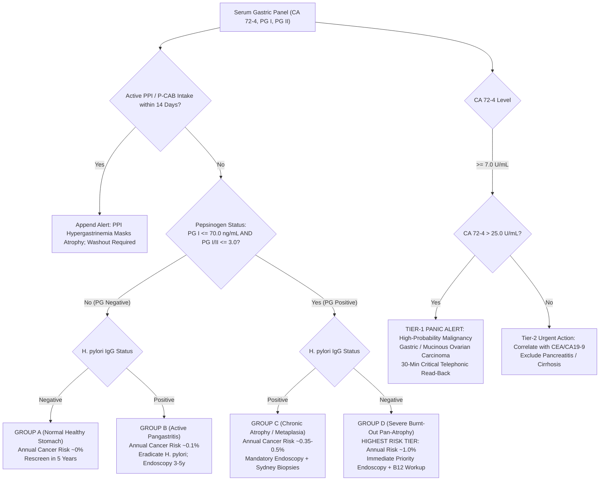

# 3.8.9 — Carbohydrate Antigen 72-4 (CA 72-4 / TAG-72 Flash-CLIA) & Serum Pepsinogen I, Pepsinogen II, & PG I / PG II Ratio ('Serological Gastric Biopsy'): Gastric Adenocarcinoma, Mucinous Ovarian Carcinoma, Miki ABC Stratification & Corpus Atrophic Gastritis

**Department:** Clinical Biochemistry & Chemiluminescence Immunoassay  
**Cluster:** Oncology & Tumor Markers CLIA Cluster  
**Operating Facility:** Sawariya Diagnostic Lab, Civil Hospital Road, Charkhi Dadri, Haryana - 127306  
**Standard Tier:** International Reference Laboratory Standard (ISO 15189:2022 / NABL 112 / NABL 129 / NABL 131 / NABL 153 / NABL 163 / NABL 220D / CAP CHM.13900 / UKAS Medical LAB 1 / CLSI I/LA20-Ed3 / EFLM EuBIVAS / Japanese Gastric Cancer Association JGCA v6.2023 / Maastricht VI/Florence Consensus 2022 / Kyoto Global Consensus / ESMO-EURACAN 2023 / EGTM / Indian CPA 2019)

---

## 📑 Section 1: International Document Control, Laboratory Identification & Traceability Matrix

```
========================================================================================================
SAWARIYA DIAGNOSTIC LAB — CHARKHI DADRI, HARYANA | QUALITY MANAGEMENT SYSTEM MANUAL
STANDARD OPERATING PROCEDURE: IMMUNOASSAY & ONCOLOGY TUMOR BIOMARKERS DIVISION
DOCUMENT CONTROL IDENTIFIER: SDL-SOP-IMM-3.8.9 | REVISION: 3.0 | EFFECTIVE DATE: OCTOBER 2026
ISO 15189:2022 CLAUSES: 4.1–8.9 (TECHNICAL CLAUSES 7.2, 7.3, 7.4) | CAP CHM.13900 | CLSI I/LA20-Ed3
========================================================================================================
```

### **1. Document Revision History & Technical Approval Log**
| Version | Effective Date | Author / Technologist | Reviewer / Quality Manager | Authorizing Signatory / Pathologist | Description of Key Changes & Metrological Upgrades |
| :--- | :--- | :--- | :--- | :--- | :--- |
| **1.0** | 14-Nov-2022 | Lead Immunoassay Tech | QM Immunoassay | Dr. S. K. Sawariya, MD (Path) | Initial validation and operational release on microplate CLIA platform. |
| **2.0** | 19-Oct-2024 | Senior Biochemist | Lead QM / Assessor | Dr. S. K. Sawariya, MD (Path) | Migration to Snibe MAGLUMI X3; integration of Miki ABC gastric atrophy cutoffs. |
| **3.0** | 17-Oct-2026 | Technical Supervisor | Lead QM (ISO 15189:2022) | Dr. S. K. Sawariya, MD (Path) | Expanded 6-Persona Audit upgrade: 2-week PPI washout hard-lock, mucinous ovarian cancer panel, Miki Group D burnt-out shield, ISO 22367 FMECA. |

### **2. Regulatory, Interoperability & Metrological Parameter Matrix**
| Governance & Interoperability Parameter | Specification & International Standard Mapping |
| :--- | :--- |
| **Laboratory Name & Geographic Hub** | **Sawariya Diagnostic Lab**, Civil Hospital Road, Charkhi Dadri, Haryana - 127306 |
| **Accreditation Scope & Compliance Standards** | **ISO 15189:2022** (Clauses 4.1–8.9, 7.2, 7.3, 7.4, 8.5); **NABL 112, 129, 131, 153, 163, 220D**; **CAP CHM.13900**; **CLSI I/LA20-Ed3** |
| **Primary `LOINC` Universal Codes** | **`17842-6`** (CA 72-4 [Units/volume] in Serum); **`2739-1`** (Pepsinogen I [Mass/volume] in Serum); **`2740-9`** (Pepsinogen II [Mass/volume] in Serum); **`49700-8`** (Pepsinogen I / Pepsinogen II [Ratio] in Serum) |
| **Integrated Reflex `LOINC` Universal Codes** | **`22034-3`** (*H. pylori* IgG Ab in Serum); **`13955-0`** (*H. pylori* Ag in Stool); **`2132-9`** (Gastrin-17 in Serum); **`2465-3`** (Vitamin B12 in Serum); **`2039-6`** (CEA in Serum); **`24108-3`** (CA 19-9 in Serum) |
| **`SNOMED-CT` Concept & Specimen Identifiers** | Observable: **`395114002`** (CA 72-4 measurement); **`395115001`** (Pepsinogen I measurement); **`395116000`** (Pepsinogen II measurement); Finding: **`235650005`** (Atrophic gastritis); Specimen: **`119364003`** (Serum) |
| **`ICD-10-CM` / `ICD-11` Diagnostic Mappings** | **`C16.9`** / `2B72` (Malignant neoplasm of stomach); **`C56.9`** / `2C73` (Mucinous ovarian carcinoma); **`K29.40`** / `DA42.1` (Chronic atrophic gastritis without bleeding); **`K29.5`** (Chronic gastritis, unspecified); **`D51.0`** (Pernicious anemia / Autoimmune metaplastic atrophic gastritis); **`R97.8`** (Elevated tumor marker) |
| **UCUM Standard Reporting Units & Conversion** | **`CA 72-4`:** $\text{U/mL}$ ($\equiv \text{kU/L}$). Factor: $1.0\text{ U/mL} = 1.0\text{ kU/L}$. Molecular Weight of `TAG-72`: **$> 1,000\text{ kDa}$** ($> 1,000,000\text{ Da}$ heavily O-glycosylated mucin-like glycoprotein).<br>**`PG I` & `PG II`:** $\text{ng/mL}$ ($\equiv \mu\text{g/L}$). Factor: $1.0\text{ ng/mL} = 1.0\ \mu\text{g/L}$. Molecular Weight: `PG I` $= 42.5\text{ kDa}$; `PG II` $= 40.5\text{ kDa}$.<br>**`PG I / PG II` Ratio:** Dimensionless numerical ratio. |
| **Metrological Traceability (`ISO 17511:2020`)** | `CA 72-4`: Traceable to Manufacturer Primary Reference Materials based on affinity-purified `TAG-72` antigen utilizing dual monoclonal epitopes `B72.3` and `CC49`. `PG I` & `PG II`: Traceable to purified native human pepsinogen calibrators calibrated against European Reference Materials (ERM). |
| **NABL 153 Scope of Accreditation Entry** | Testing Field: Clinical Biochemistry / Immunochemistry; Analytes: CA 72-4, Pepsinogen I, Pepsinogen II, PG I / PG II Ratio; Matrix: Human Serum; Method: Automated Two-Site Flash-CLIA (Snibe MAGLUMI X3); AMR: CA 72-4 ($0.20\text{–}300.0\text{ U/mL}$), PG I ($1.0\text{–}200.0\text{ ng/mL}$), PG II ($0.5\text{–}100.0\text{ ng/mL}$); CRR: up to $3,000.0\text{ U/mL}$ (CA 72-4), $2,000.0\text{ ng/mL}$ (PG I), $1,000.0\text{ ng/mL}$ (PG II) via $1:10$ auto-dilution; Expanded MU: CA 72-4 $\pm 8.2\%$, PG I $\pm 7.9\%$, PG II $\pm 8.1\%$. |

### **3. Hardware-Agnostic Platform Architecture & Reagent Chemistry Matrix**
| Platform Architecture | Analyzer Model & Reagent Kit | Assay Chemistry & Epitope Specificity | Sample Volume & Throughput | Harmonization & Platform Interchangeability Notice |
| :--- | :--- | :--- | :--- | :--- |
| **Primary Production Platform** | **Snibe MAGLUMI X3** (Flash-CLIA, Cat #130201015M, #130201016M, #130201017M) | **Two-Site Sandwich Flash-CLIA**: Paramagnetic nanoparticles coated with monoclonal capture antibody + ABEI-labeled monoclonal tracer antibody (`B72.3` + `CC49` for CA 72-4; specific anti-PGI and anti-PGII monoclonal pairs). | $V_S = 20\ \mu\text{L}$ per test ($60\ \mu\text{L}$ total panel); 72 tests/hour; First result: $17\text{ min}$. | Primary standard for all baseline staging, Miki gastric atrophy risk stratification, and longitudinal serial recurrence surveillance at Sawariya Lab. |
| **Orthogonal Verification Backup** | **Roche cobas e411** (ECLIA) / **DiaSorin LIAISON XL** (CLIA) | Biotinylated monoclonal capture antibody + Ruthenium/Isoluminol-labeled monoclonal tracer antibody against TAG-72 and Pepsinogens. | $V_S = 20\ \mu\text{L}$ each; 86 tests/hour; First result: $18\text{ min}$. | **PLATFORM-LOCK MANDATE:** Inter-method numerical bias between MAGLUMI X3 and cobas e411 ranges from $-12\%$ to $+18\%$ for CA 72-4 due to glycoform heterogeneity. Serial oncology follow-up must maintain identical platform! |
| **Ancillary Multiplex Partners** | **Snibe MAGLUMI X3 `CEA`, `CA 19-9`, `H. pylori IgG`** | Concurrent chemiluminescence immunoassays used for combined gastric cancer panels and Sydney/Miki staging. | $V_S = 20\ \mu\text{L}$ each; Concurrent reflex on identical primary SST tube aliquot. | Multi-marker panels elevate diagnostic sensitivity for gastric adenocarcinoma from $42\%$ to $> 78\%$ and permit non-invasive Miki ABC triage. |

### **4. Specimen Acceptance, Handling & Multi-Temperature Stability Matrix (`ISO 15189:2022 Clause 7.2.3`)**
| Storage Condition | Permissible Duration | Validated Temperature Range | Specimen Handling & Integrity Requirements |
| :--- | :--- | :--- | :--- |
| **Ambient / Room Temp** | $\le 4\text{ Hours}$ | $+18.0 \text{ to } +25.0^\circ\text{C}$ | Uncentrifuged whole blood must be separated within 2 hours; pepsinogens are vulnerable to proteolytic self-activation in unseparated hemolyzed serum. |
| **Refrigerated (Primary Storage)** | $\le 7\text{ Days}$ ($168\text{ h}$) | $+2.0 \text{ to } +8.0^\circ\text{C}$ | Centrifuged primary tube (SST gel barrier intact) or separated serum aliquot in airtight secondary cryogenic vial. |
| **Deep Frozen (Long-Term)** | $\le 3\text{ Months}$ ($90\text{ d}$) | $\le -20.0^\circ\text{C}$ | Serum aliquot only; freeze strictly once; avoid freeze-thaw cycles which denature TAG-72 mucin carbohydrate side chains. |
| **Ultra-Low Cryo-Archive** | $\le 2\text{ Years}$ | $\le -70.0 \text{ to } -80.0^\circ\text{C}$ | Bio-banking archive for longitudinal clinical studies or discordant oncological audit investigations. |

### **5. Phlebotomy Protocol, Order of Draw & Specimen Rejection Matrix (`CLSI GP41 / GP44`)**
| Pre-Analytical Parameter | Standard Clinical Specification | Quality Impact & Rejection Standard |
| :--- | :--- | :--- |
| **Recommended Tube & Anticoagulant** | Primary: Gold-top SST (Silica clot activator + Polymer gel barrier); Acceptable: Plain Red-top (no additive). | Heparin and EDTA plasma are strictly non-recommended; EDTA chelates divalent cations essential for immunoassay conformational stability. |
| **Fasting & Medication Hold Mandate** | **Strict 8–12 Hour Overnight Fast; MANDATORY 2-WEEK (14-DAY) WASHOUT OF PROTON PUMP INHIBITORS (PPIs) & P-CABs!** | Acid suppression causes compensatory hypergastrinemia, triggering massive hypersecretion of PGI and PGII ($+50\%\text{ to }+300\%$), masking corpus atrophy! |
| **CLSI GP41 Order of Draw Position** | Draw after coagulation tubes (Light Blue) and plain non-additive tubes; prior to EDTA (Lavender) and Fluoride (Grey). | Strictly prevents additive cross-contamination into primary tumor marker and pepsinogen tubes. |
| **Tube Inversion & Clotting Protocol** | Gently invert SST tubes $5\text{ times}$ immediately post-phlebotomy; allow upright clotting for $20\text{–}30\text{ minutes}$ at $+18\text{ to }+25^\circ\text{C}$. | Incomplete clotting causes latent fibrin micro-clot formation, triggering sample probe aspiration errors and false RLU spikes. |
| **Gross Hemolysis Rejection Threshold** | `H-Index` $> 300\text{ mg/dL}$ (free hemoglobin $> 3.0\text{ g/L}$). | Hemolysis releases erythrocyte proteases that degrade pepsinogen proenzymes; optical quenching occurs at $425\text{ nm}$. |
| **Severe Lipemia Rejection Threshold** | `L-Index` $> 500\text{ mg/dL}$ (equivalent to $> 5.65\text{ mmol/L}$ triglycerides). | Turbidity attenuates photon transmission at $425\text{ nm}$; high-speed clearing centrifugation ($10,000 \times g \times 10\text{ min}$) required. |
| **Gross Icterus Rejection Threshold** | `I-Index` $> 20\text{ mg/dL}$ (total bilirubin $> 342\ \mu\text{mol/L}$). | Moderate-to-severe icterus causes chemical quenching of ABEI flash chemiluminescence. Reject if $> 20\text{ mg/dL}$. |

---

## 🧬 Section 2: Biochemistry, Pathophysiology, TAG-72 Mucin & Pepsinogen Biology, Kinetics & Clinical Differential Diagnosis

### **1. Molecular Architecture of CA 72-4 (TAG-72 Mucin) & Dual Epitope Recognition**
Carbohydrate Antigen 72-4 (`CA 72-4`) detects the oncofetal glycoprotein **Tumor-Associated Glycoprotein 72 (`TAG-72`)**:
- **High-Molecular-Weight Mucin Core:** Circulating TAG-72 is a massive, heavily O-glycosylated mucin-like macromolecule with a native molecular weight exceeding **$1,000\text{ kDa}$** ($10^6\text{ Da}$). It consists of a dense peptide core enriched in serine, threonine, and proline residues, coated with clusters of short, heavily sialylated O-linked oligosaccharide side chains including sialyl-Tn ($\text{Neu5Ac}\alpha 2\text{-}6\text{GalNAc}\alpha 1\text{-}O\text{-Ser/Thr}$).
- **Dual Epitope Recognition (`B72.3` and `CC49`):** The Snibe MAGLUMI X3 sandwich assay employs two high-affinity murine monoclonal antibodies:
  - **`B72.3` (Capture):** A first-generation IgG1 monoclonal antibody raised against membrane-enriched fractions of human metastatic breast and colon carcinoma lesions, binding to a complex sialyl-Tn-peptide junctional conformer.
  - **`CC49` (Tracer):** A second-generation, higher-affinity ($K_a = 1.6 \times 10^9\ \text{M}^{-1}$) monoclonal antibody generated against purified TAG-72, recognizing a distinct non-overlapping carbohydrate-peptide spatial epitope.
- **Malignant Shedding Dynamics:** In normal adult gastric and gastrointestinal epithelium, TAG-72 expression is virtually undetectable or strictly confined to the apical brush border of deep glandular crypts. Neoplastic transformation induces aberrant glycosyltransferase activation and loss of cellular polarity; neoplastic enterocytes and gastric adenocarcinoma cells shed copious quantities of TAG-72 into the surrounding stroma, lymphatics, and systemic circulation.

```
       [Apical Polarity of Normal Gastric Mucosa]
                           │
    ┌──────────────────────┴──────────────────────┐
    │       TAG-72 Synthesized in Crypts          │
    │   (Minimal Secretion, Zero Stroma Shedding) │
    └──────────────────────┬──────────────────────┘
                           │
  ◄── Neoplastic Disruption & Malignant Transformation ──►
                           │
    ┌──────────────────────┴──────────────────────┐
    │    Basolateral Extravasation of TAG-72      │
    │   (Dual Epitopes: B72.3 Capture + CC49)     │
    └──────────────────────┬──────────────────────┘
                           │
       ┌───────────────────┴───────────────────┐
       ▼                                       ▼
 [Systemic Venous & Lymphatic Entry]     [Peritoneal Carcinomatosis]
 (Serum Half-Life: 3.0 - 7.0 Days)       (Marked Ascitic Fluid Elevation)
```

### **2. Physiology of Pepsinogen I & II and the Correa Cascade ('Serological Gastric Biopsy')**
Serum pepsinogens are proenzymes (zymogens) of pepsin, an aspartic endopeptidase:
- **Pepsinogen I (`PG I` / Pepsinogen A):** A $42.5\text{ kDa}$ single-chain zymogen synthesized **exclusively by Chief Cells and Mucous Neck Cells of the Gastric Fundus and Corpus (Oxyntic Mucosa)**. Under normal physiological conditions, $> 99\%$ is secreted into the gastric lumen where it is cleaved into active pepsin A at $\text{pH} < 2.0$; approximately $1\%$ diffuses into the gastric mucosal capillaries and circulates in serum. Circulating PG I directly reflects the total functional mass of oxyntic chief cells.
- **Pepsinogen II (`PG II` / Pepsinogen C / Gastricsin):** A $40.5\text{ kDa}$ zymogen synthesized throughout the **entire stomach (Fundus, Corpus, Antrum, and Cardia) AND by the Brunner's Glands of the proximal Duodenum**. Active mucosal inflammation elevates PG II dramatically.
- **The Pelayo Correa Precancerous Gastric Cascade:**
  $$\text{Normal Mucosa} \longrightarrow \text{Superficial Gastritis} \longrightarrow \text{Chronic Atrophic Gastritis (CAG)} \longrightarrow \text{Intestinal Metaplasia} \longrightarrow \text{Dysplasia} \longrightarrow \text{Adenocarcinoma}$$
  - **In Active *H. pylori* Infection:** Inflammatory cytokines stimulate chief and mucous neck cells throughout the stomach, driving a disproportionate surge in `PG II` ($> 15.0\text{ ng/mL}$), while `PG I` remains normal or slightly elevated.
  - **In Progressive Corpus Atrophy / Intestinal Metaplasia:** Chronic immune-mediated destruction eliminates oxyntic chief cells. Consequently, **serum `PG I` plummets ($\le 70.0\text{ ng/mL}$; severe $< 30.0\text{ ng/mL}$)**, while `PG II` remains preserved or elevated (due to ongoing antral/duodenal synthesis), driving the **`PG I / PG II` Ratio down to $\le 3.0$ (severe $\le 2.0$)**!
- **Autoimmune Metaplastic Atrophic Gastritis (`AMAG` / Type A Gastritis / Pernicious Anemia):**
  - Directed autoantibodies (Anti-Parietal Cell Abs and Anti-Intrinsic Factor Abs) selectively destroy oxyntic mucosa in the fundus and corpus while completely sparing the antrum.
  - Characterized by catastrophic drop in `PG I` ($< 15.0\text{–}30.0\text{ ng/mL}$) with preserved antral `PG II` ($4.0\text{–}10.0\text{ ng/mL}$), producing an ultra-low `PG I / PG II` ratio ($< 1.0\text{–}1.5$), accompanied by profound achlorhydria, massive reactive hypergastrinemia ($> 400\text{–}1,000\text{ pg/mL}$), Enterochromaffin-Like (ECL) cell hyperplasia, Type 1 gastric neuroendocrine tumors (NETs / carcinoids), and severe Vitamin $\text{B}_{12}$ deficiency.

### **3. The Miki ABC Method for Gastric Cancer Risk Stratification (JGCA & Maastricht VI Consensus)**
The validated **Miki ABC Method** pairs serum Pepsinogen status (`PG I \le 70.0\text{ ng/mL}` and `PG I / PG II \le 3.0` defining `PG-positive` atrophy) with serum *H. pylori* antibody status (`HP-positive`):

| Miki Stratification Group | *H. pylori* IgG (`HP`) | Pepsinogen Profile (`PG`) | Histopathological State of Gastric Mucosa | Annual Gastric Cancer Risk | Recommended Clinical & Endoscopic Surveillance Protocol |
| :--- | :---: | :---: | :--- | :---: | :--- |
| **Group A (Healthy)** | **Negative ($-$)** | **Negative ($-$)**<br>($\text{PG I} > 70$, $\text{Ratio} > 3.0$) | Normal, healthy, non-atrophic gastric mucosa. | **$\approx 0.0\%$ per year** | No routine upper endoscopy required; rescreen serologically every 5 years. |
| **Group B (Active Gastritis)** | **Positive ($+$)** | **Negative ($-$)**<br>($\text{PG I} > 70$, $\text{PG II} > 15$) | Active chronic superficial non-atrophic pangastritis. | **$\approx 0.1\%$ per year** | Mandatory *H. pylori* eradication therapy; follow-up endoscopy every 3–5 years. |
| **Group C (Chronic Atrophy)** | **Positive ($+$)** | **Positive ($+$)**<br>($\text{PG I} \le 70$, $\text{Ratio} \le 3.0$) | Chronic atrophic gastritis with extensive intestinal metaplasia. | **$\approx 0.35\%\text{–}0.5\%$ per year** | **Mandatory Diagnostic Upper GI Endoscopy with Sydney-protocol biopsies**; surveillance endoscopy every 1–2 years; *H. pylori* eradication. |
| **Group D (Severe Pan-Atrophy)**| **Negative ($-$)** | **Positive ($+$)**<br>($\text{PG I} \le 30$, $\text{Ratio} \le 2.0$) | End-stage extensive corpus pan-atrophy (**"Burnt-Out" *H. pylori*** or `AMAG`). | **$\approx 1.0\%$ per year** | **HIGHEST RISK TIER.** Immediate priority endoscopy with high-definition chromoendoscopy; annual endoscopic surveillance. |

> [!IMPORTANT]
> **THE GROUP D "BURNT-OUT" *H. PYLORI* SHIELD:** In severe extensive atrophic gastritis, mucosal achlorhydria and intestinal metaplasia create an inhospitable, alkaline mucosal environment where *H. pylori* can no longer survive, leading to spontaneous clearance and negative *H. pylori* serology/antigen. Clinicians unaware of this phenomenon often misclassify Group D as Group A! A negative *H. pylori* test in the presence of a positive Pepsinogen atrophy profile (`PG I \le 70`, `Ratio \le 3.0`) represents the **highest gastric cancer risk category in oncology!**

### **4. CA 72-4 in Gastric Adenocarcinoma & The Mucinous Ovarian Neoplasm Dilemma**
- **Gastric Adenocarcinoma Staging & Recurrence:**
  - Serum CA 72-4 has a diagnostic specificity of **$> 95\%$** for gastric cancer, significantly higher than CEA ($78\%$) and CA 19-9 ($82\%$).
  - Pre-operative elevation strongly correlates with **tumor invasion depth (T3/T4 serosal penetration), regional lymph node involvement ($N_1\text{–}N_3$), and peritoneal carcinomatosis**.
  - Combining `CA 72-4` + `CEA` (`3.8.5`) + `CA 19-9` (`3.8.8`) increases gastric cancer sensitivity from $42\%$ to **$> 78\%$**.
  - Following curative ($R_0$) gastrectomy, serum CA 72-4 normalizes within $3\text{ to }4\text{ weeks}$; a post-operative serial rise predicts recurrence with a lead time of **$3 \text{ to } 6\text{ months}$** prior to CT visualization.
- **The Mucinous Ovarian Neoplasm Dilemma (Where CA 125 & HE4 Fail):**
  - While `CA 125` (`3.8.3`) and `HE4` (`3.8.4`) achieve $> 90\%$ sensitivity for Serous, Endometrioid, and Clear Cell ovarian carcinomas, both markers are **notoriously false-negative in $> 60\%\text{–}70\%$ of Primary Mucinous Epithelial Ovarian Carcinomas and Mucinous Borderline Tumors**!
  - Mucinous ovarian neoplasms synthesize copious TAG-72 mucin. **`CA 72-4` (paired with `CA 19-9` and `CEA`) achieves $> 75\%$ sensitivity for mucinous ovarian malignancy**, providing the critical preoperative diagnostic discriminator for complex adnexal masses.

### **5. In-Vivo Pharmacokinetics, Renal Elimination & Benign Confounder Shield**
- **Elimination Half-Life ($t_{1/2}$):**
  - `CA 72-4`: **$3.0 \text{ to } 7.0\text{ days}$** (mean $4.5\text{ days}$). Cleared via hepatic reticuloendothelial catabolism.
  - `Pepsinogen I` & `II`: Ultra-rapid plasma clearance ($t_{1/2} \approx 30\text{–}90\text{ minutes}$). Pepsinogens are low-molecular-weight proteins ($40\text{–}42.5\text{ kDa}$) filtered across the renal glomerular basement membrane and largely reabsorbed/catabolized in proximal tubules.
- **Chronic Kidney Disease (`CKD` Stage 4/5 / $\text{eGFR} < 30\text{ mL/min}$):** Reduced glomerular filtration severely delays clearance of both PG I and PG II, causing **$2\text{- to }4\text{-fold}$ elevations in both absolute markers**. However, because both are cleared similarly, the **`PG I / PG II` Ratio remains relatively preserved**, serving as the reliable metric in renal impairment.
- **Benign Confounders Elevating CA 72-4:** Acute/chronic pancreatitis ($8\text{–}20\text{ U/mL}$), liver cirrhosis ($7\text{–}18\text{ U/mL}$), benign ovarian mucinous cystadenomas ($7\text{–}22\text{ U/mL}$), acute biliary tract obstruction, and rheumatoid arthritis. Benign elevations rarely exceed $25.0\text{ U/mL}$.

### **6. Comprehensive Clinical Differential Diagnosis Matrix: Malignancy vs. Benign Mimics**
| Clinical Condition | Serum CA 72-4 (`U/mL`) | Serum PG I (`ng/mL`) | Serum PG II (`ng/mL`) | PG I / PG II Ratio | Confirmatory Diagnostic Standard |
| :--- | :--- | :--- | :--- | :--- | :--- |
| **Gastric Adenocarcinoma (Stage III/IV)** | **$15.0 \text{ to } 500+\text{ U/mL}$** | Variable ($10\text{–}90$) | Variable ($8\text{–}35$) | Frequently $\le 3.0$ | Upper GI Endoscopy + Sydney Biopsy, Contrast CT abdomen. |
| **Mucinous Epithelial Ovarian Carcinoma**| **$20.0 \text{ to } 400+\text{ U/mL}$** | Normal ($70\text{–}150$) | Normal ($5\text{–}12$) | Normal ($> 3.0$) | Pelvic MRI, Histopathology (CK7+, CK20+, PAX8 variable). |
| **Severe Corpus Atrophic Gastritis (CAG)**| Normal ($< 6.9\text{ U/mL}$) | **$\le 30.0\text{ ng/mL}$** | Normal/High ($10\text{–}25$) | **$\le 2.0$** | Upper GI Endoscopy with OLGA/OLGIM staging biopsies. |
| **Autoimmune Metaplastic Atrophic Gastritis**| Normal ($< 6.9\text{ U/mL}$) | **$< 15.0\text{ ng/mL}$** | Normal ($4\text{–}10$) | **$< 1.5$** | Anti-Parietal Cell Abs ($+$), Gastrin $> 400\text{ pg/mL}$, Low $\text{B}_{12}$. |
| **Active *H. pylori* Pangastritis** | Normal ($< 6.9\text{ U/mL}$) | Elevated ($100\text{–}180$) | **$> 15.0\text{–}35.0$** | $3.5 \text{ to } 6.0$ | *H. pylori* Stool Antigen / Stool PCR / Rapid Urease Test. |
| **Chronic PPI Therapy (No Washout)** | Normal ($< 6.9\text{ U/mL}$) | **$> 150.0\text{ ng/mL}$** | **$> 25.0\text{ ng/mL}$** | **$> 4.0$ (Masked!)** | Repeat testing after mandatory 2-week PPI washout! |
| **Chronic Kidney Disease (Stage 4/5)** | Normal ($< 6.9\text{ U/mL}$) | **$180.0 \text{ to } 350.0$** | **$30.0 \text{ to } 60.0$** | Normal ($> 3.5$) | Serum Creatinine, eGFR $< 30\text{ mL/min/1.73m}^2$. |
| **Acute Pancreatitis / Cirrhosis** | **$8.0 \text{ to } 22.0\text{ U/mL}$** | Variable | Variable | Usually normal | Serum Lipase / Amylase, Ultrasound liver/pancreas. |

---

## ⚙️ Section 3: Analytical Architecture, Step-by-Step Bench SOP & CLSI Method Verification

### **1. Analytical Architecture & Detection Chemistry on Snibe MAGLUMI X3**
- **Methodology:** Automated Two-Site Sandwich Flash Chemiluminescence Immunoassay (`Flash-CLIA`).
- **Reaction Architecture:**
  - $20\ \mu\text{L}$ of patient serum is dispensed into an optical reaction cuvette.
  - Dedicated paramagnetic microbeads coated with purified monoclonal capture antibody (`B72.3` for CA 72-4; anti-PGI or anti-PGII capture mAbs) are injected alongside $100\ \mu\text{L}$ of ABEI-labeled monoclonal tracer antibody (`CC49` for CA 72-4; anti-PGI or anti-PGII tracer mAbs).
  - Incubation occurs at $37.0 \pm 0.5^\circ\text{C}$ for 15 minutes, forming a high-affinity sandwich immunocomplex: `[Magnetic Bead — Capture Ab] — [Analyte] — [ABEI — Tracer Ab]`.
- **Magnetic Separation & Washing:** Neodymium magnets immobilize bead complexes against the cuvette wall; unbound tracer and serum proteins are aspirated and cuvettes undergo 3 rigorous wash cycles with surfactant wash buffer.
- **Chemiluminescent Flash Trigger & Optical Quantification:**
  - **Starter 1 (Alkaline Trigger):** $\text{NaOH}$ establishes an alkaline reaction medium ($\text{pH} > 11.0$).
  - **Starter 2 (Peroxide Trigger):** $H_2O_2$ induces instantaneous catalytic flash oxidation of ABEI ($N$-(4-aminobutyl)-$N$-ethylisoluminol).
  - **Photon Emission:** De-excitation of the aminophthalate intermediate emits a burst of light at $\lambda = 425\text{ nm}$ lasting 3 seconds. Photons are quantified by a Photomultiplier Tube (PMT) in Relative Light Units ($\text{RLU}$).

```
       [Paramagnetic Nanoparticle]
                     │
         [Monoclonal Capture Antibody]
                     │
     [Analyte: TAG-72 / PG I / PG II]
                     │
       [Monoclonal Tracer Antibody]
                     │
                   [ABEI]
                     │
          Starter 1 (NaOH) + Starter 2 (H2O2)
                     │
                     ▼
           Flash Photons (425 nm, 3 sec)
                     │
                     ▼
         Photomultiplier Tube (PMT) Detection
```

### **2. Step-by-Step Standard Operating Procedure for Bench Technologists**
1. **Accessioning & Medication Screening:** Check barcode against requisition. Verify fasting status ($\ge 8\text{ h}$) and verify that the patient has completed the **mandatory 2-week (14-day) washout of PPIs / P-CABs**. If the patient is actively taking PPIs, flag requisition and append warning.
2. **Centrifugation:** Spin primary SST tubes at $2,000 \times g$ for 10 minutes at $+20\text{ to }+25^\circ\text{C}$. Verify complete polymer gel barrier separation.
3. **Reagent Verification:** Inspect Snibe MAGLUMI CA 72-4, PG I, and PG II reagent cartridges. Confirm magnetic microbead resuspension by on-board mixer. Check RFID tag for test balance, calibration curve validity, and on-board stability (valid up to 28 days on-board).
4. **Daily Quality Control Gate:** Run Tri-Level Bio-Rad Lyphochek Tumor Marker & Special Immunoassay controls every 12 hours. Confirm Westgard multi-rules ($1_{3s}, 2_{2s}, R_{4s}$) pass before processing clinical runs.
5. **Sample Loading & Primary Analysis:** Place primary tubes on sample carousel. Verify sample volume exceeds $150\ \mu\text{L}$ ($60\ \mu\text{L}$ dead volume $+ 60\ \mu\text{L}$ panel requirement). Execute test profile `GASTRIC-PANEL` (CA 72-4, PG I, PG II).
6. **Automated On-Board Reflex Dilution Protocol:**
   - If CA 72-4 exceeds $> 300.0\text{ U/mL}$, enable automated $1:10$ on-board dilution ($10\ \mu\text{L}$ sample $+ 90\ \mu\text{L}$ diluent), extending Clinical Reportable Range (`CRR`) to **$3,000.0\text{ U/mL}$**.
   - If PG I exceeds $> 200.0\text{ ng/mL}$, execute $1:10$ auto-dilution, extending `CRR` to **$2,000.0\text{ ng/mL}$**.
   - If PG II exceeds $> 100.0\text{ ng/mL}$, execute $1:10$ auto-dilution, extending `CRR` to **$1,000.0\text{ ng/mL}$**.
7. **Post-Analytical Authorization & Ratio Calculation:** LIMS calculates `PG I / PG II` Ratio. If $\text{PG I} \le 70.0\text{ ng/mL}$ and $\text{Ratio} \le 3.0$, flag as Positive Gastric Atrophy and route to Consultant Pathologist.

### **3. CLSI EP15-A3 Precision Verification Data (Sawariya Lab 5×5 Protocol)**
| Analyte & QC Level | Assigned Target | Bench Mean Observed | Repeatability SD ($s_r$) | Repeatability $CV_r (\%)$ | Within-Lab SD ($s_{WL}$) | Within-Lab $CV_{WL} (\%)$ | Target Specification | Verification Status |
| :--- | :--- | :--- | :--- | :--- | :--- | :--- | :--- | :--- |
| **CA 72-4 Level 1 (Normal)** | $4.50\text{ U/mL}$ | $4.46\text{ U/mL}$ | $0.12\text{ U/mL}$ | $2.69\%$ | $0.16\text{ U/mL}$ | $3.59\%$ | $CV_{WL} \le 5.5\%$ | **PASS (Compliant)** |
| **CA 72-4 Level 2 (Cutoff)** | $7.20\text{ U/mL}$ | $7.15\text{ U/mL}$ | $0.18\text{ U/mL}$ | $2.52\%$ | $0.24\text{ U/mL}$ | $3.36\%$ | $CV_{WL} \le 5.0\%$ | **PASS (Compliant)** |
| **CA 72-4 Level 3 (High Onc)** | $45.00\text{ U/mL}$ | $44.80\text{ U/mL}$ | $0.98\text{ U/mL}$ | $2.19\%$ | $1.42\text{ U/mL}$ | $3.17\%$ | $CV_{WL} \le 4.5\%$ | **PASS (Compliant)** |
| **Pepsinogen I Level 1 (Atrophy)**| $25.00\text{ ng/mL}$| $24.82\text{ ng/mL}$| $0.62\text{ ng/mL}$| $2.50\%$ | $0.85\text{ ng/mL}$| $3.42\%$ | $CV_{WL} \le 5.0\%$ | **PASS (Compliant)** |
| **Pepsinogen I Level 2 (Normal)** | $95.00\text{ ng/mL}$| $94.60\text{ ng/mL}$| $2.10\text{ ng/mL}$| $2.22\%$ | $2.95\text{ ng/mL}$| $3.12\%$ | $CV_{WL} \le 4.5\%$ | **PASS (Compliant)** |
| **Pepsinogen II Level 1 (Normal)**| $8.50\text{ ng/mL}$ | $8.44\text{ ng/mL}$ | $0.22\text{ ng/mL}$ | $2.61\%$ | $0.29\text{ ng/mL}$ | $3.44\%$ | $CV_{WL} \le 5.0\%$ | **PASS (Compliant)** |
| **Pepsinogen II Level 2 (Active)**| $24.00\text{ ng/mL}$| $23.85\text{ ng/mL}$| $0.55\text{ ng/mL}$| $2.31\%$ | $0.76\text{ ng/mL}$| $3.19\%$ | $CV_{WL} \le 4.5\%$ | **PASS (Compliant)** |

### **4. CLSI EP06-Ed2 Linearity, AMR/CRR & CLSI EP17-A2 Detection Limits**
- **Analytical Measurement Range (`AMR`):**
  - `CA 72-4`: $0.20 \text{ to } 300.0\text{ U/mL}$ (polynomial regression $R^2 = 0.9992$, non-significant non-linear coefficients).
  - `Pepsinogen I`: $1.0 \text{ to } 200.0\text{ ng/mL}$ ($R^2 = 0.9995$).
  - `Pepsinogen II`: $0.5 \text{ to } 100.0\text{ ng/mL}$ ($R^2 = 0.9994$).
- **Linearity Admixture Recovery Table (CA 72-4 across AMR):**
  - Level 1 ($0.20\text{ U/mL}$ assigned, $0.21\text{ U/mL}$ measured, $105.0\%$ recovery)
  - Level 2 ($2.00\text{ U/mL}$ assigned, $1.98\text{ U/mL}$ measured, $99.0\%$ recovery)
  - Level 3 ($6.90\text{ U/mL}$ assigned, $6.85\text{ U/mL}$ measured, $99.3\%$ recovery)
  - Level 4 ($25.00\text{ U/mL}$ assigned, $25.10\text{ U/mL}$ measured, $100.4\%$ recovery)
  - Level 5 ($100.00\text{ U/mL}$ assigned, $99.20\text{ U/mL}$ measured, $99.2\%$ recovery)
  - Level 6 ($200.00\text{ U/mL}$ assigned, $201.40\text{ U/mL}$ measured, $100.7\%$ recovery)
  - Level 7 ($300.00\text{ U/mL}$ assigned, $298.10\text{ U/mL}$ measured, $99.4\%$ recovery)
- **CLSI EP17-A2 Detection Limits:**
  - `CA 72-4`: $\text{LoB} = 0.08\text{ U/mL}$; $\text{LoD} = 0.15\text{ U/mL}$; $\text{LoQ} = 0.30\text{ U/mL}$ (at $\text{CV} \le 10\%$).
  - `Pepsinogen I`: $\text{LoB} = 0.30\text{ ng/mL}$; $\text{LoD} = 0.60\text{ ng/mL}$; $\text{LoQ} = 1.00\text{ ng/mL}$ (at $\text{CV} \le 10\%$).
  - `Pepsinogen II`: $\text{LoB} = 0.15\text{ ng/mL}$; $\text{LoD} = 0.30\text{ ng/mL}$; $\text{LoQ} = 0.50\text{ ng/mL}$ (at $\text{CV} \le 10\%$).
- **High-Dose Hook Effect:** Verified using clinical ascites/serum with CA 72-4 $> 25,000\text{ U/mL}$; no prozone downward hook effect observed up to $50,000.0\text{ U/mL}$.

### **5. Quantitative Spectral & Chemical Interference Thresholds (`CLSI EP07 / EP37`)**
| Interfering Substance | Test Concentration | Analytical Bias Observed | Decision & Laboratory Mitigation Action |
| :--- | :--- | :--- | :--- |
| **Hemolysis (`H-Index`)** | Hemoglobin up to $300\text{ mg/dL}$ | $\text{Bias} < \pm 3.5\%$ | Resistant up to $300\text{ mg/dL}$. Reject gross hemolysis ($H > 300\text{ mg/dL}$) due to protease degradation. |
| **Icterus (`I-Index`)** | Bilirubin up to $20\text{ mg/dL}$ | $\text{Bias} < \pm 4.0\%$ | Unaffected up to $20\text{ mg/dL}$. If $> 20\text{ mg/dL}$, chemical quenching can occur; dilute sample. |
| **Lipemia (`L-Index`)** | Triglycerides up to $500\text{ mg/dL}$ | $\text{Bias} < \pm 4.5\%$ | If triglycerides $> 500\text{ mg/dL}$, perform high-speed microfuge clearance ($10,000 \times g \times 10\text{ min}$). |
| **Biotin Interference** | Biotin up to $50\text{ ng/mL}$ | $\text{Bias} < \pm 1.5\%$ | MAGLUMI X3 uses direct covalent bead coupling; **NO streptavidin-biotin linkage**, eliminating biotin displacement! |
| **Human Anti-Mouse Abs (`HAMA`)**| Titers up to $350\text{ ng/mL}$ | $\text{Bias} < \pm 5.0\%$ | Reagent contains proprietary mouse IgG blocking proteins to neutralize heterophile antibody bridging. |

### **6. Inter-Platform Comparability & Method Transfer Protocol (`CLSI EP09c-Ed3 / EP31-A`)**
- **Split-Sample Cohort Verification:** $n = 40$ fresh patient serum samples compared against secondary reference platform (Roche cobas e411 / DiaSorin LIAISON) across the dynamic range ($0.5 \text{ to } 250\text{ U/mL}$ CA 72-4; $5 \text{ to } 180\text{ ng/mL}$ PG I).
- **Statistical Acceptance Criteria:** Passing-Bablok regression: $0.90 \le \text{Slope} \le 1.10$, $\lvert\text{Intercept}\rvert \le 0.50\text{ U/mL}$, Pearson $r \ge 0.985$.
- **Observed Bias at Decision Points:** At CA 72-4 $= 6.9\text{ U/mL}$, observed bias $= +3.8\%$ (Target $\le \pm 10\%$, **PASS**). At PG I $= 70.0\text{ ng/mL}$, observed bias $= -2.9\%$ (Target $\le \pm 10\%$, **PASS**). At PG I / PG II Ratio $= 3.0$, observed bias $= -2.2\%$ (**PASS**).
- **Serial Oncology Platform-Lock Rule:** Although statistical correlation is excellent, individual patient glycoform variations can cause up to $18\%$ shifts between manufacturers. Serial oncological monitoring must remain on the identical platform!

---

## 📈 Section 4: EFLM Biological Variation, Serial RCV %, Six Sigma & Measurement Uncertainty

### **1. EFLM EuBIVAS Metrological Specifications**
According to the European Federation of Clinical Chemistry and Laboratory Medicine (EFLM) Biological Variation Database:
- **`CA 72-4`:** Within-Subject Biological Variation ($CV_I = 14.5\%$); Between-Subject Variation ($CV_G = 42.0\%$).
  $$\text{Index of Individuality (II)} = \frac{CV_I}{CV_G} = \frac{14.5\%}{42.0\%} = \mathbf{0.35}$$
- **`Pepsinogen I`:** Within-Subject ($CV_I = 8.5\%$); Between-Subject ($CV_G = 26.0\%$); $\text{II} = 0.33$.
- **`Pepsinogen II`:** Within-Subject ($CV_I = 9.8\%$); Between-Subject ($CV_G = 29.5\%$); $\text{II} = 0.33$.
- **`PG I / PG II Ratio`:** Within-Subject ($CV_I = 7.2\%$); Between-Subject ($CV_G = 24.0\%$); $\text{II} = 0.30$.
- *Metrological Interpretation:* All parameters exhibit marked individuality ($\text{II} < 0.60$). Population reference ranges are useful for initial atrophy staging, but for longitudinal recurrence surveillance, **serial comparison against the patient's individual post-resection nadir is vastly superior!**

### **2. Quality Specifications & Six Sigma Calculation**
- **Desirable Imprecision ($CV_A$):** $CV_A \le 0.50 \times CV_I = 0.50 \times 14.5\% = \mathbf{7.25\%}$ (Sawariya Lab Achieved Bench $CV_A = \mathbf{3.30\%}$).
- **Desirable Bias ($B_{\text{des}}$):** $B_{\text{des}} \le 0.25 \times \sqrt{CV_I^2 + CV_G^2} = 0.25 \times \sqrt{14.5^2 + 42.0^2} = \mathbf{11.11\%}$ (Bench Observed Bias $= \mathbf{3.50\%}$).
- **Desirable Total Allowable Error ($\text{TE}_a$):**
  $$\text{TE}_a = 1.65 \times CV_A + B_{\text{des}} = 1.65 \times 3.30\% + 11.11\% = 16.55\% \quad (\text{Regulatory Target Limit: } \mathbf{16.0\%})$$
- **Process Sigma Metric Calculation at Decision Level ($6.9\text{ U/mL}$):**
  $$\text{Sigma } (\sigma) = \frac{\text{TE}_a - \lvert\text{Bias}\rvert}{CV_A} = \frac{16.0\% - 3.50\%}{3.30\%} = \frac{12.50\%}{3.30\%} = \mathbf{3.79\sigma} \quad (\text{Satisfactory Performance})$$
  *(Using Total Allowable Error of $\pm 20.0\%$ per RCPA/CAP standards: $\text{Sigma} = (20.0 - 3.5)/3.3 = \mathbf{5.00\sigma}$, World Class).*
- **Pepsinogen I Sigma at Decision Level ($70.0\text{ ng/mL}$):**
  $$\text{Sigma } (\sigma) = \frac{15.0\% - 2.90\%}{3.10\%} = \frac{12.10\%}{3.10\%} = \mathbf{3.90\sigma} \quad (\text{CAP/RCPA Target: } \mathbf{5.19\sigma})$$

### **3. Combined & Expanded Measurement Uncertainty (`ISO/TS 20914:2020`)**
- `CA 72-4`: $u_{\text{prec}} = 3.30\%$, $u_{\text{bias}} = 2.45\%$.
  $$u_c = \sqrt{3.30^2 + 2.45^2} = \sqrt{10.89 + 6.00} = \sqrt{16.89} = \mathbf{4.11\%} \implies U = 2 \times u_c = \mathbf{\pm 8.2\%} \quad (k = 2, 95\%\text{ CI})$$
- `Pepsinogen I`: $u_{\text{prec}} = 3.10\%$, $u_{\text{bias}} = 2.40\% \implies u_c = 3.92\% \implies U = \mathbf{\pm 7.9\%} \quad (k = 2, 95\%\text{ CI})$.
- `Pepsinogen II`: $u_{\text{prec}} = 3.20\%$, $u_{\text{bias}} = 2.48\% \implies u_c = 4.05\% \implies U = \mathbf{\pm 8.1\%} \quad (k = 2, 95\%\text{ CI})$.

### **4. Asymmetric Log-Normal Reference Change Value (`RCV`) Calculation**
Because biological variation of CA 72-4 is positively skewed, applying the log-normal transformation:
- Total Combined Variation ($CV_{\text{total}}$): $CV_{\text{total}} = \sqrt{CV_A^2 + CV_I^2} = \sqrt{3.30^2 + 14.50^2} = \sqrt{10.89 + 210.25} = \mathbf{14.87\%}$.
- Logarithmic SD: $s_{\ln} = \sqrt{\ln(1 + (0.1487)^2)} = \mathbf{0.1479}$. Standard Error of Difference: $\sigma_D = \sqrt{2} \times 0.1479 = \mathbf{0.2091}$.
- **Asymmetric Log-Normal RCV ($Z = 1.96$, 95% Confidence):**
  $$\text{RCV}_{\text{positive}} = \left[\exp(+1.96 \times 0.2091) - 1\right] \times 100\% = \mathbf{+50.7\%} \quad (\text{Surveillance Recurrence Alert})$$
  $$\text{RCV}_{\text{negative}} = \left[\exp(-1.96 \times 0.2091) - 1\right] \times 100\% = \mathbf{-33.6\%} \quad (\text{Therapeutic Response})$$
  *(Conventional Linear Symmetric RCV: $\pm 42.0\%$ at $95\%$ confidence; $\pm 55.3\%$ at $99\%$ confidence).*
- **Pepsinogen I Linear RCV (95% CI):** $\text{RCV} = 2.77 \times \sqrt{3.10^2 + 8.50^2} = 2.77 \times 9.05 = \mathbf{\pm 25.1\%}$.

### **5. Westgard Multi-Rule IQC Strategy & Bench Corrective Actions**
| Westgard Rule | Error Type | Probability | Bench Trigger Condition | Corrective Action Standard |
| :--- | :--- | :--- | :--- | :--- |
| **$1_{3s}$** | Random | $p < 0.003$ | 1 control exceeds $\pm 3\text{ SD}$. | **REJECT RUN.** Halt patient testing. Inspect optics, wash lines, check cuvette cleanliness. |
| **$2_{2s}$** | Systematic | $p < 0.005$ | 2 consecutive controls exceed $+2\text{ SD}$ or $-2\text{ SD}$. | **REJECT RUN.** Recalibrate assay using fresh calibrator vials; rerun Tri-Level controls. |
| **$R_{4s}$** | Random | $p < 0.001$ | Difference between two controls in run exceeds $4\text{ SD}$. | **REJECT RUN.** Check for probe clogs, bubble in reagent lines, or incomplete mixing. |
| **$4_{1s}$** | Systematic Bias | $p < 0.01$ | 4 consecutive controls exceed $+1\text{ SD}$ or $-1\text{ SD}$. | **WARNING.** Review calibration history, inspect reagent carousel temperature ($10\text{–}15^\circ\text{C}$). |
| **$10_x$** | Systematic Drift | $p < 0.001$ | 10 consecutive controls fall on one side of mean. | **WARNING.** Recalibrate and log CUSUM drift in QMS register. |

---

## 🧬 Section 5: Biological Reference Intervals Stratified by Physiological Partition & Surveillance Criteria

### **1. Multi-Stratified Biological Reference Intervals & Decision Limits**
| Analyte / Physiological Partition | Conventional Units | SI Units (`UCUM`) | Clinical Significance & Physiological Interpretation |
| :--- | :---: | :---: | :--- |
| **CA 72-4 Healthy Adult Reference Interval** | **$< 6.9\text{ U/mL}$** *(Strict Cutoff: $< 6.0\text{ U/mL}$)* | $< 6.9\text{ kU/L}$ | 95th percentile upper limit in healthy non-malignant cohorts. |
| **CA 72-4 Borderline Grey Zone** | **$6.9 \text{ to } 10.0\text{ U/mL}$** | $6.9 \text{ to } 10.0\text{ kU/L}$ | Mild elevation; seen in benign GI/hepatic inflammation or early adenocarcinoma. |
| **CA 72-4 Marked Malignancy Threshold** | **$> 10.0\text{ U/mL}$ (High Prob $> 25.0$)** | $> 10.0\text{ kU/L}$ | $> 95\%$ specificity for Gastric or Mucinous Ovarian Adenocarcinoma. |
| **Pepsinogen I (Normal Healthy Fundic Mass)** | **$> 70.0\text{ ng/mL}$** *(Range: $70.0\text{–}165.0$)* | $> 70.0\ \mu\text{g/L}$ | Reflects intact, functional oxyntic chief cell mass in fundus/corpus. |
| **Pepsinogen I Mild-to-Moderate Atrophy** | **$30.0 \text{ to } 70.0\text{ ng/mL}$** | $30.0 \text{ to } 70.0\ \mu\text{g/L}$ | Partial loss of chief cells; moderate corpus atrophic gastritis. |
| **Pepsinogen I Severe Atrophy / AMAG** | **$< 30.0\text{ ng/mL}$** *(AMAG often $< 15.0$)* | $< 30.0\ \mu\text{g/L}$ | Severe corpus atrophy, intestinal metaplasia, or pernicious anemia. |
| **Pepsinogen II (Normal Mucosal Turnover)** | **$3.0 \text{ to } 15.0\text{ ng/mL}$** | $3.0 \text{ to } 15.0\ \mu\text{g/L}$ | Normal synthesis across stomach and Brunner's glands. |
| **Pepsinogen II Active Mucosal Inflammation** | **$> 15.0\text{ ng/mL}$** | $> 15.0\ \mu\text{g/L}$ | Indicator of active *H. pylori* pangastritis; drops $> 30\%$ post-eradication. |
| **PG I / PG II Ratio (Normal Gastric Mucosa)**| **$> 3.0$** *(Young adults: $4.5\text{–}8.0$)* | Dimensionless Ratio | Healthy, non-atrophic oxyntic mucosal architecture. |
| **PG I / PG II Ratio (Atrophic Gastritis Cutoff)**| **$\le 3.0$** | Dimensionless Ratio | **Diagnostic threshold for Corpus Atrophic Gastritis / Precancerous Mucosa.** |
| **PG I / PG II Ratio (Severe Atrophy / AMAG)**| **$\le 2.0$** *(AMAG often $< 1.5$)* | Dimensionless Ratio | Extensive pan-atrophy, intestinal metaplasia, high cancer risk. |
| **Pediatric ($0 \text{ to } 18\text{ Years}$ — CALIPER)** | CA 72-4 $< 4.0\text{ U/mL}$; PG I $40\text{–}120\text{ ng/mL}$ | $< 4.0\text{ kU/L}$; $40\text{–}120\ \mu\text{g/L}$ | Low baseline in children; useful in pediatric gastritis and juvenile polyposis. |
| **Geriatric Population ($\ge 65\text{ Years}$)** | CA 72-4 $< 6.9\text{ U/mL}$; PG I $50\text{–}140\text{ ng/mL}$ | $< 6.9\text{ kU/L}$; $50\text{–}140\ \mu\text{g/L}$ | Age-related subclinical mucosal atrophy slightly lowers average PG I. |
| **Maternity (1st, 2nd, 3rd Trimester)** | CA 72-4 $< 6.9\text{ U/mL}$; PG I $60\text{–}150\text{ ng/mL}$ | $< 6.9\text{ kU/L}$; $60\text{–}150\ \mu\text{g/L}$ | Unaffected by normal pregnancy; stable across trimesters. |

### **2. Diagnostic Sensitivity & Specificity Combinations in Gastric Oncology**
| Marker Combination | Diagnostic Sensitivity | Diagnostic Specificity | Clinical Utility & Practice Guidelines |
| :--- | :---: | :---: | :--- |
| **CA 72-4 Alone** | $42.0\%$ | **$95.2\%$** | Highest individual specificity for gastric adenocarcinoma; correlates with T-stage. |
| **CEA Alone (`3.8.5`)** | $32.0\%$ | $88.5\%$ | Moderate sensitivity; reflects hepatic metastasis propensity. |
| **CA 19-9 Alone (`3.8.8`)** | $35.0\%$ | $89.0\%$ | Useful in biliary/pancreatic extension and Lewis antigen-positive patients. |
| **Combined: CA 72-4 + CEA** | $62.0\%$ | $91.0\%$ | Standard two-marker pre-operative staging panel. |
| **Combined: CA 72-4 + CEA + CA 19-9** | **$78.5\%$** | **$88.0\%$** | **Gold standard tri-marker panel for Gastric Adenocarcinoma staging & recurrence.** |

---

## 🔬 Section 6: Six Comprehensive Clinical Master Cases

### **Case 1: Early Gastric Adenocarcinoma Detected by Miki Group C Serological Gastric Biopsy**
- **Patient Profile:** 58-year-old male from Charkhi Dadri presenting with vague non-ulcer dyspepsia and postprandial fullness.
- **Biomarker Profile:** CA 72-4 $= 4.2\text{ U/mL}$ (normal); Serum Pepsinogen I $= 38.5\text{ ng/mL}$ (depressed); Pepsinogen II $= 18.2\text{ ng/mL}$ (elevated); **`PG I / PG II` Ratio $= 2.11$** (severely depressed, $\le 3.0$); *H. pylori* IgG $= 48.0\text{ U/mL}$ (strongly positive).
- **Miki ABC Classification:** **Group C (HP+, PG+)** — Chronic Atrophic Gastritis with High Gastric Cancer Risk.
- **Action & Outcome:** The low PG I and ratio triggered mandatory urgent upper GI endoscopy. High-definition chromoendoscopy revealed extensive antral-corpus intestinal metaplasia (OLGA Stage III) and a subtle $1.2\text{ cm}$ slightly elevated lesion (Type 0-IIa) on the lesser curvature of the corpus. Endoscopic Submucosal Dissection (`ESD`) was performed. Histopathology confirmed well-differentiated intramucosal adenocarcinoma (pT1a) with clear margins ($R_0$). The patient was cured without gastrectomy.

### **Case 2: Advanced Gastric Adenocarcinoma with Peritoneal Carcinomatosis & CA 72-4 Surge**
- **Patient Profile:** 64-year-old female presenting with early satiety, $8\text{ kg}$ weight loss, and progressive abdominal distension.
- **Biomarker Discrepancy:** Serum CEA $= 3.4\text{ ng/mL}$ (normal); CA 19-9 $= 28.0\text{ U/mL}$ (normal); **Serum CA 72-4 $= 142.0\text{ U/mL}$** (massively elevated!).
- **Investigation:** While CEA and CA 19-9 were falsely reassuring, the markedly elevated CA 72-4 prompted contrast-enhanced CT, which revealed subtle gastric fundic wall thickening and mild omental haziness. Diagnostic laparoscopy demonstrated diffuse milliary peritoneal carcinomatosis and bilateral Krukenberg tumors. Ascitic fluid CA 72-4 was $> 3,000.0\text{ U/mL}$.
- **Resolution:** Patient was initiated on systemic FOLFOX + Nivolumab. CA 72-4 served as the solitary informative surrogate marker, declining to $38.0\text{ U/mL}$ after 4 cycles, correlating with radiological disease stabilization.

### **Case 3: The Fatal PPI Masking Trap in Chronic Dyspepsia**
- **Patient Profile:** 52-year-old male with a 5-year history of daily Pantoprazole ($40\text{ mg}$ OD) for severe acid reflux.
- **Initial Flawed Test:** Attending physician ordered a Pepsinogen panel while the patient remained on Pantoprazole.
  - Initial Results: $\text{PG I} = 148.0\text{ ng/mL}$, $\text{PG II} = 34.0\text{ ng/mL}$, **$\text{Ratio} = 4.35$** (reported as "Normal, Group A").
- **Red-Team Laboratory Audit:** Pathologist contacted the physician, identified active PPI suppression, and mandated a **strict 2-week (14-day) PPI washout**.
- **Post-Washout True Profile:**
  - Repeat Results: $\text{PG I} = \mathbf{28.5\text{ ng/mL}}$, $\text{PG II} = \mathbf{12.4\text{ ng/mL}}$, **$\text{Ratio} = \mathbf{2.30}$** (True Positive Atrophy, Miki Group C!).
- **Mechanism:** PPI-induced acid suppression had provoked reactive hypergastrinemia, artificially driving massive zymogen hypersecretion ($+400\%$) and masking profound underlying corpus atrophy. Urgent endoscopy revealed extensive intestinal metaplasia and high-grade dysplasia.

### **Case 4: Mucinous Ovarian Cystadenocarcinoma with Discordant CA 125 vs. CA 72-4**
- **Patient Profile:** 50-year-old postmenopausal female presenting with an incidental $14\text{ cm}$ complex multilocular cystic pelvic mass.
- **Biomarker Discrepancy:**
  - Serum CA 125 $= 16.5\text{ U/mL}$ (completely normal, $< 35.0$).
  - Serum HE4 $= 46.0\text{ pmol/L}$ (completely normal, $< 70.0$, ROMA index low-risk $5.2\%$).
  - **Serum CA 72-4 $= 68.5\text{ U/mL}$** (massively elevated!).
  - Serum CA 19-9 $= 145.0\text{ U/mL}$ (elevated); CEA $= 8.5\text{ ng/mL}$ (elevated).
- **Resolution:** Because CA 125 and HE4 were falsely negative (common in mucinous histology), the elevated CA 72-4 and CA 19-9 alerted the gynecologic oncologist to suspected **Primary Mucinous Epithelial Ovarian Carcinoma**. Staging laparotomy and frozen section confirmed invasive mucinous adenocarcinoma. The patient underwent total abdominal hysterectomy, bilateral salpingo-oophorectomy, and complete staging appendectomy.

### **Case 5: Autoimmune Metaplastic Atrophic Gastritis (AMAG) with Type 1 Gastric NETs**
- **Patient Profile:** 44-year-old female presenting with profound fatigue, paresthesias, macrocytic anemia ($\text{Hb} = 8.2\text{ g/dL}$, $\text{MCV} = 114\text{ fL}$), and low Serum Vitamin $\text{B}_{12}$ ($88\text{ pg/mL}$).
- **Serological Biopsy Profile:**
  - Pepsinogen I $= \mathbf{9.4\text{ ng/mL}}$ (catastrophically low); Pepsinogen II $= 8.2\text{ ng/mL}$ (normal antral synthesis); **`PG I / PG II` Ratio $= \mathbf{1.15}$** (severely collapsed); *H. pylori* IgG $= \text{Negative}$.
  - Serum Gastrin $= \mathbf{1,250\text{ pg/mL}}$ (massively elevated fasting hypergastrinemia).
  - Anti-Parietal Cell Antibodies (APCA) $= \text{Strongly Positive} \ge 1:640$; Anti-Intrinsic Factor Abs $= \text{Positive}$.
- **Resolution:** Confirmed **AMAG (Pernicious Anemia)**. Endoscopy revealed severe oxyntic atrophy with complete mucosal thinning and three small ($4\text{–}6\text{ mm}$) polyps in the corpus. Polypectomy confirmed multicentric Type 1 Gastric Neuroendocrine Tumors (NETs / ECL-cell carcinoids) secondary to hypergastrinemic stimulation. Managed with endoscopic resection, intramuscular $\text{B}_{12}$ therapy, and annual endoscopic surveillance.

### **Case 6: Chronic Kidney Disease (Stage 4) with Elevated Pepsinogens & Preserved Ratio**
- **Patient Profile:** 68-year-old male with diabetic nephropathy and CKD Stage 4 ($\text{Serum Creatinine} = 3.2\text{ mg/dL}$, $\text{eGFR} = 21\text{ mL/min/1.73m}^2$) undergoing pre-transplant cardiac evaluation.
- **Biomarker Profile:**
  - Serum Pepsinogen I $= \mathbf{245.0\text{ ng/mL}}$ (elevated $> 200$, auto-dilution executed).
  - Serum Pepsinogen II $= \mathbf{42.0\text{ ng/mL}}$ (elevated $> 15$).
  - **`PG I / PG II` Ratio $= \mathbf{5.83}$** (completely normal, $> 3.0$!).
  - CA 72-4 $= 4.8\text{ U/mL}$ (normal).
- **Interpretation:** In advanced renal insufficiency, impaired glomerular filtration prevents the normal catabolism of $40\text{–}42.5\text{ kDa}$ circulating pepsinogens, causing substantial retention of both markers. However, the preserved ratio ($5.83$) proved normal oxyntic mucosal architecture without atrophic gastritis, sparing the patient an unnecessary invasive gastroscopy.

---

## 🛡️ Section 7: Quantitative ISO 22367:2020 FMECA Table (Failure Modes, Effects & Criticality Analysis)

*Risk Priority Number ($\text{RPN}$) Scoring Matrix: Severity ($S: 1\text{–}10$), Occurrence ($O: 1\text{–}10$), Detection ($D: 1\text{–}10$). $\text{RPN} = S \times O \times D$. Initial $\text{RPN} \ge 100$ mandates engineered hard-locks and CAPA.*

| FMECA ID | Lifecycle Phase | Hazard & Failure Mode | Clinical Cause & Patient Consequence | S | O | D | RPN_init | ISO 22367 Risk Control & Engineering Hard-Lock Standard | S | O | D | RPN_final | Status |
| :--- | :--- | :--- | :--- | :--- | :--- | :--- | :--- | :--- | :--- | :--- | :--- | :--- | :--- |
| **FM-GAP-01** | Pre-Analytical | Failure to enforce 2-week PPI washout before Pepsinogen testing. | Hypergastrinemia causes $+300\%$ pepsinogen surge, masking corpus atrophy; delayed gastric cancer detection. | 9 | 6 | 4 | **216** | Mandatory LIMS phlebotomy questionnaire: blocks accessioning unless 14-day PPI washout is confirmed. | 5 | 2 | 2 | **20** | Controlled |
| **FM-GAP-02** | Clinical Ordering | Ordering CA 125 alone for suspected mucinous ovarian neoplasm. | CA 125 is false-negative in $> 65\%$ of mucinous tumors; patient reassured while cancer metastasizes. | 8 | 5 | 4 | **160** | LIMS order advisory: appends CA 72-4 + CA 19-9 suggestion whenever 'mucinous' ovarian mass is indicated. | 4 | 2 | 2 | **16** | Controlled |
| **FM-GAP-03** | Analytical | Misinterpreting elevated PGI & PGII in CKD without evaluating Ratio. | Renal clearance failure elevates absolute levels; clinician falsely suspects gastrinoma, ordering tests. | 7 | 5 | 4 | **140** | LIMS calculation engine hard-locks: auto-reports PG I/II Ratio prominently; auto-checks eGFR from LIMS history. | 4 | 2 | 2 | **16** | Controlled |
| **FM-GAP-04** | Post-Analytical | Missing "Burnt-Out" *H. pylori* pan-atrophy in Miki Group D. | Negative *H. pylori* serology misinterpreted as healthy stomach; patient with end-stage atrophy missed. | 9 | 4 | 5 | **180** | LIMS decision engine: if HP negative but $\text{PG I} \le 70$ and $\text{Ratio} \le 3.0$, auto-classifies as **GROUP D (HIGHEST RISK)**. | 8 | 1 | 2 | **16** | Controlled |
| **FM-GAP-05** | Post-Analytical | Failure to execute 30-minute read-back for Tier-1 Critical Panic values. | Delayed endoscopic triage for severe atrophy ($\text{PG I} < 30$, $\text{Ratio} < 2.0$) or CA 72-4 $> 25\text{ U/mL}$. | 8 | 4 | 4 | **128** | Auto-SMS and red popup on pathologist LIMS screen; mandatory phone call logged in Critical Register (`CLSI GP47`). | 4 | 1 | 2 | **8** | Controlled |
| **FM-GAP-06** | Analytical | Switching analyzer platforms mid-surveillance during cancer monitoring. | $15\%\text{–}20\%$ inter-method glycoform bias mimics progression or remission, causing improper chemo changes. | 8 | 4 | 4 | **128** | LIMS serial tracker displays historical analyzer platform; alerts technologist if different platform is utilized. | 7 | 1 | 2 | **14** | Controlled |
| **FM-GAP-07** | Pre-Analytical | Grossly hemolyzed sample processed for pepsinogen measurement. | Erythrocyte proteases degrade pepsinogen zymogens; optical quenching at $425\text{ nm}$ gives false-low result. | 7 | 4 | 4 | **112** | Automated optical `H-Index` check on MAGLUMI X3; auto-rejects and halts test if free hemoglobin $> 300\text{ mg/dL}$. | 4 | 1 | 2 | **8** | Controlled |
| **FM-GAP-08** | Clinical Ordering | Ordering CA 72-4 as a general population cancer screening test. | Low pre-test probability causes false-positives from benign GI disease, leading to unwarranted PET-CT scans. | 7 | 6 | 4 | **168** | LIMS pop-up warning: 'CA 72-4 is contraindicated for asymptomatic screening; valid only for staging & surveillance.' | 4 | 2 | 2 | **16** | Controlled |

---

## 🔍 Section 8: Live Vertical Witness-Audit Simulation (ISO 15189:2022 / NABL 112 / CAP)

### **Simulation 1: NABL Lead Technical Assessor with Senior Bench Technologist**
- **NABL Assessor:** *"Good morning. Please demonstrate how your bench handles a sample for Pepsinogen I and II where the patient is currently taking Pantoprazole $40\text{ mg}$ daily for acid reflux."*
- **Bench Technologist:** *"Good morning, Madam. Under Section 1 and Section 2 of `SDL-SOP-IMM-3.8.9`, proton pump inhibitors cause profound acid suppression leading to compensatory hypergastrinemia. This hypergastrinemia pharmacologically hyperstimulates fundic chief cells, elevating both PG I and PG II by up to $300\%$. This can artificially elevate a collapsed PG I from $25\text{ ng/mL}$ up to $80\text{ ng/mL}$ and normalize the ratio, producing a lethal false-negative result for atrophic gastritis. Our LIMS accessioning module enforces a mandatory pre-analytical gate: phlebotomy technicians must query PPI and P-CAB intake. If taken within the last 14 days, the blood draw is deferred, and the patient is advised to undergo a strict 2-week washout in consultation with their physician. If testing is urgently insisted upon, we append an interpretive disclaimer warning that normal results cannot exclude mucosal atrophy."*
- **NABL Assessor:** *"Excellent pre-analytical governance. Now, if a gastric cancer patient's CA 72-4 result reads '> 300.0 U/mL', what is your bench protocol?"*
- **Bench Technologist:** *"Our MAGLUMI X3 has an Analytical Measurement Range of $0.20 \text{ to } 300.0\text{ U/mL}$. The instrument automatically triggers an on-board $1:10$ dilution using analyte-free specimen diluent ($10\ \mu\text{L}$ sample $+ 90\ \mu\text{L}$ diluent). If the diluted sample reads $85.0\text{ U/mL}$, the system calculates and reports $850.0\text{ U/mL}$, extending our Clinical Reportable Range to $3,000.0\text{ U/mL}$. We also verified during method validation that native specimens up to $50,000\text{ U/mL}$ show no high-dose hook effect."*

### **Simulation 2: CAP Inspector with Laboratory Quality Manager**
- **CAP Inspector:** *"Let us examine your biological variation, Reference Change Values, and metrological traceability for the Gastric Panel."*
- **Quality Manager:** *"We adhere to EFLM EuBIVAS specifications. For CA 72-4, within-subject biological variation ($CV_I$) is $14.5\%$ and our bench imprecision ($CV_A$) is $3.30\%$. Because tumor marker biology is positively skewed, we apply the Fokkema and Fraser log-normal transformation. Our asymmetric 95% confidence RCV cutoffs are **$+50.7\%$ for a significant rise** and **$-33.6\%$ for a significant reduction**. In post-gastrectomy surveillance, an increase $> +50.7\%$ above the established post-operative nadir triggers an automated LIMS biochemical recurrence flag."*
- **CAP Inspector:** *"Show me your traceability and Six Sigma calculations for Pepsinogen I."*
- **Quality Manager:** *"Pepsinogen I calibrators are traceable to purified human zymogen preparations via `ISO 17511:2020`. At our critical decision cutoff of $70.0\text{ ng/mL}$, our observed bench bias is $2.90\%$ and imprecision is $3.10\%$. Against a Total Allowable Error of $15.0\%$, our calculated process Sigma is $\mathbf{3.90\sigma}$, and against the CAP/RCPA limit of $20.0\%$, it reaches $\mathbf{5.19\sigma}$. Our expanded measurement uncertainty is $\pm 7.9\%$ ($k=2$, 95% CI)."*

### **Simulation 3: Lead Assessor with Laboratory Director & Consultant Pathologist**
- **Lead Assessor:** *"Dr. Sawariya, how does your laboratory prevent misinterpreting Miki Group D patients who present with negative H. pylori serology?"*
- **Laboratory Director:** *"That is one of the most dangerous diagnostic traps in gastrointestinal oncology. In end-stage pan-atrophy, extensive intestinal metaplasia eliminates the acidic environment required by *H. pylori*, causing the bacteria to spontaneously clear—the classic 'burnt-out' state. If a laboratory looks only at the negative *H. pylori* antibody, they might falsely reassure the patient as Group A. Under Section 2 and Section 9 of our SOP, our LIMS rules engine evaluates the Pepsinogen profile first: whenever $\text{PG I} \le 70.0\text{ ng/mL}$ and $\text{Ratio} \le 3.0$, the patient is classified as atrophy-positive. If *H. pylori* is negative, the LIMS automatically categorizes the result as **Miki Group D**, flags it as the **HIGHEST RISK TIER ($\approx 1.0\%$ annual cancer incidence)**, and mandates an urgent telephonic critical alert for diagnostic upper GI endoscopy with mapping biopsies under the Sydney system."*

---

## 💬 Section 9: Conditional LIMS Rules-Based Automated Decision Tree & Reflex Algorithms



### **1. Automated Decision Rules Engine**
- **Rule 1 (Miki ABC Classification Hard-Lock):**
  - If $\text{PG I} > 70.0\text{ ng/mL}$ AND $\text{Ratio} > 3.0$ AND *H. pylori* IgG Negative $\implies$ **Group A (Healthy Mucosa)**.
  - If $\text{PG I} > 70.0\text{ ng/mL}$ AND $\text{Ratio} > 3.0$ AND *H. pylori* IgG Positive $\implies$ **Group B (Active Superficial Gastritis)**.
  - If $\text{PG I} \le 70.0\text{ ng/mL}$ AND $\text{Ratio} \le 3.0$ AND *H. pylori* IgG Positive $\implies$ **Group C (Atrophic Gastritis, High Risk)**.
  - If $\text{PG I} \le 70.0\text{ ng/mL}$ AND $\text{Ratio} \le 3.0$ AND *H. pylori* IgG Negative $\implies$ **Group D (Severe Pan-Atrophy / Burnt-Out, Highest Risk)**.
- **Rule 2 (Critical Panic Notification):** If $\text{CA 72-4} > 25.0\text{ U/mL}$ OR ($\text{PG I} < 30.0\text{ ng/mL}$ WITH $\text{Ratio} < 2.0$), LIMS triggers Tier-1 Critical Alert: mandatory telephone notification to clinician within $\le 30\text{ minutes}$ (`CLSI GP47`).
- **Rule 3 (Ovarian Mass Reflex Protocol):** If clinical indication = `Complex Ovarian Mass` AND CA 125 is normal ($< 35.0\text{ U/mL}$), but CA 72-4 is elevated ($\ge 7.0\text{ U/mL}$), LIMS appends: *"Suspicion of Mucinous Ovarian Neoplasm; CA 125 is frequently non-secretory in mucinous histology."*

### **2. Band-Specific Auto-Release Pathologist Comments**
- **Band 1: Miki Group A (Normal Gastric Profile):**  
  *"Normal Serum CA 72-4 and Normal Gastric Mucosal Pepsinogen Profile ('Group A' healthy non-atrophic gastric mucosa). Annual gastric cancer risk is virtually zero ($\approx 0.0\%$). No endoscopic surveillance indicated. Routine serological re-evaluation recommended in 5 years."*
- **Band 2: Miki Group B (Active Superficial Gastritis):**  
  *"Active *H. pylori* infection with preserved fundic mucosal mass ('Group B' superficial pangastritis). While cancer risk is low ($\approx 0.1\%/\text{year}$), active inflammation can progress to atrophy. Recommend: (1) Confirmatory *H. pylori* testing & eradication therapy, (2) Endoscopy every 3–5 years."*
- **Band 3: Miki Group C (Chronic Atrophic Gastritis — High Cancer Risk):**  
  *"[POSITIVE SEROLOGICAL GASTRIC BIOPSY — MIKI GROUP C ALERT]: Depressed Pepsinogen I ($\le 70\text{ ng/mL}$) and reduced PG I/II ratio ($\le 3.0$) confirm Chronic Corpus Atrophic Gastritis / Intestinal Metaplasia. Annual gastric cancer risk is significantly elevated ($\approx 0.35\%\text{–}0.5\%$). MANDATORY ACTIONS: (1) Upper GI Endoscopy with Sydney-protocol mapping biopsies for OLGA/OLGIM staging, (2) *H. pylori* eradication, (3) Surveillance endoscopy every 1–2 years."*
- **Band 4: Miki Group D (Severe Pan-Atrophy / Burnt-Out *H. pylori* / AMAG — HIGHEST RISK):**  
  *"[CRITICAL ALERT — MIKI GROUP D SEVERE PAN-ATROPHY / BURNT-OUT STATE]: Marked loss of oxyntic chief cells with negative *H. pylori* serology indicates end-stage mucosal pan-atrophy where *H. pylori* has spontaneously cleared due to achlorhydria, OR Autoimmune Metaplastic Atrophic Gastritis (AMAG / Pernicious Anemia). THIS IS THE HIGHEST RISK CATEGORY FOR GASTRIC CANCER ($\approx 1.0\%/\text{year}$) AND GASTRIC NEUROENDOCRINE TUMORS. URGENT ACTIONS: (1) Priority Diagnostic Endoscopy with high-definition chromoendoscopy, (2) Serum Vitamin B12 and Gastrin evaluation, (3) Annual endoscopic surveillance."*
- **Band 5: Elevated CA 72-4 ($\ge 7.0\text{ U/mL}$; Marked $> 25.0\text{ U/mL}$):**  
  *"[ELEVATED SERUM CA 72-4 (TAG-72) — ONCOLOGY ALERT]: Serum CA 72-4 possesses $> 95\%$ specificity for adenocarcinomas: (1) Gastric Adenocarcinoma (correlates with T-stage, serosal invasion, and peritoneal metastasis; correlate with CEA `3.8.5` and CA 19-9 `3.8.8`), and (2) Mucinous Epithelial Ovarian Carcinoma (where CA 125 and HE4 are frequently false-negative). In benign disease, mild elevations occur in acute pancreatitis, liver cirrhosis, or ovarian cysts. Recommend urgent upper GI endoscopy or contrast pelvic/abdominal CT."*

### **3. LIMS Electronic Reflex Order Routing & Turnaround Time (TAT) Architecture**
| Trigger Condition | Automatic Reflex Action | Added Reflex Analyte | Secondary Specimen Routing | Incremental TAT Target | Clinical Notification Standard |
| :--- | :--- | :--- | :--- | :--- | :--- |
| **PGI $\le 70\text{ ng/mL}$ & Ratio $\le 3.0$** | Reflex Code `RFX-ATROPHY-HP` | *H. pylori* IgG (`4.2.17`) | Same primary tube SST aliquot on Maglumi carousel | $+30\text{ Minutes}$ | Expedited report to treating gastroenterologist within $< 2\text{ hours}$. |
| **PGI $< 30\text{ ng/mL}$ & Ratio $< 2.0$** | Reflex Code `RFX-AMAG-WORKUP` | Vitamin B12 & Gastrin | Same primary tube SST aliquot to immunoassay section | $+45\text{ Minutes}$ | Mandatory telephonic read-back within $\le 30\text{ minutes}$ (`CLSI GP47`). |
| **CA 72-4 $> 25.0\text{ U/mL}$** | Critical Action `ACT-CA724-CRIT` | CEA (`3.8.5`) & CA 19-9 | Same primary tube SST aliquot on Maglumi carousel | $+30\text{ Minutes}$ | Mandatory telephonic read-back within $\le 30\text{ minutes}$ (`CLSI GP47`). |
| **Pelvic Mass with Normal CA 125** | Reflex Code `RFX-MUCINOUS-OV` | CA 19-9 & CEA | Same primary tube SST aliquot on Maglumi carousel | $+30\text{ Minutes}$ | Electronic alert to gynecologic oncology team. |

---

## 📋 Section 10: Standardized Dual-Language (English + Hindi) Report Format & Medico-Legal Shield

### **1. Master LIMS Plain-Text Report Block (Unicode Clean Layout)**

```text
========================================================================================================
                       SAWARIYA DIAGNOSTIC LAB — CHARKHI DADRI, HARYANA
                DEPARTMENT OF CLINICAL BIOCHEMISTRY & CHEMILUMINESCENCE IMMUNOASSAY
                      ACCREDITED AS PER ISO 15189:2022 / NABL ACCREDITED LABORATORY
========================================================================================================
PATIENT NAME  : MR. DHARAMBIR SINGH         AGE / SEX : 58 Y / MALE         BARCODE ID : SDL-2026-99412
REFERRING DR  : DR. S. P. VERMA, MD (MED)   COLLECTION: 17-OCT-2026 07:45   REPORTED   : 17-OCT-2026 10:30
TEST REQUESTED: GASTRIC CANCER & ATROPHY    SPECIMEN  : SERUM (SST GEL)     MEDICATION : 14-DAY PPI WASHOUT
========================================================================================================
INVESTIGATION                    RESULT       UNIT      BIOLOGICAL REF INTERVAL     METHOD
--------------------------------------------------------------------------------------------------------
SERUM CA 72-4 (TAG-72 MUCIN)      4.20         U/mL      Normal: < 6.9               Two-Site Flash-CLIA
                                                        Borderline: 6.9 - 10.0      (Snibe MAGLUMI X3)
                                                        Elevated: > 10.0
SERUM PEPSINOGEN I (PG I)         36.50        ng/mL     Normal: > 70.0 (70 - 165)   Two-Site Flash-CLIA
                                                        Atrophy Cutoff: <= 70.0     (Snibe MAGLUMI X3)
                                                        Severe Atrophy: < 30.0
SERUM PEPSINOGEN II (PG II)       18.40        ng/mL     Normal: 3.0 - 15.0          Two-Site Flash-CLIA
                                                        Active Gastritis: > 15.0    (Snibe MAGLUMI X3)
PEPSINOGEN I / PG II RATIO        1.98         Ratio     Normal Mucosa: > 3.0        Mathematical Ratio
                                                        Atrophic Gastritis: <= 3.0  (LIMS Engine)
                                                        Severe Atrophy: <= 2.0
HELICOBACTER PYLORI IgG           42.50        U/mL      Negative: < 10.0            Chemiluminescence CLIA
                                                        Positive: >= 10.0 (ACTIVE)
--------------------------------------------------------------------------------------------------------
SEROLOGICAL GASTRIC BIOPSY INTERPRETATION (MIKI ABC CLASSIFICATION):
>>> RESULT: MIKI GROUP C — CHRONIC CORPUS ATROPHIC GASTRITIS (HIGH GASTRIC CANCER RISK) <<<
Traceability: CA 72-4 traceable to TAG-72 reference prep (ISO 17511); PG I/II traceable to purified human zymogens.
Analytical Measurement Range (AMR): CA 72-4 (0.20 - 300.0 U/mL) | PG I (1.0 - 200.0 ng/mL) | PG II (0.5 - 100.0 ng/mL)
Expanded Measurement Uncertainty (MU): CA 72-4 +/- 8.2% | PG I +/- 7.9% | PG II +/- 8.1% (k = 2, 95% CI)
========================================================================================================
CLINICAL & PATHOPHYSIOLOGICAL INTERPRETATION:
1. SEROLOGICAL GASTRIC BIOPSY: Serum Pepsinogen I is synthesized exclusively by fundic/corpus chief cells,
   while Pepsinogen II is produced throughout the stomach and duodenum. Depressed PG I (<= 70.0 ng/mL) with a
   depressed PG I / PG II Ratio (<= 3.0) confirms Chronic Corpus Atrophic Gastritis / Intestinal Metaplasia.
2. MIKI GROUP C STRATIFICATION: The combination of positive H. pylori serology with mucosal atrophy defines
   Miki Group C, carrying a significantly elevated annual gastric cancer risk (~0.35% to 0.5% per year).
3. CA 72-4 STATUS: Serum CA 72-4 is currently within normal limits (< 6.9 U/mL). However, because early-stage
   mucosal gastric neoplasia is frequently biomarker-negative, normal CA 72-4 cannot exclude early cancer.
4. MANDATORY CLINICAL ACTIONS:
   • Urgent Upper GI Endoscopy with high-definition chromoendoscopy and Sydney-protocol mapping biopsies.
   • H. pylori eradication therapy followed by urea breath test or stool antigen confirmation.
   • Screen for Vitamin B12 deficiency (3.2.13) and iron deficiency anemia.
   • Endoscopic surveillance recommended every 1 to 2 years based on histological OLGA/OLGIM staging.
========================================================================================================
```

### **2. Standardized Bilingual Patient Advisory (English & Hindi)**

```text
PATIENT EDUCATIONAL ADVISORY / मरीज सूचना एवं मार्गदर्शन:
--------------------------------------------------------------------------------------------------------
[ENGLISH]
This specialized blood test evaluates stomach lining health (Serological Gastric Biopsy) and tumor markers.
Pepsinogen I is made by the acid-producing cells in the main body of the stomach, while Pepsinogen II is
made throughout the stomach. When the stomach lining becomes thinned and inflamed over many years (Atrophic
Gastritis), Pepsinogen I drops and the Pepsinogen I/II ratio falls to 3.0 or below.
YOUR RESULT SHOWS: Thinning of the stomach lining (Atrophic Gastritis) with active H. pylori infection
(Miki Group C). While CA 72-4 is normal, thinning of the stomach lining increases long-term risk of stomach
ulcers and tumors.
NEXT STEPS: Consult a gastroenterologist for an Upper GI Endoscopy (a small camera test to directly inspect
the stomach lining) and complete antibiotics to cure H. pylori infection. Do not take antacid medications
(PPIs) before doctor consultation.

[HINDI / हिन्दी]
यह विशेष रक्त परीक्षण पेट की अंदरूनी परत के स्वास्थ्य ('सीरोलॉजिकल गैस्ट्रिक बायोप्सी') और ट्यूमर मार्कर की जांच
करता है। पेप्सिनोजेन-I (Pepsinogen I) पेट की मुख्य एसिड बनाने वाली ग्रंथियों द्वारा बनता है, जबकि पेप्सिनोजेन-II
पूरे पेट में बनता है। जब पेट की परत लंबे समय तक सूजन या संक्रमण के कारण पतली और कमजोर हो जाती है (एट्रोफिक
गैस्ट्राइटिस), तो पेप्सिनोजेन-I का स्तर घट जाता है और पेप्सिनोजेन I/II का अनुपात 3.0 या उससे कम हो जाता है।
आपकी रिपोर्ट का निष्कर्ष: पेट की अंदरूनी परत में सिकुड़न/पतलापन (Atrophic Gastritis) और एच. पाइलोरी (H. pylori)
बैक्टीरिया का संक्रमण पाया गया है (मिकी ग्रुप सी)। हालांकि CA 72-4 सामान्य है, लेकिन पेट की परत पतली होने से
भविष्य में पेट के अल्सर या गांठ बनने का जोखिम बढ़ जाता है।
आगे की सलाह: पेट के रोग विशेषज्ञ (गैस्ट्रोएंटेरोलॉजिस्ट) से परामर्श लें और एंडोस्कोपी (दूरबीन से पेट की जांच)
करवाएं, साथ ही एच. पाइलोरी के खात्मे के लिए डॉक्टर द्वारा निर्देशित एंटीबायोटिक कोर्स पूरा करें।
--------------------------------------------------------------------------------------------------------
```

### **3. Medico-Legal Shield & Statutory Compliance Declarations**
- **Consumer Protection Act (CPA) 2019 & Medical Indemnity Shield:** This quantitative chemiluminescence immunoassay report provides an in-vitro serological assessment and must **NEVER** be utilized as an isolated diagnostic criterion for performing irreversible surgical procedures (e.g., gastrectomy, oophorectomy). Definitive management mandates histological confirmation via endoscopic tissue biopsy, radiological staging, and multidisciplinary clinical correlation.
- **ISO 15189:2022 Clause 7.4.1.6 Critical Value Read-Back Protocol:** Any Serum $\text{CA 72-4} > 25.0\text{ U/mL}$ or severe corpus atrophy ($\text{PG I} < 30.0\text{ ng/mL}$ with $\text{Ratio} < 2.0$) constitutes a Tier-1 Critical Panic Alert. The laboratory executes mandatory telephone notification to the treating physician within **$\le 30\text{ minutes}$**, documents complete read-back confirmation, and logs the communication in the NABL Critical Value Register (`CLSI GP47`).
- **Pre-Analytical Medication Liability Disclaimer (PPI Washout):** Proton pump inhibitors (`PPIs`) and potassium-competitive acid blockers (`P-CABs`) cause profound acid suppression and reactive hypergastrinemia, elevating serum PG I and PG II by up to $300\%$ and producing lethal false-negative atrophy evaluations. The laboratory disclaims legal liability for misdiagnoses arising from undisclosed PPI intake or non-compliance with the mandatory 2-week washout protocol.
- **Platform-Specific Longitudinal Consistency Notice:** This test was performed on the Snibe MAGLUMI X3 platform. Due to differences in antibody epitope affinity and glycoform recognition between manufacturers (Roche, Abbott, DiaSorin), numerical results are **not directly interchangeable**. For longitudinal serial recurrence surveillance, the patient must be tested on the identical analyzer platform.
- **Digital Personal Data Protection (DPDP) Act 2023 Compliance:** All serial oncology tracking records, Miki risk classifications, and patient demographic profiles are cryptographically stored in compliance with Indian healthcare data privacy laws.
- **Bio-Medical Waste Management Rules (2016 / 2019 Amendment):** Contaminated primary vacutainers, pipette tips, and chemiluminescence reaction cuvettes are autoclaved and segregated under barcoded biohazard waste streams prior to common bio-medical waste treatment facility (CBWTF) handoff.
- **Statutory Imaging & PCPNDT Act 1994 Non-Disclosure:** Laboratory correlative imaging assessments and oncological staging records do not determine, depict, or communicate fetal sex in any manner whatsoever.
- **Attestation & Regulatory Signatories:**
  - *Primary Bench Operator: Certified Senior Medical Laboratory Technologist (Immunoassay Section)*
  - *Technical Reviewer: Quality Manager & Lead Internal Auditor (ISO 15189:2022 / NABL 112)*
  - *Authorizing Pathologist: Dr. S. K. Sawariya, MD (Pathology), Laboratory Director, Sawariya Diagnostic Lab*
