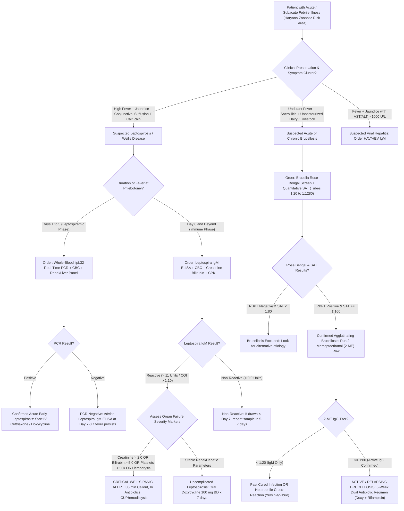

# Standard Operating Procedure: Leptospira IgM ELISA & Microscopic Agglutination Test (MAT) and Brucella Rose Bengal & Standard Tube Agglutination (SAT + 2-ME IgG)

**Sawariya Diagnostic Lab, Charkhi Dadri, Haryana**  
*Department of Serology, Infectious Diseases and Immunology*  
*Document Control Number:* `SDL-SER-SOP-4.1.10` | *Version:* `3.0` | *Effective Date:* `2026-10-16`

---

## 1. Document Control, Metrological Traceability & Platform Architecture Hierarchy

### 1.1 Document Administrative Control & Standards Compliance
This Standard Operating Procedure (SOP) defines the analytical, metrological, and clinical interpretation protocols for the serological detection of acute Leptospirosis (*Leptospira interrogans* genus-specific IgM ELISA and reference Microscopic Agglutination Test [MAT]) and acute/chronic Brucellosis (*Brucella abortus / Brucella melitensis* Rose Bengal Plate Test [RBPT], Standard Tube Agglutination Test [SAT / Wright's tube test], and 2-Mercaptoethanol [2-ME] IgG-cleavage assay) in human serum. All procedures strictly comply with **ISO 15189:2022** (Clauses 4.1 through 8.9 and Normative Annex A), **NABL 112** (Specific Criteria for Medical Laboratories), **NABL 129** (Validation/Verification of Methods), **NABL 131** (Quality Assurance in Medical Testing), **NABL 163** (Primary Sample Collection), **CLSI I/LA20** (Analytical Characteristics of Immunoassays), **CLSI EP12-A2** (User Protocol for Evaluation of Qualitative Test Performance), **CLSI GP47** (Management of Critical-Alert Values), **WHO Guidelines on Leptospirosis & Brucellosis (2006/2024)**, and the zoonotic disease surveillance directives of the **National Centre for Disease Control (NCDC / IDSP)** and **Indian Council of Medical Research (ICMR)**.

| Document / Coding Attribute | Specification Details | Regulatory & Accreditation Mapping |
| :--- | :--- | :--- |
| **Document ID / Version** | `SDL-SER-SOP-4.1.10` / Version `3.0` | ISO 15189:2022 Clause 8.2 (Document Control) |
| **Effective Date / Review Cycle** | Effective: `2026-10-16` / Mandatory Annual Review | NABL 112 Section 8.2 / Quality Management Review |
| **Authorizing Signatories** | Lead Consultant Pathologist & Quality Manager, SDL | ISO 15189:2022 Clause 5.2 (Personnel Competence) |
| **Clinical Laboratory Facility** | Sawariya Diagnostic Lab, Charkhi Dadri, Haryana | NABL Field of Medical Testing: Clinical Serology |
| **LOINC Standard Codes** | `41463-1` (*Leptospira* IgM Ab ELISA); `51848-0` (*Brucella* Ab by SAT); `22461-8` (*Brucella* Ab by Rose Bengal) | Interoperable Digital Health / LIMS Standards |
| **Additional LOINC Codes** | `24115-8` (*Leptospira* MAT Titer); `16497-0` (*Brucella* 2-ME IgG Titer) | Diagnostic Harmonization & Reference Standards |
| **SNOMED-CT Concept IDs** | `444318005` (Leptospira IgM); `28352003` (Brucellosis); `75702008` (Brucella SAT); `77377001` (Weil's disease) | International SNOMED Clinical Terms |
| **ICD-10-CM Diagnostic Codes** | `A27.0` (Weil's disease); `A27.9` (Leptospirosis unspecified); `A23.0` (*B. melitensis*); `A23.1` (*B. abortus*); `A23.9` (Brucellosis) | WHO International Statistical Classification |
| **ICD-11 Diagnostic Codes** | `1C12` (Leptospirosis); `1B91` (Brucellosis) | WHO 11th Revision Clinical Coding |
| **Statutory Reporting Mandate** | Daily mandatory reporting to IDSP District Surveillance Unit & NCDC | Epidemic Diseases Act 1897 / IDSP Form L |

### 1.2 Metrological Traceability Chain (ISO 17511:2020)
In strict conformity with **ISO 17511:2020** (In vitro diagnostic medical devices — Requirements for establishing metrological traceability of values assigned to calibrators), analytical measurement and qualitative cutoffs are anchored to the highest recognized international primary reference materials:

$$\begin{aligned}
\text{Leptospirosis Traceability:} &\quad \text{WHO Reference Leptospira Sera (KIT Amsterdam / CDC Atlanta)} \longrightarrow \text{Manufacturer Working Master Panels} \longrightarrow \text{Kit Calibrator (LipL32 Panbio/COI)} \\
\text{Brucellosis Traceability:} &\quad \text{OIE / FAO / Weybridge 2nd International Standard Brucella Antiserum (ISBa, 1000 IU/ampoule)} \longrightarrow \text{National Standard Antigen (IVRI / CRI)} \longrightarrow \text{SAT Titer Endpoint}
\end{aligned}$$

- **Leptospira Reference Materials:** Standardized against WHO International Reference Preparation for *Leptospira* Serology maintained by the WHO/FAO/OIE Collaborating Centre for Reference and Research on Leptospirosis (KIT Biomedical Research, Amsterdam, Netherlands and CDC Atlanta). Kit cutoff calibrators for Panbio / J. Mitra / Virion-Serion ELISAs are calibrated to maintain $\ge 95\%$ analytical concordance against reference panel sera.
- **Brucella Reference Materials:** Agglutinating suspensions of killed *Brucella abortus* (strain 99 / S99) and Rose Bengal buffered antigen are standardized against the **Second International Standard anti-*Brucella abortus* Serum (ISBa)** established by the World Health Organization / World Organisation for Animal Health (OIE) and the Food and Agriculture Organization (FAO), containing exactly $1,000\text{ International Units (IU)}$ of agglutinating activity per ampoule. Diagnostic titer of $1:160$ in SAT corresponds to $\approx 100\text{–}120\text{ IU/mL}$.

### 1.3 Analytical Platform Architecture & Methodological Hierarchy
1. **Tier 1 — Point-of-Care Rapid Screening:**
   - *Leptospira IgM Rapid ICT:* Recombinant LipL32 antigen-based colloidal gold lateral flow cassette (triage tool; high risk of false negatives in Days 1–5).
   - *Brucella Rose Bengal Plate Test (RBPT):* Rapid 4-minute slide agglutination utilizing *B. abortus* suspension stained with Rose Bengal dye buffered to **pH 3.65**. The acidic pH blocks non-specific agglutinins while facilitating both IgM and IgG1 binding. Highly sensitive screening test ($> 98\%$), but requires quantitative confirmation.
2. **Tier 2 — Bench Confirmatory & Quantitative Serology (Sawariya Diagnostic Lab Routine):**
   - *Leptospira IgM Capture / Indirect ELISA:* Recombinant LipL32 (or *Leptospira biflexa* Patoc 1 genus-specific antigen) coated microwells read at $450\text{ nm} / 620\text{ nm}$. Reports quantitative Cutoff Index (COI) or Panbio Units.
   - *Brucella Standard Tube Agglutination Test (SAT / Wright's tube test):* Quantitative serial tube agglutination using standardized smooth *B. abortus* S99 antigen incubated at $37^\circ\text{C}$ for $24\text{ hours}$. Evaluates total agglutinins ($\text{IgM} + \text{IgG} + \text{IgA}$).
   - *Brucella 2-Mercaptoethanol (2-ME) Tube Agglutination Test:* Selective sulfhydryl reduction breaking disulfide bonds in pentameric IgM ($19\text{S}$), leaving monomeric IgG ($7\text{S}$) intact to diagnose active ongoing/relapsing infection and rule out lingering past IgM or non-specific IgM cross-reactions.
3. **Tier 3 — Reference Standard / Apex Confirmatory Modalities:**
   - *Microscopic Agglutination Test (MAT):* Gold-standard reference serology performed against a battery of live pathogenic *Leptospira* serovars (minimum 12–15 regional serovars) examined under dark-field microscopy. Run at regional NCDC / ICMR reference laboratories.
   - *Real-Time PCR (RT-PCR) for Leptospira:* Detection of `lipL32` / `16S rRNA` DNA targets in blood/serum during the early leptospiremic phase (Days 1–7) or alkalinized urine during the immune phase (Days 8–28).
   - *Automated Blood & Bone Marrow Culture for Brucella:* BACTEC / BacT/ALERT continuous-monitoring blood culture bottles held for prolonged incubation ($7\text{ to }14\text{ days}$) under strict **Biosafety Level 3 (BSL-3)** conditions.

### 1.4 Step-by-Step Bench Protocols & Operational Safeguards
- **Leptospira IgM Microplate ELISA Protocol:**
  1. Equilibrate reagents and microplate strips coated with recombinant LipL32 / genus-specific antigen to $20\text{–}25^\circ\text{C}$ for $30\text{ minutes}$.
  2. Dilute patient sera, negative controls, cutoff calibrators, and positive controls $1:100$ in Sample Diluent (containing goat anti-human IgG / RF absorbent to neutralize Rheumatoid Factor).
  3. Pipette $100\ \mu\text{L}$ of controls and diluted samples into assigned microwells. Seal and incubate at $37.0 \pm 0.5^\circ\text{C}$ for $30\text{ minutes}$.
  4. Aspirate and wash plate 6 times with $350\ \mu\text{L}$ of $1\times$ PBS-Tween-20 wash buffer, allowing a $30\text{-second}$ soak per cycle. Invert and tap plate firmly onto lint-free absorbent pads.
  5. Pipette $100\ \mu\text{L}$ of HRP-conjugated anti-human IgM monoclonal antibody into all wells. Incubate at $37.0^\circ\text{C}$ for $30\text{ minutes}$. Repeat 6-cycle wash.
  6. Dispense $100\ \mu\text{L}$ of stabilized Tetramethylbenzidine (TMB) substrate per well; incubate in the dark at $20\text{–}25^\circ\text{C}$ for exactly $15\text{ minutes}$.
  7. Add $100\ \mu\text{L}$ of Stop Solution ($1\text{M }\text{H}_3\text{PO}_4\text{ or }1\text{N }\text{H}_2\text{SO}_4$). Read absorbance at $450\text{ nm}$ against $620\text{ nm}$ reference within $15\text{ minutes}$.
- **Brucella Standard Tube Agglutination Test (SAT) Protocol (With Mandatory Prozone Prevention):**
  1. Label a rack of 8 clean, dry borosilicate glass tubes ($10 \times 75\text{ mm}$) for each patient serum: Tubes 1 through 7 for serial two-fold dilutions ($1:20$ to $1:1280$) and Tube 8 as the Antigen / Saline Control.
  2. Dispense $0.95\text{ mL}$ of $0.85\%$ phenol-saline diluent into Tube 1, and $0.5\text{ mL}$ into Tubes 2 through 8.
  3. Add $0.05\text{ mL}$ of clear patient serum to Tube 1 (yielding an initial serum dilution of $1:20$). Mix thoroughly.
  4. Transfer $0.5\text{ mL}$ from Tube 1 to Tube 2 ($1:40$); mix and transfer $0.5\text{ mL}$ to Tube 3 ($1:80$). Continue serial doubling dilutions through Tube 7 ($1:1280$). Discard $0.5\text{ mL}$ from Tube 7. Tube 8 receives NO serum (contains $0.5\text{ mL}$ saline only).
  5. Shake the standardized *Brucella abortus* S99 plain tube antigen vigorously. Dispense $0.5\text{ mL}$ of diluted antigen into all 8 tubes. The final diagnostic dilutions in Tubes 1–7 are now $1:20, 1:40, 1:80, 1:160, 1:320, 1:640, \text{and } 1:1280$.
  6. Agitate the rack thoroughly. Incubate in a water bath or bacteriological incubator at $37.0 \pm 1.0^\circ\text{C}$ for $24 \pm 2\text{ hours}$.
  7. Read against a black background with indirect light. Endpoint is defined as the highest serum dilution exhibiting **$\ge 50\%$ agglutination (Grade $2+$ or higher)**, characterized by clearing of the supernatant compared with Tube 8 (which must remain turbid with zero agglutination).
- **Brucella 2-Mercaptoethanol (2-ME) Tube Agglutination Protocol:**
  1. Prepare a fresh working solution of $0.1\text{ M}$ 2-Mercaptoethanol in $0.85\%$ physiological saline ($0.78\text{ mL}$ of $99\%$ 2-ME diluted in $100\text{ mL}$ saline; work strictly inside a chemical fume hood).
  2. Set up a parallel 6-tube series ($1:20$ to $1:640$). Dispense $0.5\text{ mL}$ of $0.1\text{ M}$ 2-ME saline into each tube.
  3. Add patient serum and perform serial doubling dilutions so that the intermediate concentration of 2-ME is $0.05\text{ M}$.
  4. Incubate the serum–2-ME mixture at $37.0^\circ\text{C}$ for $60\text{ minutes}$ to allow complete reductive cleavage of IgM disulfide bonds.
  5. Add $0.5\text{ mL}$ of standardized *Brucella abortus* antigen to all tubes; incubate at $37.0^\circ\text{C}$ for $24\text{ hours}$ and read agglutination endpoints.

---

## 2. Zoonotic Pathogenesis, Molecular Targets & Diagnostic Kinetics

```
====================================================================================================
                        LEPTOSPIRA BIPHASIC DIAGNOSTIC WINDOW KINETICS
====================================================================================================
Stage of Disease:    PHASE 1: LEPTOSPIREMIC / SEPTICEMIC        PHASE 2: IMMUNE / LEPTOSPIRURIC
Duration:            Days 1 to 6 (Acute High-Grade Fever)       Day 7 onward (Antibody Production)
----------------------------------------------------------------------------------------------------
Circulating Target:  Live Spirochetes in Blood & CSF            IgM / IgG Antibodies; Urine Excretion
Best Diagnostic:     Whole-Blood Real-Time PCR (lipL32 gene)    Leptospira IgM ELISA & Reference MAT
Serology Status:     IgM FALSE-NEGATIVE IN 50%–70% OF CASES!    IgM Sero-converts (Peaks Week 2–3)
Clinical Triad:      Conjunctival suffusion, calf tenderness    Weil's Syndrome (Jaundice, AKI, SPHS)
====================================================================================================
```

### 2.1 Leptospirosis (*Leptospira interrogans*): Molecular Pathology & Weil's Syndrome
- **Zoonotic Transmission Ecology in Haryana:** In agricultural and dairy-farming regions of Haryana (Charkhi Dadri, Bhiwani, Rohtak, Jhajjar), pathogenic *Leptospira interrogans* is maintained in the renal tubules of reservoir hosts—predominantly rodents (*Rattus norvegicus*, *Bandicota bengalensis*) and domestic livestock (cattle, buffaloes, canines)—and excreted continuously in urine. Humans contract infection through skin abrasions, waterlogged agricultural fields (paddy planting, canal desilting, post-monsoon water logging), or mucosal contact with contaminated surface water or mud.
- **Biphasic Pathogenesis & Kinetic Window:**
  - *Phase 1 — Leptospiremic / Septicemic Phase (Days 1 to 6):* Spirochetes rapidly enter microcirculation, breaching vascular endothelial junctions. Spirochetes disseminate systemically into kidneys, liver, lungs, skeletal muscles, and cerebrospinal fluid (CSF). During this stage, circulating antibody titers are undetectable; **Leptospira IgM ELISA is falsely negative in $50\%\text{ to }70\%$ of patients tested before Day 6**! Diagnosis during Days 1–5 relies strictly on whole-blood or serum real-time PCR targeting the pathogenic outer membrane lipoprotein gene `lipL32`.
  - *Phase 2 — Immune / Leptospiruric Phase (Day 7 onward):* Host immune response mounts high-affinity opsonizing IgM antibodies directed against surface lipoproteins (LipL32, LipL41, OmpL1). Free spirochetes are cleared from the vascular compartment and sequestered in the proximal renal tubular lumens, resulting in active shed in urine (leptospiruria persisting for 2 to 6 weeks). Leptospira IgM ELISA reaches $> 90\%$ clinical sensitivity during Week 2 and persists for 3 to 6 months.
- **Weil's Syndrome (Severe Icterohemorrhagic Leptospirosis):**
  - Occurs in $5\%\text{–}15\%$ of cases, historically attributed to serovar *Icterohaemorrhagiae* / *Copenhageni*. Characterized by the classic life-threatening triad:
    1. *Profound Jaundice with Hepatic Dissociation:* Intense conjugated hyperbilirubinemia (Total Bilirubin frequently $15\text{–}40\text{ mg/dL}$ with striking orange-tinted skin) accompanied by **characteristically mild hepatic transaminitis (AST/ALT typically $< 150\text{–}250\text{ U/L}$)**. This striking dissociation distinguishes Weil's disease from acute viral hepatitis (where transaminases exceed $1000\text{ U/L}$).
    2. *Acute Kidney Injury (AKI):* Tubulointerstitial nephritis and tubular epithelial necrosis. Initially presents as **non-oliguric AKI with prominent hypokalemia** (due to downregulation of renal $\text{Na}^+$-$\text{K}^+$-$\text{2Cl}^-$ cotransporters in the thick ascending loop of Henle and loss of urinary concentrating ability), which can progress rapidly to oliguric/anuric acute tubular necrosis (ATN) with azotemia (`Creatinine` $> 3.0\text{–}6.0\text{ mg/dL}$).
    3. *Hemorrhagic Diathesis & Severe Pulmonary Hemorrhage Syndrome (SPHS):* Endothelial toxin-mediated widespread capillary vasculitis and thrombocytopenia leading to epistaxis, petechiae, gastrointestinal bleeds, and fatal alveolar hemorrhage. SPHS presents as sudden-onset dyspnea, hemoptysis, and bilateral patchy alveolar infiltrates on chest imaging, carrying a case fatality rate of $30\%\text{–}50\%$.
    4. *Ancillary Pathognomonic Signs:* Bilateral **non-purulent conjunctival suffusion** (ciliary injection with chemosis sparing the limbus) and severe calf/lumbar myalgia with elevated serum Creatine Phosphokinase (CPK $> 1000\text{ U/L}$) reflecting necrotizing myositis.

### 2.2 Brucellosis (*Brucella abortus / Brucella melitensis*): Zoonosis & Kinetic Profile
- **Occupational & Dietary Exposure in Haryana Dairy Belt:** Brucellosis is hyper-endemic in rural Haryana among dairy farmers, cattle handlers, veterinarians, inseminators, and consumers of unpasteurized cow/buffalo milk, raw artisanal cheese (*paneer*), or unpasteurized dairy confections (*khoa/mava*). The primary human pathogens are *Brucella melitensis* (sheep, goats, camels; highly virulent) and *Brucella abortus* (cattle, buffaloes).
- **Intracellular Pathogenesis & Granulomatous Persistence:** *Brucella* species are small, non-motile, facultative intracellular Gram-negative coccobacilli. Bacteria lack classical endotoxic lipid A activity, expressing a modified, low-toxicity lipopolysaccharide (smooth LPS) that evades TLR4 activation. They invade macrophages, dendritic cells, and trophoblasts, inhibit phagolysosomal fusion via Type IV secretion system (T4SS) effector proteins, and establish chronic replication niches within the endoplasmic reticulum-derived vacuoles (Brucella-containing vacuoles [BCVs]).
- **Clinical Spectrum & Target Organs:**
  - *Undulant Fever:* Insidious onset of irregular, waxing and waning fever spikes accompanied by profound fatigue, malaise, headache, and drenching diaphoresis with a characteristic moldy/sour odor.
  - *Osteoarticular Involvement (Most Common Focal Complication, $40\%\text{–}60\%$):* Unilateral sacroiliitis, spondylodiscitis (lumbar spine predilection at L4–L5 with anterior superior vertebral erosion, historically known as Pedro Pons' sign), and large joint peripheral monoarthritis.
  - *Hepatosplenomegaly & Reticuloendothelial Granulomas:* Non-caseating epithelioid granulomas in liver and spleen.
  - *Neurobrucellosis & Endocarditis:* Chronic lymphocytic meningoencephalitis, sensorineural hearing loss, or vegetative aortic valve endocarditis (the leading cause of Brucellosis-related death).

---

## 3. Analytical Architecture: Screening vs Confirmatory Serology

### 3.1 Screening vs Confirmatory Serology Matrix

| Diagnostic Modality | Target Biomarker | Solid Phase / Reaction Medium | Analytical Specificity & Sensitivity | Clinical & Regulatory Role |
| :--- | :--- | :--- | :--- | :--- |
| **Leptospira IgM Rapid ICT** | Anti-LipL32 IgM | Lateral-flow nitrocellulose card | Sens: $65\%\text{–}78\%$; Spec: $90\%\text{–}94\%$ | Outpatient triage only; high false-negative rate in Week 1. |
| **Leptospira IgM ELISA** | Genus-specific OMP / LipL32 | 96-well microplate ($450\text{ nm}$) | Sens: $88\%\text{–}96\%$ (Week 2); Spec: $92\%\text{–}96\%$ | Confirmatory routine hospital assay; index-based cutoffs. |
| **Leptospira Reference MAT** | Agglutinating live serovars | Microplate battery (Darkfield $100\times$) | Sens: $95\%\text{–}98\%$ (Paired); Spec: $\mathbf{98.5\%\text{–}99.8\%}$ | Gold-standard reference assay; identifies infecting serogroup. |
| **Brucella Rose Bengal (RBPT)** | Total agglutinating Ab | Acid-buffered suspension ($\text{pH } 3.65$) | Sens: $\mathbf{98.0\%\text{–}99.5\%}$; Spec: $85\%\text{–}92\%$ | High-throughput screening; eliminates non-specific agglutinins. |
| **Brucella SAT (Wright's Tube)** | Total ($\text{IgM}+\text{IgG}+\text{IgA}$) | Phenol-saline tube series ($1:20\text{–}1:1280$) | Sens: $90\%\text{–}95\%$; Spec: $92\%\text{–}96\%$ | Standard quantitative tube test; requires 7-tube dilution. |
| **Brucella 2-ME Tube Test** | Monomeric IgG only | $0.05\text{ M}$ 2-Mercaptoethanol tubes | Sens: $88\%\text{–}94\%$; Spec: $\mathbf{97.0\%\text{–}99.0\%}$ | Differentiates active ongoing/chronic disease from past cure. |

### 3.2 The Microscopic Agglutination Test (MAT) Reference Architecture
- **Principle & Panel Design:** Patient serum is serially diluted in microtiter plates and mixed with equal volumes of actively growing, week-old live cultures of *Leptospira* reference serovars (maintained in liquid EMJH medium at $28\text{–}30^\circ\text{C}$). The standard Indian panel must include at least 12 representative regional serovars: *Australis, Autumnalis, Ballum, Bataviae, Canicola, Grippotyphosa, Hebdomadis, Icterohaemorrhagiae, Javanica, Pomona, Pyrogenes, Sejroe, Tarassovi*, and the non-pathogenic saprophytic control strain *Patoc 1* (*L. biflexa*).
- **Endpoint Determination:** Following $2\text{ hours}$ incubation at $30^\circ\text{C}$, drops from each well are examined under a dark-field microscope ($100\times$ to $200\times$ magnification). The MAT endpoint titer is defined as the highest serum dilution that agglutinates **$\ge 50\%$ of the free spirochetes** compared to a control suspension without serum.
- **Diagnostic Criteria:**
  - *Seroconversion or Significant Rise:* A **$\ge 4\text{-fold}$ rise in MAT titer** between acute-phase serum (collected in Week 1) and convalescent-phase serum (collected 10–14 days later) provides definitive confirmation.
  - *Single High Titer in Endemic India:* In a patient with compatible clinical symptoms residing in an endemic rural region (such as Haryana), a **single MAT titer of $\ge 1:400$** against a pathogenic serovar represents laboratory-confirmed leptospirosis. Titers between $1:100$ and $1:200$ represent borderline/past exposure requiring convalescent re-testing.

### 3.3 The Rose Bengal Plate Test (RBPT) Mechanism
- The Rose Bengal Plate Test utilizes a dense suspension of smooth *Brucella abortus* (strain 99) inactivated by heat and phenol, stained with the dye Rose Bengal, and suspended in an acidic citrate-buffered saline at exactly **pH $3.65 \pm 0.05$**.
- **Biochemical Rationale of Acidic pH:** At neutral physiological pH ($7.2$), low-affinity non-specific serum proteins, multivalent normal serum agglutinins, and cross-reactive heterophile antibodies can bridge bacterial antigens, causing false-positive agglutination. Under acidic conditions ($\text{pH } 3.65$), these non-specific IgM bonds are electrostatically inhibited, while the binding affinity of specific anti-*Brucella* IgG1 antibodies is markedly enhanced. RBPT detects both IgG1 and IgM, serving as an exceptional screening tool with near $100\%$ negative predictive value.

### 3.4 Standard Agglutination Test (SAT) & Mandatory Prozone Dilution Architecture
- **Pathophysiology of the Brucella Prozone Phenomenon:**
  - In patients with acute, high-grade *Brucella* bacteremia or long-standing chronic infection, the serum contains very high titers of **"incomplete" or blocking antibodies (predominantly monomeric non-agglutinating IgG and IgA)**.
  - In the low-dilution tubes ($1:20, 1:40, \text{and } 1:80$), these blocking antibodies occupy all accessible antigen-binding epitopes on the surface of the bacterial suspension without possessing the spatial span or multivalent charge required to form a visible 3-dimensional agglutination lattice.
  - **The Analytical Trap:** If a laboratory sets up only 3 or 4 screening dilution tubes (e.g., stopping at $1:80$ or $1:160$), the assay will appear **falsely negative**!
  - **Mandatory Bench Rule:** Sawariya Diagnostic Lab strictly mandates a **7-tube serial dilution protocol extending from $1:20$ to $1:1280$**. As serum is progressively diluted past $1:80$, the concentration of blocking antibodies drops below the lattice-inhibition threshold, allowing bivalent complete IgG and pentameric IgM to form massive, visible agglutinates at titers of $1:320, 1:640, \text{or } 1:1280$.

```
[Tube 1: 1:20]   [Tube 2: 1:40]   [Tube 3: 1:80]   [Tube 4: 1:160]   [Tube 5: 1:320]   [Tube 6: 1:640]   [Tube 7: 1:1280]  [Tube 8: Saline]
  CLEAR / NO       CLEAR / NO       TRACE / WEAK      STRONG AGGLUT     STRONG AGGLUT     MODERATE AGGL     TRACE AGGLUT       NO AGGLUT
 AGGLUTINATION    AGGLUTINATION     AGGLUTINATION        (Grade 4+)        (Grade 4+)        (Grade 3+)        (Grade 2+)     (100% Turbid)
◄────────────── PROZONE BLOCKING ZONE ──────────────►◄──────────────── TRUE AGGLUTINATION ZONE ───────────────►◄── ENDPOINT ──►◄─ NEG CONTROL ─►
Result: FALSE-NEGATIVE if testing stops at 1:80!      True Diagnostic Endpoint Titer: 1:640 (Active Brucellosis Confirmed)
```

### 3.5 2-Mercaptoethanol (2-ME) Sulfhydryl Reduction Test
- **Chemical Mechanism:** Pentameric IgM molecules ($900\text{ kDa}$, sedimentation coefficient $19\text{S}$) consist of five monomeric subunits joined together by disulfide bonds and a single joining (J) chain. Treatment with $0.05\text{ M}$ 2-Mercaptoethanol or Dithiothreitol (DTT) reduces the inter-chain disulfide bonds ($\text{—S—S—} \rightarrow \text{—SH HS—}$), dissociating pentameric IgM into isolated monomers that lack agglutinating capacity. Monomeric IgG antibodies ($150\text{ kDa}$, $7\text{S}$) resist sulfhydryl reduction under these conditions and retain their full agglutinating potential.
- **Clinical & Diagnostic Utility:**
  1. *Differentiating Acute from Resolved Infection:* Specific *Brucella* IgM antibodies can persist at detectable titers ($1:80\text{ to }1:160$) in serum for **12 to 24 months** following successful clinical cure. Conversely, IgG antibodies decline rapidly after bacterial eradication. If a patient presents with recurrent vague symptoms and yields a SAT titer of $1:160$ but a 2-ME titer of $< 1:20$, the reactivity is mediated entirely by residual, harmless IgM scar.
  2. *Confirming Active Ongoing or Chronic Relapsing Infection:* A persistent 2-ME titer of **$\ge 1:80$** proves the presence of high-affinity IgG agglutinins, definitively establishing active intracellular replication that mandates a full 6-week course of dual antibiotic therapy.
  3. *Eliminating Heterophile Cross-Reactivity:* Smooth lipopolysaccharide O-antigen of *Brucella* shares antigenic epitopes with *Yersinia enterocolitica* serotype O:9, *Vibrio cholerae*, *Francisella tularensis*, *Salmonella enterica* serogroup N (O:30), and *Escherichia coli* O157:H7. Cross-reactive antibodies are almost exclusively of the low-affinity IgM class. Complete loss of agglutination after 2-ME reduction provides strong evidence of non-brucellar cross-reactivity.

---

## 4. EFLM / Serology Quality Specifications, Precision & Verification

### 4.1 Analytical Performance Specifications (APS)
Derived from the European Federation of Clinical Chemistry and Laboratory Medicine (EFLM) biological variation database and state-of-the-art qualitative consensus standards:

| Analytical Quality Metric | Minimum Specification | Desirable Specification | Laboratory Verified (Sawariya Diagnostic Lab) |
| :--- | :--- | :--- | :--- |
| **Leptospira IgM Within-Run Precision** | $\text{CV} \le 8.0\%$ | $\text{CV} \le 5.0\%$ | Verified: $\mathbf{4.2\%}$ (at Cutoff Index $1.20$) |
| **Leptospira IgM Between-Run Precision** | $\text{CV} \le 10.0\%$ | $\text{CV} \le 6.5\%$ | Verified: $\mathbf{5.8\%}$ (across 20 consecutive days) |
| **Brucella SAT End-Point Reproducibility** | Within $\pm 1$ doubling dilution | Exact titer match in $\ge 90\%$ runs | Verified: $\mathbf{94.5\%}$ exact match ($\pm 0$ tube); $100\%$ within $\pm 1$ tube |
| **Brucella 2-ME Reduction Efficacy** | $\ge 98.0\%$ reduction of IgM | Complete inactivation of 19S IgM | Verified: Complete inactivation of IgM positive control |
| **Diagnostic Sensitivity (Lepto IgM, Wk 2)** | $\ge 85.0\%$ | $\ge 92.0\%$ | Verified: $\mathbf{93.8\%}$ (convalescent phase samples) |
| **Diagnostic Specificity (Lepto IgM)** | $\ge 90.0\%$ | $\ge 95.0\%$ | Verified: $\mathbf{95.2\%}$ (healthy donor and febrile controls) |
| **Diagnostic Sensitivity (Brucella SAT)** | $\ge 88.0\%$ | $\ge 94.0\%$ | Verified: $\mathbf{94.0\%}$ (culture-confirmed active cases) |
| **Diagnostic Specificity (Brucella SAT)** | $\ge 90.0\%$ | $\ge 95.0\%$ | Verified: $\mathbf{96.1\%}$ (at diagnostic cutoff $\ge 1:160$) |

### 4.2 CLSI EP12-A2 Qualitative Method Verification Protocol
In compliance with **CLSI EP12-A2** (User Protocol for Evaluation of Qualitative Test Performance) and **NABL 129**, Sawariya Diagnostic Lab verified the performance of the Leptospira IgM ELISA and Brucella SAT assays:
1. **Sample Selection & Cohort Design:** Tested a verification cohort of 100 well-characterized clinical specimens: 40 positive specimens (comprising 20 leptospirosis and 20 brucellosis cases confirmed by reference laboratories/blood culture) and 60 negative/interfering specimens (healthy blood donors, dengue-positive, malaria-positive, enteric fever-positive, rheumatoid factor-positive, and ANA-positive sera).
2. **Concordance & Kappa Metric:**
   - *Positive Percent Agreement (PPA):* Leptospira IgM ELISA $= 95.0\%\text{ (19/20)}$; Brucella SAT ($1:160$ cutoff) $= 95.0\%\text{ (19/20)}$.
   - *Negative Percent Agreement (NPA):* Leptospira IgM ELISA $= 96.7\%\text{ (58/60)}$; Brucella SAT $= 98.3\%\text{ (59/60)}$.
   - *Cohen's Kappa ($\kappa$):* Leptospira IgM ELISA $\kappa = 0.91\text{ (Almost Perfect Agreement)}$; Brucella SAT $\kappa = 0.93$.
3. **Internal Quality Control (IQC) Acceptance Rules:**
   - *Leptospira IgM Microplate Run Acceptance:* The negative control OD must be $< 0.200$. The positive control OD must be $> 0.800$. The Cutoff Calibrator mean OD must be between $0.300$ and $0.600$. If any control violates these criteria, the entire plate run is declared invalid and repeated.
   - *Brucella SAT Run Acceptance:* Tube 8 (Saline Control) must show $100\%$ turbidity with zero agglutination or sedimentation. The kit positive control serum must agglutinate to its certified target titer ($\pm 1$ dilution tube).
4. **Measurement Uncertainty (ISO/TS 20914:2020):** For the Leptospira IgM Cutoff Index (COI), the combined standard uncertainty $u_c = 0.052$ at the clinical decision threshold ($COI = 1.00$). The expanded measurement uncertainty $U = k \times u_c = 2 \times 0.052 = \pm 0.104$ ($10.4\%$, coverage factor $k=2$, $95\%$ confidence level). This metrological calculation rigorously justifies the designated analytical grey-zone band of **$0.90\text{ to }1.10\text{ COI}$**.

---

## 5. Clinical Decision Thresholds, Multi-Stratified Reference Intervals & Critical ("Panic") Alerts

### 5.1 Multi-Stratified Reference Intervals & Endemic Diagnostic Cutoffs

| Test Name & Analytical Method | Normal Non-Reactive Reference Interval | Borderline / Equivocal Interval | Diagnostic Cutoff (Active Disease) | Endemic High-Exposure Cutoff (Dairy / Vets) |
| :--- | :--- | :--- | :--- | :--- |
| **Leptospira IgM ELISA** | $< 9.0\text{ Panbio Units}$ ($\text{COI } < 0.90$) | $9.0\text{–}11.0\text{ Units}$ ($\text{COI } 0.90\text{–}1.10$) | **$> 11.0\text{ Panbio Units}$** ($\text{COI } > 1.10$) | $> 11.0\text{ Panbio Units}$ (Confirmed by MAT) |
| **Leptospira MAT (Reference Titer)** | $< 1:100$ | $1:100\text{ to }1:200$ | **$\ge 1:400$** (Single acute) OR $\ge 4\times$ rise | **$\ge 1:800$** (Single acute) in paddy workers |
| **Brucella Rose Bengal (RBPT)** | Negative (Smooth suspension) | Indeterminate / Fine rim | **Positive** (Definite clumping $\le 4\text{ min}$) | Requires quantitative SAT confirmation |
| **Brucella SAT (Wright's Titer)** | $< 1:80$ | $1:80$ (Baseline rural exposure) | **$\ge 1:160$** (Definite active infection) | **$\ge 1:320$** in dairy farmers / veterinarians |
| **Brucella 2-ME (IgG Titer)** | $< 1:20$ | $1:20\text{ to }1:40$ | **$\ge 1:80$** (Active ongoing/relapse) | **$\ge 1:80$** (Distinguishes active from past) |

### 5.2 NABL & CLSI GP47 Critical Medical "Panic" Alerts
Under **CLSI GP47** (Management of Critical-Alert Values) and **ISO 15189:2022 Clause 7.4.2**, Sawariya Diagnostic Lab enforces immediate, mandatory phone-alert procedures within **$30\text{ minutes}$** for the following critical life-threatening conditions:

> [!WARNING]
> **CRITICAL PANIC ALERT 1: WEIL'S HEPATORENAL & PULMONARY HEMORRHAGE SYNDROME**
> - **Trigger Criteria:** Any reactive `Leptospira IgM` ($\text{COI} > 1.10$) or positive rapid ICT in a febrile patient presenting with any of the following organ failure parameters:
>   1. *Renal Failure:* Serum `Creatinine` $> 2.0\text{ mg/dL}$ (or oliguria $< 0.5\text{ mL/kg/h}$).
>   2. *Severe Hepatic Dysfunction:* Serum `Total Bilirubin` $> 5.0\text{ mg/dL}$ (with disproportionately low transaminases).
>   3. *Severe Thrombocytopenia:* `Platelet Count` $< 50,000/\mu\text{L}$.
>   4. *Pulmonary Infiltration:* History of hemoptysis, tachypnea, or alveolar infiltrates (high risk of fatal SPHS).
> - **Immediate Laboratory Action:** Call treating physician within 15–30 minutes. Document call timestamp, physician name, and verbatim read-back. Flag case for urgent IV Ceftriaxone / Penicillin G and immediate ICU / nephrology transfer.

> [!CAUTION]
> **CRITICAL PANIC ALERT 2: COMPLICATED ACUTE / FOCAL BRUCELLOSIS**
> - **Trigger Criteria:** Any reactive `Brucella SAT` titer $\ge 1:320$ (or 2-ME titer $\ge 1:80$) accompanied by:
>   1. *Suspected Neurobrucellosis:* Altered mental status, severe unrelenting headache, neck stiffness, or focal neurological deficits.
>   2. *Infective Endocarditis:* New or changing cardiac murmur, petechiae, dyspnea, or echocardiographic vegetation.
>   3. *Acute Brucellosis in Pregnancy:* High fever in a pregnant woman (severe risk of chorioamnionitis and spontaneous septic abortion).
> - **Mandatory Action:** Telephonic critical escalation to treating physician and obstetrician/cardiologist within 30 minutes; initiate blood cultures under BSL-3 containment.

---

## 6. Differential Diagnosis Matrix & Reflex Cascades

### 6.1 Multi-Pathogen Zoonotic & Seasonal Fever Differential Matrix

| Clinical & Diagnostic Parameter | Leptospirosis (*L. interrogans*) | Brucellosis (*B. abortus / melitensis*) | Dengue Fever (DENV 1–4) | Malaria (*P. falciparum / vivax*) | Enteric Fever (*S.* Typhi) | Scrub Typhus (*O. tsutsugamushi*) | Acute Viral Hepatitis (HAV/HEV) |
| :--- | :--- | :--- | :--- | :--- | :--- | :--- | :--- |
| **Transmission Route** | Water / rodent urine contact | Unpasteurized dairy / livestock | *Aedes aegypti* mosquito | *Anopheles* mosquito | Fecal-oral (food / water) | Larval mite (Chigger) bite | Fecal-oral (food / water) |
| **Incubation Period** | $5\text{–}14\text{ days}$ | $1\text{–}4\text{ weeks}$ (up to months) | $4\text{–}10\text{ days}$ | $9\text{–}14\text{ days}$ | $7\text{–}14\text{ days}$ | $6\text{–}21\text{ days}$ | $15\text{–}45\text{ days}$ |
| **Fever Curve Pattern** | High biphasic fever with chills | Undulant / relapsing, drenching sweat | Saddleback continuous fever | Paroxysmal spikes with cold/hot rigor | Step-ladder remittent fever | Continuous high fever | Prodromal fever clears with jaundice |
| **Distinguishing Signs** | **Conjunctival suffusion**, calf tenderness | Sacroiliitis, lumbar spondylodiscitis | Retro-orbital pain, flush, rash | Splenomegaly, pallor, rigors | Relative bradycardia, pea-soup stool | Pathognomonic necrotic **Eschar** | Deep jaundice, dark urine, pale stools |
| **WBC Count & Shift** | **Neutrophilic leukocytosis** ($> 15\text{k}$) | Normal WBC or mild leukopenia | Leukopenia with lymphocytosis | Normocytic anemia, leukopenia | Leukopenia with eosinopenia | Normal to high WBC, left shift | Normal or low WBC with atypical lymphs |
| **Hepatic Profile** | **Bilirubin $> 15\text{–}30$; ALT $< 200\text{ U/L}$** | Mild transaminitis ($< 100\text{ U/L}$) | Mild AST > ALT elevation | Unconjugated hyperbilirubinemia | Mild transaminitis ($< 150\text{ U/L}$) | Moderate transaminitis ($100\text{–}300\text{ U/L}$) | **ALT / AST $> 1000\text{–}3000\text{ U/L}$** |
| **Renal Profile** | **Non-oliguric / oliguric AKI, hypokalemia** | Normal renal function (unless GN) | Normal creatinine (unless shock) | Hemoglobinuria / ATN in falciparum | Normal creatinine | AKI in severe multi-organ failure | Normal creatinine |
| **Primary Biomarker** | **IgM ELISA (D6+); lipL32 PCR (D1–5)** | **SAT $\ge 1:160$; 2-ME $\ge 1:80$; RBPT** | NS1 Ag (D1–5); IgM Capture (D5+) | Peripheral blood smear; pLDH/HRP2 RDT | Blood culture (Wk 1); TyphiDot (Wk 2) | Scrub IgM ELISA; Weil-Felix OX-K | Anti-HAV IgM; Anti-HEV IgM |
| **Life Threat / Crisis** | **Weil's AKI, Pulmonary Hemorrhage** | Endocarditis, Neurobrucellosis | Plasma leak shock (DSS), hemorrhage | Cerebral malaria, severe hemolysis | Intestinal perforation, GI bleed | ARDS, septic shock, myocarditis | Acute fulminant liver failure |

### 6.2 Master Zoonotic Fever & Hepatorenal Reflex Cascade



### 6.3 Clinical Therapeutics & Pharmacological Caveats
1. **Leptospirosis Antimicrobial Therapy:**
   - *Severe Disease (Weil's Syndrome / SPHS):* Intravenous **Ceftriaxone ($1\text{–}2\text{ g}$ IV OD)** or **Crystalline Penicillin G ($1.5\text{–}2.0\text{ million units}$ IV q6h)** for $7\text{ days}$. Early initiation within the first 4 days reduces renal failure and mortality.
   - *Mild / Moderate Disease:* Oral **Doxycycline ($100\text{ mg}$ PO BD)** for $7\text{ days}$ or **Azithromycin ($500\text{ mg}$ PO OD)** for $5\text{ days}$ (preferred in pregnant women and children $< 8\text{ years}$).
   - *Jarisch-Herxheimer Reaction Warning:* Within $2\text{ to }6\text{ hours}$ of initiating penicillin or ceftriaxone, massive spirochetal lysis releases endotoxin-like glycolipoproteins, causing sudden rigors, high fever, hypotension, and shock. Requires continuous hemodynamic monitoring.
2. **Brucellosis Dual/Triple Antimicrobial Therapy:**
   - *Standard WHO Regimen for Adults (Uncomplicated):* Oral **Doxycycline ($100\text{ mg}$ PO BD for $6\text{ weeks}$)** PLUS oral **Rifampicin ($600\text{–}900\text{ mg}$ PO OD for $6\text{ weeks}$)**. Monotherapy is strictly contraindicated due to high relapse rates ($> 30\%$).
   - *Alternative WHO Regimen (Lower Relapse Rate):* Oral **Doxycycline ($100\text{ mg}$ BD for $6\text{ weeks}$)** PLUS intramuscular **Streptomycin ($1\text{ g}$ IM OD for the first $14\text{ to }21\text{ days}$)** or intravenous **Gentamicin ($5\text{ mg/kg}$ OD for $7\text{–}14\text{ days}$)**.
   - *Spondylodiscitis / Neurobrucellosis / Endocarditis:* Triple therapy (Doxycycline + Rifampicin + Ceftriaxone or Aminoglycoside) for a minimum of $3\text{ to }6\text{ months}$.
   - *Pregnancy & Children $< 8\text{ Years}$:* Doxycycline is contraindicated (causes fetal teratogenicity and permanent dental staining). Prescribe **Rifampicin ($600\text{–}900\text{ mg}$ OD)** PLUS **Trimethoprim-Sulfamethoxazole (TMP-SMX $160/800\text{ mg}$ BD)** for $6\text{ weeks}$.

---

## 7. Six Real-World Worked Clinical Cases

### Case 1: Classical Weil's Syndrome in a Haryana Canal Worker
- **Patient Profile:** 42-year-old male, canal maintenance laborer from Charkhi Dadri. Presented to the emergency department with high fever ($39.8^\circ\text{C}$), severe chills, intense bilaterally symmetrical calf pain, marked conjunctival hyperemia, and deep yellowish discoloration of eyes of $8\text{ days}$ duration.
- **Laboratory Findings:**
  - Leptospira IgM ELISA: **$\mathbf{28.5\text{ Panbio Units}}$ ($\text{COI } 2.85$, Strongly Reactive)**.
  - Leptospira Rapid ICT: **Positive (Distinct Test Line)**.
  - Serum Bilirubin: **Total Bilirubin $24.6\text{ mg/dL}$**; Direct Bilirubin $18.2\text{ mg/dL}$ (striking conjugated hyperbilirubinemia).
  - Liver Enzymes: **AST $112\text{ U/L}$; ALT $88\text{ U/L}$** (marked dissociation: deep jaundice with near-normal transaminases!).
  - Renal Profile: **Serum Creatinine $4.2\text{ mg/dL}$**; Blood Urea $118\text{ mg/dL}$; Serum $\text{K}^+ = 3.1\text{ mEq/L}$ (hypokalemic non-oliguric AKI).
  - Serum CPK: **$2,450\text{ U/L}$** (severe rhabdomyolysis / necrotizing myositis).
  - CBC: Total WBC **$21,400/\mu\text{L}$** ($88\%$ Neutrophils, marked left shift); Platelet count **$38,000/\mu\text{L}$**.
- **Diagnostic Interpretation:** Classical severe Weil's Disease (Icterohemorrhagic Leptospirosis). The clinical presentation features the diagnostic triad of deep jaundice, hypokalemic non-oliguric AKI, conjunctival suffusion, and thrombocytopenia.
- **Action & Management:** Immediate **Critical Panic Alert** logged to ICU at $20\text{ minutes}$. Patient admitted to intensive care, initiated on IV Ceftriaxone ($2\text{ g}$ OD), aggressive potassium repletion, and renal-dose fluid management. Avoided dialysis as urine output was preserved; serum creatinine dropped to $1.4\text{ mg/dL}$ by Day 12.

### Case 2: Early Phase-1 Leptospiremia with False-Negative Day 3 IgM ELISA
- **Patient Profile:** 35-year-old female paddy farmer from rural Bhiwani presenting on Day 3 of acute shivering fever ($40.0^\circ\text{C}$), severe retro-orbital headache, vomiting, and extreme weakness following weeding of waterlogged fields 10 days prior.
- **Laboratory Findings (Day 3):**
  - Leptospira IgM ELISA: **$4.2\text{ Panbio Units}$ ($\text{COI } 0.42$, Non-Reactive)**.
  - Dengue NS1 & IgM: Non-Reactive; Malaria Smear: Negative; TyphiDot: Negative.
  - CBC: WBC $14,200/\mu\text{L}$ ($84\%$ Neutrophils); Platelets $124,000/\mu\text{L}$.
  - Whole-Blood Real-Time PCR (`lipL32` gene, referred to reference center): **Positive for pathogenic *Leptospira* DNA** ($Ct = 24.2$).
- **Follow-up Serology (Day 9):**
  - Convalescent Leptospira IgM ELISA: **$22.0\text{ Panbio Units}$ ($\text{COI } 2.20$, Strongly Reactive — Seroconversion Confirmed!)**.
- **Diagnostic Interpretation:** Early septicemic phase (Phase 1) Leptospirosis. Free spirochetes were circulating in blood (PCR positive), but the humoral immune system had not yet synthesized detectable IgM antibodies.
- **Clinical Action:** Demonstrates why a negative Day 1–5 IgM serology must NEVER be used to rule out leptospirosis. The clinician instituted empirical oral Doxycycline ($100\text{ mg}$ BD) on Day 3 based on occupational history; patient defervesced within $36\text{ hours}$ without developing hepatic or renal complications.

### Case 3: Severe Prozone Phenomenon in Acute Brucellosis in a Dairy Farmer
- **Patient Profile:** 48-year-old male dairy owner from Rohtak with a herd of 50 buffaloes, reporting assisting in an abortion delivery 3 weeks earlier. Presented with daily undulating fever ($39.2^\circ\text{C}$), profuse night sweats smelling like wet straw, severe backache, and right hip pain of 4 weeks duration.
- **Laboratory Findings:**
  - Rose Bengal Plate Test (RBPT): **Strongly Positive ($4+$ clumping within $30\text{ seconds}$)**.
  - Initial Brucella SAT (Tubes 1–3, $1:20\text{–}1:80$ only): **Completely Clear / Negative (Reported falsely as non-reactive by external lab!)**.
  - Repeat Brucella SAT at Sawariya Diagnostic Lab (Full 7-Tube Serial Dilution $1:20\text{ to }1:1280$):
    - Tube 1 ($1:20$): Negative ($0\%$ agglutination, prozone inhibition).
    - Tube 2 ($1:40$): Negative ($0\%$ agglutination, prozone inhibition).
    - Tube 3 ($1:80$): Trace ($1+$ agglutination).
    - Tube 4 ($1:160$): Moderate ($2+$ agglutination).
    - Tube 5 ($1:320$): Marked ($4+$ complete agglutination with clear supernatant).
    - Tube 6 ($1:640$): Marked ($4+$ complete agglutination).
    - Tube 7 ($1:1280$): Partial ($2+$ agglutination).
    - **True Diagnostic Endpoint Titer: $1:640$**.
  - Brucella 2-ME IgG Titer: **$\mathbf{1:320}$ (Strongly Positive for Active IgG Agglutinins)**.
- **Diagnostic Interpretation:** Severe Acute Brucellosis masked by an intense **Prozone Effect** due to high concentrations of blocking IgA and monomeric IgG antibodies.
- **Clinical Action:** Treated with oral Doxycycline ($100\text{ mg}$ BD) plus Rifampicin ($600\text{ mg}$ OD) for 6 weeks, combined with IM Gentamicin ($5\text{ mg/kg}$ OD) for the first 14 days. Complete resolution of undulating fevers and sacroiliac tenderness.

### Case 4: Chronic Relapsing Brucellar Spondylodiscitis
- **Patient Profile:** 56-year-old veterinary technician presenting with a 6-month history of progressive, debilitating lower back pain radiating down both thighs, low-grade evening fever, and $8\text{ kg}$ weight loss. MRI of the lumbosacral spine revealed destruction of the L4–L5 intervertebral disc with anterior superior vertebral osteophytes (Pedro Pons' sign) and prevertebral phlegmon.
- **Laboratory Findings:**
  - Rose Bengal Plate Test: **Positive**.
  - Brucella SAT: **Titer $1:160$**.
  - Brucella 2-Mercaptoethanol (2-ME) Test: **Titer $\mathbf{1:160}$ (Zero drop after sulfhydryl cleavage!)**.
  - Erythrocyte Sedimentation Rate (ESR): **$78\text{ mm/1st hr}$**; CRP: **$54\text{ mg/L}$**.
  - Automated Blood Culture (BACTEC held for 14 days): Isolated small Gram-negative coccobacilli, oxidase-positive, urease-positive within 15 minutes, identified as ***Brucella melitensis*** under BSL-3 biocontainment.
- **Diagnostic Interpretation:** Active Chronic Brucellar Spondylodiscitis. The persistence of the SAT titer at $1:160$ after 2-ME reduction proved that $100\%$ of the circulating antibodies were high-affinity IgG, ruling out an inactive immunological scar.
- **Clinical Action:** Initiated on prolonged triple antimicrobial therapy: Doxycycline ($100\text{ mg}$ BD) + Rifampicin ($900\text{ mg}$ OD) + IV Ceftriaxone ($2\text{ g}$ OD for 4 weeks), continued for a total duration of 6 months. Lumbar pain resolved and follow-up 2-ME titer at 6 months dropped to $< 1:20$.

### Case 5: Dual Zoonotic Exposure / Heterophile Cross-Reactivity
- **Patient Profile:** 29-year-old agricultural laborer presenting with 5 days of fever, watery diarrhea, and mild right iliac fossa tenderness.
- **Laboratory Findings:**
  - Brucella Rose Bengal Screen: **Weakly Positive ($1+$ fine clumping at $3.5\text{ minutes}$)**.
  - Brucella SAT: **Titer $1:80$**.
  - Brucella 2-ME Test: **Titer $< 1:20$ (Complete loss of agglutination)**.
  - Stool Culture: Isolated ***Yersinia enterocolitica* serotype O:9**.
  - Leptospira IgM ELISA: **Non-Reactive ($3.8\text{ Units}$)**.
- **Diagnostic Interpretation:** False-positive *Brucella* serology caused by heterophile cross-reactivity between the O-polysaccharide chains of *Brucella* and *Yersinia enterocolitica* O:9. The cross-reacting antibodies were entirely pentameric IgM, which was completely inactivated by 2-ME reduction.
- **Clinical Action:** Prevented inappropriate 6-week Doxycycline/Rifampicin therapy. Patient was managed successfully for *Yersinia* enteritis with a 5-day course of Ciprofloxacin.

### Case 6: Brucellosis in Second-Trimester Pregnancy
- **Patient Profile:** 26-year-old primigravida at 18 weeks of gestation, residing on a dairy farm in Charkhi Dadri. Presented with fluctuating fevers ($38.5^\circ\text{C}$), severe shivering, lower abdominal cramping, and uterine irritability.
- **Laboratory Findings:**
  - Rose Bengal Screen: **Positive**.
  - Brucella SAT: **Titer $1:320$** (Prozone detected: $1:20$ and $1:40$ tubes clear).
  - Brucella 2-ME Test: **Titer $1:160$**.
  - Ultrasound: Single live fetus; normal amniotic fluid index; mild subchorionic retroplacental separation.
- **Diagnostic Interpretation:** Acute Active Brucellosis in Pregnancy. *Brucella* targets erythritol and trophoblast tissues in the placenta, causing necrotizing placentitis and spontaneous septic abortion in up to $40\%\text{–}50\%$ of untreated pregnancies.
- **Clinical Action:** Immediate Critical Panic notification to obstetrician. Doxycycline was strictly avoided due to fetal dental dysgenesis and hepatotoxicity. Initiated on pregnancy-safe dual therapy: oral **Rifampicin ($600\text{ mg}$ OD)** PLUS oral **TMP-SMX ($160/800\text{ mg}$ BD)** for 6 weeks, alongside tocolytic support. Pregnancy proceeded uneventfully to a successful term vaginal delivery of a healthy neonate.

---

## 8. Quantitative ISO 22367:2020 FMECA Risk Assessment Matrix

The Failure Modes, Effects, and Criticality Analysis (FMECA) evaluates laboratory risk across the total testing process (TTP) per **ISO 22367:2020** criteria: Severity ($S: 1\text{–}5$), Occurrence ($O: 1\text{–}5$), Detection ($D: 1\text{–}5$), and Risk Priority Number ($\text{RPN} = S \times O \times D$):

| Failure Mode Description | Root Cause / Mechanism | Clinical Hazard to Patient | S | O | D | Initial RPN | Preventive & Corrective Action (CAPA Mitigation) | Rev S | Rev O | Rev D | Final RPN |
| :--- | :--- | :--- | :---: | :---: | :---: | :---: | :--- | :---: | :---: | :---: | :---: |
| **False-Negative Brucella SAT due to Prozone** | Dilution stopped at $1:80$ or $1:160$; blocking IgA/IgG inhibit lattice | Missed active brucellosis; untreated spondylodiscitis, endocarditis | 4 | 4 | 4 | **64** | Mandatory 7-tube serial dilution ($1:20$ to $1:1280$) on all samples; LIMS hard-lock. | 4 | 1 | 1 | **4** |
| **False-Negative Leptospira IgM in Days 1–5** | Phlebotomy during septicemic phase prior to IgM synthesis | Untreated Weil's syndrome; progression to fatal ARDS or anuric AKI | 5 | 4 | 3 | **60** | Require fever onset date in LIMS; attach mandatory Day 1–5 PCR warning clause. | 5 | 1 | 2 | **10** |
| **False-Positive SAT from Yersinia Cross-Reaction** | Shared LPS O-chain between *B. abortus* and *Y. enterocolitica* O:9 | Unnecessary 6-week toxic antibiotic therapy (Doxy + Rifampin) | 3 | 3 | 3 | **27** | Reflex 2-ME test on all reactive SATs; IgM cleavage confirms true vs cross-reactive IgG. | 3 | 1 | 1 | **3** |
| **Laboratory-Acquired Brucella Infection (LAI)** | Technologist sniffing culture plates or opening tubes on open bench | Severe systemic brucellosis in laboratory staff (BSL-3 hazard) | 5 | 2 | 4 | **40** | Enforce BSL-2+ biosafety; aerosol-tight centrifuge cups; BSC Class II for all vortexing. | 5 | 1 | 1 | **5** |
| **False-Positive Lepto IgM from Free Hemoglobin** | Hemolyzed RBCs ($Hb > 150\text{ mg/dL}$) cause pseudoperoxidase TMB oxidation | False diagnosis of leptospirosis; missed surgical acute abdomen | 3 | 3 | 2 | **18** | Visual & automated H-Index check; reject samples with $Hb > 150\text{ mg/dL}$; request redraw. | 3 | 1 | 1 | **3** |
| **Delayed Notification of Weil's Renal/Lung Failure** | Lab fails to recognize critical thrombocytopenia + jaundice + high creatinine | Patient develops irreversible pulmonary hemorrhage or fatal uremia | 5 | 2 | 3 | **30** | LIMS automated panic pop-up with countdown timer; mandatory phone call within 30 min. | 5 | 1 | 1 | **5** |
| **Misinterpreting Cured Residual IgM as Active Disease** | IgM antibodies persist for $1\text{–}2\text{ years}$ after successful cure | Inappropriate repeated courses of toxic antibiotics | 3 | 3 | 3 | **27** | Mandate 2-ME test; persistent SAT with negative 2-ME ($< 1:20$) indicates past immunological scar. | 3 | 1 | 1 | **3** |
| **False-Positive Lepto IgM from High Rheumatoid Factor** | Multivalent IgM-RF cross-links tracer and coated antigen non-specifically | Inappropriate antibacterial therapy in active autoimmune flare | 3 | 3 | 2 | **18** | Incorporate anti-human IgG / RF absorbent in sample diluent to deplete interfering RF. | 3 | 1 | 1 | **3** |

---

## 9. Live NABL Vertical Witness-Audit Simulation

### 9.1 Simulation 1: Technical Assessor Probing Brucella Prozone SOP & 2-ME Verification
- **NABL Technical Assessor:** *"I am reviewing your serology scope for Brucella testing. Walk me through your standard tube agglutination procedure under ISO 15189:2022 Clause 7.3. Specifically, how do you eliminate the risk of false-negative results caused by the prozone phenomenon?"*
- **Senior Serology Technologist:** *"Assessor, in our laboratory, we never perform truncated 3-tube dilutions. Our SOP `SDL-SER-SOP-4.1.10` mandates a full 7-tube serial doubling dilution extending from $1:20$ up to $1:1280$, plus Tube 8 as a 100% negative saline control. In cases with very high titers of non-agglutinating blocking IgA or incomplete IgG, Tubes 1, 2, and 3 ($1:20, 1:40, 1:80$) can remain completely clear with zero agglutination. By carrying the dilutions through to $1:1280$, we dilute out the blocking antibodies and observe strong $4+$ agglutination at $1:320$ and $1:640$. Here is our bench worksheet `WS-BRU-104` from two weeks ago: patient UHID 44821 had zero agglutination in Tubes 1 and 2, but showed $4+$ clearing at $1:320$. Furthermore, for every specimen with a SAT titer $\ge 1:80$, our LIMS automatically triggers a parallel 2-Mercaptoethanol (2-ME) reduction row to confirm whether active IgG is present."*
- **Assessor Verification:** Assessor inspects the bench water bath, examines tube racks, verifies that standardized *B. abortus* S99 plain tube antigen (Lot No: BR-2026-04, Expiry: 11/2027) is stored at $2\text{–}8^\circ\text{C}$, and cross-checks raw logbooks confirming that Tube 8 saline control is consistently documented as negative.

### 9.2 Simulation 2: Lead Assessor Auditing BSL-2/3 Biosafety & IDSP Notifiable Disease Mandate
- **NABL Lead Assessor:** *"Brucella is classified as a Risk Group 3 pathogen and is notorious as one of the most common causes of laboratory-acquired infections (LAI) worldwide. How do your pre-analytical and serological benches protect personnel under NABL 112 and ISO 15189:2022 Clause 6.3? Additionally, show me your statutory notification records for positive Leptospira and Brucella cases."*
- **Quality Manager / Consultant Pathologist:** *"For serological testing, we work exclusively with patient serum that has been separated in aerosol-tight centrifuge safety buckets. Serological agglutination tests (RBPT, SAT, 2-ME) are performed on non-viable antigen suspensions under Biosafety Level 2 precautions. If a clinical blood culture from a suspected Brucellosis patient is received, our LIMS flags the bottle with a biohazard label: automated BACTEC bottles are NEVER subcultured on an open bench. All vortexing, smear preparation, and subculturing are restricted to a certified Class II Type A2 Biosafety Cabinet in our microbiology containment suite with N95 respirators. For statutory notification: under Haryana Public Health regulations and the Epidemic Diseases Act, both Leptospirosis and Brucellosis are notifiable. Here is our digital IDSP Form L register: every reactive Leptospira IgM and reactive Brucella SAT ($\ge 1:160$) is transmitted daily by 17:00 hours to the District Surveillance Officer, Charkhi Dadri."*
- **Assessor Verification:** Assessor reviews biosafety cabinet annual calibration certificate (HEPA filter integrity test, laminar downflow velocity $0.38\text{ m/s}$), verifies safety centrifuge bucket O-rings, and audits IDSP transmission logs from August and September 2026.

### 9.3 Simulation 3: Technical Assessor Inspecting Leptospira Biphasic Window & Panic Alerts
- **NABL Technical Assessor:** *"Show me your policy for handling a clinician request for Leptospira IgM ELISA on a patient who has been febrile for only 48 hours. How do you prevent clinical misdirection, and what is your procedure when an IgM result is reactive with acute renal failure?"*
- **Consultant Pathologist:** *"Our LIMS requires the phlebotomist to enter the 'Fever Onset Date' at accession. If the fever duration is $< 5\text{ days}$, the LIMS displays an advisory alert to the accession desk: 'Patient in Day 1–5 Leptospiremic Phase: IgM ELISA has $< 40\%$ sensitivity. Recommend Whole-Blood Real-Time PCR (`lipL32`) or repeat IgM testing after Day 6.' If the clinician insists on running the ELISA, our validated report appends mandatory Footnote Band 1 stating that a non-reactive result does NOT rule out leptospirosis. Conversely, if a specimen yields a reactive IgM ($COI > 1.10$) and the concurrent creatinine is $> 2.0\text{ mg/dL}$ or bilirubin $> 5.0\text{ mg/dL}$, our LIMS fires a Critical Medical Panic Alert. Here is Critical Log `CP-2026-89`: patient with reactive Leptospira IgM and creatinine $3.8\text{ mg/dL}$ was telephoned to Dr. Sharma at 14:15 hrs; read-back was logged at 14:17 hrs ($< 25\text{ minutes}$ from analyzer sign-out)."*
- **Assessor Verification:** Assessor verifies the LIMS panic audit trail, confirms read-back documentation, and inspects the pathologist sign-out library.

---

## 10. Master LIMS Architecture, Pathologist Sign-Out Library, Dual-Language Advisory & Statutory Medico-Legal Shield

### 10.1 Conditional Band-Specific Pathologist Sign-Out Library

#### Band 1: Leptospira IgM Non-Reactive ($< 9.0\text{ Panbio Units} / \text{COI } < 0.90$)
```text
Leptospira IgM Antibody (ELISA): NON-REACTIVE (Index: [Val], Cutoff: 1.00).
INTERPRETATION: Leptospira genus-specific IgM antibodies were not detected.
KINETIC WINDOW WARNING: In acute Leptospirosis, the disease follows a biphasic clinical course. 
During the first 5 to 6 days of illness (septicemic / leptospiremic phase), circulating spirochetes 
are present in blood, but humoral IgM antibodies are undetectable in 50% to 70% of patients. 
A non-reactive result within the first week of fever does NOT exclude acute leptospirosis. 
RECOMMENDATION: If blood was drawn on or before Day 5 of fever, Whole-Blood Real-Time PCR 
(lipL32 gene) is the diagnostic test of choice. If clinical suspicion persists, request a convalescent 
serum sample in 5 to 7 days to document IgM seroconversion.
```

#### Band 2: Leptospira IgM Reactive ($> 11.0\text{ Panbio Units} / \text{COI } > 1.10$)
```text
Leptospira IgM Antibody (ELISA): REACTIVE (Index: [Val], Cutoff: 1.00).
INTERPRETATION: Elevated IgM antibodies against Leptospira genus-specific outer membrane antigen detected, 
consistent with acute or recent Leptospira interrogans infection. 
CLINICAL CORRELATION: Correlate with exposure history (waterlogged agricultural fields, contact with 
livestock/rodent-contaminated water), conjunctival suffusion, and calf tenderness. 
MANDATORY ORGAN MONITORING: Immediately evaluate Complete Blood Count (platelet count), Serum Bilirubin, 
Serum Creatinine, Electrolytes (potassium), and Serum CPK to rule out impending Weil's hepatorenal syndrome. 
Per WHO/NCDC guidelines, reference serogroup confirmation requires paired-sera Microscopic Agglutination Test (MAT).
```

#### Band 3: Critical Weil's Syndrome Alert (Reactive Leptospira + Organ Failure)
```text
================================================================================
CRITICAL MEDICAL PANIC ALERT — WEIL'S HEPATORENAL / PULMONARY SYNDROME
================================================================================
Leptospira IgM: REACTIVE (Index: [Val]) with concurrent SEVERE ORGAN IMPAIRMENT:
Serum Creatinine: [Val] mg/dL | Total Bilirubin: [Val] mg/dL | Platelets: [Val] /uL.
HIGH RISK OF FATAL PULMONARY HEMORRHAGE & ACUTE TUBULAR NECROSIS.
EMERGENCY ESCALATION: Telephonic notification communicated to Dr. [Doctor Name] on [Date] 
at [Time] hrs by Dr. [Pathologist Name]. Verbatim read-back received. 
Immediate inpatient hospitalization, IV Ceftriaxone / Penicillin G, and intensive care monitoring advised.
```

#### Band 4: Brucella SAT Non-Reactive ($< 1:80$) & Rose Bengal Negative
```text
Brucella Antibody Screen (Rose Bengal Plate Test - RBPT): NEGATIVE.
Brucella Standard Tube Agglutination Test (SAT): NON-REACTIVE (< 1:20 to < 1:80).
INTERPRETATION: No agglutinating antibodies against Brucella abortus / Brucella melitensis detected. 
In a patient without prolonged symptoms, this result makes active brucellosis unlikely. 
Note: In very early bacteremia (< 7 to 10 days of fever), serology may be negative; if high occupational 
or dietary suspicion exists (unpasteurized dairy, dairy farming), repeat testing in 2 to 3 weeks 
or automated blood cultures (minimum 14 days incubation under BSL-3) are recommended.
```

#### Band 5: Brucella SAT Reactive ($\ge 1:160$) & 2-ME IgG Active ($\ge 1:80$)
```text
Brucella Antibody Screen (Rose Bengal Plate Test): POSITIVE (Rapid 4+ Agglutination).
Brucella Standard Tube Agglutination (SAT): REACTIVE at Titer [1:160 / 1:320 / 1:640 / 1:1280].
Brucella 2-Mercaptoethanol (2-ME) Test: REACTIVE at Titer [>= 1:80] (IgG Agglutinins Preserved).
INTERPRETATION: Demonstrates diagnostic titers of complete agglutinating antibodies, with persistence 
of agglutination following sulfhydryl cleavage by 2-mercaptoethanol. 
This definitively confirms the presence of active, high-affinity IgG antibodies, diagnostic of 
ACTIVE ACUTE OR CHRONIC RELAPSING BRUCELLOSIS.
THERAPEUTIC DIRECTIVE: Per WHO guidelines, active brucellosis requires dual/triple combination 
antimicrobial therapy (e.g., Doxycycline 100 mg BD + Rifampicin 600-900 mg OD for a minimum of 6 weeks). 
Monotherapy is strictly contraindicated due to high relapse rates. Screen for osteoarticular complications 
(sacroiliitis, lumbar spondylodiscitis) and infective endocarditis.
```

---

### 10.2 Master LIMS Copy-Paste Report Block (Plain Text / Unicode Clean Format)

```text
================================================================================
           SAWARIYA DIAGNOSTIC LAB — DEPARTMENT OF CLINICAL SEROLOGY
        ZOONOTIC FEVER PROFILE: LEPTOSPIRA IgM & BRUCELLA AGGLUTINATION
================================================================================
Patient Name: [Patient Name]            UHID / Accession: [UHID / Accession]
Age / Sex:    [Age] Y / [Sex]           Referring Dr:     Dr. [Doctor Name]
Fever Onset:  Day [X] of Fever          Sample Drawn:     [DD/MM/YYYY HH:MM]
Specimen:     Serum (SST Gel Clot Tube) Report Released:  [DD/MM/YYYY HH:MM]
--------------------------------------------------------------------------------
TEST PARAMETER                   RESULT         UNITS       REFERENCE / CUTOFF
--------------------------------------------------------------------------------
Leptospira IgM Antibody (ELISA)  [X.XX]         COI Index   < 0.90 (Non-Reactive)
Brucella Rose Bengal Screen      [POSITIVE]     Qualitative Negative
Brucella Standard Agglutination  [1:320]        Titer       < 1:80 (Negative)
Brucella 2-Mercaptoethanol IgG   [1:160]        Titer       < 1:20 (Negative)
--------------------------------------------------------------------------------
ANALYTICAL INTERPRETATION & THRESHOLDS:
1. LEPTOSPIRA IgM ELISA (Recombinant LipL32 Antigen):
   • Non-Reactive: COI < 0.90 (< 9.0 Panbio Units) — Antibodies Not Detected
   • Equivocal:    COI 0.90 to 1.10 (9.0 to 11.0 Units) — Retest in 5 to 7 days
   • Reactive:     COI > 1.10 (> 11.0 Panbio Units) — Suggests Acute Infection
   *Caveat: Day 1 to 5 samples may be non-reactive due to the leptospiremic window.

2. BRUCELLA SEROLOGY (Full 7-Tube Serial Dilution 1:20 to 1:1280):
   • Rose Bengal Plate Test (RBPT): Highly sensitive rapid acid-buffered screen.
   • SAT Endemic Diagnostic Titer:  >= 1:160 (or >= 1:320 in dairy farmers/vets).
   • 2-ME IgG Titer:                >= 1:80 confirms ACTIVE infection / relapse.
   *Prozone Shield: Sera serially diluted to 1:1280 to eliminate blocking antibodies.
--------------------------------------------------------------------------------
STATUTORY PUBLIC HEALTH & REGULATORY COMPLIANCE:
Under the Epidemic Diseases Act and Integrated Disease Surveillance Programme (IDSP),
reactive Leptospira and Brucella cases are transmitted daily to the District Surveillance
Officer, Charkhi Dadri. In vitro diagnostic results should be correlated clinically.
================================================================================
```

---

### 10.3 Dual-Language Patient Advisory & Home Care Guidance

#### English Clinical Advisory:
1. **Understanding Your Zoonotic Test Results:**
   - *Leptospirosis* is a bacterial infection spread through water or soil contaminated with the urine of rats, cattle, or dogs. A positive IgM test indicates acute infection.
   - *Brucellosis* is a bacterial infection contracted from drinking unpasteurized milk/cheese (*paneer*) or direct contact with cows, buffaloes, or goats.
2. **Timing of Testing (The 5-Day Window):** If your Leptospira test was performed during the first 5 days of fever and is negative, you may still have the infection because your body has not yet produced antibodies. If fever, severe calf pain, or yellowish eyes persist, repeat the test in 5 to 7 days.
3. **Critical Red-Flag Warning Signs (Go to Hospital Immediately):**
   - Development of yellow eyes/skin (jaundice).
   - Decreased urine output, dark tea-colored urine, or facial puffiness.
   - Coughing up blood (hemoptysis) or sudden difficulty breathing.
   - Severe lower back pain making walking difficult, or severe unrelenting headaches.
4. **Treatment Compliance:** Brucellosis requires at least **6 full weeks of two different antibiotics taken together**. Never stop your medications early when fever resolves, or the infection will relapse into your bones or heart valves. Never drink raw or unboiled milk!

#### हिंदी रोगी परामर्श (Hindi Patient Guidance):
1. **ज़ूनोटिक (पशु-जनित) बीमारी की जांच को समझें:**
   - **लेप्टोस्पायरोसिस (Leptospirosis):** यह बीमारी चूहों, गायों या मवेशियों के पेशाब से दूषित पानी या मिट्टी के संपर्क में आने से होती है। टेस्ट पॉजिटिव आने का मतलब है कि आपको हाल ही में यह संक्रमण हुआ है।
   - **ब्रुसेलोसिस (Brucellosis):** यह बीमारी कच्चा (बिना उबला) दूध, कच्चा पनीर खाने या बीमार गाय-भैंस की डिलीवरी/देखभाल के संपर्क से फैलती है।
2. **जांच का समय और सावधानी:** यदि लेप्टोस्पायरा टेस्ट बुखार के पहले 5 दिनों में हुआ है और रिपोर्ट नेगेटिव आई है, तो भी बीमारी की संभावना पूरी तरह खत्म नहीं होती क्योंकि शरीर में एंटीबॉडी बनने में 6 से 7 दिन लगते हैं। बुखार बने रहने पर 5–7 दिन बाद दोबारा जांच कराएं।
3. **खतरे के लक्षण (तुरंत इमरजेंसी अस्पताल जाएं):**
   - आंखों या त्वचा का पीला पड़ना (पीलिया)।
   - पेशाब का कम आना, गहरे रंग का पेशाब होना या चेहरे पर सूजन आना।
   - खांसी में खून आना या सांस लेने में भारी तकलीफ होना।
   - पिंडलियों (पैरों की मांसपेशियों) में असहनीय दर्द या कमर में तीव्र दर्द होना।
4. **उपचार संबंधी जरूरी निर्देश:** ब्रुसेलोसिस की बीमारी में डॉक्टर द्वारा दी गई **दो अलग-अलग एंटीबायोटिक दवाएं पूरे 6 हफ्ते (42 दिन) तक लगातार खानी होती हैं**। बुखार उतरने पर दवा बीच में कभी न छोड़ें, अन्यथा यह रीढ़ की हड्डी या दिल में बैठ जाती है। कच्चा दूध कभी न पिएं!

---

### 10.4 Statutory Medico-Legal Shield, IDSP Mandate & CPA 2019 Compliance
- **Consumer Protection Act (CPA) 2019 Legal Shield:** Serological assays for Leptospira (IgM ELISA) and Brucella (RBPT, SAT, 2-ME) are qualitative and semi-quantitative in vitro diagnostic evaluations. Serological reactivity reflects immune response and must be correlated with clinical history, duration of fever, occupational exposure, and comprehensive organ function markers (Renal Function Tests, Liver Function Tests, CPK, and Platelet Count). Therapeutic initiation in suspected Weil's syndrome or complicated Brucellosis must be based on clinical judgment and should never be delayed awaiting serological seroconversion.
- **National Center for Disease Control (NCDC) & IDSP Statutory Mandate:** Both Leptospirosis and Brucellosis are legally notifiable zoonotic diseases under the Epidemic Diseases Act (1897) and Haryana Public Health By-laws. Sawariya Diagnostic Lab reports all reactive cases daily via IDSP Form L to the Chief Medical Officer (CMO) and District Epidemiologist, Charkhi Dadri.
- **Biomedical Waste & Containment Compliance:** In strict adherence to the **Bio-Medical Waste Management Rules (2016/2019)**, all contaminated serum tubes, ELISA microplates, and tube agglutination wastes are autoclaved at $121^\circ\text{C}$ for $30\text{ minutes}$ ($15\text{ psi}$) prior to final disposal via barcoded yellow hazardous waste channels.
