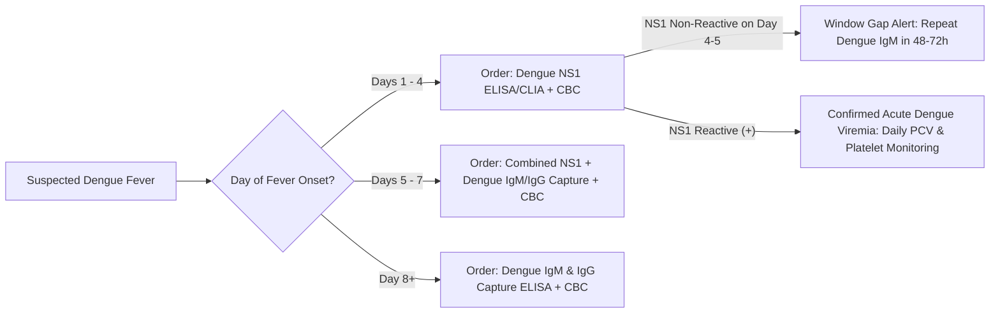

# 4.1.2 — Dengue NS1 Non-Structural Protein-1 Antigen (Day 1–5 Early Acute Viremia Phase)

**Department Folder:** `04_Serology_Infectious_Diseases_and_Immunology`  
**Cluster Folder:** `4.1_Seasonal_Fever_Dengue_Malaria_Typhoid_Cluster`  
**Document ID:** `SOP-SER-4.1.2-DENGUE-NS1` | **Version:** `4.0 (ISO 15189:2022 / NABL 112 / NCVBDC-ICMR)`

---

## 1. Document Control, Standardized Coding & Hardware-Agnostic Platform Matrix

| Coding System / Attribute | Identifier / Code | Official Nomenclature & Scope |
| :--- | :--- | :--- |
| **LOINC** | `64011-0` (ELISA/CLIA) / `75377-2` (Rapid) | Dengue virus non-structural protein 1 (`NS1`) Ag [Presence/Index] in Serum or Plasma by Immunoassay |
| **SNOMED-CT** | `442438000` / `38362002` | Measurement of Dengue virus NS1 antigen / Dengue fever (`DENV-1, DENV-2, DENV-3, DENV-4`) |
| **ICD-10-CM** | `A90` / `A91` | Dengue fever [classical dengue] / Dengue hemorrhagic fever (`Severe Dengue` per WHO 2009) |
| **UCUM Units** | `COI` / `[arb'U]/mL` (`Panbio Units`) | Cutoff Index (`COI` / `S/CO`) or Arbitrary ELISA Index Units |
| **Regulatory Mandate** | **NCVBDC & IDSP Notifiable** | Only **ELISA / CLIA / RT-PCR** confirmed `Dengue NS1` cases qualify as "Confirmed Dengue" under NCVBDC & IDSP |

### Hardware-Agnostic Analytical Platform Matrix
| Tier | Analytical Platform | Methodological Principle | Detection Target & Serotype Coverage |
| :--- | :--- | :--- | :--- |
| **Primary Automated** | **Snibe MAGLUMI X3 / X8** | Direct Sandwich Flash Chemiluminescence (`ABEI`-labeled monoclonal anti-NS1 + magnetic microbeads) | Hexameric secreted `NS1` glycoprotein across all 4 serotypes (`DENV-1, 2, 3, 4`) |
| **Gold-Standard Plate** | **Panbio / J. Mitra / Bio-Rad NS1 Capture ELISA** | One-step or Two-step Monoclonal Sandwich Microplate ELISA ($450\text{ nm}/620\text{ nm}$ read) | Conserved pan-dengue `NS1` epitopes; ICMR/NCVBDC reference standard |
| **Rapid Screening** | **SD Bioline / J. Mitra Dengue Day-1 ICT** | Immunochromatographic Lateral-Flow Rapid Card (Colloidal Gold) | **Point-of-Care Screening Only** — lower sensitivity in DENV-2/DENV-4 and Secondary Dengue |

---

## 2. Pre-Analytical Phlebotomy, Window-Period Timing, Stability & HIL Rejection Matrix

### Optimal Sampling Window & Pathophysiological Basis
- **Target Window:** **Day 1 to Day 5 of Fever Onset (`Day 1` = First day of fever $\ge 38.0^\circ\text{C}$).**
- **Pathobiology:** Dengue Non-Structural Protein 1 (`NS1`, molecular weight $46\text{–}50\text{ kDa}$) is secreted by infected endothelial and myeloid cells as a soluble lipid-associated hexamer directly into the bloodstream starting from **Day 1 of fever**, reaching peak serum concentrations ($0.04\text{ to }2.0\text{ }\mu\text{g/mL}$) on **Days 2 to 4**.
- **Specimen Type:** Serum ($2.0\text{ mL}$ from SST / Red-top tube) or $\text{K}_2\text{-EDTA}$ / Citrate plasma (verify kit insert for Rapid ICT whole-blood compatibility; **never use whole blood on MAGLUMI X3 CLIA or Microplate ELISA**).

### Specimen Stability & Quantitative HIL Rejection Matrix
| Storage Condition | Maximum Stability | Pre-Analytical Interference | Quantitative Rejection Threshold & Action |
| :--- | :--- | :--- | :--- |
| **Ambient ($20\text{–}25^\circ\text{C}$)** | $\le 8\text{ hours}$ | **Hemolysis Index ($H$)** | Reject for ELISA if **Free $\text{Hb} > 150\text{–}200\text{ mg/dL}$** (endogenous RBC peroxidase reacts with TMB chromogen causing false-positive optical density; Maglumi CLIA tolerates up to $500\text{ mg/dL}$). |
| **Refrigerated ($2\text{–}8^\circ\text{C}$)** | **Up to $7\text{ days}$** | **Lipemia Index ($L$)** | Clarify by high-speed centrifugation ($10,000 \times g$ for $10\text{ min}$) if **Triglycerides $> 500\text{ mg/dL}$**. |
| **Frozen ($-20^\circ\text{C}$)** | $3\text{–}6\text{ months}$ | **Microbial / Fibrin Clots** | Reject turbid, bacterially contaminated, or heat-inactivated sera; recentrifuge recent-draw serum to eliminate fibrin strands that cause false-positive CLIA spikes. |

---

## 3. Hardware-Agnostic Analytical SOP, Cutoff Index (`COI`) Grey-Zone & Six Sigma IQC

1. **Analytical Procedure (MAGLUMI X3 CLIA & Sandwich ELISA):**
   - **CLIA Protocol:** $50\text{ }\mu\text{L}$ of patient serum is incubated with anti-Dengue NS1 monoclonal antibody-coated magnetic microbeads and `ABEI`-labeled anti-NS1 conjugate at $37^\circ\text{C}$. After magnetic separation and 3-cycle wash, starter reagents $1+2$ trigger flash chemiluminescence measured in Relative Light Units (`RLU`) over $3\text{ seconds}$.
   - **Microplate ELISA Protocol:** Dilute patient serum, Negative, Positive, and Cutoff Calibrators ($1:2\text{ or }1:10$ per kit) in sample diluent; incubate $60\text{ min}$ at $37^\circ\text{C}$, wash $5\text{–}6\times$ with $350\text{ }\mu\text{L}$ PBS-Tween-20 ($30\text{s}$ soak), incubate HRP-conjugate $30\text{–}60\text{ min}$, wash $6\times$, add TMB substrate ($10\text{–}15\text{ min}$ dark), stop with $1\text{N }\text{H}_2\text{SO}_4$, and read at $450\text{ nm}$ with $620\text{–}650\text{ nm}$ reference filter within $15\text{ minutes}$.
2. **Calculation of Cutoff Index (`COI`) / Panbio Index Units & Grey-Zone Rule:**
   $$\text{Cutoff Index (COI)} = \frac{\text{Sample OD (or RLU)}}{\text{Mean Cutoff Calibrator OD (or RLU)}} \quad (\text{or } \times 10\text{ for Panbio Index Units})$$
   - **Non-Reactive:** $\text{COI} < 0.90$ ($< 9.0\text{ Panbio Units}$).
   - **Equivocal / Grey-Zone:** **$\text{COI } 0.90 \text{ to } 1.10$** ($9.0\text{ to }11.0\text{ Units}$) $\rightarrow$ Mandatory recentrifugation ($3,000 \times g$, $10\text{ min}$) and duplicate re-testing. If persistently equivocal, report as **Equivocal (Grey-Zone)** and reflex to **`Dengue IgM Capture ELISA`** (if $\ge \text{Day 4}$) or **`Dengue Real-Time RT-PCR`** (if $\le \text{Day 4}$).
   - **Reactive (Positive):** $\text{COI} > 1.10$ ($> 11.0\text{ Panbio Units}$).
3. **Quality Control & EQAS:**
   - Assay acceptance requires Negative Control $\text{OD} < 0.150$, Cutoff Calibrator $\text{OD} \ge 0.250$, and Positive Control Ratio $> 1.5\text{–}2.0$. Maintain internal weak-positive QC ($1.5\text{–}2.0\text{ COI}$) on Levey-Jennings charts ($\text{CV}_A \le 6\%$) and participate in NABL-accredited EQAS.

---

## 4. Analytical Precision, Diagnostic Sensitivity/Specificity, Window Period & MRI

| Infection Type / Serotype | Within-Run $\text{CV}_A\%$ | Between-Run $\text{CV}_A\%$ | Diagnostic Sensitivity (Days 1–4) | Diagnostic Sensitivity (Days 5–7) | Clinical Specificity | Minimum Retesting Interval (MRI) |
| :--- | :--- | :--- | :--- | :--- | :--- | :--- |
| **Primary Dengue (`CLIA / ELISA`)** | $3.2\%\text{–}4.8\%$ | $4.5\%\text{–}6.5\%$ | **$92.0\%\text{ – }97.0\%$** | $70.0\%\text{ – }82.0\%$ | **$98.5\%\text{ – }99.6\%$** | **$48\text{–}72\text{ hours}$** if tested within first $12\text{–}24\text{h}$ of fever |
| **Secondary Dengue (`CLIA / ELISA`)** | $3.5\%\text{–}5.0\%$ | $4.8\%\text{–}6.8\%$ | **$68.0\%\text{ – }82.0\%$** *(Cleared early!)* | **$35.0\%\text{ – }55.0\%$** | $98.5\%\text{ – }99.6\%$ | Reflex immediately to **`Dengue IgM + IgG Capture`** |
| **Rapid ICT Card (`Lateral Flow`)** | Qualitative | Qualitative | $65.0\%\text{ – }80.0\%$ | $40.0\%\text{ – }60.0\%$ | $92.0\%\text{ – }96.0\%$ | Confirm all Rapid ICT results by **Capture ELISA / CLIA** |

> [!IMPORTANT]
> **Why `NS1` Sensitivity Drops Sharply in Secondary Dengue & After Day 5:** In Secondary Dengue, pre-existing memory B-cells mount a massive anamnestic anti-NS1 $\text{IgG}$ response by **Day 2–3**, trapping circulating `NS1` antigen inside **`NS1–IgG` immune complexes** so the epitopes are masked from assay capture antibodies! Similarly, in Primary Dengue after **Day 5–7**, rising host $\text{IgM/IgG}$ clears free `NS1`. **Never rely on standalone `NS1` after Day 4 of fever!**

---

## 5. Multi-Stratified Reference Intervals & Cutoffs

| Population Stratum | Non-Reactive Cutoff | Equivocal / Grey-Zone | Reactive (Positive) Cutoff | Clinical Notes |
| :--- | :--- | :--- | :--- | :--- |
| **All Ages (Neonates, Children, Adults) — CLIA / ELISA** | **$< 0.90\text{ COI}$** ($< 9.0\text{ Units}$) | **$0.90\text{ – }1.10\text{ COI}$** ($9.0\text{–}11.0\text{ Units}$) | **$> 1.10\text{ COI}$** ($> 11.0\text{ Units}$) | High COI values simply reflect high antigen load; **COI magnitude does NOT linearly predict clinical severity** (monitor Hematocrit & Platelets instead). |
| **Pregnant Women (All Trimesters)** | $< 0.90\text{ COI}$ | $0.90\text{ – }1.10\text{ COI}$ | $> 1.10\text{ COI}$ | Maternal Dengue viremia in late 3rd trimester carries high risk of **postpartum hemorrhage** and **vertical neonatal transmission**. |
| **Rapid Immunochromatographic Card (ICT)** | Control (`C`) Line Only | Faint/Smudged Test (`T`) Line | Distinct Control (`C`) + Test (`T`) Line | Any faint rapid `NS1` line must be verified by **ELISA / CLIA**. |

---

## 6. NABL & CLSI GP47 Critical ("Panic") Alerts & Statutory Notification

- **Clinical-Hematological Critical Alert Integration:** While a reactive `Dengue NS1` alone is an Urgent Communicable Result, it escalates to an **Immediate Critical Panic Alert (<30 minutes)** whenever paired with:
  1. **Severe Thrombocytopenia:** Platelet count **$< 20,000\text{–}30,000/\mu\text{L}$** or rapid $>50\%$ drop in $24\text{ hours}$.
  2. **Hemoconcentration / Plasma Leakage:** Hematocrit (`PCV`) rise of **$\ge 20\%$ above baseline** (or absolute $\text{HCT} > 50\%$ in males / $> 46\%$ in females/children).
  3. **Pregnant Patient in Labor or 3rd Trimester** with reactive `Dengue NS1`.
- **Statutory IDSP / NCVBDC Notification:** All ELISA/CLIA-reactive `Dengue NS1` cases must be reported daily with full residential address and mobile number to the **District Vector-Borne Disease Officer / CMO under IDSP**.

---

## 7. Kinetic Day-by-Day Rise/Peak/Persistence, Differential Diagnosis & Smart LIMS Reflex Cascades



- **Kinetic Profile:** `NS1` rises within $12\text{–}24\text{h}$ of fever onset (Day 1), peaks on Days 2–4, declines rapidly between Days 5–7, and is typically undetectable by Day 9 in Primary Dengue (and by Day 4–5 in Secondary Dengue).

---

## 8. Analytical Cross-Reactivity & ISO 22367 Risk FMEA

- **High Specificity vs Antibody Tests:** Unlike `Dengue IgM/IgG` (which cross-reacts heavily across Flaviviruses), monoclonal `Dengue NS1` capture assays exhibit minimal cross-reactivity ($< 1\%\text{–}2\%$) with Japanese Encephalitis (`JEV`) or West Nile Virus, though rare cross-reactivity with **Zika virus (`ZIKV`) NS1** or high-titer Rheumatoid Factor / HAMA can occur.
- **Serotype Sensitivity Variation (`DENV-2` & `DENV-4`):** Certain commercial `NS1` kits display $10\%\text{–}15\%$ lower analytical sensitivity for `DENV-2` and `DENV-4` serotypes compared to `DENV-1` and `DENV-3`.

| Failure Mode (ISO 22367) | Root Cause | Clinical Risk | Mandatory Mitigation Control |
| :--- | :--- | :--- | :--- |
| **False-Negative `NS1` on Day 3 of Secondary Dengue** | Anamnestic anti-NS1 $\text{IgG}$ sequesters `NS1` into immune complexes | Severe Secondary Dengue / DSS missed! | Always co-order `Dengue IgM & IgG Capture` from Day 3–4 onward in endemic areas |
| **False-Positive ELISA OD from Hemolyzed Serum** | Free hemoglobin pseudo-peroxidase activity | Misdiagnosis of bacterial sepsis as Dengue | Strict visual + automated Hemolysis Index ($H > 150\text{ mg/dL}$) rejection before ELISA |

---

## 9. Conditional Band-Specific Pathologist Sign-Out Library

- **`[BAND-NON-REACTIVE]`:** *"Dengue NS1 Antigen is NON-REACTIVE. Note: A non-reactive NS1 result after Day 5 of fever (or after Day 3 in Secondary Dengue) does NOT exclude Dengue infection, as rising host antibodies clear circulating NS1 antigen. If fever duration is >=4–5 days, correlate with Dengue IgM & IgG Capture ELISA/CLIA."*
- **`[BAND-EQUIVOCAL/GREY-ZONE]`:** *"Dengue NS1 Antigen is EQUIVOCAL (Grey-Zone COI 0.90–1.10), verified in duplicate. This may represent very early Day 1 viremia or declining antigenemia during the Day 4–6 transition phase. Recommend Dengue IgM Capture ELISA after 48–72 hours and daily CBC monitoring."*
- **`[BAND-REACTIVE]`:** *"Dengue NS1 Antigen is REACTIVE, confirming acute early Dengue virus infection (viremic phase). Per WHO & NCVBDC guidelines, monitor serial Complete Blood Counts (specifically Hematocrit/PCV for plasma leakage and Platelet count) daily, especially during defervescence (Days 4–7)."*
- **`[BAND-CRITICAL]`:** *"CRITICAL ALERT: Reactive Dengue NS1 Antigen with concurrent severe thrombocytopenia (<20,000/uL) and/or hemoconcentration (>=20% rise in Hematocrit/PCV). High risk of Dengue Hemorrhagic Fever / Shock Syndrome. Immediate physician notification logged."*

---

## 10. Master LIMS Copy-Paste Report Block (Physician + Patient Summary + NCVBDC Shield)

```text
================================================================================
       DENGUE NS1 ANTIGEN — CLINICAL KINETICS & NCVBDC MEDICO-LEGAL SHIELD
================================================================================
1. DIAGNOSTIC WINDOW (DAYS 1 TO 5 OF FEVER):
   • Dengue NS1 (Non-Structural Protein-1) is secreted into blood from Day 1 
     of fever, peaks on Days 2-4, and turns NEGATIVE after Day 5-7 as the 
     body's immune antibodies (IgM/IgG) clear the antigen.
   • In Secondary Dengue (repeat infection), NS1 may clear even earlier (by 
     Day 3-4) due to rapid IgG immune-complex formation.
   • Therefore, a NEGATIVE NS1 after Day 4-5 does NOT rule out Dengue; always 
     test Dengue IgM & IgG Capture ELISA from Day 5 onward!

2. MANDATORY NCVBDC / ICMR REGULATORY & CLINICAL MONITORING SHIELD:
   • Rapid Card vs ELISA/CLIA: Per NCVBDC (Govt. of India) & ICMR guidelines, 
     Rapid Immunochromatographic (ICT) cards are screening tests only and must 
     be confirmed by NIV/ICMR-approved NS1/IgM Capture ELISA, CLIA, or RT-PCR.
   • CRITICAL DEFERVESCENCE WARNING: A positive or negative NS1 index value 
     does NOT predict disease severity. The highest risk of plasma leakage and 
     shock occurs on Days 4-7 WHEN FEVER DROPS (Defervescence Phase).
   • Mandatory Serial Monitoring: Monitor daily Complete Blood Count (rising 
     Hematocrit/PCV >=20% indicates fluid leakage; serial Platelet count) and 
     watch for warning signs (severe stomach pain, persistent vomiting, 
     bleeding gums/nose, restlessness, or extreme weakness).
   • Statutory Disclaimer: Correlate clinically. Not valid for medico-legal use.
================================================================================
```
