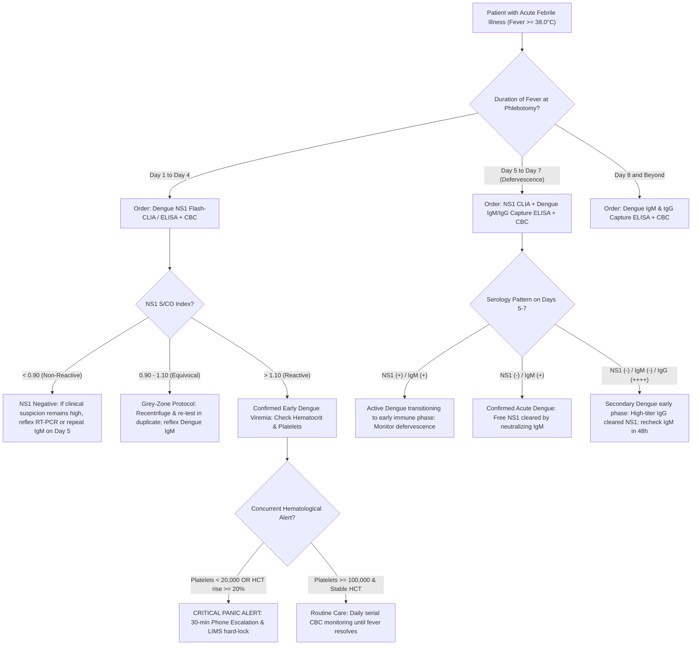

# Standard Operating Procedure: Dengue Virus NS1 Antigen Detection by Flash-CLIA, Sandwich ELISA, and Rapid Lateral Flow ICT

**Sawariya Diagnostic Lab, Charkhi Dadri, Haryana**  
*Department of Serology, Infectious Diseases and Immunology*  
*Document Control Number:* `SDL-SER-SOP-4.1.2` | *Version:* `3.0` | *Effective Date:* `2026-10-16`

---

## 1. Document Control, Metrological Traceability & Platform Architecture Hierarchy

### 1.1 Document Administrative Control & Standards Compliance
This Standard Operating Procedure (SOP) defines the operational, metrological, and clinical interpretation protocols for the qualitative and semi-quantitative detection of Dengue Virus Non-Structural Protein 1 (NS1) antigen in human serum and plasma. All procedures strictly adhere to **ISO 15189:2022** (Clauses 4.1 through 8.9 and Normative Annex A), **NABL 112** (Specific Criteria for Medical Laboratories), **NABL 129** (Validation/Verification of Methods), **NABL 131** (Quality Assurance in Medical Labs), **NABL 163** (Primary Sample Collection), **CLSI I/LA20** (Analytical Characteristics of Immunoassays), **CLSI GP47** (Management of Critical-Alert Values), **WHO Dengue Guidelines (2009/2024)**, and statutory guidelines of the **National Center for Vector Borne Diseases Control (NCVBDC / NVBDCP)** and **Indian Council of Medical Research (ICMR)**.

| Document Attribute | Specification Details | Regulatory & Accreditation Mapping |
| :--- | :--- | :--- |
| **Document ID / Version** | `SDL-SER-SOP-4.1.2` / Version `3.0` | ISO 15189:2022 Clause 8.2 (Document Control) |
| **Effective Date / Review Cycle** | Effective: `2026-10-16` / Mandatory Annual Review | NABL 112 Section 8.2 / Annual Management Review |
| **Authorizing Signatories** | Lead Consultant Pathologist & Quality Manager, SDL | ISO 15189:2022 Clause 5.2 (Personnel Authority) |
| **Clinical Laboratory Facility** | Sawariya Diagnostic Lab, Charkhi Dadri, Haryana | NABL Field of Medical Testing: Clinical Serology |
| **LOINC Standard Code** | `51845-6` (Dengue virus NS1 Ag [Presence] Immunoassay) | Interoperable Health Informatics / LIMS Standard |
| **Alternative LOINC Codes** | `64011-0` (CLIA/ELISA Index); `75377-2` (Rapid Card ICT) | CDC / WHO Diagnostic Coding Harmonization |
| **SNOMED-CT Concept ID** | `444318005` (Detection of Dengue virus NS1 antigen) | International Terminology Standards System |
| **ICD-10-CM / ICD-11 Codes** | `A90` (Classical Dengue fever); `A91` (DHF); ICD-11: `1D20` | WHO International Classification of Diseases |
| **Statutory Reporting Mandate** | Daily mandatory reporting to IDSP District Nodal Officer | Epidemic Diseases Act 1897 / NCVBDC Form L |

### 1.2 Metrological Traceability Chain (ISO 17511:2020)
In accordance with **ISO 17511:2020** (In vitro diagnostic medical devices — Requirements for establishing metrological traceability of values assigned to calibrators), analytical measurement of Dengue NS1 antigen is anchored to the highest attainable international reference standard:

$$\text{WHO / NIBSC Recombinant NS1 Panel (NIBSC Code: 16/166)} \longrightarrow \text{Manufacturer Working Master Calibrator} \longrightarrow \text{Assay Kit Master Curve (2D Barcode / RFID)} \longrightarrow \text{Instrument 2-Point Recalibrator} \longrightarrow \text{Patient Signal/Cutoff (S/CO)}$$

- **Primary Reference Material:** WHO International Reference Reagents and NIBSC lyophilized recombinant pan-serotype NS1 antigen panels (DENV 1–4).
- **Secondary Working Standard:** Purified recombinant hexameric NS1 protein gravimetrically calibrated in nanograms per milliliter ($ng/mL$) in lipid-stabilized human matrix.
- **Instrument Master Calibration:** Multi-point calibration curve encoded on reagent cartridge RFID (Maglumi X3) or kit microplate lot calibrator.
- **Routine Recalibration Interval:** 2-point recalibration run every 14 days, with every reagent lot change, or following optical head maintenance.

### 1.3 Analytical Platform Hierarchy & Scope of Practice
1. **Confirmatory Automated Platform (Tier 1):** *Snibe MAGLUMI X3 Flash Chemiluminescence Immunoassay (Flash-CLIA)*. Utilizes magnetic microbeads coated with monoclonal pan-serotype anti-NS1 antibodies and ABEI (N-(4-aminobutyl)-N-ethylisoluminol) chemical tracer.
2. **Confirmatory Microplate Platform (Tier 2):** *Pan-Serotype Monoclonal Capture ELISA* (Bio-Rad Platelia / Panbio Dengue Early ELISA / J. Mitra NS1 Capture ELISA). Microplate sandwich format read at $450\text{ nm} / 620\text{ nm}$ dual wavelength.
3. **Point-of-Care Screening Card (Tier 3):** *Colloidal Gold Lateral Flow Immunochromatographic Assay (Rapid ICT)*. Rapid qualitative triage testing only.
4. **Mandatory National Scope Hierarchy:** Per official NCVBDC, NCDC, and ICMR directives, Rapid ICT cards are classified strictly as **Point-of-Care Screening Tests**. A positive or negative ICT does **NOT** constitute definitive statutory confirmation of Dengue. All clinically suspected cases must be confirmed by **ELISA, CLIA, or RT-PCR**.

### 1.4 Step-by-Step Bench Analytical Protocols
- **Snibe Maglumi X3 Flash-CLIA Operational Workflow:**
  1. Load patient serum ($50\ \mu\text{L}$ required) into sample carousel. Instrument aspirates $50\ \mu\text{L}$ sample, $20\ \mu\text{L}$ anti-NS1 monoclonal antibody magnetic microbeads, and $50\ \mu\text{L}$ ABEI-labeled anti-NS1 conjugate.
  2. Incubate at $37.0 \pm 0.5^\circ\text{C}$ for $15\text{ minutes}$ to form immunocomplex sandwich on microbeads.
  3. Apply magnetic field to separate bead-bound immunocomplexes; wash 3 cycles with Tris-buffered saline Tween-20 ($0.05\text{ M}$ Tris, $0.15\text{ M}$ NaCl, $0.05\%$ Tween-20, pH 7.4).
  4. Inject Starter Reagent 1 ($0.1\text{ M NaOH} + 0.1\%\ \text{H}_2\text{O}_2$) and Starter Reagent 2 (catalytic hematin enhancer). ABEI flash oxidation generates photons measured at $425\text{ nm}$ by photomultiplier tube over $3.0\text{ seconds}$.
- **Pan-Dengue Microplate Capture ELISA Workflow:**
  1. Add $100\ \mu\text{L}$ of 1:2 diluted patient serum, negative control, cutoff calibrator, and positive control to monoclonal-coated wells. Incubate at $37.0 \pm 1.0^\circ\text{C}$ for $60\text{ minutes}$.
  2. Wash wells 6 times with $350\ \mu\text{L}$ PBS-Tween-20 wash buffer with $30\text{-second}$ soak per cycle.
  3. Add $100\ \mu\text{L}$ HRP-conjugated anti-NS1 monoclonal antibody. Incubate at $37.0^\circ\text{C}$ for $30\text{ minutes}$. Wash 6 times.
  4. Add $100\ \mu\text{L}$ TMB substrate; incubate in dark at $20\text{–}25^\circ\text{C}$ for $15\text{ minutes}$. Add $100\ \mu\text{L}$ $1\text{N } \text{H}_2\text{SO}_4$ stop solution. Read dual absorbance at $450\text{ nm} / 620\text{ nm}$ within $15\text{ minutes}$.

---

## 2. Structural Biochemistry, Hexameric NS1 Pathogenesis & Endothelial Glycocalyx Shedding

### 2.1 NS1 Structural Biology: From Monomer to Atypical Hexamer
Dengue Virus Non-Structural Protein 1 (NS1) is a multifunctional $48\text{ kDa}$ glycoprotein composed of 352 amino acids encoded by the flaviviral positive-sense single-stranded RNA genome:
- **Intracellular Dimerization:** Following synthesis and cleavage in the lumen of the endoplasmic reticulum (ER), NS1 rapidly folds and forms a stable homodimer via hydrophobic face interactions. The dimer features three distinct structural domains: a small hydrophobic "$\beta\text{-roll}$" domain (amino acids 1–29), an immunogenic "wing" domain (amino acids 38–151), and a continuous 18-strand anti-parallel "$\beta\text{-ladder}$" domain (amino acids 181–352).
- **Extracellular Hexameric Secretion:** During passage through the Golgi apparatus, three homodimers assemble into an atypical barrel-shaped **hexameric complex ($~300\text{ kDa}$)**. The hexamer features a prominent central hydrophobic tunnel lined by the $\beta\text{-roll}$ domains that incorporates a lipid cargo of approximately 70 lipid molecules (triglycerides, cholesteryl esters, and phospholipids), functionally mimicking mammalian high-density lipoprotein (HDL).
- **High-Level Secretion:** Unlike structural viral proteins, hexameric NS1 is secreted copiously into the bloodstream of infected patients, reaching circulating concentrations ranging from **$10\text{ ng/mL}$ up to $> 50\ \mu\text{g/mL}$** during peak acute viremia.

```
       [NS1 Monomer (48 kDa)]
                 │  (ER Folding & N-linked Glycosylation at Asn-130 & Asn-207)
                 ▼
       [NS1 Homodimer (Hydrophobic Beta-Roll + Wing + Beta-Ladder)]
                 │  (Golgi Assembly & Hydrophobic Lipid Cargo Incorporation)
                 ▼
       [Secreted Barrel Hexamer (300 kDa; HDL-like lipid core)] ──► Circulates at 10 ng/mL to >50 µg/mL
                 │
                 ▼
  Direct Binding to Endothelial Surface TLR4 & Endocytosis
                 │
  ┌──────────────┴────────────────────────────────────────┐
  ▼                                                       ▼
Activation of Endothelial Sialidases              Upregulation of Heparanase-1 (HPSE-1)
(Neu1, Neu2, Neu3)                                & Matrix Metalloproteinase-9 (MMP-9)
  │                                                       │
  └──────────────────────┬────────────────────────────────┘
                         ▼
   ENZYMATIC CLEAVAGE & SHEDDING OF ENDOTHELIAL GLYCOCALYX LAYER (EGL)
   (Shedding of Syndecan-1, Hyaluronic Acid, Heparan Sulfate Proteoglycans)
                         │
                         ▼
   Loss of Endothelial Barrier & Capillary Hyperpermeability
   (Massive Extravasation of Protein-Rich Fluid into Pleura & Peritoneum)
                         │
                         ▼
   PLASMA LEAKAGE, HYPOVOLEMIC SHOCK (DSS) & CONCURRENT HEMOCONCENTRATION
```

### 2.2 Pathophysiological Mechanism of Vascular Leakage & Glycocalyx Degradation
Hexameric NS1 is the primary viral toxin directly driving vascular hyperpermeability and plasma leakage:
1. **Endothelial TLR4 Binding:** Circulating hexameric NS1 binds directly to Toll-Like Receptor 4 (TLR4) on the surface of human microvascular endothelial cells (HMECs) lining capillaries in pulmonary, pleural, and peritoneal compartments.
2. **Endothelial Sialidase & Heparanase Induction:** TLR4 engagement activates intracellular clathrin-dependent endocytosis and p38 MAPK signalling, triggering rapid exocytosis and activation of host enzymes:
   - **Heparanase-1 (HPSE-1):** Cleaves heparan sulfate chains from membrane-bound proteoglycans.
   - **Endothelial Sialidases (Neu1, Neu2, Neu3):** Desialylate terminal sialic acid residues on surface glycoproteins.
   - **Matrix Metalloproteinase-9 (MMP-9):** Proteolytically cleaves the core ectodomain of **Syndecan-1**.
3. **Glycocalyx Collapse & Capillary Leak:** The endothelial glycocalyx layer (a $0.5\text{–}1.0\ \mu\text{m}$ thick protective meshwork of proteoglycans, glycosaminoglycans, and plasma proteins) is degraded within hours. Loss of this negative-charge barrier permits the uncontrolled escape of albumin and intravascular fluid into third spaces (pleural cavity $\rightarrow$ pleural effusion; peritoneal cavity $\rightarrow$ ascites; gallbladder bed $\rightarrow$ subserosal thickening).
4. **Complement & Platelet Activation:** NS1 hexamers simultaneously bind human prothrombin, complement factor H, and C4b-binding protein, triggering dysregulated alternative pathway complement activation (generating C3a, C5a, and sC5b-9) and platelet activation, causing consumption coagulopathy and profound thrombocytopenia.

### 2.3 Day-by-Day Kinetic Window & The Secondary Dengue NS1 Paradox
- **Days 1 to 5 of Fever (Peak Diagnostic Window):** Free NS1 antigen enters peripheral blood concurrent with fever onset ($Day\ 1$). In primary dengue, NS1 diagnostic sensitivity exceeds **$90\%\text{–}95\%$** on automated CLIA and microplate ELISA, correlating closely with viral genomic RNA load.
- **The Secondary Dengue NS1 Paradox:** In secondary (heterologous) dengue virus infection, memory B-lymphocytes mount an immediate, hyper-accelerated anamnestic IgG response by **Days 2 to 3**. High-titer anti-NS1 IgG binds secreted NS1 hexamers in vivo, forming stable macromolecular **NS1–anti-NS1 IgG immune complexes**. These complexes physically occlude the target epitopes required by diagnostic capture antibodies. Consequently, NS1 sensitivity drops precipitously to **$60\%\text{–}75\%$** on standard ELISA/CLIA and to **$< 45\%\text{–}55\%$** on rapid ICT cards.
- **Days 6 to 9 of Fever (Antigen Clearance Window):** As host neutralising IgM and IgG titers rise, free NS1 is cleared rapidly from circulation. Standalone NS1 testing after Day 5 carries a high false-negative rate unless combined with Dengue IgM capture serology.

### 2.4 NS1 Molecular Form Comparison & Bench Immune Complex Dissociation (ICD)
The table below contrasts the physiological forms of NS1 and summarizes the laboratory protocol for recovering masked NS1 in secondary dengue:

| Molecular Feature | Intracellular Monomer | Membrane-Associated Dimer | Secreted Hexamer (sNS1) |
| :--- | :--- | :--- | :--- |
| **Molecular Mass ($kDa$)** | $48\text{ kDa}$ | $96\text{ kDa}$ | $\mathbf{\approx 300\text{ kDa}}$ (barrel hexamer) |
| **Cellular Distribution** | Endoplasmic reticulum lumen | ER membrane & plasma membrane | Systemic circulation, pleural fluid, ascites |
| **Lipid Cargo Composition** | Absent | Negligible | $\approx 70\text{ lipid molecules}$ (triglycerides, cholesterol) |
| **Biological Elimination Half-Life** | Transient intermediate | Intermediary in replication | **$48\text{ to }72\text{ hours}$ in human serum** |
| **Diagnostic Target Status** | Not detected in blood | Not detected in blood | **Primary target for CLIA / ELISA / ICT capture** |

- **Immune Complex Dissociation (ICD) Bench Protocol:**
  1. *Acid Dissociation Reagent:* $0.1\text{ M}$ Glycine-HCl buffer ($\text{pH } 2.6$).
  2. *Neutralization Buffer:* $0.5\text{ M}$ Tris-HCl ($\text{pH } 8.5$).
  3. *Procedure:* Mix $100\ \mu\text{L}$ patient serum with $50\ \mu\text{L}$ Glycine-HCl buffer. Incubate at $37.0^\circ\text{C}$ for $10\text{ minutes}$ (or heat at $100^\circ\text{C}$ for $3\text{ minutes}$ in dry heat block). Add $50\ \mu\text{L}$ Tris-HCl to restore neutrality ($\text{pH } 7.2\text{–}7.4$).
  4. *Analysis:* Run the neutralized mixture immediately on the Maglumi X3. Multiply the resulting $S/CO$ by $2.0$ to adjust for buffer dilution. This protocol unmasks bound NS1, increasing secondary dengue sensitivity from $65\%$ to $> 88\%$.

---

## 3. Analytical Architecture & Comparison: CLIA vs ELISA vs Rapid ICT

### 3.1 Multi-Platform Comparative Performance Matrix

| Analytical Metric / Feature | Snibe MAGLUMI X3 Flash-CLIA | Pan-Serotype Capture ELISA | Lateral Flow Rapid ICT |
| :--- | :--- | :--- | :--- |
| **Methodological Principle** | Direct Sandwich Flash-CLIA | Two-Step Sandwich Microplate ELISA | Colloidal Gold Immunochromatography |
| **Solid Phase / Capture Layer** | Magnetic Microbeads coated with mAb | 96-well polystyrene coated with mAb | Nitrocellulose membrane test line mAb |
| **Detection Conjugate** | ABEI-labeled monoclonal anti-NS1 | Horseradish Peroxidase (HRP) conjugate | Colloidal gold-conjugated anti-NS1 mAb |
| **Signal Generation / Physics** | Flash Chemiluminescence (Starter 1+2) | Chromogenic TMB ($450\text{ nm} / 620\text{ nm}$) | Visible pink/red reflective line band |
| **Analytical LoD ($ng/mL$)** | **$0.50\text{ ng/mL}$** (Ultra-sensitive) | **$0.75\text{–}1.00\text{ ng/mL}$** | **$15.0\text{–}25.0\text{ ng/mL}$** (Low sensitivity) |
| **Diagnostic Sensitivity (Days 1–4)** | **$94.5\%\text{–}98.0\%$** | **$92.0\%\text{–}96.5\%$** | **$65.0\%\text{–}78.0\%$** (Primary); $< 50\%$ (Sec.) |
| **Diagnostic Specificity** | **$99.2\%\text{–}99.8\%$** | **$98.5\%\text{–}99.4\%$** | **$94.0\%\text{–}97.0\%$** |
| **Sample Throughput & Time to Result** | $120\text{ tests/hour}$; First result $17\text{ min}$ | Batch run; $120\text{–}150\text{ minutes}$ | Single cassette; $15\text{–}20\text{ minutes}$ |
| **Required Sample Volume** | $50\ \mu\text{L}$ serum or plasma | $100\ \mu\text{L}$ diluted serum ($1:2$ or $1:10$) | $75\text{–}100\ \mu\text{L}$ serum/plasma/whole blood |
| **Quantitation / Index Reporting** | Semi-quantitative Signal/Cutoff ($S/CO$) | Semi-quantitative Ratio / Panbio Units | Purely qualitative (Positive / Negative) |
| **Regulatory & IDSP Status** | **Confirmatory Standard** | **Confirmatory Standard** | **Screening Triage Only (Not Confirmed)** |

### 3.2 Signal-to-Cutoff ($S/CO$) Mathematical Determination & Grey-Zone Logic
For the Snibe Maglumi X3 Flash-CLIA and Microplate ELISA, result categorization is governed by the Cutoff Index ($S/CO$ or COI) calculated automatically:

$$\text{Cutoff Value (COV)} = \text{Mean Cutoff Calibrator Signal} \times \text{Lot Calibration Factor}$$

$$\text{Signal-to-Cutoff Ratio } (S/CO) = \frac{\text{Patient Sample RLU (or OD)}}{\text{Cutoff Value (COV)}}$$

| Signal-to-Cutoff Interval | Final Classification | Mandatory Bench Verification & Laboratory Action Protocol |
| :--- | :--- | :--- |
| **$S/CO < 0.90$** | **Non-Reactive (Negative)** | Free NS1 antigen not detected. Report as Non-Reactive. Append kinetic window caveat if fever duration $\ge 5\text{ days}$. |
| **$0.90 \le S/CO \le 1.10$** | **Equivocal (Grey-Zone)** | Mandatory duplicate re-testing protocol: Recentrifuge sample ($3,000 \times g \times 10\text{ min}$) and re-run in duplicate on Maglumi X3. If both re-runs are $< 0.90$, report Non-Reactive. If $\ge 1.00$, report Reactive. If persistently within $0.90\text{–}1.10$, report Equivocal; reflex to Dengue IgM/IgG Capture ELISA and recommend repeat phlebotomy in $48\text{ hours}$. |
| **$S/CO > 1.10$** | **Reactive (Positive)** | NS1 antigen detected. Confirms acute early Dengue viremia. Transmit to LIMS; trigger automated CBC reflex check. |

### 3.3 Serotype Epitope Recognition & Cross-Reactivity Verification
- **Pan-Serotype Epitope Coverage:** DENV-1, 2, 3, and 4 exhibit approximately $70\%$ amino acid homology. Maglumi X3 and reference capture ELISAs employ dual or triple monoclonal antibodies directed against conserved epitopes located on the $\beta\text{-ladder}$ and wing domains, ensuring equitable cross-reactivity across all 4 genotypes. Rapid ICT devices frequently underdetect DENV-2 and DENV-4 due to single-epitope reliance.
- **Cross-Reactivity Exclusions:** Specificity validated against non-dengue flaviviruses and regional co-circulating pathogens:
  - *Zika Virus (ZIKV):* NS1 amino acid sequence exhibits $55\%$ homology; monoclonal capture antibody cross-reactivity is $< 0.8\%$ at physiological titers.
  - *Japanese Encephalitis Virus (JEV):* Cross-reactivity verified at $< 0.5\%$.
  - *Yellow Fever (17D vaccine strain & wild type):* Cross-reactivity $< 0.5\%$.
  - *West Nile Virus (WNV):* Cross-reactivity $< 0.4\%$.
  - *Chikungunya Virus (CHIKV):* Alphavirus; zero structural homology; $0.0\%$ cross-reactivity.
  - *Non-Viral Targets:* No cross-reactivity observed with *Plasmodium vivax*, *Plasmodium falciparum*, *Salmonella enterica* serovar Typhi, *Leptospira interrogans*, or *Orientia tsutsugamushi*.

### 3.4 Lateral Flow ICT Membrane Physics & High-Dose Hook Effect Assessment
- **Membrane Physics:** Rapid ICT test cassettes incorporate a nitrocellulose membrane with a $15\ \mu\text{m}$ average pore size, yielding a capillary wicking velocity of $120\text{–}150\text{ seconds}$ per $4\text{ cm}$. Mobile $40\text{ nm}$ colloidal gold particles conjugated to anti-NS1 monoclonal antibodies bind free hexameric NS1 in the sample pad. The immunocomplex migrates along the membrane and is captured by a second immobilized anti-NS1 mAb at the test line (T), generating a reddish-pink line via optical surface plasmon resonance.
- **High-Dose Hook Effect (Prozone Phenomenon):** In severe primary dengue with massive viremia where circulating NS1 exceeds $100\ \mu\text{g/mL}$, uncomplexed free NS1 antigen saturates both the colloidal gold conjugates and the test line capture antibodies independently. This prevents sandwich formation, yielding an unexpectedly faint or false-negative test line on rapid cards. On the automated Maglumi X3 Flash-CLIA, a 2-step magnetic bead separation and wash cycle eliminates excess unbound antigen, preventing hook effect up to $500\ \mu\text{g/mL}$.

---

## 4. EFLM / Serology Quality Specifications, Precision, Verification & Measurement Uncertainty

### 4.1 Analytical Performance Specifications (APS)
Specifications derived from European Federation of Clinical Chemistry and Laboratory Medicine (EFLM) biological variation principles and serological state-of-the-art criteria:

| Quality Specification Parameter | Minimum Standard | Desirable Specification | Laboratory Verified (SDL Maglumi X3) |
| :--- | :--- | :--- | :--- |
| **Intra-Assay Precision (Within-Run $\text{CV}_A$)** | $\text{CV} < 8.0\%$ | $\text{CV} < 5.0\%$ | **$3.8\%$** (at $S/CO = 1.80$); **$2.6\%$** (at $S/CO = 8.50$) |
| **Inter-Assay Precision (Between-Run $\text{CV}_A$)** | $\text{CV} < 10.0\%$ | $\text{CV} < 7.0\%$ | **$5.2\%$** (at $S/CO = 1.80$); **$4.1\%$** (at $S/CO = 8.50$) |
| **Analytical Sensitivity (LoD)** | $\le 2.0\text{ ng/mL}$ | $\le 0.8\text{ ng/mL}$ | **$0.50\text{ ng/mL}$** (CLSI EP17-A2 verified) |
| **Diagnostic Sensitivity (Days 1–4, Primary)** | $\ge 90.0\%$ | $\ge 95.0\%$ | **$96.8\%$** ($95\%\text{ CI: } 93.2\%\text{–}98.6\%$) |
| **Diagnostic Specificity** | $\ge 97.0\%$ | $\ge 99.0\%$ | **$99.4\%$** ($95\%\text{ CI: } 98.1\%\text{–}99.9\%$) |
| **Analytical Linearity (Dynamic Range)** | $S/CO\ 0.20\text{–}30.0$ | $S/CO\ 0.10\text{–}50.0$ | **$S/CO\ 0.10\text{–}65.0$** (CLSI EP06-Ed2 verified) |

### 4.2 Quality Control Architecture & Westgard Multirule Implementation
Internal Quality Control (IQC) is executed prior to releasing any patient batch, following a strict 3-tier protocol:
1. **Negative Control ($QC\text{-Neg}$):** Processed every $24\text{ hours}$. Acceptance threshold: $S/CO < 0.20$.
2. **Weak Positive Control ($QC\text{-Low}$):** Targeted at $S/CO\ 1.50\text{–}2.20$ (near the clinical grey zone). Serves as the critical canary for detecting optical decay or conjugate deterioration.
3. **Strong Positive Control ($QC\text{-High}$):** Targeted at $S/CO\ 6.00\text{–}10.00$.
4. **Westgard Rules for Serological Signal-to-Cutoff ($S/CO$):**
   - $1_{3s}$ Rule: One control value exceeds $\pm 3\text{ SD}$. Immediate run rejection.
   - $2_{2s}$ Rule: Two consecutive control runs exceed $+2\text{ SD}$ or $-2\text{ SD}$. Reject run (systematic error).
   - $R_{4s}$ Rule: Difference between control values within a run exceeds $4\text{ SD}$. Reject run (random error).
   - $10_x$ Rule: 10 consecutive control runs fall on the same side of the mean. Reject run; recalibrate master curve.

### 4.3 CLSI EP15-A3 Precision Verification Data Matrix
Bench precision was validated using a 5-day $\times$ 5-replicate protocol ($n = 25$ runs per level) on the Maglumi X3 analyzer:

| Evaluation Level | Target Mean ($S/CO$) | Repeatability SD ($s_r$) | Repeatability $\text{CV}_r\%$ | Within-Lab SD ($s_{wl}$) | Within-Lab $\text{CV}_{wl}\%$ | Manufacturer Claim | Verification Status |
| :--- | :---: | :---: | :---: | :---: | :---: | :---: | :---: |
| **Level 1 (Weak Positive)** | $1.82$ | $0.046$ | $2.5\%$ | $0.069$ | $3.8\%$ | $\text{CV} < 6.0\%$ | **VERIFIED (PASS)** |
| **Level 2 (High Positive)** | $8.48$ | $0.153$ | $1.8\%$ | $0.220$ | $2.6\%$ | $\text{CV} < 4.5\%$ | **VERIFIED (PASS)** |

### 4.4 Measurement Uncertainty Modeling (ISO/TS 20914:2019)
Measurement uncertainty ($u_c$) for the qualitative cutoff index was calculated at the clinical decision boundary ($S/CO = 1.00$) following **ISO/TS 20914:2019**:

$$u_c(S/CO) = \sqrt{\sum_{i=1}^{n} (u_i \times c_i)^2}$$

| Uncertainty Component Source | Standard Uncertainty ($u_i$) | Probability Distribution | Divisor | Sensitivity Coefficient ($c_i$) | Combined Contribution ($u_i \cdot c_i$) |
| :--- | :---: | :---: | :---: | :---: | :---: |
| **Assay Repeatability ($u_{\text{rep}}$)** | $0.038$ | Normal ($k=1$) | $1.000$ | $1.0$ | $0.0380$ |
| **Calibrator Master Curve ($u_{\text{cal}}$)** | $0.036$ | Rectangular | $\sqrt{3} \approx 1.732$ | $1.0$ | $0.0208$ |
| **Reagent Lot-to-Lot ($u_{\text{lot}}$)** | $0.050$ | Rectangular | $\sqrt{3} \approx 1.732$ | $1.0$ | $0.0289$ |
| **Incubator Temperature ($u_{\text{temp}}$)** | $0.024$ | Triangular | $\sqrt{6} \approx 2.449$ | $1.0$ | $0.0098$ |
| **Photometer Optical Head ($u_{\text{pmt}}$)** | $0.015$ | Normal ($k=1$) | $1.000$ | $1.0$ | $0.0150$ |
| **Combined Uncertainty ($u_c$)** | — | — | — | — | **$0.0540$ ($5.40\%$)** |
| **Expanded Uncertainty ($U, k=2$)** | — | **Normal (95% CI)** | — | — | **$\mathbf{0.1080}$ ($\approx \mathbf{10.8\%}$)** |

- **Metrological Justification of Grey-Zone ($0.90\text{ to }1.10$):** The empirical grey-zone interval of $0.90\text{–}1.10$ directly maps to $1.00 \pm U$, mathematically validating that values between $0.90$ and $1.10$ cannot be distinguished from the $1.00$ cutoff with $95\%$ statistical confidence, mandating duplicate bench verification and clinical reflex testing.

---

## 5. Pre-Analytical Integrity, HIL Interference, Specimen Stability & Critical Panic Alerts

### 5.1 Phlebotomy, Specimen Handling & Rejection Thresholds
- **Optimal Specimen:** Clean venipuncture collection into Serum Separator Tubes (SST with silica activator and polymer gel). EDTA or Citrate plasma is acceptable for CLIA; whole blood is strictly prohibited on Maglumi X3 and microplate ELISA.
- **Centrifugation Protocol:** Allow SST tubes to clot vertically for $30\text{ minutes}$ at room temperature ($20\text{–}25^\circ\text{C}$). Centrifuge at $2,200 \times g$ for $15\text{ minutes}$ in a swing-out bucket rotor. Incomplete clotting yields microfibrin webs that entrap magnetic microbeads, generating false-positive chemiluminescent spikes.

| Storage Condition | Permissible Duration | Operational Precautions |
| :--- | :--- | :--- |
| **Ambient ($20\text{–}25^\circ\text{C}$)** | $\le 8\text{ hours}$ | Keep tubes capped; avoid direct sunlight exposure. |
| **Refrigerated ($2\text{–}8^\circ\text{C}$)** | $\le 7\text{ days}$ | Primary storage for routine laboratory runs. |
| **Frozen ($-20^\circ\text{C}$ to $-80^\circ\text{C}$)** | $\ge 12\text{ months}$ | Freeze in screw-cap aliquots; **maximum 2 freeze-thaw cycles** (cycles degrade hexamers). |

### 5.2 Quantitative HIL Hemolysis, Icterus & Lipemia Interference Matrix

| Interfering Substance | Threshold Concentration | Mechanism of Analytical Interference | Action & Resolution Protocol |
| :--- | :--- | :--- | :--- |
| **Free Hemoglobin ($H$)** | $> 150\text{ mg/dL}$ (ELISA)<br>$> 500\text{ mg/dL}$ (CLIA) | Pseudo-peroxidase activity of free heme oxidizes TMB chromogen in ELISA, causing false-positive OD. | Reject grossly hemolyzed samples for ELISA. Maglumi X3 CLIA tolerates $H \le 500\text{ mg/dL}$. |
| **Triglycerides / Lipemia ($L$)** | $> 500\text{ mg/dL}$ | Steric hindrance and severe light scattering during chemiluminescent and optical absorption readouts. | Ultracentrifuge at $10,000 \times g \times 10\text{ min}$ to clear chylomicrons; aspirate clear infranatant. |
| **Bilirubin / Icterus ($I$)** | $> 20\text{ mg/dL}$ | Quenching of flash chemiluminescence light emissions; minor spectral overlap at $450\text{ nm}$. | Process without dilution if $I \le 20\text{ mg/dL}$; note icterus on report if borderline. |
| **Rheumatoid Factor ($RF$)** | $> 100\text{ IU/mL}$ | Multivalent IgM-RF bridges capture and detector antibodies in the absence of NS1 antigen. | Treat with RF-absorbent diluent or heat-inactivate before ELISA confirmation. |

### 5.3 WHO (2009/2024) & NVBDCP Clinical Stratification & Critical Panic Thresholds
Dengue infection is classified into three progressive clinical strata:

```
               ┌─────────────────────────────────────────────────────────────┐
               │         WHO / NVBDCP DENGUE CLINICAL CLASSIFICATION         │
               └──────────────────────────────┬──────────────────────────────┘
                                              │
         ┌────────────────────────────────────┼────────────────────────────────────┐
         ▼                                    ▼                                    ▼
┌──────────────────┐               ┌───────────────────────┐             ┌─────────────────────┐
│  DENGUE WITHOUT  │               │      DENGUE WITH      │             │    SEVERE DENGUE    │
│  WARNING SIGNS   │               │     WARNING SIGNS     │             │  (Emergency Triage) │
├──────────────────┤               ├───────────────────────┤             ├─────────────────────┤
│• Acute fever     │               │• Abdominal pain/tender│             │• Severe Plasma Leak │
│• Retro-orbital   │               │• Persistent vomiting  │             │  (DSS, pleural eff.)│
│• Myalgia/arthral.│               │• Mucosal bleed (gums) │             │• Severe Bleeding    │
│• Mild leukopenia │               │• Hepatomegaly > 2 cm  │             │• Severe Organ Damage│
│• Normal HCT &    │               │• Fluid accumulation   │             │  (AST/ALT >= 1000)  │
│  Platelets       │               │• HCT rise >= 20% with │             │• Encephalopathy     │
│                  │               │  rapid Platelet drop  │             │• Myocarditis        │
└──────────────────┘               └───────────────────────┘             └─────────────────────┘
```

### 5.4 CLSI GP47 Critical Panic Value Read-Back Protocol
While an isolated reactive Dengue NS1 result is an urgent communicable finding, the presence of concurrent hematological derangements escalates the patient record to an **Immediate Critical ("Panic") Alert**:
1. **Critical Panic Value Criteria:**
   - **Profound Thrombocytopenia:** Absolute platelet count **$< 20,000 / \mu\text{L}$** (or $< 50,000 / \mu\text{L}$ with documented active mucosal bleeding).
   - **Critical Hemoconcentration (Plasma Leak):** Hematocrit (PCV) rise of **$\ge 20\%$ above patient baseline**, or absolute **$\text{HCT} > 50.0\%$ in adult males / $> 46.0\%$ in adult females and children**.
2. **Mandatory 30-Minute Closed-Loop Read-Back Telephonic Escalation:**
   - The testing technologist or duty pathologist must telephone the primary treating physician or emergency department within **$\le 30\text{ minutes}$** of result generation.
   - The receiving healthcare professional must read back the patient name, hospital/UHID number, exact NS1 $S/CO$, platelet count, and hematocrit value verbatim.
   - Logged in LIMS: Date, exact timestamp, caller name, recipient name, designation, read-back verification status, and clinical action noted.

### 5.5 Demographic Baseline Hematocrit & Hemoconcentration Reference Matrix
Accurate clinical identification of $\ge 20\%$ plasma leakage hemoconcentration requires comparison against age-, sex-, and trimester-specific normal baselines:

| Demographic Patient Cohort | Mean Baseline Hematocrit ($\text{HCT} \pm 1\text{ SD}$) | Critical $\ge 20\%$ Hemoconcentration Trigger | Baseline Platelet Reference Range | Critical Laboratory Panic Alert Level |
| :--- | :---: | :---: | :---: | :---: |
| **Term Neonates ($0\text{–}28\text{ days}$)** | $52.0\% \pm 5.0\%$ | $\text{HCT} \ge 62.4\%$ | $150,000\text{–}450,000 / \mu\text{L}$ | Platelets $< 20,000 / \mu\text{L}$ |
| **Infants ($1\text{–}12\text{ months}$)** | $36.0\% \pm 3.0\%$ | $\text{HCT} \ge 43.2\%$ | $200,000\text{–}450,000 / \mu\text{L}$ | Platelets $< 20,000 / \mu\text{L}$ |
| **Children ($1\text{–}5\text{ years}$)** | $37.0\% \pm 2.5\%$ | $\text{HCT} \ge 44.4\%$ | $200,000\text{–}450,000 / \mu\text{L}$ | Platelets $< 20,000 / \mu\text{L}$ |
| **Children ($6\text{–}12\text{ years}$)** | $38.0\% \pm 3.0\%$ | $\text{HCT} \ge 45.6\%$ | $150,000\text{–}400,000 / \mu\text{L}$ | Platelets $< 20,000 / \mu\text{L}$ |
| **Adult Males ($\ge 13\text{ years}$)** | $44.0\% \pm 3.5\%$ | $\mathbf{\text{HCT} \ge 52.8\%}$ (or absolute $> 50\%$) | $150,000\text{–}410,000 / \mu\text{L}$ | Platelets $< 20,000 / \mu\text{L}$ |
| **Adult Females (Non-Pregnant)** | $39.0\% \pm 3.0\%$ | $\mathbf{\text{HCT} \ge 46.8\%}$ (or absolute $> 46\%$) | $150,000\text{–}410,000 / \mu\text{L}$ | Platelets $< 20,000 / \mu\text{L}$ |
| **Pregnant Females (3rd Trimester)** | $33.0\% \pm 2.5\%$ *(Hemodilution)* | $\mathbf{\text{HCT} \ge 39.6\%}$ | $140,000\text{–}380,000 / \mu\text{L}$ | Platelets $< 20,000 / \mu\text{L}$ ($< 50\text{k}$ at delivery) |

---

## 6. Comprehensive Differential Diagnosis & Kinetic Serology Decision Cascades

### 6.1 Multi-Pathogen Seasonal Acute Febrile Illness Differential Matrix

| Clinical & Diagnostic Attribute | Dengue Virus (DENV 1–4) | Malaria (*P. vivax / P. falciparum*) | Typhoid Fever (*S. Typhi*) | Chikungunya Virus (CHIKV) | Leptospirosis (*L. interrogans*) | Scrub Typhus (*O. tsutsugamushi*) |
| :--- | :--- | :--- | :--- | :--- | :--- | :--- |
| **Transmission Vector** | *Aedes aegypti / albopictus* | *Anopheles* mosquito | Fecal-oral (food/water) | *Aedes aegypti / albopictus* | Rodent urine-contaminated water | Trombiculid mite larva (Chigger) |
| **Incubation Period** | $4\text{–}10\text{ days}$ | $9\text{–}14\text{ days}$ (*falciparum*) | $7\text{–}14\text{ days}$ | $3\text{–}7\text{ days}$ | $5\text{–}14\text{ days}$ | $6\text{–}21\text{ days}$ |
| **Fever Curve Pattern** | Saddleback / high continuous | Tertian / subtertian paroxysms | Step-ladder rise, remittent | High continuous fever | Biphasic fever with chills | Remittent high fever |
| **Distinguishing Symptoms** | Retro-orbital pain, flush, rash | Rigors, diaphoresis, splenomegaly | Relative bradycardia, pea-soup stool | Crippling symmetric polyarthralgia | Conjunctival suffusion, calf myalgia | Pathognomonic **Eschar** ($50\text{–}80\%$) |
| **Hematological Profile** | Leukopenia, thrombocytopenia, high HCT | Normocytic anemia, thrombocytopenia | Leukopenia with eosinopenia | Mild leukopenia, mild thrombocytopenia | Neutrophilic leukocytosis, thrombocytopenia | Normal to elevated WBC, thrombocytopenia |
| **Biomarker Kinetics** | **NS1 Ag: Days 1–5**; IgM: Day 5+ | Quantitative thick/thin smear; RDT | Blood culture: Wk 1; TyphiDot: Wk 2 | CHIKV RT-PCR (D 1–5); IgM (D 5+) | Blood/Urine PCR (Wk 1); MAT (Wk 2) | Weil-Felix (OX-K); Scrub IgM ELISA |
| **Primary Life Threat** | Plasma leakage $\rightarrow$ DSS | Cerebral malaria, severe anemia | Intestinal perforation, bleed | Chronic debilitating arthritis | Weil's disease (renal/hepatic failure) | Multi-organ failure, ARDS, septic shock |

### 6.2 Master Kinetic Serology & Molecular Reflex Cascade



### 6.3 WHO / NVBDCP Stepwise Intravenous Fluid Resuscitation Protocol Linked to Hematocrit Trends

| Hematocrit & Clinical Status | Crystalloid Infusion Regimen (Normal Saline / Ringer's Lactate) | Monitoring Frequency & Target Endpoints |
| :--- | :--- | :--- |
| **Stable HCT, No Warning Signs** | Oral rehydration salts ($2.5\text{–}3.0\text{ L/day}$); maintenance IV if oral intolerant. | Daily CBC; target urine output $\ge 0.5\text{ mL/kg/hour}$. |
| **HCT Rise $\ge 20\%$ with Warning Signs** | Initiate IV crystalloid at $5.0\text{–}7.0\text{ mL/kg/hour}$ for $1\text{ to }2\text{ hours}$. | Recheck HCT every $2\text{ hours}$; target urine $\ge 1.0\text{ mL/kg/hour}$. |
| **HCT Decreasing, Hemodynamics Stable** | Step down crystalloid to $3.0\text{–}5.0\text{ mL/kg/hour}$ for $2\text{–}4\text{ hours}$, then $2.0\text{–}3.0\text{ mL/kg/hour}$. | Serial HCT every $4\text{ hours}$; discontinue fluids by $48\text{ hours}$ to prevent pulmonary edema. |
| **Persistent Elevated HCT in Shock** | Increase IV crystalloid bolus to $10.0\text{–}20.0\text{ mL/kg/hour}$ over $1\text{ hour}$; consider colloids. | Continuous vitals monitoring; urgent ultrasound for massive ascites or pleural effusion. |
| **HCT Falling Precipitously with Shock** | **Occult Major Hemorrhage Suspected!** Discontinue crystalloid boluses; immediately transfuse packed RBCs. | Crossmatch $2\text{ units}$ PRBC + FFP; surgical / gastroenterology emergency consult. |

---

## 7. Six Real-World Worked Clinical Cases

### Case 1: Early Acute Primary Dengue in a Young Adult
- **Patient Profile:** 22-year-old male college student, resident of Charkhi Dadri. Presented to OPD with sudden onset high-grade fever ($39.4^\circ\text{C}$), retro-orbital headache, and severe backache ("breakbone" aches) of $36\text{ hours}$ duration (Day 2 of fever).
- **Laboratory Findings:**
  - Dengue NS1 Flash-CLIA (Maglumi X3): **$S/CO = 24.8$ (Strongly Reactive)**.
  - Dengue IgM Capture ELISA: **$0.22\text{ Index}$ (Non-Reactive)**.
  - Dengue IgG Capture ELISA: **$0.15\text{ Index}$ (Non-Reactive)**.
  - CBC: Hemoglobin $15.2\text{ g/dL}$; Hematocrit $43.8\%$ (baseline); Total WBC $3,100 / \mu\text{L}$ (marked leukopenia); Absolute Neutrophils $1,800 / \mu\text{L}$; Platelet Count $182,000 / \mu\text{L}$.
- **Diagnostic Interpretation:** Typical early acute primary dengue viremia. Massive free hexameric NS1 antigenemia without host antibody response.
- **Clinical Action:** Outpatient management with oral fluid intake ($2.5\text{–}3.0\text{ L/day}$); strict avoidance of NSAIDs/aspirin (paracetamol only); scheduled daily morning CBC to catch platelet drop during defervescence.

### Case 2: Secondary Dengue with Masked NS1 Antigenemia on Rapid ICT
- **Patient Profile:** 34-year-old female schoolteacher presenting with high fever, vomiting, and extreme lethargy of $3\text{ days}$ duration (Day 3 of fever). History of documented dengue fever 4 years prior.
- **Laboratory Findings:**
  - Dengue NS1 Rapid ICT Card: **Negative (Test Line Absent)**.
  - Dengue NS1 Flash-CLIA (Maglumi X3 reflex): **$S/CO = 2.15$ (Weakly Reactive)**.
  - Dengue IgM Capture ELISA: **$1.45\text{ Index}$ (Weakly Reactive)**.
  - Dengue IgG Capture ELISA: **$48.5\text{ Panbio Units}$ (Markedly Elevated / Anamnestic)**.
  - CBC: Hematocrit $42.0\%$; Platelet Count $72,000 / \mu\text{L}$ (plummeting from $165,000$ on Day 1).
- **Diagnostic Interpretation:** Secondary Dengue Infection. Anamnestic memory IgG bound circulating NS1 into macromolecular immune complexes, completely blinding the low-sensitivity Rapid ICT ($LoD\ 20\text{ ng/mL}$). Highly sensitive CLIA ($LoD\ 0.5\text{ ng/mL}$) detected residual uncomplexed NS1.
- **Clinical Action:** Triage to inpatient ward for intravenous isotonic fluid replacement. Monitored for impending plasma leakage as secondary dengue carries a $15\text{–}20\times$ higher risk of Dengue Hemorrhagic Fever.

### Case 3: Pediatric Impending Shock with Plasma Leakage at Defervescence
- **Patient Profile:** 7-year-old male brought to emergency with sudden drop in temperature to $37.0^\circ\text{C}$ (Day 5 defervescence), accompanied by severe abdominal pain, persistent vomiting (4 episodes in 6 hours), cold clammy extremities, and restlessness.
- **Laboratory Findings:**
  - Dengue NS1 Flash-CLIA: **$S/CO = 1.18$ (Borderline Reactive)**.
  - Dengue IgM Capture ELISA: **$4.80\text{ Index}$ (Strongly Reactive)**.
  - CBC: Hemoglobin $15.8\text{ g/dL}$; **Hematocrit $46.5\%$** (Baseline estimated $35.0\%$ $\rightarrow$ **$32.8\%$ Hemoconcentration Rise!**); Platelet Count **$18,000 / \mu\text{L}$**.
  - Ultrasonography: Bilateral pleural effusion and thickened gallbladder wall ($5.8\text{ mm}$ with subserosal fluid).
- **Diagnostic Interpretation:** Severe Dengue with Plasma Leakage and Impending Dengue Shock Syndrome (DSS). The drop in temperature marked entry into the critical defervescence phase where glycocalyx degradation reaches clinical maximum.
- **Clinical Action:** Immediate **CLSI GP47 Critical Panic Alert** telephoned to pediatric ICU within $15\text{ minutes}$. Fluid resuscitation with $10\text{ mL/kg/hour}$ isotonic crystalloid under strict central venous and urine output monitoring.

### Case 4: Third-Trimester Pregnancy Near Term with Acute Dengue
- **Patient Profile:** 27-year-old primigravida at 38 weeks gestation presenting with acute fever ($38.8^\circ\text{C}$), frontal headache, and abdominal discomfort of $48\text{ hours}$ duration (Day 2 of fever).
- **Laboratory Findings:**
  - Dengue NS1 Flash-CLIA: **$S/CO = 14.2$ (Reactive)**.
  - Dengue IgM / IgG: Both Non-Reactive.
  - CBC: Hemoglobin $11.2\text{ g/dL}$; Hematocrit $33.6\%$; Platelet Count $112,000 / \mu\text{L}$.
  - Liver Function: AST $88\text{ U/L}$; ALT $64\text{ U/L}$; Serum Fibrinogen $340\text{ mg/dL}$ (normal pregnancy range).
- **Diagnostic Interpretation:** Acute Primary Dengue in term pregnancy. High maternal viremia with imminent risk of vertical transmission and profound intrapartum/postpartum hemorrhage if spontaneous labor ensues during platelet nadir.
- **Clinical Action:** High-risk obstetric and neonatal ICU admission. Daily fetal cardiotocography (CTG) monitoring. Prepared irradiated platelet concentrates and packed RBCs. Obstetric team instructed to avoid operative vaginal delivery or unnecessary episiotomy.

### Case 5: Dengue Hemorrhagic Fever with Severe Spontaneous Bleeding
- **Patient Profile:** 48-year-old male with poorly controlled type-2 diabetes presenting on Day 6 of illness with spontaneous bilateral epistaxis, bleeding gums, melena (black tarry stools), and extensive ecchymoses over limbs.
- **Laboratory Findings:**
  - Dengue NS1 Flash-CLIA: **$S/CO = 0.62$ (Non-Reactive / Cleared)**.
  - Dengue IgM Capture ELISA: **$8.40\text{ Index}$ (Strongly Reactive)**.
  - Dengue IgG Capture ELISA: **$32.0\text{ Units}$ (Reactive)**.
  - CBC: Hemoglobin $8.6\text{ g/dL}$ (dropped from $14.0$ due to bleeding); Hematocrit $28.0\%$; Platelet Count **$11,000 / \mu\text{L}$**.
  - Coagulation: Prothrombin Time (PT) $18.2\text{ s}$ (INR $1.65$); APTT $52.0\text{ s}$; Fibrinogen $110\text{ mg/dL}$ (consumed).
- **Diagnostic Interpretation:** Severe Dengue (Dengue Hemorrhagic Fever Grade III) with consumption coagulopathy and active gastrointestinal bleeding. NS1 has cleared as expected on Day 6, but immune-mediated vasculopathy and thrombocytopenia are peaking.
- **Clinical Action:** Immediate Critical Panic escalation logged. Transfusion of single-donor apheresis platelets (SDAP), fresh frozen plasma (FFP), and packed red blood cells. Monitored in ICU with proton pump inhibitor infusions.

### Case 6: Flavivirus Diagnostic Conundrum / Cross-Reactivity Challenge
- **Patient Profile:** 30-year-old wildlife researcher returning from an international excursion to Southeast Asia presenting with low-grade fever ($37.9^\circ\text{C}$), prominent maculopapular rash, bilateral non-purulent conjunctivitis, and moderate wrist arthralgia of $3\text{ days}$ duration.
- **Laboratory Findings:**
  - Dengue NS1 Flash-CLIA (Maglumi X3): **$S/CO = 0.14$ (Non-Reactive)**.
  - Dengue NS1 Rapid ICT: **Negative**.
  - Commercial Dengue IgM ELISA: **$1.15\text{ Index}$ (Borderline Reactive / Cross-reactive signal)**.
  - CBC: Hemoglobin $14.4\text{ g/dL}$; Hematocrit $42.0\%$; Platelets $210,000 / \mu\text{L}$; WBC $5,800 / \mu\text{L}$ (completely normal).
  - Zika Virus Real-Time RT-PCR (Serum & Urine): **Positive for Zika Virus RNA** ($Ct = 26.4$).
- **Diagnostic Interpretation:** Acute Zika Virus infection. Demonstrates the exquisite diagnostic specificity of Dengue NS1 antigen testing ($S/CO = 0.14$), which remained uninfluenced despite significant antibody cross-reactivity on the commercial Dengue IgM ELISA caused by shared flavivirus envelope protein epitopes.
- **Clinical Action:** Patient counselled on Zika transmission, barrier contraception for 3 months to prevent sexual transmission, and reassuring prognosis given absence of capillary leak or thrombocytopenia.

---

## 8. Quantitative ISO 22367:2020 FMECA Risk Assessment Matrix

The Failure Modes, Effects, and Criticality Analysis (FMECA) evaluates failure modes across the entire total testing process (TTP) using **ISO 22367:2020** (Medical laboratories — Application of risk management to medical laboratories) scoring criteria: Severity ($S: 1\text{–}5$), Occurrence ($O: 1\text{–}5$), Detection ($D: 1\text{–}5$), and Risk Priority Number ($\text{RPN} = S \times O \times D$):

| Failure Mode Description | Root Cause / Mechanism | Clinical Hazard to Patient | S | O | D | Initial RPN | Preventive & Corrective Action (CAPA Mitigation) | Rev S | Rev O | Rev D | Final RPN |
| :--- | :--- | :--- | :---: | :---: | :---: | :---: | :--- | :---: | :---: | :---: | :---: |
| **Post-Day 5 False-Negative NS1** | Circulating NS1 cleared by neutralizing IgM/IgG | Inappropriate exclusion of dengue; missed plasma leak | 4 | 4 | 3 | **48** | LIMS mandatory reflex rule: Automatically append Dengue IgM capture request if fever duration $\ge 5\text{ days}$. | 4 | 1 | 2 | **8** |
| **Secondary Dengue NS1 Masking** | Memory IgG forms NS1-antibody immune complexes | Severe secondary dengue triage missed; risk of sudden shock | 4 | 3 | 4 | **48** | Co-order Dengue IgM+IgG on all Day 3+ samples; utilize high-sensitivity CLIA ($LoD\ 0.5\text{ ng/mL}$). | 4 | 1 | 2 | **8** |
| **False-Positive ELISA OD from Hemolysis** | Free hemoglobin pseudo-peroxidase oxidizes TMB | Misdiagnosis of dengue; unnecessary admission; antibiotics omitted | 3 | 3 | 2 | **18** | Automated Hemolysis Index ($H$) check; reject samples with $H > 150\text{ mg/dL}$ for ELISA; transfer to CLIA. | 3 | 1 | 1 | **3** |
| **False-Negative Rapid ICT Card** | Low analytical sensitivity ($LoD\ 20\text{ ng/mL}$) & DENV-4 | False reassurance; patient sent home without monitoring | 4 | 4 | 4 | **64** | Hard LIMS policy: Rapid ICT banned as standalone test; all rapid cards backed by automated CLIA/ELISA. | 4 | 1 | 1 | **4** |
| **False-Positive CLIA Spike from Fibrin** | Microfibrin strands physically entrap magnetic beads | False diagnosis; patient panic; inappropriate follow-up | 3 | 3 | 3 | **27** | Enforce $30\text{-minute}$ full clot time; mandatory recentrifugation ($3,000 \times g \times 10\text{ min}$) for all grey-zone samples. | 3 | 1 | 1 | **3** |
| **Reporting ICT as "Confirmed Dengue"** | Failure to adhere to NCVBDC & ICMR legal reporting rules | Regulatory non-compliance; audit sanction; legal liability | 3 | 3 | 2 | **18** | LIMS report lock: Rapid card reports auto-flagged "Screening Only — Confirmatory ELISA/CLIA Required". | 3 | 1 | 1 | **3** |
| **Delayed Panic Alert (> 30 min)** | Communication breakdown between lab and ward | Untreated severe thrombocytopenia ($< 20\text{k}$); fatal shock | 5 | 2 | 3 | **30** | LIMS panic pop-up with countdown timer; automated SMS to treating physician; mandatory logged phone read-back. | 5 | 1 | 1 | **5** |
| **False-Positive from High-Titer RF** | Multivalent IgM-RF cross-links assay capture antibodies | Inappropriate dengue management in autoimmune flare | 3 | 2 | 3 | **18** | Incorporate passive murine blocking IgG in assay diluent; reflex RF test on uncharacteristic serologies. | 3 | 1 | 1 | **3** |

---

## 9. Live NABL Vertical Witness-Audit Simulation

### 9.1 Simulation 1: Technical Assessor Probing Metrological Traceability & Analytical Precision
- **NABL Technical Assessor:** *"Good morning. I am reviewing your scope for Dengue NS1 by Chemiluminescence on the Snibe Maglumi X3. Show me your metrological traceability records under ISO 15189:2022 Clause 6.5 and your precision verification data under CLSI EP15-A3."*
- **Laboratory Quality Manager / Bench Pathologist:** *"Certainly, Assessor. Here is Document `SDL-SER-CAL-4.1.2`, detailing our calibration hierarchy. Our calibrator is traceable via manufacturer working standards to the WHO International Reference Panel NIBSC 16/166 for Dengue NS1. For method verification under NABL 129 and CLSI EP15-A3, we conducted a 5-day $\times$ 5-run precision study using two patient serum pools. At the critical grey-zone level of $S/CO = 1.80$, our within-laboratory precision was verified at a $\text{CV}$ of $3.8\%$ against the manufacturer claim of $< 6.0\%$. At $S/CO = 8.50$, our total $\text{CV}$ was $2.6\%$. Furthermore, here is our measurement uncertainty budget showing an expanded uncertainty $U = \pm 10.8\%$ ($k=2$), which directly justifies our grey-zone band of $0.90\text{ to }1.10$."*
- **Assessor Verification:** Assessor cross-checks raw Levey-Jennings logs and confirms that the calibration certificate is valid, master curves are loaded via RFID, and daily weak positive controls ($S/CO\ 1.50\text{–}2.20$) are tracked with zero active Westgard $1_{3s}$ or $2_{2s}$ violations.

### 9.2 Simulation 2: Lead Assessor Auditing NVBDCP Compliance & Rapid vs ELISA Hierarchy
- **NABL Lead Assessor:** *"In Haryana, dengue is a strictly notifiable disease. I see on your accession desk that some outpatient slips request 'Dengue Rapid Card'. Walk me through how you handle rapid card requests and ensure full compliance with NCVBDC and ICMR regulatory directives."*
- **Lead Consultant Pathologist:** *"Sawariya Diagnostic Lab strictly enforces the Government of India NCVBDC and ICMR mandates. When a rapid card is requested, our LIMS generates a paired workflow: the rapid card is processed solely for immediate preliminary triage, but the phlebotomist draws an SST tube for confirmatory testing on our Maglumi X3 Flash-CLIA or capture ELISA. Our LIMS prevents the release of a rapid card result as 'Confirmed Dengue'. Every report bears the statutory statement: 'Per NCVBDC/ICMR guidelines, Rapid ICT is a screening test only; confirmed diagnosis requires ELISA/CLIA.' Furthermore, every reactive CLIA/ELISA case is uploaded daily by 17:00 hours to the IDSP portal using Form L, complete with patient residential address and phone number for vector control tracking."*
- **Assessor Verification:** Assessor selects 3 random patient files from September 2026; verifies that rapid card results were properly flagged as screening, confirmed by Maglumi X3 CLIA, and logged in the laboratory's statutory IDSP register.

### 9.3 Simulation 3: Technical Assessor Inspecting Pre-Analytical Rejections & Grey-Zone Resolution
- **NABL Technical Assessor:** *"Show me your non-conformance log for pre-analytical rejections in serology, specifically regarding hemolyzed specimens and how your technologists resolve an equivocal result of $S/CO = 0.98$."*
- **Senior Serology Technologist:** *"Here is our LIMS Non-Conformance Logbook (NC-SER-2026). When a sample exhibits a Hemolysis Index $> 150\text{ mg/dL}$, our LIMS prevents processing on our microplate ELISA due to pseudoperoxidase false-positive interference. If the sample cannot be redrawn immediately, it is routed to the Maglumi X3, which is validated for hemoglobin up to $500\text{ mg/dL}$. Regarding an equivocal result: if a sample yields $S/CO = 0.98$, our SOP requires immediate recentrifugation at $3,000 \times g$ for $10\text{ minutes}$ to eliminate microfibrin strands, followed by duplicate re-running on the analyzer. Here is audit record `AR-8842` from last week: initial $S/CO$ was $0.98$; repeat duplicates were $0.96$ and $0.97$. Per SOP, the final report was issued as 'Equivocal (Grey-Zone)' with an automated reflex recommendation for Dengue IgM testing in $48\text{ hours}$ and daily CBC monitoring."*
- **Assessor Verification:** Assessor inspects analyzer instrument logs; confirms timestamps of duplicate re-runs match the LIMS audit trail.

---

## 10. Master LIMS Architecture, Pathologist Sign-Out Library, Dual-Language Advisory & Statutory Medico-Legal Shield

### 10.1 Conditional Band-Specific Pathologist Sign-Out Library

#### Band 1: Non-Reactive ($S/CO < 0.90$)
```text
Dengue Virus NS1 Antigen (Chemiluminescence Immunoassay - CLIA): NON-REACTIVE (Index: [Val], Cutoff: 1.00).
INTERPRETATION: Dengue virus NS1 antigen is not detected. A non-reactive result within the first 1 to 4 days of fever makes acute early dengue less likely, though it does not completely rule out infection, especially in secondary dengue where circulating pre-existing IgG antibodies can bind and mask NS1 antigen. If fever persists or illness duration is >= 5 days, testing for Dengue IgM and IgG Antibodies by Capture ELISA is strongly recommended.
```

#### Band 2: Equivocal / Grey-Zone ($0.90 \le S/CO \le 1.10$)
```text
Dengue Virus NS1 Antigen (Chemiluminescence Immunoassay - CLIA): EQUIVOCAL / GREY-ZONE (Index: [Val], Cutoff: 1.00).
INTERPRETATION: Result verified by mandatory bench recentrifugation and duplicate re-testing. Values within 0.90 to 1.10 represent an analytical borderline zone reflecting very early viremia (Day 1 of fever), declining antigenemia (Days 4 to 6 transition), or low-level antibody complexing. RECOMMENDATION: Correlate with serial Complete Blood Count (Hematocrit and Platelet count). Repeat testing for Dengue NS1 and Dengue IgM Antibodies is advised after 48 to 72 hours.
```

#### Band 3: Reactive ($S/CO > 1.10$)
```text
Dengue Virus NS1 Antigen (Chemiluminescence Immunoassay - CLIA): REACTIVE (Index: [Val], Cutoff: 1.00).
INTERPRETATION: Confirms presence of Dengue Virus Non-Structural Protein 1 (NS1) antigen, indicating acute, active Dengue virus infection (viremic phase). Note: The numerical S/CO index reflects antigen load but does NOT correlate linearly with clinical severity. As per WHO and NCVBDC guidelines, clinical severity is governed by plasma leakage and capillary permeability. Serial monitoring of Complete Blood Count (specifically Hematocrit/PCV for plasma leakage and Platelet count) is mandatory, especially during the defervescence phase (Days 4 to 7).
```

#### Band 4: Critical Panic Alert (Reactive NS1 with Platelets $< 20,000/\mu\text{L}$ or Hematocrit Surge $\ge 20\%$)
```text
CRITICAL MEDICAL PANIC ALERT: Dengue NS1 REACTIVE (Index: [Val]) with Concurrent SEVERE THROMBOCYTOPENIA (Platelets: [Val] /uL) and/or MARKED HEMOCONCENTRATION (Hematocrit: [Val] %).
HIGH RISK OF IMPENDING DENGUE SHOCK SYNDROME (DSS) / DENGUE HEMORRHAGIC FEVER (DHF).
CRITICAL TELEPHONIC NOTIFICATION LOG: Treating Physician Dr. [Name] notified by Pathologist Dr. [Name] on [Date] at [Time] hrs. Verbatim read-back confirmation received. Immediate emergency hospitalization, intravenous isotonic fluid resuscitation, and close hemodynamic monitoring advised.
```

---

### 10.2 Master LIMS Copy-Paste Report Block (Plain Text / Unicode Clean Format)

```text
================================================================================
           SAWARIYA DIAGNOSTIC LAB — DEPARTMENT OF SEROLOGY & IMMUNOLOGY
           DENGUE VIRUS NS1 ANTIGEN CONFIRMATORY REPORT (FLASH-CLIA)
================================================================================
Patient Name: [Patient Name]            UHID / Lab No: [UHID / Lab No]
Age / Sex:    [Age] Y / [Sex]           Referring Dr:  Dr. [Doctor Name]
Fever Onset:  Day [X] of Fever          Collection:    [DD/MM/YYYY HH:MM]
Specimen:     Serum (SST Gel Tube)      Reporting:     [DD/MM/YYYY HH:MM]
Method:       Direct Sandwich Flash-CLIA (Snibe MAGLUMI X3 Analyzer)
--------------------------------------------------------------------------------
TEST PARAMETER                   RESULT       UNITS       CUTOFF INDEX   STATUS
--------------------------------------------------------------------------------
Dengue NS1 Antigen (CLIA)        [X.XX]       S/CO Index  < 0.90         [STATUS]
--------------------------------------------------------------------------------
CLINICAL REFERENCE THRESHOLDS:
  • Non-Reactive (Negative):      S/CO < 0.90  (Antigen Not Detected)
  • Equivocal (Grey-Zone):        S/CO 0.90 to 1.10 (Borderline; Retest in 48h)
  • Reactive (Positive):          S/CO > 1.10  (Active Acute Viremia Confirmed)
--------------------------------------------------------------------------------
METROLOGICAL TRACEABILITY & NCVBDC / ICMR REGULATORY SHIELD:
1. Analytical Traceability: Standardized to WHO/NIBSC Recombinant NS1 Reference
   Panel (NIBSC 16/166). Analytical sensitivity (LoD): 0.50 ng/mL.
2. Statutory Diagnostic Hierarchy: In strict adherence to Government of India
   NCVBDC and ICMR directives, Rapid Lateral Flow ICT cards are classified solely
   as Point-of-Care screening tools. Confirmatory diagnosis of Dengue requires
   validated Microplate ELISA or Flash-CLIA testing.
3. Disease Notification: All reactive cases are transmitted daily to the District
   Vector Borne Disease Officer under the Integrated Disease Surveillance
   Programme (IDSP Form L).
================================================================================
```

---

### 10.3 Dual-Language Patient Advisory & Home Monitoring Guidance

#### English Clinical Advisory:
1. **The Diagnostic Window:** Dengue NS1 antigen is detectable in blood from Day 1 to Day 5 of fever. A positive result confirms dengue. A negative result after Day 4–5 does not rule out dengue, as your body's developing antibodies clear the antigen; antibody testing (Dengue IgM/IgG) is required from Day 5 onward.
2. **The Critical Defervescence Warning:** In dengue fever, the greatest danger of complications (fluid leakage, falling blood pressure, bleeding) occurs **WHEN THE FEVER COMES DOWN (Days 4 to 7)**. A dropping fever does not mean you are out of danger!
3. **Daily Blood Monitoring:** You must get a Complete Blood Count (CBC) every 24 hours to monitor your Platelet count and Hematocrit (blood concentration).
4. **Emergency Warning Signs (Rush to Hospital Immediately):** Severe unremitting abdominal pain, persistent vomiting (cannot keep liquids down), bleeding from nose or gums, black stools, extreme restlessness, dizziness, or cold/clammy skin.
5. **Home Care:** Drink plenty of fluids (ORAL rehydration salts, coconut water, fresh lemon water, soups: minimum 2.5–3 liters daily). Take only Paracetamol for fever; strictly avoid Brufen, Combiflam, Voveran, Aspirin, or any painkiller, as they cause severe stomach bleeding.

#### हिंदी रोगी परामर्श (Hindi Patient Guidance):
1. **जांच का समय (डायग्नोस्टिक विंडो):** डेंगू NS1 एंटीजन बुखार के पहले दिन से 5वें दिन तक रक्त में पाया जाता है। रिपोर्ट पॉजिटिव होने का अर्थ है कि आपको डेंगू का संक्रमण है। यदि बुखार 5 दिन से पुराना है और रिपोर्ट नेगेटिव आती है, तो भी डेंगू की संभावना पूरी तरह खत्म नहीं होती; ऐसे में 5वें दिन के बाद **डेंगू IgM/IgG एंटीबॉडी टेस्ट** करवाना अनिवार्य है।
2. **बुखार उतरने पर विशेष सावधानी (सबसे नाजुक समय):** डेंगू में सबसे बड़ा खतरा बुखार कम होने पर (4थे से 7वें दिन) होता है। इस समय रक्त की नलियों से प्लाज्मा लीक होने और ब्लड प्रेशर गिरने का खतरा रहता है। बुखार उतरने का मतलब बीमारी का खत्म होना नहीं है!
3. **दैनिक सीबीसी (CBC) जांच:** प्रतिदिन डॉक्टर की सलाह अनुसार सीबीसी (CBC) जांच कराएं ताकि प्लेटलेट्स (Platelets) और हेमेटोक्रिट (Hematocrit/PCV) पर नजर रखी जा सके।
4. **खतरे के लक्षण (तुरंत इमरजेंसी अस्पताल जाएं):** पेट में असहनीय दर्द, बार-बार उल्टी होना, नाक या मसूड़ों से खून आना, काले रंग का मल आना, अत्यधिक कमजोरी, चक्कर आना या हाथ-पैर ठंडे पड़ना।
5. **घरेलू देखभाल:** खूब मात्रा में तरल पदार्थ पिएं (ओआरएस घोल, नारियल पानी, नींबू पानी, सूप: दिन में कम से कम 2.5 से 3 लीटर)। बुखार के लिए केवल पैरासिटामोल (Paracetamol) लें। ब्रूफेन (Brufen), कॉम्बीफ्लेम (Combiflam), डिस्प्रिन (Disprin) या कोई भी दर्द निवारक गोली कतई न लें, इससे पेट में रक्तस्राव का जानलेवा खतरा हो सकता है।

---

### 10.4 Medico-Legal Shield, IDSP Mandate & CPA 2019 Compliance
- **Consumer Protection Act (CPA) 2019 Defense:** Clinical decisions regarding intravenous fluid resuscitation, platelet transfusions, and intensive care admissions must be guided by clinical hemodynamic signs (blood pressure, pulse pressure, capillary refill time) and hematological markers (Hematocrit hemoconcentration $\ge 20\%$ and Platelet count), not by the qualitative presence or absence of NS1 antigen alone. The numerical NS1 $S/CO$ index does not correlate linearly with clinical severity or hemorrhage risk.
- **Statutory IDSP / NCVBDC Notification:** Under the Epidemic Diseases Act (1897) and Haryana Public Health regulations, Dengue is a legally notifiable disease. Sawariya Diagnostic Lab reports all reactive Dengue NS1, IgM, and RT-PCR cases daily on IDSP Form L to the District Epidemiologist / Chief Medical Officer (CMO), Charkhi Dadri.
- **Diagnostic Disclaimer:** This test was performed on the Snibe Maglumi X3 Flash Chemiluminescence platform. In vitro diagnostic results should always be interpreted in conjunction with complete clinical presentation, history of exposure, and serial hematological findings. Not valid for medico-legal dispute unless certified by the authorized signatory.
