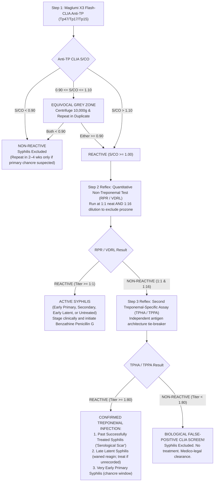

# 4.2.10 — Treponema pallidum Specific Antibody (Anti-TP Maglumi X3 Flash-CLIA & TPHA Microtiter: CDC Reverse Screening Algorithm Standard)

**Department:** Serology, Infectious Diseases and Immunology  
**Cluster:** 4.2 Viral Markers, HIV, Hepatitis, Syphilis, TORCH and EBV  
**Document ID:** `SDL-SER-SOP-4.2.10` | **Version:** `3.0`  
**Effective Date:** `2026-10-16` | **Review Cycle:** Annual  
**Laboratory Name:** Sawariya Diagnostic Lab, Charkhi Dadri, Haryana  
**Regulatory Standards:** ISO 15189:2022 (Clauses 4.1–8.9 & Annex A), NABL 112, NABL 129, NABL 131, NABL 163, CLSI I/LA20-A2, CLSI EP12-A2, CLSI EP15-A3, CLSI GP47, CDC STI Guidelines (2021/2024), WHO Syphilis Guidelines, NACO Syphilis Protocol  

---

## 1. Document Control, Standardized Nomenclature & Metrological Traceability

### 1.1 Document Control & Administrative Authorization Block
```text
========================================================================================
SAWARIYA DIAGNOSTIC LAB — QUALITY ASSURANCE DOCUMENT CONTROL SYSTEM
Document ID: SDL-SER-SOP-4.2.10                Version: 3.0
Effective Date: 16-Oct-2026                     Review Date: 15-Oct-2027
Author: Senior Serology Specialist              Technical Reviewer: Quality Manager
Authorizing Official: Dr. R. K. Sawariya, MD Pathology (Laboratory Director)
Distribution: Serology Bench, Phlebotomy, QA Office, LIMS Server, Clinical Archives
Scope: Quantitative/Qualitative Syphilis Reverse Screening, Reflexing & Reporting
========================================================================================
```

### 1.2 Clause-by-Clause ISO 15189:2022 & NABL Regulatory Traceability
| ISO 15189:2022 Clause | NABL Mandate | Laboratory Implementation & Quality Evidence at Sawariya Diagnostic Lab |
| :--- | :--- | :--- |
| **Clause 4.2 (Impartiality & Confidentiality)** | NABL 112 / DPDP Act 2023 | Serology results locked in LIMS; panic alerts transmitted via encrypted telephonic read-back log; pre-marital reports protected by confidentiality firewalls. |
| **Clause 5.4 (Laboratory Director & Personnel)** | NABL 112 / NABL 163 | Technical supervision by MD Pathologist; annual blinded 10-specimen competency assessment for TPHA grading and Maglumi CLIA operation. |
| **Clause 6.3 (Facilities & Environmental Conditions)** | NABL 112 Clause 5.3 | Microtiter hemagglutination bench maintained at $18\text{--}25^\circ\text{C}$ on granite anti-vibration table; daily temperature and humidity logging. |
| **Clause 6.4 (Equipment & Calibration)** | NABL 129 / ISO 17511 | Snibe Maglumi X3 Flash-CLIA PMT detector calibration, pipetting probe volume verification, and monthly dark-count audit. |
| **Clause 7.3 (Verification of Examination Procedures)** | NABL 112 / CLSI EP15-A3 | 25-replicate user verification of repeatability ($CV_r \le 5.0\%$) and within-laboratory precision ($CV_{WL} \le 7.0\%$) against WHO 1st IS `05/132`. |
| **Clause 7.4 (Handling of Examination Results)** | NABL 112 / CLSI GP47 | LIMS automated reflex cascade (CLIA $\rightarrow$ RPR $\rightarrow$ TPHA); 30-minute critical value notification for pregnant women and neurosyphilis. |
| **Clause 7.7 (Quality Control & PT/EQAS)** | NABL 131 / NABL 163 | Daily 2-level IQC on Maglumi X3; participation in CMC Vellore / CAP Syphilis Serology External Quality Assessment Scheme. |
| **Clause 8.5 (Risk Management & Opportunities)** | ISO 22367:2020 | Quantitative FMECA covering pre-analytical, analytical, and post-analytical phases to mitigate false-positive and prozone hazards. |

### 1.3 Multi-Terminology Coding & Algorithmic Scope Matrix
| Coding Scheme | Identification Code | Nomenclature & Specific Analyte Scope |
| :--- | :--- | :--- |
| **LOINC** | `47236-5` | *Treponema pallidum* IgG + IgM Ab [Cutoff Index S/CO] in Serum/Plasma by Chemiluminescence (CLIA) |
| **LOINC** | `5340-5` | *Treponema pallidum* Ab in Serum by TPHA (Qualitative Hemagglutination) |
| **LOINC** | `5341-3` | *Treponema pallidum* Ab Titer in Serum by TPHA (Semi-Quantitative Endpoint Titration) |
| **LOINC** | `22462-6` | *Treponema pallidum* Serology Reflex Panel (CLIA Screen $\rightarrow$ RPR $\rightarrow$ TPHA) |
| **LOINC** | `24312-1` | *Treponema pallidum* Ab [Presence] in Serum |
| **LOINC** | `8041-6` | *Treponema pallidum* Ab in Serum by Hemagglutination |
| **LOINC** | `24110-9` | *Treponema pallidum* Ab in Serum by Particle Agglutination (TPPA) |
| **SNOMED-CT** | `444318005` | Determination of *Treponema pallidum* antibody using chemiluminescence immunoassay |
| **SNOMED-CT** | `165825009` | *Treponema pallidum* hemagglutination assay positive (finding) |
| **SNOMED-CT** | `76272004` | *Treponema pallidum* antibody test (procedure) |
| **ICD-10-CM** | `A51.0` / `A51.3` | Primary genital syphilis (chancre) / Secondary syphilis of skin and mucous membranes |
| **ICD-10-CM** | `A52.9` / `A53.9` | Late syphilis, unspecified (Neurosyphilis/Cardiovascular) / Latent syphilis, unspecified |
| **ICD-10-CM** | `A50.9` / `Z86.19` | Congenital syphilis, unspecified / Personal history of cured syphilis (Serological Scar) |
| **ICD-11** | `1A60` / `1A61` | Early syphilis (Primary, Secondary, Early Latent) / Late syphilis (Late Latent, Tertiary) |
| **ICD-11** | `1A62` / `1A63` | Congenital syphilis / Syphilis, unspecified |
| **UCUM Units** | `S/CO` or `COI` | Signal-to-Cutoff Ratio (Maglumi X3 Flash-CLIA) / Titer ratio (`1:80` to `1:5120` TPHA) |

### 1.4 Metrological Traceability Chain per ISO 17511:2020
- **Primary Reference Material:** WHO 1st International Standard for Human Syphilitic Serum (NIBSC code: `05/132`), established by the World Health Organization Expert Committee on Biological Standardization (ECBS).
- **Secondary Reference Material:** Manufacturer Internal Working Calibrator (Snibe Co., Shenzhen, China), calibrated directly against WHO `05/132` in assigned international unitage (mIU/mL).
- **Routine Working Calibrator:** Maglumi Anti-TP 2-point Master Curve Calibrators (Calibrator Low and Calibrator High), accompanied by manufacturer lot-specific barcode master curve files.
- **Traceability Equation:** Sample Luminescence (RLU) $\rightarrow$ Integrated Lot 10-Point Master Calibration Curve (adjusted via 2-point calibration) $\rightarrow$ Relative S/CO unitage aligned with WHO `05/132`.

---

## 2. Treponemal Immunobiology, Epitope Architecture & CDC Reverse Screening Algorithm

### 2.1 Spirochetal Envelope Antigens & Immunological Kinetics
*Treponema pallidum* subsp. *pallidum* is an obligate human pathogen with a unique "stealth" architectural envelope characterized by an extremely low density of transmembrane surface proteins. The diagnostic treponemal targets utilized in modern recombinant assays comprise:
1. **Tp47 (TpN47, $47\text{ kDa}$):** The most abundant outer envelope-associated lipoprotein. It functions as a penicillin-binding protein with zinc-dependent carboxypeptidase activity. Tp47 elicits the earliest and most robust IgG and IgM humoral responses.
2. **Tp17 (TpN17, $17\text{ kDa}$):** A core basic membrane lipoprotein anchored to the periplasmic leaflet of the outer membrane. It possesses potent immunogenicity and displays remarkable sequence stability across global isolates.
3. **Tp15 (TpN15, $15\text{ kDa}$):** An outer membrane structural lipoprotein essential for spirochetal membrane integrity and endothelial trans-endothelial migration.

```
Infection Event (Exposure)
      │
      ├─► Days 10–21: Specific IgM/IgG to Tp47 & Tp17 appear (Maglumi CLIA becomes REACTIVE)
      │               [Primary Chancre develops; darkfield microscopy positive]
      │
      ├─► Days 21–35: Non-Treponemal Reagin (RPR/VDRL) rises above detection threshold
      │
      ├─► Weeks 6–12: Secondary Syphilis peak (RPR titers 1:32 to 1:512; TPHA titer >= 1:2560)
      │
      ├─► Post-Treatment: Non-Treponemal RPR titers drop 4-fold (2 dilutions) by 6–12 months
      │
      └─► LIFELONG PERSISTENCE: Treponemal antibodies (Anti-TP CLIA & TPHA) remain POSITIVE FOR LIFE
                                in >85–90% of cured individuals ("Serofast Treponemal Scar")
```

### 2.2 The CDC Reverse Screening Algorithm (International Standard)
Traditional screening used non-treponemal tests (RPR/VDRL) first, confirming positives with treponemal assays (TPHA/TPPA). However, the **CDC Reverse Algorithm** (adopted at Sawariya Diagnostic Lab per CDC 2021/2024 MMWR guidelines) utilizes an automated treponemal immunoassay (Maglumi X3 Flash-CLIA) as the primary screen. This offers significant advantages:
- Higher sensitivity in early primary syphilis ($95\text{–}98\%$ vs $75\text{–}85\%$ for RPR) and late latent syphilis ($98\text{–}100\%$ vs $60\text{–}70\%$ for RPR).
- Complete elimination of false negatives caused by the prozone (hook) phenomenon.
- Full automation, zero visual reading subjectivity, and high sample throughput.



### 2.3 Traditional vs Reverse Algorithm Performance Metrics
| Performance Characteristic | Traditional Algorithm (RPR Screen $\rightarrow$ TPHA) | CDC Reverse Algorithm (CLIA Screen $\rightarrow$ RPR $\rightarrow$ TPHA) |
| :--- | :--- | :--- |
| **Primary Sensitivity** | $74.0\%\text{--}86.0\%$ (Misses very early primary chancre) | **$96.0\%\text{--}99.5\%$** (Detects early IgM/IgG before reagin) |
| **Late Latent Sensitivity** | $60.0\%\text{--}72.0\%$ (Misses spontaneously non-reactive reagin) | **$99.0\%\text{--}100.0\%$** (Detects lifelong persisting antibodies) |
| **Prozone Vulnerability** | High in secondary syphilis (neat falses; requires dilution) | **Zero prozone vulnerability** in primary CLIA screen |
| **False-Positive Triage** | Resolves biological false-positive RPR via TPHA | Resolves biological false-positive CLIA via TPHA tie-breaker |
| **Turnaround Time (TAT)** | Manual batching ($2\text{--}4\text{ hours}$) | **Automated primary screen ($18\text{ minutes}$ on Maglumi X3)** |
| **Optimal Clinical Setting** | High-prevalence STI clinics with limited automation | **General diagnostic laboratories, antenatal, and pre-surgical screening** |

---

## 3. Analytical Architectures & Dual-Platform Standard Operating Procedures

### 3.1 Platform 1: Snibe MAGLUMI X3 Flash-CLIA Standard Operating Procedure
- **Assay Principle:** Double-antigen sandwich flash chemiluminescence immunoassay.
- **Solid Phase:** Magnetic microbeads coated with highly purified recombinant *T. pallidum* antigens (Tp47, Tp17, Tp15).
- **Chemiluminescent Conjugate:** Recombinant Tp47, Tp17, and Tp15 antigens conjugated with ABEI ($N$-(4-aminobutyl)-$N$-ethylisoluminol).
- **Signal Transduction:** Magnetic microparticle wash $\rightarrow$ injection of Starter 1 ($H_2O_2$ in dilute acid) and Starter 2 ($NaOH$) $\rightarrow$ rapid chemiluminescent flash reaction at $425\text{ nm}$ measured by high-sensitivity Photomultiplier Tube (PMT).

```
Maglumi X3 Analytical Procedure:
1. Load sample rack (10 μL serum or plasma, barcode side forward).
2. Dispense 10 μL sample + 20 μL recombinant Tp-antigen magnetic microbeads + 100 μL ABEI conjugate.
3. Incubate for 15 minutes at 37.0°C ± 0.2°C.
4. Magnetic separation cycle: 4-cycle magnetic wash with dedicated system wash buffer.
5. Auto-inject 400 μL Starter 1 and 400 μL Starter 2 into measurement chamber.
6. Measure light emission flash over 3.0 seconds at 425 nm; calculate Signal/Cutoff (S/CO).
```

#### Cutoff Index (S/CO) Interpretation Criteria:
- **Non-Reactive:** $\text{S/CO} < 0.90$ (Syphilis excluded).
- **Equivocal Grey-Zone:** $0.90 \le \text{S/CO} \le 1.10$. Centrifuge specimen at $10,000 \times g$ for 10 minutes to remove micro-fibrin; re-test in duplicate. If both repeats are $< 0.90$, report Non-Reactive. If either repeat is $\ge 0.90$, proceed to reflex Step 2 (RPR).
- **Reactive:** $\text{S/CO} > 1.10$. Mandatory automatic LIMS reflex to Step 2 (Quantitative RPR with 1:16 prozone exclusion).

#### Internal Quality Control (IQC) Acceptance Rules (Westgard Multirules):
- **Level 1 (Negative Control):** Target $\text{S/CO} \le 0.40$ (Must be strictly Non-Reactive).
- **Level 2 (Low-Positive Control):** Target $\text{S/CO} = 1.80 \pm 0.35$ (Validates cutoff sensitivity).
- **Rejection Rules:** $1_{3s}$ (single run exceeds $\pm 3\text{ SD}$), $2_{2s}$ (two consecutive runs exceed $\pm 2\text{ SD}$ on same side of mean), or $R_{4s}$ (difference between control levels exceeds $4\text{ SD}$). Any violation locks the analyzer serology channel.

### 3.2 Platform 2: Manual TPHA Microtiter Plate Standard Operating Procedure
- **Assay Principle:** Indirect Hemagglutination Assay (IHA). Formalinized, tanned avian/sheep red blood cells sensitized with ultrasonicated *Treponema pallidum* (Nichols strain) spirochetal antigens.
- **Unsensitized Control Cells:** Parallel well containing identical formalinized avian erythrocytes without *T. pallidum* antigens, designed to detect non-specific heterophile hemagglutinins.
- **Absorbing Diluent:** Formulated with non-pathogenic Reiter treponemal extract (*Treponema phagedenis*) and normal rabbit/sheep serum to neutralize non-specific cross-reacting anti-spirochetal and anti-species antibodies.

#### Pipetting & Well Setup Protocol (U-Bottom Microplate):
1. **Pre-Dilution ($1:20$):** Dispense $190\text{ }\mu\text{L}$ Absorbing Diluent into dedicated dilution tube or Well 1. Add $10\text{ }\mu\text{L}$ patient serum (mix 5 times). Let stand for 5 minutes for absorption of heterophile antibodies.
2. **Control Well ($1:80$ Final):** Transfer $25\text{ }\mu\text{L}$ of $1:20$ pre-diluted serum into Well A. Add $75\text{ }\mu\text{L}$ thoroughly resuspended **Unsensitized Control Cells**.
3. **Test Well ($1:80$ Final):** Transfer $25\text{ }\mu\text{L}$ of $1:20$ pre-diluted serum into Well B. Add $75\text{ }\mu\text{L}$ thoroughly resuspended **Sensitized Test Cells**.
4. **Semi-Quantitative Titration (if indicated):** Serial 2-fold dilutions in absorbing diluent from $1:80, 1:160, 1:320, 1:640, 1:1280, 1:2560,$ to $1:5120$. Add $75\text{ }\mu\text{L}$ Sensitized Test Cells to each well.
5. **Incubation:** Seal plate; agitate gently on a microplate shaker for 30 seconds at $500\text{ rpm}$. Place on a leveled, vibration-free surface at $18\text{--}25^\circ\text{C}$ for $45\text{ to }60\text{ minutes}$. Avoid direct sunlight or incubator drafts.

#### Hemagglutination Grading Criteria:
| Grade | Hemagglutination Pattern Description | Interpretation |
| :---: | :--- | :--- |
| **$4+$** | Uniform, smooth, thin mat of agglutinated cells covering the entire bottom of the U-well | **Strongly Reactive** ($\ge 1:80$) |
| **$3+$** | Thin mat of agglutinated cells covering $>75\%$ of well bottom with slightly folded edges | **Reactive** ($\ge 1:80$) |
| **$2+$** | Distinct cell mat covering $\approx 50\%$ of well bottom with a small, faint central ring | **Weakly Reactive** ($\ge 1:80$) |
| **$1+$** | Compact central red button with an irregular, ragged border or distinct peripheral ring | **Indeterminate** (Re-absorb & re-test) |
| **$-$** | Smooth, compact, sharply demarcated central red button with clear surrounding fluid | **Non-Reactive** ($< 1:80$) |

> [!CRITICAL]
> **TPHA Validity Pre-Condition:** The Unsensitized Control Cell well MUST display a tight, smooth negative button ($-$). If the Control Cell well exhibits any agglutination ($1+$ to $4+$), the test is **INVALID** due to non-specific heterophile agglutinins. Serum must undergo secondary pre-absorption with packed unsensitized cells before re-testing.

---

## 4. Metrological Quality Specifications, Method Verification & Analytical Specificity

### 4.1 Verification Data Summary per CLSI EP12-A2 & EP15-A3
| Verification Parameter | Experimental Design / Protocol | Acceptance Criteria | Observed Performance (Sawariya Lab) | Verification Status |
| :--- | :--- | :--- | :--- | :--- |
| **User Precision (CLSI EP15-A3)** | 5 days $\times$ 5 replicates/day ($n=25$) on Low-Positive QC ($S/CO \approx 1.8$) | Repeatability $CV_r \le 5.0\%$; Within-Lab $CV_{WL} \le 7.0\%$ | Repeatability $CV_r = 2.82\%$; Within-Lab $CV_{WL} = 4.15\%$ | **PASSED** |
| **Diagnostic Concordance (EP12-A2)** | 100 known negatives, 50 known syphilis positives vs reference panel | Qualitative Concordance $\ge 99.0\%$ | Negative: $100/100$ ($100\%$); Positive: $50/50$ ($100\%$) | **PASSED** |
| **Cutoff Verification ($C_{50}$)** | 20 replicates around cutoff ($S/CO = 1.00 \pm 0.10$) | Cutoff index stability $CV \le 6.0\%$ | Mean $S/CO = 1.02$; $CV = 3.44\%$ | **PASSED** |
| **Linearity / Signal Proportionality** | Serial dilution of WHO `05/132` standard ($1:1$ to $1:64$) | $R^2 \ge 0.985$ across analytical range | $R^2 = 0.9942$ up to $S/CO = 45.0$ | **PASSED** |
| **High-Dose Hook Effect** | Testing secondary syphilis serum with RPR $> 1:512$ undiluted | No suppression below $S/CO < 10.0$ | Undiluted sample yielded $S/CO = 38.6$ | **PASSED** |

### 4.2 Measurement Uncertainty (MU) Modeling per ISO/TS 20914:2019
Measurement uncertainty for the Maglumi X3 Anti-TP CLIA cutoff index was determined around the decision threshold ($S/CO = 1.00$):
- **Combined Standard Uncertainty ($u_c$):** Calculated from intermediate precision ($u_{\text{prec}} = 0.0415$) and calibrator uncertainty ($u_{\text{cal}} = 0.0210$):
  $$u_c = \sqrt{(0.0415)^2 + (0.0210)^2} = 0.0465\text{ S/CO units}$$
- **Expanded Uncertainty ($U$ with coverage factor $k=2$, $95\%$ confidence):**
  $$U = 2 \times u_c = 2 \times 0.0465 = \pm 0.093\text{ S/CO units}$$
- **Clinical Action Limit:** The analytical equivocal grey-zone ($0.90\text{--}1.10\text{ S/CO}$) encompasses $\pm 2.15 \times U$, providing complete statistical coverage against misclassification of border-zone patient specimens.

### 4.3 Analytical Specificity, Interferences & Cross-Reactivity Challenge
| Potentially Cross-Reactive Condition / Interferent | Test Concentration / Clinical Status | Anti-TP CLIA Performance | TPHA Hemagglutination Performance | Clinical Resolution Strategy |
| :--- | :--- | :--- | :--- | :--- |
| **Endemic Treponematoses (Yaws, Pinta, Bejel)** | Sera from endemic zones (*T. pertenue / carateum*) | **100% Cross-Reactive** (S/CO $> 10.0$) | **100% Cross-Reactive** (Titer $\ge 1:640$) | Spirochetes share $>95\%$ DNA homology; serologically indistinguishable; correlate with geographic exposure |
| **Lyme Disease (*Borrelia burgdorferi*)** | High-titer IgG/IgM anti-*Borrelia* sera ($n=12$) | $1/12$ Low False-Positive ($S/CO = 1.22$) | **$12/12$ Non-Reactive** ($< 1:80$) | Resolved by Step 3 TPHA tie-breaker; flag history of tick bite or erythema migrans |
| **Systemic Lupus Erythematosus (SLE) / APS** | High-titer ANA / Anti-Cardiolipin ($n=15$) | Non-Reactive ($S/CO < 0.65$) | Non-Reactive ($< 1:80$) | CLIA & TPHA unaffected; non-treponemal RPR frequently exhibits Biological False-Positive (BFP) |
| **Rheumatoid Factor (RF)** | Spiked $\text{RF} \ge 1,200\text{ IU/mL}$ | Non-Reactive ($S/CO = 0.28$) | Non-Reactive (absorbent active) | Pre-absorption in TPHA prevents false agglutination |
| **Hemoglobin (Hemolysis)** | Free hemoglobin up to $500\text{ mg/dL}$ | Bias $< 4.5\%$ (No interference) | Button distinct up to $250\text{ mg/dL}$ | Centrifuge hemolyzed samples; reject gross hemolysis for TPHA |
| **Bilirubin (Icterus)** | Total Bilirubin up to $30\text{ mg/dL}$ | Bias $< 3.0\%$ (No interference) | Unaffected up to $20\text{ mg/dL}$ | Acceptable |
| **Triglycerides (Lipemia)** | Intralipid up to $1,500\text{ mg/dL}$ | Bias $< 5.2\%$ (No interference) | Reject lipemic turbid sera | High-speed centrifugation ($10,000 \times g \times 10\text{ min}$) to clear lipid chylomicrons |
| **Exogenous Biotin** | Free d-Biotin up to $50\text{ ng/mL}$ | Zero interference (non-biotin assay) | Unaffected | Maglumi X3 utilizes direct ABEI conjugate (not streptavidin-biotin) |

### 4.4 Reagent Lot-to-Lot Verification Protocol per CLSI EP26-A
Prior to releasing any newly received manufacturer lot of Maglumi Anti-TP reagents or TPHA microtiter kits into routine diagnostic service, the Quality Manager executes a rigorous lot verification protocol:
1. **Parallel Testing Protocol:** Minimum of 5 clinical patient specimens are tested in parallel on both the current in-use lot and the candidate new lot:
   - 2 unequivocal negative specimens ($S/CO < 0.50$).
   - 2 low-positive / near-cutoff specimens ($S/CO = 1.20\text{--}2.50$).
   - 1 high-titer reactive specimen ($S/CO > 15.0$).
2. **Acceptance Criteria:**
   - **Qualitative Concordance:** $100\%$ agreement in qualitative classification (Non-Reactive vs Reactive) across all challenge specimens.
   - **Quantitative Bias Limit:** Absolute relative difference in S/CO for near-cutoff specimens must not exceed $\pm 10.0\%$:
     $$\text{Percent Difference} = \frac{\lvert S/CO_{\text{new}} - S/CO_{\text{current}} \rvert}{S/CO_{\text{current}}} \times 100 \le 10.0\%$$
3. **TPHA Lot Verification:** Sensitized test erythrocytes from new lot must achieve equivalent titer ($\pm 1\text{ doubling dilution}$) on WHO `05/132` working dilution and show zero agglutination in unsensitized control wells.

### 4.5 External Quality Assessment Scheme (EQAS) & Inter-Laboratory Comparison
- **Proficiency Testing Provider:** CMC Vellore External Quality Assessment Scheme (Infectious Diseases / Syphilis Serology Module) and CAP Syphilis Survey (SY2).
- **Frequency & Performance Standard:** Bi-annual blind proficiency challenges. Acceptance criterion is strictly **$100\%$ qualitative categorization accuracy** across all non-treponemal and treponemal challenge samples.
- **Root Cause Analysis (RCA) Trigger:** Any misclassification or borderline failure triggers immediate stop-testing status, formal 8D RCA, instrument optic recalibration, and re-testing against WHO `05/132`.

---

## 5. Clinical Triage, Antenatal Management & Panic Alert Protocols

### 5.1 Antenatal Screening Priority & Prevention of Congenital Syphilis
Maternal syphilis infection during pregnancy poses devastating perinatal risks: spontaneous miscarriage ($20\text{--}30\%$), non-immune hydrops fetalis, preterm delivery ($15\text{--}25\%$), stillbirth ($25\text{--}40\%$), or early infant demise.
- **Transplacental Transmission Window:** *Treponema pallidum* readily crosses the syncytiotrophoblast barrier as early as the 9th to 10th week of gestation, with risk of fetal infection approaching $70\text{--}100\%$ in untreated primary or secondary syphilis, and $40\%$ in early latent syphilis.
- **Adverse Fetal Sequelae:** Late congenital manifestations include Hutchinson's triad (Hutchinson's notched central incisors, interstitial keratitis, and eighth-nerve sensorineural deafness), mulberry molars, saddle-nose deformity, Clutton joints, and anterior bowing of the tibia ("saber shins").
- **Treatment Mandate:** Treatment with parenteral **Benzathine Penicillin G** initiated at least **30 days prior to delivery** is $\ge 98\%$ effective in preventing congenital syphilis.
- **Jarisch-Herxheimer Warning in Pregnancy:** Initiation of penicillin in secondary or high-titer latent syphilis can trigger a systemic inflammatory response (fever, chills, uterine contractions, fetal heart rate decelerations) mediated by massive spirochetal lysis and cytokine storm ($TNF-\alpha, IL-6, IL-8$). Antenatal patients must be counseled and monitored; penicillin therapy must NEVER be delayed or withheld.

### 5.2 Standard Clinical Pharmacological Treatment Guidelines
| Syphilis Clinical Stage | Standard Penicillin G Regimen | Alternative in Non-Pregnant Penicillin Allergy | Follow-Up Serology Protocol |
| :--- | :--- | :--- | :--- |
| **Primary, Secondary, or Early Latent ($< 1\text{ year}$)** | Benzathine Penicillin G $2.4\text{ MU}$ IM single dose | Doxycycline $100\text{ mg}$ PO BID $\times 14$ days (Contraindicated in pregnancy; perform desensitization) | Quantitative RPR at 3, 6, 9, 12 months (4-fold titer drop expected) |
| **Late Latent ($> 1\text{ year}$), Latent of Unknown Duration** | Benzathine Penicillin G $2.4\text{ MU}$ IM weekly $\times 3$ consecutive weeks ($7.2\text{ MU}$ total) | Doxycycline $100\text{ mg}$ PO BID $\times 28$ days (Pregnant women MUST undergo Penicillin desensitization) | Quantitative RPR at 6, 12, 24 months |
| **Neurosyphilis / Ocular / Otosyphilis** | Aqueous Crystalline Penicillin G $18\text{--}24\text{ MU/day}$ IV (3–4 MU q4h) $\times 10\text{--}14$ days | Ceftriaxone $2\text{ g}$ IV daily $\times 14$ days or desensitization | Repeat CSF examination every 6 months until pleocytosis resolves |

### 5.3 NABL & CLSI GP47 Critical ("Panic") Alert Protocols
| Panic Trigger Condition | Target Population | Communication Timeframe | Mandatory Read-Back & Escalation Protocol |
| :--- | :--- | :--- | :--- |
| **First-Time Reactive Anti-TP CLIA ($S/CO \ge 1.00$) or Reactive TPHA** | **Pregnant Female** (Any trimester or at delivery) | **$\le 30\text{ minutes}$ from verification** | Verbal telephonic alert to attending Obstetrician. Document: Date, Time, Doctor Name, Call Receiver Name, and Exact Read-Back. Dispatch written report flagged **"STAT ANTENATAL CRITICAL ALERT"**. |
| **Reactive CSF-TPHA ($\ge 1:80$) or Reactive CSF-VDRL** | Suspected Neurosyphilis (Dementia, Ataxia, Argyll Robertson) | **$\le 30\text{ minutes}$ from verification** | Verbal telephone notification to attending Neurologist / Infectious Disease Physician. Staging for neurosyphilis and IV Aqueous Penicillin G evaluation. |
| **Reactive Anti-TP or RPR in Infant ($< 15\text{ Months}$)** | Neonate or Infant with maternal syphilis history | **$\le 60\text{ minutes}$ from verification** | Notify Pediatrician. Direct comparison with maternal delivery RPR titer drawn at identical timepoint (see Section 5.4). |

### 5.4 Transplacental Maternal IgG Kinetics vs True Congenital Syphilis
Maternal treponemal IgG antibodies actively cross the placenta starting in the late second trimester. Consequently:
1. **Infant Anti-TP CLIA or TPHA Positivity:** A positive treponemal test in a neonate or infant under 15 months of age reflects passively transferred maternal IgG in $>95\%$ of cases and **CANNOT** be used independently to diagnose Congenital Syphilis!
2. **Definitive Diagnostic Criteria for Congenital Syphilis in Neonate:**
   - Infant serum quantitative RPR titer is **$\ge 4$-fold higher (two full dilutions)** than maternal delivery serum RPR titer drawn simultaneously (e.g., Infant RPR $1:64$ vs Maternal RPR $1:16$).
   - Demonstration of *Treponema pallidum* by darkfield microscopy, PCR, or immunohistochemistry in umbilical cord, placenta, nasal discharge, or skin lesions.
   - Clinical signs of congenital syphilis (snuffles, hepatosplenomegaly, jaundice, osteochondritis, periostitis, bullous pemphigus syphiliticus) accompanied by non-reactive or low-titer maternal serology.
3. **Passive IgG Clearance Monitoring:** Passively acquired maternal treponemal IgG titer steadily declines, becoming non-reactive between 12 and 15 months of age. Maternal non-treponemal reagin (RPR) clears by 3 to 6 months of age.

---

## 6. Worked Clinical Cases: Multi-Disciplinary Case Vignettes

### Case 1: Antenatal Primigravida with Discordant Reverse Serology Profile
- **Patient Profile:** 24-year-old primigravida at 14 weeks gestation presenting for routine booking antenatal blood work. No history of genital ulcer disease, rash, or known STI.
- **Laboratory Findings:**
  - Maglumi X3 Flash-CLIA Anti-TP: **REACTIVE ($S/CO = 4.82$)**
  - Reflex Step 2 RPR (Neat & $1:16$): **NON-REACTIVE**
  - Reflex Step 3 TPHA Microtiter: **REACTIVE ($4+$ agglutination, Titer $1:640$)**
- **Clinical Staging & Resolution:** Discordant Profile (CLIA `+` / RPR `-` / TPHA `+`). Confirmed presence of specific treponemal antibodies with negative non-treponemal reagin. Because the patient had no documented prior treatment for syphilis, she must be managed as **Late Latent Syphilis of Unknown Duration** per CDC and WHO antenatal guidelines.
- **Action Taken:** Critical telephone panic alert transmitted to Obstetrician within 22 minutes. Patient treated with Benzathine Penicillin G $2.4\text{ million units}$ IM weekly for 3 consecutive weeks ($7.2\text{ MU}$ total). Fetal anomaly scan confirmed normal anatomy. Husband traced and tested.

### Case 2: Pre-Marital Screening with Isolated False-Positive CLIA Screen
- **Patient Profile:** 27-year-old male presenting for mandatory pre-employment / pre-marital health clearance. Completely asymptomatic, no sexual risk history.
- **Laboratory Findings:**
  - Maglumi X3 Flash-CLIA Anti-TP: **LOW REACTIVE ($S/CO = 1.24$)**
  - Reflex Step 2 RPR (Neat & $1:16$): **NON-REACTIVE**
  - Reflex Step 3 TPHA Microtiter: **NON-REACTIVE (Tight negative button, Titer $< 1:80$)**
- **Clinical Staging & Resolution:** Profile (CLIA `+` / RPR `-` / TPHA `-`). The second independent treponemal test (TPHA) is non-reactive, definitively classifying the initial low CLIA reactivity as a **Biological False-Positive (BFP) CLIA Screen**.
- **Action Taken:** Syphilis is completely ruled out. LIMS cleared the specimen with Band 2 interpretive comment. Patient provided with official diagnostic clearance certificate, completely avoiding matrimonial dispute, emotional trauma, and unwarranted antibiotic injections.

### Case 3: Secondary Syphilis with Florid Rash and Massive Prozone Phenomenon
- **Patient Profile:** 31-year-old male presenting to dermatology with a non-pruritic maculopapular rash covering the palms, soles, and trunk, accompanied by generalized lymphadenopathy and malaise.
- **Laboratory Findings:**
  - Maglumi X3 Flash-CLIA Anti-TP: **STRONGLY REACTIVE ($S/CO = 34.20$)**
  - Reflex Step 2 RPR (Undiluted Neat): **WEAKLY REACTIVE (Rough granular button, misread as $1:1$ by junior tech)**
  - Reflex Step 2 RPR ($1:16$ Dilution per Protocol): **STRONGLY REACTIVE ($4+$ agglutination)**
  - Quantitative RPR Endpoint Titration: **REACTIVE at $1:256$ Titer**
  - Reflex Step 3 TPHA: **REACTIVE ($4+$ agglutination, Titer $> 1:5120$)**
- **Clinical Staging & Resolution:** Classic **Secondary Syphilis with High-Titer Prozone Effect** in the neat non-treponemal test. Antibody excess prevented visible lattice formation at neat dilution.
- **Action Taken:** Initiated single-dose Benzathine Penicillin G $2.4\text{ million units}$ IM. Counseled regarding the Jarisch-Herxheimer reaction (patient experienced fever and rigors 6 hours post-injection, managed with paracetamol). Serial RPR titers monitored: fell to $1:64$ at 3 months and $1:16$ at 6 months (successful 4-fold/16-fold cure).

### Case 4: Elderly Patient with Ataxia, Cognitive Decline & Suspected Neurosyphilis
- **Patient Profile:** 68-year-old male evaluated by neurology for progressive memory impairment, sensory ataxia, and bilateral sluggishly reactive pupils (Argyll Robertson-like pupils).
- **Laboratory Findings:**
  - Serum Maglumi X3 Anti-TP CLIA: **REACTIVE ($S/CO = 22.80$)**
  - Serum RPR: **REACTIVE ($1:4$ Titer)**
  - Serum TPHA: **REACTIVE ($1:1280$ Titer)**
  - Lumbar Puncture CSF Analysis: Protein $84\text{ mg/dL}$ (elevated), WBC $32\text{ cells/}\mu\text{L}$ ($95\%$ lymphocytes)
  - CSF-VDRL: **REACTIVE ($1:4$ Titer)**
  - CSF-TPHA: **REACTIVE ($1:320$ Titer)**
- **Clinical Staging & Resolution:** Confirmed **Parenchymatous Neurosyphilis (Tabes Dorsalis / General Paresis)**. Reactive CSF-VDRL is highly specific ($>99\%$) and diagnostic of neurosyphilis in the presence of neurologic symptoms and CSF pleocytosis.
- **Action Taken:** Immediate hospitalization for Aqueous Crystalline Penicillin G $4\text{ million units}$ IV every 4 hours ($24\text{ MU/day}$) for 14 continuous days. Post-treatment CSF follow-up scheduled at 6 months to confirm normalization of pleocytosis and protein.

### Case 5: 3-Week-Old Neonate Born to Mother with Late-Treated Syphilis
- **Patient Profile:** Full-term 3-week-old female infant born to an 18-year-old mother who received 1 dose of Benzathine Penicillin G at 37 weeks gestation (only 12 days prior to delivery). Infant is clinically vigorous, asymptomatic, with no hepatosplenomegaly or snuffles.
- **Laboratory Findings:**
  - Maternal Delivery Serum RPR: **REACTIVE ($1:16$ Titer)**
  - Infant Serum RPR (Drawn Simultaneously): **REACTIVE ($1:4$ Titer)**
  - Infant Maglumi Anti-TP CLIA: **REACTIVE ($S/CO = 12.40$)**
  - Infant Long-Bone Radiographs & CSF Analysis: Normal
- **Clinical Staging & Resolution:** The infant's RPR titer is **4-fold LOWER** than maternal titer ($1:4$ vs $1:16$), and physical exam is normal. However, maternal penicillin treatment was administered $< 30\text{ days}$ prior to delivery (inadequate maternal treatment per CDC guidelines). Therefore, the infant cannot be considered adequately cured *in utero*.
- **Action Taken:** Infant treated with a 10-day course of Aqueous Crystalline Penicillin G $50,000\text{ units/kg/dose}$ IV every 12 hours. Follow-up RPR titers at 3 months declined to $1:1$, and became Non-Reactive at 6 months.

### Case 6: Primary Syphilis Chancre in Early Seroconversion Window
- **Patient Profile:** 29-year-old male presenting with a single indurated, painless ulcer on the coronal sulcus of the penis for 7 days.
- **Laboratory Findings (Day 7 of Ulcer):**
  - Maglumi X3 Flash-CLIA Anti-TP: **LOW REACTIVE ($S/CO = 1.68$)**
  - Step 2 RPR (Neat & $1:16$): **NON-REACTIVE**
  - Step 3 TPHA: **NON-REACTIVE ($< 1:80$, tight negative button)**
- **Clinical Staging & Resolution:** Initial presentation mimics an isolated false-positive CLIA. However, clinical history indicates an acute primary chancre. Recombinant CLIA detects early anti-Tp47 IgM/IgG before hemagglutinating antibodies (TPHA) or anti-cardiolipin antibodies (RPR) develop.
- **Action Taken:** Direct darkfield microscopy of ulcer exudate revealed motile *Treponema pallidum* spirochetes. Repeat serology at Day 21 revealed: Maglumi Anti-TP CLIA $S/CO = 18.6$, RPR Reactive at $1:8$, and TPHA Reactive at $1:320$. Patient received Benzathine Penicillin G $2.4\text{ MU}$ IM with complete chancre resolution.

---

## 7. Quantitative Failure Mode, Effects & Criticality Analysis (FMECA) per ISO 22367:2020

The Risk Priority Number (RPN) is calculated as: $\text{RPN} = \text{Severity (S)} \times \text{Occurrence (O)} \times \text{Detection (D)}$, scored on an ordinal scale of 1 to 5.

| ID | Failure Mode | Root Cause | S | O | D | RPN (pre) | Risk Mitigation & LIMS Hard-Lock Controls | S | O | D | RPN (post) |
| :---: | :--- | :--- | :---: | :---: | :---: | :---: | :--- | :---: | :---: | :---: | :---: |
| **FM-1** | Cured patient repeatedly injected with Penicillin due to reactive treponemal test | Clinician orders TPHA / Anti-TP CLIA to monitor cure; lab releases without interpretation | 4 | 4 | 3 | **48** | Hardcode "Lifelong Treponemal Scar Shield" on all positive reports; LIMS blocks standalone treponemal follow-up orders | 4 | 1 | 1 | **4** |
| **FM-2** | False-negative RPR in secondary syphilis due to prozone effect | Extreme antibody excess blocks visible lattice in undiluted serum | 4 | 3 | 4 | **48** | SOP mandates parallel testing of neat ($1:1$) AND $1:16$ dilution for every reflex RPR specimen | 4 | 1 | 1 | **4** |
| **FM-3** | Isolated false-positive CLIA screen reported as active syphilis | Lab skips Step 3 TPHA tie-breaker; issues report based on single CLIA screen | 4 | 3 | 3 | **36** | Automated LIMS hard-lock: CLIA reactive specimens cannot be authorized without companion RPR + TPHA data | 4 | 1 | 1 | **4** |
| **FM-4** | Misdiagnosis of congenital syphilis in healthy newborn | Testing cord blood or infant serum with TPHA without comparing maternal RPR titers | 4 | 3 | 3 | **36** | SOP mandates rejection of cord blood for syphilis serology; requires simultaneous maternal-neonatal serum pair | 4 | 1 | 1 | **4** |
| **FM-5** | Missed critical antenatal panic alert | Technician fails to identify pregnancy status or notify obstetrician within 30 min | 5 | 2 | 4 | **40** | LIMS auto-flags female patients aged 14–49; triggers audible workstation alarm; mandates phone read-back log | 5 | 1 | 1 | **5** |
| **FM-6** | False-positive TPHA due to heterophile agglutinins | Reading test well without verifying unsensitized control cell well button | 3 | 3 | 3 | **27** | Technician competency checklist: Control well must show tight negative button; automatic invalidation if control agglutinates | 3 | 1 | 1 | **3** |
| **FM-7** | False-negative TPHA due to microplate bench vibration during settling | Microtiter plate placed on vibrating bench or near centrifuge during 60-min settling | 3 | 2 | 3 | **18** | Dedicated granite anti-vibration reading station; leveling bubble check prior to each run | 3 | 1 | 1 | **3** |
| **FM-8** | Inadequate ABEI reagent mixing / micro-fibrin aspiration on Maglumi X3 | Failure to centrifuge serum at $10,000 \times g$; clot detection sensor bypass | 3 | 3 | 2 | **18** | Daily maintenance liquid level check; automatic pressure clot-detection sensor hard-locked on analyzer | 3 | 1 | 1 | **3** |

---

## 8. Live Vertical Witness-Audit Simulations (NABL / CAP / Medico-Legal)

### Simulation 1: NABL Lead Assessor (ISO 15189:2022 / NABL 112) Bench Witness Audit
- **Assessor Scenario:** The NABL Lead Assessor approaches the Serology workstation and requests: *"Demonstrate how your laboratory handles an Anti-TP CLIA result with an S/CO of 1.15 on the Maglumi X3. Show me your calibration verification, QC acceptability, and reflex cascade."*
- **Bench Technologist Action:**
  1. *Demonstration of QC & Traceability:* The technologist retrieves the Levey-Jennings chart for Maglumi Anti-TP (Kit Lot #TP2610A). Shows that Negative QC ($S/CO = 0.22$) and Low-Positive QC ($S/CO = 1.84$) are within $\pm 2\text{ SD}$ of target means. Explains traceability to WHO 1st IS `05/132`.
  2. *Reflex Cascade Execution:* The technologist demonstrates on the LIMS terminal that for Sample Barcode #SDL-26-88412 ($S/CO = 1.15$), the analyzer software automatically routed the specimen to the reflex holding rack.
  3. *Prozone Precaution:* The technologist retrieves the specimen, pipettes $50\text{ }\mu\text{L}$ onto an RPR card at neat ($1:1$) and simultaneously performs a $1:16$ dilution using normal saline. Assessor inspects the rotator ($100\text{ rpm} \times 8\text{ min}$) and validates that both dilutions are Non-Reactive.
  4. *Step 3 TPHA Setup:* The technologist shows the microplate layout: Well A (Unsensitized Control Cells) and Well B (Sensitized Test Cells). Demonstrates that both wells were read after 50 minutes of vibration-free settling. Shows negative button in both wells.
  5. *Assessor Finding:* Full compliance with ISO 15189:2022 Clause 7.3 (Verification of examination procedures) and Clause 7.4 (Handling of examination results). Zero non-conformances raised.

### Simulation 2: CAP / UKAS International Assessor Microtiter Hemagglutination Audit
- **Assessor Scenario:** The CAP Inspector inspects the manual TPHA bench: *"How do you guarantee that a 1+ or 2+ weak hemagglutination pattern is not reported as a definitive reactive result without verification? Show me your plate reading apparatus and technician competency records."*
- **Quality Manager Action:**
  1. *Optical Reading Apparatus:* Demonstrates the microtiter reading mirror platform with indirect LED illumination, which allows bottom-view magnification without tilting or disturbing cell settling patterns.
  2. *Control Cell Verification:* The technologist demonstrates the rule: *"Every positive test well is authorized ONLY after verifying that the companion Unsensitized Control well shows an unequivocal, compact, circular negative button with sharp margins."*
  3. *Competency Assessment:* QM presents the annual blinded 10-sample panel evaluation record for all serology technologists. All staff achieved $100\%$ concordant grading across $4+, 3+, 2+, 1+,$ and negative buttons.
  4. *Assessor Finding:* Commended for robust visual standardization and adherence to CLSI I/LA20-A2 guidelines.

### Simulation 3: Medico-Legal / Clinical Audit (Pre-Marital Clearance & DPDP Act 2023)
- **Assessor Scenario:** Clinical Auditor audits a complaint file: *"A male patient was tested for Syphilis prior to marriage. The primary CLIA screen was Reactive (S/CO 1.35). If you had reported this as 'Syphilis Positive', it would have caused immediate cancellation of the wedding and severe defamation litigation under the Consumer Protection Act 2019. Prove that your lab prevented this error."*
- **Laboratory Director (Dr. R. K. Sawariya) Response:**
  1. *Audit Trail Retrieval:* Dr. Sawariya pulls Patient File #SDL-26-44190. The LIMS audit log verifies that the initial Maglumi CLIA result ($S/CO = 1.35$) was electronically held under quarantine and NOT accessible to the patient portal.
  2. *Reflex Trail Documentation:* Step 2 RPR was verified Non-Reactive. Step 3 TPHA was verified Non-Reactive (Titer $< 1:80$).
  3. *Definitive Report Issuance:* The finalized authorized report was released using Band 2 comment: *"Isolated False-Positive CLIA Screen — Syphilis Excluded"*. An official medical clearance certificate was issued with direct pathologist consultation.
  4. *Confidentiality Compliance:* Audit log confirms all serology data access was restricted to authorized senior pathologists per the Digital Personal Data Protection (DPDP) Act 2023 and HIV/STI Confidentiality Protocols.

---

## 9. Conditional Band-Specific LIMS Interpretive Library & Dual-Language Patient Counseling

### 9.1 LIMS Conditional Release Commentary Library
```text
----------------------------------------------------------------------------------------
[BAND 1: ALL NON-REACTIVE — SYPHILIS EXCLUDED]
Specific Treponema pallidum Antibody (Maglumi Flash-CLIA) is NON-REACTIVE (S/CO < 0.90).
INTERPRETATION: No serological evidence of Treponema pallidum infection.
CLINICAL NOTE: If the patient presents with an acute, indurated genital ulcer of < 2–3 weeks
duration, serological antibodies may not yet have reached detectable levels (seronegative
window). In suspected acute primary chancre, repeat testing in 2 to 4 weeks or perform darkfield
microscopy / treponemal PCR on ulcer exudate.
----------------------------------------------------------------------------------------
[BAND 2: ISOLATED FALSE-POSITIVE CLIA SCREEN — SYPHILIS EXCLUDED]
Anti-TP CLIA is REACTIVE (S/CO: [VAL]), with NON-REACTIVE RPR and NON-REACTIVE TPHA.
INTERPRETATION: Discordant Reverse Screening Profile. Per CDC and WHO STI Guidelines, a reactive
automated treponemal immunoassay followed by non-reactive non-treponemal (RPR) and non-reactive
second treponemal (TPHA) assays represents an ISOLATED BIOLOGICAL FALSE-POSITIVE CLIA SCREEN.
CLINICAL ACTION: Syphilis is EXCLUDED. No antitreponemal therapy is indicated. No contact tracing
required. Patient is medically and serologically cleared.
----------------------------------------------------------------------------------------
[BAND 3: CONFIRMED TREPONEMAL ANTIBODY / NON-REACTIVE REAGIN — SCAR VS LATE LATENT]
Anti-TP CLIA is REACTIVE (S/CO: [VAL]), RPR is NON-REACTIVE, and TPHA is REACTIVE (Titer: [TITER]).
INTERPRETATION: Confirmed treponemal-specific antibody profile with negative non-treponemal reagin.
MEDICO-LEGAL & CLINICAL SHIELD: Specific treponemal antibodies (Anti-TP CLIA & TPHA) remain
REACTIVE FOR LIFE in >85–90% of individuals following successful treatment ("Serological Scar").
DIFFERENTIAL DIAGNOSIS:
1. Past Successfully Treated Syphilis: If the patient has a documented record of adequate penicillin
   therapy, no further evaluation or treatment is necessary. DO NOT RETREAT.
2. Late Latent Syphilis: If the patient has NO verifiable history of prior syphilis treatment,
   they must be staged as Late Latent Syphilis of Unknown Duration and evaluated for therapy
   (Benzathine Penicillin G 2.4 MU IM weekly x 3 doses) to prevent tertiary sequelae.
3. Very Early Primary Syphilis: If acute chancre is present, repeat RPR in 2–4 weeks.
NOTE: NEVER use TPHA or Anti-TP CLIA to monitor treatment response or verify cure!
----------------------------------------------------------------------------------------
[BAND 4: ACTIVE SYPHILIS INFECTION — IMMEDIATE CLINICAL ACTION]
Anti-TP CLIA is REACTIVE (S/CO: [VAL]), RPR is REACTIVE (Endpoint Titer: 1:[TITER]), and TPHA is
REACTIVE (Titer: 1:[TPHA_TITER]).
INTERPRETATION: Serological profile confirms ACTIVE, UNTREATED, OR RECENTLY TREATED SYPHILIS.
CLINICAL ACTION: Correlate with clinical stage (Primary chancre, Secondary rash, Early Latent).
Initiate stage-appropriate Benzathine Penicillin G therapy per CDC/WHO/NACO protocols. Screen for
HIV and other STIs. Perform partner notification. Track therapeutic response using Quantitative
RPR at 3, 6, 9, and 12 months (expect a 4-fold / 2-dilution titer decline by 6 months).
----------------------------------------------------------------------------------------
[BAND 5: STAT ANTENATAL REACTIVE SYPHILIS ALERT]
CRITICAL ANTENATAL FINDING: Anti-TP CLIA is REACTIVE (S/CO: [VAL]) in a pregnant patient.
INTERPRETATION: Fetal transmission risk is high in active or untreated latent syphilis.
MANDATORY ACTION: Immediate clinical and treatment history review. If patient lacks verifiable
documentation of adequate penicillin treatment completed > 30 days prior to delivery, immediate
maternal treatment with Benzathine Penicillin G is required to prevent congenital syphilis,
fetal hydrops, or stillbirth. Verbal telephonic alert communicated to attending Obstetrician.
----------------------------------------------------------------------------------------
[BAND 6: BIOLOGICAL FALSE-POSITIVE RPR — TREPONEMAL TESTS NON-REACTIVE]
RPR is REACTIVE (Titer: 1:[TITER]), but Anti-TP CLIA and TPHA are both NON-REACTIVE.
INTERPRETATION: BIOLOGICAL FALSE-POSITIVE (BFP) NON-TREPONEMAL TEST. Syphilis is EXCLUDED.
ETIOLOGY: Transient BFP commonly occurs in acute febrile illness, malaria, dengue, viral infections,
recent vaccination, or pregnancy. Persistent BFP (> 6 months) suggests autoimmune conditions
such as Systemic Lupus Erythematosus (SLE), Antiphospholipid Syndrome (APS), or leprosy.
----------------------------------------------------------------------------------------
[BAND 7: SUSPECTED NEUROSYPHILIS CSF SEROLOGY PROFILE]
CSF-VDRL is REACTIVE (Titer: 1:[TITER]) and/or CSF-TPHA is REACTIVE (Titer: 1:[TPHA_TITER]).
INTERPRETATION: Serological findings confirm central nervous system treponemal involvement.
Reactive CSF-VDRL in the absence of gross blood contamination is highly specific (>99%) and
confirms NEUROSYPHILIS when accompanied by neurologic/ophthalmic signs or CSF pleocytosis.
MANDATORY ACTION: Immediate consultation with Neurology/ID. Initiate IV Aqueous Crystalline
Penicillin G (18–24 MU/day for 10–14 days). Follow up with repeat LP at 6 months.
----------------------------------------------------------------------------------------
```

### 9.2 Dual-Language Patient Counseling & Destigmatization Guide (English / Hindi)
```text
========================================================================================
PATIENT COUNSELING ADVISORY / मरीज परामर्श मार्गदर्शिका
========================================================================================
ENGLISH ADVISORY:
• What does a positive Syphilis test mean?
  Syphilis testing involves two types of tests: Treponemal (Anti-TP/TPHA) and Non-Treponemal
  (RPR). Treponemal tests detect specific antibodies that develop after infection.
• The Lifelong Antibody Rule ("Medical Scar"):
  Once you have had syphilis, treponemal antibodies usually stay positive in your blood for
  the rest of your life, even after you are completely cured with antibiotics. A positive
  treponemal test DOES NOT automatically mean you have an active illness today.
• How do we tell if infection is active?
  Your doctor uses the companion RPR test. If the RPR is negative and you were previously
  treated, the positive Anti-TP is merely a harmless "scar" of past recovery.

हिंदी परामर्श मार्गदर्शिका:
• सिफलिस (Syphilis) जांच के परिणाम का क्या अर्थ है?
  सिफलिस की जांच में दो प्रकार के टेस्ट होते हैं: ट्रेपोनेमल (Anti-TP/TPHA) और नॉन-ट्रेपोनेमल (RPR)।
  ट्रेपोनेमल टेस्ट शरीर में इस बैक्टीरिया के खिलाफ बनी विशिष्ट रोग-प्रतिरोधक क्षमता (एंटीबॉडी)
  को पहचानता है।
• जीवनभर रहने वाला एंटीबॉडी नियम ("पुराना निशान"):
  यदि किसी व्यक्ति को जीवन में कभी भी सिफलिस का संक्रमण हुआ हो, तो पेनिसिलिन के सफल इलाज के बाद
  भी यह एंटीबॉडी ८५% से ९०% मरीजों के खून में जीवनभर पॉजिटिव बनी रहती है। इसलिए, Anti-TP या TPHA का
  पॉजिटिव आना यह साबित नहीं करता कि आपको वर्तमान में सक्रिय बीमारी है।
• बीमारी सक्रिय है या पुरानी?
  डॉक्टर companion RPR टेस्ट के आधार पर यह निर्णय लेते हैं। यदि RPR टेस्ट नेगेटिव है और आपका पुराना
  इलाज हो चुका है, तो यह केवल पुराने संक्रमण का एक हानिरहित 'निशान' (Serological Scar) है। इसके लिए
  बार-बार इंजेक्शन लगवाने की आवश्यकता नहीं होती है।
========================================================================================
```

---

## 10. Master LIMS Copy-Paste Report Block & Authorization Signatures

```text
========================================================================================
SAWARIYA DIAGNOSTIC LAB — DEPARTMENT OF SEROLOGY & INFECTIOUS DISEASES
Charkhi Dadri, Haryana | NABL Accredited Laboratory (ISO 15189:2022)
----------------------------------------------------------------------------------------
COMPREHENSIVE SYPHILIS SEROLOGY PANEL (CDC REVERSE SCREENING ALGORITHM)
Patient Name: [PATIENT NAME]             Age / Gender: [AGE] / [GENDER]
Patient UHID: [UHID NUMBER]              Sample ID / Barcode: [BARCODE]
Referring Clinician: Dr. [CLINICIAN NAME] Date & Time Collected: [DATE & TIME]
Specimen Type: Serum                     Date & Time Reported: [DATE & TIME]
========================================================================================
TEST PARAMETER                          RESULT            DECISION LIMIT    METHOD
----------------------------------------------------------------------------------------
Treponema pallidum Total Ab (CLIA)     [1.42] S/CO       < 0.90: Non-React  Flash-CLIA
                                                         >= 1.00: Reactive  (Maglumi X3)
Reflex Step 2: Quantitative RPR         NON-REACTIVE      Non-Reactive       Flocculation
  (Tested neat 1:1 and 1:16 prozone)
Reflex Step 3: Confirmatory TPHA        REACTIVE (1:320)  < 1:80: Non-React  Hemagglutination
----------------------------------------------------------------------------------------
INTEGRATED DIAGNOSTIC PROFILE: CONFIRMED TREPONEMAL ANTIBODY / NON-REACTIVE REAGIN
(Profile: Anti-TP CLIA [+], RPR [-], TPHA [+ 1:320])

PATHOLOGIST CLINICAL INTERPRETATION & MEDICO-LEGAL SHIELD:
1. Treponemal-specific antibodies (Anti-TP and TPHA) are confirmed present.
2. Non-treponemal reagin (RPR) is non-reactive at both neat and 1:16 dilutions (prozone excluded).
3. LIFELONG PERSISTENCE RULE: In >85–90% of individuals, specific treponemal antibodies
   (TPHA / Anti-TP CLIA) remain REACTIVE FOR LIFE following successful cure ("Serofast Scar").
4. CLINICAL MANAGEMENT:
   • If patient has a verified record of prior completed penicillin therapy: NO TREATMENT
     NEEDED. The findings represent a persistent serological scar.
   • If patient has NO verifiable history of prior treatment: Patient should be staged for
     Late Latent Syphilis of Unknown Duration and treated with Benzathine Penicillin G
     2.4 MU IM weekly for 3 consecutive weeks to prevent tertiary complications.
   • NOTE: Do NOT use TPHA or Anti-TP CLIA to evaluate response to treatment. Post-treatment
     follow-up must be performed using Quantitative RPR titers at 6 and 12 months.
========================================================================================
```

### 10.1 Key Guidelines & Regulatory Bibliography
1. **CDC STI Treatment Guidelines (2021 & 2024 MMWR Updates):** Syphilis Detection, Reverse Screening, and Management Protocols.
2. **WHO Guidelines for the Treatment of Treponema pallidum (Syphilis) (2016/2023):** Antenatal screening and mother-to-child transmission elimination.
3. **CLSI I/LA20-A2:** Analytical Characteristics and Clinical Utility of Immunological Assays for Serodiagnosis of Syphilis; Approved Guideline.
4. **CLSI EP12-A2:** User Protocol for Evaluation of Qualitative Test Performance; Approved Guideline.
5. **CLSI EP15-A3:** User Verification of Precision and Estimation of Bias; Approved Guideline.
6. **CLSI GP47:** Management of Critical- and Significant-Risk Results; Approved Guideline.
7. **ISO 15189:2022:** Medical laboratories — Requirements for quality and competence (Clauses 4.1–8.9 & Annex A).
8. **ISO 22367:2020:** Medical laboratories — Application of risk management to medical laboratories.
9. **ISO 17511:2020:** In vitro diagnostic medical devices — Requirements for establishing metrological traceability of values assigned to calibrators.
10. **National AIDS Control Organisation (NACO), Ministry of Health & Family Welfare, India:** National Guidelines for the Prevention and Management of Viral and Treponemal STIs.

### 10.2 Authorization Signatures & Laboratory Director Sign-Off
```text
Verified By:                                            Authorized By:

_____________________________                           _____________________________
Senior Serology Technologist                            Dr. R. K. Sawariya, MD Pathology
B.Sc. MLT, Serology Bench Lead                          Consultant Pathologist & Lab Director
Sawariya Diagnostic Lab, Charkhi Dadri                  Sawariya Diagnostic Lab, Charkhi Dadri
MCI Regn No: [MCI-HARYANA-28419]                        NABL Lead Assessor / Quality Manager
```
