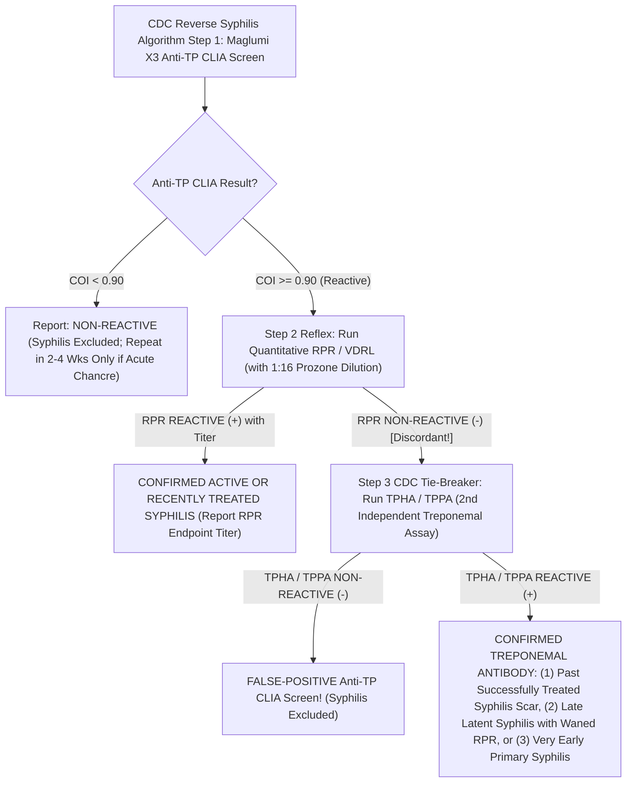

# 4.2.10 — Treponema pallidum Specific Antibody (Anti-TP Maglumi X3 CLIA & TPHA — Traditional vs CDC Reverse Syphilis Algorithm)

**Department Folder:** `04_Serology_Infectious_Diseases_and_Immunology`  
**Cluster Folder:** `4.2_Viral_Markers_HIV_Hepatitis_Syphilis_TORCH_and_EBV_Cluster`  
**Document ID:** `SOP-SER-4.2.10-TPHA-ANTITP` | **Version:** `4.0 (ISO 15189:2022 / NABL 112 / CDC-WHO-IUSTI Reverse Algorithm)`

---

## 1. Document Control, Standardized Coding & Hardware-Agnostic Platform Matrix

| Coding System / Attribute | Identifier / Code | Official Nomenclature & Scope |
| :--- | :--- | :--- |
| **LOINC** | `24312-1` (`Anti-TP CLIA`) / `8041-6` (`TPHA`) / `24110-9` (`TPPA`) | *Treponema pallidum* specific Ab [$\text{IgM + IgG}$] in Serum by Immunoassay (`CLIA`) and Hemagglutination (`TPHA / TPPA`) |
| **SNOMED-CT** | `165828006` / `269864002` / `76272004` | *Treponema pallidum* hemagglutination assay (`TPHA`) & specific treponemal chemiluminescence immunoassay |
| **ICD-10-CM** | `A51.0`–`A53.9` (Syphilis) / `Z86.19` (Past treated syphilis scar) | Syphilis (all stages) & personal history of cured treponemal infection |
| **UCUM Units** | `COI` / `S/CO` (`Maglumi Anti-TP`) / `[titer]` (`1:80` to `1:5120` `TPHA`) | Chemiluminescence Cutoff Index or Reciprocal Hemagglutination Titer |
| **Algorithmic Role** | **Confirmatory (Traditional) OR Primary Screen (CDC Reverse Algorithm)** | Detects specific antibodies against **`TpN15` ($15\text{ kDa}$), `TpN17` ($17\text{ kDa}$), and `TpN47` ($47\text{ kDa}$)** recombinant *T. pallidum* lipoprotein antigens |

### Hardware-Agnostic Analytical Platform Matrix
| Assay Modality | Antigen Targets | Methodological Principle | Algorithmic Role (Traditional vs Reverse) |
| :--- | :--- | :--- | :--- |
| **Snibe MAGLUMI X3 / X8 `Anti-TP` (`Syphilis`) CLIA** | Recombinant **`TpN15 + TpN17 + TpN47`** *T. pallidum* antigens | Double-Antigen Sandwich Flash Chemiluminescence (detects both specific **$\text{IgM}$ and $\text{IgG}$**) | **Automated Primary Screen in CDC Reverse Algorithm** (or high-throughput confirmatory assay); earliest seroconversion ($2\text{–}3\text{ wks}$ post-exposure) |
| **`TPHA` / `TPPA` Microtiter Assay** | *Treponema pallidum* (Nichols strain) sonicated antigen on avian erythrocytes (`TPHA`) or gelatin particles (`TPPA`) | Indirect Hemagglutination / Particle Agglutination in U-bottom microtiter wells (Screen cutoff **$\ge 1:80$**) | **Confirmatory Gold-Standard Tie-Breaker** for discordant `Anti-TP CLIA (+) / RPR (-)` specimens per CDC guidelines! |
| **Rapid Syphilis `Anti-TP` ICT** | Recombinant `TpN15/17/47` strip | Lateral-Flow Immunochromatography | Point-of-care screening; **remains positive for life after cure**! |

---

## 2. Pre-Analytical Phlebotomy, Early Seroconversion Window, Stability & HIL Rejection Matrix

### Kinetics of Specific Treponemal Antibodies & The Lifelong Persistence Rule
1. **Earliest Serological Marker in Primary Syphilis:** Specific anti-`TpN47/15/17` $\text{IgM}$ and $\text{IgG}$ antibodies detected by **Maglumi X3 `Anti-TP` CLIA** appear **$1\text{ to }3\text{ weeks}$ after exposure** (often $5\text{ to }10\text{ days}$ **BEFORE** `VDRL/RPR` turns positive!).
2. **Lifelong Persistence After Cure ("Treponemal Scar" — Top Medico-Legal Rule):**
   - Once a patient develops specific treponemal antibodies (`TPHA`, `TPPA`, `Anti-TP CLIA`, or `Rapid Syphilis Card`), **$85\%\text{ to }95\%$ of patients remain `TPHA / Anti-TP` POSITIVE FOR THE REST OF THEIR LIVES**, even after 100% successful Penicillin cure!
   - **Critical Rule:** **NEVER use `TPHA`, `Anti-TP CLIA`, or a Rapid Syphilis Card to monitor treatment response, verify cure, or diagnose re-infection**—always use quantitative **`VDRL / RPR` (`SOP 4.2.9`)**!

### Specimen Stability & Quantitative HIL Rejection Matrix
| Storage Condition | Maximum Stability | Interference Factor | Quantitative Rejection Threshold & Corrective Action |
| :--- | :--- | :--- | :--- |
| **Ambient ($20\text{–}25^\circ\text{C}$)** | $\le 24\text{ hours}$ | **Fibrin Clots (`Maglumi CLIA`)** | Recentrifuge at $10,000 \times g$ for $10\text{ min}$ before duplicate re-testing of any low-COI ($0.90\text{–}5.0$) specimen. |
| **Refrigerated ($2\text{–}8^\circ\text{C}$)** | **Up to $7\text{ days}$** | **Heterophile Anti-Fowl RBC Antibodies (`TPHA`)** | **Mandatory Unsensitized Control Cell Well (`1:20` / `1:40`):** Every `TPHA` test MUST include an Unsensitized Control Cell well alongside the Sensitized Test Cell well (`1:80`). If Control Cells agglutinate, absorb serum with unsensitized cells and re-test! |
| **Frozen ($-20^\circ\text{C}$)** | $6\text{ months}$ | **Hemolysis ($H$) / Lipemia ($L$)** | Maglumi CLIA unaffected up to $\text{Hb } 500\text{ mg/dL}$ and $\text{TG } 1,000\text{ mg/dL}$; reject gross hemolysis/lipemia for microtiter `TPHA`. |

---

## 3. Hardware-Agnostic Analytical SOP: Traditional vs CDC Reverse Syphilis Algorithm



1. **MAGLUMI X3 `Anti-TP` CLIA Cutoff Index (`COI`):**
   - **Non-Reactive:** $\text{COI} < 0.90\text{ AU/mL}$.
   - **Equivocal / Grey-Zone:** **$\text{COI } 0.90\text{ to }1.10$** $\rightarrow$ Centrifuge at $10,000 \times g$ and re-test in duplicate + run `RPR` and `TPHA`.
   - **Reactive:** $\text{COI} > 1.10$.
2. **`TPHA` Microtiter Plate SOP (`1:80` Qualitative Screen & `1:80` to `1:5120` Titration):**
   - Dilute patient serum $1:20$ in absorbing diluent. Transfer $25\text{ }\mu\text{L}$ into Well A (add $75\text{ }\mu\text{L}$ **Unsensitized Control Cells** $\rightarrow$ final $1:80$) and $25\text{ }\mu\text{L}$ into Well B (add $75\text{ }\mu\text{L}$ ***T. pallidum*-Sensitized Test Cells** $\rightarrow$ final $1:80$).
   - Mix on plate shaker $30\text{s}$, incubate vibration-free at $20\text{–}25^\circ\text{C}$ for **$45\text{–}60\text{ minutes}$**.
   - **Reading:** Compact central button with smooth edges = **Non-Reactive**; smooth mat/carpet covering bottom of well ($2+\text{ to }4+$) = **Reactive ($\ge 1:80$)** (provided Control Cell well shows a tight negative button!).

---

## 4. Analytical Precision, Diagnostic Sensitivity/Specificity, Window Period & MRI

| Assay Modality | Within-Run $\text{CV}_A\%$ | Sensitivity (Primary) | Sensitivity (Secondary & Latent) | Clinical Specificity | Persistence Duration | Minimum Retesting Interval (MRI) |
| :--- | :--- | :--- | :--- | :--- | :--- | :--- |
| **`Maglumi X3 Anti-TP CLIA`** | $2.6\%\text{–}4.4\%$ | **$92.0\%\text{ – }98.0\%$** | **$99.8\%\text{ – }100.0\%$** | $99.3\%\text{ – }99.8\%$ | **Lifelong ($85\%\text{–}95\%$)** | **NEVER repeat `Anti-TP` or `TPHA` once confirmed positive!** (Use `RPR/VDRL` for follow-up). |
| **`TPHA / TPPA` ($\ge 1:80$)** | $\pm 1\text{ Well}$ | $86.0\%\text{ – }95.0\%$ | **$99.5\%\text{ – }100.0\%$** | **$99.5\%\text{ – }99.9\%$** | **Lifelong ($85\%\text{–}95\%$)** | Do not repeat once positive |

---

## 5. Multi-Stratified Reference Intervals & Complete 4-Pattern Syphilis Diagnostic Matrix

| Pattern | `Anti-TP CLIA` (Treponemal 1) | `VDRL / RPR` (Non-Treponemal) | `TPHA / TPPA` (Treponemal 2) | Definitive Clinical Diagnosis & Recommended Management |
| :--- | :--- | :--- | :--- | :--- |
| **Pattern 1** | **Non-Reactive (-)** | **Non-Reactive (-)** | Not Required | **No Serological Evidence of Syphilis.** *(If acute chancre $<2\text{–}3\text{ wks}$, repeat in $2\text{ wks}$).* |
| **Pattern 2** | **Non-Reactive (-)** | **Reactive (+)** *(Usually $\le 1:4\text{–}1:8$)* | **Non-Reactive (-)** | **Biological False-Positive (`BFP`) `VDRL/RPR`!** Syphilis excluded (common in pregnancy, malaria, dengue, SLE/APS). |
| **Pattern 3** | **Reactive (+)** | **Reactive (+)** *(With Titer)* | **Reactive (+)** | **Confirmed Active, Untreated, or Recently Treated Syphilis.** Treat per stage with Benzathine Penicillin G and monitor `RPR/VDRL` titer at $6\text{ & }12\text{ months}$. |
| **Pattern 4A** | **Reactive (+)** | **Non-Reactive (-)** *(at $1:1$ & $1:16$)* | **Reactive (+)** | **Confirmed Treponemal Antibody with Negative Reagin:**<br>1. **Past Successfully Treated Syphilis ("Serofast Treponemal Scar")** — *no treatment needed if documented cure!*<br>2. **Late Latent Syphilis** (where `VDRL/RPR` has waned over years — treat with $3\times 2.4\text{ MU}$ weekly Benzathine Penicillin G if never treated!), OR<br>3. **Very Early Primary Syphilis** (where `Anti-TP` turned positive days before `RPR`). |
| **Pattern 4B** | **Reactive (+)** *(Low COI $1.0\text{–}3.0$)* | **Non-Reactive (-)** | **Non-Reactive (-)** | **Isolated False-Positive `Anti-TP CLIA` Screen!** Syphilis excluded (no treatment required). |

---

## 6. NABL & CLSI GP47 Critical ("Panic") Alerts & Antenatal / Neurosyphilis Escalation

- **Antenatal Syphilis Discordance (`Anti-TP [+] / RPR [-] / TPHA [+]` in Pregnancy):**
  - If a pregnant woman presents with **confirmed Treponemal positivity (`Anti-TP CLIA +` and `TPHA +`) and negative `RPR`** and has **NO documented record of prior adequate Penicillin treatment**, CDC and WHO guidelines mandate treating her for **Late Latent Syphilis** to protect the fetus!
- **Congenital Syphilis Caveat for Infants ($< 15\text{–}18\text{ Months}$):**
  - Maternal treponemal $\text{IgG}$ (`TPHA / Anti-TP`) crosses the placenta passively and persists in the healthy newborn for **$12\text{ to }15\text{ months}$**! Therefore, a positive `TPHA` or `Anti-TP CLIA` in an infant does **NOT** diagnose Congenital Syphilis—compare quantitative **Infant vs Maternal `RPR/VDRL` titers** (infant titer $\ge 4\text{-fold}$ maternal titer is diagnostic!).

---

## 7. Kinetic Persistence Profile & Smart LIMS Reflex Cascades

- **Why Quantitative `TPHA` Titers ($1:80\text{ to }1:5120$) Do NOT Track Cure:**
  - Clinicians occasionally order serial `TPHA` dilutions expecting the titer to fall after Penicillin therapy. Even when `TPHA` is titrated ($1:80, 1:160, 1:320, 1:640, 1:1280$), titers remain high for years/decades after complete microbiological cure. Always redirect clinicians to **Quantitative `VDRL / RPR` (`SOP 4.2.9`)** for post-treatment follow-up!

---

## 8. Analytical Cross-Reactivity & ISO 22367 Risk FMEA

1. **Endemic Non-Venereal Treponematoses (100% Cross-Reactive):** *Treponema pallidum* subsp. *pertenue* (**Yaws**), subsp. *endemicum* (**Bejel**), and *Treponema carateum* (**Pinta**) are antigenically identical to venereal Syphilis on all treponemal and non-treponemal tests.
2. **Spirochetal & Autoimmune False-Positive Low-COI `Anti-TP`:** Lyme disease (*Borrelia burgdorferi*), Relapsing Fever (*Borrelia*), Leptospirosis, periodontal *Treponema denticola*, SLE, and pregnancy can rarely cause low-COI ($1.0\text{–}3.0$) false-positive `Anti-TP CLIA` results (resolved by negative `RPR` + negative `TPHA/TPPA` tie-breaker).

| Failure Mode (ISO 22367) | Root Cause | Clinical & Medico-Legal Risk | Mandatory Mitigation Control |
| :--- | :--- | :--- | :--- |
| **Previously Cured Patient Repeatedly Injected with Penicillin Because `TPHA / Rapid Syphilis Card` Is Still Positive** | Failure to understand that `TPHA / Anti-TP` stays positive for life after cure! | Unnecessary painful IM Benzathine Penicillin injections; marital/social stigma; visa rejection! | Hardcode the **Lifelong `TPHA / Anti-TP` Persistence ("Serological Scar") Shield** in bold in Section 9 & Section 10 |
| **Low-COI `Anti-TP CLIA (+)` Reported Without `RPR` & `TPHA` Reflex** | Skipping Steps 2 & 3 of CDC Reverse Algorithm | Biological false-positive CLIA misdiagnosed as Syphilis | Enforce full 3-step CDC Reverse Algorithm matrix in LIMS |

---

## 9. Conditional Band-Specific Pathologist Sign-Out Library

- **`[BAND-NON-REACTIVE]`:** *"Specific Treponema pallidum Antibody (Anti-TP CLIA / TPHA) is NON-REACTIVE. Absence of specific treponemal antibodies excludes past or present Syphilis (except during the earliest 1–3 week incubation window prior to seroconversion). Note: If VDRL/RPR was reactive on this specimen, a non-reactive TPHA/Anti-TP confirms that the VDRL/RPR was a Biological False-Positive (BFP) reaction!"*
- **`[BAND-DISCORDANT-ANTITP-POS-RPR-NEG-TPHA-NEG]`:** *"Discordant Reverse Algorithm Profile: Anti-TP CLIA is low-reactive (COI 1.0–3.0) with NON-REACTIVE VDRL/RPR and NON-REACTIVE confirmatory TPHA/TPPA. Per CDC Reverse Algorithm guidelines, this represents an isolated False-Positive CLIA screening reaction. Syphilis is excluded."*
- **`[BAND-REACTIVE-RPR-NEG-TPHA-POS]`:** *"Specific Treponemal Antibody (Anti-TP CLIA & TPHA) is REACTIVE with a NON-REACTIVE VDRL/RPR (verified at 1:16 prozone dilution). CRITICAL CLINICAL NOTE: Because specific treponemal antibodies (TPHA/Anti-TP) remain positive FOR LIFE in 85–95% of individuals after successful treatment, this profile represents: (1) Past Successfully Treated Syphilis ('serological scar' — no retreatment needed if prior treatment is documented), (2) Untreated Late Latent Syphilis with waned VDRL/RPR, or (3) Very Early Primary Syphilis."*
- **`[BAND-REACTIVE-BOTH-POS]`:** *"Both Specific Treponemal Antibody (Anti-TP CLIA / TPHA) and Non-Treponemal VDRL/RPR (Titer: [1:X]) are REACTIVE, confirming Active, Untreated, or Recently Treated Syphilis. Monitor treatment response using serial quantitative VDRL/RPR titers at 6 and 12 months (do NOT use TPHA/Anti-TP to monitor cure)."*

---

## 10. Master LIMS Copy-Paste Report Block (Physician + Patient Summary + CDC Reverse Algorithm & Lifelong Scar Shield)

```text
================================================================================
   SPECIFIC TREPONEMAL ANTIBODY (TPHA / ANTI-TP CLIA) — MEDICO-LEGAL SHIELD
================================================================================
1. CLINICAL PRINCIPLE & THE LIFELONG PERSISTENCE ("SEROLOGICAL SCAR") RULE:
   • TPHA and Anti-TP CLIA detect antibodies specifically directed against 
     Treponema pallidum proteins (TpN15, TpN17, TpN47).
   • CRITICAL LIFELONG PERSISTENCE SHIELD: Once a person has been infected with 
     Syphilis, TPHA and Anti-TP CLIA remain REACTIVE FOR LIFE in 85% to 95% of 
     patients—even after 100% complete cure with Penicillin!
   • Therefore, a positive TPHA / Anti-TP (or Rapid Syphilis Card) CANNOT 
     distinguish between current active infection and a completely cured past 
     infection, and MUST NEVER be used to monitor treatment response! Always 
     check the companion Quantitative VDRL / RPR titer to assess active disease.

2. INTEGRATED CDC / WHO SYPHILIS DIAGNOSTIC MATRIX:
   • TPHA/Anti-TP (-) AND VDRL/RPR (-): Syphilis excluded (unless <2-3 wk exposure).
   • TPHA/Anti-TP (-) AND VDRL/RPR (+): BIOLOGICAL FALSE-POSITIVE VDRL/RPR! 
     Syphilis is EXCLUDED (common in normal pregnancy, malaria, dengue, SLE).
   • TPHA/Anti-TP (+) AND VDRL/RPR (+ with Titer): CONFIRMED ACTIVE OR RECENTLY 
     TREATED SYPHILIS. Track 4-fold VDRL/RPR titer decline at 6 & 12 months.
   • TPHA/Anti-TP (+) AND VDRL/RPR (-): Indicates (a) Past Cured Syphilis 
     ("serological scar"), (b) Late Latent Syphilis where VDRL/RPR has waned, 
     or (c) Very Early Primary Syphilis (or false-positive CLIA if TPHA is 
     negative).
   • Infants <15 Months: Maternal IgG crosses the placenta; positive infant 
     TPHA/Anti-TP reflects maternal antibody. Not valid for medico-legal use.
================================================================================
```
