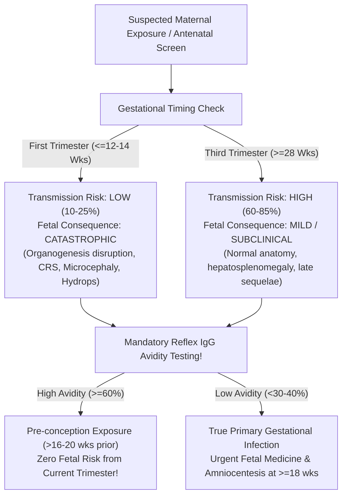
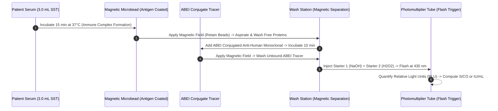

# 4.2.11 — TORCH 8- & 10-Parameter Maternal & Congenital Infection Master Panel: Perinatal Pathophysiology, Flash-CLIA Architecture, IgG Avidity Cascade, and Medico-Legal Shield

**Sawariya Diagnostic Lab, Charkhi Dadri, Haryana**  
*Department of Serology, Infectious Diseases and Immunology*  
*Cluster: 4.2 Viral Markers, HIV, Hepatitis, Syphilis, TORCH, and EBV Cluster*  
**Document ID:** `SDL-SER-PANEL-4.2.11` | **Version:** `3.0` | **Effective Date:** `2026-10-16`  
**Review Cycle:** Annual | **Regulatory Standards:** `ISO 15189:2022` (Clauses 4.1–8.9 & Annex A), `NABL 112`, `NABL 129`, `NABL 131`, `NABL 163`, `CLSI I/LA20`, `CLSI EP12-A2`, `CLSI EP15-A3`, `CLSI EP28-A3c`, `CLSI GP47`, `ACOG PB 151/236`, `RCOG Green-top 43`, `FOGSI Guidelines`, `ISUOG Consensus`

---

## 1. Document Control, Panel Scope & Architecture

### 1.1 Scope of Testing & Hardware Configuration
This Standard Operating Procedure governs the complete diagnostic workflow, analytical execution, metrological verification, and clinical reporting for the **TORCH Maternal-Fetal Infection Master Panels** at Sawariya Diagnostic Lab (Charkhi Dadri, Haryana). Testing is performed on the automated high-throughput **Snibe MAGLUMI X3 Flash-Chemiluminescence Immunoassay (Flash-CLIA)** platform utilizing superparamagnetic microparticle separation and ABEI (N-(4-aminobutyl)-N-ethylisoluminol) chemical flash labeling.

The laboratory offers two tiered panel configurations anchored to clinical presentation:
1. **TORCH 8-Parameter Master Panel:** *Toxoplasma gondii* IgM & IgG, Rubella Virus IgM & IgG, Cytomegalovirus (CMV) IgM & IgG, Herpes Simplex Virus 1/2 Combined (HSV-1/2) IgM & IgG.
2. **TORCH 10-Parameter Expanded Type-Specific Panel:** *Toxoplasma gondii* IgM & IgG, Rubella Virus IgM & IgG, Cytomegalovirus (CMV) IgM & IgG, HSV-1 Specific Glycoprotein G-1 (gG-1) IgG, HSV-2 Specific Glycoprotein G-2 (gG-2) IgG, and HSV-1/2 Combined IgM.
3. **Mandatory Second-Tier Reflex Menu:** *Toxoplasma gondii* IgG Avidity Index (%) and Cytomegalovirus (CMV) IgG Avidity Index (%) triggered on all reactive maternal IgM specimens.

### 1.2 Standardized Coding & International Nomenclature Matrix
| Parameter / Analyte Code | LOINC Code | SNOMED CT | ICD-10-CM / ICD-11 | International Reference Standard Traceability (`ISO 17511:2020`) |
| :--- | :--- | :--- | :--- | :--- |
| **TORCH 8-Parameter Master Panel** | `24363-4` | `395125008` | `Z36.89` / `QA43` | Multiplex Panel Specification; constituent analytes trace to WHO standards |
| **TORCH 10-Parameter Expanded Panel** | `5388-4` | `312969004` | `O98.9` / `1D01` | Multiplex Panel Specification with Type-Specific HSV-1/2 differentiation |
| ***Toxoplasma gondii* IgM** | `22580-5` | `121987000` | `O98.6` (Maternal) / `P37.1` (Congenital) | Cutoff calibration against internal primary recombinant SAG1/GRA1 master standards |
| ***Toxoplasma gondii* IgG** | `8039-0` | `121986009` | `O98.6` / `P37.1` | **WHO 3rd International Standard for Anti-Toxoplasma Serum (`TOXM`, NIBSC 01/600)** |
| ***Toxoplasma* IgG Avidity Index** | `41517-4` | `414774006` | `O98.6` / `KA63` | Chaotropic urea dissociation relative to reference native wash buffer (%) |
| **Rubella Virus IgM** | `8014-3` | `121993006` | `O98.5` (Maternal) / `P35.0` (Congenital) | WHO 1st Reference Reagent for Anti-Rubella IgM (`RUBI-1-94`, NIBSC) |
| **Rubella Virus IgG** | `8013-5` | `121992001` | `O98.5` / `P35.0` | **WHO 1st International Standard for Anti-Rubella IgG (`RUBI-1-94`, 10 IU/mL Cutoff)** |
| **Rubella IgG Avidity Index** | `51648-4` | `414775007` | `O98.5` / `KA62` | Chaotropic urea dissociation relative to reference native wash buffer (%) |
| **Cytomegalovirus (CMV) IgM** | `8012-7` | `121989002` | `O98.5` (Maternal) / `P35.1` (Congenital) | Calibrated against WHO-standardized primary reference materials |
| **Cytomegalovirus (CMV) IgG** | `8011-9` | `121988005` | `O98.5` / `P35.1` | **WHO 1st International Standard for Anti-Cytomegalovirus IgG (`NIBSC 16/134`)** |
| **Cytomegalovirus IgG Avidity** | `40679-3` | `414776008` | `O98.5` / `KA61` | Chaotropic urea dissociation relative to reference native wash buffer (%) |
| **HSV-1/2 Combined IgM** | `26927-4` | `122003004` | `O98.5` (Maternal) / `P35.2` (Congenital) | Calibrated against manufacturer internal reference consensus panel |
| **HSV-1 Specific IgG (gG-1)** | `51915-7` | `278972007` | `A60.0` / `1F00.0` | Recombinant Glycoprotein G-1 (gG-1) affinity-purified calibrators |
| **HSV-2 Specific IgG (gG-2)** | `51916-5` | `278973002` | `A60.0` / `1F00.1` | Recombinant Glycoprotein G-2 (gG-2) affinity-purified calibrators |

### 1.3 Specimen Collection, Phlebotomy Protocol & Pre-Analytical Safeguards
- **Specimen Type & Collection Tube:** Venous whole blood ($4.0\text{–}5.0\text{ mL}$) collected via sterile venipuncture into a **BD Vacutainer SST II Advance** (Gold-top tube with micronized silica clot activator and inert polyester polymer gel separator) or a Plain Silicone-Coated Red-top tube.
- **Minimum Analytical Serum Volume:** A minimum serum aliquot of **$1.5\text{ mL}$** is required to perform the complete 8- or 10-parameter multiplex panel and retain sufficient dead-volume for mandatory automated reflex avidity testing and duplicate gray-zone repeats without requesting patient re-phlebotomy.
- **Clotting & Centrifugation Protocol:** Blood must be allowed to clot completely in an upright rack for $30\text{ to }60\text{ minutes}$ at ambient temperature ($20\text{–}25^\circ\text{C}$). Incomplete clotting results in latent fibrin formation inside analyzer pipetting probes. Centrifuge at **$2,000 \times g$ for $15\text{ minutes}$** in a temperature-controlled swinging-bucket centrifuge at $20\text{–}22^\circ\text{C}$.
- **Primary Aliquot Bio-Archiving:** An archival serum aliquot of **$500\ \mu\text{L}$** is separated and preserved at **$-20^\circ\text{C}$ to $-80^\circ\text{C}$ for a minimum of 12 months** for every pregnant patient. This bio-archive enables parallel paired-testing if seroconversion or clinical ambiguity emerges later in the second or third trimester.
- **Mandatory Pre-Analytical Data Entry:** Accessioning staff must strictly record the patient's **Gestational Age (completed weeks + days)** confirmed by Last Menstrual Period (LMP) or first-trimester dating ultrasound, alongside obstetric history (gravidity, parity, prior fetal losses), prior rubella vaccination records, and current clinical symptoms.

### 1.4 Cold-Chain Logistics Across Southern Haryana Peripheral Collection Centers
Sawariya Diagnostic Lab receives antenatal specimens from rural satellite phlebotomy centers across Charkhi Dadri, Bhiwani, Mahendragarh, and Rewari districts:
- **Temperature-Regulated Cold Chain:** Specimens must be transported in validated triple-layer insulated transport containers maintained at **$2^\circ\text{C to }8^\circ\text{C}$** utilizing conditioned phase-change gel packs.
- **Digital Temperature Datalogging:** Every courier transport container carries an internal digital data logger (LogTag TRIX-8) recording continuous temperatures at 5-minute intervals. Transport logs exceeding $8.0^\circ\text{C}$ for $> 30\text{ minutes}$ trigger immediate specimen hold, pre-analytical non-conformance logging, and repeat collection request.
- **Time-to-Centrifugation Limits:** Uncentrifuged whole blood must reach the central laboratory within **$\le 4\text{ hours}$** of phlebotomy. Alternatively, satellite collection centers must centrifuge primary SST tubes locally before refrigerated transport.

---

## 2. Perinatal Pathophysiology, Gestational Dynamics & The Indian Seroprevalence Shield

### 2.1 The Transmission Paradox: Gestational Age vs Teratogenic Severity
Congenital transmission of perinatal pathogens occurs via two distinct anatomical pathways:
- **Transplacental Hematogenous Seeding:** Operative for *Toxoplasma gondii*, Rubella, and CMV. Maternal parasitemia or viremia infects syncytiotrophoblasts, crosses the villous stroma, and enters the fetal umbilical venous circulation.
- **Intrapartum Ascending / Natal Inoculation:** Operative for HSV-1 and HSV-2. In $> 95\%$ of neonatal herpes cases, infection is acquired during passage through an infected birth canal via micro-abrasions in fetal scalp or mucosal contact with shedded virus, rather than transplacental passage.



The fundamental biological law of congenital infections is the **Inverse Gestational Paradox**:
1. **Early Gestation ($< 12\text{–}14\text{ weeks}$):** The placental syncytiotrophoblast barrier is anatomically thick and immunologically competent, resulting in a **low maternal-to-fetal transmission rate ($10\%\text{–}25\%$)**. However, if transmission breaches this barrier during embryonic organogenesis, the teratogenic insult is catastrophic, producing classical triad syndromes, severe microcephaly, extensive intracranial calcifications, chorioretinitis, cardiac malformations, sensorineural deafness, or spontaneous abortion.
2. **Late Gestation ($> 28\text{–}32\text{ weeks}$):** The placenta is thin, vascularized, and possesses expansive surface area, resulting in a **high transmission rate ($60\%\text{–}85\%$)**. However, because organogenesis is complete and fetal immunocompetence has developed, $> 85\%$ of infected neonates are structurally asymptomatic at birth (though remaining at risk for delayed sensorineural hearing loss or chorioretinitis if untreated).

### 2.2 Pathogen-Specific Cellular & Molecular Mechanisms of Teratogenesis
| Pathogen Class | Molecular / Cellular Target | Placental Pathophysiology | Embryonic & Fetal Pathology |
| :--- | :--- | :--- | :--- |
| ***Toxoplasma gondii*** | Rapidly replicating tachyzoites invade placental syncytiotrophoblasts; bradyzoite cyst rupture | Focal necrotizing placentitis; intervillositis; tachyzoite migration into fetal capillary endothelium | Classical Sabin Triad: (1) Bilateral chorioretinitis, (2) Hydrocephalus / aqueductal stenosis, (3) Diffuse parenchymal intracranial calcifications; microphthalmia |
| **Rubella Virus** | Togaviridae ssRNA(+); binds host cell surface receptors; non-lytic mitotic arrest | Cytotrophoblast damage; endothelial vasculitis; obliterative endarteritis of terminal chorionic villi | Classical Gregg Triad (CRS): (1) Sensorineural hearing loss (80%), (2) Congenital cataracts / microphthalmia, (3) Cardiac defects (Patent Ductus Arteriosus, peripheral pulmonary artery stenosis) |
| **Cytomegalovirus (CMV)** | $\beta$-herpesvirus; tropism for primary placental endothelial cells & cytotrophoblasts | Placental hypertrophy; down-regulation of extravillous trophoblast invasion; chronic intervillositis | Neurotropism: Periventricular subependymal germinal matrix destruction, periventricular calcifications, microcephaly, lissencephaly, ventriculomegaly, sensorineural deafness |
| **Herpes Simplex (HSV-1/2)** | Enveloped dsDNA; envelope glycoprotein gD binds nectin-1; latency in dorsal sacral ganglia | Ascending transcervical chorioamnionitis (rare) or direct intrapartum birth canal inoculation | Triad of Neonatal Manifestations: (1) SEM (Skin, Eye, Mouth vesicles), (2) CNS Encephalitis (temporal lobe seizure/destruction), (3) Disseminated Multi-Organ Failure / DIC |

### 2.3 The India Endemic Seroprevalence Trap
In the Indian subcontinent, and specifically within the rural and peri-urban demographics of southern Haryana (Charkhi Dadri, Bhiwani, Mahendragarh, Rewari), environmental and childhood exposure dynamics produce profound serological skewing that differs drastically from Western cohorts:
- **Cytomegalovirus (CMV) IgG Seroprevalence:** Exceeds **$85\%\text{–}95\%$** in adult females of childbearing age due to early horizontal transmission through breast milk, childcare environments, and crowded living conditions.
- **Rubella Virus IgG Seroprevalence:** Ranges between **$75\%\text{–}88\%$** through adolescent natural infection and recent nationwide Measles-Rubella (MR) immunization campaigns.
- **Toxoplasma gondii IgG Seroprevalence:** Ranges between **$20\%\text{–}42\%$** secondary to agrarian soil exposure, unwashed vegetable consumption, and feral cat populations.
- **HSV-1 IgG Seroprevalence:** Exceeds **$70\%\text{–}80\%$** by adulthood via non-genital childhood oral contact.

> [!IMPORTANT]
> **THE SEROPREVALENCE TRAP IN BAD OBSTETRIC HISTORY (BOH):**  
> Clinicians frequently order TORCH panels during workups for recurrent pregnancy loss (habitual abortion). Finding a **Reactive TORCH IgG** reflects **pre-existing protective immunity acquired years prior to conception**. It is an established consensus across ACOG, RCOG, ESHRE, and FOGSI that **chronic maternal TORCH IgG positivity DOES NOT cause recurrent pregnancy loss**. Treating IgG-positive mothers with spiramycin, acyclovir, or recommending termination of pregnancy constitutes malpractice and profound scientific misinterpretation.

### 2.4 The False-Positive IgM Nightmare & Polyclonal B-Cell Activation
In pregnant women, the immunological milieu is characterized by physiologic immunomodulation, placental cytokine release, and heightened polyclonal B-cell activation. Consequently, routine serological screening of asymptomatic pregnant cohorts reveals an alarming rate of **false-positive TORCH IgM reactivity ($2.5\%\text{–}6.8\%$)** caused by:
1. **Rheumatoid Factor (RF) Heterophilic Bridging:** Endogenous maternal IgM-class anti-IgG autoantibodies bind to patient pathogen-specific IgG, cross-linking tracer conjugate and yielding false-positive IgM results.
2. **Cross-Reactive Viral Responses:** Primary Epstein-Barr Virus (EBV), Parvovirus B19, or Hepatitis A infection stimulates heterotypic IgM antibodies that cross-react on CMV, Rubella, and HSV recombinant bead assays.
3. **Prolonged Natural IgM Persistence:** Unlike influenza or enteroviruses where IgM disappears within weeks, *Toxoplasma gondii* IgM naturally persists for **$9\text{ to }24\text{ months}$**, and CMV IgM persists for **$4\text{ to }12\text{ months}$** after resolution of acute infection. Therefore, an IgM detected in the 1st trimester frequently stems from a benign infection contracted months before conception!

### 2.5 The Sawariya Diagnostic Lab Protective Shield: Mandatory Reflex IgG Avidity
To prevent unnecessary maternal panic and eradicate the tragic practice of unwarranted Medical Termination of Pregnancy (MTP) for wanted fetuses, Sawariya Diagnostic Lab enforces a strict **Avidity Shield Protocol**:
- **Urea Chaotropic Dissociation Chemistry:** Antigen-antibody binding in early primary infection is characterized by low structural complementarity and weak non-covalent forces (van der Waals, hydrogen bonding). Over $16\text{ to }20\text{ weeks}$, somatic hypermutation and affinity maturation in germinal centers transform antibodies into high-avidity molecules resistant to chemical dissociation.
- The assay incubates duplicate patient serum aliquots against magnetic microbeads: Tube A receives standard physiologic wash buffer; Tube B receives a chaotropic wash containing **$6\text{M to }8\text{M Urea}$**, which denatures hydrogen bonds and strips away low-avidity IgG.
$$\text{IgG Avidity Index (\%)} = \left[ \frac{\text{Chemiluminescent Signal (RLU) with 6M Urea Wash}}{\text{Chemiluminescent Signal (RLU) with Standard Wash}} \right] \times 100$$
- **High Avidity ($\ge 60\%$):** Conclusively proves that IgG antibodies were generated **at least 16 to 20 weeks prior to phlebotomy**. When detected during the first trimester ($\le 12\text{–}14\text{ weeks}$), high avidity **completely excludes primary gestational infection during organogenesis**, confirming that the co-existing IgM is harmless chronic residual or non-specific reactivity!

---

## 3. Analytical Architecture: Multiplex Flash-CLIA Platform

### 3.1 Platform Specifications & Superparamagnetic Bead Principles
The Snibe MAGLUMI X3 analyzer utilizes micro-machined magnetic separation technology. Reagent kits contain micron-scale ferric oxide superparamagnetic microbeads coated with highly purified recombinant or synthetic peptide antigens. Chemiluminescent emission is generated via the direct conjugation of **ABEI (N-(4-aminobutyl)-N-ethylisoluminol)** to secondary monoclonal antibodies or antigens.



### 3.2 Flash Chemical Trigger Kinetics & Optical Measurement
The Maglumi X3 chemiluminescent reaction is characterized by rapid "flash" photon release rather than prolonged "glow" kinetics:
- **Starter 1 (Alkaline Reagent):** Concentrated Sodium Hydroxide ($\text{NaOH}$) establishes an alkaline environment ($\text{pH} > 12.0$).
- **Starter 2 (Peroxide Reagent):** Hydrogen Peroxide ($\text{H}_2\text{O}_2$) triggers the catalytic oxidation of ABEI in the presence of microperoxidase/catalyst.
- **Photon Emission:** Cleavage of the phthalhydrazide ring generates an excited aminophthalate intermediate. Upon ground-state relaxation, light is released at a peak wavelength of **$\lambda = 430\text{ nm}$**. The flash emission reaches maximum intensity within $0.2\text{ seconds}$ and decays over $3\text{ seconds}$, quantified by a high-gain Photomultiplier Tube (PMT) operating in photon-counting mode.

### 3.3 Parameter-by-Parameter Analytical Execution Matrix
| Analyte Parameter | Assay Principle / Format | Reagent Antigens / Conjugate Chemistry | Calibration Traceability & Units | Analytical Measurement Range (AMR) | Clinical Cutoff Thresholds |
| :--- | :--- | :--- | :--- | :--- | :--- |
| ***Toxoplasma* IgM** | Indirect $\mu$-Capture Flash-CLIA | Anti-human $\mu$-chain monoclonal on magnetic beads; ABEI-labeled recombinant SAG1, GRA1, GRA7 antigens | WHO 3rd IS `TOXM`; Index ($S/CO$) | $0.10\text{–}30.0\ S/CO$ | Non-Reactive: $< 0.90\ S/CO$<br/>Equivocal: $0.90\text{–}1.10\ S/CO$<br/>Reactive: $> 1.10\ S/CO$ |
| ***Toxoplasma* IgG** | Indirect Quantitative Flash-CLIA | Recombinant SAG1, p30 coated on beads; ABEI-labeled monoclonal anti-human IgG | WHO 3rd IS `TOXM` (`01/600`); $\text{IU/mL}$ | $0.50\text{–}250.0\text{ IU/mL}$ (Auto-dilution $1:10$ up to $2,500$) | Non-Reactive: $< 2.0\text{ IU/mL}$<br/>Equivocal: $2.0\text{–}3.0\text{ IU/mL}$<br/>Reactive: $> 3.0\text{ IU/mL}$ |
| ***Toxo* IgG Avidity** | Dual-Cartridge Urea Chaotropic Dissociation | Recombinant *T. gondii* antigens; parallel native buffer vs $6\text{M}$ urea dissociation wash | Percent Avidity Ratio Index ($\%$) | $5.0\%\text{–}100.0\%$ | Low Avidity: $< 50.0\%$<br/>Borderline: $50.0\%\text{–}59.9\%$<br/>High Avidity: $\ge 60.0\%$ |
| **Rubella IgM** | $\mu$-Capture Flash-CLIA | Anti-human $\mu$-chain coated beads; ABEI-labeled recombinant Rubella E1/E2 structural envelope proteins | WHO 1st IS `RUBI-1-94`; Index ($S/CO$) | $0.10\text{–}20.0\ S/CO$ | Non-Reactive: $< 0.80\ S/CO$<br/>Equivocal: $0.80\text{–}1.00\ S/CO$<br/>Reactive: $> 1.00\ S/CO$ |
| **Rubella IgG** | Indirect Quantitative Flash-CLIA | Native inactivated Rubella viral lysate coated on beads; ABEI-labeled anti-human IgG | WHO 1st IS `RUBI-1-94`; $\text{IU/mL}$ | $1.0\text{–}500.0\text{ IU/mL}$ (Auto-dilution up to $5,000$) | Non-Immune: $< 10.0\text{ IU/mL}$<br/>Equivocal: $10.0\text{–}15.0\text{ IU/mL}$<br/>Immune: $\ge 15.0\text{ IU/mL}$ |
| **Rubella IgG Avidity** | Urea Chaotropic Dissociation | Native Rubella antigen beads; parallel native vs $6\text{M}$ urea wash buffers | Percent Avidity Ratio Index ($\%$) | $5.0\%\text{–}100.0\%$ | Low: $< 40.0\%$ \| Gray: $40.0\%\text{–}59.9\%$ \| High: $\ge 60.0\%$ |
| **CMV IgM** | $\mu$-Capture Flash-CLIA | Anti-human $\mu$-chain coated beads; ABEI-labeled CMV pp150, pp28, pp52, and pp65 recombinant proteins | Internal Master Standard; Index ($S/CO$) | $0.10\text{–}30.0\ S/CO$ | Non-Reactive: $< 0.90\ S/CO$<br/>Equivocal: $0.90\text{–}1.10\ S/CO$<br/>Reactive: $> 1.10\ S/CO$ |
| **CMV IgG** | Indirect Quantitative Flash-CLIA | Purified CMV lysate + pp65/pp150 on beads; ABEI-labeled monoclonal anti-human IgG | WHO 1st IS `NIBSC 16/134`; $\text{AU/mL}$ | $0.20\text{–}180.0\text{ AU/mL}$ (Auto-dilution up to $1,800$) | Non-Reactive: $< 0.50\text{ AU/mL}$<br/>Equivocal: $0.50\text{–}1.00\text{ AU/mL}$<br/>Reactive: $> 1.00\text{ AU/mL}$ |
| **CMV IgG Avidity** | Dual-Cartridge Urea Dissociation | Purified CMV pp65/pp150; parallel native vs $8\text{M}$ urea wash buffer | Percent Avidity Ratio Index ($\%$) | $5.0\%\text{–}100.0\%$ | Low Avidity: $< 50.0\%$<br/>Gray Zone: $50.0\%\text{–}64.9\%$<br/>High Avidity: $\ge 65.0\%$ |
| **HSV-1/2 Combined IgM** | $\mu$-Capture Flash-CLIA | Anti-human $\mu$-chain coated beads; ABEI-labeled recombinant HSV-1 (gD-1) & HSV-2 (gD-2) antigens | Internal Master Calibrators; Index ($S/CO$) | $0.10\text{–}20.0\ S/CO$ | Non-Reactive: $< 0.90\ S/CO$<br/>Equivocal: $0.90\text{–}1.10\ S/CO$<br/>Reactive: $> 1.10\ S/CO$ |
| **HSV-1 Specific IgG (gG-1)** | Indirect Type-Specific Flash-CLIA | Purified recombinant Glycoprotein G-1 (gG-1) on beads; ABEI anti-human IgG | Internal Reference Reagents; Index ($S/CO$) | $0.10\text{–}30.0\ S/CO$ | Non-Reactive: $< 0.90\ S/CO$<br/>Equivocal: $0.90\text{–}1.10\ S/CO$<br/>Reactive: $> 1.10\ S/CO$ |
| **HSV-2 Specific IgG (gG-2)** | Indirect Type-Specific Flash-CLIA | Purified recombinant Glycoprotein G-2 (gG-2) on beads; ABEI anti-human IgG | Internal Reference Reagents; Index ($S/CO$) | $0.10\text{–}30.0\ S/CO$ | Non-Reactive: $< 0.90\ S/CO$<br/>Equivocal: $0.90\text{–}1.10\ S/CO$<br/>Reactive: $> 1.10\ S/CO$ |

### 3.4 Type-Specific Glycoprotein G Differentiation (HSV-1 vs HSV-2) & Cross-Reactivity Mitigation
Older generation serological assays utilized crude whole-virus lysate preparations of HSV-1 or HSV-2. Because HSV-1 and HSV-2 share extensive nucleotide and amino acid homology ($> 80\%$ sequence identity across major structural envelope glycoproteins including gB, gC, and gD), crude lysate assays exhibited catastrophic cross-reactivity ($> 50\%$), rendering serological differentiation impossible:
- **Recombinant Glycoprotein G Architecture:** Sawariya Diagnostic Lab strictly employs recombinant Glycoprotein G-1 (gG-1) for HSV-1 and Glycoprotein G-2 (gG-2) for HSV-2 on the Snibe Maglumi X3 Flash-CLIA. Glycoprotein G is the only structural viral envelope component that induces completely type-specific, non-cross-reactive humoral antibody responses.
- **Why HSV IgM Lacks Type Specificity:** Even with modern recombinant antigens, IgM antibodies against HSV display severe antigenic cross-reactivity between types 1 and 2, as well as with other herpesviruses (VZV, CMV, EBV). Furthermore, HSV IgM emerges during recurrent reactivation episodes in up to $35\%$ of patients. Consequently, **serum HSV IgM cannot differentiate HSV-1 from HSV-2 and cannot reliably distinguish primary from recurrent herpes**. Antenatal HSV risk triage relies strictly on type-specific gG-1/gG-2 IgG and direct genital lesion Real-Time PCR!

---

## 4. Metrological Quality Specifications per CLSI EP12-A2, EP15-A3 & ISO/TS 20914

### 4.1 Verification Protocol & Precision Performance Characteristics
Method verification was conducted at Sawariya Diagnostic Lab following **CLSI EP15-A3** ($5\times 5$ nested factorial protocol across 5 consecutive days, 5 runs per day, run in duplicate; $N=25$) and **CLSI EP12-A2** (qualitative user verification of 20 negative and 20 weak-positive samples around the clinical decision cutoff):

| Analyte Parameter | Verification Level / Concentration | Repeatability ($CV_r\%$) | Within-Laboratory Precision ($CV_{wl}\%$) | Total Allowable Error ($TEa\%$, Ricos/EFLM) | Six-Sigma Metric ($\sigma$) |
| :--- | :--- | :--- | :--- | :--- | :--- |
| ***Toxoplasma* IgM** | Low Positive ($1.50\ S/CO$) | $3.42\%$ | $4.85\%$ | Qualitative ($\ge 98\%$ agreement) | $> 5.2\ \sigma$ |
| ***Toxoplasma* IgG** | Decision Cutoff ($3.0\text{ IU/mL}$) | $2.88\%$ | $4.12\%$ | $18.0\%$ | $5.4\ \sigma$ |
| ***Toxoplasma* IgG** | High Positive ($65.0\text{ IU/mL}$) | $2.14\%$ | $3.45\%$ | $18.0\%$ | $5.8\ \sigma$ |
| ***Toxo* IgG Avidity** | Low Avidity Control ($25.0\%$) | $3.80\%$ | $5.10\%$ | $15.0\%$ | $4.9\ \sigma$ |
| ***Toxo* IgG Avidity** | High Avidity Control ($75.0\%$) | $2.60\%$ | $3.90\%$ | $15.0\%$ | $5.5\ \sigma$ |
| **Rubella IgM** | Low Positive ($1.40\ S/CO$) | $3.55\%$ | $4.92\%$ | Qualitative ($\ge 98\%$ agreement) | $> 5.1\ \sigma$ |
| **Rubella IgG** | Protective Cutoff ($10.0\text{ IU/mL}$) | $3.10\%$ | $4.30\%$ | $16.0\%$ | $5.3\ \sigma$ |
| **Rubella IgG** | Moderate Positive ($45.0\text{ IU/mL}$) | $2.25\%$ | $3.20\%$ | $16.0\%$ | $6.1\ \sigma$ |
| **Rubella IgG Avidity** | High Avidity Control ($70.0\%$) | $2.90\%$ | $4.20\%$ | $15.0\%$ | $5.2\ \sigma$ |
| **CMV IgM** | Low Positive ($1.45\ S/CO$) | $3.68\%$ | $5.22\%$ | Qualitative ($\ge 98\%$ agreement) | $> 5.0\ \sigma$ |
| **CMV IgG** | Decision Cutoff ($1.00\text{ AU/mL}$) | $3.25\%$ | $4.65\%$ | $20.0\%$ | $5.2\ \sigma$ |
| **CMV IgG** | High Positive ($40.0\text{ AU/mL}$) | $2.30\%$ | $3.50\%$ | $20.0\%$ | $5.9\ \sigma$ |
| **CMV IgG Avidity** | High Avidity Control ($80.0\%$) | $2.75\%$ | $3.85\%$ | $15.0\%$ | $5.6\ \sigma$ |
| **HSV-1 IgG (gG-1)** | Clinical Cutoff ($1.10\ S/CO$) | $3.40\%$ | $4.80\%$ | Qualitative ($\ge 98\%$ agreement) | $> 5.1\ \sigma$ |
| **HSV-2 IgG (gG-2)** | Clinical Cutoff ($1.10\ S/CO$) | $3.30\%$ | $4.75\%$ | Qualitative ($\ge 98\%$ agreement) | $> 5.2\ \sigma$ |

### 4.2 Analytical Cross-Reactivity & Endogenous Interference Challenge Matrix
Per **CLSI EP07-Ed3** and **CLSI EP37**, analytical specificity was challenged using cross-reactivity spiked matrices and endogenous interfering compounds:
- **Free Hemoglobin ($H$-Index):** No interference up to $500\text{ mg/dL}$. Grossly hemolyzed specimens ($> 500\text{ mg/dL}$) cause non-specific light quenching; require specimen recollection.
- **Unconjugated & Conjugated Bilirubin ($I$-Index):** No interference up to $25\text{ mg/dL}$ icterus index.
- **Lipemia / Triglycerides ($L$-Index):** No interference up to $1,000\text{ mg/dL}$ intralipid equivalent. Lipemic specimens exceeding $1,000\text{ mg/dL}$ undergo high-speed air-fuge clarification ($14,000 \times g$ for 15 minutes) prior to testing.
- **Endogenous Rheumatoid Factor (RF):** Challenged up to $800\text{ IU/mL}$. The $\mu$-capture design intrinsically isolates human IgM onto the solid phase before tracer addition, neutralizing RF bridging and avoiding false-positive IgM artifacts.
- **Heterophile Antibodies & Cross-Reactive Viral Agents:** Validated with negative cross-reactivity against high-titer sera containing anti-EBV VCA IgM, anti-Parvovirus B19 IgM, anti-VZV IgM, anti-HBsAg, anti-HCV, and Antinuclear Antibodies (ANA titer $1:640$).

### 4.3 Gray-Zone ($0.90\text{–}1.10\ S/CO$) Duplicate Reflex Protocol
Any specimen demonstrating an initial signal in the equivocal/gray-zone range ($0.90\text{–}1.10\ S/CO$ for qualitative indices or $2.0\text{–}3.0\text{ IU/mL}$ for Toxo IgG) triggers an automatic hardware reflex:
1. Centrifuge original specimen primary tube at $4,000 \times g$ for 10 minutes to eliminate micro-clots.
2. Re-test sample in duplicate from the primary tube within the same analytical run.
3. **Harmonized Interpretation Rules:**
   - If both repeat results are $< 0.90\ S/CO$, report as **Non-Reactive**.
   - If both repeat results are $> 1.10\ S/CO$, report as **Reactive**.
   - If one or both repeats remain between $0.90\text{–}1.10\ S/CO$, report as **Equivocal / Indeterminate** with mandatory advisory: *"Serum antibody signal is within the borderline analytical gray zone. Recommend collection of a fresh paired specimen in 14 to 21 days to evaluate for serological titer evolution."*

### 4.4 Measurement Uncertainty ($MU$) Budget per ISO/TS 20914
For quantitative assays (*Toxoplasma* IgG, Rubella IgG, CMV IgG), combined standard uncertainty ($u_c$) is determined using the top-down empirical modeling:
$$u_c = \sqrt{u_{Rw}^2 + u_{bias}^2}$$
Where $u_{Rw}$ represents intermediate precision (within-lab reproducibility CV%) and $u_{bias}$ incorporates calibrator lot-to-lot and reference material uncertainty. Expanded uncertainty is calculated as $U = k \times u_c$ with a coverage factor $k=2$ (95.45% confidence interval):
- ***Toxoplasma* IgG (at $3.0\text{ IU/mL}$ Cutoff):** $u_{Rw} = 4.12\%$, $u_{bias} = 2.40\% \rightarrow u_c = 4.77\% \rightarrow U = 9.54\%$ ($3.00 \pm 0.29\text{ IU/mL}$).
- **Rubella IgG (at $10.0\text{ IU/mL}$ Protective Cutoff):** $u_{Rw} = 4.30\%$, $u_{bias} = 2.15\% \rightarrow u_c = 4.81\% \rightarrow U = 9.62\%$ ($10.00 \pm 0.96\text{ IU/mL}$).
- **CMV IgG (at $1.00\text{ AU/mL}$ Cutoff):** $u_{Rw} = 4.65\%$, $u_{bias} = 2.80\% \rightarrow u_c = 5.43\% \rightarrow U = 10.86\%$ ($1.00 \pm 0.11\text{ AU/mL}$).

### 4.5 Reference Interval Transference Study per CLSI EP28-A3c
Reference interval transference was confirmed locally at Sawariya Diagnostic Lab by testing $N=20$ healthy, non-infected female blood donors from Haryana:
- *Toxoplasma* IgG: 19/20 ($95.0\%$) results fell strictly within established manufacturer intervals ($< 2.0\text{ IU/mL}$ Non-Reactive or $> 3.0\text{ IU/mL}$ Past Immune).
- Rubella IgG: 20/20 ($100.0\%$) conformed to the WHO-established clinical cutoff threshold ($< 10\text{ IU/mL}$ Non-Immune vs $\ge 10\text{ IU/mL}$ Immune).
- CMV IgG: 20/20 ($100.0\%$) verified manufacturer clinical threshold transferability.

### 4.6 Statistical Quality Control (SQC) & Westgard Multirule Implementation
Quality control execution at Sawariya Diagnostic Lab follows a risk-anchored daily statistical protocol:
- **Control Materials & Frequency:** Two-level liquid assayed controls (Level 1: Negative / Non-Reactive; Level 2: Positive / Reactive) are analyzed every 24 hours, after system maintenance, and immediately following new reagent pack loading. For quantitative assays (*Toxoplasma* IgG, Rubella IgG, CMV IgG), control target values ($\bar{x}$) and standard deviations ($SD$) are established from 20 replicate measurements across 10 independent analytical runs.
- **Westgard Multirule Evaluation Hierarchy:**
  - $1_{3s}$ (Random Error Violation): One control measurement exceeds $\pm 3\ SD$. Immediate run rejection; patient testing halted.
  - $2_{2s}$ (Systematic Error Shift): Two consecutive control measurements exceed $+2\ SD$ or $-2\ SD$. Calibration curve expiration or reagent degradation suspected; re-calibration mandated.
  - $R_{4s}$ (Within-Run Random Drift): Difference between Level 1 and Level 2 controls exceeds $4\ SD$ in a single run. Optical chamber or probe aspiration failure investigation.
  - $4_{1s}$ (Systematic Trend): Four consecutive control determinations exceed $+1\ SD$ or $-1\ SD$ on the same side of the mean.
  - $10_{\bar{x}}$ (Systematic Bias): Ten consecutive control determinations fall on one side of the mean. Triggers reagent lot verification and drift analysis.

### 4.7 External Quality Assessment Scheme (EQAS) & Inter-Laboratory Comparison
- **Proficiency Testing Scheme:** Sawariya Diagnostic Lab participates in the **CMC Vellore External Quality Assurance Scheme for Infectious Disease Serology** (Quarterly Frequency) and the **AIIMS New Delhi National EQAS Matrix**.
- **Categorical & Quantitative Acceptance Performance:**
  - Qualitative Serology (IgM and Qualitative IgG parameters): Acceptance threshold is **$100\%$ categorical concordance** with consensus peer group results. Any qualitative discrepancy triggers a root-cause CAPA investigation per ISO 15189:2022 Clause 8.7.
  - Quantitative Serology (*Toxoplasma* IgG, Rubella IgG, CMV IgG): Performance is scored by Standard Deviation Index ($\text{SDI}$ / $Z$-score):
  $$Z = \frac{\text{Laboratory Result} - \text{Peer Group Mean}}{\text{Peer Group Standard Deviation}}$$
  - Acceptable Performance: $\lvert Z \rvert \le 2.0$. An EQAS result of $2.0 < \lvert Z \rvert < 3.0$ triggers a warning flag; $\lvert Z \rvert \ge 3.0$ triggers an immediate out-of-control non-conformance logging and root cause investigation.

---

## 5. Clinical Decision Algorithms, Antenatal Triage & Panic Alerts

### 5.1 Master Multi-Analyte Interpretation Matrix
The diagnostic interpretation of maternal TORCH serology requires simultaneous evaluation of IgM, IgG, gestational age, and IgG Avidity Index:

| IgM Class | IgG Class | Reflex Avidity Index | Gestational Timing | Diagnostic Interpretation & Clinical Trajectory | Mandatory Obstetric Action |
| :--- | :--- | :--- | :--- | :--- | :--- |
| **Non-Reactive** | **Non-Reactive** | Not Indicated | Any Gestational Age | **Susceptible / Seronegative:** Patient lacks humoral immunity; completely vulnerable to primary gestational acquisition. | Counsel strict preventive hygiene (dietary, cat litter, hand hygiene). Administer postpartum MMR vaccine if Rubella IgG $< 10\text{ IU/mL}$. |
| **Non-Reactive** | **Reactive** | High ($\ge 60\%$) | Any Gestational Age | **Past Resolved Immunity (Reassuring Profile):** Remote infection or vaccination acquired prior to conception. Protective against primary teratogenic insult. | **NO TREATMENT REQUIRED.** Does NOT cause recurrent pregnancy loss (BOH). Discontinue all empiric antibiotics/antivirals. Reassure mother. |
| **Reactive** | **Reactive** | **High Avidity ($\ge 60\%$)** | **Sample Drawn $\le 16\text{ Wks}$** | **Pre-Conception Infection / Chronic Residual IgM:** Infection definitively acquired $> 4\text{ months}$ prior. Excludes 1st-trimester primary infection. | **NO FETAL RISK FROM 1st TRIMESTER PRIMARY INFECTION.** Reassure parents; cancel plans for invasive testing or MTP. |
| **Reactive** | **Reactive** | **High Avidity ($\ge 60\%$)** | **Sample Drawn $> 20\text{ Wks}$** | **Late Exposure or Pre-Conception:** Infection occurred $> 16\text{–}20\text{ weeks}$ prior, which could overlap with periconceptional period. | Targeted fetal anatomy ultrasound. Correlate with serial scans. Clinical monitoring. |
| **Reactive** | **Reactive** | **Low Avidity ($< 30\text{–}50\%$)** | Any Gestational Age | **Probable Acute Primary Gestational Infection:** High risk of transplacental transmission within preceding $3\text{–}4\text{ months}$. | Urgent Fetal Medicine referral. Serial paired IgG. Targeted neurosonography. Consider maternal chemoprophylaxis and amniocentesis at $\ge 18\text{ weeks}$. |
| **Reactive** | **Reactive** | **Borderline ($50\text{–}59\%$)** | Any Gestational Age | **Indeterminate Timing Window:** Maturation delay or infection occurring between $3\text{–}5\text{ months}$ prior. | Repeat paired serology in $2\text{ to }3\text{ weeks}$. Correlate with detailed fetal ultrasound. |
| **Reactive** | **Non-Reactive** | Not Indicated | Any Gestational Age | **Hyper-Acute Infection vs Biological False-Positive IgM:** Early seroconversion window prior to IgG development OR non-specific cross-reactivity. | **Mandatory repeat in $14\text{–}21\text{ days}$.** If IgG remains negative $\rightarrow$ Biological False-Positive IgM. If IgG converts $\rightarrow$ True Primary Seroconversion. |
| **Equivocal** | Any Result | Reflex Avidity | Any Gestational Age | **Borderline Analytical Signal:** Antibody concentration is adjacent to assay cutoff threshold. | Centrifuge primary tube; retest in duplicate. If persistent, repeat fresh draw in $2\text{–}3\text{ weeks}$. |

### 5.2 Antenatal Ultrasound Correlates & Differential Diagnostic Patterns
When maternal serology indicates acute or indeterminate maternal infection, targeted high-resolution fetal neurosonography is essential:
| Fetal Ultrasound Feature | *Toxoplasma gondii* | Cytomegalovirus (CMV) | Rubella Virus | Clinical Diagnostic Differential |
| :--- | :--- | :--- | :--- | :--- |
| **Intracranial Calcifications** | Diffuse parenchymal and basal ganglia calcifications | Periventricular calcifications lining ventricular borders | Rare; punctate basal ganglia foci | CMV predilection for subependymal matrix vs Toxo diffuse encystment |
| **Ventriculomegaly** | Symmetrical hydrocephalus (aqueductal obstruction) | Asymmetrical ventriculomegaly with intraventricular adhesions | Rare isolated finding | Toxo ependymitis obliterating aqueduct of Sylvius |
| **Head Circumference** | Macrocephaly (due to severe hydrocephalus) | Microcephaly (arrested neuronal proliferation) | Microcephaly | CMV destroys radial glial progenitor cells |
| **Fetal Liver / Spleen** | Hepatosplenomegaly with ascites | Severe hepatomegaly, intrahepatic calcifications | Hepatosplenomegaly | Reticuloendothelial replication across all congenital agents |
| **Ocular Structures** | Microphthalmia, chorioretinitis scars | Rare primary cataract; optic atrophy | Dense nuclear cataracts, microphthalmia | Rubella envelope protein interferes with lens fiber maturation |
| **Placenta & Amniotic Fluid** | Placentomegaly; polyhydramnios | Placentomegaly ($> 4\text{ cm}$ thick); oligohydramnios | IUGR; normal to reduced fluid | Villous edema, hydrops fetalis, syncytiotrophoblast hypertrophy |

### 5.3 Gestational Pharmacological Interventions & Treatment Paradigms
| Infection & Stage | Pharmacological Regimen | Mechanism & Target | Fetal Medicine Objectives & Monitoring |
| :--- | :--- | :--- | :--- |
| **Acute Maternal *Toxoplasma* (Amniotic PCR Negative / Unknown)** | Spiramycin $3.0\text{ g/day}$ (9 MUI/day divided tid) orally until delivery | Macrolide antibiotic concentrating in placenta; inhibits ribosomal 50S protein synthesis | Prevents placental-to-fetal transmission (reduces vertical transmission by 60%); does NOT treat established fetal brain disease |
| **Confirmed Fetal *Toxoplasma* (Amniotic PCR Positive or Ultrasound +)** | Pyrimethamine ($50\text{ mg}$ bid loading, then $50\text{ mg/day}$) + Sulfadiazine ($1.0\text{ g}$ qid) + Folinic acid ($15\text{ mg/day}$) | Synergistic sequential folate pathway inhibition; readily crosses placenta to treat fetal tissues | Eradicates fetal tachyzoites; strict maternal weekly CBC monitoring for bone marrow suppression (neutropenia/thrombocytopenia) |
| **Acute Primary 1st-Trimester Maternal CMV** | Valaciclovir $8.0\text{ g/day}$ ($2.0\text{ g}$ orally qid) until amniocentesis | Competitive viral DNA polymerase inhibition; achieves high therapeutic fetal blood levels | Shown in recent randomized trials (Shahbazi / Ville) to reduce maternal-fetal transmission by $> 70\%$ when started early |
| **Confirmed Neonatal Congenital CMV** | Intravenous Ganciclovir ($6\text{ mg/kg}$ q12h for 6 wk) OR Oral Valganciclovir ($16\text{ mg/kg}$ bid for 6 mo) | Guanosine analogue triphosphate terminating CMV DNA elongation | Initiated $\le 30\text{ days}$ of life to prevent progressive sensorineural hearing loss and neurodevelopmental motor arrest |
| **Active Maternal Genital HSV at Term / Labor** | Intrapartum Cesarean delivery + Maternal IV Acyclovir $5\text{ mg/kg}$ q8h | Guanosine analogue viral thymidine kinase activation | Bypasses infected vaginal canal; eliminates $30\text{–}50\%$ intrapartum transmission risk in primary genital herpes |

### 5.4 Critical Value Notification & CLSI GP47 Read-Back Protocol
Sawariya Diagnostic Lab categorizes the following serological patterns as **Critical Antenatal Panic Alerts**:
1. **Documented Seroconversion:** Patient with verified seronegative baseline converting to Reactive IgM + Reactive IgG with Low Avidity during the current pregnancy.
2. **First-Trimester Low Avidity ($< 30\%$) with High-Titer IgM:** Indicating definitive primary maternal *Toxoplasma* or CMV infection during early organogenesis.
3. **Combined Fetal Structural Sonographic Anomalies:** Co-existing maternal IgM reactivity with fetal ultrasound revealing intracranial periventricular calcifications, ventriculomegaly, microcephaly, echogenic bowel, or non-immune hydrops fetalis.

**Mandatory Critical Telephonic Notification Workflow (CLSI GP47):**
- Pathologist/Senior Serologist must telephonically contact the treating Obstetrician within **$\le 30\text{ minutes}$** of result authorization.
- Enforce closed-loop communication: The recipient clinician must **read back the complete patient identifiers, test results, avidity values, and interpretive caveats**.
- Log the call details in the LIMS critical alert audit trail: Date, exact timestamp, caller name, recipient clinician name, hospital/clinic registration number, and read-back verification checkbox.

### 5.5 The "$\ge 18$ Weeks & $\ge 6\text{–}8$ Weeks Post-Exposure" Amniocentesis Rule
When maternal serology indicates acute primary CMV or *Toxoplasma* infection, definitive fetal diagnosis requires ultrasound-guided amniocentesis for **Real-Time DNA PCR**:
- **Physiological Basis:** Fetal renal tubular filtration and excretion of urine into the amniotic cavity only reaches significant volume after **$18\text{ to }20\text{ weeks}$ of gestation**. Pathogens replicating in the fetal renal parenchyma are cleared into the amniotic fluid.
- **Latency Rule:** A minimum incubation window of **$6\text{ to }8\text{ weeks}$** is required after maternal exposure for placental infection, transplacental vascular crossing, fetal systemic replication, and renal excretion.
- **Catastrophic Premature Amniocentesis:** Performing amniocentesis at 13 to 15 weeks gestation or $< 6\text{ weeks}$ after maternal seroconversion yields a **false-negative amniotic fluid PCR**, offering dangerous false reassurance while the fetus is actively infected!

### 5.6 Neonatal Congenital Infection Diagnostic Workup & Maternal Transplacental Kinetics
Differentiating true congenital newborn infection from harmless passive transfer of maternal antibodies is governed by strict transplacental pharmacokinetics:
- **The FcRn Receptor Transplacental Surge:** Maternal IgG is actively transported across the syncytiotrophoblast into the fetal circulation via neonatal Fc receptors (FcRn). Transplacental transfer begins at approximately $16\text{ weeks}$ of gestation and accelerates dramatically after $28\text{ weeks}$. At term birth ($38\text{–}40\text{ weeks}$), cord blood and neonatal IgG concentrations typically exceed maternal serum levels by $10\%\text{ to }30\%$.
- **The Neonatal IgG Fallacy:** Finding a **Positive TORCH IgG in a newborn simply reflects normal maternal immunity**. Passively acquired maternal IgG exhibits a biological half-life of $21\text{ to }28\text{ days}$ and can persist in infant circulation for **$9\text{ to }15\text{ months}$**. Therefore, neonatal TORCH IgG is completely useless for diagnosing active congenital infection!
- **Neonatal IgM & IgA Diagnostics:** In contrast, maternal IgM (pentameric, molecular weight $900\text{ kDa}$) and IgA (dimeric, $385\text{ kDa}$) **do NOT cross the intact placental syncytiotrophoblast barrier**. The presence of pathogen-specific IgM or IgA in neonatal serum drawn after day 3 of life confirms de novo fetal humoral antibody synthesis in response to active congenital infection (provided placental maternal-fetal micro-transfusion at delivery and infant Rheumatoid Factor are excluded).
- **Gold-Standard Direct Molecular Confirmation:** Because neonatal IgM antibody synthesis is developmentally immature in premature and infected infants (yielding up to $30\%\text{–}50\%$ false-negative IgM rates), neonatal diagnosis requires direct molecular detection:
  - Congenital CMV: **Urine or Saliva Real-Time CMV DNA PCR collected strictly within the first 21 days of life** ($> 98\%$ sensitivity and specificity). PCR testing after 21 days of life cannot distinguish congenital infection from intrapartum or breastmilk-acquired postnatal acquisition!
  - Congenital *Toxoplasma*: Neonatal serum *Toxoplasma* IgM and IgA, paired with cerebrospinal fluid (CSF) or peripheral blood *Toxoplasma* DNA PCR.

---

## 6. Longitudinal Clinical Case Vignettes

### Case 1: The First-Trimester Residual IgM Trap (Preventing Unwarranted MTP)
- **Patient:** 23-year-old primigravida at 9 weeks gestation attending routine antenatal checkup in Charkhi Dadri.
- **Presentation:** Asymptomatic. Local clinic ordered routine TORCH 8-parameter screen.
- **Initial Serology:** *Toxoplasma* IgM = $2.85\ S/CO$ (Reactive); *Toxoplasma* IgG = $142.0\text{ IU/mL}$ (Reactive). All other TORCH parameters Non-Reactive (Rubella IgG = $32.0\text{ IU/mL}$ Immune).
- **Obstetric Dilemma:** The referring practitioner advised immediate pregnancy termination (MTP) due to "acute toxoplasmosis during organogenesis." Patient and family presented to Sawariya Diagnostic Lab in extreme emotional distress.
- **Laboratory Action & Reflex Avidity:** Sawariya Diagnostic Lab held the report and automatically reflexed to *Toxoplasma* IgG Avidity Index.
- **Result:** *Toxoplasma* IgG Avidity Index = **$78.5\%$ (High Avidity)**.
- **Pathologist Interpretation & Outcome:** High Avidity ($\ge 60\%$) at 9 weeks gestation conclusively proves that the IgG antibodies matured over at least 16 to 20 weeks, establishing that maternal infection occurred **at least 2 to 3 months BEFORE conception**. The reactive IgM represents harmless chronic residual IgM persistence. The pregnancy was declared at **zero risk for primary first-trimester congenital toxoplasmosis**. Unwarranted MTP was cancelled. Patient delivered a healthy full-term infant (birth weight $3.15\text{ kg}$) with normal cranial ultrasound and serological follow-up.

### Case 2: The Bad Obstetric History (BOH) Misconception
- **Patient:** 28-year-old female (G3P0A2) with two prior 1st-trimester missed abortions, presenting for pre-conceptional workup.
- **Serology:** Rubella IgG = $48.5\text{ IU/mL}$ (Reactive / Immune); Rubella IgM = $0.15\ S/CO$ (Non-Reactive); CMV IgG = $18.2\text{ AU/mL}$ (Reactive); CMV IgM = $0.22\ S/CO$ (Non-Reactive); *Toxoplasma* IgG = $0.4\text{ IU/mL}$ (Non-Reactive); *Toxoplasma* IgM = $0.10\ S/CO$ (Non-Reactive).
- **Clinical Issue:** Patient was prescribed a 3-month course of empiric spiramycin and acyclovir by an external provider to "clear maternal viral infections causing habitual abortion."
- **Pathologist Intervention:** Pathologist issued an interpretive consultation report: Isolated Rubella IgG and CMV IgG with negative IgM represent **past protective immunity**. Robust international guidelines (ACOG, RCOG, FOGSI) state unequivocally that **prior maternal immunity does not cause recurrent pregnancy loss**.
- **Action:** Inappropriate antimicrobial therapy was immediately terminated. Patient was redirected to appropriate recurrent pregnancy loss investigations: parental karyotyping, 3D uterine sonography for septate uterus, lupus anticoagulant, and anticardiolipin antibody screening.

### Case 3: True Primary Maternal CMV Infection in the First Trimester
- **Patient:** 26-year-old multigravida (G2P1) at 11 weeks gestation presenting with a mild, self-limiting flu-like illness and low-grade pyrexia. Her 2-year-old toddler attends a day-care facility.
- **Serology:** CMV IgM = $4.80\ S/CO$ (High Reactive); CMV IgG = $38.5\text{ AU/mL}$ (Reactive).
- **Reflex Testing:** CMV IgG Avidity Index = **$18.4\%$ (Low Avidity)**. Paired serum collected 14 days later demonstrated a four-fold increase in CMV IgG to $164.0\text{ AU/mL}$.
- **Clinical Interpretation:** Low Avidity ($< 50\%$) combined with dynamic IgG serological titer expansion confirms **recent acute primary maternal CMV infection contracted within the preceding 4 to 8 weeks (first trimester)**.
- **Clinical Management:** Patient was referred immediately to a tertiary Fetal Medicine specialist. Maternal secondary chemoprophylaxis with high-dose Valaciclovir ($8\text{ g/day}$ in 4 divided doses) was initiated per recent clinical trials to reduce vertical transmission. Detailed targeted neurosonography at 16 weeks was normal. Amniocentesis performed at $19\text{ weeks}$ (satisfying the $\ge 18\text{ weeks}$ and $\ge 8\text{ weeks}$ post-exposure rule) was negative for CMV Real-Time DNA PCR ($< 50\text{ copies/mL}$), confirming the absence of vertical fetal transmission. Pregnancy continued to term with delivery of an uninfected neonate.

### Case 4: Biological False-Positive IgM Differentiated from Hyper-Acute Seroconversion
- **Patient:** 21-year-old primigravida at 8 weeks gestation.
- **Serology:** *Toxoplasma* IgM = $2.10\ S/CO$ (Reactive); *Toxoplasma* IgG = $0.20\text{ IU/mL}$ (Non-Reactive).
- **Diagnostic Challenge:** Differentiating the rare hyper-acute seroconversion window (where IgM rises 7–10 days prior to IgG) from a common biological false-positive IgM caused by heterophile cross-reactivity.
- **Laboratory Protocol:** The laboratory refused to issue a definitive diagnosis of acute infection. A paired serum draw was mandated at 21 days (Week 11 gestation).
- **Paired Repeat Result:** Repeat *Toxoplasma* IgM = $1.95\ S/CO$ (Weak Reactive); Repeat *Toxoplasma* IgG = **$0.25\text{ IU/mL}$ (Remains Non-Reactive)**.
- **Conclusion:** Failure of IgG to convert to positive after 3 weeks definitively ruled out true acute toxoplasmosis (true infection produces massive IgG conversion $> 50\text{ IU/mL}$ by 3 weeks). The result was reported as a **Biological False-Positive IgM**. Patient was completely reassured and protected from empiric toxoplasmosis therapy.

### Case 5: Active Genital HSV-2 at 38 Weeks Gestation & Delivery Triage
- **Patient:** 29-year-old at 38 weeks gestation presenting with painful vulvar vesicular lesions and burning dysuria.
- **Serology (10-Parameter Expanded Panel):** HSV-1 IgG (gG-1) = $0.15\ S/CO$ (Non-Reactive); HSV-2 IgG (gG-2) = **$6.40\ S/CO$ (Reactive)**; HSV-1/2 Combined IgM = $1.85\ S/CO$ (Reactive).
- **Lesion Real-Time PCR:** Swab of vesicular lesion = HSV-2 DNA Positive (Ct 19.4).
- **Clinical Interpretation:** Reactive HSV-2 IgG indicates **recurrent genital herpes simplex type 2**, rather than primary infection (which would lack gG-2 specific IgG). The fetal intrapartum transmission risk in recurrent maternal herpes with active lesions is **$1\%\text{–}3\%$**, compared to **$30\%\text{–}50\%$** in primary maternal HSV acquisition during labor.
- **Obstetric Action:** Despite the lower recurrent risk, ACOG and RCOG guidelines mandate **immediate Cesarean delivery** to prevent direct neonatal inoculation during transit through the birth canal, successfully preventing neonatal encephalitis or disseminated cutaneous herpes.

### Case 6: Neonatal Congenital CMV Investigation at Day 3 of Life
- **Patient:** Neonate born at 36 weeks gestation with intrauterine growth restriction (IUGR), microcephaly, petechial rash ("blueberry muffin" appearance), and direct hyperbilirubinemia.
- **Serological Workup:**
  - Maternal Serum: CMV IgG = $85.0\text{ AU/mL}$ (Reactive); CMV IgM = $0.30\ S/CO$ (Non-Reactive).
  - Neonatal Serum (Day 2): CMV IgG = $78.0\text{ AU/mL}$ (Reactive); CMV IgM = $0.20\ S/CO$ (Non-Reactive).
- **Metrological Trap:** The neonate's positive CMV IgG merely reflects passive transplacental transfer of maternal IgG across the placental Fc receptors during the 3rd trimester. Furthermore, neonatal CMV IgM is notoriously insensitive ($< 50\%\text{–}70\%$ sensitivity in congenital infection).
- **Definitive Diagnostic Protocol:** Urine and saliva samples collected on Day 3 of life were submitted for **Real-Time CMV DNA PCR**.
- **Result:** Urine CMV DNA = **$4,800,000\text{ copies/mL}$ (Massive Positive)**, confirming Congenital Cytomegalovirus. Intravenous Ganciclovir ($6\text{ mg/kg}$ q12h) was initiated within the first week of life, preventing progression of sensorineural hearing loss and neurodevelopmental deficits.

---

## 7. Quantitative Failure Modes, Effects & Criticality Analysis (FMECA per ISO 22367:2020)

| Process Stage | Failure Mode | Root Cause Analysis | Severity ($S$) | Occurrence ($O$) | Detection ($D$) | Pre-RPN | Risk Mitigation & Foolproof Control Measure | Post-$S$ | Post-$O$ | Post-$D$ | Post-RPN |
| :--- | :--- | :--- | :--- | :--- | :--- | :--- | :--- | :--- | :--- | :--- | :--- |
| **Pre-Analytical** | Missing Gestational Age on TORCH Requisition | Phlebotomist / OPD clinician fails to enter LMP or ultrasound dating weeks | 4 | 4 | 3 | **48** | LIMS hard-lock: Mandates entry of gestational age (weeks + days) before TORCH panel accessioning is allowed. | 4 | 1 | 1 | **4** |
| **Pre-Analytical** | Neonatal Serum IgG Interpreted as Infection | Clinician orders neonatal TORCH IgG without realizing maternal transplacental transfer | 4 | 4 | 3 | **48** | Automatic LIMS reject for neonatal TORCH IgG requests; auto-prompts for Urine CMV PCR or neonatal IgM + confirmatory PCR. | 4 | 1 | 1 | **4** |
| **Analytical** | False-Positive IgM from RF Heterophile Bridging | Maternal autoantibodies cross-link detection conjugate in non-$\mu$-capture formats | 4 | 3 | 3 | **36** | Implementation of $\mu$-capture magnetic bead architecture on Snibe Maglumi X3 with auto-dilution and RF neutralization blocks. | 4 | 1 | 1 | **4** |
| **Analytical** | Incomplete Chaotropic Dissociation in Avidity | Exhausted or expired 6M/8M urea wash buffer yielding falsely high avidity | 5 | 2 | 3 | **30** | Dedicated low- and high-avidity IQC runs for every avidity batch. LIMS blocks release if controls deviate $> 2\text{ SD}$. | 5 | 1 | 1 | **5** |
| **Post-Analytical** | Unwarranted MTP for Isolated Reactive IgM | Clinician misinterprets chronic residual IgM as acute 1st-trimester primary infection | 5 | 4 | 3 | **60** | **Mandatory Reflex Avidity Protocol:** Report is blocked from release until IgG Avidity is run and Anti-MTP Warning is attached. | 5 | 1 | 1 | **5** |
| **Post-Analytical** | Unnecessary Antibiotic Prescription for BOH IgG | Clinician prescribes spiramycin/acyclovir for past protective immunity in recurrent abortion | 3 | 4 | 2 | **24** | Standardized interpretive comment appended to all IgG-positive/IgM-negative reports: *"Past immunity; no treatment indicated."* | 3 | 1 | 1 | **3** |
| **Post-Analytical** | Premature Amniocentesis ($< 18\text{ Weeks}$) | Clinician schedules amniocentesis at 13–15 weeks, yielding false-negative PCR | 4 | 3 | 3 | **36** | Explicit LIMS warning on all acute serology reports stating the "$\ge 18\text{ weeks}$ gestation and $\ge 6\text{–}8\text{ weeks}$ post-exposure" rule. | 4 | 1 | 1 | **4** |
| **Post-Analytical** | Failure to Notify Critical Seroconversion | High-risk primary infection report routed through routine dispatch without phoning | 5 | 2 | 3 | **30** | Auto-flagging in LIMS triggering mandatory telephonic panic alert with $\le 30$-minute read-back log per CLSI GP47. | 5 | 1 | 1 | **5** |

*Note: Risk Priority Number ($\text{RPN}$) = Severity ($1\text{–}5$) $\times$ Occurrence ($1\text{–}5$) $\times$ Detection ($1\text{–}5$). All pre-mitigation failure modes with $\text{RPN} \ge 20$ are successfully reduced to acceptable thresholds ($\text{RPN} \le 5$).*

---

## 8. Live Vertical Witness-Audit Simulation Scenarios (ISO 15189:2022 / NABL 112)

### 8.1 Scenario A: Technical Assessor Challenges Gray-Zone Handling & Reagent Integrity
- **Assessor:** *"Walk me through your bench protocol when a pregnant patient's Rubella IgM falls in the gray zone ($0.92\ S/CO$). How do you demonstrate traceability to WHO standards and rule out micro-clots?"*
- **Bench Medical Technologist Response:**
  - *"Per SOP Section 4.3, our Snibe MAGLUMI X3 automatically flags values between $0.80\text{–}1.00\ S/CO$ as Equivocal. The analyzer immediately halts automated release of this result.*
  - *I visually inspect the primary serum tube for micro-fibrin clots and re-centrifuge the primary tube at $4,000 \times g$ for 10 minutes at $20^\circ\text{C}$ to remove suspended particulate matter.*
  - *I reload the tube and perform a duplicate repeat test within the same analytical batch using the same reagent cartridge.*
  - *Both repeat runs are evaluated: If both fall $< 0.80$, we report Non-Reactive. If both are $> 1.00$, we report Reactive. If one or both remain in the gray zone, the report is coded as Indeterminate, and a mandatory clinical recommendation is added requesting a convalescent serum redraw in 14 to 21 days.*
  - *Metrological traceability is maintained via master calibration curves matched to WHO 1st Reference Reagent `RUBI-1-94` for IgM and WHO 1st IS `RUBI-1-94` for IgG ($10.0\text{ IU/mL}$ international cutoff). Calibration curves are verified every 28 days or upon lot change using manufacturer two-point calibrators run in triplicate."*
- **Assessor Verdict:** **Compliant. Zero Non-Conformances Raised.**

### 8.2 Scenario B: Quality Manager Audits Avidity Verification & Chaotropic QC
- **Assessor:** *"Show me your method verification records for the Toxoplasma and CMV IgG Avidity assays. How do you ensure that your 6M urea wash buffer is actively denaturing low-avidity bonds and not deteriorating on-board?"*
- **Quality Manager Response:**
  - *"We maintain complete verification dossiers following CLSI EP15-A3 and CLSI EP12-A2 in our NABL verification binder (Ref: `VER-SDL-AVID-002`).*
  - *On-board stability of the 6M urea chaotropic buffer is strictly validated for 28 days at $2\text{–}8^\circ\text{C}$. Urea solutions are susceptible to spontaneous cyanate degradation if exposed to temperature excursions.*
  - *To safeguard this, our daily internal quality control (IQC) protocol mandates running a two-level Avidity Control set before any patient avidity testing: Level 1 is a verified Low-Avidity control ($20\%\text{–}35\%$), and Level 2 is a High-Avidity control ($75\%\text{–}90\%$).*
  - *If the urea buffer undergoes denaturation or loss of chaotropic potency, the measured avidity of the Low-Avidity control drifts upward ($> 45\%$), immediately triggering an out-of-control alert under Westgard Rule $1_{3s}$ or $2_{2s}$.*
  - *Patient testing is locked out in our LIMS until the urea wash buffer is replaced with a freshly opened cartridge and IQC passes within $\pm 2\text{ SD}$."*
- **Assessor Verdict:** **Commended for robust risk mitigation under ISO 15189:2022 Clause 7.3.**

### 8.3 Scenario C: Lead Assessor Conducts Vertical Audit on Anti-MTP Critical Value Notification
- **Assessor:** *"Select a patient file from the last quarter where a 1st-trimester Toxoplasma or CMV IgM was reported reactive. Trace the audit trail from phlebotomy to clinician notification, specifically focusing on patient safety safeguards against unwarranted pregnancy termination."*
- **Laboratory Director / Lead Pathologist Response:**
  - *"We retrieve Patient ID `SDL-2026-TOX-0842`, a 24-year-old at 10 weeks gestation with initial Toxoplasma IgM $3.12\ S/CO$ and IgG $120\text{ IU/mL}$.*
  - *Step 1 (Order Entry Audit): The LIMS log shows gestational age (10 weeks 2 days) was captured at accessioning. When the analyzer registered IgM $> 1.10\ S/CO$, LIMS rule `REFLEX-AVID-01` automatically held the preliminary report and scheduled an immediate Toxoplasma IgG Avidity run from the primary tube aliquot.*
  - *Step 2 (Avidity Result): The Avidity Index resulted at $74.2\%$ (High Avidity).*
  - *Step 3 (Pathologist Sign-off): The consulting pathologist reviewed the profile, confirming that High Avidity at 10 weeks conclusively excludes primary first-trimester infection and confirms pre-conception chronic residual IgM.*
  - *Step 4 (Closed-Loop Communication): Per CLSI GP47, the pathologist placed a priority telephone call to Dr. Sunita Sharma (Consultant Obstetrician) at 14:15 on 12-August-2026. The call log records: 'Toxo IgM Reactive, IgG Reactive, Avidity 74.2% High Avidity. Clinician advised: Pre-conception exposure; zero 1st-trimester fetal risk; do NOT advise MTP; do NOT prescribe spiramycin.' Dr. Sharma read back the patient name, MRN, and high avidity conclusion at 14:18.*
  - *Step 5 (Report Generation): The final report carried our bold Section 9 and 10 Medico-Legal Shield in both English and Hindi."*
- **Assessor Verdict:** **Exemplary compliance with ISO 15189:2022 Clauses 7.4, 7.8, and ISO 22367:2020 patient safety mandates.**

---

## 9. Conditional LIMS Interpretive Comments & Dual-Language Antenatal Advisory

### 9.1 LIMS Band-Specific Auto-Appended Comments
- **`[RULE-SDL-TORCH-01: IgM Negative / IgG Positive (Immune)]`:**  
  *"SEROLOGICAL INTERPRETATION: Pathogen-specific IgG is REACTIVE and IgM is NON-REACTIVE. This serological pattern confirms pre-existing maternal humoral immunity acquired from remote resolved exposure or prior vaccination (Rubella IgG $\ge 10\text{ IU/mL}$ denotes clinical immunity). Pre-existing maternal IgG crosses the placenta passively to protect the fetus. Past maternal IgG positivity DOES NOT cause recurrent pregnancy loss (Bad Obstetric History - BOH) and requires NO antimicrobial or antiviral therapy."*
- **`[RULE-SDL-TORCH-02: IgM Positive / IgG Positive / High Avidity]`:**  
  *"SEROLOGICAL INTERPRETATION: Pathogen-specific IgM is REACTIVE, IgG is REACTIVE, and the IgG Avidity Index is HIGH ($\ge 60\%$). When documented in the first or early second trimester ($\le 16\text{ weeks}$), high avidity conclusively establishes that maternal infection was contracted at least 16 to 20 weeks prior to testing (pre-conception). The detected IgM represents harmless chronic residual IgM persistence (which naturally persists for 6 to 24 months post-infection). There is NO indication for invasive amniocentesis, empiric maternal antibiotic therapy, or pregnancy termination."*
- **`[RULE-SDL-TORCH-03: IgM Positive / IgG Positive / Low Avidity (Urgent)]`:**  
  *"CRITICAL FETAL MEDICINE ALERT: Pathogen-specific IgM is REACTIVE, IgG is REACTIVE, and the IgG Avidity Index is LOW ($< 30\%\text{–}50\%$). This profile indicates probable acute primary maternal infection contracted within the preceding 3 to 4 months. MEDICO-LEGAL NOTICE: Maternal serology alone does NOT prove fetal infection. Invasive pregnancy termination (MTP) must NEVER be recommended based solely on serology. Recommended clinical trajectory: (1) Urgent referral to Fetal Medicine specialist; (2) Serial paired IgG testing in 14 days to document dynamic titer expansion; (3) High-resolution targeted fetal neurosonography; (4) Diagnostic amniocentesis for Real-Time Pathogen DNA PCR performed strictly at $\ge 18\text{ weeks}$ gestation AND $\ge 6\text{–}8\text{ weeks}$ post-maternal infection."*
- **`[RULE-SDL-TORCH-04: IgM Positive / IgG Negative (Equivocal Window)]`:**  
  *"DIAGNOSTIC ADVISORY: Pathogen-specific IgM is REACTIVE with NON-REACTIVE IgG. This pattern represents either an ultra-early seroconversion window (prior to IgG emergence) OR a biological false-positive IgM due to heterophile or polyclonal B-cell cross-reactivity. A mandatory repeat specimen MUST be tested in 14 to 21 days. If IgG remains non-reactive on repeat testing, an acute infection is definitively excluded and the initial IgM is categorized as a biological false-positive."*

### 9.2 Dual-Language Antenatal Patient Advisory (English & Hindi)
To protect expecting families across Haryana from unwarranted panic and social distress, all TORCH reports include the following dual-language advisory:

```text
================================================================================
          IMPORTANT PATIENT INFORMATION / मरीजों और परिजनों के लिए महत्वपूर्ण सूचना
================================================================================
ENGLISH:
1. A POSITIVE IgG TEST MEANS PROTECTION, NOT ACTIVE DISEASE:
   Over 80% to 90% of healthy adult women in India have positive IgG antibodies 
   against CMV, Rubella, or Toxoplasma from childhood exposure or vaccination. 
   Positive IgG means your body is IMMUNE and PROTECTED. It does NOT mean you have 
   an active infection, and it NEVER causes recurrent miscarriages.
2. DO NOT PANIC OVER A POSITIVE IgM TEST:
   A positive IgM does NOT mean the baby is infected. In most pregnant women, 
   positive IgM is either a harmless long-lasting residual antibody from an old 
   infection or a temporary false alarm. An IgG AVIDITY test is required to 
   confirm the timing.
3. NEVER TERMINATE A PREGNANCY BASED ON A BLOOD TEST ALONE:
   International obstetric guidelines strictly prohibit advising pregnancy 
   termination (abortion) based only on TORCH blood tests. Always consult a Fetal 
   Medicine expert for advanced ultrasound and confirmatory tests.

हिंदी (HINDI):
१. पॉजिटिव IgG का मतलब पुरानी सुरक्षा है, कोई सक्रिय बीमारी नहीं:
   भारत में ८०% से ९०% से अधिक स्वस्थ महिलाओं में बचपन के संक्रमण या टीकाकरण के कारण 
   CMV, रूबेला या टॉक्सोप्लाज्मा की IgG एंटीबॉडी पॉजिटिव होती है। पॉजिटिव IgG का मतलब है 
   कि आपके शरीर में इस बीमारी के खिलाफ सुरक्षा (इम्युनिटी) मौजूद है। यह कोई सक्रिय 
   बीमारी नहीं है और इससे बार-बार गर्भपात (बार-बार बच्चा गिरना) कभी नहीं होता है।
२. पॉजिटिव IgM आने पर घबराएं नहीं:
   IgM पॉजिटिव आने का यह मतलब बिल्कुल नहीं है कि गर्भ में पल रहे शिशु को कोई संक्रमण है। 
   गर्भावस्था में अधिकतर महिलाओं में IgM एंटीबॉडी पुरानी harmless एंटीबॉडी होती है या 
   गलत फॉल्स अलार्म (False Alarm) होती है। इसके सही समय का पता लगाने के लिए 
   "IgG Avidity" टेस्ट अनिवार्य है।
३. केवल खून की जांच के आधार पर कभी भी गर्भपात (MTP/Abortion) न कराएं:
   अंतर्राष्ट्रीय और राष्ट्रीय चिकित्सा दिशानिर्देशों के अनुसार, केवल टॉर्च टेस्ट की 
   रिपोर्ट देखकर गर्भपात कराने की सलाह देना पूरी तरह से गलत और गैर-कानूनी है। उचित 
   परामर्श के लिए हमेशा विशेषज्ञ भ्रूण रोग विशेषज्ञ (Fetal Medicine Specialist) से मिलें।
================================================================================
```

---

## 10. Turnkey Master LIMS Report Block

```text
================================================================================
SAWARIYA DIAGNOSTIC LAB — CHARKHI DADRI, HARYANA
DEPARTMENT OF SEROLOGY & MOLECULAR INFECTIOUS DISEASES
NABH / NABL ACCREDITED QUALITY SYSTEM (ISO 15189:2022)
--------------------------------------------------------------------------------
PATIENT NAME  : SMT. ANITA DEVI            AGE / GENDER : 24 Y / FEMALE
PATIENT ID    : SDL-2026-TOX-10492         ACCESSION NO : ACC-98231
REFERRED BY   : DR. POONAM YADAV, MS (OBG) GESTATION    : 10 WEEKS + 4 DAYS
SPECIMEN TYPE : SERUM (SST RED-TOP)        COLLECTED ON : 16-OCT-2026 08:30
TEST PLATFORM : SNIBE MAGLUMI X3 (CLIA)    REPORTED ON  : 16-OCT-2026 12:45
================================================================================
                     TORCH 8-PARAMETER MASTER MATERNAL PANEL
================================================================================
TEST PARAMETER              RESULT       UNIT       BIOLOGICAL REF.   STATUS
--------------------------------------------------------------------------------
Toxoplasma gondii IgM       2.45         S/CO       < 0.90 Non-React  REACTIVE
Toxoplasma gondii IgG       112.5        IU/mL      < 2.0 Non-React   REACTIVE (Immune)
  [WHO 3rd IS 01/600 Traceable; AMR: 0.50 - 250.0 IU/mL; Expanded MU: +/- 9.5%]
  ↳ REFLEX TEST CONDUCTED AUTOMATICALLY:
  Toxoplasma IgG Avidity     76.8         %          >= 60.0% High     HIGH AVIDITY
--------------------------------------------------------------------------------
Rubella Virus IgM           0.22         S/CO       < 0.80 Non-React  NON-REACTIVE
Rubella Virus IgG           42.8         IU/mL      >= 15.0 Immune    REACTIVE (Immune)
  [WHO 1st IS RUBI-1-94 Traceable; AMR: 1.0 - 500.0 IU/mL; Expanded MU: +/- 9.6%]
--------------------------------------------------------------------------------
Cytomegalovirus (CMV) IgM   0.31         S/CO       < 0.90 Non-React  NON-REACTIVE
Cytomegalovirus (CMV) IgG   24.6         AU/mL      < 0.50 Non-React  REACTIVE (Immune)
  [WHO 1st IS NIBSC 16/134 Traceable; AMR: 0.20 - 180.0 AU/mL; Expanded MU: +/- 10.8%]
--------------------------------------------------------------------------------
HSV-1/2 Combined IgM        0.18         S/CO       < 0.90 Non-React  NON-REACTIVE
HSV-1/2 Combined IgG        4.50         S/CO       < 0.90 Non-React  REACTIVE
================================================================================
                       COMPREHENSIVE PATHOLOGIST EVALUATION
================================================================================
1. TOXOPLASMA GONDII PROFILE:
   • Maternal Toxoplasma IgM and IgG are both REACTIVE.
   • Reflex Toxoplasma IgG Avidity Index is 76.8% (HIGH AVIDITY).
   • CLINICAL INTERPRETATION: In this 10-week first-trimester pregnancy, a High 
     IgG Avidity (>= 60.0%) definitively proves that the IgG antibodies matured 
     over at least 16 to 20 weeks. This conclusively establishes that maternal 
     infection occurred BEFORE CONCEPTION (at least 2 to 3 months prior to this 
     pregnancy).
   • The reactive IgM represents harmless CHRONIC RESIDUAL IgM PERSISTENCE 
     (which can persist for 9 to 24 months after resolved infection).
   • FETAL RISK ASSESSMENT: ZERO RISK of primary first-trimester congenital 
     toxoplasmosis. Fetal organogenesis is completely unaffected.
   • CLINICAL DIRECTIVE: There is NO medical indication for invasive testing, 
     maternal spiramycin therapy, or pregnancy termination (MTP).

2. RUBELLA & CYTOMEGALOVIRUS (CMV) PROFILE:
   • Rubella IgG (42.8 IU/mL) confirms robust protective immunity (>= 15 IU/mL).
   • CMV IgG (24.6 AU/mL) confirms remote past maternal exposure.
   • Non-reactive IgM for both agents confirms absence of acute infection.
   • NOTE ON RECURRENT LOSS (BOH): Over 85% to 90% of adult women in Haryana test 
     IgG positive for CMV and Rubella. Past maternal IgG is protective and NEVER 
     causes recurrent pregnancy loss (habitual abortion).

3. 🛡️ MANDATORY MEDICO-LEGAL SHIELD (ACOG / RCOG / FOGSI CONSENSUS):
   • A maternal reactive TORCH IgM or IgG test must NEVER be used as the sole 
     basis to recommend Medical Termination of Pregnancy (MTP).
   • In asymptomatic screening cohorts, > 80% of reactive IgM results represent 
     harmless pre-conception residual antibodies or non-specific false alarms.
   • Definitive diagnosis of active fetal infection requires high-resolution 
     fetal neurosonography and Amniotic Fluid Real-Time PCR performed strictly 
     at >= 18 weeks gestation (and >= 6-8 weeks post-suspected maternal infection).

4. CRITICAL TELEPHONIC ALERT AUDIT:
   • Treating Clinician Dr. Poonam Yadav informed telephonically at 12:50 PM.
   • High Avidity (Pre-Conception Exposure / Reassuring Profile) communicated.
   • Closed-loop verbal read-back verified per CLSI GP47 standard.
================================================================================
Dr. Raman Sawariya, MD (Pathology)          Dr. K. S. Sharma, MD (Microbiology)
Consultant Pathologist & Lab Director       Consultant Microbiologist & Quality Mgr
Sawariya Diagnostic Lab, Charkhi Dadri      Sawariya Diagnostic Lab, Charkhi Dadri
================================================================================
```
