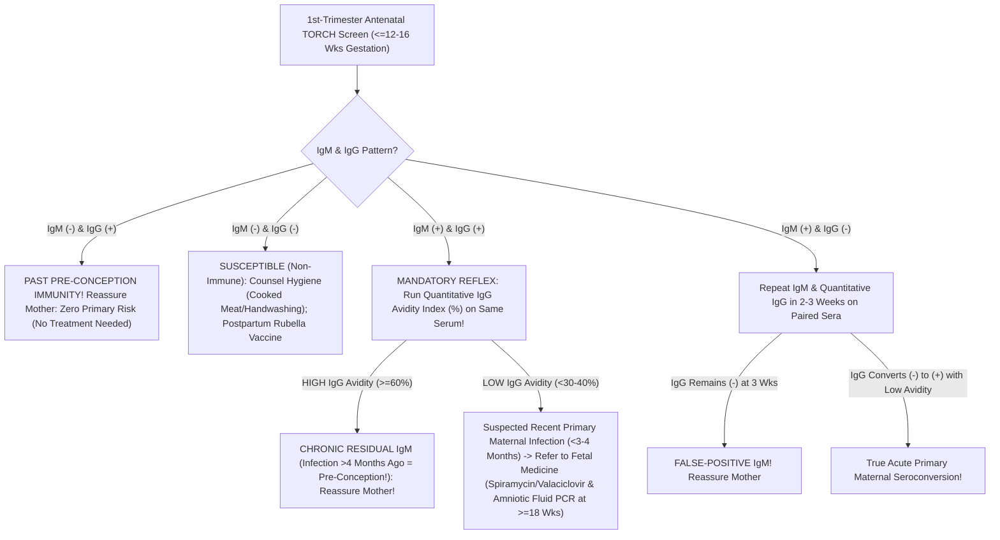

# 4.2.11 — TORCH Panel (Toxoplasma, Rubella, CMV, HSV-1/2 IgM & IgG) Master Maternal-Fetal Interpretation & IgG Avidity Cascade

**Department Folder:** `04_Serology_Infectious_Diseases_and_Immunology`  
**Cluster Folder:** `4.2_Viral_Markers_HIV_Hepatitis_Syphilis_TORCH_and_EBV_Cluster`  
**Document ID:** `SOP-SER-4.2.11-TORCH-MASTER` | **Version:** `4.0 (ISO 15189:2022 / NABL 112 / ACOG-RCOG-FOGSI-ISUOG)`

---

## 1. Document Control, Standardized Coding & Hardware-Agnostic Platform Matrix

| Coding System / Attribute | Identifier / Code | Official Nomenclature & Scope |
| :--- | :--- | :--- |
| **LOINC (Master Panel)** | `24363-4` (`TORCH 8/10 Panel`) / `5388-4` | Congenital & Maternal Perinatal Infection Master Panel: *Toxoplasma gondii* ($\text{IgM/IgG}$), Rubella ($\text{IgM/IgG}$), Cytomegalovirus ($\text{CMV IgM/IgG}$), Herpes Simplex Virus $\text{HSV-1}$ & $\text{HSV-2}$ ($\text{IgM/IgG}$) + Reflex **`Toxo/CMV/Rubella IgG Avidity Index`** |
| **SNOMED-CT** | `395125008` / `312969004` | TORCH congenital infection screening panel / Bad Obstetric History (`BOH`) & antenatal screening |
| **ICD-10-CM** | `Z36.89` (Antenatal screen) / `O98.51`–`O98.81` / `P35`–`P37` | Maternal infectious diseases complicating pregnancy; Congenital viral/parasitic infections |
| **UCUM Units** | `IU/mL` (`Toxo IgG, Rubella IgG, CMV IgG`) / `AU/mL` / `COI` / `%` (`Avidity Index`) | WHO International Units per mL, Cutoff Index, and Percentage Avidity Index (`%`) |
| **Medico-Legal Priority** | **Top Antenatal Consumer Litigation Shield** | **NEVER advise termination of pregnancy (`MTP`) based on an isolated reactive `TORCH IgM` without `IgG Avidity Index` and Amniotic Fluid PCR confirmation!** |

### Hardware-Agnostic Analytical Platform Matrix
| TORCH Analyte Pair | Primary Platform (`Snibe MAGLUMI X3 / X8`) | WHO International Standard Traceability | Mandatory Reflex Confirmatory Test |
| :--- | :--- | :--- | :--- |
| ***Toxoplasma gondii* `IgM & IgG`** (`SOP 4.2.12`) | $\mu$-Capture `IgM` (`AU/mL` / `COI`) & Quantitative `IgG` (`IU/mL`) | **WHO 3rd IS `TOXM / 01/600`** | **`Toxoplasma IgG Avidity Index (%)`** + Serial $2\text{–}3\text{ wk}$ paired `IgG` |
| **Rubella Virus `IgM & IgG`** (`SOP 4.2.13`) | $\mu$-Capture `IgM` (`AU/mL` / `COI`) & Quantitative `IgG` (`IU/mL`) | **WHO 1st IS `RUBI-1-94` ($\ge 10\text{ IU/mL}$ = Immune)** | **`Rubella IgG Avidity`** + Paired $2\text{-wk}$ `IgG` |
| **Cytomegalovirus (`CMV`) `IgM & IgG`** (`SOP 4.2.14`) | $\mu$-Capture `IgM` (`AU/mL` / `COI`) & Quantitative `IgG` (`IU/mL` / `AU/mL`) | **WHO 1st IS `NIBSC 16/134`** | **`CMV IgG Avidity Index (%)`** + Maternal/Amniotic `CMV DNA PCR` |
| **`HSV-1 (gG-1)` & `HSV-2 (gG-2)` `IgM & IgG`** (`SOP 4.2.15`) | Type-Specific Glycoprotein-G (`gG-1` & `gG-2`) `IgG` & `IgM` (`COI`) | Type-specific `gG-1` & `gG-2` recombinant calibrators | Genital lesion **`HSV-1/2 Real-Time PCR`** (if active lesions near labor) |

---

## 2. Pre-Analytical Phlebotomy, Gestational-Age Anchoring, Stability & HIL Rejection Matrix

### Mandatory Antenatal Pre-Analytical Data Capture
- **Gestational Age (`Weeks + Days` by LMP / Dating Scan) Is Mandatory:** The clinical meaning of `IgG Avidity` depends entirely on **which week of gestation** the blood sample was drawn:
  - A **High `IgG Avidity Index` ($\ge 60\%$)** proves the infection occurred **$> 16\text{ to }20\text{ weeks}$ ($> 4\text{ months}$) BEFORE the blood draw**.
  - Therefore, a **High `IgG Avidity` measured in the 1st Trimester ($\le 12\text{–}16\text{ weeks}$ gestation)** definitively proves the mother acquired the infection **BEFORE conception** (zero risk of primary first-trimester fetal infection!). However, if the first blood test is delayed until **28 weeks gestation**, a High Avidity only proves infection occurred before Week 12 (which could still have been in the early 1st trimester!).
- **Specimen Type:** Serum ($3.0\text{–}4.0\text{ mL}$ from SST / Red-top tube). **Archive an aliquot of all 1st-trimester antenatal sera at $-20^\circ\text{C}$ for at least $6\text{–}9\text{ months}$** to allow parallel paired testing if a mid-pregnancy seroconversion question arises!

### Specimen Stability & Quantitative HIL Rejection Matrix
| Storage Condition | Maximum Stability | Interference Factor | Quantitative Rejection Threshold & Corrective Action |
| :--- | :--- | :--- | :--- |
| **Ambient ($20\text{–}25^\circ\text{C}$)** | $\le 8\text{ hours}$ | **Fibrin Strands** | Recentrifuge at $10,000 \times g$ for $10\text{ min}$ before duplicate re-testing of any reactive `TORCH IgM`. |
| **Refrigerated ($2\text{–}8^\circ\text{C}$)** | **Up to $7\text{ days}$** | **Hemolysis ($H$) / Lipemia ($L$)** | Maglumi X3 CLIA stable up to $\text{Hb } 500\text{ mg/dL}$, $\text{TG } 1,000\text{ mg/dL}$, $\text{Bilirubin } 25\text{ mg/dL}$. |
| **Frozen ($-20^\circ\text{C}$)** | $6\text{–}12\text{ months}$ | **Rheumatoid Factor (`RF`) & Neonatal `IgM` Maternal Transfer** | In **Neonatal Congenital TORCH Workup**, maternal `IgG` crosses the placenta passively (so positive newborn `TORCH IgG` simply reflects the mother!), whereas **`IgM` does NOT cross the placenta** (positive newborn `Toxo/CMV/Rubella IgM` or `PCR` confirms congenital infection, provided neonatal `RF` is excluded). |

---

## 3. Hardware-Agnostic Analytical SOP, `IgG Avidity` Urea Dissociation Principle & Six Sigma IQC



1. **Analytical Principle of the `IgG Avidity` Assay (6M–8M Urea / Chaotropic Dissociation):**
   - During the first $1\text{ to }3\text{ months}$ of a primary infection, B-cells secrete **Low-Avidity `IgG`** with weak non-covalent antigen binding. Over $4\text{ to }6\text{ months}$ of somatic hypermutation in germinal centers, `IgG` matures into **High-Avidity `IgG`**.
   - Patient serum is assayed in two parallel wells/cartridges: **Well 1 (Reference Wash Buffer)** and **Well 2 (6M–8M Urea / Guanidine Chaotropic Dissociation Buffer)** which strips away weakly bound Low-Avidity `IgG`:
   $$\text{IgG Avidity Index (\%)} = \frac{\text{IgG Signal (RLU or OD) WITH Urea Dissociation Wash}}{\text{IgG Signal (RLU or OD) WITHOUT Urea (Standard Wash)}} \times 100\%$$
   - **Low Avidity ($< 30\%\text{–}40\%$ per kit):** Suggests **Recent Primary Infection within the past $3\text{–}4\text{ months}$**.
   - **Borderline / Equivocal Avidity ($40\%\text{–}59\%$):** Indeterminate timing; repeat paired serology in $2\text{–}3\text{ weeks}$.
   - **High Avidity ($\ge 60\%$ per kit):** Confirms **Remote Past Infection acquired $> 4\text{ months}$ ($> 16\text{–}20\text{ weeks}$) prior to testing**!

---

## 4. Analytical Precision, Gestational Transmission vs Severity Paradox & MRI

| Pathogen | 1st-Trimester Maternal-to-Fetal Transmission Rate | 3rd-Trimester Maternal-to-Fetal Transmission Rate | Risk of Severe Fetal Structural Anomalies (`1st` vs `3rd` Trimester) | Residual Maternal `IgM` Persistence |
| :--- | :--- | :--- | :--- | :--- |
| ***Toxoplasma gondii*** | **Low ($10\%\text{ – }15\%$)** | **High ($60\%\text{ – }70\%$)** | **1st Trimester = Severe** (Chorioretinitis, hydrocephalus, intracranial calcifications); **3rd Trimester = Mostly subclinical** at birth | **`IgM` persists for $6\text{ to }24\text{ MONTHS}$!** |
| **Rubella Virus** | **Very High ($80\%\text{ – }90\%$ at $<11\text{ wks}$)** | $30\%\text{ – }60\%$ ($>30\text{ wks}$) | **$< 12\text{ Wks}$ = Classic Congenital Rubella Syndrome (`CRS`): Cataracts, sensorineural deafness, PDA/pulmonary stenosis ($>85\%$ defect rate); $> 16\text{–}20\text{ Wks} \approx 0\%$ structural defects!** | `IgM` persists for $2\text{ to }6\text{ months}$ (up to $12\text{ mo}$ post-vaccine) |
| **Cytomegalovirus (`CMV`)** | **$30\%\text{ – }35\%$** (Primary) / **$1\%\text{ – }2\%$** (Non-Primary) | **$65\%\text{ – }70\%$** (Primary) | **1st Trimester Primary Infection carries virtually ALL risk ($10\%\text{–}15\%$) of permanent sensorineural hearing loss, microcephaly & periventricular calcifications!** | **`IgM` persists for $4\text{ to }12\text{ MONTHS}$** and turns positive during reactivation! |
| **`HSV-1 / HSV-2`** | $< 1\%$ (Intrauterine) | **$30\%\text{–}50\%$ (Intrapartum Primary) vs $< 1\%\text{–}2\%$ (Recurrent)** | **Intrapartum transmission during active genital shedding at delivery** causes Neonatal SEM / Encephalitis / Disseminated HSV | Serum `HSV IgM` is unreliable |

---

## 5. Multi-Stratified Reference Intervals & Complete 4-Quadrant TORCH Interpretation Matrix

| `TORCH IgM` | `TORCH IgG` | `IgG Avidity Index (%)` | Clinical Interpretation & Evidence-Based Obstetric Action |
| :--- | :--- | :--- | :--- |
| **Non-Reactive (-)** | **Non-Reactive (-)** | N/A | **Susceptible / Seronegative:** No prior exposure. Counsel preventive hygiene (avoid raw/undercooked meat, unwashed salad, cat litter for *Toxo*; toddler saliva/urine hygiene for *CMV*). Administer **MMR Vaccine postpartum** if `Rubella IgG < 10 IU/mL` (**never give live MMR during pregnancy!**). |
| **Non-Reactive (-)** | **Reactive (+)** | High ($\ge 60\%$) | **Pre-Conception Maternal Immunity (Past Resolved Infection / Vaccination): COMPLETELY REASSURING! Mother is immune from past exposure ($>85\%\text{–}95\%$ of Indian women are `CMV IgG +` and `Rubella IgG +`!). Do NOT prescribe Spiramycin, Acyclovir, or repeat TORCH testing for isolated `IgG (+)` in Bad Obstetric History (`BOH`)!** |
| **Reactive (+)** | **Reactive (+)** | **HIGH Avidity ($\ge 60\%$)** *(in 1st Trimester)* | **Chronic Residual `IgM` from Pre-Conception Infection ($> 4\text{ Months}$ Ago):** Over **$75\%\text{ to }85\%$ of isolated `Toxo IgM (+)` and `CMV IgM (+)` results in routine antenatal screening have HIGH `IgG Avidity`**! Reassure parents—no primary first-trimester fetal risk! |
| **Reactive (+)** | **Reactive (+)** | **LOW Avidity ($< 30\%\text{–}40\%$)** | **Suspected Recent Primary Maternal Infection ($< 3\text{–}4\text{ Months}$):** Repeat paired `IgG` in $2\text{ weeks}$ ($\ge 2\text{–}4\times$ rise), refer to **Fetal Medicine** for targeted neurosonography, consider maternal prophylaxis (**Spiramycin / Pyrimethamine-Sulfadiazine** for *Toxo*; **high-dose Valaciclovir $8\text{ g/day}$** for 1st-trimester primary *CMV*), and perform **Amniocentesis PCR at $\ge 18\text{ weeks}$ gestation** (and $\ge 6\text{–}8\text{ weeks}$ after maternal infection). |
| **Reactive (+)** | **Non-Reactive (-)** | N/A | **Early Acute Seroconversion vs False-Positive `IgM`:** Mandatory repeat `IgM + Quantitative IgG` on a paired sample in **$2\text{ to }3\text{ weeks}$**. If `IgG` remains negative after 3 weeks $\rightarrow$ **Confirmed Biological False-Positive `IgM`**! |

---

## 6. NABL & CLSI GP47 Critical ("Panic") Alerts & Anti-MTP Medico-Legal Protection

> [!CAUTION]
> **THE GREATEST OBSTETRIC TRAGEDY IN INDIA — UNWARRANTED PREGNANCY TERMINATION (`MTP`) FOR ISOLATED `TORCH IgM (+)` OR `TORCH IgG (+)`:**
> 1. **Why Isolated `TORCH IgG (+)` with `IgM (-)` NEVER Causes Recurrent Miscarriage (`BOH`):** Past maternal immunity (`Toxo IgG+`, `Rubella IgG+`, `CMV IgG+`, `HSV IgG+`) protects the fetus and **DOES NOT cause recurrent habitual abortions**! Ordering TORCH in non-pregnant women with recurrent miscarriage (`BOH`) and treating positive `IgG` with antibiotics/antivirals is condemned by **ACOG, RCOG, and FOGSI**.
> 2. **Why Isolated `TORCH IgM (+)` Is False-Positive or Pre-Conception in $> 80\%$ of Screened Pregnancies:** Because `Toxoplasma IgM` and `CMV IgM` persist for **$6\text{ to }24\text{ months}$** after a harmless pre-pregnancy infection—and polyclonal B-cell activation in normal pregnancy causes frequent false-positive `IgM`—**$> 80\%$ of pregnant women with a reactive `Toxo IgM` or `CMV IgM` DO NOT have an acute primary pregnancy infection!**
> 3. **Mandatory Pathologist Intervention:** Any reactive `Toxo IgM`, `Rubella IgM`, or `CMV IgM` in a pregnant woman **must automatically trigger a reflex `IgG Avidity Index` test** and carry the bold **Anti-MTP Medico-Legal Shield** in Section 10!

---

## 7. Kinetic Timing of Amniocentesis (`>= 18 Weeks` Rule) & Smart LIMS Reflex Cascades

- **Why Amniocentesis for Fetal `Toxo / CMV PCR` Must Wait Until $\ge 18\text{ Weeks}$ Gestation AND $\ge 6\text{–}8\text{ Weeks}$ Post-Infection:**
  - Fetal kidneys only begin excreting substantial urine (which carries *CMV* virions and *Toxoplasma* DNA into the amniotic fluid) at **$18\text{ to }20\text{ weeks}$ of gestation**, and placental-to-fetal passage takes $6\text{ to }8\text{ weeks}$. Performing amniocentesis at 13 or 15 weeks yields a **false-negative amniotic fluid PCR**!

---

## 8. Analytical Cross-Reactivity & ISO 22367 Risk FMEA

- **Cross-Reactivity Across Herpesviruses (`EBV / CMV / HSV / VZV`):** Acute Epstein-Barr Virus (`EBV`), Varicella-Zoster (`VZV`), or Parvovirus B19 frequently causes false-positive `CMV IgM`, `Rubella IgM`, or `HSV IgM` due to polyclonal B-cell stimulation and Rheumatoid Factor bridging.

| Failure Mode (ISO 22367) | Root Cause | Clinical & Medico-Legal Risk | Mandatory Mitigation Control |
| :--- | :--- | :--- | :--- |
| **Precious Pregnancy Terminated (`MTP`) Based on Reactive `Toxo IgM` or `CMV IgM` Alone** | Clinician mistakes chronic residual `IgM` or false-positive `IgM` for acute 1st-trimester fetal infection | **Unnecessary abortion of a 100% healthy fetus; severe malpractice litigation!** | Hardcode **Mandatory Reflex `IgG Avidity` + Never Terminate on `IgM` Alone Shield** in Section 9 & Section 10 |
| **Patient Treated for `TORCH IgG (+)` with `IgM (-)`** | Misinterpreting protective `IgG` memory as active disease | Unnecessary drug toxicity and anxiety | Boldly state that `IgG (+) / IgM (-)` = **Protective Past Immunity (No Treatment Required)** |

---

## 9. Conditional Band-Specific Pathologist Sign-Out Library

- **`[BAND-IGM-NEG-IGG-POS-IMMUNE]`:** *"TORCH IgM is NON-REACTIVE and IgG is REACTIVE. REASSURING PROFILE: This pattern confirms pre-existing maternal immunity from past resolved exposure or vaccination (Rubella IgG >=10 IU/mL). Past TORCH IgG positivity is protective, does NOT cause recurrent pregnancy loss (BOH), and requires NO antimicrobial or antiviral treatment."*
- **`[BAND-IGM-POS-HIGH-AVIDITY]`:** *"TORCH IgM is REACTIVE with Reactive IgG and a HIGH IgG Avidity Index (>=60%). REASSURING PROFILE: High IgG Avidity confirms that the maternal infection was acquired >4 months (>16–20 weeks) prior to this blood draw, indicating chronic residual IgM persistence or non-specific IgM reactivity rather than an acute primary infection during the current trimester."*
- **`[BAND-IGM-POS-LOW-AVIDITY-CRITICAL]`:** *"URGENT FETAL MEDICINE ALERT: Reactive IgM with Reactive IgG and a LOW IgG Avidity Index (<30%–40%), suggestive of recent primary maternal infection within the preceding 3–4 months. CRITICAL MEDICO-LEGAL NOTE: A reactive maternal serological test or low avidity does NOT prove fetal infection and must NEVER be used alone to counsel pregnancy termination! Recommend Fetal Medicine referral, repeat paired IgG in 2 weeks, targeted fetal neurosonography, and confirmatory Amniotic Fluid Real-Time PCR at >=18 weeks gestation."*

---

## 10. Master LIMS Copy-Paste Report Block (Physician + Patient Summary + Anti-MTP Avidity Legal Shield)

```text
================================================================================
   TORCH PANEL (TOXO, RUBELLA, CMV, HSV) — AVIDITY & ANTI-MTP LEGAL SHIELD
================================================================================
1. FOUR-QUADRANT TORCH INTERPRETATION GUIDE (MATERNAL SEROLOGY):
   • IgM (-) & IgG (+): PAST IMMUNITY (PROTECTIVE!). Indicates remote past 
     exposure or vaccination (Rubella IgG >=10 IU/mL = Immune). Does NOT cause 
     recurrent miscarriage (BOH) and requires NO treatment!
   • IgM (-) & IgG (-): SUSCEPTIBLE (Non-Immune). Advise preventive hygiene 
     during pregnancy and postpartum Rubella (MMR) vaccination.
   • IgM (+) & IgG (+): MANDATORY REFLEX IgG AVIDITY INDEX REQUIRED!
     - HIGH IgG Avidity (>=60%): Confirms infection occurred >4 MONTHS (>16-20 
       weeks) ago! Over 80% of positive Toxo/CMV IgM results in pregnancy are 
       harmless "chronic residual IgM" (which can persist for 6 to 24 months) 
       with High Avidity.
     - LOW IgG Avidity (<30-40%): Suggests recent primary maternal infection 
       within the past 3-4 months -> Refer to Fetal Medicine specialist.
   • IgM (+) & IgG (-): Repeat paired IgM & Quantitative IgG in 2-3 weeks; if 
     IgG remains negative at 3 weeks, the IgM is a Biological False-Positive!

2. 🛡️ MANDATORY FOGSI / ACOG / RCOG MEDICO-LEGAL SHIELD (NEVER TERMINATE ON IgM):
   • NEVER counsel or perform Medical Termination of Pregnancy (MTP) based on a 
     reactive TORCH IgM result alone! Positive maternal IgM is frequently a 
     false-positive cross-reaction or residual pre-conception IgM, and even in 
     confirmed primary maternal infection, the majority of fetuses in the 1st 
     trimester are NOT infected.
   • Definitive Fetal Diagnosis: RequiresIgG Avidity Index, serial fetal 
     ultrasound, and Amniotic Fluid Real-Time PCR performed at >=18 weeks 
     gestation (and >=6-8 weeks after maternal exposure).
   • Statutory Disclaimer: Correlate clinically. Not valid for medico-legal use.
================================================================================
```
