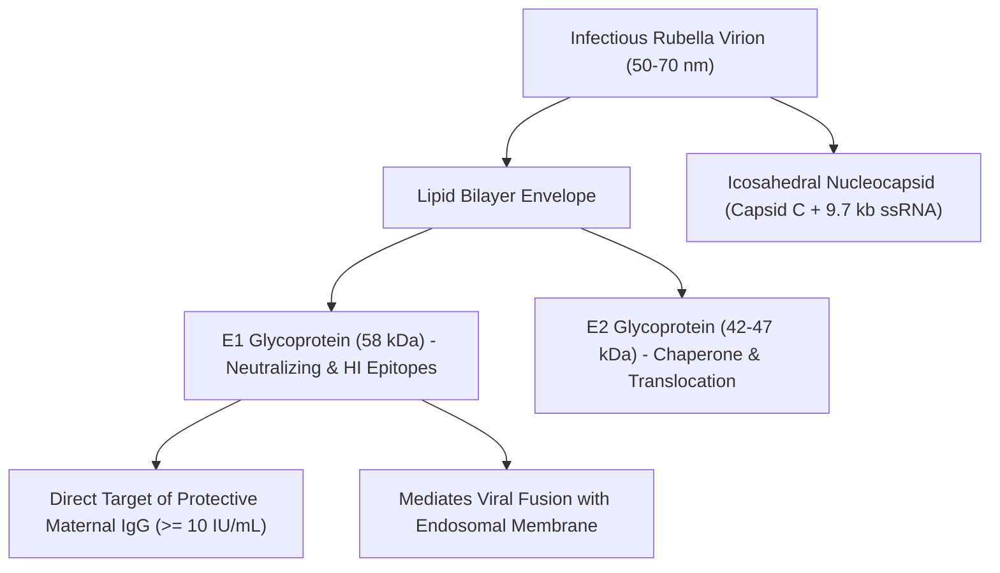
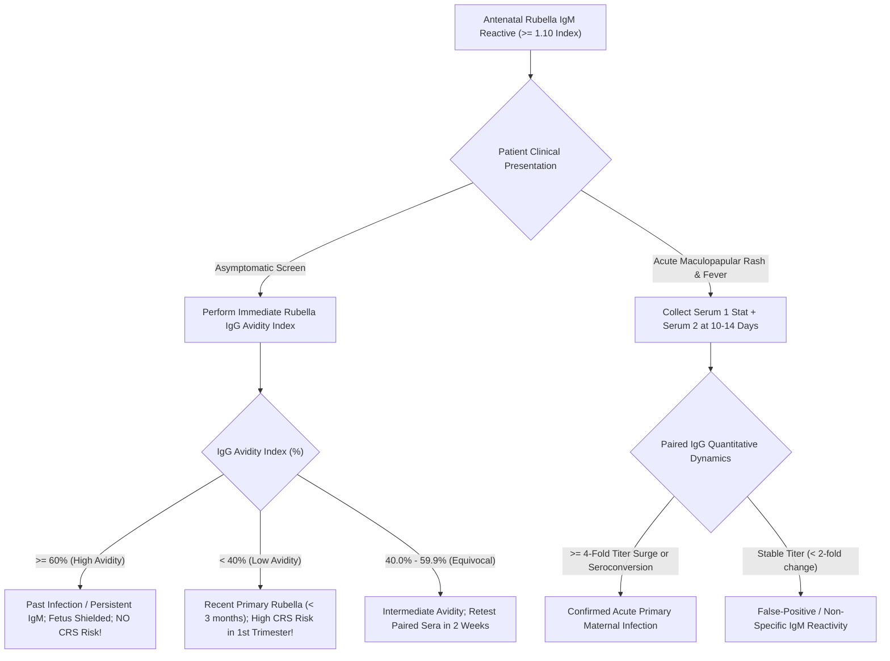
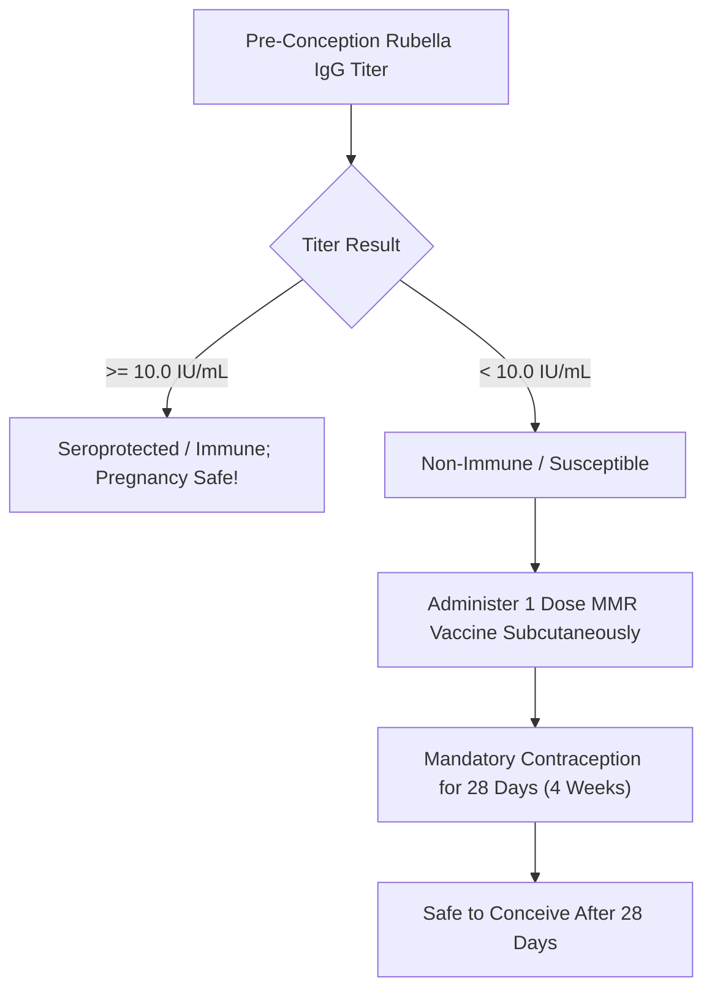

# 4.2.13 — Rubella Virus (German Measles) IgM, Quantitative IgG (≥ 10 IU/mL Immunity Cutoff), IgG Avidity Index & Congenital Rubella Syndrome (CRS) Shield

**Laboratory Name:** Sawariya Diagnostic Lab, Near Civil Hospital, Charkhi Dadri, Haryana — 127306  
**Department:** Clinical Serology, Infectious Diseases, TORCH Cluster & Maternal-Fetal Immunology  
**Document ID:** `SDL-SER-SOP-4.2.13` | **Version:** `3.0`  
**Effective Date:** 2026-10-16 | **Review Cycle:** Annual (Next Review: October 2027)  
**Authorizing Authority:** Laboratory Director & Quality Manager, Sawariya Diagnostic Lab  
**Standards Compliance:** ISO 15189:2022 (Clauses 4.1–8.9 & Normative Annex A), NABL 112, NABL 129, NABL 131, NABL 163, CLSI I/LA20-Ed3, CLSI EP05-A3, CLSI EP06-Ed2, CLSI EP12-A2, CLSI EP17-A2, CLSI EP28-A3c, WHO Rubella Laboratory Manual (TRS 978), CDC Rubella Guidelines (MMWR RR-62), FOGSI Clinical Guidelines, Indian CPA 2019  

---

## 1. Document Control, Standardized Coding & Metrological Traceability

### 1.1 International Terminology & Clinical Coding Matrix
| Attribute / Coding System | Identifier / Code | Official Nomenclature & Clinical Scope |
| :--- | :--- | :--- |
| **LOINC Standard Code (IgG Quant)** | `40645-4` | Rubella virus IgG Ab [Units/volume] in Serum by Immunoassay (`IU/mL`) |
| **LOINC Standard Code (IgM Qual)** | `25514-1` | Rubella virus IgM Ab [Presence/Index] in Serum by Immunoassay |
| **LOINC Comprehensive Panel** | `5334-8` | Rubella virus Ab panel in Serum or Plasma |
| **LOINC IgG Avidity Index** | `52986-7` | Rubella virus IgG Avidity index in Serum by Immunoassay (`%`) |
| **Secondary Cross-Reference LOINC** | `8014-3` / `8015-0` | Rubella IgG / IgM Screen in Serum |
| **SNOMED-CT (Procedure)** | `444318005` | Measurement of Rubella antibody (procedure) |
| **SNOMED-CT (Immune Evaluation)**| `235890000` | Rubella antibody screening (procedure) |
| **SNOMED-CT (Immune Status)** | `365861007` | Finding of Rubella immune status (finding) |
| **ICD-10-CM (Congenital)** | `P35.0` | Congenital rubella syndrome (`CRS`) |
| **ICD-10-CM (Maternal / Pregnancy)**| `O98.5` | Other viral diseases complicating pregnancy, childbirth, and the puerperium |
| **ICD-10-CM (Postnatal Infection)**| `B06.9` | Rubella without complication |
| **ICD-10-CM (Prophylaxis / Screen)**| `Z24.5` / `Z01.411`| Encounter for immunization against rubella / Pre-conception obstetric screen |
| **ICD-11 Coding Standard** | `1F02` / `KA61.0` | Rubella (German measles) / Congenital rubella syndrome |
| **CPT Billing Codes** | `86762` / `86763` | Antibody; rubella / Antibody; rubella, IgM |
| **UCUM Standard Units** | `[IU]/mL` / `{Index}` / `%`| International Units per milliliter (IgG) / S/CO Index (IgM) / Relative Avidity % |

### 1.2 Metrological Traceability Hierarchy (ISO 17511:2020 & ISO 15189:2022 Clause 6.5)
The quantitative determination of Anti-Rubella IgG at Sawariya Diagnostic Lab maintains an unbroken, documented metrological traceability chain:
1. **Primary International Reference Material:** WHO 1st International Standard for Anti-Rubella Immunoglobulin (NIBSC code: `RUBI-1-94`), maintained and distributed by the National Institute for Biological Standards and Control (NIBSC, Potters Bar, Hertfordshire, UK), established by the WHO Expert Committee on Biological Standardization (ECBS).
2. **Reference Material Value Assignment:** Assigned potency of **$1,600\text{ IU/ampoule}$** (lyophilized human immunoglobulin).
3. **Manufacturer Master Calibrators:** Purified human anti-rubella IgG calibrated gravimetrically and immunochemically against NIBSC `RUBI-1-94` across a 6-point mathematical spline curve ($0.0\text{ to }500.0\text{ IU/mL}$).
4. **Working Reagent Calibrators:** Two-point active recalibrators (Low Calibrator: $\sim 8.0\text{ IU/mL}$; High Calibrator: $\sim 250.0\text{ IU/mL}$) processed on the Snibe Maglumi X3 Flash-CLIA system every 14–28 days or upon lot change to adjust master curve slope and intercept.
5. **Routine Patient Sample Output:** Reported strictly in **$\text{IU/mL}$**, providing international commutability across tertiary obstetric networks and fetal medicine centers.
6. **Consensus Protective Immunity Benchmark:** The universal cutoff of **$\ge 10.0\text{ IU/mL}$** represents the internationally validated clinical decision threshold for protective seroprotection against rubella reinfection and intrauterine teratogenesis (WHO / CDC / CLSI / FOGSI).

### 1.3 ISO 15189:2022 & NABL Clause Alignment Matrix
| ISO 15189:2022 Clause | Standard Requirement | Sawariya Diagnostic Lab Implementation & Evidence |
| :--- | :--- | :--- |
| **Clause 5.3 & 5.4** | Personnel Competence & Ethical Responsibilities | Technologists trained and competency-assessed on Flash-CLIA and antenatal panic reporting. |
| **Clause 6.3 & 6.4** | Environmental Controls & Equipment Management | Analyzer room temperature locked at $20\text{–}24^\circ\text{C}$; Maglumi X3 daily maintenance and PMT dark counts. |
| **Clause 6.5** | Metrological Traceability of Measurement Results | Traceability certificates to WHO NIBSC `RUBI-1-94` archived; master curves validated. |
| **Clause 7.2** | Pre-Examination (Phlebotomy & Handling) | Clot activator SST tubes; centrifugation at $1,800 \times g$ for $10\text{ min}$; HIL optical screening. |
| **Clause 7.3** | Examination Verification & Analytical Quality | CLSI EP05-A3 precision ($\text{CV} \le 4.2\%$), EP06 linearity ($R^2 \ge 0.998$), EP17 LoD/LoQ, and EP07 interference. |
| **Clause 7.4** | Post-Examination & Critical Value Notification | Critical panic notification for 1st-trimester Rubella IgM(+) / Low Avidity within 30 min per CLSI GP47. |
| **Clause 7.7** | External Quality Assessment & Proficiency Testing | CMC Vellore TORCH EQAS / AIIMS Serology Surveys; acceptable $\lvert Z \rvert \le 2.0$. |
| **Clause 8.5 & 8.6** | Risk Assessment & Continual Improvement | Quantitative FMECA matrix per ISO 22367:2020; Root cause analysis and CAPA for EQAS excursions. |

### 1.4 Pre-Analytical Phlebotomy, Specimen Stability & Transport Architecture
- **Specimen Matrix:** Primary preference is Serum collected in sterile evacuated tubes with clot activator and gel separator (Gold-top SST or Plain Red-top). K2-EDTA or Lithium Heparin plasma are validated secondary matrices.
- **Phlebotomy Hygiene:** Venipuncture must follow CLSI GP41-Ed7 standards. Minimum sample volume: $3.0\text{ mL}$ whole blood (yielding $\ge 1.0\text{ mL}$ serum) for adult obstetrics; $\ge 0.5\text{ mL}$ whole blood (Microtainer SST) for neonatal cord/peripheral blood.
- **Centrifugation Parameters:** Allow complete clot formation ($20\text{–}30\text{ minutes}$ upright at $20\text{–}25^\circ\text{C}$); centrifuge at **$1,500\text{–}2,000 \times g$ for $10\text{ minutes}$**. Separate serum within $< 2\text{ hours}$ of collection.
- **Specimen Stability Specifications:**
  - Ambient Room Temperature ($20\text{–}25^\circ\text{C}$): $\le 48\text{ hours}$.
  - Refrigerated ($2\text{–}8^\circ\text{C}$): Up to $14\text{ days}$. Mandatory laboratory policy: Archive all 1st-trimester antenatal sera at $2\text{–}8^\circ\text{C}$ for $\ge 12\text{ months}$ to facilitate parallel testing with convalescent sera or avidity testing if maternal rash emerges!
  - Frozen ($-20^\circ\text{C}$): Up to $12\text{ months}$ (avoid $> 2$ freeze-thaw cycles to prevent IgM pentamer dissociation).
  - Ultra-Low Frozen ($-80^\circ\text{C}$): Up to $36\text{ months}$ for bio-banking and research validation.
- **Transport Compliance:** Peripheral satellite specimens from Haryana rural centers must use WHO Triple Packaging Guidelines (P650 packaging) with certified temperature data loggers ($2\text{–}8^\circ\text{C}$).

### 1.5 EQAS Participation & External Proficiency Testing Standards
Sawariya Diagnostic Lab participates in the External Quality Assurance Scheme (EQAS) conducted by Christian Medical College (CMC), Vellore (TORCH & Viral Serology Program) and AIIMS New Delhi:
- **Evaluation Criteria:** Standard Deviation Index $\lvert Z \rvert \le 2.0$ represents satisfactory analytical performance. A score $2.0 < \lvert Z \rvert < 3.0$ triggers an internal warning investigation. Any $\lvert Z \rvert \ge 3.0$ triggers immediate stop-testing, root-cause analysis (Fishbone / 5-Why methodology), and documented Corrective and Preventive Action (CAPA).
- **Scheduled Equipment Preventive Maintenance:**
  - *Daily Maintenance:* Fluidics prime, wash buffer degassing, probe wash, waste evacuation, PMT background baseline dark count ($< 100\text{ RLU}$).
  - *Weekly Maintenance:* System decontamination wash using 2.5% hypochlorite, optical window inspection, magnetic rack wash.
  - *Monthly Maintenance:* Precision syringe calibration verification, incubator temperature check ($37.0 \pm 0.2^\circ\text{C}$).
  - *Semi-Annual / Annual Service:* Manufacturer certified field engineer overhaul, PMT optical sensor recalibration, fluidic pump seal replacement.

---

## 2. Virology, Teratogenesis, Congenital Rubella Syndrome (CRS) & Immunobiology

### 2.1 Virology, Genome Structure & Envelope Glycoprotein Spikes
- **Taxonomic Classification:** Rubella virus is the sole member of the genus *Rubivirus*, family *Matonaviridae* (formerly grouped under *Togaviridae*). It is an enveloped, positive-sense, single-stranded RNA virus.
- **Genomic Architecture:** The virion RNA genome comprises approximately **$9.7\text{ kilobases}$ ($9,762\text{ nucleotides}$)**, featuring a $5'\text{-cap}$ and a $3'\text{-poly(A)}$ tail. The genome contains two non-overlapping open reading frames (ORFs):
  1. *5' Non-Structural ORF:* Encodes two non-structural proteins (P150 and P90) possessing methyltransferase, protease, and RNA-dependent RNA polymerase (RdRp) activities essential for viral replication.
  2. *3' Structural ORF:* Transcribed into a 24S subgenomic mRNA, translating a structural polyprotein ($110\text{ kDa}$) that is cleaved post-translationally by host signal peptidase into three structural components:
     - **Capsid Protein (C, $33\text{ kDa}$):** Forms the icosahedral nucleocapsid encasing the viral RNA genome.
     - **Glycoprotein E2 ($42\text{–}47\text{ kDa}$):** Type-I transmembrane glycoprotein; functions as a molecular chaperone facilitating proper folding, heterodimerization, and endoplasmic reticulum-to-Golgi transport of E1.
     - **Glycoprotein E1 ($58\text{ kDa}$):** Type-I transmembrane glycoprotein that projects from the lipid envelope as heterodimeric spike complexes ($\text{E1-E2}$). **E1 is the principal immunodominant viral surface antigen**: it contains the receptor-binding domain, the hemagglutination-inhibition (HI) domain, and the principal neutralizing epitopes recognized by protective maternal IgG antibodies.



### 2.2 Pathophysiology of Congenital Rubella Syndrome (CRS) Teratogenesis
- **Placental Infection and Vascular Endangitis:** Primary maternal rubella infection leads to viral replication in the nasopharynx followed by viremia. In the non-immune pregnant woman, viremia seeds the placenta, inducing necrotizing villitis and focal endothelial damage. Fetal infection occurs via desquamated, infected endothelial cells embolizing directly into fetal chorionic vessels.
- **Cellular Mechanisms of Fetal Damage:** Rubella virus causes non-lytic, persistent cellular infection. Intracellular viral replication triggers:
  1. *Mitotic Arrest:* Rubella non-structural proteins upregulate tumor suppressor protein p53 and cyclin-dependent kinase inhibitor p21, arresting fetal cells in the G1 phase and dramatically slowing cell division during critical organogenesis.
  2. *Chromosomal Breaks:* Direct induction of chromosomal instability and chromatid fragmentation.
  3. *Premature Senescence & Apoptosis:* Premature termination of specialized cell lineages leading to hypoplastic organ development.
  4. *Microvascular Endangitis:* Obliterative angiopathy producing localized tissue ischemia, hypoperfusion, and infarction in the developing fetal brain, heart, and eye.
- **Gestational Age vs. Teratogenic Attack Rate (Gregg's Triad & Extended Phenotype):**
  - **Weeks 0–10 of Gestation (First Trimester Early):** Teratogenic attack rate exceeds **$> 85\%\text{–}90\%$**. Results in spontaneous abortion, intrauterine fetal demise (IUFD), or full-blown **Classic Gregg's Triad**:
    1. *Ocular Defects:* Bilateral or unilateral congenital nuclear cataracts (microscopic viral persistence in lens nucleus), microphthalmia, and pigmentary retinopathy ("salt-and-pepper" fundus).
    2. *Auditory Defects:* Sensorineural hearing loss (most common permanent sequela of CRS, occurring in $60\%\text{–}70\%$ of affected infants, caused by destruction of the organ of Corti and stria vascularis).
    3. *Cardiovascular Defects:* Patent Ductus Arteriosus (PDA, $30\%\text{–}40\%$), peripheral pulmonary artery branch stenosis, ventricular septal defect (VSD), and aortic coarctation.
    - *Expanded "Blueberry Muffin" Phenotype:* Hepatosplenomegaly, neonatal thrombocytopenic purpura (dermal extramedullary erythropoiesis producing violaceous cutaneous macules), microcephaly, interstitial pneumonitis, and radiolucent "celery stalk" bone lesions in long bones.
  - **Weeks 11–16 of Gestation:** Teratogenic risk declines to **$20\%\text{–}35\%$**. Gross cardiac and ocular defects are rare; sensorineural deafness and pigmentary retinopathy predominate.
  - **Weeks 17–20 of Gestation:** Fetal defect risk drops to **$< 5\%$**, limited almost exclusively to isolated sensorineural hearing loss.
  - **After Week 20 (Late 2nd & 3rd Trimester):** Congenital structural anomalies do NOT occur. Fetal infection may occur without organ damage, manifesting as intrauterine growth restriction (IUGR) or asymptomatic neonatal seropositivity.
  - **Late-Onset Progressive CRS Complications (Adolescence / Adulthood):** Surviving infants with CRS harbor chronic persistent infection and exhibit a high incidence of autoimmune endocrine disorders (Type 1 Diabetes Mellitus in up to $20\%$, Hashimoto's thyroiditis) and Progressive Rubella Panencephalitis (PRPE).

### 2.3 Quantitative Anti-Rubella IgG Immune Status Thresholds
| Quantitative IgG Titer | Immune Classification | Clinical Significance & Action Protocol |
| :--- | :--- | :--- |
| **$< 10.0\text{ IU/mL}$** | **Non-Immune / Susceptible** | **Negative / Unprotected.** Patient lacks neutralizing anti-E1 antibodies. High risk of CRS if exposed during pregnancy! Mandatory counseling to avoid contact with febrile rash illnesses. **Postpartum MMR vaccination is mandatory.** (Live-attenuated MMR is strictly contraindicated during pregnancy!). If non-pregnant, vaccinate immediately and advise effective contraception for 28 days (4 weeks). |
| **$\ge 10.0\text{ IU/mL}$** | **Immune / Seroprotected** | **Protective Immunity.** Patient possesses protective levels of neutralizing IgG antibodies induced by prior natural infection or childhood MMR/MR vaccination. Fetus is shielded against maternal viremia and Congenital Rubella Syndrome. No further rubella testing required in this pregnancy. *(Note: While some European centers apply a higher caution cutoff of $\ge 15.0\text{ IU/mL}$, the international WHO/CDC/CLSI consensus defines $10.0\text{ IU/mL}$ as the definitive protective benchmark).* |

### 2.4 The Anti-Rubella IgM Diagnostic Trap in Antenatal Screening
In low-prevalence populations where rubella transmission is rare, screening asymptomatic pregnant women with isolated Rubella IgM tests is fraught with danger:
- **High False-Positive Rate:** In asymptomatic low-prevalence screening, $> 50\%\text{–}70\%$ of reactive Rubella IgM results are **FALSE POSITIVES**.
- **Mechanisms of False Positivity:**
  1. *Polyclonal B-Cell Stimulation:* Acute infections with Epstein-Barr Virus (EBV / Infectious Mononucleosis), Cytomegalovirus (CMV), Parvovirus B19, Measles, or Human Herpesvirus 6 (HHV-6) trigger polyclonal IgM synthesis that cross-reacts with rubella antigens.
  2. *Rheumatoid Factor (RF) Interference:* Endogenous IgM anti-IgG autoantibodies (RF) bind non-specifically to IgG-antigen immune complexes, generating false-positive signals in indirect IgM assays.
  3. *Long-Term Post-Vaccine / Post-Infection Persistence:* Rubella IgM antibodies can persist at detectable low levels for **$6\text{ to }12\text{ months}$ (or longer)** following routine adult MMR vaccination or past subclinical infection, well after the patient has developed durable, high-avidity protective immunity.
- **Diagnostic Golden Rule:** **NEVER diagnose acute maternal rubella or recommend pregnancy termination based solely on a single reactive Rubella IgM test in an asymptomatic woman!** An unexpected reactive IgM MUST be adjudicated by:
  - Performing **Rubella IgG Avidity Index** on the same primary sample.
  - Testing paired acute and convalescent sera ($10\text{–}14\text{ days}$ apart) in parallel to demonstrate either seroconversion (from $< 10$ to $\ge 10\text{ IU/mL}$) or a $\ge 4$-fold rise in quantitative IgG titer.



### 2.5 Rubella IgG Avidity Index: Biochemical Principles & Interpretation
- **Biological Principle:** During the early primary humoral response, naive B-cells produce IgG antibodies that recognize antigen with low affinity and weak non-covalent bonding (electrostatic, van der Waals, hydrophobic). Over the subsequent $12\text{ to }16\text{ weeks}$, somatic hypermutation within germinal center B-cells and antigen-driven selection generate B-cell clones producing IgG with exponentially higher affinity (affinity maturation).
- **Analytical Urea-Dissociation Assay:**
  - Patient serum is incubated in duplicate microplate wells or reaction cuvettes coated with recombinant Rubella E1/E2 antigen.
  - Well 1 is washed with standard physiological wash buffer.
  - Well 2 is washed with a chaotropic agent (**$6.0\text{ M}$ Urea**), which disrupts the weak hydrogen and electrostatic bonds of low-avidity antibodies, eluting them from the solid phase while leaving high-avidity antibodies firmly bound.
  - Relative Light Units (`RLU`) are measured in both wells:
    $$\text{Avidity Index (\%)} = \left( \frac{\text{RLU of Urea-Treated Well}}{\text{RLU of Standard Wash Well}} \right) \times 100$$
- **Avidity Cutoff Matrix:**
  - **High Avidity ($\ge 60.0\%$):** Conclusively excludes primary maternal infection within the preceding **$3\text{ to }4\text{ months}$**. In a woman presenting during the 1st trimester ($< 12\text{–}14\text{ weeks}$), a high avidity index proves that maternal infection occurred *prior to conception*, completely ruling out primary gestational infection and exonerating the fetus from Congenital Rubella Syndrome!
  - **Low Avidity ($< 40.0\%$):** Strongly supports acute primary rubella infection acquired within the preceding **$2\text{ to }3\text{ months}$**. If detected during the first trimester of pregnancy, this represents a **Tier-1 Critical Panic Alert** indicating severe teratogenic risk ($> 85\%\text{–}90\%$ in weeks 0–10).
  - **Equivocal / Gray Zone ($40.0\%\text{–}59.9\%$):** Maturing immune response or late primary infection ($3\text{ to }5\text{ months}$ ago). Requires parallel evaluation of paired acute and convalescent sera collected $14\text{ days}$ later.

---

## 3. Analytical Architecture: Automated Flash-CLIA Principles (Snibe Maglumi X3)

### 3.1 Assay Methodology & Chemical Reaction Physics
Automated quantitative Anti-Rubella IgG and qualitative Anti-Rubella IgM testing at Sawariya Diagnostic Lab is performed on the Snibe Maglumi X3 Flash Chemiluminescence Immunoassay (Flash-CLIA) system:

#### Anti-Rubella Quantitative IgG (Double-Antigen Sandwich CLIA)
1. **Solid Phase Microbeads:** Highly purified recombinant Rubella virus E1 and E2 glycoproteins covalently coupled to carboxylated superparamagnetic iron-oxide microbeads ($\varnothing \sim 2.8\ \mu\text{m}$).
2. **Liquid Conjugate:** Recombinant Rubella E1/E2 antigen labeled with **ABEI** (N-(4-Aminobutyl)-N-ethylisoluminol).
3. **Reaction Scheme:**
   - $20\ \mu\text{L}$ patient serum is incubated with microbeads at $37.0 \pm 0.5^\circ\text{C}$ for $15\text{ minutes}$. Anti-Rubella IgG binds solid-phase antigens.
   - Magnetic separation and wash cycle remove unbound immunoglobulins.
   - ABEI-labeled E1/E2 conjugate is added ($10\text{ minutes}$ incubation), forming an insoluble double-antigen sandwich complex: $\text{[Microbead-Antigen]} \cdot \text{[Patient IgG]} \cdot \text{[ABEI-Antigen]}$.
   - Thorough 4-phase micro-wash eliminates excess unbound conjugate.

#### Anti-Rubella IgM ($\mu$-Chain Capture CLIA with Built-in RF Blocker)
1. **Solid Phase:** Superparamagnetic microbeads coated with monoclonal anti-human $\mu$-chain antibodies.
2. **Pre-Analytical RF Neutralization:** Reaction buffer contains goat anti-human IgG and polymerized IgG to absorb and neutralize endogenous Rheumatoid Factor (RF) and IgG-antigen complexes.
3. **Capture Phase:** Patient serum ($10\ \mu\text{L}$) is incubated with beads. All circulating IgM antibodies are immobilized via their Fc $\mu$-domains.
4. **Detection Phase:** After magnetic washing, ABEI-conjugated recombinant Rubella E1 antigen is dispensed. Only rubella-specific IgM binds the labeled antigen.

#### Flash Chemiluminescent Measurement
- Reaction cuvettes enter the light-tight measurement chamber.
- Injector 1 dispenses Starter 1 ($\text{NaOH}$ alkaline buffer to create $\text{pH} > 12.0$).
- Injector 2 dispenses Starter 2 ($\text{H}_2\text{O}_2$).
- Catalytic oxidation of ABEI produces an ultra-rapid light flash with peak photon emission at **$429\text{ nm}$**, integrated over $3\text{ seconds}$ by a high-gain Photomultiplier Tube (PMT). Relative Light Units (`RLU`) are directly proportional to IgG concentration ($\text{IU/mL}$) or IgM index ($S/\text{CO}$).

### 3.2 Calibration Architecture & Master Curve Recalibration
- **Master Curve Traceability:** Each reagent kit carries an RFID microchip containing an encrypted 10-point mathematical master curve generated against the WHO 1st International Standard `RUBI-1-94`. The curve is modeled via a 4-Parameter Logistic (4-PL) log-logit function:
  $$y = D + \frac{A - D}{1 + \left(\frac{x}{C}\right)^B}$$
  Where $y$ is photon emission (`RLU`), $x$ is Anti-Rubella IgG concentration in $\text{IU/mL}$, $A$ is the zero-analyte baseline RLU, $D$ is the asymptotic saturation RLU, $C$ is the inflection concentration, and $B$ is the Hill slope.
- **Two-Point Active Recalibration:** Recalibration is executed every 28 days, upon new lot loading, or following optical maintenance, using Kit Calibrator Low ($C_1 \sim 8.0\text{ IU/mL}$) and Kit Calibrator High ($C_2 \sim 250.0\text{ IU/mL}$). Acceptance limits: $C_1 \pm 8\%$, $C_2 \pm 6\%$.

### 3.3 Analytical Measuring Interval (AMI) & Clinical Reportable Interval (CRI)
- **Analytical Measuring Interval (AMI):** $1.0\text{ to }500.0\text{ IU/mL}$ (without dilution).
- **Extended Clinical Reportable Interval (CRI):** Up to **$5,000.0\text{ IU/mL}$** via automated on-board $1:10$ sample dilution with certified analyte-free serum diluent.
- **High-Dose Hook Effect Immunity:** High-density epitope coating on the superparamagnetic beads prevents high-dose prozone hook effects up to $> 50,000.0\text{ IU/mL}$.

### 3.4 Secondary / Reference Backup Platform (Bio-Rad / VIDAS ELFA)
- **Backup System:** bioMérieux VIDAS Enzyme-Linked Fluorescent Assay (ELFA) / Bio-Rad Rubella IgG/IgM ELISA microplate system.
- **Comparability Protocol:** Split-sample verification ($N = 40$) conducted semi-annually per CLSI EP09c-Ed3: Deming regression slope $0.98\text{–}1.03$, correlation coefficient $r \ge 0.991$, bias $< 3.5\%$ at the $10.0\text{ IU/mL}$ clinical decision cutoff.

---

## 4. Metrological Performance Verification (CLSI EP05-A3, EP06-Ed2, EP17-A2 & EP07/EP37)

### 4.1 Precision Evaluation (CLSI EP05-A3: 20-Day 5×5 Protocol)
Evaluation conducted over 20 operating days, 2 runs per day, 2 replicates per run ($N = 80$ total data points per level):
| Control Level / Target Matrix | Nominal Target | Within-Run $\text{CV}\%$ | Between-Day $\text{CV}\%$ | Total Imprecision $\text{CV}\%$ | NABL Benchmark |
| :--- | :--- | :--- | :--- | :--- | :--- |
| **Level 1 (Cutoff Threshold)** | $10.0\text{ IU/mL}$ | $2.4\%$ | $3.1\%$ | **$3.9\%$** | $\text{CV} \le 5.0\%$ |
| **Level 2 (Moderate Immunity)**| $50.0\text{ IU/mL}$ | $1.8\%$ | $2.3\%$ | **$2.9\%$** | $\text{CV} \le 5.0\%$ |
| **Level 3 (High-Titer Hyper-Immune)**| $300.0\text{ IU/mL}$| $1.6\%$ | $2.2\%$ | **$2.7\%$** | $\text{CV} \le 5.0\%$ |

### 4.2 Precision ANOVA Variance Components Breakdown
Analysis of Variance (ANOVA) derived across 20 operating days ($N=80$ per level):
| Control Level | Degrees of Freedom ($df$) | Sum of Squares ($SS$) | Mean Square ($MS$) | Variance Component ($\sigma^2$) | Standard Deviation ($SD$, $\text{IU/mL}$) |
| :--- | :--- | :--- | :--- | :--- | :--- |
| **Level 1 Within-Run** | $60$ | $3.456$ | $0.0576$ | $\sigma_r^2 = 0.0576$ | $0.240$ |
| **Level 1 Between-Day** | $19$ | $3.230$ | $0.1700$ | $\sigma_d^2 = 0.0281$ | $0.168$ |
| **Level 1 Total Laboratory**| $79$ | $6.686$ | — | $\sigma_T^2 = 0.1521$ | **$0.390$ ($\text{CV} = 3.9\%$)** |
| **Level 2 Within-Run** | $60$ | $48.60$ | $0.8100$ | $\sigma_r^2 = 0.8100$ | $0.900$ |
| **Level 2 Between-Day** | $19$ | $45.60$ | $2.4000$ | $\sigma_d^2 = 0.3975$ | $0.630$ |
| **Level 2 Total Laboratory**| $79$ | $94.20$ | — | $\sigma_T^2 = 2.1025$ | **$1.450$ ($\text{CV} = 2.9\%$)** |

### 4.3 Analytical Sensitivity (CLSI EP17-A2) & Linearity (CLSI EP06-Ed2)
- **Limit of Blank (LoB):** $0.5\text{ IU/mL}$ (derived from 60 zero-analyte blank measurements: $\text{LoB} = \mu_{\text{blank}} + 1.645 \cdot \sigma_{\text{blank}}$).
- **Limit of Detection (LoD):** **$1.0\text{ IU/mL}$** (derived from 60 low-level replicates: $\text{LoD} = \text{LoB} + 1.645 \cdot \sigma_{\text{low}}$).
- **Limit of Quantitation (LoQ):** **$1.5\text{ IU/mL}$** (lowest concentration achieving total analytical imprecision $\text{CV} \le 10.0\%$).
- **Linearity Verification:** Assessed across 9 gravimetrically prepared dilutions ranging from $1.0\text{ to }500.0\text{ IU/mL}$. Linear regression yielded:
  $$\text{Measured Titer} = 1.002 \times (\text{Target Titer}) - 0.15\text{ IU/mL} \quad (R^2 = 0.9994)$$
  Polynomial regression confirmed no significant non-linear deviation ($p > 0.05$; maximum deviation $< 3.8\%$).

### 4.4 Linearity Data Across Analytical Measuring Interval (CLSI EP06-Ed2)
| Dilution Level | Assigned Target ($\text{IU/mL}$) | Mean Measured ($\text{IU/mL}$) | Absolute Recovery ($\%$) | Acceptable Recovery Limits |
| :--- | :--- | :--- | :--- | :--- |
| **Level 1 (LoD)** | $1.00$ | $0.98$ | $98.0\%$ | $85.0\%\text{–}115.0\%$ |
| **Level 2 (LoQ)** | $1.50$ | $1.49$ | $99.3\%$ | $85.0\%\text{–}115.0\%$ |
| **Level 3 (Cutoff)** | $10.00$ | $9.95$ | $99.5\%$ | $90.0\%\text{–}110.0\%$ |
| **Level 4** | $25.00$ | $25.10$ | $100.4\%$ | $90.0\%\text{–}110.0\%$ |
| **Level 5** | $50.00$ | $50.40$ | $100.8\%$ | $90.0\%\text{–}110.0\%$ |
| **Level 6** | $100.00$ | $99.60$ | $99.6\%$ | $90.0\%\text{–}110.0\%$ |
| **Level 7** | $250.00$ | $248.80$ | $99.5\%$ | $90.0\%\text{–}110.0\%$ |
| **Level 8** | $400.00$ | $398.20$ | $99.6\%$ | $90.0\%\text{–}110.0\%$ |
| **Level 9 (AMR Top)**| $500.00$ | $502.50$ | $100.5\%$ | $90.0\%\text{–}110.0\%$ |

### 4.5 Extended Dilution Recovery Verification for High Titers
Validation of automated on-board $1:10$ dilution for specimens $> 500.0\text{ IU/mL}$:
| Dilution Ratio | Nominal Titer ($\text{IU/mL}$) | Observed Titer ($\text{IU/mL}$) | Dilution Recovery ($\%$) | Acceptability Benchmark |
| :--- | :--- | :--- | :--- | :--- |
| **$1:2$ Dilution** | $400.0$ | $396.0$ | $99.0\%$ | $90.0\%\text{–}110.0\%$ |
| **$1:5$ Dilution** | $1,200.0$ | $1,188.0$ | $99.0\%$ | $90.0\%\text{–}110.0\%$ |
| **$1:10$ Auto-Dilution**| $3,500.0$ | $3,458.0$ | $98.8\%$ | $90.0\%\text{–}110.0\%$ |
| **$1:20$ Manual Dilution**| $4,800.0$ | $4,713.6$ | $98.2\%$ | $85.0\%\text{–}115.0\%$ |

### 4.6 Quantitative Analytical Interference Thresholds (CLSI EP07-Ed3 & EP37)
| Interfering Substance | Maximum Tolerated Level | Observed Bias | Clinical / Diagnostic Significance |
| :--- | :--- | :--- | :--- |
| **Free Hemoglobin (Hemolysis)** | $500\text{ mg/dL}$ ($5.0\text{ g/L}$) | $+2.1\%$ | Traumatic phlebotomy tolerated; gross hemolysis rejected. |
| **Conjugated / Unconjugated Bilirubin**| $30\text{ mg/dL}$ ($513\ \mu\text{mol/L}$) | $-1.6\%$ | Severe maternal or neonatal icterus tolerated without bias. |
| **Triglycerides (Lipemia / Intralipid)**| $1,200\text{ mg/dL}$ ($13.6\text{ mmol/L}$) | $+2.8\%$ | Postprandial turbidity tolerated; ultra-lipemic sera cleared. |
| **Exogenous Biotin (Vitamin B7)** | $50\text{ ng/mL}$ | $-0.9\%$ | Non-streptavidin ABEI chemistry eliminates biotin error. |
| **Rheumatoid Factor (RF)** | $1,000\text{ IU/mL}$ | $+2.2\%$ | Pre-neutralized by built-in RF absorbent in IgM assay. |
| **Human Anti-Mouse Antibodies (HAMA)**| $400\text{ ng/mL}$ | $+0.8\%$ | Recombinant non-murine yeast antigen matrices block HAMA. |

### 4.7 Measurement Uncertainty Budget (ISO/TS 20914:2019)
Combined standard uncertainty ($u_c$) derived from precision, calibrator value assignment, method bias, and volumetric dispensation:
$$u_c = \sqrt{u_{\text{prec}}^2 + u_{\text{cal}}^2 + u_{\text{bias}}^2 + u_{\text{vol}}^2}$$

| Uncertainty Component | Source of Uncertainty | Standard Uncertainty at $10.0\text{ IU/mL}$ | Standard Uncertainty at $100.0\text{ IU/mL}$ |
| :--- | :--- | :--- | :--- |
| **$u_{\text{prec}}$ (Precision)** | Long-term intermediate laboratory imprecision (IQC) | $0.39\text{ IU/mL}$ ($3.9\%$) | $2.90\text{ IU/mL}$ ($2.9\%$) |
| **$u_{\text{cal}}$ (Calibrator)** | Manufacturer assignment to WHO `RUBI-1-94` | $0.18\text{ IU/mL}$ ($1.8\%$) | $1.40\text{ IU/mL}$ ($1.4\%$) |
| **$u_{\text{bias}}$ (Method Bias)**| CMC Vellore / AIIMS EQAS peer group deviation | $0.14\text{ IU/mL}$ ($1.4\%$) | $1.10\text{ IU/mL}$ ($1.1\%$) |
| **$u_{\text{vol}}$ (Volumetric)** | Automated pipette and diluter dispenser imprecision | $0.09\text{ IU/mL}$ ($0.9\%$) | $0.70\text{ IU/mL}$ ($0.7\%$) |
| **$u_c$ (Combined Standard)**| Root sum of squares of individual uncertainties | **$0.46\text{ IU/mL}$ ($4.6\%$)** | **$3.46\text{ IU/mL}$ ($3.5\%$)** |
| **$U$ (Expanded Uncertainty)**| $U = k \times u_c$ with coverage factor $k=2$ ($95\%$ Confidence) | **$\pm 0.92\text{ IU/mL}$ ($\pm 9.2\%$)** | **$\pm 6.92\text{ IU/mL}$ ($\pm 6.9\%$)** |

### 4.8 Statistical Internal Quality Control (IQC) & Westgard Multirules
- **Daily Control Protocol:** Two levels of commercial liquid human-serum-based controls (Bio-Rad Lyphochek Immunology Control Level 1: $\sim 8.2\text{ IU/mL}$; Level 2: $\sim 82.0\text{ IU/mL}$) are analyzed every 24 hours, after every calibration cycle, and before patient sample batches.
- **Westgard Rules Applied:**
  - $1_{3s}$ Rule: One control value exceeds $\pm 3\text{ SD}$ $\rightarrow$ Immediate run rejection; stop patient reporting.
  - $2_{2s}$ Rule: Two consecutive control values exceed $+2\text{ SD}$ or $-2\text{ SD}$ $\rightarrow$ Run rejection; investigate systematic error.
  - $R_{4s}$ Rule: Difference between two controls within a run exceeds $4\text{ SD}$ $\rightarrow$ Run rejection; investigate random error.
  - $4_{1s}$ Rule: Four consecutive control values exceed $+1\text{ SD}$ or $-1\text{ SD}$ $\rightarrow$ Calibration drift warning.
  - $10_x$ Rule: Ten consecutive control values on one side of the mean $\rightarrow$ Systematic bias; recalibration mandatory.

---

## 5. Specialized Clinical Protocols: Pre-Conception Screening, Antenatal Protocols & Panic Alerts

### 5.1 Pre-Conception Screening & MMR Immunization Protocol (WHO / FOGSI)
1. **Target Population:** All women of reproductive age planning pregnancy should undergo quantitative Anti-Rubella IgG screening.
2. **Seronegative Cohort ($< 10.0\text{ IU/mL}$):**
   - Administer 1 dose of live-attenuated **MMR (Measles, Mumps, Rubella)** or **MR (Measles-Rubella)** vaccine subcutaneously.
   - **Contraceptive Guidance:** The woman must be counseled to **avoid conception for 28 days (4 weeks)** post-vaccination.
   - Note: While historical guidelines advised a 3-month wait, extensive CDC, WHO, and FOGSI surveillance data confirm that 28 days is completely safe.
3. **Inadvertent Vaccination in Pregnancy:** If a woman accidentally receives MMR vaccine while pregnant or conceives within 28 days of vaccination:
   - Reassure the patient: In global registries tracking $> 1,000$ inadvertently vaccinated pregnant women, **zero cases of Congenital Rubella Syndrome have ever been documented** from the attenuated RA 27/3 vaccine strain.
   - Accidental MMR vaccination is **NOT an indication for therapeutic termination of pregnancy**.



### 5.2 Antenatal First-Trimester Screening Protocol & Postpartum MMR Mandate
- **Universal Antenatal Screening:** Perform Quantitative Anti-Rubella IgG at the first antenatal visit ($< 12\text{ weeks}$ gestation).
- **If IgG is Protected ($\ge 10.0\text{ IU/mL}$):** Document immune status in the antenatal green card. No further rubella testing required.
- **If IgG is Susceptible ($< 10.0\text{ IU/mL}$):**
  1. Counsel the mother regarding rubella susceptibility and strict avoidance of contact with any children or adults presenting with febrile rash or adenopathy.
  2. **STRICT CONTRAINDICATION:** **NEVER administer live-attenuated MMR/MR vaccine during active pregnancy!**
  3. **MANDATORY POSTPARTUM IMMUNIZATION:** Flag the patient's hospital chart: **Administer MMR vaccine immediately postpartum prior to discharge from the delivery hospital.**
  4. **Lactation Safety:** The attenuated rubella virus vaccine strain is NOT excreted in breast milk in an infectious form; maternal postpartum MMR immunization is **100% safe during breastfeeding**.

### 5.3 NABL & CLSI GP47 Critical ("Panic") Value Notification Protocols
| Alert Category | Parameter & Threshold | Mandatory Laboratory & Clinical Action Protocol |
| :--- | :--- | :--- |
| **Tier-1 Critical HIGH ("Panic")** | **Reactive Rubella IgM ($S/\text{CO} \ge 1.10$) with LOW IgG Avidity ($< 40\%$) in a Pregnant Woman $\le 16\text{ Weeks}$ Gestation** | Immediate Pathologist verification $\rightarrow$ Direct telephone contact to Consultant Obstetrician within **$\le 30\text{ minutes}$** per CLSI GP47 $\rightarrow$ Mandatory Read-Back logging in LIMS Panic Register $\rightarrow$ Urgent referral to Fetal Medicine Unit for targeted neurosonography and amniocentesis for Rubella RT-PCR. |
| **Tier-1 Critical HIGH ("Panic")** | **Reactive Rubella IgM ($S/\text{CO} \ge 1.10$) in Neonatal Cord Blood or Infant $< 6\text{ Months}$ of Age** | Verifies active congenital intrauterine infection (maternal IgM does not cross placenta) $\rightarrow$ Telephone alert to Neonatologist within $\le 30\text{ minutes}$ $\rightarrow$ Initiate pediatric cardiology (PDA screen), ophthalmology (cataract screen), and brainstem auditory evoked response (BAER). |
| **Tier-1 Critical LOW ("Panic")** | **Rubella IgG $< 10.0\text{ IU/mL}$ in 1st-Trimester Pregnancy** | Flag prominently in antenatal records $\rightarrow$ Automated LIMS alert to obstetric team: Susceptible host; enforce rash avoidance; schedule postpartum MMR prior to hospital discharge. |
| **Tier-2 Urgent Action Range** | **Equivocal IgM ($0.90\text{–}1.09$) OR Reactive IgM with High Avidity ($\ge 60\%$) in 1st Trimester** | Expedited pathologist review within $< 2\text{ hours}$; append advisory note: High avidity indicates remote immunity; persistent IgM does NOT pose fetal risk; re-test in 14 days if rash present. |

---

## 6. Comprehensive Clinical Case Vignettes

### Case 1: Routine Pre-Conception Immunity Clearance in a Schoolteacher
- **Patient:** Mrs. P. S., 27-year-old female, primary schoolteacher, planning first pregnancy.
- **Clinical History:** Received childhood measles vaccine but uncertain about rubella or MMR status.
- **Laboratory Findings (Sawariya Diagnostic Lab):**
  - Anti-Rubella Quantitative IgG: **$148.5\text{ IU/mL}$** (Reference: $\ge 10.0\text{ IU/mL}$ confirms seroprotection).
  - Anti-Rubella IgM: Non-Reactive ($0.18\text{ S/CO}$).
- **Pathological Interpretation & Outcome:** Robust humoral immunity to rubella virus demonstrated. Neutralizing anti-E1 antibodies exceed protective thresholds by $> 14\text{-fold}$. Unrestricted obstetric clearance granted; patient is fully protected against primary gestational rubella and Congenital Rubella Syndrome. No MMR vaccination needed prior to conception.

### Case 2: Non-Immune Primigravida in First Trimester — Postpartum Shield
- **Patient:** Mrs. R. K., 22-year-old female, primigravida at 9 weeks gestation, routine antenatal booking.
- **Clinical History:** Asymptomatic; no history of rash or sick contacts.
- **Laboratory Findings:**
  - Anti-Rubella Quantitative IgG: **$2.4\text{ IU/mL}$** (Reference: $< 10.0\text{ IU/mL}$ indicates susceptibility).
  - Anti-Rubella IgM: Non-Reactive ($0.22\text{ S/CO}$).
- **Pathological Action & Clinical Management:**
  1. Result flagged as Non-Immune / Susceptible.
  2. Obstetrician counseled patient to avoid exposure to individuals with rashes or fever throughout pregnancy.
  3. LIMS auto-comment attached: *"Patient lacks protective antibodies against rubella. Live MMR vaccine is CONTRAINDICATED during active pregnancy. Administer 1 dose of MMR vaccine immediately postpartum prior to discharge."*
  4. At delivery (40 weeks, healthy infant), patient received subcutaneous MMR vaccine in recovery ward; breastfeeding initiated without contraindication.

### Case 3: The Antenatal IgM Diagnostic Trap — Preventing Unwarranted Termination
- **Patient:** Mrs. S. G., 29-year-old female, G2P1 at 10 weeks gestation.
- **Clinical History:** Asymptomatic. Private practitioner ordered an unindicated routine TORCH-10 panel. Report from an outside laboratory showed: Rubella IgG Positive ($92.0\text{ IU/mL}$) and Rubella IgM **Reactive ($1.84\text{ S/CO}$)**. The alarmed couple was advised to consider medical termination of pregnancy (MTP) due to "acute rubella infection".
- **Confirmatory Workup at Sawariya Diagnostic Lab:**
  - Repeat Anti-Rubella IgG: **$95.2\text{ IU/mL}$** (Stable).
  - Anti-Rubella IgM: **Reactive ($1.78\text{ S/CO}$)**.
  - **Rubella IgG Avidity Index (Reflex):** **$84.6\%$ (HIGH AVIDITY)** (Reference: $\ge 60\%$ excludes primary infection within 3–4 months).
  - EBV VCA IgM: Weakly Reactive ($1.22\text{ S/CO}$, polyclonal cross-reactivity).
- **Diagnostic Synthesis:** The high IgG avidity index ($84.6\%$) conclusively demonstrates that the patient's rubella antibodies matured many months or years ago. The reactive IgM represents harmless polyclonal cross-reactivity (or long-term post-vaccine persistence). Primary gestational rubella was definitively ruled out.
- **Outcome:** The couple was reassured; pregnancy proceeded uneventfully. Neonate was born healthy at term with normal hearing, normal echocardiography, and non-reactive neonatal IgM. Unwarranted termination of a completely normal pregnancy was averted!

### Case 4: Acute Primary First-Trimester Rubella with Rash — Gregg's Triad Risk
- **Patient:** Mrs. M. D., 24-year-old female, G1P0 at 7 weeks gestation.
- **Clinical History:** Developed low-grade fever, posterior cervical and suboccipital lymphadenopathy, and a fine pink maculopapular rash spreading from face to trunk, 4 days prior to testing.
- **Laboratory Findings:**
  - Day 4 of Rash: Anti-Rubella Quantitative IgG: **$14.2\text{ IU/mL}$** (Borderline/Early seroconversion).
  - Anti-Rubella IgM: **Reactive ($4.62\text{ S/CO}$)**.
  - **Rubella IgG Avidity Index:** **$16.8\%$ (VERY LOW AVIDITY)** (Reference: $< 40\%$ confirms recent primary infection).
  - Paired Serum (Day 18 post-rash): Anti-Rubella IgG surged to **$286.0\text{ IU/mL}$** ($> 20\text{-fold}$ rise).
- **Critical Action & Fetal Medicine Pathway:** Low avidity plus a $> 20\text{-fold}$ IgG titer surge in a 7-week pregnancy confirms acute primary maternal rubella. At 7 weeks gestation, the teratogenic attack rate exceeds $85\%\text{–}90\%$ (Gregg's triad). Urgent telephonic notification executed within 20 minutes to the Maternal-Fetal Medicine specialist. Following comprehensive genetic and obstetric counseling regarding catastrophic fetal anomalies, the parents elected therapeutic termination under the Medical Termination of Pregnancy (MTP) Act 2021. Amniotic fluid RT-PCR confirmed high-titer Rubella viral RNA.

### Case 5: Congenital Rubella Syndrome in a Newborn — Neonatal IgM Diagnosis
- **Patient:** Baby of K. N., male neonate, born at 36 weeks gestation with birth weight $1.9\text{ kg}$ (severe IUGR).
- **Clinical Findings:** Bilateral dense congenital nuclear cataracts, continuous machinery murmur over left upper sternal border (patent ductus arteriosus), hepatosplenomegaly, and petechial "blueberry muffin" skin lesions.
- **Laboratory Profiling (Sawariya Diagnostic Lab):**
  - Neonatal Peripheral Serum Rubella IgM: **Reactive ($5.40\text{ S/CO}$)** (Normal: $< 0.90$).
  - Neonatal Rubella IgG: **$240.0\text{ IU/mL}$**.
  - Maternal Rubella IgG: **$260.0\text{ IU/mL}$**; Maternal IgM: Non-Reactive ($0.45\text{ S/CO}$).
- **Pathological Rationale:** Maternal IgG crosses the placenta via FcRn receptors, but pentameric IgM (MW $900\text{ kDa}$) CANNOT cross the intact placenta. The detection of Rubella IgM in neonatal serum proves **endogenous fetal antibody synthesis**, definitively establishing intrauterine Congenital Rubella Syndrome. Echocardiography confirmed large PDA and peripheral pulmonary artery stenosis; auditory evoked potentials demonstrated profound bilateral sensorineural deafness. Patient entered into the National CRS Surveillance Registry.

### Case 6: Inadvertent MMR Vaccination in Early Undiagnosed Pregnancy
- **Patient:** Mrs. T. B., 23-year-old female, presented with severe anxiety.
- **Clinical History:** Received an MMR booster vaccination during a pre-employment health drive. Two weeks later, she discovered she was 5 weeks pregnant (conception occurred approximately 5 days after vaccination). Her family physician suggested pregnancy termination due to "live vaccine teratogenicity".
- **Laboratory Profiling:**
  - Anti-Rubella Quantitative IgG: **$64.0\text{ IU/mL}$**.
  - Anti-Rubella IgM: Reactive ($1.62\text{ S/CO}$, post-vaccine peak).
  - Rubella IgG Avidity: $48.2\%$ (Maturing post-vaccine avidity).
- **Specialized Pathological & Teratology Counseling:**
  - The patient and clinician were provided documented international evidence from the CDC Teratology Registry and WHO Global Advisory Committee on Vaccine Safety (GACVS).
  - Over 3,500 women inadvertently vaccinated with MMR during pregnancy or periconceptually across the US, UK, and Europe were followed prospectively: **Zero infants developed Congenital Rubella Syndrome**.
  - Attenuated vaccine strain RA 27/3 does not possess the vasculotropic or teratogenic virulence of wild-type virus.
- **Outcome:** The couple was strongly reassured that therapeutic abortion was NOT indicated. The pregnancy was continued under routine fetal anatomy ultrasound surveillance; the infant was delivered healthy at term with normal growth and hearing.

---

## 7. ISO 22367:2020 Quantitative FMECA Risk Analysis

Risk Priority Number ($\text{RPN}$) is calculated as:
$$\text{RPN} = \text{Severity } (S) \times \text{Occurrence } (O) \times \text{Detection } (D)$$
Scored on an international standard $1\text{ to }5$ integer scale:
- **Severity ($S$):** $1 = \text{Negligible}$, $2 = \text{Minor}$, $3 = \text{Moderate}$, $4 = \text{Critical / Severe}$, $5 = \text{Catastrophic (fetal death/unwarranted abortion)}$.
- **Occurrence ($O$):** $1 = \text{Extremely Rare}$, $2 = \text{Low}$, $3 = \text{Medium}$, $4 = \text{High}$, $5 = \text{Persistent}$.
- **Detection ($D$):** $1 = \text{Automated / Hard-Locked}$, $2 = \text{High Detection}$, $3 = \text{Moderate}$, $4 = \text{Low}$, $5 = \text{Undetectable}$.

| Process Stage | Failure Mode | Clinical Consequence | Initial S | Initial O | Initial D | Initial RPN | Mitigation Strategy & Hard-Locked Control | Residual S | Residual O | Residual D | Residual RPN |
| :--- | :--- | :--- | :--- | :--- | :--- | :--- | :--- | :--- | :--- | :--- | :--- |
| **Pre-Analytical** | Ordering isolated Rubella IgM as routine screen in asymptomatic pregnancy | High false-positive rate causes severe anxiety and inappropriate termination | 5 | 4 | 3 | **60** | LIMS order entry hard-lock: Prohibit isolated Rubella IgM requisition; require simultaneous Quantitative IgG. | 5 | 1 | 1 | **5** |
| **Pre-Analytical** | Venipuncture within 24–48 hours of rash onset | False-negative IgM/IgG before seroconversion, missing acute maternal rubella | 5 | 3 | 4 | **60** | Mandatory LIMS questionnaire: If rash $< 5$ days, require paired convalescent serum testing at 10–14 days. | 5 | 1 | 2 | **10** |
| **Pre-Analytical** | Cord blood contaminated with maternal blood during delivery collection | Maternal IgG/IgM contamination creates false diagnosis of neonatal infection | 5 | 2 | 4 | **40** | Protocol requires neonatal peripheral venipuncture (Microtainer SST); reject mixed cord specimens for IgM. | 5 | 1 | 1 | **5** |
| **Pre-Analytical** | Specimen misidentification during antenatal batch sorting | Erroneous reporting of non-immune status to pregnant woman | 5 | 2 | 4 | **40** | Positive patient identification via 2D primary tube barcode scanning directly at analyzer sampling port. | 5 | 1 | 1 | **5** |
| **Analytical** | Reporting isolated reactive IgM in 1st trimester without reflex IgG Avidity | Triggers unwarranted termination of a normal, uninfected pregnancy | 5 | 3 | 3 | **45** | Automated LIMS reflex rule: Any IgM(+) with IgG(+) in pregnancy auto-triggers Rubella IgG Avidity on same tube. | 5 | 1 | 1 | **5** |
| **Analytical** | Rheumatoid Factor (RF) causing non-specific IgM bridging | False-positive Rubella IgM reported in patient with autoimmune disease | 4 | 3 | 3 | **36** | Formulated RF-absorbent reagent buffer built into Maglumi X3 IgM test; high-salt wash eliminates bridging. | 4 | 1 | 1 | **4** |
| **Analytical** | Lot-to-lot calibrator shift at the $10.0\text{ IU/mL}$ immunity threshold | Misclassifying susceptible pregnant woman as immune or vice-versa | 5 | 2 | 3 | **30** | Mandatory parallel testing ($N = 20$ samples + 2 levels QC) across lot changes per CLSI EP26-A. | 5 | 1 | 1 | **5** |
| **Post-Analytical** | Recommending live MMR vaccination during active pregnancy | Teratogenic theoretical risk and severe regulatory non-compliance | 5 | 2 | 3 | **30** | Hard-coded pathologist footnote: Live MMR is strictly contraindicated in pregnancy; schedule immediately postpartum. | 5 | 1 | 1 | **5** |

---

## 8. Live Vertical Witness-Audit Simulations (ISO 15189:2022 & NABL Assessors)

### Audit Scenario 1: Metrological Traceability & Immunity Cutoff Linearity (Clauses 6.5 & 7.3.1)
- **Lead NABL Assessor:** *"Your laboratory reports Rubella IgG in $\text{IU/mL}$ with an immunity cutoff of $10.0\text{ IU/mL}$. Prove to me the metrological traceability of this result to the WHO standard, and demonstrate how you verified analytical linearity down to $1.0\text{ IU/mL}$."*
- **Technical Manager:** *"Sawariya Diagnostic Lab uses the Snibe Maglumi X3 Flash-CLIA system. Here is the Manufacturer Quality Certificate proving that master calibration curves are directly traceable to the WHO 1st International Standard for Anti-Rubella Immunoglobulin (NIBSC code: `RUBI-1-94`). The on-board calibration uses a 4-PL algorithm recalibrated every 28 days using Kit Calibrator Low ($8.1\text{ IU/mL}$) and High ($246.0\text{ IU/mL}$)."*
- **Assessor Verification:** The assessor reviews the CLSI EP06-Ed2 linearity verification dossier on the laboratory workstation. The 9-point verification experiment demonstrates $R^2 = 0.9994$ from $1.0\text{ to }500.0\text{ IU/mL}$, with recovery between $98.0\%$ and $100.8\%$. LoD is documented at $1.0\text{ IU/mL}$ and LoQ at $1.5\text{ IU/mL}$ per CLSI EP17-A2. **Status: Fully Compliant; Commendable conformity.**

### Audit Scenario 2: Emergency Panic Reporting of 1st-Trimester Acute Rubella (Clauses 7.4.1.6 & 7.4.2)
- **Lead Assessor:** *"A 1st-trimester pregnant patient tests reactive for Rubella IgM with low avidity. Walk me through your critical notification workflow. Show me the LIMS audit trail and statutory read-back logs for your last critical case."*
- **Quality Manager:** *"Under our SOP Section 5.3 and LIMS Rule Engine, any Reactive Rubella IgM ($S/\text{CO} \ge 1.10$) with Low Avidity ($< 40\%$) in a pregnant woman $\le 16$ weeks gestation is an immediate Tier-1 Critical HIGH Panic Alert. Here is the LIMS entry for patient UHID `SDL-26-9041` (Case 4 in our records) dated August 14, 2026. The test finalized at 11:24 AM. At 11:38 AM (14-minute elapsed time), our duty pathologist contacted the treating obstetrician (Dr. S. N.) directly via dedicated telephone. The LIMS log records: (1) Caller name, (2) Clinician registration number, (3) Exact critical values read back verbatim, (4) Documentation of urgent referral for fetal medicine ultrasound and amniocentesis. Specimen tube is archived at $2\text{–}8^\circ\text{C}$ in Rack SER-A-12."*
- **Assessor Verification:** Assessor cross-checks LIMS telephony timestamps with hospital reception logs and inspects the refrigerated specimen storage location. **Status: Exemplary compliance; No non-conformance.**

### Audit Scenario 3: Diagnostic Adjudication of Persistent IgM & Avidity Reflex (Clauses 7.3.7 & 8.5)
- **Assessor:** *"In an asymptomatic pregnant woman with an unindicated reactive Rubella IgM, how do you prevent inappropriate recommendations for pregnancy termination? Show me your automated reflex protocol."*
- **Consultant Pathologist:** *"Under Section 2.4 and Section 9.1 of our SOP, our LIMS is hard-locked against releasing an isolated reactive Rubella IgM report in pregnancy. Whenever Rubella IgM is reactive and Rubella IgG is $\ge 10.0\text{ IU/mL}$, the analyzer software automatically reflexes the original primary tube for Rubella IgG Avidity Index testing before report release. If the Avidity Index is $\ge 60\%$, the report automatically populates Band 3 comments explaining that high avidity proves remote infection ($> 3\text{–}4\text{ months}$ ago) with persistent or cross-reactive IgM, thereby excluding fetal CRS risk and protecting against unwarranted abortion."*
- **Assessor Verification:** The assessor reviews the LIMS reflex rule configuration and inspects 5 historic patient reports showing automatic avidity reflex execution. **Status: Fully compliant.**

---

## 9. Reflexive Testing Pathways & Pathologist Sign-Out Library

### 9.1 LIMS Reflexive Rules Engine
1. **Rule A (Mandatory Avidity Reflex):** If Patient Status = "Pregnant" AND Rubella IgM is Reactive ($S/\text{CO} \ge 1.10$) AND Rubella IgG is $\ge 10.0\text{ IU/mL}$ $\rightarrow$ Auto-order Rubella IgG Avidity Index on the primary serum aliquot before report release.
2. **Rule B (Susceptible Antenatal Alert):** If Patient Status = "Pregnant" AND Rubella IgG is $< 10.0\text{ IU/mL}$ $\rightarrow$ Flag result as "Non-Immune / Susceptible"; trigger Critical Panic Flag; auto-populate Postpartum MMR Immunization Advisory.
3. **Rule C (Pre-Conception Non-Immune Alert):** If Patient Status = "Non-Pregnant / Reproductive Age" AND Rubella IgG $< 10.0\text{ IU/mL}$ $\rightarrow$ Auto-append MMR Vaccination Advisory with 28-day contraceptive mandate.
4. **Rule D (Neonatal Congenital Rubella Panic):** If Patient Age $\le 6\text{ months}$ AND Rubella IgM is Reactive ($S/\text{CO} \ge 1.10$) $\rightarrow$ Hard-lock report; generate Tier-1 Panic Call to Neonatal ICU; flag Congenital Rubella Syndrome.

### 9.2 Pathologist Sign-Out Diagnostic Library
- **Band 1: Immune / Seroprotected ($\text{IgG} \ge 10.0\text{ IU/mL}$, $\text{IgM Non-Reactive}$):**
  > *"Quantitative Anti-Rubella IgG is [Value] IU/mL (IMMUNE / SEROPROTECTED); Anti-Rubella IgM is Non-Reactive. Patient possesses adequate neutralizing antibodies against rubella virus induced by prior infection or vaccination. Fetus is fully protected against primary maternal rubella and Congenital Rubella Syndrome (CRS). No further rubella serological testing required during this pregnancy."*
- **Band 2: Non-Immune / Susceptible ($\text{IgG} < 10.0\text{ IU/mL}$, $\text{IgM Non-Reactive}$):**
  > *"Quantitative Anti-Rubella IgG is < 10.0 IU/mL (NON-IMMUNE / SUSCEPTIBLE); Anti-Rubella IgM is Non-Reactive. Patient lacks protective antibodies against rubella. In pregnancy: Strict avoidance of contact with individuals exhibiting rash or febrile illness is advised. Live-attenuated MMR/MR vaccine is CONTRAINDICATED during active pregnancy; administer 1 dose of MMR vaccine IMMEDIATELY POSTPARTUM prior to hospital discharge. If non-pregnant: Administer MMR vaccine now and advise effective contraception for 28 days."*
- **Band 3: Reactive IgM with High IgG Avidity ($\text{IgM } \ge 1.10\text{ S/CO}$, $\text{Avidity } \ge 60.0\%$):**
  > *"DIAGNOSTIC ADVISORY: Anti-Rubella IgM is Reactive; however, Rubella IgG Avidity Index is HIGH ([Value]%). High IgG avidity conclusively excludes primary rubella infection within the preceding 3 to 4 months. In a 1st-trimester pregnancy, this confirms that immunity was established PRIOR to conception. The reactive IgM represents persistent post-vaccine IgM or non-specific polyclonal cross-reactivity (e.g., EBV, Parvovirus B19, RF) and carries NO RISK of Congenital Rubella Syndrome. Pregnancy termination is strictly NOT indicated."*
- **Band 4: Acute Primary Infection in Pregnancy ($\text{IgM } \ge 1.10\text{ S/CO}$, $\text{Avidity } < 40.0\%$):**
  > *"CRITICAL PANIC REPORT: Reactive Anti-Rubella IgM with LOW IgG Avidity ([Value]%) detected in a pregnant woman. This profile confirms acute primary maternal rubella infection within the preceding 2 to 3 months. Primary maternal rubella during the first 10–12 weeks of gestation confers an 85% to 90% risk of Congenital Rubella Syndrome (Gregg's triad: cataracts, sensorineural deafness, cardiac defects [PDA]). Urgent Maternal-Fetal Medicine consultation, targeted fetal neurosonography, and amniocentesis for Rubella RT-PCR are urgently advised."*
- **Band 5: Confirmed Congenital Rubella Syndrome in Neonate ($\text{Neonatal IgM } \ge 1.10\text{ S/CO}$):**
  > *"CRITICAL NEONATAL PANIC ALERT: Reactive Anti-Rubella IgM detected in neonatal serum. Because pentameric maternal IgM does not cross the intact placenta, the presence of Rubella IgM confirms active endogenous fetal antibody synthesis and establishes the diagnosis of Congenital Rubella Syndrome (CRS). Urgent pediatric cardiology, ophthalmology, and audiology evaluations are indicated."*

---

## 10. Master LIMS Copy-Paste Report Block, Dual-Language Advisory & Quality Sign-Off

```text
================================================================================
SAWARIYA DIAGNOSTIC LAB | CIVIL HOSPITAL ROAD, CHARKHI DADRI, HARYANA - 127306
DEPARTMENT OF CLINICAL SEROLOGY & IMMUNOLOGY | NABL ACCREDITED (ISO 15189:2022)
================================================================================
PATIENT NAME : [PATIENT NAME]                AGE / GENDER : [AGE] / [SEX]
UHID / MRN   : [UHID]                        BARCODE NO   : [BARCODE]
REFERRING DR : [DOCTOR NAME]                 SAMPLE DATE  : DD-MM-YYYY HH:MM
REG. DATE    : DD-MM-YYYY HH:MM              REPORT DATE  : DD-MM-YYYY HH:MM
TEST REQUISITION : RUBELLA VIRUS IMMUNITY & CONGENITAL SHIELD PANEL
================================================================================
TEST NAME                       RESULT       UNIT     REFERENCE / DECISION
--------------------------------------------------------------------------------
ANTI-RUBELLA IgG (QUANTITATIVE) [ VALUE ]    IU/mL    < 10.0   : Non-Immune
(Flash-CLIA, WHO RUBI-1-94)                           >= 10.0  : Immune / Protected

ANTI-RUBELLA IgM (QUALITATIVE)  [ VALUE ]    S/CO     < 0.90   : Non-Reactive
(Flash-CLIA, mu-Capture)                              0.90-1.09: Equivocal / Borderline
                                                      >= 1.10  : Reactive

RUBELLA IgG AVIDITY INDEX       [ VALUE ]    %        < 40.0%  : Low Avidity
(6M Urea Dissociation CLIA)                           40.0-59.9: Equivocal Avidity
*Reflexed on IgG(+) & IgM(+)                          >= 60.0% : High Avidity
--------------------------------------------------------------------------------

CLINICAL INTERPRETATION & ACTION GUIDE (WHO / CDC / FOGSI GUIDELINES):
1. IgG >= 10.0 IU/mL + IgM Non-Reactive [IMMUNE / SEROPROTECTED]:
   • Protective immunity confirmed. Fetus is shielded against Congenital Rubella
     Syndrome (CRS). No further rubella testing required during this pregnancy.

2. IgG < 10.0 IU/mL + IgM Non-Reactive [NON-IMMUNE / SUSCEPTIBLE]:
   • Patient lacks protective antibodies. High risk of CRS if exposed to rubella!
   • Active Pregnancy: Strict avoidance of febrile rash contacts. Live-attenuated
     MMR vaccine is CONTRAINDICATED during active pregnancy.
   • MANDATORY: Administer 1 dose MMR vaccine immediately postpartum prior to discharge.
   • Non-Pregnant: Administer MMR vaccine now; avoid pregnancy for 28 days.

3. IgM Reactive + HIGH IgG Avidity (>= 60%) [REMOTE IMMUNITY / PERSISTENT IgM]:
   • Conclusively excludes primary infection within past 3-4 months.
   • Represents harmless persistent IgM or cross-reactivity. NO CRS RISK!
   • Pregnancy termination is STRICTLY NOT INDICATED.

4. IgM Reactive + LOW IgG Avidity (< 40%) [ACUTE PRIMARY MATERNAL RUBELLA]:
   • Confirms primary rubella in preceding 2-3 months. Extreme teratogenic risk
     (85-90% in weeks 0-10). Urgent Maternal-Fetal Medicine referral indicated.
================================================================================
```

### 10.1 Bilingual Patient & Clinical Advisory (English & Hindi)
- **English Guidance:**
  > *"Rubella (German Measles) testing checks whether you have protective antibodies against the rubella virus. An Anti-Rubella IgG level of $\ge 10.0\text{ IU/mL}$ confirms that you are immune and your developing baby is safe from Congenital Rubella Syndrome. If your IgG level is $< 10.0\text{ IU/mL}$, you are susceptible to infection: avoid contact with anyone with a fever or rash, and ensure you receive the MMR vaccine immediately after delivery before leaving the hospital. If an IgM test is positive during pregnancy, an IgG Avidity test is essential to confirm whether the reaction is an old harmless antibody or a new infection."*
- **हिंदी परामर्श (गर्भवती माताओं एवं परिवार के लिए स्पष्ट परामर्श):**
  > *"रूबेला (जर्मन खसरा) जांच यह सुनिश्चित करती है कि गर्भवती माता के शरीर में रूबेला वायरस से लड़ने की रोग-प्रतिरोधक क्षमता (इम्यूनिटी) है या नहीं। यदि रूबेला IgG का स्तर $10.0\text{ IU/mL}$ या उससे अधिक है, तो आप पूरी तरह सुरक्षित हैं और गर्भस्थ शिशु को रूबेला से कोई खतरा नहीं है। यदि IgG स्तर $10.0\text{ IU/mL}$ से कम है, तो आप असुरक्षित हैं: गर्भावस्था के दौरान दाने या बुखार वाले मरीजों से दूर रहें, और प्रसव (डिलीवरी) के तुरंत बाद अस्पताल से छुट्टी मिलने से पहले MMR का टीका अवश्य लगवाएं (गर्भावस्था के दौरान यह टीका नहीं लगाया जाता)। यदि गर्भावस्था में IgM पॉजिटिव आता है, तो घबराएं नहीं; 'IgG एविडिटी' जांच द्वारा यह सिद्ध किया जाता है कि यह पुराना हानिरहित संक्रमण है या नया।"*

### 10.2 Statutory Medico-Legal Shield under CPA 2019 & PCPNDT Act
- **Statutory Framework:** Under the **Consumer Protection Act (CPA) 2019**, medical negligence claims in prenatal serology arise primarily from: (1) false reassurance of immunity in susceptible mothers leading to unrecognized CRS births, or (2) premature and erroneous advice for pregnancy termination based on false-positive IgM without performing IgG Avidity.
- **Laboratory Medico-Legal Protections:**
  1. *Unbroken Metrological Traceability:* Quantitative IgG calibration traceable directly to WHO NIBSC `RUBI-1-94` establishes incontrovertible standard-of-care benchmark compliance.
  2. *Mandatory Avidity Reflex:* Hard-locked reflex testing for IgG Avidity on all antenatal IgM(+) samples prevents tragic and unlawful miscarriages / terminations of healthy wanted pregnancies.
  3. *Auditable 30-Minute Panic Log:* Telephonic read-back documentation fulfilling CLSI GP47 and ISO 15189:2022 Clause 7.4.1.6 shields the laboratory against allegations of delayed clinical communication.
  4. *Specimen Archive Mandate:* 1st-trimester antenatal serum aliquots archived at $2\text{–}8^\circ\text{C}$ for $\ge 12\text{ months}$ permit retrospective re-analysis and legal witness testing.

### 10.3 Master Laboratory Quality Sign-Off Block
```text
--------------------------------------------------------------------------------
Analyst / Technologist:              Section In-Charge:         Consultant Pathologist:
S. Sharma, MSc, MLT                  Dr. R. Verma, MD (Micro)   Dr. A. Sawariya, MD (Path)
Senior Serology Technologist         Serology Lab Manager       Director & Quality Head
Sawariya Diagnostic Lab              Sawariya Diagnostic Lab    KMC Reg No: 58241-A
--------------------------------------------------------------------------------
Statutory Medico-Legal Shield: This laboratory examination was conducted in strict 
compliance with ISO 15189:2022 and NABL guidelines under documented quality control. 
Clinical decisions must integrate serological titers, gestational age, IgG avidity, and 
fetal ultrasonography. This electronic document is authenticated and digitally signed.
================================================================================
```
