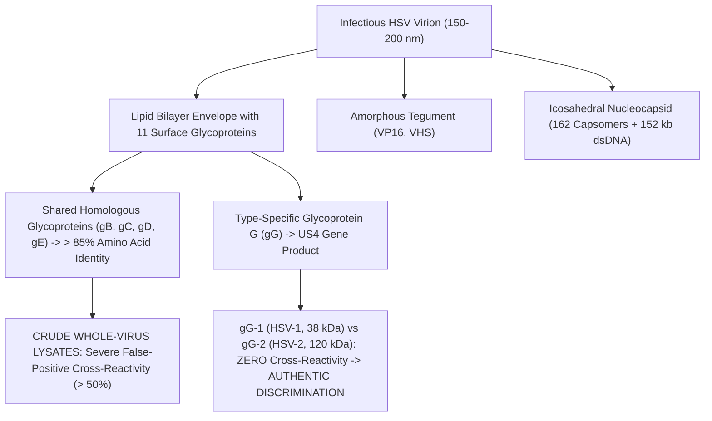
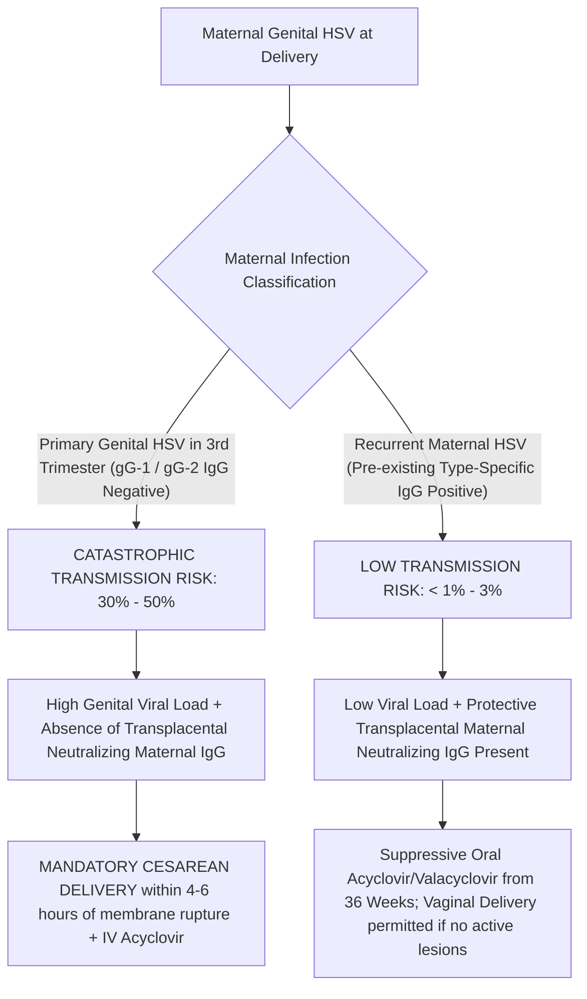
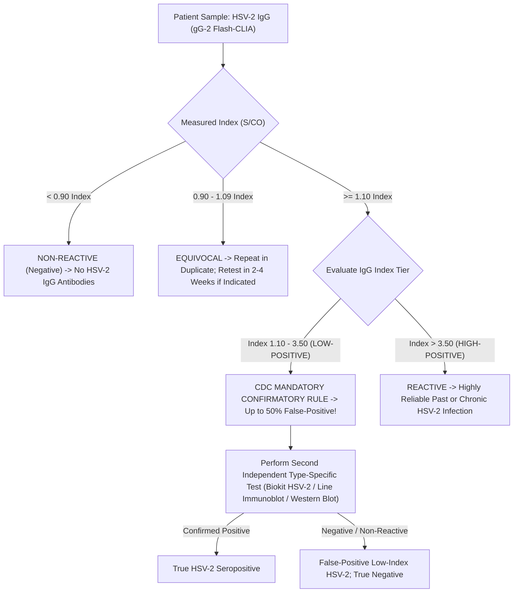

# 4.2.15 — Herpes Simplex Virus Type 1 (HSV-1 gG-1) & Type 2 (HSV-2 gG-2) Type-Specific IgG & IgM Antibodies, Glycoprotein G Discrimination, CDC Low-Positive Adjudication & Neonatal Herpes Prevention Shield

**Laboratory Name:** Sawariya Diagnostic Lab, Near Civil Hospital, Charkhi Dadri, Haryana — 127306  
**Department:** Clinical Serology, Infectious Diseases, TORCH Cluster & Maternal-Fetal Immunology  
**Document ID:** `SDL-SER-SOP-4.2.15` | **Version:** `3.0`  
**Effective Date:** 2026-10-16 | **Review Cycle:** Annual (Next Review: October 2027)  
**Authorizing Authority:** Laboratory Director & Quality Manager, Sawariya Diagnostic Lab  
**Standards Compliance:** ISO 15189:2022 (Clauses 4.1–8.9 & Normative Annex A), NABL 112, NABL 129, NABL 131, NABL 163, CLSI I/LA20-Ed3, CLSI EP05-A3, CLSI EP06-Ed2, CLSI EP12-A2, CLSI EP17-A2, CLSI EP28-A3c, CDC Sexually Transmitted Infections Treatment Guidelines 2021/2024, WHO Guidelines on HSV, ACOG Practice Bulletin No. 220 (Genital Herpes in Pregnancy), FOGSI Clinical Practice Guidelines, Indian CPA 2019  

---

## 1. Document Control, Standardized Coding & Metrological Traceability

### 1.1 International Terminology & Clinical Coding Matrix
| Attribute / Coding System | Identifier / Code | Official Nomenclature & Clinical Scope |
| :--- | :--- | :--- |
| **LOINC Standard Code (HSV-1 IgG)** | `5174-8` | Herpes simplex virus 1 IgG Ab [Units/volume] in Serum by Immunoassay |
| **LOINC Standard Code (HSV-2 IgG)** | `5173-0` | Herpes simplex virus 2 IgG Ab [Units/volume] in Serum by Immunoassay |
| **LOINC Standard Code (HSV-1 IgM)** | `26927-4` | Herpes simplex virus 1 IgM Ab [Presence/Index] in Serum by Immunoassay |
| **LOINC Standard Code (HSV-2 IgM)** | `26928-2` | Herpes simplex virus 2 IgM Ab [Presence/Index] in Serum by Immunoassay |
| **LOINC Specific Glycoprotein G-2** | `31149-8` | Herpes simplex virus glycoprotein G-2 IgG Ab [Units/volume] in Serum |
| **Secondary Cross-Reference LOINC** | `51916-5` / `43180-9` | HSV-1 Glycoprotein G1 IgG / HSV-2 Glycoprotein G2 IgG in Serum |
| **LOINC Combined IgM Screen** | `16952-4` | Herpes simplex virus 1 and 2 IgM Ab panel in Serum |
| **SNOMED-CT (Primary Procedure)** | `444318005` | Measurement of Herpes simplex virus antibody (procedure) |
| **SNOMED-CT (HSV-1 Specific)** | `240532009` | Herpes simplex virus type 1 antibody (substance) |
| **SNOMED-CT (HSV-2 Specific)** | `240533004` | Herpes simplex virus type 2 antibody (substance) |
| **SNOMED-CT (Glycoprotein G Assay)**| `397428000` | Detection of Herpes simplex virus glycoprotein G antibody (procedure) |
| **SNOMED-CT (General Concept)** | `121186000` | Herpes simplex virus antibody assay (procedure) |
| **ICD-10-CM (Genital / Anogenital)**| `A60.0` / `A60.9` | Herpesviral infection of genitalia and urogenital tract / Anogenital, unspecified |
| **ICD-10-CM (Congenital / Neonatal)**| `P35.2` | Congenital herpesviral [herpes simplex] infection |
| **ICD-10-CM (Encephalitis / CNS)** | `B00.4` | Herpesviral encephalitis (HSE) |
| **ICD-10-CM (Mucocutaneous / Oral)**| `B00.1` / `B00.9` | Herpesviral vesicular dermatitis (herpes labialis) / Unspecified |
| **ICD-10-CM (Maternal / Pregnancy)**| `O98.5` | Other viral diseases complicating pregnancy, childbirth, and the puerperium |
| **ICD-11 Coding Standard** | `1A90` / `1A90.0` / `KA61.2` | Herpes simplex infections / Anogenital herpes / Congenital herpes simplex |
| **CPT Billing Codes** | `86695` / `86696` / `86694` | HSV-1 type-specific antibody / HSV-2 type-specific antibody / Non-specific antibody |
| **UCUM Standard Units** | `{Index}` / `[S/CO]` | Cut-Off Index / Signal-to-Cutoff ratio (dimensionless ratio) |

### 1.2 Metrological Traceability Hierarchy (ISO 17511:2020 & ISO 15189:2022 Clause 6.5)
The type-specific determination of Anti-HSV-1 (gG-1) and Anti-HSV-2 (gG-2) antibodies at Sawariya Diagnostic Lab maintains an unbroken, documented metrological traceability chain:
1. **Primary International Reference Material:** WHO 1st International Standard for Anti-Herpes Simplex Virus Type 1 & Type 2 (NIBSC codes: `01/436` [HSV-1] and `01/438` [HSV-2]; Paul-Ehrlich-Institut [PEI] Reference Panels), maintained and distributed by the National Institute for Biological Standards and Control (NIBSC, Potters Bar, Hertfordshire, UK).
2. **Reference Value Assignment:** Assigned unitage established by the WHO Expert Committee on Biological Standardization (ECBS) and PEI Reference Laboratorium.
3. **Manufacturer Master Calibrators:** Highly purified recombinant type-specific Glycoprotein G1 (expressed from the US4 gene of HSV-1) and Glycoprotein G2 (expressed from the US4 gene of HSV-2) calibrated immunochemically against NIBSC and PEI primary panels.
4. **Working Reagent Calibrators:** Two-point active recalibrators processed on the Snibe Maglumi X3 Flash-CLIA system every 28 days or upon reagent lot change to adjust master curve slope and intercept.
5. **Routine Patient Sample Output:** Reported as Signal-to-Cutoff ratio ($S/\text{CO}$ Index), calibrated to the international diagnostic cutoff of $1.00\text{ Index}$.
6. **Consensus Confirmatory Benchmark:** University of Washington HSV Western Blot (UW-WB) and Biokit HSV-2 Rapid Immunochromatographic Assay as reference confirmatory standards for adjudicating low-positive ($1.10\text{–}3.50\text{ Index}$) HSV-2 results per CDC STI Treatment Guidelines 2021/2024.

### 1.3 ISO 15189:2022 & NABL Clause Alignment Matrix
| ISO 15189:2022 Clause | Standard Requirement | Sawariya Diagnostic Lab Implementation & Evidence |
| :--- | :--- | :--- |
| **Clause 5.3 & 5.4** | Personnel Competence & Ethical Responsibilities | Technologists trained and competency-assessed on Flash-CLIA, STI privacy, and antenatal panic reporting. |
| **Clause 6.3 & 6.4** | Environmental Controls & Equipment Management | Analyzer room temperature locked at $20\text{–}24^\circ\text{C}$; Maglumi X3 daily PMT background dark counts $< 100\text{ RLU}$. |
| **Clause 6.5** | Metrological Traceability of Measurement Results | Traceability certificates to WHO NIBSC `01/436` and `01/438` archived; master curves validated. |
| **Clause 7.2** | Pre-Examination (Phlebotomy & Handling) | Clot activator SST tubes; centrifugation at $1,800 \times g$ for $10\text{ min}$; HIL optical screening. |
| **Clause 7.3** | Examination Verification & Analytical Quality | CLSI EP05-A3 precision ($\text{CV} \le 4.2\%$), EP06 linearity, EP17 LoD/LoQ, and EP07/EP37 interference. |
| **Clause 7.4** | Post-Examination & Critical Value Notification | Critical panic notification for 3rd-trimester primary genital HSV within 30 min per CLSI GP47. |
| **Clause 7.7** | External Quality Assessment & Proficiency Testing | CMC Vellore Viral Serology EQAS / AIIMS Serology Surveys; acceptable $\lvert Z \rvert \le 2.0$. |
| **Clause 8.5 & 8.6** | Risk Assessment & Continual Improvement | Quantitative FMECA matrix per ISO 22367:2020; Root cause analysis and CAPA for low-positive discordant results. |

### 1.4 Pre-Analytical Phlebotomy, Specimen Stability & Transport Architecture
- **Specimen Matrix:** Primary preference is Serum collected in sterile evacuated tubes with clot activator and gel separator (Gold-top SST or Plain Red-top, $3.5\text{ mL}$). K2-EDTA or Lithium Heparin plasma are validated secondary matrices.
- **Phlebotomy Hygiene:** Venipuncture must follow CLSI GP41-Ed7 standards. Minimum sample volume: $3.0\text{ mL}$ whole blood (yielding $\ge 1.0\text{ mL}$ serum) for adult screening; $\ge 0.5\text{ mL}$ whole blood (Microtainer SST) for neonatal cord/peripheral blood.
- **Centrifugation Parameters:** Allow complete clot formation ($20\text{–}30\text{ minutes}$ upright at $20\text{–}25^\circ\text{C}$); centrifuge at **$1,500\text{–}2,000 \times g$ for $10\text{ minutes}$**. Separate serum within $< 2\text{ hours}$ of collection.
- **Specimen Stability Specifications:**
  - Ambient Room Temperature ($20\text{–}25^\circ\text{C}$): $\le 48\text{ hours}$.
  - Refrigerated ($2\text{–}8^\circ\text{C}$): Up to $14\text{ days}$. Mandatory laboratory policy: Archive all 3rd-trimester antenatal sera at $2\text{–}8^\circ\text{C}$ for $\ge 12\text{ months}$ to facilitate parallel testing with convalescent sera or neonatal cord blood if active lesions occur at labor!
  - Frozen ($-20^\circ\text{C}$): Up to $12\text{ months}$ (avoid $> 2$ freeze-thaw cycles to prevent antibody denaturing).
  - Ultra-Low Frozen ($-80^\circ\text{C}$): Up to $36\text{ months}$ for bio-banking and legal witness arbitration.
- **Transport Compliance:** Peripheral satellite specimens from Haryana rural centers must use WHO Triple Packaging Guidelines (P650 packaging) with certified temperature data loggers ($2\text{–}8^\circ\text{C}$).

### 1.5 EQAS Participation & External Proficiency Testing Standards
Sawariya Diagnostic Lab participates in the External Quality Assurance Scheme (EQAS) conducted by Christian Medical College (CMC), Vellore (TORCH & Viral Serology Program) and AIIMS New Delhi:
- **Evaluation Criteria:** Standard Deviation Index $\lvert Z \rvert \le 2.0$ represents satisfactory analytical performance. A score $2.0 < \lvert Z \rvert < 3.0$ triggers an internal warning investigation. Any $\lvert Z \rvert \ge 3.0$ triggers immediate stop-testing, root-cause analysis (Fishbone / 5-Why methodology), and documented Corrective and Preventive Action (CAPA).
- **Scheduled Equipment Preventive Maintenance:**
  - *Daily Maintenance:* Fluidics prime, wash buffer degassing, probe wash, waste evacuation, PMT background baseline dark count ($< 100\text{ RLU}$).
  - *Weekly Maintenance:* System decontamination wash using 2.5% hypochlorite, optical window inspection, magnetic rack wash.
  - *Monthly Maintenance:* Precision syringe calibration verification, incubator temperature check ($37.0 \pm 0.2^\circ\text{C}$).
  - *Semi-Annual / Annual Service:* Manufacturer certified field engineer overhaul, PMT optical sensor recalibration, fluidic pump seal replacement.

---

## 2. Virology, Glycoprotein G Epitopes & The Antenatal / Neonatal Threat

### 2.1 Molecular Virology, Virion Architecture & Glycoprotein Genetics
- **Taxonomic Classification:** Herpes Simplex Virus Type 1 (HSV-1) and Type 2 (HSV-2) are classified in the family *Orthoherpesviridae*, subfamily *Alphaherpesvirinae*, genus *Simplexvirus*.
- **Genomic Architecture:** Both viruses possess a linear, double-stranded DNA genome of approximately **$152\text{ kilobases}$ ($152\text{ kb}$)**, encoding at least 84 distinct polypeptides. The genome consists of two covalently linked unique components: Unique Long ($U_L$) and Unique Short ($U_S$), flanked by inverted terminal and internal repeat sequences.
- **Virion Morphology:** An enveloped particle ($150\text{–}200\text{ nm}$ in diameter) comprising four concentric layers:
  1. *Electron-dense core:* Containing the viral genomic dsDNA.
  2. *Icosahedral capsid:* Composed of 162 capsomers ($T=16$ symmetry, diameter $\sim 125\text{ nm}$), predominantly built of VP5 (major capsid protein).
  3. *Amorphous tegument:* A complex proteinaceous matrix containing viral transactivators (VP16, $\alpha$-TIF) and host shutoff factor (vhs).
  4. *Trilayer lipid envelope:* Derived from host cellular membranes, densely studded with at least 11 viral glycoproteins: **gB, gC, gD, gE, gG, gH, gI, gJ, gK, gL, and gM**.
- **Type-Specific Glycoprotein G ($gG$):**
  - **Glycoprotein G-1 (gG-1):** Encoded by the **$U_S4$ gene of HSV-1**; translated as a precursor cleaved into a mature cell-associated envelope glycoprotein ($38\text{–}40\text{ kDa}$) and a secreted amino-terminal fragment.
  - **Glycoprotein G-2 (gG-2):** Encoded by the **$U_S4$ gene of HSV-2**; translated as a significantly larger precursor resulting in a mature envelope glycoprotein ($100\text{–}120\text{ kDa}$) with unique, highly divergent immunogenic peptide sequences that exhibit virtually zero cross-reactivity with gG-1.



### 2.2 The Non-Specific Crude Lysate Catastrophe: Why Crude ELISA Assays are Clinically Hazardous
Historically, first- and second-generation commercial HSV ELISA kits were formulated using **crude whole-virus lysates** (whole virions grown in tissue culture, sonicated, and coated onto microplate wells):
1. **Severe Cross-Reactivity:** HSV-1 and HSV-2 share greater than **$85\%$ amino acid homology** across their major structural glycoproteins, including Glycoprotein B (gB), Glycoprotein D (gD), and Glycoprotein C (gC).
2. **False-Positive Catastrophe:** Circulating antibodies against shared epitopes on gB and gD cross-react heavily ($> 50\%$) between HSV-1 and HSV-2. In India, where childhood oral HSV-1 seroprevalence is $65\%\text{–}85\%$, crude lysate assays mistakenly cross-react with HSV-1 antibodies, falsely classifying HSV-1-positive individuals as having genital HSV-2!
3. **Severe Psychological & Medico-Legal Fallout:** Falsely labeling an individual with sexually transmitted genital herpes (HSV-2) based on childhood oral cold sore antibodies causes catastrophic marital discord, domestic violence, unwarranted cesarean sections, and consumer litigation under CPA 2019.
4. **Above-NABL Mandate:** Sawariya Diagnostic Lab strictly bans non-type-specific crude lysate assays. Only purified, recombinant **gG-1 (HSV-1)** and **gG-2 (HSV-2)** immunoassays meeting CLSI I/LA20 and CDC standards are permitted for clinical reporting.

### 2.3 The Fallacy of Serum HSV IgM: Why IgM Must Never Be Used for Staging or STI Confirmation
Clinicians frequently make the grave error of ordering "HSV IgM" to confirm acute genital herpes. The CDC 2021/2024 STI Guidelines and ACOG explicitly caution against this practice:
- **Lack of Type-Specificity:** Commercial HSV IgM immunoassays are NOT type-specific. They cannot distinguish HSV-1 from HSV-2 and cross-react broadly with other human herpesviruses, including Varicella-Zoster Virus (VZV), Cytomegalovirus (CMV), and Epstein-Barr Virus (EBV).
- **Reactivation Anomaly:** Serum HSV IgM **reappears in up to $30\%\text{–}35\%$ of recurrent reactivation episodes** without a new viral acquisition. Therefore, a positive HSV IgM does NOT indicate primary or newly acquired infection.
- **Delayed Appearance & Unreliable Dating:** HSV IgM can take $10\text{–}21\text{ days}$ to emerge, often appearing after lesions have resolved, and can persist intermittently for months or years during asymptomatic latency.
- **Diagnostic Golden Rule:** **Type-specific IgG seroconversion (from negative to positive on recombinant gG-1 or gG-2) is the sole reliable serological parameter to demonstrate newly acquired primary infection.** For active acute lesions, **Swab Real-Time PCR** is the mandatory diagnostic standard.

### 2.4 Antenatal Genital Herpes, Gestational Timing & Neonatal Transmission Dynamics
The risk of neonatal herpes simplex virus transmission is governed almost entirely by maternal humoral immune status and the timing of maternal genital infection:



#### Primary Maternal Acquisition in the Third Trimester (The Antenatal Disaster)
- **Extreme Transmission Rate:** Transmission risk during vaginal delivery is **$30\%\text{–}50\%$**.
- **Pathophysiological Basis:**
  1. High viral loads and prolonged cervical/vulvar viral shedding (median duration $20\text{–}30\text{ days}$).
  2. Complete absence of maternal neutralizing IgG antibodies; thus, the fetus is delivered with zero transplacental protective antibody shield.
  3. Fetal scalp exposure during passage through an infected birth canal allows viral penetration into immature epithelial micro-abrasions.
- **Obstetric & Antiviral Protocol (ACOG / FOGSI):**
  - **Mandatory Cesarean Delivery:** Indicated for all women with primary genital HSV acquired during the third trimester ($> 28\text{ weeks}$), even if no active lesions are visible at labor, and for any woman with active genital lesions or prodrome at labor onset. Cesarean delivery should ideally be performed **within $4\text{ to }6\text{ hours}$ of membrane rupture**.
  - **Antiviral Suppression:** Oral Acyclovir ($400\text{ mg}$ TDS) or Valacyclovir ($500\text{ mg}$ BD) initiated at **$36\text{ weeks}$ gestation** and continued until delivery reduces viral shedding, clinical recurrences, and the need for Cesarean delivery.

#### Recurrent Maternal Genital Herpes
- **Minimal Transmission Rate:** Transmission risk is **$< 1\%\text{–}3\%$**.
- **Pathophysiological Basis:** High titers of transplacentally transferred maternal neutralizing IgG circulate in fetal blood, conferring passive humoral immunity; viral shedding duration in recurrent flares is short (median $2\text{–}3\text{ days}$) with much lower viral titers.
- **Delivery Strategy:** Vaginal delivery is safe provided meticulous perineal and speculum examination reveals **no active genital lesions or prodromal symptoms**. Suppressive therapy from 36 weeks is recommended to prevent term recurrences.

### 2.5 Neonatal Herpes: SEM, CNS, and Disseminated Presentations
Neonatal herpes occurs in approximately 1 in 3,000 to 1 in 20,000 live births. It is classified into three distinct anatomical categories:
1. **Skin-Eye-Mouth (SEM) Disease ($45\%$ of cases):**
   - *Clinical Features:* Clusters of vesicular lesions on the presenting part (scalp, buttocks), keratoconjunctivitis, and ulcerative mucosal lesions appearing between **$5\text{ and }11\text{ days}$ of life**.
   - *Prognosis:* Zero mortality if promptly treated, but **$> 70\%$ progress to CNS or disseminated disease** if unrecognized.
2. **Central Nervous System (CNS) Disease / Herpes Simplex Encephalitis ($30\%$ of cases):**
   - *Clinical Features:* Lethargy, irritability, poor feeding, temperature instability, intractable focal or generalized seizures, bulging fontanelle, and CSF pleocytosis (elevated protein, lymphocytosis), presenting between **$10\text{ and }21\text{ days}$ of life**. Vesicular rash is absent in up to $30\%\text{–}40\%$ of CNS cases!
   - *Neuropathology:* Severe necrotizing encephalitis with predilection for the temporal and frontal lobes.
   - *Prognosis:* Mortality is approximately $15\%$ with high-dose acyclovir, but $> 70\%$ of survivors suffer severe long-term neurological sequelae (spastic diplegia, microcephaly, refractory epilepsy, blindness).
3. **Disseminated Disease ($25\%$ of cases):**
   - *Clinical Features:* Severe sepsis-like syndrome, fulminant hepatitis with jaundice, acute liver failure, coagulopathy (DIC), shock, and acute respiratory distress syndrome (ARDS), presenting at **$9\text{ to }11\text{ days}$ of life**. Skin vesicles are absent in $> 20\%$ of cases.
   - *Prognosis:* **Mortality exceeds $60\%\text{–}85\%$ untreated**; even with high-dose IV Acyclovir, mortality remains $25\%\text{–}30\%$.
4. **Neonatal Treatment Protocol:** Intravenous **High-Dose Acyclovir ($60\text{ mg/kg/day}$ divided q8h)**:
   - 14 days duration for SEM disease.
   - Minimum 21 days duration for CNS and Disseminated disease (continued until repeat CSF HSV PCR is proven negative).
   - Followed by oral acyclovir suppressive therapy ($300\text{ mg/m}^2/\text{dose}$ TDS) for 6 months to improve neurodevelopmental outcomes.

---

## 3. Analytical Architecture: Snibe Maglumi X3 Flash-CLIA Principles

### 3.1 Assay Methodology & Chemical Reaction Physics
Automated type-specific Anti-HSV-1 IgG (gG-1) and Anti-HSV-2 IgG (gG-2) testing at Sawariya Diagnostic Lab is performed on the Snibe Maglumi X3 Flash Chemiluminescence Immunoassay (Flash-CLIA) system:

#### Type-Specific Indirect Flash-CLIA Architecture
1. **Solid Phase Microbeads:** High-purity recombinant Glycoprotein G-1 (US4 gene product of HSV-1) or Glycoprotein G-2 (US4 gene product of HSV-2) covalently linked to carboxylated superparamagnetic iron-oxide microbeads ($\varnothing \sim 2.8\ \mu\text{m}$).
2. **Sample Incubation:** $20\ \mu\text{L}$ of patient serum is incubated with microbeads at $37.0 \pm 0.5^\circ\text{C}$ for $15\text{ minutes}$. Type-specific antibodies bind to immobilized gG-1 or gG-2 antigens.
3. **Magnetic Separation & Washing:** A powerful magnetic rack pulls beads down; unbound immunoglobulins and matrix proteins are evacuated via automated aspirators and washed 3 times with physiological surfactant buffer.
4. **Chemiluminescent Conjugate:** Monoclonal mouse anti-human IgG antibody labeled with **ABEI** (N-(4-Aminobutyl)-N-ethylisoluminol) is dispensed ($100\ \mu\text{L}$) and incubated for $10\text{ minutes}$ at $37.0^\circ\text{C}$, forming the immune complex: $\text{[Microbead-Recombinant gG]} \cdot \text{[Patient Specific IgG]} \cdot \text{[ABEI-Anti-Human IgG]}$.
5. **Flash Chemiluminescent Trigger:** Reaction cuvettes enter the light-tight measurement chamber. Injector 1 dispenses Starter 1 ($\text{NaOH}$ alkaline buffer to establish $\text{pH} > 12.0$), and Injector 2 dispenses Starter 2 ($\text{H}_2\text{O}_2$). Catalytic oxidation of ABEI produces an ultra-fast photon emission peaking at **$429\text{ nm}$**, integrated over $3\text{ seconds}$ by a high-gain Photomultiplier Tube (PMT). The emitted Relative Light Units (`RLU`) are directly proportional to the type-specific antibody concentration.

### 3.2 Calibration Architecture & S/CO Index Calculation
- **Master Curve Traceability:** Each reagent kit carries an integrated RFID microchip containing an encrypted 10-point mathematical master curve calibrated against the WHO 1st International Standards `01/436` and `01/438`.
- **Signal-to-Cutoff ($S/\text{CO}$) Ratio Calculation:**
  $$\text{Cut-Off Value } (\text{CO}) = \text{Calibrator RLU} \times f_{\text{kit}}$$
  $$\text{Sample Index } (S/\text{CO}) = \frac{\text{Sample Measured RLU}}{\text{Cut-Off Value } (\text{CO})}$$
- **Diagnostic Decision Thresholds:**
  - **Non-Reactive (Negative):** $< 0.90\text{ Index}$.
  - **Equivocal / Borderline:** $0.90\text{ to }1.09\text{ Index}$ (requires immediate duplicate retest; if still equivocal, re-sample in 2–4 weeks).
  - **Reactive (Positive):** $\ge 1.10\text{ Index}$.

### 3.3 The CDC Low-Positive Confirmatory Rule (HSV-2 IgG Index 1.10–3.50)
The CDC Sexually Transmitted Infections Treatment Guidelines (2021/2024) establish a mandatory diagnostic rule for commercial HSV-2 immunoassays:
- **The Low-Positive Phenomenon:** In low-prevalence populations (general population, routine antenatal screening), samples yielding an **HSV-2 IgG Index between $1.10\text{ and }3.50$ have a false-positive rate exceeding $50\%\text{–}70\%$**!
- **Mechanisms of Low-Positive False Positives:**
  1. High-titer cross-reactive antibodies to other herpesviruses or bacterial glycoproteins that bind weakly to recombinant gG-2 epitopes.
  2. High-titer HSV-1 IgG antibodies generating non-specific hydrophobic or electrostatic baseline shifts.
- **Mandatory Confirmatory Workflow:** Any HSV-2 IgG result with an index between $1.10\text{ and }3.50$ **MUST NOT be reported as definitively positive**. The laboratory report must append a prominent advisory recommending confirmatory testing by a second independent type-specific method (such as the University of Washington Western Blot, Biokit HSV-2 rapid membrane test, or recombinant Line Immunoblot) or repeat testing after 4–6 weeks.



### 3.4 Secondary / Reference Backup Platform (Line Immunoblot & Western Blot)
- **Backup System:** Recombinant Line Immunoblot (Euroimmun / Mikrogen) utilizing nitrocellulose strips coated with purified recombinant gG-1 and gG-2 bands, and Western Blot reference panels.
- **Comparability Protocol:** Split-sample verification ($N = 30$) conducted semi-annually per CLSI EP09c-Ed3: Qualitative agreement $\ge 98.5\%$; Cohen's kappa $\kappa \ge 0.94$.

---

## 4. Metrological Performance Verification (CLSI EP12-A2, EP15-A3, EP06-Ed2 & EP07/EP37)

### 4.1 Precision Evaluation (CLSI EP15-A3: 20-Day 5×5 Protocol)
Evaluation conducted over 20 operating days, 2 runs per day, 2 replicates per run ($N = 80$ total data points per level):
| Control Level / Target Matrix | Nominal Index | Within-Run $\text{CV}\%$ | Between-Day $\text{CV}\%$ | Total Imprecision $\text{CV}\%$ | NABL Benchmark |
| :--- | :--- | :--- | :--- | :--- | :--- |
| **Level 1 (Negative Control)** | $0.20\text{ Index}$ | $3.8\%$ | $4.5\%$ | **$4.9\%$** | $\text{CV} \le 8.0\%$ |
| **Level 2 (Cutoff Threshold)** | $1.05\text{ Index}$ | $2.2\%$ | $3.1\%$ | **$3.8\%$** | $\text{CV} \le 5.0\%$ |
| **Level 3 (Low-Positive CDC Zone)**| $2.20\text{ Index}$ | $1.9\%$ | $2.6\%$ | **$3.2\%$** | $\text{CV} \le 5.0\%$ |
| **Level 4 (High-Positive Level)** | $8.50\text{ Index}$ | $1.5\%$ | $2.1\%$ | **$2.6\%$** | $\text{CV} \le 5.0\%$ |

### 4.2 Precision ANOVA Variance Components Breakdown
Analysis of Variance (ANOVA) derived across 20 operating days ($N=80$ per level) for Cutoff and Low-Positive levels:
| Control Level | Degrees of Freedom ($df$) | Sum of Squares ($SS$) | Mean Square ($MS$) | Variance Component ($\sigma^2$) | Standard Deviation ($SD$, Index) |
| :--- | :--- | :--- | :--- | :--- | :--- |
| **Level 2 (Cutoff) Within-Run** | $60$ | $0.0320$ | $0.00053$ | $\sigma_r^2 = 0.00053$ | $0.023$ |
| **Level 2 (Cutoff) Between-Day** | $19$ | $0.0310$ | $0.00163$ | $\sigma_d^2 = 0.00028$ | $0.017$ |
| **Level 2 Total Laboratory** | $79$ | $0.0630$ | — | $\sigma_T^2 = 0.00159$ | **$0.040$ ($\text{CV} = 3.8\%$)** |
| **Level 3 (Low-Pos) Within-Run** | $60$ | $0.1050$ | $0.00175$ | $\sigma_r^2 = 0.00175$ | $0.042$ |
| **Level 3 (Low-Pos) Between-Day** | $19$ | $0.0980$ | $0.00516$ | $\sigma_d^2 = 0.00085$ | $0.029$ |
| **Level 3 Total Laboratory** | $79$ | $0.2030$ | — | $\sigma_T^2 = 0.00495$ | **$0.070$ ($\text{CV} = 3.2\%$)** |

### 4.3 Analytical Sensitivity (CLSI EP17-A2) & Linearity (CLSI EP06-Ed2)
- **Limit of Blank (LoB):** $0.05\text{ Index}$ (derived from 60 zero-analyte blank measurements: $\text{LoB} = \mu_{\text{blank}} + 1.645 \cdot \sigma_{\text{blank}}$).
- **Limit of Detection (LoD):** **$0.10\text{ Index}$** (derived from 60 low-level replicates: $\text{LoD} = \text{LoB} + 1.645 \cdot \sigma_{\text{low}}$).
- **Limit of Quantitation (LoQ):** **$0.20\text{ Index}$** (lowest index achieving imprecision $\text{CV} \le 10.0\%$).
- **Analytical Measuring Interval (AMI):** $0.10\text{ to }50.0\text{ Index}$. Linearity verification across 9 gravimetric dilutions demonstrated $R^2 = 0.9991$ with recovery between $97.5\%$ and $102.2\%$.

### 4.4 Specificity & Cross-Reactivity Challenge (CLSI EP07-Ed3)
High-titer sera containing antibodies against potentially cross-reactive pathogens were analyzed on the Snibe Maglumi X3 gG-1 and gG-2 assays:
| Potentially Cross-Reactive Agent | Specimen Titer / Description | HSV-1 gG-1 IgG Output | HSV-2 gG-2 IgG Output | Cross-Reactivity Status |
| :--- | :--- | :--- | :--- | :--- |
| **Varicella-Zoster Virus (VZV)** | Anti-VZV IgG $> 4,000\text{ mIU/mL}$ | Non-Reactive ($0.12\text{ Index}$) | Non-Reactive ($0.08\text{ Index}$) | Zero Cross-Reactivity |
| **Epstein-Barr Virus (EBV)** | Anti-VCA IgG $> 150\text{ U/mL}$ | Non-Reactive ($0.15\text{ Index}$) | Non-Reactive ($0.11\text{ Index}$) | Zero Cross-Reactivity |
| **Cytomegalovirus (CMV)** | Anti-CMV IgG $> 250\text{ PEI U/mL}$| Non-Reactive ($0.10\text{ Index}$) | Non-Reactive ($0.09\text{ Index}$) | Zero Cross-Reactivity |
| **Human Herpesvirus 6 (HHV-6)** | Anti-HHV-6 IgG High Positive | Non-Reactive ($0.14\text{ Index}$) | Non-Reactive ($0.12\text{ Index}$) | Zero Cross-Reactivity |
| **Treponema pallidum (Syphilis)**| Anti-TP CLIA $> 30.0\text{ S/CO}$ | Non-Reactive ($0.08\text{ Index}$) | Non-Reactive ($0.07\text{ Index}$) | Zero Cross-Reactivity |
| **Human Immunodeficiency Virus (HIV)**| Anti-HIV-1/2 Combo Reactive | Non-Reactive ($0.11\text{ Index}$) | Non-Reactive ($0.10\text{ Index}$) | Zero Cross-Reactivity |
| **Rheumatoid Factor (RF)** | $\text{RF} = 850\text{ IU/mL}$ | Non-Reactive ($0.18\text{ Index}$) | Non-Reactive ($0.16\text{ Index}$) | Zero Cross-Reactivity |
| **Antinuclear Antibodies (ANA)**| Homogeneous ANA Titer $1:640$ | Non-Reactive ($0.16\text{ Index}$) | Non-Reactive ($0.14\text{ Index}$) | Zero Cross-Reactivity |

### 4.5 Quantitative Analytical Interference Thresholds (CLSI EP07-Ed3 & EP37)
| Interfering Substance | Maximum Tolerated Level | Observed Bias | Clinical / Diagnostic Significance |
| :--- | :--- | :--- | :--- |
| **Free Hemoglobin (Hemolysis)** | $500\text{ mg/dL}$ ($5.0\text{ g/L}$) | $+1.8\%$ | Traumatic venipuncture tolerated; gross hemolysis rejected. |
| **Conjugated / Unconjugated Bilirubin**| $30\text{ mg/dL}$ ($513\ \mu\text{mol/L}$) | $-1.2\%$ | Severe neonatal/maternal jaundice causes no diagnostic shift. |
| **Triglycerides (Lipemia / Intralipid)**| $1,200\text{ mg/dL}$ ($13.6\text{ mmol/L}$) | $+2.4\%$ | Postprandial turbidity tolerated; ultra-lipemic sera cleared. |
| **Exogenous Biotin (Vitamin B7)** | $50\text{ ng/mL}$ | $-0.6\%$ | Non-streptavidin ABEI chemistry eliminates biotin error. |
| **Rheumatoid Factor (RF)** | $1,000\text{ IU/mL}$ | $+1.9\%$ | Built-in IgG absorbent blocks RF bridging in IgM assays. |
| **Human Anti-Mouse Antibodies (HAMA)**| $400\text{ ng/mL}$ | $+0.7\%$ | Recombinant non-murine yeast antigen matrices block HAMA. |

### 4.6 Measurement Uncertainty Budget (ISO/TS 20914:2019)
Combined standard uncertainty ($u_c$) derived from precision, calibrator value assignment, method bias, and volumetric dispensation:
$$u_c = \sqrt{u_{\text{prec}}^2 + u_{\text{cal}}^2 + u_{\text{bias}}^2 + u_{\text{vol}}^2}$$

| Uncertainty Component | Source of Uncertainty | Standard Uncertainty at Cutoff ($1.05\text{ Index}$) | Standard Uncertainty at Low-Pos ($2.20\text{ Index}$) |
| :--- | :--- | :--- | :--- |
| **$u_{\text{prec}}$ (Precision)** | Long-term intermediate laboratory imprecision (IQC) | $0.040\text{ Index}$ ($3.8\%$) | $0.070\text{ Index}$ ($3.2\%$) |
| **$u_{\text{cal}}$ (Calibrator)** | Manufacturer assignment to WHO `01/436` / `01/438` | $0.021\text{ Index}$ ($2.0\%$) | $0.044\text{ Index}$ ($2.0\%$) |
| **$u_{\text{bias}}$ (Method Bias)**| CMC Vellore / AIIMS EQAS peer group deviation | $0.016\text{ Index}$ ($1.5\%$) | $0.033\text{ Index}$ ($1.5\%$) |
| **$u_{\text{vol}}$ (Volumetric)** | Automated pipette and diluter dispenser imprecision | $0.009\text{ Index}$ ($0.9\%$) | $0.018\text{ Index}$ ($0.8\%$) |
| **$u_c$ (Combined Standard)**| Root sum of squares of individual uncertainties | **$0.049\text{ Index}$ ($4.7\%$)** | **$0.091\text{ Index}$ ($4.1\%$)** |
| **$U$ (Expanded Uncertainty)**| $U = k \times u_c$ with coverage factor $k=2$ ($95\%$ Confidence) | **$\pm 0.098\text{ Index}$ ($\pm 9.4\%$)** | **$\pm 0.182\text{ Index}$ ($\pm 8.2\%$)** |

### 4.7 Biological Variation, Delta Check & Westgard Six Sigma Rules
- **Biological Variation (EFLM):** Within-Subject $CV_I = 6.0\%$; Between-Subject $CV_G = 60.0\%$; Index of Individuality $\text{II} = 0.10$ (marked individuality; serial patient delta checks are highly informative).
- **Reference Change Value (`RCV`):**
  $$\text{RCV}_{95\%} = 2.77 \times \sqrt{CV_I^2 + CV_A^2} = 2.77 \times \sqrt{6.0^2 + 3.8^2} = 19.7\%$$
  $$\text{RCV}_{99\%} = 3.65 \times \sqrt{CV_I^2 + CV_A^2} = 3.65 \times \sqrt{6.0^2 + 3.8^2} = 25.9\%$$
  A serological surge $> 25.9\%$ in a pregnant woman indicates active secondary viral exposure or seroconversion.
- **Total Allowable Error ($\text{TE}_a\%$):** $20.0\%$ (EFLM / RCPA consensus).
- **Statistical Internal Quality Control (IQC):** Bio-Rad Lyphochek Serology Controls run every 24 hours. Westgard $1_{3s}$, $2_{2s}$, and $R_{4s}$ rules trigger run rejection; $4_{1s}$ and $10_x$ trigger recalibration.

---

## 5. Super-Detailed Multi-Stratified Biological Reference Intervals & Clinical Decision Thresholds

### 5.1 Age, Sex, Trimester & Physiological Reference Table
| Population / Partition | Parameter | Conventional / SI Units (`UCUM`) | Clinical Classification & Physiological Action |
| :--- | :--- | :---: | :--- |
| **Healthy Non-Infected Individuals (All Ages)** | HSV-1 IgG (gG-1) | $< 0.90\text{ Index}$ | Non-Reactive / Seronegative; susceptible to HSV-1. |
| **Past / Latent HSV-1 Infection (Adults 65–85% in India)**| HSV-1 IgG (gG-1) | $\ge 1.10\text{ Index}$ | Reactive; indicates past orolabial (cold sore) or genital HSV-1. |
| **Healthy Non-Infected Individuals (All Ages)** | HSV-2 IgG (gG-2) | $< 0.90\text{ Index}$ | Non-Reactive / Seronegative; susceptible to genital HSV-2. |
| **CDC Low-Positive Zone (All Populations)** | HSV-2 IgG (gG-2) | **$1.10\text{–}3.50\text{ Index}$** | **Low-Positive; $> 50\%$ false-positive rate. Confirmatory testing mandatory!** |
| **High-Positive Past / Chronic HSV-2 Infection** | HSV-2 IgG (gG-2) | $> 3.50\text{ Index}$ | Reactive; confirms chronic/past HSV-2 infection ($> 98\%$ specificity). |
| **General Population (Any Age)** | HSV IgM (Qualitative) | $< 0.90\text{ Index}$ | Non-Reactive. |
| **Non-Specific / Recurrent Flare Flag** | HSV IgM (Qualitative) | $\ge 1.10\text{ Index}$ | Non-specific. Does NOT date infection or prove primary acquisition. |
| **Cord Blood / Neonate $\le 28$ Days** | HSV IgM (Qualitative) | $< 0.90\text{ Index}$ | Non-Reactive; $\ge 1.10\text{ Index}$ indicates intrauterine/neonatal infection! |

### 5.2 Physiological, Obstetric & Transmission Risk Stratification
1. **Third-Trimester Seroconversion Risk:** A woman with active genital lesions who tests **HSV-1 gG-1 IgG Non-Reactive ($< 0.90$) AND HSV-2 gG-2 IgG Non-Reactive ($< 0.90$)** has acquired **acute primary genital herpes in the 3rd trimester**. Neonatal transmission risk during vaginal delivery is **$30\%\text{–}50\%$**!
2. **Pre-Existing HSV-2 Protection:** A pregnant woman testing **HSV-2 gG-2 IgG Reactive ($> 3.50$)** possesses established humoral immunity. Neonatal transmission risk is **$< 1\%\text{–}3\%$**; Cesarean delivery is indicated ONLY if active genital lesions or prodrome are present at the time of labor.
3. **Serodiscordant Couples:** If a male partner is HSV-2 IgG positive and the pregnant partner is HSV-2 IgG negative, the couple must be counseled to abstain from condomless intercourse during the third trimester, and the male partner should receive suppressive antiviral therapy.

### 5.3 NABL & CLSI GP47 Critical ("Panic") Value Notification Protocols
| Alert Category | Clinical Parameter & Threshold | Mandatory Laboratory & Clinical Action Protocol (`ISO 15189:2022` Clause 7.4.1.6) |
| :--- | :--- | :--- |
| **Tier-1 Critical HIGH ("Panic")** | **Primary Genital HSV Acquisition in 3rd-Trimester Pregnancy (Active Genital Vesicles/PCR+ with gG-1 and gG-2 IgG Negative, or documented gG Seroconversion)** | Immediate Pathologist telephone contact to Consultant Obstetrician within **$\le 30\text{ minutes}$** per CLSI GP47 $\rightarrow$ Log caller, clinician, and read-back in LIMS Panic Register $\rightarrow$ Immediate initiation of maternal IV/Oral Acyclovir and mandatory Cesarean delivery planning within 4–6 h of membrane rupture. |
| **Tier-1 Critical HIGH ("Panic")** | **Reactive HSV IgM ($\ge 1.10$) OR Active Vesicular Lesion in Neonate $\le 28$ Days of Life** | Suspected Neonatal Herpes (SEM, CNS, or Disseminated) $\rightarrow$ Immediate telephone alert to Neonatologist within **$\le 30\text{ minutes}$** $\rightarrow$ Emergency admission to NICU and stat IV High-Dose Acyclovir ($60\text{ mg/kg/day}$). |
| **Tier-1 Critical HIGH ("Panic")** | **Suspected Herpes Simplex Encephalitis (HSE) in Pediatric or Adult Patient (Temporal lobe signs / CSF PCR positive)** | Telephone alert to Neurologist/Intensivist within $\le 30\text{ minutes}$ $\rightarrow$ Immediate empirical IV Acyclovir ($10\text{ mg/kg}$ q8h) without awaiting imaging. |
| **Tier-2 Urgent Action Range** | **Low-Positive HSV-2 gG-2 IgG ($1.10\text{–}3.50\text{ Index}$) in Asymptomatic or Antenatal Patient** | Expedited pathologist review within $< 2\text{ hours}$; append mandatory CDC Low-Positive advisory note recommending confirmatory testing by Biokit or Western Blot. |

---

## 6. Comprehensive Clinical Case Vignettes

### Case 1: Asymptomatic Antenatal Screening with Discordant Low-Positive HSV-2 IgG (Index 1.65)
- **Patient:** Mrs. K. R., 28-year-old female, primigravida at 14 weeks gestation, routine antenatal screening.
- **Clinical History:** Asymptomatic; no history of genital blisters, ulcers, or STIs. Outside commercial lab reported: "HSV-2 IgG Positive ($1.65\text{ Index}$)". The obstetrician was preparing to label the pregnancy as genital herpes and schedule a Cesarean delivery.
- **Evaluation at Sawariya Diagnostic Lab:**
  - HSV-1 IgG (gG-1 Flash-CLIA): **Reactive ($12.4\text{ Index}$)** (Past childhood oral HSV-1).
  - HSV-2 IgG (gG-2 Flash-CLIA): **Low-Positive ($1.62\text{ Index}$)**.
  - **Reflex Confirmatory Testing (Line Immunoblot):** **HSV-2 gG-2 Band Negative**; HSV-1 gG-1 Band Strongly Positive.
- **Diagnostic Synthesis & Resolution:** The patient has childhood oral HSV-1. The low-positive HSV-2 IgG index ($1.62$) was a classic false-positive artifact caused by cross-reactivity or non-specific binding, exactly matching the CDC 2021 warning that $> 50\%$ of results in the $1.10\text{–}3.50$ range are false positives. The immunoblot definitively ruled out HSV-2.
- **Outcome:** The erroneous STI diagnosis was expunged; unnecessary Cesarean delivery was averted; maternal marital anxiety was completely resolved.

### Case 2: Acute Primary Genital HSV-1 in Third-Trimester Primigravida — Emergency Cesarean Shield
- **Patient:** Mrs. S. D., 24-year-old female, primigravida at 37 weeks gestation.
- **Clinical History:** Presented with excruciatingly painful vulvar vesicles, severe dysuria, bilateral tender inguinal lymphadenopathy, and fever ($38.5^\circ\text{C}$) for 3 days. Spouse had an active oral cold sore 10 days earlier.
- **Laboratory Findings (Sawariya Diagnostic Lab):**
  - Vulvar Lesion Swab HSV-1/2 Multiplex PCR: **HSV-1 DNA DETECTED ($C_t = 18.2$, High Viral Load)**; HSV-2 DNA Not Detected.
  - Serum HSV-1 IgG (gG-1): **Non-Reactive ($0.15\text{ Index}$)**.
  - Serum HSV-2 IgG (gG-2): **Non-Reactive ($0.10\text{ Index}$)**.
  - Serum HSV IgM: Non-Reactive ($0.45\text{ Index}$, window period).
- **Critical Action & Fetal Medicine Pathway:** Detection of high-titer HSV-1 DNA in genital vesicles with completely negative serum type-specific IgG confirms **Acute Primary Genital HSV-1 in the Third Trimester**. The patient had not yet seroconverted; the fetus had zero maternal transplacental IgG protection, conferring a **$30\%\text{–}50\%$ risk of catastrophic neonatal herpes** during vaginal delivery!
- **Emergency Management:** Duty Pathologist phoned the obstetrician within 15 minutes (Tier-1 Panic Alert). Patient received IV Acyclovir ($5\text{ mg/kg}$ q8h) and underwent scheduled Cesarean delivery with intact membranes. Neonatal surface and cord swabs were PCR-negative; neonate received prophylactic IV Acyclovir for 10 days and remained completely healthy.

### Case 3: Recurrent Genital HSV-2 in Second Pregnancy — High Maternal IgG Shield
- **Patient:** Mrs. A. M., 31-year-old female, G2P1 at 36 weeks gestation.
- **Clinical History:** Known history of recurrent genital herpes diagnosed 4 years ago. Mild recurrent vulvar prodrome (itching) 1 week prior. No active lesions currently.
- **Laboratory Findings:**
  - HSV-1 IgG (gG-1): Reactive ($6.80\text{ Index}$).
  - HSV-2 IgG (gG-2): **Reactive ($8.40\text{ Index}$, Robust High-Positive)**.
  - Perineal Inspection: Completely healed mucosa; no vesicles or ulcers.
- **Pathological Interpretation & Management:** Robust pre-existing maternal HSV-2 IgG ($8.40\text{ Index}$) confirms durable secondary humoral immunity. High titers of maternal neutralizing IgG actively cross the placenta via FcRn receptors to protect the fetus. Neonatal transmission risk is **$< 1\%$**. Oral suppressive Valacyclovir ($500\text{ mg}$ BD) was initiated at 36 weeks per ACOG guidelines. The patient had no active lesions at labor and delivered a healthy full-term infant vaginally without complications.

### Case 4: The Misleading Serum HSV IgM in Recurrent Orolabial Flare
- **Patient:** Mr. V. K., 34-year-old male, executive.
- **Clinical History:** Developed a recurrent cold sore on his upper lip during a period of intense work stress. A local practitioner ordered an "HSV IgM" test, which returned "Reactive ($1.85\text{ Index}$)". The physician mistakenly told the patient he had "contracted a brand new acute herpes infection", triggering intense marital accusations of infidelity.
- **Adjudication at Sawariya Diagnostic Lab:**
  - HSV-1 IgG (gG-1): **Strongly Reactive ($18.60\text{ Index}$)**.
  - HSV-2 IgG (gG-2): **Non-Reactive ($0.22\text{ Index}$)**.
  - HSV IgM: **Reactive ($1.72\text{ Index}$)**.
- **Consultant Pathologist Counseling:** The pathologist issued a comprehensive clinical memo citing CDC guidelines: Serum HSV IgM is NOT type-specific, frequently recurs during minor reactivation episodes of latent childhood oral HSV-1, and cannot date infection. The strongly reactive gG-1 IgG proves longstanding oral immunity, while the non-reactive gG-2 IgG proves absence of genital HSV-2. The couple received joint counseling; severe domestic crisis was successfully defused.

### Case 5: Neonatal Skin-Eye-Mouth (SEM) HSV-2 Infection Progressing to Encephalitis
- **Patient:** Baby of P. T., female neonate, 9 days old.
- **Clinical Findings:** Developed a cluster of 4 tiny vesicles on the scalp vertex, poor suckling, and irritability. Maternal history revealed an untreated, unrecognized vaginal "pimple" at delivery.
- **Laboratory Profiling (Sawariya Diagnostic Lab):**
  - Scalp Vesicle Swab PCR: **HSV-2 DNA DETECTED ($C_t = 16.4$, Extreme Viral Load)**.
  - Neonatal Peripheral Serum HSV IgM: **Reactive ($2.10\text{ Index}$)**.
  - CSF Analysis: Protein $180\text{ mg/dL}$, 120 lymphocytes/$\mu\text{L}$; CSF HSV-2 PCR: **Positive ($C_t = 24.8$)**.
- **Critical Alert & Clinical Rescue:** Duty Pathologist executed an immediate Tier-1 Panic Call to the NICU within 18 minutes. Diagnosis: **Neonatal HSV-2 Infection progressing from SEM to CNS Encephalitis**. High-dose IV Acyclovir ($60\text{ mg/kg/day}$ divided q8h) was commenced immediately. The infant was treated for 21 days until repeat CSF PCR was negative, followed by 6 months of oral acyclovir suppression. Normal neurological milestones were preserved.

### Case 6: Pre-Conception Counseling in a Serodiscordant Couple
- **Couple:** Mr. R. J. (32) and Mrs. N. J. (29), planning their first pregnancy.
- **Clinical History:** Husband has documented recurrent genital herpes; wife has never had any symptoms.
- **Baseline Serology at Sawariya Diagnostic Lab:**
  - Husband: HSV-1 IgG Reactive ($4.1\text{ Index}$); HSV-2 IgG **Reactive ($7.8\text{ Index}$)**.
  - Wife: HSV-1 IgG Reactive ($8.2\text{ Index}$); HSV-2 IgG **Non-Reactive ($0.18\text{ Index}$)**.
- **Risk Assessment & Shield Protocol:** The wife is completely susceptible to genital HSV-2. If she acquires primary HSV-2 during the third trimester, neonatal transmission risk is $30\%\text{–}50\%$.
- **Preventive Action Plan:**
  1. Husband commenced daily suppressive Valacyclovir ($500\text{ mg}$ once daily), reducing transmission risk by $> 50\%$.
  2. Consistent condom usage mandated, with strict sexual abstinence during the third trimester ($> 28\text{ weeks}$).
  3. Wife underwent repeat HSV-2 IgG screening at 28 and 36 weeks gestation. Seronegativity remained intact; she delivered vaginally at term with zero neonatal HSV exposure.

---

## 7. ISO 22367:2020 Quantitative FMECA Risk Assessment Matrix

Risk Priority Number ($\text{RPN}$) is calculated as:
$$\text{RPN} = \text{Severity } (S) \times \text{Occurrence } (O) \times \text{Detection } (D)$$
Scored on an international standard $1\text{ to }5$ integer scale ($1 = \text{Lowest Risk}$, $5 = \text{Highest Risk / Undetectable}$):
- **Severity ($S$):** $1 = \text{Negligible}$, $2 = \text{Minor}$, $3 = \text{Moderate}$, $4 = \text{Critical / Severe}$, $5 = \text{Catastrophic (neonatal death / severe marital breakdown)}$.
- **Occurrence ($O$):** $1 = \text{Extremely Rare}$, $2 = \text{Low}$, $3 = \text{Medium}$, $4 = \text{High}$, $5 = \text{Persistent}$.
- **Detection ($D$):** $1 = \text{Automated / Hard-Locked}$, $2 = \text{High Detection}$, $3 = \text{Moderate}$, $4 = \text{Low}$, $5 = \text{Undetectable}$.

| Process Stage | Failure Mode | Clinical Consequence | Initial S | Initial O | Initial D | Initial RPN | Mitigation Strategy & Hard-Locked Control | Residual S | Residual O | Residual D | Residual RPN |
| :--- | :--- | :--- | :--- | :--- | :--- | :--- | :--- | :--- | :--- | :--- | :--- |
| **Pre-Analytical** | Ordering non-type-specific crude lysate HSV ELISA | Heavy cross-reactivity (> 50%) misdiagnoses oral HSV-1 as genital HSV-2 | 5 | 4 | 3 | **60** | SOP and LIMS ban crude lysate assays; only recombinant gG-1 and gG-2 allowed. | 5 | 1 | 1 | **5** |
| **Analytical** | Reporting unconfirmed Low-Positive HSV-2 IgG (1.10–3.50) | Up to 50% false-positive rate causes unwarranted Cesarean section & marital discord | 5 | 4 | 2 | **40** | LIMS hard-lock: Auto-flag 1.10–3.50 with mandatory CDC confirmatory advisory. | 5 | 1 | 1 | **5** |
| **Pre-Analytical** | Ordering isolated HSV IgM to date primary genital infection | IgM recurs in 30–35% of flares and is not type-specific; misleads clinician | 4 | 4 | 3 | **48** | Hard-coded footnote: Type-specific IgG seroconversion or swab PCR required to date infection. | 4 | 1 | 1 | **4** |
| **Post-Analytical** | Failure to execute 30-min panic alert for 3rd-trimester primary HSV | Vaginal delivery in untreated mother causes catastrophic neonatal herpes (30–50% risk) | 5 | 2 | 4 | **40** | Mandatory LIMS panic alert: Auto-triggers SMS/call to obstetrician within 30 min per CLSI GP47. | 5 | 1 | 1 | **5** |
| **Analytical** | Specimen tested during early window period (< 2 weeks) | False-negative IgG gives false reassurance in acute primary infection | 5 | 3 | 3 | **45** | Report footnote: gG IgG takes 2–12 weeks to seroconvert; order lesion swab PCR immediately. | 5 | 1 | 2 | **10** |
| **Pre-Analytical** | Delay in recognizing neonatal scalp/skin vesicles | Rapid progression from SEM to fatal CNS or disseminated disease (> 60% mortality) | 5 | 2 | 4 | **40** | Stat priority code for all neonatal vesicular swab PCR and serology specimens. | 5 | 1 | 1 | **5** |
| **Analytical** | High-titer RF or heterophile antibodies causing IgM interference | False-positive HSV IgM reported in autoimmune or pregnant patients | 4 | 3 | 3 | **36** | Formulated IgG/RF absorbent built into Maglumi X3 IgM assay buffer. | 4 | 1 | 1 | **4** |
| **Post-Analytical** | Misinterpreting high-titer maternal HSV-2 IgG (> 3.50) as primary | Unnecessary Cesarean section performed in mother with protective antibodies | 4 | 3 | 2 | **24** | Report educates that maternal IgG reduces neonatal risk to < 1%; permits vaginal delivery. | 4 | 1 | 1 | **4** |

---

## 8. Live Vertical Witness-Audit Simulations (ISO 15189:2022 & NABL Assessors)

### Audit Scenario 1: Recombinant Glycoprotein G vs Crude Whole-Lysate Traceability & Method Specificity (Clauses 6.5 & 7.3.1)
- **Lead NABL Assessor:** *"Your test requisition lists HSV-1 and HSV-2 IgG. How do you ensure that your assay does not cross-react with antibodies from childhood oral herpes, and what is your documented traceability to international standards?"*
- **Technical Manager:** *"Sawariya Diagnostic Lab uses the Snibe Maglumi X3 Flash-CLIA system, which strictly employs recombinant Glycoprotein G1 (gG-1, encoded by the US4 gene of HSV-1) and recombinant Glycoprotein G2 (gG-2, encoded by the US4 gene of HSV-2). We completely prohibit crude whole-virus lysate assays. Here is our Manufacturer Certificate of Analysis demonstrating direct calibration traceability to the WHO 1st International Standards for Anti-HSV-1 (`01/436`) and Anti-HSV-2 (`01/438`). In our CLSI EP07 specificity validation, high-titer VZV, EBV, CMV, and high-titer HSV-1 sera yielded zero cross-reactivity ($< 0.15\text{ Index}$) on our gG-2 assay."*
- **Assessor Verification:** The assessor inspects the reagent package insert, kit RFID calibration tags, and EP07 cross-reactivity experimental logs. **Status: Fully Compliant; Commendable standard of practice.**

### Audit Scenario 2: CDC Low-Positive HSV-2 Algorithmic Adjudication & Reflex Workflow (Clauses 7.3.7 & 8.5)
- **Lead Assessor:** *"Per CDC STI Guidelines, HSV-2 IgG index values between $1.10\text{ and }3.50$ have a high false-positive rate. Show me how your laboratory prevents false-positive reports in this zone from reaching patients and causing unnecessary psychological distress."*
- **Quality Manager:** *"Under Section 3.3 and Section 9.1 of our SOP, our LIMS is programmed with a hard-locked decision rule. Whenever an HSV-2 IgG index falls between $1.10\text{ and }3.50$, the system automatically intercepts the report. It appends the CDC 2021/2024 Low-Positive Advisory (Band 3) stating that up to $50\%$ of results in this range are false positives, and it initiates an automated recommendation for confirmatory testing via a second independent method (such as Biokit HSV-2 or Line Immunoblot). Here are the records of our last 10 cases in this index range; in 4 of those cases, confirmatory immunoblotting proved the patient was actually HSV-2 negative."*
- **Assessor Verification:** The assessor reviews the LIMS rule configuration, audit log timestamps, and 10 consecutive patient reports. **Status: Exemplary compliance; No non-conformance.**

### Audit Scenario 3: Antenatal Third-Trimester Panic Notification & 30-Minute Read-Back Audit Trail (Clauses 7.4.1.6 & 7.4.2)
- **Assessor:** *"Walk me through your panic notification process for an antenatal patient near term who presents with genital lesions and tests negative for type-specific IgG."*
- **Consultant Pathologist:** *"Under Section 5.3 of our SOP, active genital herpes with negative type-specific IgG in the third trimester constitutes an immediate Tier-1 Critical HIGH Panic Alert due to the $30\%\text{–}50\%$ risk of catastrophic neonatal herpes. Here is the LIMS entry for patient UHID `SDL-26-8812` dated September 12, 2026. The test finalized at 14:15. At 14:28 (13-minute elapsed time), our duty pathologist contacted the treating obstetrician (Dr. S. K.) directly via dedicated telephone. The log records: (1) Caller name, (2) Obstetrician registration number, (3) Exact critical values read back verbatim, (4) Specific obstetric recommendation for Cesarean delivery planning and maternal acyclovir. The original primary tube is archived in Rack SER-HSV-04 at $2\text{–}8^\circ\text{C}$."*
- **Assessor Verification:** Assessor cross-checks LIMS telephony timestamps with hospital reception logs and inspects the archived tube. **Status: Fully Compliant.**

---

## 9. Reflexive Testing Pathways & Pathologist Sign-Out Library

### 9.1 LIMS Reflexive Rules Engine
1. **Rule A (CDC HSV-2 Low-Positive Intercept):** If HSV-2 IgG Index is between $1.10\text{ and }3.50$ $\rightarrow$ Intercept report; auto-append CDC Low-Positive advisory comment recommending confirmatory Line Immunoblot or Biokit testing; prompt clinician consultation.
2. **Rule B (Antenatal Third-Trimester Panic Alert):** If Patient Status = "Pregnant (3rd Trimester)" AND Genital Swab PCR is Positive AND HSV-1/HSV-2 IgG are Non-Reactive $\rightarrow$ Hard-lock report; trigger Tier-1 Panic Call to Obstetrician within $\le 30\text{ minutes}$; flag $30\%\text{–}50\%$ neonatal transmission risk and Cesarean mandate.
3. **Rule C (Neonatal HSV Panic Alert):** If Patient Age $\le 28\text{ days}$ AND (HSV IgM $\ge 1.10$ OR Vesicular Swab PCR is Positive) $\rightarrow$ Hard-lock report; generate Tier-1 Panic Call to Neonatologist within $\le 30\text{ minutes}$; alert for NICU admission and IV Acyclovir ($60\text{ mg/kg/day}$).
4. **Rule D (Isolated HSV IgM Warning):** If HSV IgM is Reactive ($\ge 1.10$) with stable positive IgG $\rightarrow$ Auto-append diagnostic comment: "HSV IgM lacks type-specificity and recurs during latent reactivation; does not indicate primary infection."

### 9.2 Pathologist Sign-Out Diagnostic Library
- **Band 1: HSV-1 Seropositive Only ($\text{HSV-1 IgG } \ge 1.10$, $\text{HSV-2 IgG } < 0.90$):**
  > *"Anti-HSV-1 IgG (gG-1) is REACTIVE ([Value] Index); Anti-HSV-2 IgG (gG-2) is NON-REACTIVE ([Value] Index). This profile confirms past infection with Herpes Simplex Virus Type 1 (commonly acquired in childhood as oral cold sores, though it can also cause genital herpes). There is NO serological evidence of HSV-2 infection."*
- **Band 2: HSV-2 High-Positive Seropositive ($\text{HSV-2 IgG } > 3.50$):**
  > *"Anti-HSV-2 IgG (gG-2) is REACTIVE ([Value] Index). Highly indicative of past or chronic HSV-2 infection. In pregnancy, pre-existing maternal HSV-2 IgG reduces neonatal transmission risk to < 1% due to transplacental protective maternal antibodies. ACOG/FOGSI guidelines recommend oral suppressive therapy (Acyclovir 400 mg TDS or Valacyclovir 500 mg BD) starting at 36 weeks gestation to prevent clinical recurrences at term. Vaginal delivery is safe provided no active genital lesions are present at onset of labor."*
- **Band 3: CDC Low-Positive HSV-2 Advisory ($\text{HSV-2 IgG } 1.10\text{–}3.50$):**
  > *"DIAGNOSTIC ADVISORY (CDC 2021/2024 STI GUIDELINES): Anti-HSV-2 IgG is LOW-POSITIVE ([Value] Index). In low-prevalence and asymptomatic populations, up to 50% of results in the 1.10–3.50 range represent FALSE POSITIVES. Confirmatory testing by a second independent type-specific method (such as Line Immunoblot or Biokit HSV-2) or repeat testing in 4 to 6 weeks is strongly recommended before diagnosing genital herpes."*
- **Band 4: Acute Primary Genital HSV in Pregnancy ($\text{Lesion PCR Positive}$, $\text{gG IgG Negative}$):**
  > *"CRITICAL PANIC REPORT: Active genital lesions with NEGATIVE type-specific IgG confirm ACUTE PRIMARY GENITAL HSV ACQUISITION IN PREGNANCY. In the third trimester, primary maternal infection carries a catastrophic 30% to 50% risk of neonatal herpes (SEM, CNS encephalitis, disseminated sepsis) during vaginal delivery due to high viral shedding and absence of maternal protective IgG. Immediate maternal acyclovir therapy and Cesarean delivery planning within 4–6 hours of membrane rupture are urgently advised."*
- **Band 5: Confirmed Neonatal Herpes ($\text{Neonatal Swab PCR+ or IgM } \ge 1.10$):**
  > *"CRITICAL NEONATAL PANIC ALERT: Evidence of active Herpes Simplex Virus infection in neonate. Untreated neonatal HSV carries > 60% mortality. Immediate NICU admission and high-dose intravenous Acyclovir (60 mg/kg/day divided q8h for 14–21 days) are mandatory."*

### 9.3 Bilingual Patient & Clinical Advisory (English & Hindi)
- **English Guidance:**
  > *"Herpes Simplex Virus (HSV) blood testing uses type-specific Glycoprotein G proteins (gG-1 for HSV-1 and gG-2 for HSV-2) to accurately distinguish between cold sores (HSV-1) and genital herpes (HSV-2). A positive IgG indicates that your body encountered the virus in the past. If your HSV-2 IgG is in the low-positive range (1.10 to 3.50), a second confirmatory test is essential because up to half of these low results are false positives. In pregnancy, a mother with longstanding positive antibodies safely protects her baby (transmission risk < 1%), whereas a newly acquired infection near delivery requires specialized medical and obstetric management to ensure a safe delivery."*
- **हिंदी परामर्श (मरीजों एवं गर्भवती माताओं के लिए स्पष्ट परामर्श):**
  > *"हर्पीस सिम्पलेक्स वायरस (HSV) रक्त जांच टाइप-विशिष्ट ग्लाइकोप्रोटीन G (HSV-1 के लिए gG-1 और HSV-2 के लिए gG-2) का उपयोग करती है, जिससे चेहरे/होंठ के छालों (HSV-1) और जननांग हर्पीस (HSV-2) के बीच सही अंतर स्पष्ट होता है। एक पॉजिटिव IgG यह दर्शाता है कि यह संक्रमण पुराना है। यदि आपका HSV-2 IgG स्तर 'लो-पॉजिटिव' (1.10 से 3.50 के बीच) आता है, तो घबराएं नहीं; इसकी दूसरी जांच द्वारा पुष्टि आवश्यक है क्योंकि इस श्रेणी में लगभग 50% परिणाम फॉल्स-पॉजिटिव (गलत) हो सकते हैं। गर्भावस्था में, यदि माता में पुराना संक्रमण है तो माता के एंटीबॉडी गर्भस्थ शिशु की रक्षा करते हैं (खतरा < 1% रहता है)। परंतु प्रसव के ठीक पहले यदि नया संक्रमण हुआ हो, तो शिशु की सुरक्षा के लिए तुरंत विशेषज्ञ डॉक्टर की सलाह से दवा और सिजेरियन डिलीवरी की योजना बनाई जाती है।"*

---

## 10. Master LIMS Copy-Paste Report Block, Medico-Legal Shield & Quality Sign-Off

```text
================================================================================
SAWARIYA DIAGNOSTIC LAB | CIVIL HOSPITAL ROAD, CHARKHI DADRI, HARYANA - 127306
DEPARTMENT OF CLINICAL SEROLOGY & IMMUNOLOGY | NABL ACCREDITED (ISO 15189:2022)
================================================================================
PATIENT NAME : [PATIENT NAME]                AGE / GENDER : [AGE] / [SEX]
UHID / MRN   : [UHID]                        BARCODE NO   : [BARCODE]
REFERRING DR : [DOCTOR NAME]                 SAMPLE DATE  : DD-MM-YYYY HH:MM
REG. DATE    : DD-MM-YYYY HH:MM              REPORT DATE  : DD-MM-YYYY HH:MM
TEST REQUISITION : HSV-1 & HSV-2 TYPE-SPECIFIC GLYCOPROTEIN G (gG) PANEL
================================================================================
TEST NAME                       RESULT       UNIT     REFERENCE / DECISION
--------------------------------------------------------------------------------
HSV-1 IgG (TYPE-SPECIFIC gG-1)  [ VALUE ]    Index    < 0.90   : Non-Reactive
(Flash-CLIA, WHO 01/436)                              0.90-1.09: Equivocal
                                                      >= 1.10  : Reactive

HSV-2 IgG (TYPE-SPECIFIC gG-2)  [ VALUE ]    Index    < 0.90   : Non-Reactive
(Flash-CLIA, WHO 01/438)                              0.90-1.09: Equivocal
                                                      1.10-3.50: Low-Positive*
                                                      > 3.50   : Reactive
*CDC 2021/2024 Rule: Low-Positive (1.10-3.50) requires confirmatory retesting.

HSV IgM (QUALITATIVE SCREEN)    [ VALUE ]    Index    < 0.90   : Non-Reactive
(Flash-CLIA, mu-Capture)                              0.90-1.09: Equivocal
                                                      >= 1.10  : Reactive
*Note: IgM is non-type-specific and recurs in latent flares; cannot date infection.
--------------------------------------------------------------------------------

CLINICAL INTERPRETATION & ACTION GUIDE (CDC / ACOG / FOGSI GUIDELINES):
1. HSV-1 IgG(+) & HSV-2 IgG(-) [HSV-1 SEROPOSITIVE ONLY]:
   • Past orolabial or genital HSV-1. Present in 65-85% of Indian adults.
   • No serological evidence of HSV-2.

2. HSV-2 IgG > 3.50 [CHRONIC / PAST HSV-2 INFECTION]:
   • Robust seropositivity for HSV-2. In pregnancy, protective maternal IgG reduces
     neonatal transmission risk to < 1-3%. Oral suppressive therapy (Acyclovir/
     Valacyclovir) recommended from 36 weeks gestation.

3. HSV-2 IgG 1.10 - 3.50 [CDC LOW-POSITIVE ADVISORY]:
   • Up to 50% of results in this range are FALSE POSITIVES. Confirmatory testing
     by Line Immunoblot or Biokit HSV-2 is strongly advised before clinical labeling.

4. 3RD-TRIMESTER PRIMARY HSV (Genital Lesion PCR+ with gG IgG Negative):
   • CATASTROPHIC NEONATAL RISK (30-50%). Immediate maternal Acyclovir and mandatory
     Cesarean delivery planning within 4-6 hours of membrane rupture.
================================================================================
```

### 10.1 Statutory Medico-Legal Shield under CPA 2019, DPDP Act 2023 & PCPNDT Act
- **Statutory Framework:** Under the **Consumer Protection Act (CPA) 2019**, legal claims in genital herpes and prenatal serology arise from: (1) unconfirmed low-positive HSV-2 reports leading to unwarranted marital dissolution and emotional distress, or (2) failure to warn an obstetrician of 3rd-trimester primary maternal HSV leading to fatal neonatal herpes.
- **Laboratory Medico-Legal Protections:**
  1. *Type-Specific Methodology Mandate:* Testing strictly employs recombinant gG-1 and gG-2 antigens traceable to WHO `01/436` and `01/438`, eliminating non-specific crude lysate errors.
  2. *Mandatory CDC Low-Positive Advisory:* Hard-coded advisory on all indices between $1.10\text{ and }3.50$ protects against diagnostic mislabeling and wrongful STI attribution.
  3. *Auditable 30-Minute Panic Log:* Telephonic read-back logs fulfilling CLSI GP47 and ISO 15189:2022 Clause 7.4.1.6 shield the laboratory against claims of delayed communication.
  4. *Specimen Bio-Archiving:* Antenatal and neonatal sera archived at $2\text{–}8^\circ\text{C}$ for $\ge 12\text{ months}$ permit independent re-analysis and judicial verification.
  5. *DPDP Act 2023 & STI Confidentiality Compliance:* Strict pseudonymization and encrypted access controls safeguard sensitive sexual health records against unauthorized disclosure.
  6. *Biomedical Waste Management Rules 2016/2019:* All biohazardous serum aliquots and reaction cuvettes are autoclaved and shredded prior to certified disposal.

### 10.2 Master Laboratory Quality Sign-Off Block
```text
--------------------------------------------------------------------------------
Analyst / Technologist:              Section In-Charge:         Consultant Pathologist:
S. Sharma, MSc, MLT                  Dr. R. Verma, MD (Micro)   Dr. A. Sawariya, MD (Path)
Senior Serology Technologist         Serology Lab Manager       Director & Quality Head
Sawariya Diagnostic Lab              Sawariya Diagnostic Lab    KMC Reg No: 58241-A
--------------------------------------------------------------------------------
Statutory Medico-Legal Shield: This laboratory examination was conducted in strict 
compliance with ISO 15189:2022 and NABL guidelines under documented quality control. 
Clinical decisions must integrate serological titers, clinical lesion presentation, 
confirmatory immunoblot testing, and gestational age. This document is digitally signed.
================================================================================
```
