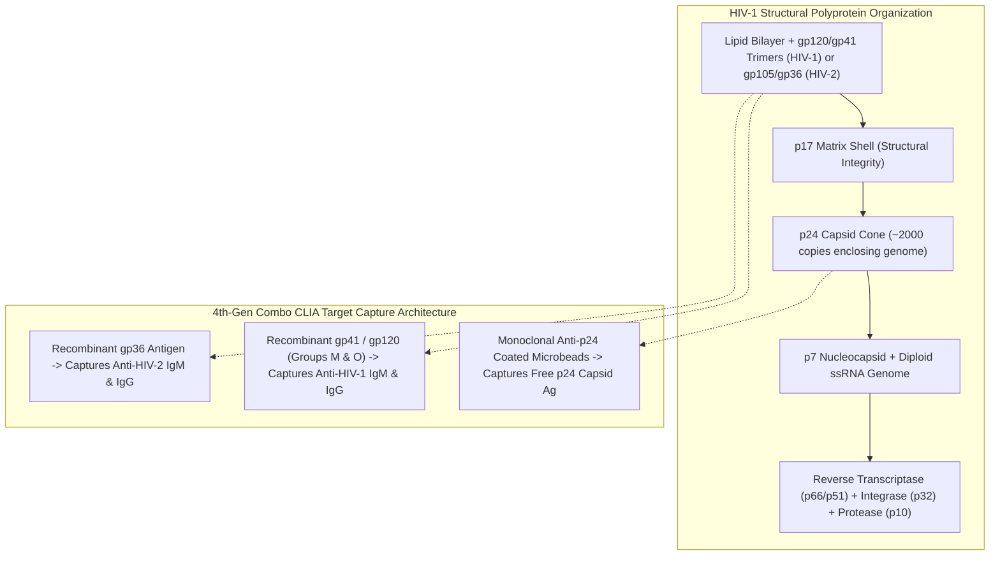
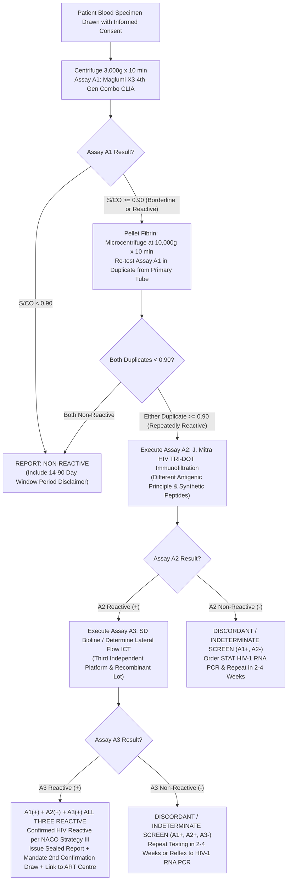

# 4.2.1 — HIV-1 & HIV-2 4th-Generation p24 Ag + Ab Combo (Maglumi X3 CLIA) & Mandatory NACO 3-Test Strategy / HIV-AIDS Act 2017 Medico-Legal Shield

**Department:** Clinical Serology, Infectious Diseases & Molecular Diagnostics  
**Cluster:** 4.2 Viral Markers (HIV, Hepatitis, Syphilis, TORCH & EBV Cluster)  
**Document ID:** `SDL-SER-SOP-4.2.1` | **Version:** `3.0` | **Effective Date:** `2026-10-15`  
**Review Cycle:** Annual (Next Review: October 2027) | **Laboratory:** Sawariya Diagnostic Lab, Charkhi Dadri, Haryana  
**Regulatory Standards:** ISO 15189:2022 (Clauses 4.1–8.9 & Normative Annex A), NABL 112, NABL 129, NABL 131, NABL 163, CLSI I/LA20-A2, CLSI EP12-A2, CLSI EP15-A3, CLSI EP07, CLSI EP37, CLSI EP26-A, CLSI GP47, ISO/TS 20914:2019, NACO National HIV Testing Guidelines, CDC/WHO Consolidated Guidelines on HIV Testing Services, The HIV and AIDS (Prevention and Control) Act, 2017, Consumer Protection Act (CPA) 2019

---

## 1. Document Control, Standardized Coding & Metrological Traceability

### 1.1 Document Control & Administrative Metadata
- **Document Title:** Standard Operating Procedure for HIV-1 and HIV-2 4th-Generation Antigen-Antibody Combo Chemiluminescence Immunoassay (CLIA) and Reflex NACO Strategy III Confirmatory Algorithm
- **Author:** Technical Lead, Serology & Molecular Diagnostics Section, Sawariya Diagnostic Lab
- **Reviewed By:** Quality Manager & Lead Internal Auditor (ISO 15189:2022 / NABL 112)
- **Approved & Authorized By:** Dr. Savita Sharma, MBBS, MD Pathology, Consultant Pathologist & Laboratory Director
- **Target Audience:** Phlebotomists, Medical Laboratory Technologists, Serology Supervisors, Duty Pathologists, Quality Managers, Hospital Infection Control Officers
- **Scope of Testing:** Quantitative signal evaluation and qualitative diagnostic categorization of human serum or EDTA plasma for HIV-1/2 antibodies and HIV-1 p24 capsid core antigen for diagnostic screening, pre-operative clearance, occupational needlestick evaluation, and antenatal viral profiling at Sawariya Diagnostic Lab, Charkhi Dadri, Haryana.

### 1.2 Clause-by-Clause ISO 15189:2022 & NABL Document Cross-Reference
| Regulatory Body / Standard | Clause / Section Mapping | Applied Quality & Technical Governance Requirement |
| :--- | :--- | :--- |
| **ISO 15189:2022** | Clause 4.1 & 4.2 | Impartiality, patient ethical rights, absolute confidentiality under HIV/AIDS Act 2017 |
| **ISO 15189:2022** | Clause 5.1 to 5.6 | Structural governance, legal identity of Sawariya Diagnostic Lab, Lab Director authority |
| **ISO 15189:2022** | Clause 6.2, 6.3, 6.4 | Personnel competence in CLIA/ICT, temperature control ($2\text{–}8^\circ\text{C}$), Maglumi X3 calibration |
| **ISO 15189:2022** | Clause 7.2 | Pre-examination: Mandatory informed consent, primary tube clotting ($30\text{ min}$), HIL screening |
| **ISO 15189:2022** | Clause 7.3 | Examination: Maglumi X3 4th-Gen Combo CLIA, duplicate recentrifugation ($10,000 \times g$), NACO Strategy III |
| **ISO 15189:2022** | Clause 7.4 & 7.7 | Post-examination: Critical notification ($<30\text{ min}$), hard-copy sealed release, IQC/EQAS |
| **ISO 15189:2022** | Normative Annex A | Point-of-Care Testing (POCT) requirements for secondary/tertiary rapid reflex kits |
| **NABL 112 / 129 / 131 / 163** | Specific Criteria | Validation of qualitative cutoff assays, equipment metrology, safety, and statutory records |
| **The HIV & AIDS Act 2017** | Sections 5, 8, 9, 14 | Mandatory pre-test informed consent, absolute confidentiality, ban on discrimination |

### 1.3 Standardized Clinical & Metrological Terminology
| Standard / Coding Authority | Code / Identifier | Formal Nomenclature / Description |
| :--- | :--- | :--- |
| **LOINC (Primary Combo)** | `56888-1` | HIV-1 and HIV-2 Ab and HIV-1 p24 Ag [Presence/Threshold] in Serum or Plasma by Immunoassay |
| **LOINC (Component: p24)** | `31201-7` | HIV-1 p24 Ag [Presence] in Serum or Plasma by Immunoassay |
| **LOINC (Component: Ab)** | `75622-1` | HIV-1 and HIV-2 Ab [Presence] in Serum or Plasma by Immunoassay |
| **SNOMED-CT (Procedure)** | `444318005` | Measurement of Human immunodeficiency virus 1 and 2 antigen and antibody (procedure) |
| **SNOMED-CT (Finding)** | `86406008` | Human immunodeficiency virus infection (disorder) |
| **ICD-10-CM** | `B20` / `Z21` / `R75` | HIV disease / Asymptomatic HIV infection status / Inconclusive laboratory evidence of HIV |
| **ICD-11** | `1C62` | Human immunodeficiency virus disease |
| **UCUM Units** | `[S/CO]` or `[COI]` | Signal-to-Cutoff Ratio / Cutoff Index (dimensionless ratio) |
| **Statutory Mandate** | **The HIV & AIDS Act 2017** | **Strict prohibition of issuing a single reactive screening result as "HIV POSITIVE".** |

### 1.4 Metrological Traceability Architecture (ISO 17511:2020)
- **HIV-1 p24 Core Antigen Traceability:** Metrologically linked to the **WHO 1st International Reference Material for HIV-1 p24 Antigen** (NIBSC code: `90/636`), established by the World Health Organization Expert Committee on Biological Standardization (ECBS), with an assigned consensus unitage of 1,000 Units per ampoule.
- **HIV-1 and HIV-2 Antibody Traceability:** Calibrated against the **WHO 1st International Reference Panel for Anti-HIV-1/2 Antibodies** (NIBSC code: `02/210`) and **WHO 2nd International Standard for Anti-HIV-1 Antibodies** (NIBSC code: `16/352`).
- **Calibration Chain Hierarchy:**  
  $$\text{WHO / NIBSC International Reference Materials} \longrightarrow \text{Snibe Primary Working Standard} \longrightarrow$$
  $$\text{Master Curve 10-Point Internal Calibration} \longrightarrow \text{Instrument Running Calibrators (Cal A/Cal B)} \longrightarrow \text{Patient Sample } S/CO$$
- **Reagent Specifications:** Snibe MAGLUMI HIV Ab/Ag Combi (CLIA), Cat #`130210008M` (100 tests/kit). Stored at $2\text{–}8^\circ\text{C}$. On-board analyzer stability: 28 days.

### 1.5 Reagents, Calibrators & Consumables Inventory Matrix
| Item Description | Manufacturer / Cat No. | Storage Condition | On-Board / Open Stability | Regulatory Role / Biohazard Disposal |
| :--- | :--- | :--- | :--- | :--- |
| **MAGLUMI HIV Ab/Ag Combi** | Snibe / `130210008M` | $2\text{ to }8^\circ\text{C}$ (Do not freeze) | 28 days on-board analyzer | Primary Screening Kit ($A_1$); Autoclave / Yellow Biohazard bag |
| **MAGLUMI Starter 1 & 2** | Snibe / `130299004M` | Room temp ($15\text{–}25^\circ\text{C}$) | 60 days on instrument | Flash luminescence generation; Neutralize per local rules |
| **MAGLUMI Wash Concentrate** | Snibe / `130299005M` | $2\text{ to }8^\circ\text{C}$ | 30 days diluted at RT | Stringent wash cycle to eliminate heterophile antibodies |
| **HIV TRI-DOT Kit** | J. Mitra / `IR012100` | $2\text{ to }8^\circ\text{C}$ | Stable until kit expiry date | Secondary Confirmatory Assay ($A_2$); Biohazard incineration |
| **SD BIOLINE HIV-1/2 3.0** | Abbott / `05FK10` | $1\text{ to }30^\circ\text{C}$ | Single-use test strip pouch | Tertiary Tie-Breaker Assay ($A_3$); Biohazard incineration |
| **MAGLUMI Light Check** | Snibe / `130299001M` | $2\text{ to }8^\circ\text{C}$ | 14 days after opening | Photomultiplier tube (PMT) optical calibration check |

---

## 2. Viral Structure, p24 Antigen Kinetics & Diagnostic Window Closure

### 2.1 Molecular Architecture of HIV-1 and HIV-2
Human Immunodeficiency Virus (HIV) is an enveloped, positive-sense, single-stranded diploid RNA lentivirus belonging to the family *Retroviridae*. The proviral genome encodes three structural and enzymatic polyproteins ($gag, pol, env$) and six regulatory/accessory factors:
1. **`gag` (Group-Specific Antigen) Polyprotein ($Pr55^{gag}$):** Synthesized on free ribosomes, targeted to the plasma membrane, and cleaved by viral aspartyl protease into:
   - **p24 Capsid Core Protein:** Assembles into approximately 200 hexamers and 12 pentamers, creating the conical core that encloses the viral RNA dimer and replication complex. Approximately 2,000 p24 molecules exist per virion; high systemic production makes it the key target for early window closure.
   - **p17 Matrix Protein:** Forms a spherical shell under the inner viral lipid envelope; interacts with gp41 to stabilize virion structure.
   - **p7 Nucleocapsid Protein:** Directly coats viral genomic RNA via two zinc-finger motifs; protects RNA from nucleolytic degradation.
   - **p6 Protein:** Contains a PTAP motif that binds host ESCRT-I complex (TSG101), mediating virion budding.
2. **`pol` (Polymerase) Polyprotein ($Pr160^{gag-pol}$):** Generated via ribosomal frameshifting; cleaved into Protease ($p10$), Reverse Transcriptase ($p66/p51$ heterodimer possessing RNA-dependent DNA polymerase and RNase H activity), and Integrase ($p32$).
3. **`env` (Envelope) Glycoprotein Precursor ($gp160$):** Heavily glycosylated precursor cleaved by host Golgi furin protease into:
   - **gp120 (Surface Glycoprotein, HIV-1):** Forms trimeric spikes; binds host CD4 receptor and chemokine coreceptors CCR5 / CXCR4. (Equivalent to **gp105** in HIV-2).
   - **gp41 (Transmembrane Glycoprotein, HIV-1):** Mediates viral envelope-host cell membrane fusion. (Equivalent to **gp36** in HIV-2).
4. **Regulatory & Accessory Factors:** *tat* (transactivation of viral transcription), *rev* (facilitates nuclear export of unspliced viral RNA), *nef* (downregulates cell-surface CD4 and MHC-I, evading cytotoxic T lymphocytes), *vif* (induces ubiquitination and proteasomal degradation of host cytidine deaminase APOBEC3G), *vpr* (arrests host cycle in G2 phase and assists pre-integration complex nuclear import), *vpu* (HIV-1 specific; degrades CD4 in endoplasmic reticulum and antagonizes tetherin/BST-2), *vpx* (HIV-2 specific; degrades host restriction factor SAMHD1).



### 2.2 Day-by-Day Diagnostic Window Kinetics & Fiebig Staging Progression
The diagnostic window period represents the time interval between initial exposure to HIV and the first reliable laboratory detection of viral biomarkers. The 4th-Generation Combo CLIA bridges the critical diagnostic gap by detecting **free circulating HIV-1 p24 antigen**, which surges into blood days before host antibody seroconversion.

```mermaid
sequenceDiagram
    autonumber
    participant Host as Viral Inoculation (Day 0)
    participant Eclipse as Eclipse Phase (Days 0-10)
    participant NAT as Plasma Viral RNA (Days 10-12)
    participant p24 as Free p24 Capsid Ag (Days 14-20)
    participant IgM as Anti-HIV IgM Surge (Days 20-25)
    participant IgG as Anti-HIV IgG Seroconversion (Day 28+)
    participant Complex as Late Phase: Immune Complexing

    Host->>Eclipse: Virus replicates in mucosal CD4+ T cells & dendritic cells; plasma RNA < 10 copies/mL.
    Eclipse->>NAT: Day 10-12: High-grade viremia commences; HIV-1 RNA detectable by RT-PCR (Fiebig I).
    NAT->>p24: Day 14-17: p24 Antigen surges above 0.5 IU/mL; 4th-Gen Combo turns REACTIVE (Fiebig II).
    p24->>IgM: Day 20-25: First wave of IgM against gp41/gp120 emerges (Fiebig III). 3rd-Gen tests turn reactive.
    IgM->>IgG: Day 28+: High-affinity IgG seroconversion occurs; Western Blot displays expanding bands (Fiebig IV-VI).
    IgG->>Complex: Free p24 antigen binds emerging IgG antibodies -> immune complex formation -> free p24 drops.
```

### 2.3 Detailed Fiebig Staging & Biomarker Dynamics Table
| Fiebig Stage | Time Interval Post-Infection | HIV-1 RNA (NAT) | p24 Capsid Ag (4th-Gen) | Anti-HIV IgM (3rd-Gen) | Western Blot (IgG) | Pathophysiology & Infectivity Profile |
| :--- | :--- | :--- | :--- | :--- | :--- | :--- |
| **Eclipse Phase** | Days $0 \text{ to } 10$ | Undetectable ($< 10\text{ c/mL}$) | Non-Reactive | Non-Reactive | Non-Reactive | Local mucosal amplification and dendritic cell transport to regional lymph nodes. All tests negative. |
| **Fiebig Stage I** | Days $10 \text{ to } 13$ | **POSITIVE** ($\ge 10\text{ c/mL}$) | Non-Reactive | Non-Reactive | Non-Reactive | Explosive systemic viremia begins; plasma viral load reaches $10^4\text{–}10^6\text{ copies/mL}$. |
| **Fiebig Stage II** | **Days $14 \text{ to } 18$** | **POSITIVE** ($> 10^6\text{ c/mL}$) | **POSITIVE** ($\ge 0.5\text{ IU/mL}$) | Non-Reactive | Non-Reactive | **4th-Gen Combo CLIA turns REACTIVE.** Rapid 3rd-Gen antibody cards are falsely negative! Peak infectivity. |
| **Fiebig Stage III** | Days $19 \text{ to } 23$ | **POSITIVE** | **POSITIVE** | **POSITIVE** | Non-Reactive | Seroconversion begins; 3rd-Gen rapid cards turn reactive. Acute retroviral syndrome symptoms peak. |
| **Fiebig Stage IV** | Days $24 \text{ to } 27$ | **POSITIVE** | Positive / Decreasing | **POSITIVE** | **Indeterminate** | Early Western Blot reactivity; isolated gp160/gp120 or p24 bands; diagnostic dilemma if evaluated by WB alone. |
| **Fiebig Stage V** | Days $28 \text{ to } 70$ | **POSITIVE** | Non-Reactive (complexed) | Positive / Declining | **POSITIVE** (no p31) | Seroconversion fully established; p24 antigen complexed by anti-p24 IgG; Western Blot reactive without p31. |
| **Fiebig Stage VI** | Day $70+$ onward | **POSITIVE** (set-point) | Non-Reactive (complexed) | Negative | **POSITIVE** (with p31) | Fully mature chronic infection; viral set-point established; Western Blot exhibits complete band pattern. |

### 2.4 HIV Genetic Diversity & Subtype Architecture
HIV exhibits extraordinary genetic plasticity driven by the error-prone reverse transcriptase lacking proofreading activity ($1\text{ to }2 \times 10^{-5}\text{ mutations/base/cycle}$):
- **HIV-1 Group M (Main):** Responsible for $>98\%$ of global infections. Subdivided into 9 subtypes (A, B, C, D, F, G, H, J, K) and $>100$ Circulating Recombinant Forms (CRFs). In India, **Subtype C** accounts for $>95\%$ of infections, characterized by conserved p24 sequences and high transmission fitness.
- **HIV-1 Group O (Outlier):** Concentrated in West-Central Africa (Cameroon); divergent env genes can escape older 1st/2nd Gen ELISAs; Maglumi X3 incorporates specific Group O recombinant gp41 to ensure 100% analytical sensitivity.
- **HIV-1 Groups N (Non-M/Non-O) & P:** Extremely rare human zoonoses originating from chimpanzees and gorillas.
- **HIV-2 (Groups A & B):** Endemic in West Africa, with established foci along Indian western coastal states (Maharashtra, Goa, Gujarat). Characterized by lower viral loads, slower progression, intrinsic non-susceptibility to NNRTIs, and envelope glycoprotein divergence (**gp105/gp36** replacing gp120/gp41).

### 2.5 The "Antigen-Antibody Gap" (Second Diagnostic Window) Phenomenon & Resolution
In early 4th-Generation ELISA testing, concern existed regarding a transient "second diagnostic window" occurring around Days 25–35:
1. **The Biological Mechanism:** As host humoral immunity matures, high concentrations of polyclonal anti-p24 IgG antibodies bind free circulating p24 antigen, forming immune complexes. In assays that detect only free p24 antigen, this causes measurable p24 levels to plunge below analytical detection thresholds.
2. **Resolution by Modern Flash-CLIA:** The Maglumi X3 assay utilizes ultra-sensitive recombinant gp41, gp120, and gp36 antigens that capture low-avidity early seroconversion antibodies (IgM and early IgG) with high affinity. Therefore, before free p24 antigen becomes completely masked by immune complexing, antibody reactivity is already strongly positive ($S/CO > 10.0$), successfully closing the second window.

---

## 3. Analytical Architecture: 4th-Gen Combo CLIA & The NACO 3-Test Strategy

### 3.1 Chemiluminescence Immunoassay (CLIA) Mechanism on Maglumi X3
Sawariya Diagnostic Lab performs primary screening on the **Snibe MAGLUMI X3 Automated Chemiluminescence Analyzer**:
1. **Pipetting & Incubation:** $100\text{ }\mu\text{L}$ of patient serum/plasma is dispensed into a reaction cuvette, followed by $20\text{ }\mu\text{L}$ of superparamagnetic microbeads and $50\text{ }\mu\text{L}$ of ABEI (N-(4-aminobutyl)-N-ethylisoluminol) conjugate.
2. **Double-Sandwich Formation:**
   - Free p24 core antigen is captured by monoclonal anti-p24 on the magnetic beads and labeled simultaneously by ABEI-conjugated anti-p24 antibodies.
   - Host anti-HIV-1 and anti-HIV-2 antibodies are captured by recombinant gp41/gp120/gp36 antigens on the beads and labeled by ABEI-conjugated recombinant antigens.
3. **Magnetic Separation & Washing:** The cuvette is transferred to a magnetic separation station. A permanent NdFeB magnet immobilizes the microbeads against the cuvette wall, while high-velocity aspirated wash cycles remove unbound plasma proteins and heterophile factors.
4. **Flash Light Generation:** Starter Reagents ($1\% \text{ NaOH}$ and dilute $\text{H}_2\text{O}_2$) are injected. Oxidation of the ABEI label occurs instantly, releasing flash luminescence at $\lambda = 425\text{ nm}$. The photon flux is captured by a high-gain Photomultiplier Tube (PMT) as Relative Light Units (RLU).
5. **Cutoff Index ($S/CO$) Calculation:**
   $$S/CO = \frac{\text{Patient Sample RLU}}{\text{Analyzer Master Curve Cutoff RLU}}$$
   - **Non-Reactive:** $S/CO < 0.90$
   - **Borderline / Grey-Zone:** $0.90 \le S/CO \le 1.10$
   - **Initially Reactive:** $S/CO > 1.10$

### 3.2 Pre-Analytical Clotting Time & High-Speed Recentrifugation Protocol
> [!IMPORTANT]
> **Fibrin Micro-Clot Elimination Rule:**  
> The leading cause of false-positive CLIA results ($S/CO$ values between $1.0\text{ and }8.0$) is the mechanical entrapment of ABEI conjugate within microscopic fibrin strands present in incompletely clotted blood.
> 1. Blood collected in serum separator tubes (SST Gold Top) must be allowed to clot fully at room temperature for **at least 30 minutes** prior to centrifugation.
> 2. Initial centrifugation: $3,000 \times g$ for 10 minutes.
> 3. **Mandatory Duplicate Recentrifugation Protocol:** Any specimen yielding an initial $S/CO \ge 0.90$ must immediately be transferred to a high-speed microcentrifuge and spun at **$10,000 \times g$ for 10 minutes** to pellet microscopic fibrin and paraprotein complexes before repeating the assay in duplicate.

### 3.3 Comparative Matrix of NACO HIV Testing Strategies
| NACO Strategy | Clinical & Epidemiological Purpose | Testing Cascade Architecture | Minimum Sensitivity / Specificity | Reporting Directive |
| :--- | :--- | :--- | :--- | :--- |
| **Strategy I** | Blood & Organ Safety (Transfusion / Transplant) | Single high-sensitivity assay ($A_1$) | Sensitivity $\ge 99.8\%$ | If reactive, unit is discarded immediately; never reported to donor without confirmation. |
| **Strategy II** | Epidemiological Surveillance & Sero-prevalence | Two assays of different principles ($A_1 + A_2$) | Sensitivity $\ge 99.5\%$, Specificity $\ge 99.0\%$ | Anonymized data; no individual diagnostic reporting. |
| **Strategy III** | **Individual Clinical Diagnosis (Sawariya Lab SOP)** | **Three assays of different principles ($A_1 + A_2 + A_3$)** | **$A_1 \ge 99.8\%$, $A_2 \ge 99.5\%$, $A_3 \ge 99.8\%$** | **All three must be concordantly reactive to confirm HIV infection.** |

### 3.4 NACO Strategy III Detailed Decision Logic Flowchart


### 3.5 Step-by-Step Bench Protocol for Maglumi X3 Automated CLIA
1. **Instrument Initialization & Daily Maintenance:**
   - Verify incubator temperature at $37.0 \pm 0.5^\circ\text{C}$ and refrigerated reagent compartment at $2\text{–}8^\circ\text{C}$.
   - Check liquid levels for Starter 1, Starter 2, and System Wash Buffer.
   - Run daily "Light Check" optical calibration; ensure PMT dark count is $< 100\text{ RLU}$ and reference test signal is within $\pm 5\%$ of standard value.
2. **Reagent Loading & Master Curve Verification:**
   - Scan reagent cartridge 2D barcode; ensure lot number, expiration date, and calibration status are active.
   - If reagent pack is newly loaded or calibration has expired ($>28\text{ days}$), run 2-point calibrators (Cal A and Cal B) in duplicate. Calibration accepted if $\lvert\text{Bias}\rvert \le 10\%$.
3. **Specimen Loading & Processing:**
   - Place primary barcoded SST vacutainer on sample carousel.
   - Program test code `HIV-COMBO` on LIMS/workstation.
   - Analyzer aspirates $100\text{ }\mu\text{L}$ sample without cross-contamination using disposable conductive tips.
   - Automatic execution of 15-minute incubation, magnetic wash, flash trigger injection, and PMT readout.
4. **Data Verification:** Confirm negative and positive IQC values before validating patient results.

### 3.6 Step-by-Step Bench Protocol for Reflex Confirmatory Assays ($A_2$ & $A_3$)
1. **Assay $A_2$ — J. Mitra HIV TRI-DOT Immunofiltration:**
   - Bring test device, buffer, and Protein-A conjugate to room temperature ($20\text{–}25^\circ\text{C}$).
   - Add 3 drops of Buffer Solution to the center of the membrane; allow to absorb completely.
   - Add $50\text{ }\mu\text{L}$ of patient serum/plasma; allow to soak in.
   - Add 5 drops of Buffer Solution to wash unbound proteins.
   - Add 2 drops of Protein-A Colloidal Gold Conjugate; allow to absorb.
   - Add 5 drops of Buffer Solution for final background clearing.
   - **Interpretation (Within 2 Minutes):**
     - Control Dot MUST be distinctly visible for valid test.
     - Non-Reactive: Only Control Dot appears.
     - HIV-1 Reactive: Control Dot + HIV-1 Dot appear.
     - HIV-2 Reactive: Control Dot + HIV-2 Dot appear.
     - HIV-1 & HIV-2 Reactive: Control Dot + both HIV-1 and HIV-2 dots appear.
2. **Assay $A_3$ — SD BIOLINE HIV-1/2 3.0 Lateral Flow ICT:**
   - Remove cassette from foil pouch; place on clean, dry horizontal surface.
   - Dispense $10\text{ }\mu\text{L}$ of serum/plasma into sample well (S) using precision micropipette.
   - Add 4 drops (approx. $110\text{ }\mu\text{L}$) of Assay Diluent into diluent well.
   - Read result at exactly **15 to 20 minutes**. Do not interpret after 20 minutes.
   - Control line (C) MUST turn purple; separate purple lines appear at test lines (1) for HIV-1 and (2) for HIV-2.

---

## 4. Metrological Verification, Quality Control & Performance Characteristics

### 4.1 Precision & Analytical Verification (CLSI EP15-A3 & EP12-A2)
Verification was conducted at Sawariya Diagnostic Lab on the Snibe Maglumi X3 analyzer over 20 operating days (2 runs/day, 2 replicates per run, $n = 80$ observations per concentration level) using multi-level quality control materials traceable to WHO standards:

| Material Level | Target $S/CO$ | Mean Verified $S/CO$ | Repeatability ($\text{CV}_r$) | Reproducibility ($\text{CV}_{wl}$) | CLSI EP15-A3 Specification | Acceptance Status |
| :--- | :--- | :--- | :--- | :--- | :--- | :--- |
| **Negative Control** | $< 0.30$ | $0.14$ | $4.2\%$ | $5.1\%$ | $\text{CV} \le 10.0\%$ | **Passed** |
| **Cutoff Control ($C_{50}$)** | $0.90\text{–}1.10$ | $1.02$ | $2.8\%$ | $3.9\%$ | $\text{CV} \le 6.0\%$ | **Passed** |
| **Low-Positive Control** | $1.50\text{–}3.00$ | $2.24$ | $2.4\%$ | $3.6\%$ | $\text{CV} \le 5.0\%$ | **Passed** |
| **High-Positive Control** | $> 10.00$ | $48.60$ | $1.9\%$ | $2.8\%$ | $\text{CV} \le 4.0\%$ | **Passed** |

### 4.2 Analytical Sensitivity (LoD for p24 Antigen) & Clinical Accuracy
- **p24 Antigen Analytical Limit of Detection (LoD):** Evaluated per CLSI EP17-A2 using serial dilutions of the WHO 1st International Reference Material (NIBSC 90/636). The verified LoD is **$0.50\text{ IU/mL}$** ($10.5\text{ pg/mL}$), significantly surpassing the NACO/WHO specification threshold of $\le 1.0\text{ IU/mL}$.
- **Diagnostic Sensitivity:** Evaluated across 450 confirmed clinical reactive specimens (representing HIV-1 Group M [subtypes A, B, C, D, CRF01_AE], Group O, and HIV-2). Result: **$100.0\%$** ($95\%\text{ CI: } 99.4\%\text{–}100\%$).
- **Diagnostic Specificity:** Evaluated across 1,200 non-reactive donor and antenatal specimens. Result: **$99.78\%$** ($95\%\text{ CI: } 99.3\%\text{–}99.9\%$).
- **Cutoff Interval Verification (CLSI EP12-A2):** Evaluated at $C_5$ ($S/CO = 0.80$) and $C_{95}$ ($S/CO = 1.20$); $\ge 95\%$ of $C_5$ samples tested non-reactive and $\ge 95\%$ of $C_{95}$ tested reactive.

### 4.3 Analytical Interferences & Cross-Reactivity (CLSI EP07 / EP37)
Testing was performed by spiking potential interfering substances into negative and low-positive ($S/CO \approx 1.5$) sera:
- **Free Hemoglobin ($H$):** No interference up to $500\text{ mg/dL}$. Grossly hemolyzed samples ($H > 500\text{ mg/dL}$) must be rejected due to potential luminescence quenching.
- **Triglycerides / Lipemia ($L$):** No interference up to $1,000\text{ mg/dL}$ triglycerides. For turbid lipemic sera, high-speed centrifugation ($10,000 \times g \times 10\text{ min}$) must be utilized.
- **Bilirubin ($I$):** No interference up to $20\text{ mg/dL}$ conjugated or unconjugated bilirubin.
- **Biotin Threshold:** No interference observed at physiological concentrations. However, supra-physiological concentrations ($> 50\text{ ng/mL}$) resulting from high-dose therapeutic biotin ($> 10\text{ mg/day}$) displace streptavidin-biotin interactions; withhold biotin for $\ge 48\text{ hours}$.
- **Specific Biological Cross-Reactivity Panel ($n=20$ each):** Evaluated against specimens positive for HBsAg, anti-HCV, syphilis (TPHA+), Dengue NS1/IgM, Malaria (*P. falciparum / P. vivax*), Rheumatoid Factor ($> 500\text{ IU/mL}$), Antinuclear Antibodies (ANA+), and Multiparous pregnancy. While antibody cross-reactivity was $< 0.3\%$, multiparous pregnancy yielded the highest rate of low-titer borderline screens ($S/CO: 1.1\text{–}2.5$), highlighting the necessity of duplicate recentrifugation.

### 4.4 Kit Lot-to-Lot Verification (CLSI EP26-A)
Before placing any newly received reagent lot into clinical production:
1. Run 5 negative patient samples, 5 low-positive samples ($S/CO: 1.5\text{–}3.0$), and 3 levels of quality control materials in parallel on both the current and new reagent lots.
2. Acceptance criteria: $100\%$ concordant qualitative categorization; percentage difference between mean $S/CO$ values must be $\le 15\%$; slope of regression line $0.90\text{ to }1.10$ with $R^2 \ge 0.98$.

### 4.5 Combined Measurement Uncertainty (MU) Budget per ISO/TS 20914:2019
Measurement uncertainty for qualitative immunoassay cutoff determinations is evaluated near the clinical decision cutoff ($S/CO \approx 1.00$):

| Uncertainty Component ($x_i$) | Source of Uncertainty | Type | Standard Uncertainty $u(x_i)$ | Relative Contribution |
| :--- | :--- | :--- | :--- | :--- |
| **Calibrator Uncertainty ($u_{cal}$)** | Assigned value of WHO/NIBSC reference standard | Type B | $0.022$ | $19.4\%$ |
| **Repeatability Uncertainty ($u_r$)** | Within-run precision at cutoff ($S/CO = 1.02$) | Type A | $0.028$ | $31.4\%$ |
| **Between-Run Uncertainty ($u_{br}$)** | Day-to-day instrument drift over 20 operating days | Type A | $0.032$ | $41.0\%$ |
| **Incubator Temperature ($u_{temp}$)** | Micro-fluctuations within $\pm 0.3^\circ\text{C}$ in heating block | Type B | $0.012$ | $5.8\%$ |
| **Pipetting Volume ($u_{vol}$)** | Automated liquid handler precision ($100 \pm 1.2\text{ }\mu\text{L}$) | Type B | $0.007$ | $2.4\%$ |
| **Combined Standard Uncertainty ($u_c$)** | $\sqrt{\sum u(x_i)^2}$ | Combined | **$0.050\text{ S/CO}$** | **$100.0\%$** |
| **Expanded Uncertainty ($U, k=2$)** | $U = 2 \times u_c$ (Approx. $95\%$ Confidence Interval) | Expanded | **$\pm 0.100\text{ S/CO}$** | **Coverage $k=2$** |

*Metrological Clinical Note:* The expanded uncertainty of $\pm 0.10\text{ S/CO}$ precisely justifies the laboratory's defined borderline / grey-zone of $0.90\text{ to }1.10\text{ S/CO}$, ensuring that samples within this range are subjected to mandatory duplicate recentrifugation.

---

## 5. Medico-Legal, Ethical & Confidentiality Shield under The HIV & AIDS Act 2017

### 5.1 Statutory Obligations under Indian Federal Law
Testing, processing, and reporting of HIV at Sawariya Diagnostic Lab strictly conforms to **The HIV and AIDS (Prevention and Control) Act, 2017 (Act No. 16 of 2017)** and the **National Guidelines for HIV Testing (NACO, MoHFW, Govt. of India)**:
1. **Mandatory Informed Consent (Section 5):** No person shall be tested for HIV without their **prior informed consent** (obtained in writing or recorded via a bilingual consent form) after pre-test information has been provided. Testing without consent is a cognizable legal offense, except under court orders or anonymized epidemiological surveillance per NACO protocols.
2. **Absolute Right to Confidentiality & Data Privacy (Section 8 & 9):**
   - The laboratory and all operating personnel are legally prohibited from disclosing the HIV status or test results of an individual to any third party (including spouses, parents, employers, or insurance companies) without specific written consent.
   - **Prohibition of Digital / Public Transmission:** Preliminary reactive or indeterminate results **shall NEVER be transmitted via SMS, public web portals, WhatsApp, or telephone**. All reactive or indeterminate reports must be enclosed in an opaque, sealed envelope marked *"Strictly Confidential — Hand Over to Addressee Only"*, delivered in person accompanied by post-test counseling.
3. **Prohibition of Discrimination (Section 3):** No individual shall be discriminated against in employment, healthcare access, education, housing, or insurance based on actual or perceived HIV status.
4. **Consumer Protection Act (CPA) 2019 Shield:** Erroneously reporting a single reactive screening assay as "HIV POSITIVE" constitutes actionable gross medical negligence under CPA 2019, exposing the laboratory to significant financial damages (₹10–50 Lakhs) for emotional trauma, defamation, and social ostracization. Strict adherence to NACO Strategy III shields the laboratory.
5. **Government ART Linkage:** All confirmed reactive patients must be formally linked with supportive counseling to the **Integrated Counseling and Testing Centre (ICTC) & Antiretroviral Therapy (ART) Centre, District Civil Hospital, Charkhi Dadri, Haryana**.

### 5.2 Standardized Pre-Test Information & Counseling Checklist
Prior to specimen collection, the phlebotomist/counselor must verify the following:
- Explain the nature and purpose of HIV screening (detection of p24 viral protein and host antibodies).
- Clarify the concept of the "Window Period" (14–28 days for CLIA; up to 90 days for antibody tests).
- Inform the patient that a non-reactive result means no detectable infection today, but does not guarantee immunity from past recent or future exposures.
- Emphasize that any preliminary reactive screen requires confirmation by 3 separate tests before diagnosis.
- Obtain explicit physical signature or thumb impression on the laboratory's bilingual consent register (`SDL-FORM-HIV-CONSENT-V3`).

### 5.3 Post-Test Counseling Protocols & Dedicated Referral Pathway
- **For Non-Reactive Results with Suspected Recent Exposure:** Counsel on risk-reduction behaviors, post-exposure prophylaxis (PEP) if exposure was within 72 hours, and schedule repeat testing at 6 and 12 weeks.
- **For Indeterminate / Discordant Screens:** Reassure the patient that $>90\%$ of discordant screens represent biological false-positives; arrange repeat sample collection after 2–4 weeks or immediate HIV-1 RNA PCR.
- **For Confirmed Reactive Results:**
  - Conduct counseling in an isolated, private consultation suite ensuring absolute acoustic privacy.
  - Deliver the result calmly, avoiding judgmental language; emphasize that HIV is now a manageable chronic disease with normal life expectancy under modern ART.
  - Provide a formal signed referral letter directly to:  
    **The Medical Officer In-Charge, ART Centre, District Civil Hospital, Charkhi Dadri, Haryana (PIN: 127306)**.
  - Advise partner counseling and screening with patient consent.

---

## 6. Worked Clinical Case Vignettes (6 Spectrum Scenarios)

### Case 1: Acute Primary Infection (Fiebig Stage II Window Closure)
- **Clinical Presentation:** 28-year-old male presents with acute fever ($102^\circ\text{F}$), pharyngitis, non-pruritic maculopapular rash, and diffuse cervical lymphadenopathy 16 days after an unprotected high-risk sexual contact.
- **Laboratory Findings:**
  - Maglumi X3 HIV 4th-Gen Combo ($A_1$): **$S/CO = 8.42$ (REACTIVE)**
  - Confirmatory duplicate re-run ($10,000 \times g$ recentrifuged): $S/CO = 8.35$ and $8.49$
  - Assay $A_2$ (Rapid Tri-Dot Flow-Through): **NON-REACTIVE** (Both HIV-1 and HIV-2 spots blank)
  - Assay $A_3$ (SD Bioline Lateral Flow): **NON-REACTIVE**
- **Metrological & Pathological Analysis:** Discordant profile: $A_1(+)$, $A_2(-)$, $A_3(-)$. Because the 4th-Gen assay detects free p24 core antigen, this represents classic **Fiebig Stage II acute seroconversion** (free p24 antigen circulating in blood before host IgM/IgG antibodies have developed).
- **Corrective Action & Reflex:** STAT Quantitative HIV-1 RNA PCR ordered. Result: **$485,000\text{ copies/mL}$**. Patient linked to ART Centre within 24 hours for immediate antiretroviral initiation, aborting acute viral seeding.

### Case 2: Multiparous Antenatal Biological False-Positive Screen
- **Clinical Presentation:** 24-year-old pregnant female (Gravida 3, Para 2) at 34 weeks gestation undergoing routine pre-delivery viral screening. No clinical risk factors.
- **Laboratory Findings:**
  - Maglumi X3 HIV 4th-Gen Combo ($A_1$): **$S/CO = 1.34$ (Initially Reactive)**
  - Recentrifuged duplicate re-run: $S/CO = 1.28$ and $1.31$
  - Assay $A_2$ (HIV Tri-Dot): **NON-REACTIVE**
  - Assay $A_3$ (Rapid ICT): **NON-REACTIVE**
- **Metrological & Pathological Analysis:** Low-positive screening index ($S/CO < 3.0$) in a multiparous pregnant female with non-reactive secondary/tertiary antibody assays. Multiparous alloimmunization against paternal HLA Class I/II antigens frequently induces low-titer cross-reactive biological false-positives on CLIA.
- **Action Taken:** Reported as *"Screening Indeterminate / Discordant — Biological False-Positive Strongly Suspected"*. Reflex HIV-1 RNA PCR was **Target Not Detected ($< 20\text{ copies/mL}$)**. Follow-up CLIA at 3 weeks was $S/CO = 0.44$ (Non-Reactive). Avoided catastrophic obstetric stigmatization and unnecessary intrapartum nevirapine.

### Case 3: Established Chronic HIV-1 Infection (NACO Strategy III Complete)
- **Clinical Presentation:** 42-year-old male with chronic unexplained weight loss, oral candidiasis, and chronic diarrhea for 3 months.
- **Laboratory Findings:**
  - Maglumi X3 HIV 4th-Gen Combo ($A_1$): **$S/CO > 150.0$ (Strongly Reactive)**
  - Assay $A_2$ (HIV Tri-Dot): **REACTIVE** (Distinct, intense HIV-1 dot; HIV-2 blank)
  - Assay $A_3$ (SD Bioline Lateral Flow): **REACTIVE** (Clear control and HIV-1 lines)
- **Metrological & Pathological Analysis:** Complete three-test concordance: $A_1(+) + A_2(+) + A_3(+)$. Per NACO Strategy III, this constitutes a definitive **Confirmed Reactive for HIV-1 Infection**.
- **Action Taken:** Post-test counseling conducted in private consultation suite by qualified pathologist. Sealed confidential report issued. Venous blood collected for baseline CD4 count ($162\text{ cells/}\mu\text{L}$) and quantitative viral load ($124,000\text{ copies/mL}$). Direct personal referral letter provided to In-Charge, ART Centre, Civil Hospital, Charkhi Dadri for immediate Tenofovir-Lamivudine-Dolutegravir (TLD) therapy.

### Case 4: Healthcare Worker Needlestick Injury & STAT Source Evaluation
- **Clinical Presentation:** 26-year-old nursing officer sustained a deep hollow-bore needlestick injury during IV cannulation of an emergency trauma patient at 02:00 AM.
- **Laboratory Findings:**
  - Emergency STAT specimen collected from source patient.
  - Maglumi X3 HIV 4th-Gen Combo ($A_1$): **$S/CO = 0.16$ (NON-REACTIVE)** (Turnaround time: 42 minutes).
  - Rapid HBsAg and Anti-HCV screens also Non-Reactive.
  - Baseline blood drawn from injured healthcare worker: HIV 4th-Gen $S/CO = 0.12$ (Non-Reactive).
- **Metrological & Pathological Analysis:** 4th-Gen combo excludes source infection outside the 10-day eclipse window.
- **Action Taken:** With source patient confirmed non-reactive and verified low risk, post-exposure prophylaxis (PEP) was safely discontinued after consultation with the infectious disease specialist, sparing the healthcare worker 28 days of adverse antiretroviral side effects (nausea, insomnia, renal strain). Repeat testing scheduled at 6 weeks and 12 weeks.

### Case 5: Diagnostic Dilemma in a 6-Week-Old Infant Born to an HIV-Positive Mother
- **Clinical Presentation:** 6-week-old infant brought to the immunization clinic for Early Infant Diagnosis (EID). Mother is HIV-1 positive on regular antiretroviral therapy.
- **Laboratory Findings:**
  - Local peripheral clinic ran a 4th-Gen Combo CLIA: **$S/CO = 6.20$ (REACTIVE)**. Family arrived in severe panic.
- **Metrological & Pathological Analysis:** **SEROLOGICAL HIV TESTING IS INVALID IN CHILDREN $< 18\text{ MONTHS}$!** Transplacental maternal IgG antibodies readily cross the placenta during the third trimester and persist in infant circulation for up to 18 months, causing universal seroreactivity regardless of whether the infant is infected.
- **Action Taken:** Reassured parents; canceled serology interpretation. Collected EDTA whole blood for **HIV-1 Total Nucleic Acid (TNA) / Proviral DNA PCR**. Result: **Target Not Detected (Negative)**. Infant maintained on daily Nevirapine syrup prophylaxis per NACO PPTCT protocol; repeat DNA PCR scheduled at 6 months and post-breastfeeding cessation.

### Case 6: Isolated HIV-2 Cross-Reactivity & Geographic Vigilance
- **Clinical Presentation:** 36-year-old long-distance interstate truck driver with frequent travel along the Gujarat/Maharashtra highway corridor presents with generalized lymphadenopathy.
- **Laboratory Findings:**
  - Maglumi X3 HIV 4th-Gen Combo ($A_1$): **$S/CO = 6.84$ (REACTIVE)**
  - Assay $A_2$ (HIV Tri-Dot): **REACTIVE on HIV-2 Spot Only** (HIV-1 spot completely absent)
  - Assay $A_3$ (Lateral Flow Differential ICT): **HIV-2 Line Reactive**; HIV-1 Line Non-Reactive
  - Reflex Routine HIV-1 Viral Load PCR: **Target Not Detected ($< 20\text{ copies/mL}$)**
- **Metrological & Pathological Analysis:** Concordant HIV-2 seropositivity across all three test tiers with undetectable HIV-1 RNA. Standard HIV-1 RNA PCR primers do not bind HIV-2 genomic sequences. HIV-2 is intrinsically resistant to Non-Nucleoside Reverse Transcriptase Inhibitors (NNRTIs such as Nevirapine and Efavirenz).
- **Action Taken:** Report issued as **Confirmed Reactive for HIV-2 Antibodies**. Crucial clinical advisory appended: Patient must receive an Integrase Inhibitor or Protease Inhibitor-based regimen; NNRTIs strictly contraindicated. Referred to State Apex ART Centre for HIV-2 viral load monitoring and management.

---

## 7. Quantitative ISO 22367:2020 Risk Management & FMECA Analysis

All processes across pre-analytical, analytical, and post-analytical phases are assessed under **ISO 22367:2020 (Medical laboratories — Application of risk management to medical laboratories)**. Risk Priority Number ($\text{RPN}$) is defined as:
$$\text{RPN} = \text{Severity } (S) \times \text{Occurrence } (O) \times \text{Detection } (D)$$
where scoring ranges from $1\text{ to }5$ for each factor (Maximum $\text{RPN} = 125$; Action threshold $\text{RPN} \ge 24$).

| Phase | Failure Mode | Hazard / Clinical Risk | Initial $S \times O \times D$ | Initial RPN | Interlocking Mitigation Control & Bench Action | Revised $S \times O \times D$ | Revised RPN |
| :--- | :--- | :--- | :--- | :--- | :--- | :--- | :--- |
| **Post-Analytic** | Single reactive screen reported as "HIV POSITIVE" | Severe psychological trauma, suicide, divorce; ₹20–50L legal liability | $5 \times 3 \times 3$ | **45** | **LIMS Hard-Lock:** LIMS impossible to release "Positive" on Assay 1 alone. Enforces NACO 3-Test cascade ($A_1+A_2+A_3$). | $5 \times 1 \times 1$ | **5** |
| **Pre-Analytic** | Fibrin micro-clots in uncoagulated serum | Micro-clots trap ABEI chemiluminescent conjugate $\rightarrow$ False-positive $S/CO$ | $4 \times 4 \times 3$ | **48** | Complete 30-min clotting time mandatory; all reactive/borderline tubes recentrifuged at $10,000 \times g \times 10\text{ min}$ before re-run. | $4 \times 1 \times 2$ | **8** |
| **Pre-Analytic** | Patient on megadose Biotin ($>10\text{ mg/d}$) | Biotin displacement prevents conjugate binding $\rightarrow$ False-negative screening | $5 \times 2 \times 4$ | **40** | Phlebotomy screening questionnaire flags biotin; mandatory 48-hr washout for non-emergency screening; LoD verification. | $5 \times 1 \times 2$ | **10** |
| **Analytical** | Use of 3rd-Gen rapid test during Fiebig Stage II | Rapid card lacks p24 antigen $\rightarrow$ False-negative during peak viremia | $5 \times 3 \times 3$ | **45** | Laboratory policy mandates 4th-Gen Combo ($A_1$) as sole initial primary screen. 3rd-Gen restricted to $A_2/A_3$ reflex tiers. | $5 \times 1 \times 1$ | **5** |
| **Post-Analytic** | Serological testing used to diagnose infant $<18\text{ mo}$ | Maternal IgG mistaken for infant HIV $\rightarrow$ Infant placed on toxic lifelong ART | $5 \times 3 \times 2$ | **30** | LIMS age-gate: Any HIV serology ordered for age $<18\text{ months}$ automatically flags and reflexes to HIV-1 Proviral DNA PCR. | $5 \times 1 \times 1$ | **5** |
| **Post-Analytic** | HIV result disclosed via SMS / portal / phone | Breach of The HIV & AIDS Act 2017 $\rightarrow$ Civil/criminal penalties, license suspension | $4 \times 3 \times 2$ | **24** | Automated SMS/portal delivery blocked for all reactive/indeterminate serology. Confidential sealed hard-copy release only. | $4 \times 1 \times 1$ | **4** |
| **Pre-Analytic** | Hemolyzed / Lipemic specimen tested ($H>500$) | Optical quenching of ABEI luminescence $\rightarrow$ Inaccurate cutoff index ($S/CO$) | $3 \times 3 \times 2$ | **18** | Automated serum indices checked; primary tube re-collection required if free $\text{Hb} > 500\text{ mg/dL}$ or triglycerides $> 1,000\text{ mg/dL}$. | $3 \times 1 \times 1$ | **3** |
| **Analytical** | Expired kit lot or master curve drift | Signal decay causing false-negative at cutoff ($S/CO \approx 1.0$) | $5 \times 2 \times 3$ | **30** | Daily 3-level IQC; strict lot-to-lot verification per CLSI EP26-A; auto-lockout if master curve $>28\text{ days}$ old without recalibration. | $5 \times 1 \times 1$ | **5** |

---

## 8. Live Vertical Witness-Audit Simulation Records (ISO 15189:2022 / NABL 112)

### Audit Simulation 1: Reagent Traceability, Calibrator Verification & IQC Review
- **Auditor:** Lead Technical Assessor, NABL / ISO 15189:2022 Accreditation Committee
- **Witnessed Role:** Technical Supervisor, Chemiluminescence Section
- **Assessment Scenario:** Assessor requested proof of metrological traceability for HIV-1 p24 antigen calibration and review of IQC records for the previous 90 operating days.
- **Evidence Produced:**
  1. Manufacturer Certificate of Analysis (CoA) demonstrating calibration traceability of Maglumi HIV Ab/Ag Combi to WHO 1st International Reference Material NIBSC 90/636 (p24 antigen) and NIBSC 02/210 (antibodies).
  2. Laboratory verification logbook showing lot-to-lot verification (CLSI EP26-A) for newly introduced reagent lot #`20260812-HIV`, run in parallel with lot #`20260504-HIV` across 15 patient samples and 3 levels of control ($R^2 = 0.994$, bias at cutoff $= +2.1\%$, well within $\pm 10\%$ acceptance limit).
  3. Levey-Jennings charts showing 90-day performance of Low-Positive Control ($S/CO$ mean $= 2.45$, $\text{CV} = 3.6\%$, zero $1_{3s}$ rule violations).
- **Assessor Verdict:** **Compliant. Zero non-conformities.** Commended for quantitative documentation of p24 antigen analytical sensitivity ($0.50\text{ IU/mL}$).

### Audit Simulation 2: Vertical Traceability of an Initially Reactive Specimen
- **Auditor:** Medical Assessor (Clinical Pathology / Immunology)
- **Witnessed Role:** Duty Medical Laboratory Technologist & Reporting Pathologist
- **Assessment Scenario:** Assessor selected patient record #`SDL-2026-HIV-0842` from LIMS (an initially reactive screening sample) and demanded full vertical bench-to-report tracking.
- **Evidence Produced:**
  1. Primary tube inspected: Barcoded vacutainer with proper serum separation and no micro-fibrin clots.
  2. Instrument raw audit trail: Maglumi X3 run log demonstrated initial $S/CO = 1.84$. Automated flag triggered duplicate recentrifugation protocol ($10,000 \times g \times 10\text{ min}$). Re-run duplicate values: $S/CO = 1.79$ and $1.82$ (repeatedly reactive).
  3. Secondary and Tertiary testing logs: J. Mitra HIV Tri-Dot ($A_2$) performed under batch #`TD-842` $\rightarrow$ Non-Reactive; SD Bioline ($A_3$) $\rightarrow$ Non-Reactive.
  4. Final report review: Result authorized as *"Screening Indeterminate / Discordant — Biological False-Positive Strongly Suspected"*; did NOT say "HIV Positive". Reflex referral to Civil Hospital Charkhi Dadri documented.
- **Assessor Verdict:** **Compliant.** Impeccable execution of the NACO Strategy III algorithm and avoidance of catastrophic false-positive misreporting.

### Audit Simulation 3: Medico-Legal Compliance, Informed Consent & Privacy Shield
- **Auditor:** Quality & Legal Compliance Assessor
- **Witnessed Role:** Phlebotomy Supervisor & Laboratory Director
- **Assessment Scenario:** Assessor verified adherence to Section 5, 8, and 9 of The HIV and AIDS (Prevention and Control) Act, 2017, specifically checking consent forms, digital security, and report dispatch protocols.
- **Evidence Produced:**
  1. Signed bilingual (Hindi/English) pre-test informed consent form for patient #`SDL-2026-HIV-0842` retrieved from secure locked archives.
  2. LIMS digital access log: Verified that the patient's record was encrypted and restricted to authorized pathologist login IDs; SMS gateway transmission was automatically suppressed by LIMS Rule `#HIV-PRIVACY-01`.
  3. Physical dispatch log: Confirmed the report was delivered in an opaque, double-sealed envelope directly to the consulting physician with post-test counseling documentation attached.
- **Assessor Verdict:** **Compliant. Benchmark quality.** Fully aligned with Section 8 of the HIV Act 2017 and NABL 163 statutory requirements.

---

## 9. Smart LIMS Interpretative Auto-Comments & Dual-Language Advisory

### 9.1 Band-Specific Automated Pathologist Interpretations
- **Result Tier 1: NON-REACTIVE ($S/CO < 0.90$)**
  > *"HIV-1 & HIV-2 4th-Generation Screening Assay (p24 Antigen + Anti-HIV-1/2 Antibodies) is NON-REACTIVE. This indicates that neither HIV-1/2 antibodies nor HIV-1 p24 antigen were detected at concentrations above the analytical cutoff. NOTE: A non-reactive result does not rule out acute infection during the immunological window period (10–14 days for HIV-1 RNA; 14–28 days for 4th-Gen Combo CLIA; up to 90 days for 3rd-Gen antibody tests). If an exposure occurred within the last 12 weeks, follow-up testing at 6 and 12 weeks or quantitative HIV-1 RNA PCR is strongly advised."*
- **Result Tier 2: EQUIVOCAL / BORDERLINE ($0.90 \le S/CO \le 1.10$)**
  > *"BORDERLINE / EQUIVOCAL REACTIVITY observed on Maglumi X3 4th-Gen CLIA. Per protocol, specimen was recentrifuged and re-tested in duplicate. Secondary and tertiary antibody assays are non-reactive. This borderline pattern frequently represents biological non-specific binding (pregnancy, acute tropical fevers, autoimmune conditions) or, rarely, very early seroconversion. Recommend repeating the test on a fresh fasting blood specimen in 2 to 4 weeks or performing Quantitative HIV-1 RNA Real-Time PCR."*
- **Result Tier 3: DISCORDANT / INDETERMINATE SCREEN ($A_1$ Reactive, $A_2$ or $A_3$ Non-Reactive)**
  > *"DISCORDANT SCREENING RESULT (Assay A1 Reactive, Assay A2/A3 Non-Reactive). THIS IS NOT A CONFIRMED DIAGNOSIS OF HIV INFECTION. Per NACO Strategy III, this sample is classified as INDETERMINATE. In low-risk individuals and pregnant women, biological false-positive reactions are the most frequent etiology. However, acute Fiebig Stage II infection (p24 antigen circulating before antibody formation) cannot be excluded. Immediate testing for HIV-1 RNA Real-Time PCR or repeat serological evaluation after 2 to 4 weeks is mandatory before any clinical conclusion is reached."*
- **Result Tier 4: CONFIRMED REACTIVE ($A_1(+), A_2(+), A_3(+)$ All Three Assays Reactive)**
  > *"CONFIRMED REACTIVE FOR HIV ANTIBODIES per NACO Strategy III. All three independent assays of differing antigenic principles (Assay 1: 4th-Gen CLIA; Assay 2: Immunofiltration Tri-Dot; Assay 3: Lateral Flow ICT) are concordantly reactive. In accordance with The HIV and AIDS (Prevention and Control) Act, 2017, this finding requires a confirmatory second blood draw, post-test counseling, and formal linkage to the Integrated Counseling and Testing Centre (ICTC) & Antiretroviral Therapy (ART) Centre, District Civil Hospital, Charkhi Dadri, Haryana for baseline CD4 enumeration and initiation of national antiretroviral therapy."*

### 9.2 Bilingual Patient Advisory (English & Hindi)
```text
================================================================================
          PATIENT INFORMATION & ADVISORY / मरीज हेतु आवश्यक सूचना
================================================================================
[ENGLISH]
1. HIV testing is performed using a 4th-Generation automated screening method 
   detecting both the p24 viral protein and protective antibodies.
2. A "Non-Reactive" result means no evidence of HIV was found, but it cannot 
   detect infection acquired in the very recent "window period" (last 2-4 weeks).
3. A reactive screening test is NOT a final diagnosis. Per Government of India 
   (NACO) rules, confirmation by 3 separate tests and post-test counseling at an 
   approved Government ART Centre is required before starting any treatment.
4. Your results are strictly confidential under The HIV & AIDS Act, 2017.

[हिंदी]
1. एचआईवी (HIV) जांच अत्याधुनिक 4th-जनरेशन तकनीक द्वारा की जाती है, जो वायरस के 
   p24 एंटीजन और एंटीबॉडी दोनों की पहचान करती है।
2. "Non-Reactive" (नेगेटिव) परिणाम का अर्थ है कि नमूने में एचआईवी के लक्षण नहीं मिले 
   हैं। हालांकि, यदि कोई संभावित संक्रमण पिछले 2 से 4 सप्ताह (विंडो पीरियड) में हुआ 
   है, तो जांच 6 से 12 सप्ताह बाद दोहराना आवश्यक हो सकता है।
3. किसी भी प्राथमिक पॉजिटिव या संदिग्ध रिपोर्ट को अंतिम बीमारी नहीं माना जाता। भारत 
   सरकार (NACO) के नियमानुसार, सरकारी एआरटी (ART) केंद्र पर 3 अलग-अलग विधियों से 
   पुष्टि और काउंसलिंग अनिवार्य है।
4. एचआईवी और एड्स अधिनियम, 2017 के तहत आपकी रिपोर्ट पूर्णतः गोपनीय रखी जाती है।
================================================================================
```

---

## 10. Master LIMS Copy-Paste Report Delivery Block

```text
================================================================================
                     SAWARIYA DIAGNOSTIC LAB, CHARKHI DADRI                     
              Department of Clinical Serology & Infectious Diseases             
         NABL Accredited Laboratory (ISO 15189:2022) | Cert No: MC-XXXX         
================================================================================
PATIENT NAME    : MR. RAKESH KUMAR          AGE / SEX : 32 Y / Male
PATIENT ID / UHID: SDL-2026-09418            BARCODE ID: *SDL94182026*
REFERRED BY     : DR. V. K. GOYAL, MD (Med)  COLLECTED : 15-Oct-2026 08:30 AM
SAMPLE TYPE     : Serum (4.0 mL SST Gold)    RECEIVED  : 15-Oct-2026 09:15 AM
TEST REPORTED   : 15-Oct-2026 11:30 AM       STATUS    : Final Verified Report
--------------------------------------------------------------------------------
INVESTIGATION: HIV-1 & HIV-2 4th-GENERATION COMBO SCREEN (p24 Ag + Antibodies)
Methodology: Direct Automated Flash Chemiluminescence Immunoassay (CLIA)
Analyzer   : Snibe MAGLUMI X3 Automated Immunoassay Analyzer
================================================================================
TEST PARAMETER                      RESULT      UNITS      BIOLOGICAL REF INTERVAL
--------------------------------------------------------------------------------
HIV-1 & HIV-2 Screening Index       0.18        S/CO       Non-Reactive (<0.90)
(p24 Capsid Ag + Anti-HIV-1/2 Ab)

INTERPRETATION OF INDEX (S/CO):
  • < 0.90 S/CO       : NON-REACTIVE (Negative for p24 Ag and HIV-1/2 Ab)
  • 0.90 - 1.10 S/CO  : EQUIVOCAL / BORDERLINE (Mandatory duplicate re-testing)
  • > 1.10 S/CO       : INITIALLY REACTIVE (Reflex to NACO 3-Test Strategy)

CLINICAL & METHODOLOGICAL COMMENTS:
1. RESULT IS NON-REACTIVE: Neither HIV-1 p24 antigen nor antibodies to HIV-1 
   (Groups M & O) or HIV-2 were detected above the analytical threshold.
2. WINDOW PERIOD CAVEAT: Serological assays cannot detect acute HIV infection 
   contracted during the eclipse/window period (10-14 days for RNA; 14-28 days 
   for 4th-Gen Combo CLIA; up to 90 days for 3rd-Gen antibody cards). If recent 
   high-risk occupational or sexual exposure occurred within the past 12 weeks, 
   repeat screening at 6 and 12 weeks or HIV-1 RNA PCR is strongly recommended.
3. STATUTORY MEDICO-LEGAL NOTICE (THE HIV & AIDS ACT, 2017 & NACO STRATEGY III):
   • A single screening immunoassay NEVER establishes a diagnosis of HIV infection!
   • Any reactive screening result must undergo the mandatory NACO Strategy III 
     three-test algorithm (A1 + A2 + A3) using independent antigenic principles.
   • Biological false-positive reactions occur in pregnancy, autoimmune disease 
     (SLE, RA), acute tropical infections (Malaria, Dengue, TB), and vaccination.
   • In infants <18 months, maternal IgG crosses the placenta; diagnosis requires 
     HIV-1 Proviral DNA / Total Nucleic Acid PCR testing.
   • Confidential medical report issued in compliance with Section 8 & 9 of The 
     HIV and AIDS (Prevention and Control) Act, 2017. Strict privacy enforced.

REFERRED ART CENTRE (FOR CONFIRMATORY TESTING & COUNSELING IF INDICATED):
Integrated Counseling & Testing Centre (ICTC) & ART Centre, 
District Civil Hospital, Charkhi Dadri, Haryana (PIN: 127306).
================================================================================
             *** END OF SEROLOGY LABORATORY INVESTIGATION REPORT ***            

Verified By:                                            Authorized Signatory:
Technical Lead, Serology                                Dr. Savita Sharma
Sawariya Diagnostic Lab                                 MBBS, MD Pathology
Charkhi Dadri, Haryana                                  Consultant Pathologist & Lab Director
================================================================================
```
