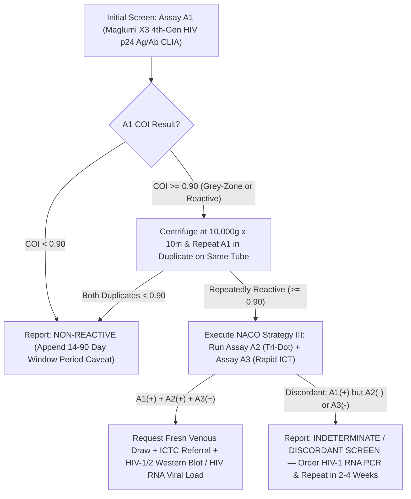

# 4.2.1 — HIV-1 & HIV-2 4th-Generation p24 Ag + Ab Combo (Maglumi X3 CLIA) & Mandatory NACO / HIV-AIDS Act 2017 Legal Shield

**Department Folder:** `04_Serology_Infectious_Diseases_and_Immunology`  
**Cluster Folder:** `4.2_Viral_Markers_HIV_Hepatitis_Syphilis_TORCH_and_EBV_Cluster`  
**Document ID:** `SOP-SER-4.2.1-HIV-COMBO` | **Version:** `4.0 (ISO 15189:2022 / NABL 112 / NACO 2017 / HIV & AIDS Act 2017)`

---

## 1. Document Control, Standardized Coding & Hardware-Agnostic Platform Matrix

| Coding System / Attribute | Identifier / Code | Official Nomenclature & Scope |
| :--- | :--- | :--- |
| **LOINC** | `56888-1` (4th-Gen Combo) / `75622-1` (3rd-Gen) | $\text{HIV-1}$ and $\text{HIV-2}$ $\text{Ab} + \text{HIV-1 p24 Ag}$ [Presence/Index] in Serum or Plasma by Immunoassay |
| **SNOMED-CT** | `413231002` / `86406008` | Screening for Human Immunodeficiency Virus ($\text{HIV-1}$ Group M/O & $\text{HIV-2}$) antigen and antibody |
| **ICD-10-CM** | `Z11.4` (Screening) / `R75` (Inconclusive) / `B20` | Encounter for screening for HIV; Inconclusive laboratory evidence of HIV |
| **UCUM Units** | `COI` / `S/CO` (`Cutoff Index`) | Signal-to-Cutoff Ratio / Chemiluminescence Cutoff Index |
| **Statutory Mandate** | **The HIV & AIDS Act 2017 (India) & NACO** | **NEVER report a single screening assay as "HIV POSITIVE"**; report strictly as `"Non-Reactive"` or `"Initially Reactive — Refer for NACO 3-Test Confirmatory Strategy"` |

### Hardware-Agnostic Analytical Platform Matrix
| NACO Assay Tier | Analytical Platform | Antigen/Antibody Principle | Role in NACO Strategy III (`A1 + A2 + A3`) |
| :--- | :--- | :--- | :--- |
| **Assay 1 (`A1` — Ultra-High Sensitivity Screen)** | **Snibe MAGLUMI X3 / X8 `HIV Ab/Ag Combi` CLIA** *(or 4th-Gen ELISA)* | 4th-Gen Sandwich Flash CLIA: Recombinant `gp41/gp120` ($\text{HIV-1}$ Group M/O), `gp36` ($\text{HIV-2}$), and monoclonal anti-**`p24` capsid antigen** | Primary screening assay (Sensitivity $\ge 99.8\%$); detects acute `p24` antigenemia $5\text{–}10\text{ days}$ before antibody seroconversion. |
| **Assay 2 (`A2` — High Specificity Principle 2)** | **Tridot / Flow-Through Immunofiltration (`HIV-1/2`)** | Vertical Immunofiltration Membrane with distinct `HIV-1` (`gp41/gp120`) and `HIV-2` (`gp36`) synthetic peptides | Second independent principle required when `A1` is repeatedly reactive (Specificity $\ge 99.5\%$). |
| **Assay 3 (`A3` — High Specificity Principle 3)** | **SD Bioline / Meriscreen 3rd/4th-Gen Lateral-Flow ICT** | Lateral-Flow Immunochromatography (different antigen source/lot from `A1` & `A2`) | Third confirmatory assay under **NACO Strategy III**; supplemented by **HIV-1/2 Immunoblot & Quantitative HIV RNA Viral Load**. |

---

## 2. Pre-Analytical Phlebotomy, Informed Consent, Window Period & HIL Rejection Matrix

### Statutory Pre-Test Counseling & Written Informed Consent (`HIV & AIDS Act 2017`, Section 5)
1. **Informed Consent & Barcoded Anonymity:** Per **Section 5 of The HIV and AIDS (Prevention and Control) Act, 2017**, no HIV test shall be undertaken without the **informed consent** of the individual (or legal guardian), accompanied by pre-test information and strict barcode confidentiality.
2. **Diagnostic Window Periods by Technology Tier:**
   - **HIV-1 RNA Real-Time PCR (`NAT`):** **$10 \text{ to } 14\text{ days}$** post-exposure.
   - **4th-Generation `HIV-1/2 Ab + p24 Ag` Combo (`Maglumi X3 CLIA`):** **$14 \text{ to } 28\text{ days}$** post-exposure (`p24` capsid protein rises at Day 14–18).
   - **3rd-Generation Antibody-Only Rapid Card / Tri-Dot (`IgM + IgG`):** **$21 \text{ to } 90\text{ days}$ ($3\text{ to }12\text{ weeks}$)** post-exposure.

### Specimen Stability & Quantitative HIL Rejection Matrix
| Storage Condition | Maximum Stability | Interference Factor | Quantitative Rejection Threshold & Corrective Action |
| :--- | :--- | :--- | :--- |
| **Ambient ($20\text{–}25^\circ\text{C}$)** | $\le 8\text{ hours}$ | **Fibrin Micro-Clots (Top Cause of False-Positive CLIA!)** | **Mandatory Recentrifugation:** Any serum drawn $<30\text{ min}$ before centrifugation or from patients on anticoagulants/dialysis must be recentrifuged at **$3,000\text{–}10,000 \times g$ for $10\text{ min}$** (fibrin traps `ABEI` conjugate!). |
| **Refrigerated ($2\text{–}8^\circ\text{C}$)** | **Up to $7\text{ days}$** | **Hemolysis ($H$) / Lipemia ($L$)** | Maglumi X3 CLIA stable up to $\text{Hb } 500\text{ mg/dL}$, $\text{TG } 1,000\text{ mg/dL}$, and $\text{Bilirubin } 20\text{ mg/dL}$; reject gross hemolysis/lipemia on Rapid ICT. |
| **Frozen ($-20^\circ\text{C}$)** | $6\text{ months}$ | **Biotin / HAMA Interference** | High-dose Biotin ($> 5\text{–}10\text{ mg/day}$) interferes with streptavidin-biotin assays; withhold Biotin for $48\text{ hours}$ prior to draw. |

---

## 3. Hardware-Agnostic Analytical SOP, NACO Strategy III Cascade & Six Sigma IQC



1. **MAGLUMI X3 CLIA Cutoff Index (`COI`) & Mandatory Duplicate Re-Centrifugation Rule:**
   - **Non-Reactive:** $\text{COI} < 0.90\text{ AU/mL}$ (or $< 1.00$ per kit master curve).
   - **Grey-Zone / Borderline:** $\text{COI } 0.90\text{ to }1.10$.
   - **Initially Reactive:** $\text{COI} > 1.10$.
   - **NEVER release an initially reactive `A1` result directly:** Immediately centrifuge the primary tube at $10,000 \times g$ for $10\text{ minutes}$ to pellet fibrin micro-strands and re-run `A1` in duplicate. If repeatedly reactive, perform `Assay 2` and `Assay 3` before issuing any preliminary report.
2. **Six Sigma IQC & EQAS:**
   - Run Negative Control ($< 0.30\text{ COI}$), HIV-1 Antibody Positive Control, HIV-2 Antibody Positive Control, and HIV-1 `p24` Antigen Control daily. Participate in NACO/NARI/CMC Vellore EQAS with $100\%$ concordance requirement.

---

## 4. Analytical Precision, Diagnostic Sensitivity/Specificity, Window Period & MRI

| Assay Tier | Within-Run $\text{CV}_A\%$ | Between-Run $\text{CV}_A\%$ | Diagnostic Sensitivity | Diagnostic Specificity | Window Period | Minimum Retesting Interval (MRI) |
| :--- | :--- | :--- | :--- | :--- | :--- | :--- |
| **`Maglumi X3 4th-Gen Combo`** | $2.8\%\text{–}4.5\%$ | $4.0\%\text{–}6.2\%$ | **$99.9\%\text{ – }100.0\%$** | $99.5\%\text{ – }99.8\%$ | **$14\text{ – }28\text{ days}$** | **$2\text{ to }4\text{ weeks}$** (and at $12\text{ weeks}$) post-exposure |
| **`3rd-Gen Tri-Dot / ICT`** | Qualitative | Qualitative | $99.3\%\text{ – }99.8\%$ | $99.2\%\text{ – }99.7\%$ | **$21\text{ – }90\text{ days}$** | **$4\text{, }6\text{, and }12\text{ weeks}$** post-exposure |
| **`NACO 3-Test (A1+A2+A3)`** | Combined | Combined | $99.8\%$ | **$> 99.95\%$** | $14\text{ – }90\text{ days}$ | Confirm on a **2nd independent blood draw** |

---

## 5. Multi-Stratified Reference Intervals & Special Population Cutoffs

| Population Stratum | Non-Reactive Cutoff | Equivocal / Grey-Zone | Actionable Reactive Cutoff & Special Mandatory Protocol |
| :--- | :--- | :--- | :--- |
| **General Adult & Adolescent ($> 18\text{ Months}$)** | **$< 0.90\text{ COI}$** | $0.90\text{ – }1.10\text{ COI}$ | **$> 1.10\text{ COI}$:** Report as *"Initially Reactive — Refer for Confirmatory Testing"* (`NACO Strategy III` + `HIV RNA PCR`). |
| **Antenatal / Pregnant Women (1st, 2nd, 3rd Trimester & Labor)** | $< 0.90\text{ COI}$ | $0.90\text{ – }1.10\text{ COI}$ | **High Biological False-Positive (`BFP`) Stratum:** Multiparous pregnancy frequently causes low-COI ($1.0\text{–}8.0$) false-positive `A1` screens! Conversely, if confirmed `A1+A2+A3` reactive in labor, initiate **immediate PPTCT Antiretroviral Prophylaxis** per NACO guidelines. |
| **Infants & Children $< 18\text{ Months}$ Born to HIV(+) Mothers** | **Serology Invalid for Diagnosis** | N/A | **Maternal $\text{IgG}$ Placental Transfer:** Passive maternal anti-HIV $\text{IgG}$ persists in infant blood for up to **$18\text{ months}$**! Definitive Early Infant Diagnosis (`EID`) requires **HIV-1 Total Nucleic Acid (`TNA`) / Proviral DNA PCR at 6 weeks, 6 months, and 18 months**. |

---

## 6. NABL & CLSI GP47 Critical ("Panic") Alerts & Statutory Notification

> [!WARNING]
> **OBSTETRIC INTRAPARTUM & NEEDLESTICK PEP CRITICAL ALERTS (<30 MINUTES):**
> 1. **Reactive HIV Screen in a Woman in Active Labor (`Unbooked Antenatal Case`):** Immediate confidential alert to the Obstetrician/Labor Room to initiate emergency **Prevention of Parent-to-Child Transmission (`PPTCT`) Nevirapine/Zidovudine neonatal prophylaxis** while confirmatory testing proceeds.
> 2. **Source-Patient Testing After Healthcare Worker (`HCW`) Needlestick Injury:** Expedite STAT 4th-Gen `HIV Combo` ($\text{TAT} < 60\text{ minutes}$) so HCW Post-Exposure Prophylaxis (`PEP` — Tenofovir + Lamivudine + Dolutegravir within $< 2\text{ hours}$, max $72\text{ hours}$) is not delayed.

---

## 7. Kinetic Marker Progression (`Fiebig Stages I–VI`) & Smart LIMS Reflex Cascades

| Fiebig Acute HIV Stage | Cumulative Days Post-Transmission | `HIV-1 RNA PCR` | `p24 Antigen` (4th-Gen) | `HIV IgM` (3rd-Gen) | `HIV IgG` / Western Blot |
| :--- | :--- | :--- | :--- | :--- | :--- |
| **Eclipse Phase** | Days $1 \text{ – } 10$ | Negative | Negative | Negative | Negative |
| **Fiebig Stage I** | Days $10 \text{ – } 14$ | **Positive (+)** | Negative | Negative | Negative |
| **Fiebig Stage II** | **Days $15 \text{ – } 20$** | **Positive (+)** | **Positive (+)** *(Caught by 4th-Gen Combo; missed by 3rd-Gen Rapid Cards!)* | Negative | Negative |
| **Fiebig Stage III** | Days $21 \text{ – } 25$ | **Positive (+)** | **Positive (+)** | **Positive (+)** | Negative |
| **Fiebig Stage IV–VI** | Day $26+$ onward | **Positive (+)** | Variable (complexed) | **Positive (+)** | **Indeterminate $\rightarrow$ Positive (+)** |

---

## 8. Biological False-Positive (`BFP`) Cross-Reactivity & ISO 22367 Risk FMEA

- **Why Low-COI ($1.0\text{–}10.0$) False-Positive `HIV Combo` Results Occur in Low-Prevalence Populations:**
  - **Pregnancy (Multiparous alloimmunization against paternal HLA Class I/II antigens)**, acute **Malaria, Dengue, EBV, CMV, Viral Hepatitis, Tuberculosis, Leprosy**, **Recent Vaccinations** (Influenza, Hepatitis B, Rabies, Tetanus), **Autoimmune Diseases (SLE, Rheumatoid Factor, Antiphospholipid Syndrome)**, chronic renal failure/hemodialysis, hypergammaglobulinemia, and fibrin micro-clots.

| Failure Mode (ISO 22367) | Root Cause | Clinical & Medico-Legal Risk | Mandatory Mitigation Control |
| :--- | :--- | :--- | :--- |
| **Single Reactive Screen Released as `"HIV POSITIVE"`** | Violation of NACO Strategy III | **Severe patient psychological trauma/suicide; ₹10–50 Lakh NCDRC consumer liability!** | Hardcode LIMS output value as `"Initially Reactive — Refer for Confirmatory Testing"` + full NACO/HIV Act 2017 Shield |
| **False-Negative 3rd-Gen Rapid Card in Acute Fiebig Stage II HIV** | Rapid card lacks `p24` antigen detection | Acute hyper-infectious HIV missed during Day 15–22 window | Prioritize 4th-Gen `Maglumi X3 HIV p24 Ag/Ab Combo` + explicit Window Period disclaimer |

---

## 9. Conditional Band-Specific Pathologist Sign-Out Library

- **`[BAND-NON-REACTIVE]`:** *"HIV-1 & HIV-2 4th-Generation Screening Assay (p24 Ag + Ab) is NON-REACTIVE. Note: A non-reactive result does not exclude recent HIV exposure within the immunological window period (14–28 days for 4th-Gen Ag/Ab assays; up to 90 days for 3rd-Gen antibody assays). Repeat testing or HIV-1 RNA PCR is advised if recent high-risk exposure is suspected."*
- **`[BAND-EQUIVOCAL/INDETERMINATE]`:** *"Borderline / Indeterminate reactivity observed on initial screening (COI 0.90–2.50) with negative secondary/tertiary rapid assays. In low-prevalence populations (particularly pregnancy, acute febrile illnesses, or autoimmune conditions), this pattern most commonly represents a Biological False-Positive reaction, though very early acute seroconversion (Fiebig Stage II) cannot be excluded. Recommend Quantitative HIV-1 RNA Real-Time PCR or repeat testing on a fresh sample in 2–4 weeks."*
- **`[BAND-REACTIVE-SCREEN]`:** *"INITIALLY REACTIVE ON SCREENING ASSAY — NOT A CONFIRMED DIAGNOSIS OF HIV INFECTION. Per NACO (Govt. of India) Strategy III and The HIV and AIDS (Prevention and Control) Act, 2017, a reactive screening test must NEVER be interpreted as a definitive diagnosis. Mandatory confirmatory evaluation using three independent assays of different principles (ICTC referral), HIV-1/2 Western Blot/Immunoblot, and/or Quantitative HIV-1/2 RNA Viral Load on a fresh venous blood sample is required."*

---

## 10. Master LIMS Copy-Paste Report Block (Physician + Patient Summary + NACO & HIV Act 2017 Legal Shield)

```text
================================================================================
   HIV 1 & 2 SCREENING — MANDATORY NACO & HIV/AIDS ACT 2017 STATUTORY SHIELD
================================================================================
1. INTERPRETATION OF SCREENING RESULT (4TH-GEN p24 Ag + HIV-1/2 Ab):
   • NON-REACTIVE (Negative): No HIV-1/2 antibodies or p24 antigen detected at 
     the time of blood draw. Does NOT rule out recent exposure within the 
     "Window Period" (14-28 days for 4th-Gen Ag/Ab CLIA; up to 3-12 weeks [90 
     days] for 3rd-Gen Antibody/Rapid tests). Repeat testing after 4-12 weeks 
     or HIV-1 RNA PCR is advised if recent exposure is suspected.
   • INITIALLY REACTIVE / EQUIVOCAL: THIS IS A SCREENING RESULT ONLY AND IS NOT 
     A CONFIRMED DIAGNOSIS OF HIV INFECTION!

2. MANDATORY STATUTORY MEDICO-LEGAL SHIELD (NACO GUIDELINES & HIV ACT 2017):
   • Mandatory 3-Test Confirmatory Strategy (NACO Strategy III): Per National 
     AIDS Control Organization (NACO, MoHFW Govt. of India) guidelines, NO 
     clinical, personal, marital, employment, surgical, or treatment decision 
     may be made on a single reactive screening test. Any reactive result MUST 
     be confirmed using three independent assays of different antigenic 
     principles (A1 + A2 + A3 / ICTC referral), HIV-1/2 Western Blot/Line 
     Immunoassay, and/or Quantitative HIV-1/2 RNA Viral Load PCR on a fresh 
     venous blood sample, accompanied by post-test counseling.
   • Causes of Biological False-Positive Screening Reactions: Pregnancy 
     (multiparous women), recent vaccinations (Influenza, Hep-B, Rabies), acute 
     viral/tropical fevers (Malaria, Dengue, EBV, CMV, Tuberculosis), autoimmune 
     diseases (SLE, Rheumatoid Factor), renal failure/dialysis, or heterophile Ab.
   • Infants <18 Months: Maternal IgG crosses the placenta; infant diagnosis 
     requires HIV-1 Proviral DNA / Total Nucleic Acid (TNA) PCR.
   • Statutory Confidentiality: Issued under Chapter IV of The HIV and AIDS 
     (Prevention and Control) Act, 2017. Strict confidentiality applies. 
     Not valid for medico-legal purposes.
================================================================================
```
