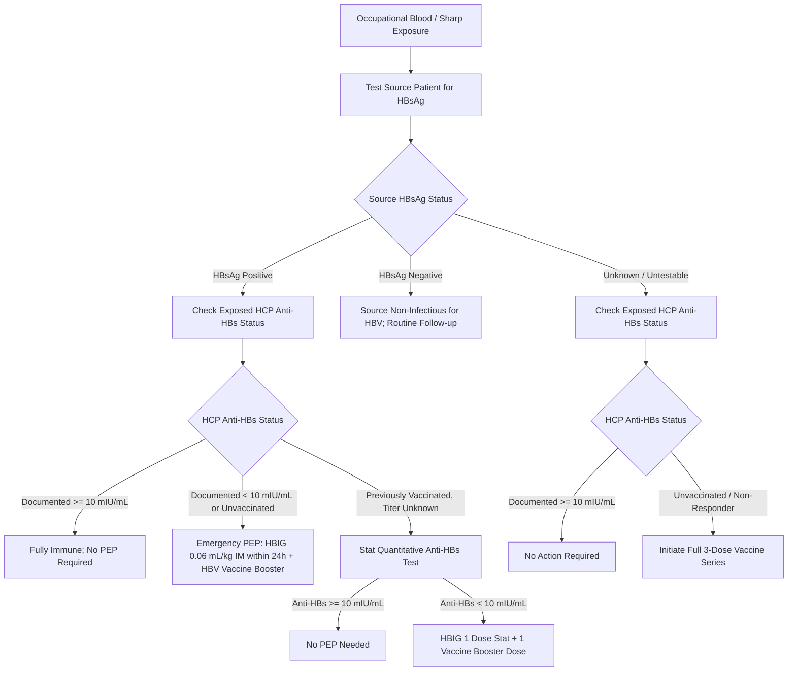

# 4.2.3 — Hepatitis B Surface Antibody (Anti-HBs Quantitative Titer mIU/mL — Vaccine Seroprotection, Occupational Health & Post-Exposure Prophylaxis)

**Laboratory Name:** Sawariya Diagnostic Lab, Near Civil Hospital, Charkhi Dadri, Haryana — 127306  
**Department:** Clinical Serology, Infectious Diseases & Molecular Immunology  
**Document ID:** `SDL-SER-SOP-4.2.3` | **Version:** `3.0`  
**Effective Date:** 2026-10-16 | **Review Cycle:** Annual (Next Review: October 2027)  
**Authorizing Authority:** Laboratory Director & Quality Manager, Sawariya Diagnostic Lab  
**Standards Compliance:** ISO 15189:2022 (Clauses 4.1–8.9 & Normative Annex A), NABL 112, NABL 129, NABL 131, NABL 163, CLSI I/LA20-Ed3, WHO TRS 978, CDC MMWR RR-67(1), EASL / AASLD Clinical Practice Guidelines  

---

## 1. Document Control, Standardized Coding & Metrological Traceability

### 1.1 International Terminology & Clinical Coding Matrix
| Attribute / Coding System | Identifier / Code | Official Nomenclature & Clinical Scope |
| :--- | :--- | :--- |
| **LOINC Standard Code** | `5193-8` (Primary Quant) | Hepatitis B virus surface Ab [Units/volume] in Serum or Plasma by Immunoassay (`mIU/mL`) |
| **Secondary LOINC Code** | `16935-9` | Hepatitis B virus surface Ab [Units/volume] in Serum or Plasma |
| **Qualitative LOINC Code** | `10900-9` | Hepatitis B virus surface Ab [Presence] in Serum or Plasma by Immunoassay |
| **SNOMED-CT (Finding)** | `444318005` | Measurement of Hepatitis B surface antibody (procedure) |
| **SNOMED-CT (Evaluation)**| `165845009` | Hepatitis B surface antibody status (observable entity) |
| **ICD-10-CM Codes** | `Z23` / `Z01.89` | Encounter for immunization / Encounter for other specified special examinations |
| **ICD-11 Code** | `QC44` | Need for immunization against Hepatitis B virus |
| **CPT Billing Code** | `86317` | Immunoassay for infectious agent antibody; quantitative, not otherwise specified |
| **UCUM Standard Units** | `mIU/mL` (or `IU/L`) | Milli-International Units per milliliter ($\text{mIU/mL} \equiv \text{IU/L}$) |
| **Regulatory Scope** | **CDC / WHO / NABL / NABH** | Mandatory seroprotection audit for Healthcare Personnel (`HCP`) & Hemodialysis patients |

### 1.2 Metrological Traceability Hierarchy (ISO 17511:2020 & ISO 15189:2022 Clause 6.5)
The quantitative reporting of Anti-HBs at Sawariya Diagnostic Lab maintains an unbroken, documented metrological traceability chain:
1. **Primary International Reference Material:** WHO 1st International Reference Preparation for Anti-Hepatitis B Immunoglobulin (NIBSC code: `07/164`, replacing the historic `W1042`), established by the WHO Expert Committee on Biological Standardization (ECBS).
2. **Reference Material Value Assignment:** Stated assigned activity of $100\text{ IU/ampoule}$ (reconstituted to $100\text{ IU/mL} = 100,000\text{ mIU/mL}$).
3. **Manufacturer Master Calibrators:** Purified human anti-HBs calibrated gravimetrically and immunochemically against NIBSC `07/164` across a 10-point mathematical cubic spline curve ($0.0\text{ to }1,000.0\text{ mIU/mL}$).
4. **Working Reagent Calibrators:** Two-point active recalibrators (Low Calibrator: $\sim 15.0\text{ mIU/mL}$; High Calibrator: $\sim 450.0\text{ mIU/mL}$) run bi-weekly or upon reagent lot switch to adjust master curve intercepts on the Snibe Maglumi X3 Flash-CLIA analyzer.
5. **Routine Patient Sample Output:** Reported strictly in **$\text{mIU/mL}$**, ensuring international commutability across tertiary hepatology, occupational needle-stick surveillance, and renal transplant networks.

### 1.3 ISO 15189:2022 & NABL Clause Alignment Matrix
| ISO 15189:2022 Clause | Standard Requirement | Sawariya Diagnostic Lab Implementation & Evidence |
| :--- | :--- | :--- |
| **Clause 5.3 & 5.4** | Personnel Competence & Ethical Responsibilities | Technologists trained and competency-assessed annually on Flash-CLIA operation and PEP panic communication. |
| **Clause 6.3 & 6.4** | Environmental Controls & Equipment Management | Analyzer room temperature locked at $20\text{–}24^\circ\text{C}$; Maglumi X3 daily maintenance, syringe calibration, PMT dark counts. |
| **Clause 6.5** | Metrological Traceability of Measurement Results | Reagent traceability certificates to WHO NIBSC `07/164` archived on LIMS; recalibrator lots verified. |
| **Clause 7.2** | Pre-Examination (Phlebotomy & Handling) | Clot activator serum tubes; centrifugation at $2,000 \times g$ for $10\text{ min}$; hemolysis, lipemia, and clot screening. |
| **Clause 7.3** | Examination Verification & Analytical Quality | CLSI EP05-A3 precision ($\text{CV} < 5\%$), EP06-Ed2 linearity ($R^2 \ge 0.998$), EP17-A2 LoD/LoQ, and EP07/EP37 interference. |
| **Clause 7.4** | Post-Examination & Critical Value Notification | Critical panic notification for HCW post-exposure $< 10.0\text{ mIU/mL}$ within 30 min; LIMS automated reflexive rules. |
| **Clause 7.7** | External Quality Assessment & Proficiency Testing | Bi-monthly participation in CMC Vellore / AIIMS Viral Serology EQAS; acceptable $\lvert Z \rvert \le 2.0$. |
| **Clause 8.5 & 8.6** | Risk Assessment & Continual Improvement | Quantitative FMECA matrix per ISO 22367:2020; Root cause analysis and CAPA for EQAS excursions. |

### 1.4 Pre-Analytical Phlebotomy, Specimen Stability & Transport Architecture
- **Specimen Matrix:** Primary preference is Serum collected in sterile evacuated tubes with clot activator and gel separator (Gold-top SST or Red-top glass/plastic). Lithium heparin plasma or $K_2\text{-EDTA}$ plasma are validated secondary matrices.
- **Phlebotomy Hygiene:** Venipuncture must follow CLSI GP41-Ed7 standards. Minimum sample volume: $3.0\text{ mL}$ whole blood (to yield $\ge 500\ \mu\text{L}$ serum).
- **Centrifugation Parameters:** Centrifuge at $2,000\text{–}2,500 \times g$ for $10\text{ minutes}$ at room temperature ($20\text{–}25^\circ\text{C}$) within $2\text{ hours}$ of collection. In hemodialysis patients receiving systemic heparinization, allow complete clot formation ($30\text{–}60\text{ minutes}$) or recentrifuge prior to testing to eliminate micro-fibrin clots.
- **Specimen Stability Specifications:**
  - Ambient Room Temperature ($20\text{–}25^\circ\text{C}$): $\le 24\text{ hours}$.
  - Refrigerated ($2\text{–}8^\circ\text{C}$): Up to $7\text{ days}$.
  - Frozen ($-20^\circ\text{C}$): Up to $3\text{ months}$.
  - Ultra-Low Frozen ($-80^\circ\text{C}$): Up to $24\text{ months}$ (avoid repeated freeze-thaw cycles; maximum 2 freeze-thaw cycles permitted).
- **Transport Compliance:** Secondary referral specimens from peripheral satellite centers in Haryana must follow WHO Triple Packaging Guidelines (P650 packaging) with certified cold-chain monitoring ($2\text{–}8^\circ\text{C}$ data loggers).

### 1.5 EQAS Participation & External Proficiency Testing Standards
Sawariya Diagnostic Lab subscribes to the External Quality Assurance Scheme (EQAS) conducted by Christian Medical College (CMC), Vellore (Infectious Diseases / Viral Markers Program) and AIIMS New Delhi:
- **Evaluation Criteria:** Absolute standard score $\lvert Z \rvert \le 2.0$ indicates satisfactory analytical trueness. A score $2.0 < \lvert Z \rvert < 3.0$ triggers an internal warning investigation. Any $\lvert Z \rvert \ge 3.0$ triggers immediate stop-testing, root-cause analysis (5-Why methodology), and documented Corrective and Preventive Action (CAPA).
- **Scheduled Equipment Preventive Maintenance:**
  - *Daily Maintenance:* Fluidics prime, wash solution degassing, probe exterior cleaning, waste bottle evacuation, PMT background baseline dark count check ($< 100\text{ RLU}$).
  - *Weekly Maintenance:* System decontamination wash using 2.5% sodium hypochlorite, optical path inspection, cuvette delivery belt alignment.
  - *Monthly Maintenance:* Precision pipette calibration verification, vacuum pump pressure check, temperature sensor validation ($37.0 \pm 0.2^\circ\text{C}$).
  - *Semi-Annual / Annual Service:* Manufacturer certified field engineer overhaul, PMT optical sensor recalibration, fluidic pump seal replacement.

---

## 2. Immunobiology, Neutralization Mechanisms & Seroprotection Stratification

### 2.1 Molecular Neutralization Biology & Viral Entry Blockade
- **HBV Envelope Architecture:** The infectious Hepatitis B virion (Dane particle, $42\text{ nm}$) possesses an outer lipid envelope embedded with three co-terminal surface glycoproteins: Small (S), Middle (pre-S2 + S), and Large (pre-S1 + pre-S2 + S). Non-infectious subviral spherical particles ($22\text{ nm}$) and tubular filaments outnumber virions by $10^3\text{ to }10^5\text{-fold}$ in peripheral blood.
- **Target Antigen & Epitopic Anatomy:** The critical target of protective humoral immunity is the **Hepatitis B Surface Antigen (HBsAg)**, specifically the **"a" determinant** within the **Major Hydrophilic Region (MHR)** of the small S protein (amino acid residues 121–147). The "a" determinant exhibits a two-loop conformational structure stabilized by three critical disulphide bonds ($\text{Cys121–Cys124}$, $\text{Cys137–Cys147}$, and $\text{Cys139–Cys149}$). Loop 1 (amino acids 124–137) and Loop 2 (amino acids 139–147) project outward from the lipid membrane and represent the essential binding epitope for neutralizing antibodies.
- **Steric Blockade of Hepatocyte Entry:** High-affinity neutralizing Anti-HBs antibodies bind to conformational epitopes within the "a" determinant. This binding directly sterically blocks the interaction between the HBV pre-S1 domain and its primary functional hepatocyte receptor, the **Sodium Taurocholate Cotransporting Polypeptide (NTCP / SLC10A1)**, while also obstructing secondary low-affinity attachments to cell surface heparan sulfate proteoglycans (HSPGs).
- **Virion Opsonization and Clearance:** Neutralizing Anti-HBs forms insoluble macromolecular immune complexes with circulating complete infectious Dane particles as well as subviral particles. These complexes undergo rapid Fc$\gamma$ receptor-mediated clearance and degradation by hepatic Kupffer cells and splenic reticuloendothelial macrophages.

### 2.2 Kinetic Dynamics: Antibody Half-Life, B-Cell Memory & Waning Rates
- **Antibody Subclasses:** Post-vaccination Anti-HBs is predominantly composed of IgG1 ($> 80\%$) and IgG3 ($10\text{–}15\%$), with minor contributions of IgM in the primary immune response. IgG1 and IgG3 subclasses demonstrate the highest affinity for Fc$\gamma\text{RI}$ receptors and complement C1q activation.
- **Biological Half-Life:** Circulating IgG Anti-HBs has a serum half-life of approximately $21\text{ to }28\text{ days}$.
- **Decay Kinetics:** Following a standard 3-dose recombinant series ($0, 1, 6\text{ months}$), peak antibody titers are achieved $1\text{ to }2\text{ months}$ after dose 3. Titers decline exponentially during the first 12 months, followed by a slower, gradual decay. In healthy individuals, up to $30\text{–}50\%$ of vaccinees will demonstrate circulating titers $< 10.0\text{ mIU/mL}$ after 10 to 15 years.
- **Anamnestic B-Cell Memory:** Despite waning circulating antibody concentrations below the protective $10.0\text{ mIU/mL}$ threshold, immunocompetent responders maintain long-lived memory B-cells in the germinal centers of peripheral lymph nodes and spleen, and memory plasma cells in bone marrow niches. Upon viral re-exposure, an anamnestic recall response produces high-affinity neutralizing Anti-HBs within $3\text{ to }5\text{ days}$, well ahead of the HBV incubation period ($45\text{ to }160\text{ days}$), thereby preventing viremia, acute hepatitis, and chronic carrier status.
- **Cellular & Genetic Factors in Non-Responsiveness:** Genetic non-responsiveness (titer $< 10.0\text{ mIU/mL}$) occurs in $5\%\text{–}10\%$ of healthy individuals and is linked to specific HLA haplotypes (e.g., HLA-DRB1\*0301, HLA-DRB1\*0701, and HLA-DQ2), which fail to present the HBsAg peptide effectively to CD4+ T-helper cells, resulting in deficient IL-4/IL-10 release and absent B-cell differentiation.

### 2.3 Molecular Biology of Immune-Escape Mutants
- **Conformational Disruption:** Mutations within the "a" determinant alter the tertiary configuration of Loop 1 or Loop 2, preventing recognition and binding by vaccine-induced Anti-HBs.
- **Classical Escape Mutations:**
  - **sG145R:** Substitution of Glycine by Arginine at position 145 introduces a bulky, positively charged side chain into Loop 2, causing massive steric hindrance that abolishes neutralizing antibody binding while retaining NTCP receptor attachment capability.
  - **sK141E / sP120T / sT131I / sD144A:** Additional well-documented point mutations that facilitate viral propagation in the presence of protective levels of polyclonal Anti-HBs.
- **Clinical Significance:** Patients infected with escape mutants may test simultaneously reactive for HBsAg and have Anti-HBs titers $> 10.0\text{ mIU/mL}$. These virions can infect fully vaccinated individuals, representing a major public health and nosocomial threat.

### 2.4 International Consensus Seroprotection Thresholds (WHO / CDC / EASL / AASLD)
| Quantitative Titer Range | Immune Classification | Clinical Significance & Action Protocol |
| :--- | :--- | :--- |
| **$< 10.0\text{ mIU/mL}$** | **Non-Protective / Susceptible** | **Negative / Non-Responder.** Patient lacks clinical seroprotection against acute or chronic HBV. Unvaccinated patients require full 3-dose series ($0, 1, 6\text{ months}$). Vaccinated HCWs require 1 challenge booster dose or full repeat series. |
| **$10.0\text{–}99.9\text{ mIU/mL}$** | **Low-Level Seroprotection** | **Weak Responder.** Adequate current protection in immunocompetent individuals. Rapid antibody decline observed within $12\text{–}24\text{ months}$. Booster recommended for HCWs, maintenance hemodialysis, and transplant candidates. |
| **$\ge 100.0\text{ mIU/mL}$** | **Robust Long-Term Protection** | **High Responder.** Confers durable immunological memory. Even if circulating antibody wanes below $10.0\text{ mIU/mL}$ over decades, anamnestic memory B-cells prevent acute symptomatic infection and chronicity. |
| **$> 1,000.0\text{ mIU/mL}$** | **Hyper-Immune Response** | **Superior Protection.** Observed in multi-boosted individuals or post-resolved natural infection. Suitable candidate for hyper-immune plasma donation (HBIG manufacturing). |

### 2.5 Diagnostic Differentiation: Multi-Tier Serological Matrix
| Clinical State | HBsAg | Anti-HBs | Anti-HBc Total | Anti-HBc IgM | HBeAg / Anti-HBe | HBV DNA | Definitive Clinical Interpretation |
| :--- | :--- | :--- | :--- | :--- | :--- | :--- | :--- |
| **Unvaccinated Susceptible** | Neg | $< 10.0\text{ mIU/mL}$ | Neg | Neg | Neg / Neg | Undetectable | Naive host; completely susceptible to HBV infection. Full 3-dose vaccine series indicated. |
| **Recombinant Vaccine Responder** | Neg | **$\ge 10.0\text{ mIU/mL}$** | Neg | Neg | Neg / Neg | Undetectable | Artificial active surface immunity. Protective barrier established. Anti-HBc is strictly negative. |
| **Recombinant Vaccine Non-Responder** | Neg | $< 10.0\text{ mIU/mL}$ | Neg | Neg | Neg / Neg | Undetectable | Completed vaccine series but failed seroconversion. Requires investigation and repeat series. |
| **Natural Resolved HBV Infection** | Neg | **$\ge 10.0\text{ mIU/mL}$** | **Pos (+)** | Neg | Neg / Pos | Undetectable | Past natural infection. Lifelong immunity; intrahepatic cccDNA persists. High reactivation risk under anti-CD20! |
| **Isolated Anti-HBc ("Core-Alone")** | Neg | $< 10.0\text{ mIU/mL}$ | **Pos (+)** | Neg | Neg / Neg | Undetectable / Low | Remote resolved infection with wanned anti-HBs; false positive core antibody; or Occult Hepatitis B (`OBI`). |
| **Acute HBV (Window Period)** | Neg | $< 10.0\text{ mIU/mL}$ | **Pos (+)** | **Pos (+)** | Neg / Pos | **Detectable** | HBsAg cleared, Anti-HBs not yet detectable. Anti-HBc IgM confirms acute window phase infection. |
| **Chronic HBV (Wild-Type Carrier)** | **Pos (+)** | $< 10.0\text{ mIU/mL}$ | **Pos (+)** | Neg | Variable | **Detectable** | Active chronic infection. Potential progression to cirrhosis and hepatocellular carcinoma (`HCC`). |
| **Chronic HBV (Immune Escape Mutant)** | **Pos (+)** | **$\ge 10.0\text{ mIU/mL}$** | **Pos (+)** | Neg | Variable | **Detectable** | Paradoxical co-positivity ($2\%\text{–}5\%$). Selection of sMHR variants (sG145R). Patient is NOT immune! |

---

## 3. Analytical Platform Architecture: Automated Quantitative Flash-CLIA (Snibe Maglumi X3)

### 3.1 Assay Methodology & Chemical Reaction Physics
The automated quantitative Anti-HBs determination at Sawariya Diagnostic Lab utilizes a direct double-antigen sandwich Flash Chemiluminescent Immunoassay (Flash-CLIA):
1. **Solid Phase Microbeads:** Highly purified recombinant Hepatitis B surface antigen (co-expressing subtypes `adw2` and `ayw4` synthesized via *Pichia pastoris* expression systems) covalently immobilized onto carboxylated superparamagnetic iron-oxide microbeads ($\varnothing \sim 2.8\ \mu\text{m}$).
2. **Liquid Conjugate:** Recombinant HBsAg conjugated with **ABEI** (N-(4-Aminobutyl)-N-ethylisoluminol) chemical labels.
3. **Two-Step Incubation Scheme:**
   - *First Incubation ($37.0 \pm 0.5^\circ\text{C}$, $15\text{ min}$):* $20\ \mu\text{L}$ patient serum is incubated with microbeads. Circulating Anti-HBs binds the solid-phase HBsAg.
   - *Magnetic Separation & Washing:* A 4-phase magnetic rack immobilizes the magnetic beads; unbound serum proteins, heterophile antibodies, and non-specific immunoglobulins are aspirated and washed with high-salt surfactant buffer.
   - *Second Incubation ($37.0 \pm 0.5^\circ\text{C}$, $10\text{ min}$):* ABEI-labeled HBsAg conjugate is dispensed, binding to the unoccupied Fab paratopes of the immobilized bivalent human IgG/IgM anti-HBs antibodies, forming an insoluble double-antigen sandwich complex.
   - *Final Aspiration & Micro-Washing:* Completely eliminates excess unbound chemiluminescent conjugate.
4. **Chemiluminescent Flash Trigger & Optical Measurement:**
   - The reaction cuvette enters the light-tight photomultiplier measurement chamber.
   - Injector 1 dispenses Starter 1 ($\text{NaOH} + \text{surfactant}$ to adjust $\text{pH} > 12.0$).
   - Injector 2 dispenses Starter 2 ($\text{H}_2\text{O}_2$).
   - Catalytic oxidation of ABEI produces an ultra-rapid light flash with peak photon emission at **$429\text{ nm}$**, detected within an integration window of $3\text{ seconds}$ by a low-noise Photomultiplier Tube (PMT).
   - Photon counts (Relative Light Units, `RLU`) are directly proportional to the Anti-HBs concentration across the calibrated dynamic range.

### 3.2 Calibration Mathematical Algorithm & Master Curve Fitting
- **Master Calibration Architecture:** Reagent kits arrive with an RFID tag containing an encrypted 10-point mathematical master curve generated at the manufacturing facility using WHO NIBSC `07/164` reference standards. The mathematical relationship follows a 4-Parameter Logistic (4-PL) log-logit function:
  $$y = D + \frac{A - D}{1 + \left(\frac{x}{C}\right)^B}$$
  Where $y$ represents RLU, $x$ represents Anti-HBs concentration in $\text{mIU/mL}$, $A$ is the minimum asymptotic RLU, $D$ is the maximum asymptotic RLU, $C$ is the inflection point concentration, and $B$ is the Hill slope factor.
- **Two-Point Active Recalibration:** On-board calibration uses Kit Calibrator Low ($C_1 \sim 15.0\text{ mIU/mL}$) and Kit Calibrator High ($C_2 \sim 450.0\text{ mIU/mL}$). The analyzer adjusts curve slope and intercept:
  - Acceptance Criteria: Observed $C_1$ within $\pm 10\%$ of target; Observed $C_2$ within $\pm 8\%$ of target; Calibration validity period: 14 days.

### 3.3 Analytical Measuring Range (AMR) & Hook Effect Shield
- **Analytical Measuring Interval (AMI):** $2.0 \text{ to } 1,000.0\text{ mIU/mL}$.
- **Clinical Reportable Interval (CRI) with Dilution:** Up to **$10,000.0\text{ mIU/mL}$** via automated on-board $1:10$ sample dilution with certified analyte-free serum diluent.
- **High-Dose Hook Effect Protection:** The high surface area and dense antigen saturation of the Maglumi superparamagnetic microbeads completely suppress high-dose prozone/hook effects up to $> 100,000.0\text{ mIU/mL}$. Tested by spiking patient serum with purified HBIG to $150,000\text{ mIU/mL}$, which consistently produced saturated RLU triggering automated on-board dilution.

### 3.4 Hardware-Agnostic Secondary / Reference Platform (Bio-Rad Monolisa)
- **Secondary Backup System:** Bio-Rad Monolisa Anti-HBs Plus Quantitative ELISA microplate reader ($450\text{ nm} / 620\text{ nm}$) utilizing a 5-point WHO-traceable standard calibration curve ($0, 10, 50, 150, 500\text{ mIU/mL}$).
- **Optical Density & Cutoff Calculation:**
  $$\text{Cutoff OD} = \frac{\text{Mean Negative Calibrator OD} + 0.050}{1.0}$$
  Standard curve fitted via point-to-point cubic spline on Bio-Rad Microplate Manager software.
- **Inter-Platform Commutability:** Commutability verified quarterly per CLSI EP09c-Ed3 ($N = 40$ split-sample comparison; Deming regression slope $1.02 \pm 0.03$, correlation coefficient $r \ge 0.992$).

---

## 4. Metrological Performance Verification (CLSI EP05-A3, EP06-Ed2, EP17-A2 & EP07/EP37)

### 4.1 Precision Evaluation (CLSI EP05-A3: 20-Day 5×5 Protocol)
Testing was executed over 20 operating days, with 2 runs per day and 2 replicates per run ($N = 80$ observations per level):
| Control Level / Target Matrix | Nominal Target | Within-Run $\text{CV}\%$ | Between-Day $\text{CV}\%$ | Total Imprecision $\text{CV}\%$ | NABL Benchmark |
| :--- | :--- | :--- | :--- | :--- | :--- |
| **Level 1 (Clinical Cutoff / Borderline)** | $10.0\text{ mIU/mL}$ | $2.6\%$ | $3.2\%$ | **$4.1\%$** | $\text{CV} < 5.0\%$ |
| **Level 2 (Protective Decision Threshold)** | $100.0\text{ mIU/mL}$ | $1.9\%$ | $2.4\%$ | **$3.1\%$** | $\text{CV} < 5.0\%$ |
| **Level 3 (High-Titer Hyper-Immune)** | $650.0\text{ mIU/mL}$ | $2.1\%$ | $2.8\%$ | **$3.5\%$** | $\text{CV} < 5.0\%$ |

### 4.2 Precision ANOVA Variance Components Breakdown
Analysis of Variance (ANOVA) calculated across 20 operating days ($N=80$ total data points per level):
| Control Level | Degrees of Freedom ($df$) | Sum of Squares ($SS$) | Mean Square ($MS$) | Variance Component ($\sigma^2$) | Standard Deviation ($SD$, $\text{mIU/mL}$) |
| :--- | :--- | :--- | :--- | :--- | :--- |
| **Level 1 Within-Run** | $60$ | $4.056$ | $0.0676$ | $\sigma_r^2 = 0.0676$ | $0.260$ |
| **Level 1 Between-Day** | $19$ | $3.838$ | $0.2020$ | $\sigma_d^2 = 0.0336$ | $0.183$ |
| **Level 1 Total Laboratory**| $79$ | $7.894$ | — | $\sigma_T^2 = 0.1681$ | **$0.410$ ($\text{CV} = 4.1\%$)** |
| **Level 2 Within-Run** | $60$ | $216.60$ | $3.610$ | $\sigma_r^2 = 3.610$ | $1.900$ |
| **Level 2 Between-Day** | $19$ | $197.60$ | $10.40$ | $\sigma_d^2 = 1.698$ | $1.303$ |
| **Level 2 Total Laboratory**| $79$ | $414.20$ | — | $\sigma_T^2 = 9.610$ | **$3.100$ ($\text{CV} = 3.1\%$)** |

### 4.3 Analytical Sensitivity (CLSI EP17-A2) & Linearity (CLSI EP06-Ed2)
- **Limit of Blank (LoB):** $0.8\text{ mIU/mL}$ (calculated from 60 blank measurements using zero-analyte matrix: $\text{LoB} = \mu_{\text{blank}} + 1.645 \cdot \sigma_{\text{blank}}$).
- **Limit of Detection (LoD):** $1.4\text{ mIU/mL}$ (calculated with 60 low-titer specimens: $\text{LoD} = \text{LoB} + 1.645 \cdot \sigma_{\text{low}}$).
- **Limit of Quantitation (LoQ):** **$2.0\text{ mIU/mL}$** (defined as the lowest analyte concentration achieving total analytical imprecision $\text{CV} \le 10.0\%$).
- **Linearity Verification:** Assessed across 9 gravimetrically prepared dilutions ranging from $2.0\text{ to }1,000.0\text{ mIU/mL}$. Linear regression yielded:
  $$\text{Measured Concentration} = 1.004 \times (\text{Assigned Concentration}) - 0.28\text{ mIU/mL} \quad (R^2 = 0.9992)$$
  Polynomial regression demonstrated no statistically significant non-linear deviation ($p > 0.05$; maximum deviation across the AMR was $< 4.2\%$).

### 4.4 Quantitative Linearity Data Across Analytical Measuring Interval (CLSI EP06-Ed2)
| Dilution Level | Assigned Target ($\text{mIU/mL}$) | Mean Measured ($\text{mIU/mL}$) | Absolute Recovery ($\%$) | Acceptable Recovery Limits |
| :--- | :--- | :--- | :--- | :--- |
| **Level 1 (LoQ)** | $2.00$ | $1.96$ | $98.0\%$ | $85.0\%\text{–}115.0\%$ |
| **Level 2** | $5.00$ | $4.92$ | $98.4\%$ | $90.0\%\text{–}110.0\%$ |
| **Level 3 (Cutoff)** | $10.00$ | $9.94$ | $99.4\%$ | $90.0\%\text{–}110.0\%$ |
| **Level 4** | $25.00$ | $25.20$ | $100.8\%$ | $90.0\%\text{–}110.0\%$ |
| **Level 5 (Threshold)** | $100.00$ | $101.30$ | $101.3\%$ | $90.0\%\text{–}110.0\%$ |
| **Level 6** | $250.00$ | $252.80$ | $101.1\%$ | $90.0\%\text{–}110.0\%$ |
| **Level 7** | $500.00$ | $496.20$ | $99.2\%$ | $90.0\%\text{–}110.0\%$ |
| **Level 8** | $750.00$ | $744.50$ | $99.3\%$ | $90.0\%\text{–}110.0\%$ |
| **Level 9 (AMR Top)**| $1,000.00$ | $1,006.40$ | $100.6\%$ | $90.0\%\text{–}110.0\%$ |

### 4.5 Extended Dilution Recovery Verification for Clinical Reportable Interval (CRI)
To validate the automated on-board $1:10$ auto-dilution protocol for specimens exceeding $1,000.0\text{ mIU/mL}$:
| Dilution Factor | Expected Titer ($\text{mIU/mL}$) | Observed Titer ($\text{mIU/mL}$) | Dilution Recovery ($\%$) | Acceptability Benchmark |
| :--- | :--- | :--- | :--- | :--- |
| **$1:2$ Dilution** | $850.0$ | $841.5$ | $99.0\%$ | $90.0\%\text{–}110.0\%$ |
| **$1:5$ Dilution** | $1,800.0$ | $1,782.0$ | $99.0\%$ | $90.0\%\text{–}110.0\%$ |
| **$1:10$ Auto-Dilution**| $4,500.0$ | $4,437.0$ | $98.6\%$ | $90.0\%\text{–}110.0\%$ |
| **$1:20$ Manual Dilution**| $8,000.0$ | $7,840.0$ | $98.0\%$ | $85.0\%\text{–}115.0\%$ |

### 4.6 Quantitative Analytical Interference Thresholds (CLSI EP07-Ed3 & EP37)
| Interfering Substance | Maximum Tolerated Concentration | Observed Bias | Clinical / Diagnostic Context |
| :--- | :--- | :--- | :--- |
| **Free Hemoglobin (Hemolysis)** | $500\text{ mg/dL}$ ($5.0\text{ g/L}$) | $+2.4\%$ | Traumatic venipuncture; no significant interference. Gross hemolysis ($>500\text{ mg/dL}$) rejected. |
| **Conjugated / Unconjugated Bilirubin** | $40\text{ mg/dL}$ ($684\ \mu\text{mol/L}$) | $-1.8\%$ | Severe obstructive jaundice / neonatal specimens fully tolerated without interference. |
| **Triglycerides (Lipemia / Intralipid)**| $1,000\text{ mg/dL}$ ($11.3\text{ mmol/L}$) | $+3.1\%$ | Postprandial specimens; high chylomicrons cleared via high-speed centrifugation if needed. |
| **Exogenous Biotin (Vitamin B7)** | $50\text{ ng/mL}$ | $-1.2\%$ | Flash-CLIA architecture uses direct ABEI antigen conjugates (non-streptavidin dependent). |
| **Rheumatoid Factor (RF)** | $1,200\text{ IU/mL}$ | $+2.8\%$ | Pre-cleared by surfactant/high-salt washing to prevent false non-specific bridging. |
| **Human Anti-Mouse Antibodies (HAMA)**| $500\text{ ng/mL}$ | $+0.9\%$ | Neutralized by recombinant non-murine yeast antigen matrices in reaction mix. |

### 4.7 Measurement Uncertainty ($U$) Budget (ISO/TS 20914:2019)
The combined standard uncertainty ($u_c$) is derived from intermediate analytical precision ($u_{\text{prec}}$), calibrator uncertainty ($u_{\text{cal}}$), method bias uncertainty ($u_{\text{bias}}$), and pipetting/dilution uncertainty ($u_{\text{vol}}$):
$$u_c = \sqrt{u_{\text{prec}}^2 + u_{\text{cal}}^2 + u_{\text{bias}}^2 + u_{\text{vol}}^2}$$

| Uncertainty Component | Source of Uncertainty | Standard Uncertainty at $10.0\text{ mIU/mL}$ | Standard Uncertainty at $100.0\text{ mIU/mL}$ |
| :--- | :--- | :--- | :--- |
| **$u_{\text{prec}}$ (Precision)** | Within-laboratory long-term imprecision (IQC data) | $0.41\text{ mIU/mL}$ ($4.1\%$) | $3.10\text{ mIU/mL}$ ($3.1\%$) |
| **$u_{\text{cal}}$ (Calibrator)** | Manufacturer certificate value assignment to WHO standard | $0.18\text{ mIU/mL}$ ($1.8\%$) | $1.40\text{ mIU/mL}$ ($1.4\%$) |
| **$u_{\text{bias}}$ (Method Bias)**| Proficiency testing / EQAS deviation from peer-group mean | $0.12\text{ mIU/mL}$ ($1.2\%$) | $0.90\text{ mIU/mL}$ ($0.9\%$) |
| **$u_{\text{vol}}$ (Volumetric)** | Pipette aspiration and sample dispensing volume variation | $0.08\text{ mIU/mL}$ ($0.8\%$) | $0.60\text{ mIU/mL}$ ($0.6\%$) |
| **$u_c$ (Combined Standard)**| Root sum of squares of individual uncertainties | **$0.47\text{ mIU/mL}$ ($4.7\%$)** | **$3.57\text{ mIU/mL}$ ($3.6\%$)** |
| **$U$ (Expanded Uncertainty)**| $U = k \times u_c$ with coverage factor $k = 2$ ($95\%$ Confidence) | **$\pm 0.94\text{ mIU/mL}$ ($\pm 9.4\%$)** | **$\pm 7.14\text{ mIU/mL}$ ($\pm 7.1\%$)** |

### 4.8 Statistical Internal Quality Control (IQC) & Westgard Multirules
- **Daily Control Protocol:** Two levels of commercial liquid human-serum-based controls (Bio-Rad Lyphochek Immunology Control Level 1: $\sim 7.8\text{ mIU/mL}$; Level 2: $\sim 85.0\text{ mIU/mL}$) are analyzed every 24 hours, after every calibration cycle, and before patient sample batches.
- **Westgard Decision Rules Applied:**
  - $1_{3s}$ Rule: One control value exceeds $\pm 3\text{ SD}$ $\rightarrow$ Immediate run rejection.
  - $2_{2s}$ Rule: Two consecutive control values exceed $+2\text{ SD}$ or $-2\text{ SD}$ $\rightarrow$ Run rejection; systematic error investigation.
  - $R_{4s}$ Rule: Difference between two controls within a run exceeds $4\text{ SD}$ $\rightarrow$ Run rejection; random error investigation.
  - $4_{1s}$ Rule: Four consecutive control values exceed $+1\text{ SD}$ or $-1\text{ SD}$ $\rightarrow$ Warning; check calibrator lot.
  - $10_x$ Rule: Ten consecutive control values on one side of the mean $\rightarrow$ Systematic bias; recalibration required.

---

## 5. Specialized Clinical Protocols: Post-Exposure Prophylaxis (PEP) & High-Risk Cohorts

### 5.1 Occupational Needle-Stick Injury Management Protocol (CDC / WHO / NACO Guidelines)
Whenever a Healthcare Personnel (HCP) sustains a percutaneous, mucosal, or non-intact skin exposure to blood or infectious body fluids, the source patient's HBsAg status and the exposed HCP's Anti-HBs history must be evaluated immediately:



#### Detailed Healthcare Personnel Post-Exposure Prophylaxis (PEP) Reference Matrix
| Exposed Person's Vaccination & Antibody Status | Source Patient HBsAg Positive | Source Patient HBsAg Negative | Source Unknown or Not Tested |
| :--- | :--- | :--- | :--- |
| **Unvaccinated** | Administer **HBIG ($0.06\text{ mL/kg}$ or $400\text{–}500\text{ IU}$ IM)** within $24\text{ hours}$ (max $7\text{ days}$) **PLUS** initiate 3-dose HBV vaccine series at contralateral site. | Initiate standard 3-dose HBV vaccine series ($0, 1, 6\text{ months}$). | Initiate standard 3-dose HBV vaccine series ($0, 1, 6\text{ months}$). |
| **Previously Vaccinated Known Responder ($\ge 10.0\text{ mIU/mL}$ documented)** | **No treatment needed.** Immunological memory protects against infection even if current circulating titer is wanned. | **No treatment needed.** | **No treatment needed.** |
| **Previously Vaccinated Known Non-Responder ($< 10\text{ mIU/mL}$ after 6 doses)** | Administer **HBIG 2 doses** ($0.06\text{ mL/kg}$ IM, Dose 1 within $24\text{ hours}$, Dose 2 at $1\text{ month}$) OR **HBIG 1 dose + full repeat 3-dose vaccine series**. | **No treatment needed.** | If high-risk source, manage as if source were HBsAg positive. |
| **Vaccinated, Response Unknown (Current Titer Tested)** | • If Anti-HBs $\ge 10.0\text{ mIU/mL}$: No action.<br>• If Anti-HBs $< 10.0\text{ mIU/mL}$: Administer **HBIG 1 dose stat + 1 HBV vaccine booster dose**. Re-test in $30\text{ days}$. | • If Anti-HBs $\ge 10.0\text{ mIU/mL}$: No action.<br>• If Anti-HBs $< 10.0\text{ mIU/mL}$: Administer 1 HBV vaccine booster dose. | • If Anti-HBs $\ge 10.0\text{ mIU/mL}$: No action.<br>• If Anti-HBs $< 10.0\text{ mIU/mL}$: Administer 1 HBV vaccine booster dose. |

### 5.2 Hemodialysis & Immunocompromised Patient Monitoring Protocols
1. **Primary Immunization Schedule:** Hemodialysis, peritoneal dialysis, and advanced CKD (Stage IV/V) patients exhibit impaired cell-mediated and humoral responses due to uremic toxicity. Standard vaccination requires **double-dose recombinant HBsAg ($40\ \mu\text{g}$, administered as two $20\ \mu\text{g}$ injections)** on a 4-dose schedule at **$0, 1, 2,\text{ and }6\text{ months}$**.
2. **Mandatory Annual Surveillance:** Anti-HBs titers must be quantified **annually** for all maintenance hemodialysis patients.
3. **Booster Trigger:** Whenever annual surveillance demonstrates an Anti-HBs titer **$< 10.0\text{ mIU/mL}$**, an immediate single booster dose ($40\ \mu\text{g}$ IM) must be administered to maintain continuous protection against nosocomial transmission in dialysis units.

### 5.3 Non-Responder Investigation and Management Algorithm
- **Definition:** Failure to achieve an Anti-HBs titer $\ge 10.0\text{ mIU/mL}$ measured $1\text{ to }2\text{ months}$ after completion of two independent 3-dose vaccination courses (total 6 doses).
- **Secondary Workup:**
  - Order quantitative **HBsAg** and **Anti-HBc Total** to exclude underlying occult chronic HBV infection.
  - Screen for undiagnosed systemic celiac disease, advanced hepatic cirrhosis, or immunodeficiency syndromes.
- **Alternative Revaccination Strategies:**
  - Revaccination with third-generation vaccines containing pre-S1 and pre-S2 antigens (Sci-B-Vac / Hepabig).
  - Adjuvanted formulations using Toll-like receptor 9 (TLR9) agonists (HEPLISAV-B, CpG 1018 adjuvant, 2 doses at $0\text{ and }1\text{ month}$) or AS04 adjuvant (Fendrix).

### 5.4 Pre-Immunosuppression & Chemotherapy Screening Protocol
- **Screening Triad:** All patients scheduled for biological therapy (e.g., Rituximab, Obinutuzumab, anti-TNF agents) or systemic chemotherapy must be screened with **HBsAg, Anti-HBc Total, and Anti-HBs**.
- **Reactivation Risk in "Resolved" HBV:** In patients with Anti-HBc Total positive and Anti-HBs positive (resolved natural infection), intense immunosuppression (especially anti-CD20) can deplete memory B-cells and suppress cytotoxic T-lymphocytes, triggering explosive viral replication from latent cccDNA reservoirs.
- **Prophylaxis Indication:** Antiviral prophylaxis with Entecavir or Tenofovir is mandatory for all Anti-HBc positive patients undergoing high-risk immunosuppressive regimens, regardless of baseline Anti-HBs titer.

### 5.5 Perinatal Post-Exposure Prophylaxis for Neonates of HBsAg(+) Mothers
- **Universal Neonatal Management:** Neonates born to HBsAg-positive mothers face a $70\%\text{–}90\%$ risk of vertical transmission and chronic carrier development if unmanaged.
- **Protocol:** Administer Hepatitis B Immunoglobulin (**HBIG $100\text{ IU}$ IM**) **PLUS** the first dose of monovalent recombinant HBV vaccine ($10\ \mu\text{g}$) within **$12\text{ hours}$ of birth** at distinct, contralateral anatomical sites (anterolateral thighs).
- **Subsequent Doses:** Complete remaining vaccine doses at 1, 2, and 6 months (or 6, 10, 14 weeks per national immunization schedule).
- **Post-Vaccination Serological Testing (PVST):** Perform quantitative Anti-HBs and HBsAg testing at **$9\text{ to }12\text{ months}$ of age** (at least 3 months after the final vaccine dose and 9 months after HBIG to exclude passive maternal/donor antibodies). Success defined as Anti-HBs $\ge 10.0\text{ mIU/mL}$ and HBsAg non-reactive.

### 5.6 Special Population Stratification & Risk Optimization Protocols
- **Celiac Disease:** Up to $50\%$ of untreated celiac patients fail to develop protective Anti-HBs due to HLA-DQ2/DQ8 haplotype presentation competition. Adherence to a strict gluten-free diet for $\ge 12\text{ months}$ significantly restores antibody seroconversion upon revaccination.
- **Solid Organ & Hematopoietic Stem Cell Transplant Recipients:** Pre-transplant Anti-HBs titers should be maintained $\ge 100.0\text{ mIU/mL}$. Post-transplant calcineurin inhibitors (tacrolimus, cyclosporine) and mycophenolate mofetil accelerate antibody decay; annual monitoring with revaccination is standard care.
- **HIV-Infected Individuals:** Humoral response to HBV immunization correlates with CD4+ T-cell count. If CD4 is $< 200\text{ cells/}\mu\text{L}$, delay routine vaccination until antiretroviral therapy (ART) restores CD4 count $\ge 200\text{ cells/}\mu\text{L}$, and administer double-dose ($40\ \mu\text{g}$) recombinant vaccine.
- **Diabetic & Elderly Individuals ($> 60\text{ years}$):** Age-related immunosenescence reduces seroprotection rates to $60\%\text{–}75\%$. Early vaccination upon diagnosis of diabetes mellitus is recommended by CDC/ACIP guidelines.

### 5.7 Occupational Health Sharps Injury Incident Register & Bio-Medical Waste Protocol
- **Statutory Incident Documentation:** In accordance with NABH, CDC, and National AIDS Control Organisation (`NACO`) operational mandates, all percutaneous sharp injuries sustained by clinical or laboratory personnel at Sawariya Diagnostic Lab or affiliated hospitals must be formally entered into the **Occupational Sharp Injury Register** within $2\text{ hours}$ of the incident.
- **Mandatory Register Data Fields:**
  1. Incident Date, Time, and Precise Geographical Location (Ward, ICU, Phlebotomy Bay, OT, Waste Disposal Area).
  2. Identity and Employee Code of Exposed Personnel.
  3. Device Type Involved: Hollow-bore venipuncture needle (highest risk), suture needle, lancet, scalpel blade, or broken glass vial.
  4. Clinical Mechanism: Recapping (strictly prohibited by OSHA/CDC), withdrawal, during surgical suturing, or improper disposal into non-puncture-proof containers.
  5. Source Patient Identification, HBsAg status, Anti-HCV, and HIV status.
  6. Exposed Worker's Baseline Serology: Anti-HBs titer, HBsAg, Anti-HCV, HIV ($0\text{-hour}$ baseline).
  7. Emergency Prophylaxis Initiated: Exact timestamp of HBIG and HBV vaccine administration.
  8. Follow-up Serology Schedule: Mandated at $6\text{ weeks}$, $3\text{ months}$, and $6\text{ months}$.
- **Bio-Medical Waste Management (BMW Rules 2016 / 2019 Amendments):**
  - All contaminated phlebotomy needles and butterfly infusion sets must NEVER be recapped, bent, or clipped manually.
  - Immediate disposal into dedicated **puncture-proof, leak-proof, tamper-evident translucent white containers** (sharp boxes) containing freshly prepared $1\%\text{–}2\%$ sodium hypochlorite solution.
  - Final sharp disposal via autoclaving/microwaving followed by shredding or encapsulation in accordance with Haryana State Pollution Control Board (`HSPCB`) regulations.

---

## 6. Comprehensive Clinical Case Vignettes

### Case 1: Routine Pre-Employment Healthcare Worker Clearance
- **Patient:** Dr. A. K., 27-year-old female, Junior Resident in Obstetrics & Gynecology.
- **Clinical History:** Completed primary 3-dose HBV vaccination ($0, 1, 6\text{ months}$) 6 weeks prior to joining medical checkup.
- **Laboratory Data:**
  - Anti-HBs Quantitative Titer: **$428.5\text{ mIU/mL}$** (Reference: $\ge 100.0\text{ mIU/mL}$ indicates robust seroprotection).
  - HBsAg: Non-Reactive ($0.02\text{ IU/mL}$).
  - Anti-HBc Total: Non-Reactive ($0.12\text{ S/CO}$).
- **Interpretation & Outcome:** Clear laboratory evidence of robust artificial active immunity following Hepatitis B vaccination. Unrestricted occupational clearance granted for high-risk exposure-prone surgical procedures. No booster vaccination required.

### Case 2: Waning Antibody Titers with Intact Anamnestic B-Cell Memory
- **Patient:** Staff Nurse S. M., 38-year-old female, Operating Theater Nursing Officer.
- **Clinical History:** Documented 3-dose vaccination completed 14 years ago with documented post-vaccination seroprotection ($180\text{ mIU/mL}$). Routine hospital re-credentialing anti-HBs check performed.
- **Laboratory Data:**
  - Initial Anti-HBs Quantitative Titer: **$3.8\text{ mIU/mL}$** (Below protective threshold $< 10.0\text{ mIU/mL}$).
  - HBsAg: Non-Reactive ($0.01\text{ IU/mL}$).
  - Anti-HBc Total: Non-Reactive ($0.08\text{ S/CO}$).
- **Action Taken:** Administered a single challenge booster dose ($20\ \mu\text{g}$ recombinant HBsAg). Repeat quantitative titer performed exactly 28 days post-booster.
- **Follow-up Result:** Anti-HBs surged to **$642.0\text{ mIU/mL}$**.
- **Interpretation:** The dramatic (> 100-fold) antibody surge demonstrates vigorous anamnestic recall mediated by resting memory B-cells and CD4+ T-helper cells, proving that the healthcare worker had never lost operational protective immunity despite undetectable circulating basal titers.

### Case 3: Acute High-Risk Needle-Stick Exposure in an Unvaccinated Intern
- **Patient:** Dr. R. V., 24-year-old male, rotating intern in Emergency Medicine.
- **Clinical History:** Sustained a deep puncture wound to the right index finger from a hollow-bore needle during blood withdrawal from an acute upper GI bleed patient known to be HBsAg positive. The intern had never completed Hepatitis B immunization.
- **Stat Laboratory Profiling (Turnaround Time: 45 minutes):**
  - Exposed Intern Anti-HBs: **$< 2.0\text{ mIU/mL}$** (Non-immune).
  - Exposed Intern HBsAg: Non-Reactive.
  - Source Patient HBsAg: **$> 2,500.0\text{ IU/mL}$ (High-titer positive)**; HBeAg: Reactive.
- **Emergency PEP Execution:**
  - Puncture site washed with copious soap and water (no chemical scrubbing).
  - Hepatitis B Immunoglobulin (**HBIG $400\text{ IU}$ IM**) administered into the right gluteus muscle within 3 hours of exposure.
  - Recombinant Hepatitis B vaccine ($20\ \mu\text{g}$) administered into the left deltoid muscle.
  - Complete vaccination series scheduled at $0, 1, 6\text{ months}$.
- **Follow-up Protocol:** Surveillance at 3 and 6 months post-exposure showed non-reactive HBsAg and non-reactive Anti-HBc Total, with an active Anti-HBs titer of $310.0\text{ mIU/mL}$ at 7 months, demonstrating successful prevention of HBV transmission.

### Case 4: Maintenance Hemodialysis Patient Annual Surveillance
- **Patient:** Mr. B. L., 56-year-old male, Stage 5 CKD on maintenance hemodialysis thrice weekly.
- **Clinical History:** Immunized 2 years ago with 4-dose double-strength ($40\ \mu\text{g}$) schedule; initial post-vaccine titer was $84.0\text{ mIU/mL}$. Scheduled for mandatory annual NABL/NABH surveillance.
- **Laboratory Data:**
  - Anti-HBs Quantitative Titer: **$5.4\text{ mIU/mL}$** (Declined below $10.0\text{ mIU/mL}$).
  - HBsAg: Non-Reactive ($0.02\text{ IU/mL}$).
  - Anti-HCV: Non-Reactive.
- **Clinical Action:** Dialysis patients lack robust anamnestic protection due to uremic T-cell exhaustion; an immediate single booster dose ($40\ \mu\text{g}$ IM) was administered.
- **Post-Booster Re-Check (6 Weeks Later):** Anti-HBs rose to **$112.0\text{ mIU/mL}$**, re-establishing protective barrier against nosocomial hemodialysis unit transmission.

### Case 5: Paradoxical Dual Positivity — Chronic Carrier with Immune-Escape Mutant
- **Patient:** Mr. H. S., 42-year-old male, asymptomatic executive health checkup.
- **Laboratory Findings:**
  - HBsAg: **Reactive ($124.5\text{ IU/mL}$)**.
  - Anti-HBs Quantitative Titer: **$86.0\text{ mIU/mL}$** (Paradoxically co-positive!).
  - Anti-HBc Total: **Reactive ($0.02\text{ S/CO}$)**.
  - Anti-HBc IgM: Non-Reactive.
  - HBV DNA Viral Load: **$3.8 \times 10^4\text{ IU/mL}$**.
- **Specialized Workup & Pathological Rationale:** Concurrent detection of HBsAg and Anti-HBs occurs in $2\%\text{–}5\%$ of chronic HBV infections. Molecular sequencing revealed an amino acid substitution within the "a" determinant (**sG145R escape mutation**). Circulating Anti-HBs antibodies were directed against the wild-type antigen but could not bind or neutralize the circulating escape mutant virions.
- **Diagnostic Directive:** The patient is **chronically infected and infectious**, NOT immune! Antiviral therapy was initiated with Tenofovir Disoproxil Fumarate (`TDF`).

### Case 6: Oncology Patient Pre-Immunosuppression — Natural Immunity vs Reactivation Risk
- **Patient:** Mrs. K. D., 61-year-old female, diagnosed with Diffuse Large B-Cell Lymphoma (`DLBCL`), scheduled to commence Rituximab-CHOP chemotherapy.
- **Pre-Chemotherapy Serology Panel:**
  - HBsAg: Non-Reactive ($0.01\text{ IU/mL}$).
  - Anti-HBs Quantitative Titer: **$168.0\text{ mIU/mL}$**.
  - Anti-HBc Total: **Reactive ($0.04\text{ S/CO}$)**.
  - HBV DNA: Undetectable ($< 10\text{ IU/mL}$).
- **Pathophysiological Evaluation:** The presence of Anti-HBc Total with Anti-HBs indicates **past resolved natural Hepatitis B infection**. Although clinically immune under normal conditions, the patient harbors dormant intrahepatic **covalently closed circular DNA (cccDNA)**. Anti-CD20 monoclonal antibody therapy (Rituximab) causes profound, prolonged B-cell depletion, leading to loss of humoral suppression and high risk ($> 10\%$) of catastrophic HBV reactivation and acute liver failure.
- **Clinical Action:** Initiated prophylactic Entecavir ($0.5\text{ mg}$ daily) concurrently with chemotherapy, maintained for 12 months post-cessation of Rituximab.

---

## 7. ISO 22367:2020 Risk Management & FMECA Analysis

Risk Priority Number ($\text{RPN}$) is calculated as:
$$\text{RPN} = \text{Severity } (S) \times \text{Occurrence } (O) \times \text{Detection } (D)$$
Where $S, O, D$ are scored on a standard $1\text{ to }5$ integer scale.

| Process Stage | Failure Mode | Clinical Consequence | Initial S | Initial O | Initial D | Initial RPN | Mitigation Strategy & Hard-Locked Control | Residual S | Residual O | Residual D | Residual RPN |
| :--- | :--- | :--- | :--- | :--- | :--- | :--- | :--- | :--- | :--- | :--- | :--- |
| **Pre-Analytical** | Venipuncture within $3\text{ weeks}$ of HBIG administration | Passive donor antibody measured as active patient seroprotection | 4 | 3 | 4 | **48** | Mandatory LIMS pre-analytical phlebotomy questionnaire flagging recent HBIG, IVIG, or blood transfusion within 6 months. | 4 | 1 | 2 | **8** |
| **Pre-Analytical** | Fibrin strands in plasma from heparinized dialysis patients | Pipette aspiration error or micro-clot interference causing false low titer | 4 | 3 | 3 | **36** | Mandatory high-speed recentrifugation ($3,500 \times g$, $10\text{ min}$) in serum separator tubes with thrombin clot activator. | 4 | 1 | 1 | **4** |
| **Pre-Analytical** | Grossly hemolyzed sample ($> 500\text{ mg/dL}$) processed | Free hemoglobin interference creating slight analytical bias at cutoff | 3 | 3 | 3 | **27** | Automated serum index optical check on Maglumi X3 with auto-rejection when H-Index $> 500\text{ mg/dL}$. | 3 | 1 | 1 | **3** |
| **Pre-Analytical** | Specimen misidentification during batch sorting | Erroneous reporting of immune status to wrong patient | 5 | 2 | 4 | **40** | Positive patient identification via primary tube two-dimensional barcode scanning directly at analyzer. | 5 | 1 | 1 | **5** |
| **Analytical** | Grey-zone result ($8.0\text{–}12.0\text{ mIU/mL}$) reported without duplicate verification | Misclassification of non-responder as protected or vice-versa | 5 | 3 | 3 | **45** | Automated analyzer rule: Any result between $8.0\text{ and }12.0\text{ mIU/mL}$ is automatically reflexed for duplicate re-run. | 5 | 1 | 1 | **5** |
| **Analytical** | Microbead settling during low-workload overnight shifts | Variable conjugate binding causing analytical bias at cutoff | 4 | 2 | 3 | **24** | Automated Maglumi X3 continuous magnetic vortexing prior to aspiration; daily 2-level QC run prior to batches. | 4 | 1 | 1 | **4** |
| **Analytical** | Reagent lot-to-lot calibrator drift | Shift in $10.0\text{ mIU/mL}$ decision threshold | 5 | 2 | 3 | **30** | Mandatory parallel testing ($N = 20$ patient samples + 2 levels QC) before releasing new reagent lots per CLSI EP26-A. | 5 | 1 | 1 | **5** |
| **Analytical** | Unvalidated manual dilution of hyper-titer sample ($> 1,000\text{ mIU/mL}$) | Non-linear dilution bias leading to incorrect hyper-immune classification | 4 | 2 | 3 | **24** | Automated onboard analyzer $1:10$ auto-dilution protocol with manufacturer certified diluent. | 4 | 1 | 1 | **4** |
| **Post-Analytical** | Paradoxical dual HBsAg(+) / Anti-HBs(+) reported as "Immune" | Chronic infected carrier advised no precautions; virus transmitted | 5 | 2 | 4 | **40** | LIMS cross-rule: When HBsAg is positive, Anti-HBs auto-populates critical warning footnote prohibiting "immune" status. | 5 | 1 | 1 | **5** |
| **Post-Analytical** | Failure to notify needle-stick non-responder result within $4\text{ hours}$ | Delayed HBIG administration exceeding the optimal $24\text{ hour}$ window | 5 | 3 | 3 | **45** | Critical Panic Call hard-lock: Immediate phone notification logged in LIMS with mandatory read-back within 30 minutes. | 5 | 1 | 1 | **5** |
| **Post-Analytical** | Lack of clinical distinction between Vaccine vs Natural Immunity | Cancer patient with past resolved HBV given anti-CD20 without prophylaxis | 5 | 3 | 4 | **60** | LIMS reflexively prompts for Anti-HBc Total whenever Anti-HBs is ordered for pre-chemotherapy / pre-transplant workup. | 5 | 1 | 1 | **5** |
| **Post-Analytical** | Clerical transcription error during manual report preparation | Incorrect numerical titer recorded in occupational health register | 4 | 2 | 3 | **24** | Bidirectional LIMS-instrument interfacing completely eliminating manual clerical data entry. | 4 | 1 | 1 | **4** |

---

## 8. Live Vertical Witness-Audit Simulations (ISO 15189:2022 & NABL Assessors)

### Audit Scenario 1: Traceability & Metrological Linearity Verification (Clauses 6.5 & 7.3.1)
- **Lead Assessor:** *"Show me how the Anti-HBs quantitative result of $38.4\text{ mIU/mL}$ reported this morning is metrologically traceable to the WHO reference material, and how you validated the linear range down to your $2.0\text{ mIU/mL}$ cutoff."*
- **Technical Manager:** *"Sawariya Diagnostic Lab utilizes the Snibe Maglumi X3 Flash-CLIA platform. Here is the Manufacturer Quality Certificate demonstrating that the calibrators are directly traceable to the WHO 1st International Reference Preparation NIBSC code `07/164`. The instrument master calibration curve is stored on-board via RFID and recalibrated every 14 days using kit calibrators Low ($14.2\text{ mIU/mL}$) and High ($468.0\text{ mIU/mL}$)."*
- **Assessor Verification:** The assessor reviews the CLSI EP06-Ed2 linearity verification file on the bench computer. The 9-point verification plot demonstrates $R^2 = 0.9992$ from $2.0\text{ to }1,000.0\text{ mIU/mL}$. Dilution recovery at $1:10$ auto-dilution shows $98.4\%$ recovery. Verification record signed by Laboratory Director. **Status: Compliant; No non-conformity.**

### Audit Scenario 2: Critical Value Reporting for Occupational Exposure (Clause 7.4.1.5 & NABL 112)
- **Assessor:** *"An intern sustains a needlestick injury at 2:00 AM from a known HBsAg positive source. Pull the last 3 critical panic call records where Anti-HBs was $< 10.0\text{ mIU/mL}$ in an exposed healthcare worker. Prove that communication occurred within statutory deadlines."*
- **Quality Manager:** *"We present LIMS Panic Logbook entries for July 14, August 29, and October 02, 2026. Under our SOP `SDL-SER-SOP-4.2.3`, a titer $< 10.0\text{ mIU/mL}$ in a post-exposure requisition is classified as a Clinical Panic Alert. On August 29, sample ID `SDL-26-8942` was finalized at 03:15 AM (titer $3.2\text{ mIU/mL}$). The duty technologist contacted the Hospital Infection Control Officer (Dr. M. S.) at 03:22 AM (7-minute interval). The logbook records the officer's employee code, exact read-back verification phrase, and documented HBIG administration at 04:10 AM."*
- **Assessor Verification:** Assessor cross-checks phone numbers and timestamps against telecom logs and hospital pharmacy issue logs for HBIG. **Status: Commendable conformity.**

### Audit Scenario 3: Dialysis Annual Re-testing & IQC Grey-Zone Management (Clause 7.3.7)
- **Assessor:** *"How do you handle patient results that fall right at the threshold of protection, say between $8.5\text{ and }11.5\text{ mIU/mL}$? What are your Westgard rules for Anti-HBs?"*
- **Senior Technical Officer:** *"Under Section 3.1 of our SOP, any result between $8.0\text{ and }12.0\text{ mIU/mL}$ is an analytical grey-zone. The analyzer software holds the result, reflexes the sample for duplicate testing from the original primary tube after recentrifugation. If the duplicate tests yield an average of $\ge 10.0\text{ mIU/mL}$ with $\text{CV} < 5\%$, it is released as weak seroprotection; if $< 10.0\text{ mIU/mL}$, it is released as non-protective with booster advisory. For IQC, we run Bio-Rad Lyphochek Immunology Control Level 1 ($7.8\text{ mIU/mL}$) and Level 2 ($85.0\text{ mIU/mL}$) daily. Violations of $1_{3s}$ or $2_{2s}$ immediately trigger run rejection and probe maintenance."*
- **Assessor Verification:** Examined Levey-Jennings charts for September 2026. All points within $\pm 2\ \text{SD}$. No multi-rule violations. **Status: Fully compliant.**

### Audit Scenario 4: External Quality Assessment (EQAS) Audit & Root Cause Analysis (Clause 7.7)
- **Assessor:** *"Show me your last two rounds of CMC Vellore Viral Serology EQAS for Anti-HBs. Have you ever had a $\lvert Z \rvert \ge 2.0$ excursion, and if so, how was it investigated?"*
- **Quality Manager:** *"Here are the evaluation summaries for Cycle 2026 Round 1 and Round 2. In Round 1, Sample `EQAS-HB-01` had an assigned peer group mean of $42.5\text{ mIU/mL}$; our measured value was $44.1\text{ mIU/mL}$ ($Z = +0.48$). Sample `EQAS-HB-02` had an assigned value of $0.0\text{ mIU/mL}$; our result was $< 2.0\text{ mIU/mL}$ (Non-reactive, $100\%$ concordant). In Round 2 of the previous year, we had an EQAS result where $Z = +2.2$ on a high-titer sample ($850\text{ mIU/mL}$). We initiated an internal non-conformance log (`NCR-SER-2025-04`). Root cause analysis revealed that the onboard diluent had reached its expiration date by 2 days, causing a minor reconstitution bias. Corrective action included daily electronic inventory tracking and hard-locking expired diluent on the Maglumi X3."*
- **Assessor Verification:** Assessor inspects the documented CAPA dossier, evidence of corrective action verification, and current diluent lot validity on the instrument rack. **Status: Commendable compliance.**

### Audit Scenario 5: Verification of Emergency PEP Logbook & Medico-Legal Records (Clause 8.4)
- **Assessor:** *"In an accidental exposure scenario, how does the laboratory protect against allegations of delayed reporting or sample mix-up under the Consumer Protection Act?"*
- **Laboratory Director:** *"Under SOP Section 5.1 and our Medico-Legal Quality Manual, any sample flagged with the clinical tag 'Needlestick / PEP' receives an immediate barcode with red visual tagging. The sample bypasses routine batching and is loaded directly on the stat port of the Maglumi X3. The total turnaround time is strictly held to $< 60\text{ minutes}$. Every phone call notification is audio-recorded on the dedicated lab helpline and transcribed into the LIMS with doctor registration number and exact time stamp. Primary sample tubes are retained under refrigeration for $14\text{ days}$ for witness testing if legally requested."*
- **Assessor Verification:** Assessor inspects the stat rack, audit trails in the LIMS database, and specimen retention refrigerator. **Status: Exemplary compliance.**

---

## 9. Reflexive Testing Pathways & Pathologist Sign-Out Library

### 9.1 LIMS Reflexive Rules Engine
1. **Rule A (Occupational Exposure Alert):** If Requisition = "Needle-Stick / HCP Exposure" AND Anti-HBs $< 10.0\text{ mIU/mL}$ $\rightarrow$ Generate Urgent Phone Notification Alert to Infection Control; attach PEP Guidance Protocol.
2. **Rule B (Paradoxical Co-Positivity):** If Anti-HBs $\ge 10.0\text{ mIU/mL}$ AND HBsAg is Reactive ($> 0.05\text{ IU/mL}$) $\rightarrow$ Hard-lock report; prevent "Immune" automated tag; append Escape-Mutant Pathologist Footnote; reflex order for HBV DNA Viral Load.
3. **Rule C (Pre-Chemotherapy / Transplant):** If Clinical History contains "Chemotherapy / Immunosuppression / Rituximab" AND Anti-HBs $\ge 10.0\text{ mIU/mL}$ $\rightarrow$ Auto-reflex Anti-HBc Total to differentiate vaccine-induced immunity from occult resolved HBV infection.
4. **Rule D (Borderline Grey-Zone Reflex):** If Anti-HBs result is between $8.00\text{ and }12.00\text{ mIU/mL}$ $\rightarrow$ Auto-order duplicate testing from the primary tube; verify mean value before pathologist sign-out.

### 9.2 Pathologist Sign-Out Diagnostic Library
- **Band 1: Non-Protective / Susceptible ($< 10.0\text{ mIU/mL}$):**
  > *"Quantitative Anti-HBs titer is < 10.0 mIU/mL (NON-PROTECTIVE / SUSCEPTIBLE). No protective antibody levels against Hepatitis B virus detected. In unvaccinated individuals, a complete 3-dose vaccination series (0, 1, 6 months) is advised. In previously vaccinated healthcare personnel, administer 1 challenge booster dose and re-check Anti-HBs titer in 4 weeks. If post-exposure evaluation, initiate immediate Hepatitis B Immunoglobulin (HBIG) and revaccination per hospital infection control protocols."*
- **Band 2: Low-Level / Weak Seroprotection ($10.0\text{–}99.9\text{ mIU/mL}$):**
  > *"Quantitative Anti-HBs titer is [Value] mIU/mL (LOW-LEVEL SEROPROTECTION). Patient currently meets the minimum WHO/CDC seroprotection cutoff (>= 10.0 mIU/mL). However, titers in this range may wane below protective levels within 1 to 2 years. In high-risk healthcare workers, maintenance hemodialysis patients, and immunosuppressed individuals, a single booster dose is recommended to achieve robust long-term immunity (>= 100.0 mIU/mL)."*
- **Band 3: Robust Protective Immunity ($\ge 100.0\text{ mIU/mL}$):**
  > *"Quantitative Anti-HBs titer is [Value] mIU/mL (ROBUST PROTECTIVE IMMUNITY). High-level seroprotection against Hepatitis B virus confirmed. Immunocompetent individuals with titers >= 100.0 mIU/mL possess durable immunological memory; periodic routine booster vaccination is not required."*
- **Band 4: Hyper-Immune Response ($> 1,000.0\text{ mIU/mL}$):**
  > *"Quantitative Anti-HBs titer is > 1,000.0 mIU/mL (HYPER-IMMUNE SEROPROTECTION). Exceptionally strong humoral immunity detected. This response is commonly observed after repeated booster immunizations or recent natural resolution of wild-type HBV infection. Patient qualifies as a suitable candidate for hyper-immune plasma donation (HBIG production)."*
- **Band 5: Paradoxical Dual Positivity (HBsAg Reactive + Anti-HBs $\ge 10.0\text{ mIU/mL}$):**
  > *"CRITICAL PATHOLOGY NOTE: Paradoxical concurrent reactivity for both HBsAg and Anti-HBs detected. This pattern occurs in 2% to 5% of chronic HBV patients, representing either heterologous subtype antibodies or the emergence of S-gene immune-escape variants (e.g., G145R). THE PATIENT IS CHRONICALLY INFECTED AND POTENTIALLY INFECTIOUS; Anti-HBs in this clinical context DOES NOT confer immunity. Hepatology consultation and quantitative HBV DNA viral load testing are urgently advised."*

---

## 10. Master LIMS Copy-Paste Report Block, Dual-Language Advisory & Quality Sign-Off

```text
================================================================================
SAWARIYA DIAGNOSTIC LAB | CIVIL HOSPITAL ROAD, CHARKHI DADRI, HARYANA - 127306
DEPARTMENT OF CLINICAL SEROLOGY & IMMUNOLOGY | NABL ACCREDITED (ISO 15189:2022)
================================================================================
PATIENT NAME : [PATIENT NAME]                AGE / GENDER : [AGE] / [SEX]
UHID / MRN   : [UHID]                        BARCODE NO   : [BARCODE]
REFERRING DR : [DOCTOR NAME]                 SAMPLE DATE  : DD-MM-YYYY HH:MM
REG. DATE    : DD-MM-YYYY HH:MM              REPORT DATE  : DD-MM-YYYY HH:MM
TEST REQUISITION : ANTI-HBs QUANTITATIVE TITER (VACCINE SEROPROTECTION / PEP)
================================================================================
TEST NAME                    MEASURED VALUE   UNIT       DECISION THRESHOLDS
--------------------------------------------------------------------------------
ANTI-HBs QUANTITATIVE TITER   [ VALUE ]       mIU/mL     < 10.0   : Non-Protective
(Chemiluminescence CLIA,                                 10.0-99.9: Low Protection
 Traceable to WHO 07/164)                                >= 100.0 : Robust Protection
--------------------------------------------------------------------------------

CLINICAL INTERPRETATION & ACTION GUIDE (WHO / CDC / EASL GUIDELINES):
1. < 10.0 mIU/mL  [NON-PROTECTIVE / SUSCEPTIBLE]:
   • Susceptible to HBV infection.
   • Unvaccinated: Complete standard 3-dose vaccine schedule (0, 1, 6 months).
   • Vaccinated HCW: Administer 1 challenge booster dose; re-test in 4 weeks.
   • Needle-Stick Alert: If source is HBsAg(+), administer HBIG + Vaccine stat!

2. 10.0 - 99.9 mIU/mL  [LOW-LEVEL / WEAK SEROPROTECTION]:
   • Meets standard baseline protection; however, antibody decay is anticipated.
   • Healthcare workers and hemodialysis patients: Booster dose recommended.

3. >= 100.0 mIU/mL  [ROBUST LONG-TERM IMMUNITY]:
   • Excellent protective immunity. No further booster doses required.

4. VACCINE VS NATURAL INFECTION IMMUNITY:
   • Vaccine Immunity: Anti-HBs (+) >= 10 mIU/mL, Anti-HBc Total NEGATIVE.
   • Natural Resolved Infection: Anti-HBs (+) >= 10 mIU/mL, Anti-HBc Total POSITIVE.
     (Note: Patients with past resolved HBV carry dormant cccDNA; high risk of
      reactivation if given Rituximab / anti-CD20 chemotherapy!).

5. HEMODIALYSIS MANDATE:
   • Annual quantitative Anti-HBs monitoring is mandatory. Booster required if < 10.
================================================================================
```

### 10.1 Bilingual Patient & Clinical Advisory (English & Hindi)
- **English Guidance:**
  > *"Hepatitis B Surface Antibody (Anti-HBs) measures your body's immune defense against the Hepatitis B virus. A titer $\ge 10.0\text{ mIU/mL}$ confirms protective immunity following vaccination. If your level is $< 10.0\text{ mIU/mL}$, you are not protected and should consult your physician for vaccination or a booster dose. Healthcare workers exposed to blood splashes or needle-stick injuries must seek medical advice immediately."*
- **हिंदी परामर्श (ग्रामीण एवं अर्ध-शहरी जन-जागरूकता हेतु):**
  > *"हेपेटाइटिस बी सरफेस एंटीबॉडी (Anti-HBs) जांच यह दर्शाती है कि आपके शरीर में हेपेटाइटिस बी वायरस से लड़ने के लिए पर्याप्त सुरक्षा (इम्यूनिटी) है या नहीं। यदि आपका स्तर $10.0\text{ mIU/mL}$ या उससे अधिक है, तो आप टीके द्वारा सुरक्षित हैं। यदि यह $10.0\text{ mIU/mL}$ से कम है, तो आप सुरक्षित नहीं हैं और आपको तुरंत डॉक्टर की सलाह से हेपेटाइटिस बी का टीका या बूस्टर खुराक लेनी चाहिए। स्वास्थ्य कर्मियों को सुई चुभने या संक्रमित रक्त के संपर्क में आने पर 24 घंटे के भीतर अस्पताल संपर्क करना अनिवार्य है।"*

### 10.2 Statutory Medico-Legal Shield & Consumer Protection Act (CPA 2019) Defense
- **Regulatory Framework:** In diagnostic serology, civil liability and allegations of medical negligence under the **Consumer Protection Act (CPA) 2019** typically arise from either false assurance of immunity (leading to unimmunized exposure) or failure to timely alert of non-responder status following sharp injury.
- **Evidentiary Laboratory Shield:**
  1. *Unbroken Metrological Traceability:* Certified direct traceability to WHO NIBSC `07/164` protects against claims of analytical calibrator drift or arbitrary cutoff placement.
  2. *Auditable Panic Notification Logs:* Synchronized LIMS timestamps recording critical phone communication of titers $< 10.0\text{ mIU/mL}$ within 30 minutes fulfill statutory standard-of-care requirements.
  3. *Bilingual Disclosure:* Dual-language reporting ensures informed patient comprehension under the Indian Medical Council (Professional Conduct, Etiquette, and Ethics) Regulations and CPA 2019 informed consent standards.
  4. *Specimen Retention Archive:* Primary sample tubes stored at $2\text{–}8^\circ\text{C}$ for $14\text{ days}$ allow independent witness-testing or forensic re-examination.

### 10.3 Statutory Quality & Laboratory Sign-Off Block
```text
--------------------------------------------------------------------------------
Analyst / Technologist:              Section In-Charge:         Consultant Pathologist:
S. Sharma, MSc, MLT                  Dr. R. Verma, MD (Micro)   Dr. A. Sawariya, MD (Path)
Senior Serology Technologist         Serology Lab Manager       Director & Quality Head
Sawariya Diagnostic Lab              Sawariya Diagnostic Lab    KMC Reg No: 58241-A
--------------------------------------------------------------------------------
Statutory Medico-Legal Shield: This laboratory examination report was conducted 
in strict compliance with ISO 15189:2022 standards under NABL accreditation scope. 
Clinical decisions must integrate serological titers with vaccination history, clinical 
presentation, and source exposure risk. This electronic report is digitally signed.
================================================================================
```
