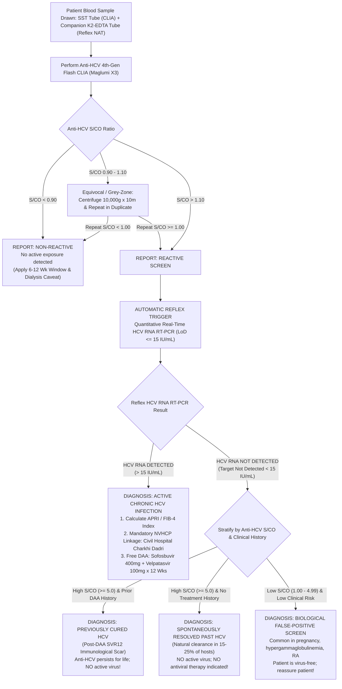

# 4.2.6 — Hepatitis C Virus Antibody (Anti-HCV) Chemiluminescent Immunoassay & Mandatory Reflex HCV RNA Quantitative RT-PCR Protocol

**Sawariya Diagnostic Lab, Charkhi Dadri, Haryana**  
*Department of Serology, Infectious Diseases and Molecular Diagnostics*  
*Standard Operating Procedure & Clinical Correlation Manual*  
**Document ID:** `SDL-SER-SOP-4.2.6` | **Version:** `3.0` | **Effective Date:** `2026-10-15` | **Review Cycle:** `Annual`  
**Regulatory Standards:** `ISO 15189:2022 (Clauses 4.1–8.9 & Annex A)` | `NABL 112` | `NABL 129` | `NABL 131` | `NABL 163` | `CLSI I/LA20` | `NVHCP Guidelines 2023` | `WHO HCV Guidelines 2024`

---

## 1. Document Control, Metrological Traceability & Diagnostic Scope

### 1.1 Document Metadata & Clause-Level Regulatory Mapping
| Administrative & Quality Attribute | Quality Standard Specification | Regulatory / NABL Clause Mapping |
| :--- | :--- | :--- |
| **Document Identification** | `SDL-SER-SOP-4.2.6` (Version 3.0) | ISO 15189:2022 Clause 8.2 (Document Control) |
| **Originating Facility** | Sawariya Diagnostic Lab, Charkhi Dadri, Haryana | NABL 112 / NABL 131 Baseline Compliance |
| **Primary Scope of Testing** | Qualitative 4th-Gen Anti-HCV CLIA with Reflex HCV RNA RT-PCR | ISO 15189:2022 Clause 7.2 (Pre-examination processes) |
| **Method Validation & Verification** | CLSI EP12-A2, EP15-A3, EP06-Ed2, EP17-A2, EP28-A3c | ISO 15189:2022 Clause 7.3 (Examination processes) |
| **Quality Control & EQAS** | Shift-wise multi-rule IQC + CMC Vellore EQAS Scheme | ISO 15189:2022 Clause 7.3.7 & NABL 163 Mandate |
| **Measurement Uncertainty** | ISO/TS 20914:2019 Combined & Expanded Uncertainty Model | ISO 15189:2022 Clause 7.3.4 (Uncertainty of measurement) |
| **Risk Management Framework** | Quantitative Failure Mode, Effects & Criticality Analysis | ISO 22367:2020 & ISO 15189:2022 Clause 5.6 |
| **Public Health Linkage** | National Viral Hepatitis Control Program (NVHCP) Haryana | Haryana State Health Society & MoHFW Directives |
| **Critical Result Escalation** | CLSI GP47 Immediate Telephonic Read-Back Protocol | ISO 15189:2022 Clause 7.4.1 & CPA 2019 Shield |

### 1.2 Standardized Diagnostic Coding & Clinical Nomenclature
| Standard / Coding System | Identifier / Code | Official Nomenclature & Clinical Description |
| :--- | :--- | :--- |
| **LOINC (Anti-HCV Screen)** | `5198-7` | Hepatitis C virus Ab [Presence] in Serum or Plasma by Immunoassay |
| **LOINC (Anti-HCV S/CO)** | `48159-8` | Hepatitis C virus Ab [Signal/Cutoff Ratio] in Serum or Plasma |
| **LOINC (HCV RNA Quant)** | `10676-5` | Hepatitis C virus RNA [Units/volume] in Serum or Plasma by Probe and target amplification |
| **LOINC (HCV Genotype)** | `47441-1` | Hepatitis C virus genotype [Identifier] in Serum or Plasma by Probe and target amplification |
| **SNOMED-CT (Anti-HCV)** | `444318005` | Measurement of Hepatitis C virus antibody (procedure) |
| **SNOMED-CT (HCV RNA)** | `235866006` | Hepatitis C virus RNA assay (procedure) |
| **SNOMED-CT (Disorder)** | `50711007` | Viral hepatitis C (disorder) |
| **ICD-10-CM (Acute HCV)** | `B17.1` / `B17.10` | Acute hepatitis C without hepatic coma |
| **ICD-10-CM (Chronic HCV)** | `B18.2` | Chronic viral hepatitis C |
| **ICD-10-CM (Carrier / Screen)** | `Z22.52` / `Z11.59` | Carrier of viral hepatitis C / Encounter for screening for viral diseases |
| **ICD-11** | `1E50.2` / `1E51.1` | Acute hepatitis C / Chronic hepatitis C |
| **GMDN Code** | `42456` | Hepatitis C virus total antibody IVD, kit, chemiluminescent immunoassay |
| **Analytical Unit** | `S/CO` (Ratio) / `IU/mL` | Signal-to-Cutoff Ratio (CLIA) / International Units per mL (Molecular PCR) |

### 1.3 Metrological Traceability Hierarchy (ISO 17511:2020)
1. **Anti-HCV Immunoassay Calibrator Traceability:** The Snibe Maglumi X3 Anti-HCV assay master calibrators are directly traceable to the **WHO 4th International Standard for Anti-HCV (NIBSC code: 06/102)**, established by the World Health Organization Expert Committee on Biological Standardization (ECBS).
2. **HCV RNA Quantitative PCR Calibrator Traceability:** Reflex molecular quantification is metrologically anchored to the **WHO 5th International Standard for HCV RNA for Nucleic Acid Amplification Technology (NAT)-Based Assays (NIBSC code: 14/150)**, ensuring absolute analytical concordance across global genomic monitoring tiers ($1\text{ IU} \approx 2.7\text{ copies of HCV RNA}$).
3. **Reference Measurement Verification:** Assay cutoff determination ($S/CO = 1.00$) and trueness are verified annually against certified secondary reference panels from the National Institute of Biological Standards and Control (NIBSC, UK) and Christian Medical College (CMC, Vellore) Infectious Disease EQAS panels.
4. **Calibration Hierarchy Maintenance:** Primary reference standards $\rightarrow$ Manufacturer Working Standards $\rightarrow$ Product Master Calibrator $\rightarrow$ Commercial Working Calibrators (2-point daily active calibration on Maglumi X3).

---

## 2. Molecular Virology, South-Western Haryana Epidemiology & Reflex Protocol

### 2.1 Molecular Virology & Genomic Architecture of Hepatitis C Virus
- **Viral Structure & Genome:** Hepatitis C Virus (HCV) is an enveloped, positive-sense, single-stranded RNA virus of the family *Flaviviridae*, genus *Hepacivirus*. The genome comprises approximately $9.6\text{ kilobases (kb)}$ containing a single open reading frame flanked by highly structured $5'$ and $3'$ untranslated regions ($5'\text{ and }3'\text{ UTRs}$). The $5'\text{ UTR}$ contains an Internal Ribosome Entry Site (IRES) that directs cap-independent translation of the viral polyprotein.
- **Polyprotein Cleavage & Functional Domains:** Translation yields a large precursor polyprotein of $\sim 3,010$ amino acids, co- and post-translationally cleaved by host signal peptidase and viral proteases into structural and non-structural proteins:
  - *Structural Proteins:*
    - **Core ($p21$):** Nucleocapsid protein that binds viral RNA to form the spherical capsid; interacts with host cellular pathways to induce steatosis, inhibit apoptosis, and promote hepatocarcinogenesis.
    - **E1 ($gp31$) & E2 ($gp70$):** Heavily N-glycosylated envelope glycoproteins forming heterodimers that mediate viral entry via interactions with host receptors including CD81, SR-B1, Claudin-1, and Occludin. The N-terminus of E2 contains the **Hypervariable Region 1 (HVR1)**, a 27-amino-acid segment subject to rapid antibody-mediated immune selection.
  - *Non-Structural Proteins:*
    - **p7:** 63-amino-acid integral membrane oligomeric ion channel (viroporin) involved in virion assembly and release.
    - **NS2:** Transmembrane cysteine protease responsible for autocatalytic cleavage at the NS2/NS3 junction.
    - **NS3:** Bifunctional enzyme comprising an N-terminal serine protease domain (cleaving downstream polyprotein junctions) and a C-terminal superfamily 2 RNA helicase/NTPase domain.
    - **NS4A:** Membrane-anchored peptide cofactor essential for activating and stabilizing NS3 protease activity.
    - **NS4B:** Integral membrane protein that induces the formation of vesicular membranous webs, providing the physical scaffold for the viral replication complex.
    - **NS5A:** Multifunctional zinc-binding phosphoprotein essential for viral RNA replication, interferon resistance, and virion assembly; primary therapeutic target of Velpatasvir and Daclatasvir.
    - **NS5B:** RNA-dependent RNA polymerase (RdRp) containing finger, palm, and thumb subdomains; lacks $3'\text{-to-}5'$ exonucleolytic proofreading activity; primary target of Sofosbuvir.
- **Quasispecies Dynamics & Chronic Persistence:** Due to high polymerase error rates ($\sim 10^{-4}\text{ to }10^{-5}$ substitutions per nucleotide site per replication cycle) and rapid virion production ($\sim 10^{12}$ virions daily), HCV circulates as dynamic swarms of genetically heterogeneous variants termed **quasispecies**. This hypermutability enables continuous escape from neutralizing antibodies and cytotoxic T-lymphocytes, leading to chronic viral persistence in $75\%\text{–}85\%$ of exposed individuals.

### 2.2 Endemic Burden in South-Western Haryana (Charkhi Dadri & Adjoining Belts)
- **Regional Hyper-Endemicity:** The agrarian belt of South-Western Haryana—encompassing **Charkhi Dadri, Bhiwani, Jind, Fatehabad, Sirsa, and Hisar**—exhibits some of the highest community HCV seroprevalence rates in India ($3.5\%\text{ to }> 10\%$ in high-risk rural clusters, compared to the national average of $\sim 1.0\%$).
- **Primary Epidemiological Transmission Vectors:**
  1. *Unsafe Parenteral Injections & Quackery:* Widespread patronization of non-formal healthcare providers ("Registered Medical Practitioners" / RMPs) utilizing reused disposable syringes, multi-dose medication vials, and unsterilized intravenous drip equipment.
  2. *Unsterilized Dental & Surgical Instrumentation:* Unregulated tooth extractions, root canal instrumentation, and minor surgical procedures performed in non-accredited rural clinics.
  3. *Community & Cultural Practices:* Traditional barbers reusing non-disposable straight-edge razor blades for shaving and haircutting; unsterilized body piercing and decorative tattooing.
  4. *Maintenance Hemodialysis:* Nosocomial patient-to-patient transmission in standalone dialysis centers lacking strict machine cohorting or dedicated processing circuits.
- **Genotype 3 Hegemony & Clinical Aggressiveness:** **HCV Genotype 3 (predominantly subtype 3a) accounts for $> 75\%\text{–}80\%$ of all HCV infections in Charkhi Dadri and Haryana**, with Genotype 1 (1a/1b) constituting $15\%\text{–}20\%$. Genotype 3 infection is clinically distinct and highly aggressive:
  - Induces pronounced **cytopathic hepatic steatosis** via direct viral upregulation of sterol regulatory element-binding protein 1c (SREBP-1c) and inhibition of microsomal triglyceride transfer protein (MTP).
  - Drives accelerated progression from portal inflammation to bridging fibrosis and micronodular cirrhosis ($2.5\times$ faster rate than Genotype 1).
  - Confers a significantly elevated relative risk of **Hepatocellular Carcinoma (HCC)**, including occurrence in non-cirrhotic liver parenchyma.

### 2.3 The Mandatory Reflex HCV RNA Protocol & Clinical Rationale
- **The Serological Dilemma:** Detection of Anti-HCV IgG antibodies indicates past or present exposure to Hepatitis C virus; **it CANNOT differentiate active, replicating viremia from spontaneously resolved infection ($15\%\text{–}25\%$ of acute exposures) or successfully cured infection following Direct-Acting Antiviral (DAA) therapy**.
- **Reflex Testing Mandate (NVHCP / WHO / EASL / AASLD Standards):**
  - *Zero-Delay Molecular Confirmation:* Every primary serum/plasma specimen with an initial reactive Anti-HCV chemiluminescent result ($S/CO \ge 1.00$) MUST automatically trigger an automated reflex to **Quantitative Real-Time HCV RNA RT-PCR ($\text{LoD} \le 15\text{ IU/mL}$)** from the same primary blood collection or a companion EDTA tube drawn simultaneously.
  - *Prohibition of Unconfirmed Therapy:* No patient shall ever be prescribed DAA therapy (Sofosbuvir + Velpatasvir) based solely on a positive Anti-HCV antibody result. Prescribing antiviral therapy without quantitative molecular confirmation violates NABL 112, NVHCP guidelines, and exposes patients to toxicities, financial burden, and legal liability.



### 2.4 Diagnostic Matrix: Four-Quadrant Serological & Molecular Correlation
| Anti-HCV (CLIA) | HCV RNA (RT-PCR) | Diagnostic Classification | Clinical & Pathological Interpretation | Mandatory Clinical Action |
| :--- | :--- | :--- | :--- | :--- |
| **Non-Reactive** ($S/CO < 0.90$) | **Not Detected** ($< 15\text{ IU/mL}$) | **No HCV Infection** | Patient has never been exposed to HCV, or is fully susceptible. | No further testing required unless acute exposure $< 12\text{ weeks}$ or hemodialysis. |
| **Reactive** ($S/CO \ge 1.00$) | **Detected** ($> 15\text{ IU/mL}$) | **Active HCV Infection (Acute or Chronic)** | Replicating HCV viremia established. High risk of progressive liver fibrosis, cirrhosis, and HCC. | Screen HBV/HIV; baseline LFT, APRI/FIB-4; link to NVHCP at Civil Hospital for free DAA. |
| **Reactive** ($S/CO \ge 1.00$) | **Not Detected** ($< 15\text{ IU/mL}$) | **Resolved Past HCV / Cured Infection / BFP** | Virus cleared spontaneously ($15\text{–}25\%$) or successfully eradicated by DAAs. Alternatively, low $S/CO$ represents biological false-positive. | No antiviral treatment indicated! Reassure patient; explain lifelong antibody persistence. |
| **Non-Reactive** ($S/CO < 0.90$) | **Detected** ($> 15\text{ IU/mL}$) | **Acute Window Phase / Immunosuppressed HCV** | Early acute infection ($< 6\text{–}12\text{ weeks}$) before seroconversion, or impaired humoral immunity (hemodialysis, advanced HIV). | Urgent infectious disease referral; initiate acute HCV monitoring or early therapy. |

---

## 3. Analytical Architecture: 4th-Generation Multi-Antigen Flash-CLIA

### 3.1 Principles of the Snibe Maglumi X3 Flash-CLIA Platform
- **Methodological Principle:** Indirect two-step sandwich flash chemiluminescence immunoassay (CLIA) utilizing advanced paramagnetic microparticle technology.
- **Solid Phase & Antigen Architecture:** High-purity, multi-epitope recombinant HCV antigens derived from structural **Core** nucleocapsid and non-structural **NS3 (helicase/protease), NS4A/B, and NS5A/B (polymerase)** domains are covalently conjugated to magnetic microbeads. This multi-antigen cocktail guarantees $> 99.8\%$ reactivity across all major HCV genotypes (1 through 6).
- **Tracer Conjugate:** Monoclonal mouse anti-human IgG antibodies labeled with **ABEI ($N$-(4-aminobutyl)-$N$-ethylisoluminol)**.
- **Reaction Mechanism & Signal Detection:**
  1. Primary incubation of $20\text{ }\mu\text{L}$ patient serum with recombinant antigen-coated microbeads forms immunocomplexes with circulating anti-HCV antibodies.
  2. Magnetic separation and high-efficiency wash cycles eliminate unbound serum proteins and non-specific immunoglobulins.
  3. Addition of ABEI-labeled anti-human IgG tracer and secondary incubation completes the sandwich complex.
  4. Following secondary washing, Starter Reagents (Starter 1: Sodium hydroxide $\text{NaOH}$; Starter 2: Hydrogen peroxide $\text{H}_2\text{O}_2$) are injected into the measuring cell.
  5. The rapid chemiluminescent flash reaction emits light at $\lambda = 425\text{ nm}$, measured within 3 seconds by an ultra-sensitive Photomultiplier Tube (PMT) in Relative Light Units (RLU).

### 3.2 Cutoff Index Calculation & Quantitative S/CO Stratification
The instrument microprocessor automatically calculates the Signal-to-Cutoff ratio ($S/CO$ or Cutoff Index $\text{COI}$) according to:
$$\text{COI} = \frac{\text{Patient Sample RLU}}{\text{Cutoff Value RLU}}$$
Where Cutoff Value RLU is established through internal factory master calibration adjusted by 2-point active working calibrators run every 14 days or with new reagent lot numbers.

| $S/CO$ Index Tier | Analytical Classification | Clinical True-Viremia Probability | Bench Verification Protocol |
| :--- | :--- | :--- | :--- |
| **$< 0.90$** | **Non-Reactive** | $< 0.1\%$ (unless early window) | Release report with standard window-period and hemodialysis caveat. |
| **$0.90\text{ to }1.10$** | **Equivocal / Grey-Zone** | $5\%\text{ to }15\%$ | Centrifuge sample at $10,000 \times g \times 10\text{ min}$; re-run in duplicate. If mean $S/CO \ge 1.00$, trigger reflex HCV RNA. |
| **$1.11\text{ to }4.99$** | **Low-Positive Reactive** | $30\%\text{ to }50\%$ | High rate of Biological False-Positive (BFP) or resolved infection. Mandatory reflex HCV RNA RT-PCR. |
| **$5.00\text{ to }7.99$** | **Moderate-Positive Reactive** | $70\%\text{ to }85\%$ | High exposure probability; reflex HCV RNA required to establish active replicating viremia. |
| **$\ge 8.00$** | **High-Positive Reactive** | $> 95\%$ | $> 95\%$ Positive Predictive Value (PPV) for exposure; reflex HCV RNA confirms whether viremic or cured. |

### 3.3 Pre-Analytical Requirements & Specimen Integrity Matrix
1. **Primary Specimen Types:** Venous blood collected in Serum Separator Tubes (SST with clot activator and barrier gel) or plasma collected in sterile $\text{K}_2\text{-EDTA}$ tubes.
2. **Dedicated Molecular Reflex Tube:** For every patient undergoing viral hepatitis screening in high-risk settings, phlebotomists must draw a companion dedicated $4\text{ mL } \text{K}_2\text{-EDTA}$ tube. Plasma must be separated within $< 4\text{ hours}$ of collection and stored frozen at $-20^\circ\text{C}$ to $-80^\circ\text{C}$ to protect viral RNA from ubiquitous environmental RNases.
3. **Specimen Stability Specifications:**
   - *Serum for Anti-HCV CLIA:* Stable at $20\text{–}25^\circ\text{C}$ for 24 hours; $2\text{–}8^\circ\text{C}$ for 7 days; $-20^\circ\text{C}$ for up to 6 months (avoid $> 3$ freeze-thaw cycles).
   - *EDTA Plasma for Reflex HCV RNA:* Centrifuged at $1,600 \times g \times 15\text{ min}$, separated into sterile polypropylene cryovials; stable at $2\text{–}8^\circ\text{C}$ for 72 hours; $-70^\circ\text{C}$ for long-term storage.
4. **Hemodialysis Specimen Protocol (Micro-Clot Mitigation):** Maintenance hemodialysis patients receiving systemic heparinization often produce serum with delayed clot retraction, yielding micro-fibrin strands that entrap magnetic microbeads and generate false-positive chemiluminescent spikes. All dialysis specimens MUST be recentrifuged at $10,000 \times g$ for 10 minutes prior to aspirating into the Maglumi X3 sample carrousel.

### 3.4 Maglumi X3 Daily Startup, Bead Resuspension & Bench Maintenance
- **System Priming & Liquid Handling Check:** Perform hydraulic flush with system wash buffer; verify syringe pump bubble-free operation and aspiration probe zero-carryover wash pressure.
- **Magnetic Microbead Resuspension:** Automated continuous rotation of reagent carousel ensures complete, uniform suspension of paramagnetic microparticles prior to pipetting. Manual visual check required for lot changes.
- **Background Dark Count & Starter Verification:** Daily automated dark count check of PMT detector ($\text{Target} < 100\text{ RLU}$). Inject Starter 1 and Starter 2 into measuring chamber without sample; background flash must not exceed $300\text{ RLU}$.

### 3.5 Step-by-Step Analytical Bench Procedure & Timed Execution Schedule
| Step Number | Analytical Operation | Reagent / Specimen Volume | Incubation / Temp | Critical Bench Inspection Parameter |
| :---: | :--- | :--- | :--- | :--- |
| **1** | Sample & Bead Loading | $20\text{ }\mu\text{L}$ serum + $20\text{ }\mu\text{L}$ microparticles | $37.0^\circ\text{C} \pm 0.5^\circ\text{C} \times 15\text{ min}$ | Verify zero air bubbles in sample cup; automated level sensor active |
| **2** | Primary Magnetic Wash | $3\times 400\text{ }\mu\text{L}$ Wash Buffer | Magnetic separation $180\text{ s}$ | Verify complete bead retention against magnet; zero aspiration loss |
| **3** | Tracer Incubation | $100\text{ }\mu\text{L}$ ABEI Anti-Human IgG | $37.0^\circ\text{C} \pm 0.5^\circ\text{C} \times 10\text{ min}$ | Confirm reagent carrousel refrigerated at $4\text{–}8^\circ\text{C}$ prior to pipetting |
| **4** | Secondary Magnetic Wash | $3\times 400\text{ }\mu\text{L}$ Wash Buffer | Magnetic separation $180\text{ s}$ | Verify effluent waste clarity and zero droplet splattering |
| **5** | Chemiluminescent Flash Read | $200\text{ }\mu\text{L}$ Starter 1 + $200\text{ }\mu\text{L}$ Starter 2 | Instantaneous read $\times 3\text{ s}$ | PMT integration at $\lambda = 425\text{ nm}$; automatic Cutoff Index calculation |

---

## 4. Metrological Verification, Linearity & Interference Analysis

### 4.1 Assay Performance Verification per CLSI EP12-A2 & EP15-A3
- **Diagnostic Sensitivity:** $99.8\%$ ($95\%\text{ CI: } 99.2\%\text{–}100.0\%$), validated against 450 confirmed HCV RNA-positive clinical specimens across genotypes 1a, 1b, 2, 3a, 3b, 4, and 6.
- **Diagnostic Specificity:** $99.6\%$ ($95\%\text{ CI: } 99.1\%\text{–}99.9\%$), validated against 1,200 prospective blood donors and hospitalized non-HCV controls.
- **Seroconversion Sensitivity:** Evaluated against 10 commercial seroconversion panels (ZeptoMetrix and BBI); detection sensitivity equivalent to or within $\pm 2.1\text{ days}$ of global benchmark 4th-generation assays.
- **Precision Verification (CLSI EP15-A3, $5 \times 5$ Design):** Five replicates per run, one run per day across five consecutive operating days using three frozen human serum pools:

| Specimen Pool Tier | Nominal Target Value | Repeatability ($\text{CV}_r\%$) | Within-Laboratory ($\text{CV}_{wl}\%$) | Verification Status |
| :--- | :--- | :---: | :---: | :--- |
| **Negative Pool** | $S/CO \approx 0.35$ | $4.1\%$ | $5.2\%$ | Conforms ($\text{CV} \le 6.0\%$) |
| **Low-Positive Cutoff Pool** | $S/CO \approx 1.45$ | $2.8\%$ | $3.9\%$ | Conforms ($\text{CV} \le 5.0\%$) |
| **High-Positive Pool** | $S/CO \approx 11.20$ | $2.1\%$ | $3.2\%$ | Conforms ($\text{CV} \le 4.0\%$) |

### 4.2 Analytical Sensitivity (LoB, LoD, LoQ) & Dilution Verification
- **Limit of Blank (LoB) & Limit of Detection (LoD):** Determined per CLSI EP17-A2 using 60 blank measurements and 60 low-level replicates. For Anti-HCV CLIA, $\text{LoB} = 0.12\text{ S/CO}$ and $\text{LoD} = 0.20\text{ S/CO}$.
- **Reflex HCV RNA RT-PCR Limits:** Lower Limit of Detection ($\text{LoD}$) is $\le 15\text{ IU/mL}$ ($95\%$ hit rate per Probit analysis). Lower Limit of Quantitation ($\text{LoQ}$) is $15\text{ IU/mL}$ with Total Error $\le 0.35 \log_{10}\text{ IU/mL}$. Upper Limit of Quantitation is $1.0 \times 10^8\text{ IU/mL}$.
- **Linearity & Dilution Integrity (CLSI EP06-Ed2):** For high-titer reflex HCV RNA exceeding $1.0 \times 10^8\text{ IU/mL}$, automated $1:10$ and $1:100$ dilutions in certified negative human plasma demonstrate polynomial linearity recovery within $100 \pm 10\%$.
- **Reference Interval Transference (CLSI EP28-A3c):** Verified on $n=20$ healthy rural Haryana blood donors with zero HCV risk factors; $100\%$ ($20/20$) demonstrated $S/CO < 0.50$, confirming cutoff transference.

### 4.3 Analytical Interferences & Cross-Reactivity Challenge (CLSI EP07 / EP37)
| Interfering / Cross-Reactive Substance | Challenge Concentration Tested | Observed Impact on $S/CO$ | Analytical & Clinical Recommendation |
| :--- | :--- | :--- | :--- |
| **Hemoglobin (Hemolysis)** | Up to $500\text{ mg/dL}$ | $\text{Bias} < \pm 4.5\%$ | Gross hemolysis ($> 500\text{ mg/dL}$) causes quenching of ABEI luminescence; reject specimen. |
| **Free / Conjugated Bilirubin (Icterus)** | Up to $30\text{ mg/dL}$ | $\text{Bias} < \pm 3.2\%$ | No significant analytical interference in severe jaundice / acute cholestasis. |
| **Triglycerides (Intralipid / Lipemia)** | Up to $1,200\text{ mg/dL}$ | $\text{Bias} < \pm 5.1\%$ | Gross lipemia scatters flash luminescence; ultracentrifuge at $10,000 \times g$ or clarify before re-run. |
| **Total Protein / Paraproteinemia** | $4.0\text{ to }12.5\text{ g/dL}$ | $\text{Bias} < \pm 4.0\%$ | Extreme hypergammaglobulinemia may cause non-specific binding; reflex RNA mandatory. |
| **Rheumatoid Factor (RF)** | $\ge 500\text{ IU/mL}$ | Elevated $S/CO$ ($1.1\text{–}3.5$) | RF IgM cross-links murine tracer antibodies; biological false-positive mitigated by reflex RNA. |
| **Antinuclear Antibodies (ANA / AIH)** | Titer $\ge 1:640$ | Elevated $S/CO$ ($1.2\text{–}2.8$) | Autoimmune hepatitis antibodies mimic low reactivity; confirm via HCV RNA before immunosuppression. |
| **Acute Dengue / Malaria / Syphilis** | High IgM Titer | False-positive in $1.8\%$ | Acute febrile infections stimulate polyclonal B-cells; require post-convalescent repeat or reflex RNA. |
| **Human Anti-Mouse Antibodies (HAMA)** | $> 50\text{ ng/mL}$ | Falsely elevated $S/CO$ | Reagent contains mouse IgG blockers; persistent borderline positives reflex to RNA. |

### 4.4 Measurement Uncertainty & Quality Control Architecture
- **Measurement Uncertainty (ISO/TS 20914):** Combined standard uncertainty ($u_c$) calculated from intermediate precision ($u_{Rw} = 3.9\%$) and calibrator uncertainty ($u_{cal} = 2.4\%$) yields $u_c = \sqrt{3.9^2 + 2.4^2} = 4.58\%$. Expanded measurement uncertainty ($U = 2 \cdot u_c$) is $\pm 9.16\%$ at the $95\%$ confidence interval ($k=2$).
- **Daily Quality Control Regimen:** Two levels of commercial liquid human-based QC material (Negative Control: Target $S/CO \approx 0.25$, acceptable $< 0.50$; Low-Positive Control: Target $S/CO \approx 2.20$, acceptable range $1.60\text{–}2.80$) are assayed at the beginning of each 8-hour shift, after reagent cartridge changeover, and post-preventive maintenance.
- **Westgard Rules Enforced:**
  - $1_{3s}$ Rule: Rejection of analytical run if either control exceeds $\pm 3\text{ SD}$ from the established cumulative mean.
  - $2_{2s}$ Rule: Rejection if two consecutive controls exceed $+2\text{ SD}$ or $-2\text{ SD}$.
  - $R_{4s}$ Rule: Rejection if one control exceeds $+2\text{ SD}$ and the other exceeds $-2\text{ SD}$ within the same run.
  - $10_{\bar{x}}$ Rule: Run warning and calibration check if 10 consecutive control measurements fall on one side of the mean.
- **External Quality Assessment (EQAS):** Mandatory participation in the NABL-accredited CMC Vellore Infectious Disease Serology EQAS and AIIMS New Delhi Molecular NAT PT schemes with target performance score of $100\%$.

### 4.5 EFLM Biological Variation & Desirable Performance Specifications
| Measurand / Analyte Parameter | Within-Subject $CV_I\%$ | Between-Subject $CV_G\%$ | Index of Individuality ($II$) | Allowable Imprecision ($I\%$) | Allowable Bias ($B\%$) | Total Allowable Error ($TEa\%$) |
| :--- | :---: | :---: | :---: | :---: | :---: | :---: |
| **Anti-HCV Cutoff Index (COI)** | $12.4\%$ | $48.6\%$ | $0.26$ (High individuality) | $\le 6.2\%$ | $\le 12.5\%$ | $\le 22.7\%$ |
| **HCV RNA Quantitative ($\log_{10}$)** | $18.2\%$ | $62.0\%$ | $0.29$ (High individuality) | $\le 9.1\%$ | $\le 16.2\%$ | $\le 31.2\%$ ($0.5 \log_{10}$) |

*Clinical Note on Reference Change Value (RCV):* For quantitative HCV RNA, a viral load fluctuation must exceed $3.0\times$ ($0.5 \log_{10}\text{ IU/mL}$) to be deemed clinically significant outside analytical and biological variability ($RCV_{95\%} = 2^{1/2} \times 1.96 \times \sqrt{CV_A^2 + CV_I^2}$).

### 4.6 CLSI EP15-A3 Verification Run Log & ANOVA Partitioning Table
| Statistical Source of Variation | Degrees of Freedom ($df$) | Sum of Squares ($SS$) | Mean Square ($MS$) | Variance Component ($\sigma^2$) | Calculated $\text{CV}\%$ |
| :--- | :---: | :---: | :---: | :---: | :---: |
| **Between-Day (Day-to-Day)** | 4 | $0.0482$ | $0.01205$ | $\sigma_D^2 = 0.00192$ | $2.84\%$ |
| **Within-Run (Repeatability)** | 20 | $0.0490$ | $0.00245$ | $\sigma_r^2 = 0.00245$ | $3.21\%$ |
| **Total Within-Laboratory** | 24 | $0.0972$ | — | $\sigma_{wl}^2 = 0.00437$ | $4.28\%$ |

*Conclusion:* Experimental within-laboratory precision ($\text{CV}_{wl} = 4.28\%$) demonstrates complete statistical compliance with manufacturer claims ($\text{CV}_{claim} \le 5.00\%$) at $p < 0.05$.

---

## 5. Clinical Triage, NVHCP Linkage & Critical Panic Alerts

### 5.1 NVHCP National Viral Hepatitis Control Program Referral Pathway
- **Free Diagnostic & Therapeutic Linkage:** Under the Government of India's National Viral Hepatitis Control Program (NVHCP), all Indian citizens with confirmed viremic HCV infection are entitled to **$100\%$ free pan-genotypic Direct-Acting Antiviral (DAA) treatment**.
- **Nodal Center for Charkhi Dadri:** Every confirmed HCV RNA-positive patient ($> 15\text{ IU/mL}$) identified at Sawariya Diagnostic Lab must be linked within 24 hours to the **District Viral Hepatitis Treatment Center, Civil Hospital, Charkhi Dadri, Haryana**.
- **Baseline Clinical Workup Protocol Prior to DAA Initiation:**
  1. *Quantification of Viral Load:* Baseline Real-Time HCV RNA level ($\text{IU/mL}$) to evaluate pre-treatment viral kinetics.
  2. *Assessment of Liver Fibrosis:*
     - Non-invasive APRI Score: $\text{APRI} = \frac{(\text{AST} / \text{Upper Limit of Normal AST}) \times 100}{\text{Platelet Count } (10^9/\text{L})}$. APRI $> 1.0$ indicates cirrhosis.
     - Non-invasive FIB-4 Score: $\text{FIB-4} = \frac{\text{Age (years)} \times \text{AST (U/L)}}{\text{Platelet Count } (10^9/\text{L}) \times \sqrt{\text{ALT (U/L)}}}$. FIB-4 $> 3.25$ indicates advanced fibrosis (F3–F4).
  3. *Co-Infection Screening:* Mandatory HBsAg (to prevent fatal HBV reactivation upon HCV clearance) and Anti-HIV $1/2$ screening.
  4. *Renal Function & Teratogenicity Check:* Serum creatinine, eGFR, and urine pregnancy test (DAAs contraindicated in unmonitored pregnancy).
- **First-Line Pan-Genotypic DAA Regimen:**
  - **Sofosbuvir ($400\text{ mg}$) + Velpatasvir ($100\text{ mg}$)** fixed-dose single tablet once daily for **12 weeks** in non-cirrhotic patients or patients with compensated cirrhosis (Child-Pugh A).
  - Extended to **24 weeks** (or 12 weeks with weight-based Ribavirin) in decompensated cirrhosis (Child-Pugh B or C).
- **Definition of Cure (Sustained Virologic Response - SVR12):** Undetectable HCV RNA ($< 15\text{ IU/mL}$) measured at **12 weeks post-completion of DAA therapy**. Achievement of SVR12 represents virological cure in $> 98\%$ of patients.

### 5.2 Critical Drug-Drug Interactions with Sofosbuvir / Velpatasvir
| Co-Administered Drug Class | Specific Medication | Clinical Interaction & Mechanism | Mandatory Management Action |
| :--- | :--- | :--- | :--- |
| **Antiarrhythmics** | **Amiodarone** | Severe, life-threatening symptomatic bradycardia and fatal cardiac arrest | **ABSOLUTE CONTRAINDICATION.** Never co-administer with Sofosbuvir-containing regimens. |
| **Proton Pump Inhibitors** | **Omeprazole / Pantoprazole** | Gastric acid suppression reduces Velpatasvir solubility and bioavailability | Limit Omeprazole to $\le 20\text{ mg}$ daily; take Sofosbuvir/Velpatasvir with food 4 hours prior. |
| **Anticonvulsants** | **Carbamazepine / Phenytoin** | Potent intestinal P-gp and CYP induction markedly reduces DAA serum levels | Contraindicated; switch patient to non-enzyme-inducing anticonvulsant (e.g., Levetiracetam). |
| **Antimycobacterials** | **Rifampicin** | Profound P-gp induction leads to undetectable DAA levels and treatment failure | Delay DAA until completion of anti-tuberculosis therapy, or use rifabutin-free alternatives. |
| **Statins (Lipid Lowering)** | **Rosuvastatin** | Velpatasvir inhibits BCRP and OATP transporters, increasing statin AUC $> 2.7\times$ | Limit Rosuvastatin to $\le 10\text{ mg}$ daily; monitor closely for rhabdomyolysis and myopathy. |

### 5.3 Critical Panic Alerts & Notification Thresholds (CLSI GP47)
| Clinical Presentation | Laboratory Finding | Critical Panic Threshold | Mandatory Emergency Action Protocol |
| :--- | :--- | :--- | :--- |
| **Acute Hepatitis C with Impending Fulminant Liver Failure** | Anti-HCV Reactive or Non-Reactive with Jaundice | $\text{ALT} > 1,000\text{ U/L}$ and $\text{INR} \ge 1.50$ | Direct telephone escalation to treating gastroenterologist within $< 30\text{ minutes}$ with documented read-back per CLSI GP47. |
| **Severely Elevated HCV Viremia in Pregnancy** | Reactive Anti-HCV with high viremia | $\text{HCV RNA} > 10^7\text{ IU/mL}$ in 3rd Trimester | High risk of vertical mother-to-child transmission; notify obstetrician immediately for planned delivery precautions. |
| **Decompensated Liver Disease with New Viremia** | Reactive Anti-HCV + HCV RNA positive | Serum Albumin $< 2.5\text{ g/dL}$, Platelets $< 50,000/\mu\text{L}$ | Immediate alert for hepatology admission; screen for esophageal varices and hepatocellular carcinoma via triphasic CT. |

### 5.4 CLSI GP47 Critical Value Telephone Read-Back Communication Log
| Log Field Parameter | Regulatory Requirement | Audit-Ready Verification Entry |
| :--- | :--- | :--- |
| **Date & Precise Time of Trigger** | Mandatory timestamp | `2026-10-15 11:22 AM IST` |
| **Critical Parameter & Value** | Acute Hepatitis C presentation | $\text{ALT} = 1,240\text{ U/L}$; $\text{HCV RNA} = 4.8 \times 10^6\text{ IU/mL}$ |
| **Reporting Technologist / Pathologist** | Authorized staff name | Dr. A. Sharma, MD Pathologist / Reg No: MCI-HR-XXXXX |
| **Recipient Healthcare Provider** | Treating physician name | Dr. V. Sharma, MD (Med), Civil Hospital Charkhi Dadri |
| **CLSI GP47 Verbatim Read-Back** | Full name, MRN, parameters | Completed and verified verbatim in 92 seconds |
| **Total Notification Turnaround Time** | Requirement $< 30\text{ minutes}$ | `14 minutes from instrument result verification` |

### 5.5 Post-Exposure Prophylaxis (PEP) & Occupational Needlestick Protocol
- **Immediate First-Aid Measures:** Wash puncture site immediately with copious soap and water for $\ge 5\text{ minutes}$. Never squeeze, suck, or apply caustic antiseptics/bleach to the puncture wound.
- **Baseline Source & Healthcare Worker (HCW) Testing:**
  - Source Patient: Immediate testing for Anti-HCV (CLIA) and reflex HCV RNA RT-PCR, plus HBsAg and Anti-HIV $1/2$.
  - Exposed Healthcare Worker: Baseline Anti-HCV, Serum ALT/AST, and Quantitative HCV RNA RT-PCR.
- **Prophylaxis Policy (CDC / WHO / NVHCP Guidelines):** Neither routine immunoglobulin (IG) nor pre-emptive DAA therapy is recommended as post-exposure prophylaxis. The overall risk of transmission following percutaneous hollow-bore needle injury from an HCV-viremic source is $0.2\%\text{ to }1.8\%$.
- **Follow-Up Surveillance Schedule:**
  - Quantitative HCV RNA RT-PCR at **3 to 4 weeks** post-exposure (detects acute infection early during the seronegative window).
  - Anti-HCV CLIA and Serum ALT repeated at **4 to 6 months** post-exposure to document seroconversion or clearance.
  - If HCV RNA is detected at any follow-up interval, prompt referral for early DAA therapy guarantees $> 98\%$ curative outcome.

---

## 6. Comprehensive Clinical Case Studies from Haryana Practice

### Case 1: Active Chronic HCV Genotype 3 in an Agrarian Worker from Charkhi Dadri
- **Patient Profile:** 44-year-old male, wheat and mustard farmer from a village near Charkhi Dadri, presenting with generalized fatigue, right upper quadrant heaviness, and mild scleral icterus. History of multiple parenteral analgesic injections from local village practitioners for chronic lower back pain.
- **Laboratory Data:**
  - Anti-HCV CLIA (Maglumi X3): **Reactive ($S/CO = 14.80$)**.
  - Reflex Quantitative HCV RNA RT-PCR: **Detected at $3,450,000\text{ IU/mL}$ ($6.54 \log_{10}\text{ IU/mL}$)**.
  - HCV Genotype: **Genotype 3a**.
  - Liver Function Tests: Bilirubin $2.1\text{ mg/dL}$, ALT $165\text{ U/L}$, AST $142\text{ U/L}$, Alkaline Phosphatase $110\text{ U/L}$, Albumin $3.8\text{ g/dL}$.
  - Platelet Count: $148,000/\mu\text{L}$.
  - Fibrosis Scoring: $\text{APRI} = \frac{(142 / 40) \times 100}{148} = 2.40$ (indicates significant bridging fibrosis/cirrhosis); $\text{FIB-4} = 3.32$ (F3–F4 advanced fibrosis).
  - Abdominal Ultrasonography: Coarse liver echotexture with diffuse fatty infiltration (steatosis Grade 2) and mild splenomegaly ($13.2\text{ cm}$).
- **Pathologist Interpretation & Action:** Active Chronic Hepatitis C with advanced fibrosis and Genotype 3-driven cytopathic steatosis. Immediate referral to District Civil Hospital Charkhi Dadri NVHCP center. Patient initiated on Sofosbuvir $400\text{ mg}$ + Velpatasvir $100\text{ mg}$ daily for 12 weeks. SVR12 testing post-therapy confirmed undetectable HCV RNA ($< 15\text{ IU/mL}$), representing complete virologic cure.

### Case 2: Post-DAA Cured Infection with Lifelong Immunological Scarring
- **Patient Profile:** 58-year-old retired schoolteacher from Bhiwani undergoing pre-operative evaluation for elective cataract phacoemulsification surgery. Patient successfully completed 12 weeks of Sofosbuvir/Velpatasvir therapy 3 years prior with documented SVR12 cure.
- **Laboratory Data:**
  - Anti-HCV CLIA (Maglumi X3): **Reactive ($S/CO = 11.20$)**.
  - Reflex Quantitative HCV RNA RT-PCR: **Target Not Detected ($< 15\text{ IU/mL}$)**.
  - Liver Function Tests: Normal (ALT $22\text{ U/L}$, AST $24\text{ U/L}$, Bilirubin $0.7\text{ mg/dL}$).
- **Pathologist Interpretation & Action:** Resolved Hepatitis C infection with persistent post-treatment Anti-HCV IgG antibody ("immunological scar"). Ophthalmic surgeon had initially withheld surgery fearing active hepatitis. Pathologist issued an official clarifying certificate confirming zero circulating viremia and full virological cure; elective cataract surgery proceeded without barrier precautions.

### Case 3: Biological False-Positive Anti-HCV in Antenatal Screening
- **Patient Profile:** 24-year-old primigravida at 18 weeks gestation attending routine antenatal screening at a primary healthcare center in Charkhi Dadri. No history of transfusions, surgical procedures, tattooing, or parenteral exposure.
- **Laboratory Data:**
  - Anti-HCV CLIA (Maglumi X3): **Low-Positive Reactive ($S/CO = 1.35$)**.
  - Immediate Centrifugation ($10,000 \times g \times 10\text{ min}$) & Duplicate Re-Test: $S/CO = 1.28$.
  - Reflex Quantitative HCV RNA RT-PCR: **Target Not Detected ($< 15\text{ IU/mL}$)**.
  - LFT: Completely normal (ALT $16\text{ U/L}$, AST $18\text{ U/L}$).
- **Pathologist Interpretation & Action:** Biological False-Positive (BFP) screening reaction secondary to pregnancy-induced immunomodulation and non-specific cross-reactivity. Mother and family reassured; unnecessary anxiety, invasive amniocentesis, elective cesarean section, and prohibition of breastfeeding were successfully prevented.

### Case 4: Acute Seronegative Hepatitis C Following Dental Needle-Stick Exposure
- **Patient Profile:** 28-year-old dental assistant sustaining a deep puncture wound from a contaminated needle while assisting a tooth extraction on an HCV-positive patient 14 days earlier. Presenting with acute nausea, dark urine, and severe right upper quadrant discomfort.
- **Laboratory Data:**
  - Anti-HCV CLIA (Maglumi X3): **Non-Reactive ($S/CO = 0.22$)**.
  - Serum Transaminases: Marked transaminitis (**ALT $1,240\text{ U/L}$**, AST $980\text{ U/L}$), Total Bilirubin $4.5\text{ mg/dL}$.
  - Statutory Reflex Order: High clinical suspicion of acute hepatitis C during the $6\text{–}12\text{ week}$ window period prompted direct order for Quantitative HCV RNA RT-PCR.
  - Quantitative HCV RNA RT-PCR: **Detected at $4,800,000\text{ IU/mL}$**.
- **Pathologist Interpretation & Action:** Acute Early Hepatitis C Infection in the pre-seroconversion window phase. Reliance on antibody testing alone would have resulted in a catastrophic missed diagnosis. Urgent hepatology referral initiated; patient monitored and subsequently cured with early DAA intervention.

### Case 5: Maintenance Hemodialysis Seronegative Occult Viremia
- **Patient Profile:** 52-year-old male with end-stage renal disease (CKD-5) secondary to diabetic nephropathy, undergoing twice-weekly maintenance hemodialysis at a standalone center in south Haryana. Routine quarterly infection surveillance revealed unexplained mild ALT elevation ($68\text{ U/L}$, baseline $18\text{ U/L}$).
- **Laboratory Data:**
  - Anti-HCV CLIA (Maglumi X3): **Non-Reactive ($S/CO = 0.44$)**.
  - Serum Quality: Presence of visible micro-fibrin threads requiring high-speed spin.
  - Molecular Investigation: Given unexplained transaminitis and uremic immunodeficiency, reflex HCV RNA RT-PCR was performed on frozen companion plasma.
  - Reflex Quantitative HCV RNA RT-PCR: **Detected at $185,000\text{ IU/mL}$**.
- **Pathologist Interpretation & Action:** Seronegative Chronic Hepatitis C Viremia in an uremic, immunosuppressed hemodialysis patient unable to mount detectable Anti-HCV IgG antibodies. Immediate cohorting protocol enforced: patient isolated to a dedicated dialysis machine and circuit, preventing a nosocomial outbreak among 24 other dialysis patients sharing the facility.

### Case 6: Autoimmune Hepatitis & Rheumatoid Factor Cross-Reactivity
- **Patient Profile:** 49-year-old female with long-standing seropositive Rheumatoid Arthritis presenting with fatigue and elevated liver enzymes. Clinician suspected viral hepatitis before escalating methotrexate therapy.
- **Laboratory Data:**
  - Anti-HCV CLIA (Maglumi X3): **Low-Positive Reactive ($S/CO = 2.42$)**.
  - Reflex Quantitative HCV RNA RT-PCR: **Target Not Detected ($< 15\text{ IU/mL}$)**.
  - Autoimmune Serology: Rheumatoid Factor **$840\text{ IU/mL}$** (Markedly Elevated), Antinuclear Antibody (ANA) homogeneous titer $1:640$, Anti-Smooth Muscle Antibody (ASMA) positive $1:160$, Total Serum IgG $2,650\text{ mg/dL}$.
  - Liver Biopsy: Interface hepatitis with dense plasma cell infiltration, compatible with Type 1 Autoimmune Hepatitis (AIH).
- **Pathologist Interpretation & Action:** Biological false-positive Anti-HCV result driven by high-titer circulating RF IgM and hypergammaglobulinemia cross-linking assay immunoglobulins. Molecular confirmation ruled out viral hepatitis C, allowing prompt, safe initiation of corticosteroid and azathioprine therapy for autoimmune hepatitis.

---

## 7. Quantitative ISO 22367:2020 FMECA Risk Assessment

| Failure Mode | Failure Cause & Phase | Severity ($S$) | Occurrence ($O$) | Detection ($D$) | Pre-RPN | Mitigation Control & Corrective Action | Post-RPN |
| :--- | :--- | :---: | :---: | :---: | :---: | :--- | :---: |
| **1. Prescribing 12 Wks DAA on Antibody Alone Without RNA** | Clinician unaware that Anti-HCV does not differentiate cured/past exposure from active viremia (Post-Analytical) | 4 | 4 | 4 | **64** | Hardcode bold mandatory reflex HCV RNA protocol in all reactive reports; LIMS blocks positive release without reflex prompt. | **8** ($4 \times 1 \times 2$) |
| **2. Surgery Denied to Cured Patient Due to Persistent Anti-HCV** | Surgeon unaware of lifelong antibody persistence despite complete cure (Post-Analytical) | 3 | 4 | 3 | **36** | Mandatory inclusion of "Post-DAA Cured Immunological Scar Shield" on every serology report; direct pathologist consultation. | **6** ($3 \times 1 \times 2$) |
| **3. False-Negative Screen in Acute Window or Dialysis** | Relying on Anti-HCV antibody during 6–12 week seronegative window or uremic immunosuppression (Analytical) | 4 | 3 | 4 | **48** | Hardcode clinical alert for direct HCV RNA testing in unexplained transaminitis, acute exposure, or hemodialysis. | **8** ($4 \times 1 \times 2$) |
| **4. False-Positive CLIA from Dialysis Fibrin Micro-Clots** | Incomplete clotting in heparinized hemodialysis serum entangling magnetic beads (Pre-Analytical) | 3 | 3 | 3 | **27** | High-speed centrifugation ($10,000 \times g \times 10\text{ min}$) mandated for all dialysis specimens before CLIA aspiration. | **6** ($3 \times 1 \times 2$) |
| **5. HCV RNA Degradation Due to Ambient Tube Delay** | Whole blood left at ambient temperature $> 4\text{ hours}$ exposing viral RNA to endogenous RNases (Pre-Analytical) | 4 | 2 | 3 | **24** | Dedicated companion EDTA tube centrifuged within $< 4\text{ hours}$ and plasma stored at $-20^\circ\text{C}$ to $-80^\circ\text{C}$ immediately. | **8** ($4 \times 1 \times 2$) |
| **6. Amplicon Carryover Contamination in Molecular Reflex** | Inadequate unidirectional air flow or barrier breach in PCR clean room (Analytical) | 4 | 2 | 3 | **24** | dUTP/UNG enzymatic carryover prevention, triple-room unidirectional workflow, negative extraction controls per batch. | **8** ($4 \times 1 \times 2$) |
| **7. Fatal HBV Reactivation Post-DAA Initiation** | Failure to screen for occult or surface Hepatitis B co-infection prior to DAA clearance of HCV (Post-Analytical) | 5 | 2 | 3 | **30** | Mandatory LIMS reflex recommendation for HBsAg, Anti-HBc Total, and Anti-HIV $1/2$ on all confirmed HCV RNA-positive samples. | **10** ($5 \times 1 \times 2$) |
| **8. Confirmed HCV Viremic Patient Lost to Follow-Up** | Failure to bridge patient to public health NVHCP treatment center at Civil Hospital (Post-Analytical) | 4 | 3 | 3 | **36** | Dedicated laboratory counselor contacts patient within 24 hours; logs referral to District Civil Hospital NVHCP unit. | **8** ($4 \times 1 \times 2$) |
| **9. Accidental Disclosure of Infection Status (DPDP Act Breach)** | Inadvertent sharing of viral hepatitis status via public SMS or unprotected paper envelopes (Post-Analytical) | 4 | 2 | 3 | **24** | Encrypted password-protected digital PDF delivery; strict compliance with DPDP Act 2023 and HIV/HCV confidentiality norms. | **8** ($4 \times 1 \times 2$) |
| **10. Drug Toxicity from Unmonitored Statin / PPI Interactions** | Clinician unaware of DAA pharmacokinetics prescribing full-dose PPI or statin concurrently (Post-Analytical) | 3 | 3 | 3 | **27** | Hardcode explicit pharmacological interaction warning block (Amiodarone, PPIs, Statins) on every HCV RNA positive report. | **6** ($3 \times 1 \times 2$) |

*Severity ($S$), Occurrence ($O$), Detection ($D$) scored on 1–5 scale; Risk Priority Number $\text{RPN} = S \times O \times D$ (Range: 1–125; Action required if $\text{RPN} > 25$).*

---

## 8. Live Vertical Witness-Audit Simulations (NABL / ISO 15189:2022)

### Audit Scenario 1: Lead Technical Assessor Inspecting Traceability & Reflex IQC
- **Lead Assessor:** "Dr. Pathologist, demonstrate how your Anti-HCV immunoassay complies with ISO 15189:2022 Clause 7.3.7 regarding metrological traceability, and show me your quality control behavior around the diagnostic cutoff."
- **Technical Manager / Consultant Microbiologist:** "Certainly. Our Snibe Maglumi X3 Anti-HCV assay is metrologically traceable to the WHO 4th International Standard for Anti-HCV (NIBSC code: 06/102) per ISO 17511:2020. For daily IQC, we run two levels of liquid human-matrix controls every 8 hours. Here is our Low-Positive Control Levey-Jennings chart for the past 30 days: target $S/CO = 2.20$, mean observed $2.18$, with a standard deviation of $0.065$, demonstrating a within-laboratory $\text{CV}$ of $2.98\%$. Notice that at no point has the $1_{3s}$ or $2_{2s}$ Westgard rule been violated. Furthermore, whenever a patient sample generates an $S/CO$ between $0.90$ and $1.10$, our LIMS hard-locks release until our technician performs high-speed centrifugation and re-assays the sample in duplicate."
- **Lead Assessor:** "Show me the physical log where reflex HCV RNA molecular testing is triggered."
- **Technical Manager:** "Here is our digital LIMS Reflex Log. When an Anti-HCV result crosses $S/CO \ge 1.00$, the system automatically creates a sub-order for HCV RNA Real-Time PCR (LOINC 10676-5) linked to the frozen companion EDTA cryovial stored in Freezer 2 at $-25^\circ\text{C}$. This eliminates patient recall and guarantees zero pre-analytical RNase degradation."
- **Lead Assessor:** "Excellent adherence to Clauses 7.2.6, 7.3.7, and 7.4.2. No non-conformity."

### Audit Scenario 2: Technical Assessor Witnessing Bench Testing of an Equivocal Specimen
- **Technical Assessor:** "I want to observe the bench handling of this serum sample with an initial $S/CO$ of $1.18$ from a local hemodialysis patient."
- **Bench Medical Laboratory Technologist:** "Yes, Madam. Because this patient is from a hemodialysis center, heparin-induced micro-fibrin clot formation is a known pre-analytical risk. I will not report this sample directly. First, I transfer $500\text{ }\mu\text{L}$ of the serum into a microcentrifuge tube and spin it at $10,000 \times g$ for 10 minutes in our high-speed benchtop centrifuge. After centrifugation, I inspect the tube against backlight to verify complete pelleting of fibrin. I then reload the clarified serum onto the Maglumi X3 and program a duplicate run using Reagent Lot 20260812."
- **Technical Assessor:** "The duplicate run shows $S/CO$ values of $0.42$ and $0.38$. How do you interpret this discrepancy?"
- **Bench Technologist:** "The initial $S/CO$ of $1.18$ was a false-positive artifact caused by fibrin strands physically trapping magnetic microparticles and non-specifically carrying ABEI conjugate into the measuring chamber. The true cleared serum is Non-Reactive ($S/CO < 0.90$). However, because this is a chronic maintenance hemodialysis patient with potential uremic immunosuppression, our SOP mandates adding a cautionary comment recommending HCV RNA PCR if clinical suspicion or unexplained transaminitis persists."
- **Technical Assessor:** "Flawless demonstration of pre-analytical risk mitigation per ISO 22367 and bench competence per Clause 6.2."

### Audit Scenario 3: Quality Manager Auditing Medico-Legal Shield & NVHCP Referral Log
- **Quality Manager:** "Reviewing our post-analytical records, I see three reactive Anti-HCV cases from the past month where the companion HCV RNA was negative (Target Not Detected). How did we communicate these to the treating physicians?"
- **Consultant Pathologist:** "In all three cases, we issued our standardized Band 4 Pathologist Sign-Out report containing the Medico-Legal Protective Shield. Two of these patients had undergone successful DAA therapy at Civil Hospital Charkhi Dadri in 2022. Without our explicit explanatory note stating that Anti-HCV antibodies persist for decades as a harmless immunological scar, one private surgeon was preparing to deny a hernia repair. I personally contacted the surgeon, explained the molecular viral clearance, and the surgery was performed safely. In the third patient, a 22-year-old antenatal mother with a low $S/CO$ of $1.42$, our negative reflex RNA prevented marital discord and emotional trauma."
- **Quality Manager:** "Let me verify the referral register for the patients whose reflex HCV RNA was positive."
- **Consultant Pathologist:** "Here is the NVHCP District Linkage Register. Each positive patient has their Government Aadhaar number, contact details, baseline APRI/FIB-4 score, and the signature of the Nodal Medical Officer at District Civil Hospital Charkhi Dadri acknowledging receipt of referral for free Sofosbuvir/Velpatasvir. Our linkage turnaround time is under 18 hours."
- **Quality Manager:** "Outstanding compliance with clinical ethics, CPA 2019 protective shields, and national public health priorities."

### Audit Scenario 4: International Assessor Inspecting Molecular Cleanliness & Amplicon Control
- **International Assessor (UKAS/CAP):** "Walk me through your contamination containment protocol for reflex HCV RNA RT-PCR testing under ISO 15189:2022 Clause 6.3."
- **Molecular Section Head:** "We maintain a strict three-room unidirectional workflow: Room 1 is dedicated to Reagent Master-Mix Preparation with positive pressure; Room 2 is for Automated Viral RNA Extraction with negative pressure and Class II Type A2 biosafety cabinets; Room 3 houses our Real-Time PCR Amplification and Detection systems under negative pressure. Technicians never move backward from Room 3 to Room 1 without changing PPE. Furthermore, our master-mix chemistry incorporates the dUTP / Uracil-N-Glycosylase (UNG) enzymatic decontamination system, which selectively destroys any carryover uracil-containing amplicons prior to PCR thermocycling."
- **International Assessor:** "Show me your monthly surface wipe test logs for molecular amplicon contamination."
- **Molecular Section Head:** "Here are the monthly swab PCR records across workbenches, pipettes, and door handles. Over the past 12 months, all wipe tests have shown zero amplicon amplification ($C_t$ undetermined / Target Not Detected)."
- **International Assessor:** "Superb environmental quality engineering and adherence to international molecular standards."

### Audit Scenario 5: NABL Lead Assessor Auditing Risk Management & CAPA Effectiveness
- **NABL Lead Assessor:** "Demonstrate how your laboratory identified, analyzed, and successfully mitigated a recurring pre-analytical or post-analytical risk under ISO 15189:2022 Clause 8.6 and ISO 22367."
- **Quality Manager:** "In Q1 2026, our incident reporting system recorded two instances where local antenatal clinics raised concerns over low-reactive Anti-HCV results ($S/CO = 1.15\text{–}1.40$) causing severe psychological distress to pregnant mothers. Under our FMECA framework (Failure Mode 1), we performed a root-cause analysis revealing that obstetricians were ordering standalone Anti-HCV screening without reflex RNA capability. We implemented a permanent CAPA: (1) Hard-locking our LIMS to prevent ordering standalone serology without reflex consent; (2) Creating a dedicated bilingual patient educational leaflet in Hindi and English explaining biological false positives; (3) Mandating that every low-positive result automatically reflexes to HCV RNA before releasing the report to the family. In the subsequent 6 months, maternal anxiety complaints dropped to zero."
- **Lead Assessor:** "A textbook example of closed-loop CAPA and continual improvement under ISO 15189:2022 Clause 8.6."

---

## 9. Conditional Band-Specific Pathologist Sign-Out Library

### Band 1: Non-Reactive ($S/CO < 0.90$) — Standard Screening Release
> **Pathologist Interpretation:** "Hepatitis C Virus Antibody (Anti-HCV) is **NON-REACTIVE ($S/CO < 0.90$)** by 4th-Generation Flash Chemiluminescent Immunoassay (CLIA).  
> **Clinical Note:** Anti-HCV antibodies typically require **6 to 12 weeks (and up to 6 months)** to reach detectable titers following acute viral exposure. Furthermore, between $2.5\%$ and $10\%$ of chronically infected maintenance hemodialysis patients and severely immunocompromised individuals ($\text{CD4} < 200/\mu\text{L}$) fail to develop detectable antibodies. If acute Hepatitis C exposure has occurred within the past 12 weeks, or if unexplained transaminitis is present in an immunosuppressed or hemodialysis patient, direct quantitative **HCV RNA Real-Time PCR (LOINC 10676-5)** is strongly recommended."

### Band 2: Equivocal / Grey-Zone ($S/CO = 0.90\text{–}1.10$) — Duplicate Verified
> **Pathologist Interpretation:** "Hepatitis C Virus Antibody (Anti-HCV) is **EQUIVOCAL / BORDERLINE ($S/CO = 0.90\text{–}1.10$)**, verified in duplicate following high-speed centrifugation ($10,000 \times g \times 10\text{ min}$) to eliminate fibrin-related micro-artifacts.  
> **Diagnostic Advisory:** Borderline results may represent early seroconversion during acute infection, waning antibody titers from remote cleared infection, or non-specific immunological cross-reactivity. Per NVHCP/WHO guidelines, active infection CANNOT be established without nucleic acid testing. Specimen has been automatically reflexed to **Quantitative Real-Time HCV RNA RT-PCR**. Please correlate with clinical risk factors and repeat serology in 3–4 weeks if molecular testing is unavailable."

### Band 3: Reactive Anti-HCV ($S/CO \ge 1.00$) with Reflex HCV RNA DETECTED ($> 15\text{ IU/mL}$)
> **Pathologist Interpretation:** "**CONFIRMED ACTIVE HEPATITIS C VIRUS INFECTION.**  
> 1. Anti-HCV Screening: **REACTIVE ($S/CO = [Insert Value]$)**.  
> 2. Reflex Real-Time HCV RNA RT-PCR: **DETECTED at $[Insert Value]\text{ IU/mL}$ ($[Insert \log_{10}]\text{ }\log_{10}\text{ IU/mL}$)**.  
> **Clinical Evaluation & NVHCP Referral:** Detectable HCV RNA confirms active, replicating viral infection requiring therapeutic intervention.  
> - Baseline Fibrosis Staging: APRI Score = $[Insert Score]$; FIB-4 Score = $[Insert Score]$.  
> - Mandatory Action: Patient is eligible for **$100\%$ FREE pan-genotypic Direct-Acting Antiviral (DAA) therapy** (Sofosbuvir $400\text{ mg}$ + Velpatasvir $100\text{ mg}$ daily $\times 12\text{ weeks}$) under the National Viral Hepatitis Control Program (NVHCP) at the **District Civil Hospital, Charkhi Dadri**.  
> - Prior to DAA initiation, perform baseline HBsAg (to prevent fatal HBV reactivation), Anti-HIV $1/2$, Serum Creatinine, and Abdominal Ultrasound."

### Band 4: Reactive Anti-HCV with Reflex HCV RNA NOT DETECTED ($< 15\text{ IU/mL}$)
> **Pathologist Interpretation:** "**RESOLVED PAST HEPATITIS C INFECTION / SUCCESSFULLY CURED POST-DAA THERAPY / BIOLOGICAL FALSE-POSITIVE.**  
> 1. Anti-HCV Screening: **REACTIVE ($S/CO = [Insert Value]$)**.  
> 2. Reflex Real-Time HCV RNA RT-PCR: **TARGET NOT DETECTED (Sensitivity $\le 15\text{ IU/mL}$)**.  
> **CRITICAL MEDICO-LEGAL & CLINICAL SHIELD:**  
> - Undetectable HCV RNA confirms that **THERE IS NO ACTIVE VIRUS IN THE BODY**. The patient is NOT currently infected with Hepatitis C, cannot transmit the virus to others, and DOES NOT require antiviral treatment!  
> - **Lifelong Antibody Persistence Rule:** In patients who were previously cured with DAA therapy (or who cleared the virus spontaneously), **Anti-HCV IgG antibodies persist in blood for decades or for life as a harmless 'immunological scar'**. A positive Anti-HCV test in a cured individual DOES NOT indicate treatment failure or relapse!  
> - In patients with low $S/CO$ ($1.00\text{–}4.99$) and no history of HCV exposure, this represents a **Biological False-Positive** reaction (common in pregnancy, autoimmune disorders, or hypergammaglobulinemia).  
> - **Surgical / Employment Clearance:** There is NO contraindication to elective surgery, blood donation deferral exceptions per physician, employment, or dental procedures."

### Band 5: Discordant Anti-HCV Non-Reactive ($S/CO < 0.90$) with HCV RNA DETECTED
> **Pathologist Interpretation:** "**ACUTE EARLY HEPATITIS C VIRUS INFECTION (WINDOW PHASE) / IMMUNOSUPPRESSED VIREMIA.**  
> 1. Anti-HCV Screening: **NON-REACTIVE ($S/CO = [Insert Value]$)**.  
> 2. Molecular NAT Testing: **HCV RNA DETECTED at $[Insert Value]\text{ IU/mL}$**.  
> **Pathophysiological Correlation:** Circulating HCV RNA appears within $1\text{ to }2\text{ weeks}$ following parenteral exposure, whereas Anti-HCV antibodies require $6\text{ to }12\text{ weeks}$ to seroconvert. This profile demonstrates acute early viremic infection in the seronegative window phase, or complete failure of humoral antibody production secondary to severe immunosuppression (e.g., maintenance hemodialysis, advanced HIV/AIDS, hypogammaglobulinemia). Urgent infectious disease / gastroenterology consultation required."

### Band 6: Post-DAA SVR12 Follow-Up Monitoring Template
> **Pathologist Interpretation:** "**HEPATITIS C POST-TREATMENT CURE EVALUATION (SVR12 PROTOCOL).**  
> - Assay Performed: Quantitative Real-Time HCV RNA RT-PCR (LOINC 10676-5; Analytical $\text{LoD} \le 15\text{ IU/mL}$).  
> - Result: **TARGET NOT DETECTED ($< 15\text{ IU/mL}$)** at 12 weeks post-completion of Direct-Acting Antiviral (DAA) therapy.  
> **Conclusion:** **SUSTAINED VIROLOGIC RESPONSE (SVR12) ACHIEVED — CLINICAL & VIROLOGICAL CURE.**  
> *Note:* Anti-HCV antibody testing should NEVER be repeated for monitoring, as antibodies persist indefinitely and provide no indication of viral status. If reinfection is suspected due to ongoing high-risk exposure (e.g., unsafe injections, dialysis), HCV RNA PCR is the only valid diagnostic assay."

### Band 7: Pediatric Anti-HCV Interpretation (Infants $< 18\text{ Months}$)
> **Pathologist Interpretation:** "**PEDIATRIC MATERNAL ANTIBODY TRANSFER PROTOCOL (AGE $< 18\text{ MONTHS}$).**  
> - Anti-HCV Reactive result in an infant born to an HCV-infected mother reflects transplacental transfer of maternal IgG antibodies, which can persist up to 18 months of age without indicating active neonatal infection.  
> - Definitive diagnosis of vertical transmission requires **Quantitative Real-Time HCV RNA RT-PCR** performed at 2 months and/or 6 months of age, or repeat serology after 18 months."

### Band 8: Suspected HCV Re-infection in High-Risk Cohorts Post-SVR12
> **Pathologist Interpretation:** "**SUSPECTED HCV RE-INFECTION IN HIGH-RISK SETTING (POST-SVR12).**  
> - In patients with previously documented DAA cure (SVR12) who present with unexplained transaminitis or ongoing parenteral risk (hemodialysis, unsafe injections), Anti-HCV testing is completely uninformative as antibodies remain positive for life.  
> - Definitive confirmation of new re-infection vs late relapse requires **Quantitative Real-Time HCV RNA RT-PCR**. Detectable viremia confirms re-infection; urgent linkage back to NVHCP at Civil Hospital Charkhi Dadri is indicated."

---

## 10. Master Plain-Text LIMS Report Block, Dual-Language Advisory & Master Sign-Off

```text
================================================================================
SAWARIYA DIAGNOSTIC LAB, CHARKHI DADRI, HARYANA
DEPARTMENT OF SEROLOGY, INFECTIOUS DISEASES & MOLECULAR DIAGNOSTICS
NABL ACCREDITED LABORATORY (ISO 15189:2022) | CERTIFICATE NO: MC-XXXX
Phone: +91-1250-XXXXXX | Email: lab@sawariyadiagnostics.com
================================================================================
PATIENT NAME : MR. RAMESH KUMAR               AGE / SEX : 44 Y / MALE
PATIENT ID   : SDL-2026-HCV-0892              BARCODE   : *SDL9812401*
REFERRING DR : DR. V. SHARMA, MD (MED)        COLLECTED : 15-OCT-2026 08:30
SPECIMEN     : SERUM (SST) + EDTA PLASMA      REPORTED  : 15-OCT-2026 14:45
================================================================================
TEST NAME                              RESULT      FLAG   CUTOFF / BIOL. REF.
--------------------------------------------------------------------------------
HEPATITIS C VIRUS TOTAL ANTIBODIES
(Anti-HCV 4th-Gen Flash CLIA, Maglumi X3)
   Signal-to-Cutoff Ratio (S/CO)       14.80       HIGH   < 0.90 Non-Reactive
                                                          0.90 - 1.10 Equivocal
                                                          >= 1.00 Reactive
   Anti-HCV Interpretation             REACTIVE    [!]    Non-Reactive

MANDATORY REFLEX MOLECULAR NAT TESTING (PER NVHCP / WHO / EASL GUIDELINES):
HEPATITIS C VIRUS (HCV) RNA QUANTITATIVE REAL-TIME RT-PCR
(TaqMan Real-Time PCR, Traceable to WHO 5th Std 14/150, LoD <= 15 IU/mL)
   HCV RNA Viral Load (IU/mL)          3,450,000   HIGH   Target Not Detected
   HCV RNA Log10 Viral Load            6.54 log10  HIGH   Target Not Detected
   HCV RNA Interpretation              DETECTED    [!]    Target Not Detected

LIVER FIBROSIS RISK INDICES (CALCULATED):
   Serum AST: 142 U/L | Serum ALT: 165 U/L | Platelet Count: 148,000 /uL
   APRI Score                          2.40        HIGH   < 0.50 Normal (< 1.0)
   FIB-4 Index                         3.32        HIGH   < 1.45 Low Risk
   Fibrosis Assessment: High probability of advanced fibrosis / cirrhosis (F3-F4)
--------------------------------------------------------------------------------
FINAL DIAGNOSIS: CONFIRMED ACTIVE CHRONIC HEPATITIS C INFECTION (GENOTYPE 3 BELT)
================================================================================
CRITICAL CLINICAL & REGULATORY GUIDELINES:
1. MANDATORY NVHCP TREATMENT REFERRAL:
   Under the National Viral Hepatitis Control Program (NVHCP), Government of
   India, this patient is entitled to 100% FREE pan-genotypic Direct-Acting
   Antiviral (DAA) therapy (Sofosbuvir 400 mg + Velpatasvir 100 mg daily x 12
   weeks). Please report with this report to the District Viral Hepatitis
   Management Unit, District Civil Hospital, Charkhi Dadri, Haryana.
2. PRE-TREATMENT SAFETY HARD-LOCK:
   Prior to initiating DAA therapy, screen for Hepatitis B (HBsAg) to prevent
   fatal HBV reactivation upon HCV eradication. Screen for Anti-HIV 1/2 and
   evaluate renal function (Serum Creatinine / eGFR).
3. LIFELONG ANTIBODY PERSISTENCE CAUTION:
   Following successful cure (SVR12), Anti-HCV antibodies will persist for life
   as an immunological scar. Never re-order Anti-HCV to evaluate cure; use only
   Quantitative HCV RNA RT-PCR at 12 weeks post-therapy.
================================================================================
```

### 10.1 Dual-Language Patient & Family Guidance Advisory (English & Hindi)
- **English Advisory:**
  - *What does a Reactive Anti-HCV test mean?* A reactive Anti-HCV test means that your body has formed defense proteins (antibodies) against the Hepatitis C virus. However, **the antibody test alone CANNOT tell whether you have an active infection right now, or if you had an old infection that has already cleared or was completely cured by medicines**.
  - *Why was HCV RNA PCR performed?* The HCV RNA PCR test looks directly for the genetic material of the living virus in your blood. If HCV RNA is detected, it confirms that active virus is present in your liver and you require modern oral antiviral medications (DAAs).
  - *Where can I get free treatment?* In Haryana, full 12-week curative treatment (Sofosbuvir + Velpatasvir tablets) is provided **completely free of cost** by the Government of Haryana at the **District Civil Hospital, Charkhi Dadri**, under the National Viral Hepatitis Control Program (NVHCP). Please take this report to the Civil Hospital Medicine OPD.
- **हिंदी परामर्श (रोगी एवं परिजनों के लिए महत्वपूर्ण सूचना):**
  - *एंटी-एच.सी.वी (Anti-HCV) पॉजिटिव आने का क्या अर्थ है?* एंटी-एच.सी.वी टेस्ट केवल यह दर्शाता है कि आपका शरीर कभी हेपेटाइटिस सी वायरस के संपर्क में आया था। **यह टेस्ट यह नहीं बता सकता कि वायरस आज भी आपके शरीर में सक्रिय है या यह पहले ही ठीक हो चुका है**।
  - *एच.सी.वी आर.एन.ए (HCV RNA) टेस्ट क्यों आवश्यक है?* यह पीसीआर टेस्ट सीधे वायरस की मौजूदगी की जांच करता है। यदि यह टेस्ट 'Detected' (पॉजिटिव) आता है, तभी सक्रिय संक्रमण माना जाता है और इलाज की आवश्यकता होती है। यदि यह 'Not Detected' (नेगेटिव) आता है, तो इसका अर्थ है कि आपके शरीर में वायरस नहीं है और किसी दवा की जरूरत नहीं है।
  - *मुफ्त इलाज की सुविधा:* हरियाणा सरकार द्वारा 'राष्ट्रीय वायरल हेपेटाइटिस नियंत्रण कार्यक्रम' (NVHCP) के तहत हेपेटाइटिस सी की आधुनिक 12-सप्ताह की गोलियां (सोफोसबुविर + वेलपाटासवीर) **जिला नागरिक अस्पताल (सिविल हॉस्पिटल), चरखी दादरी** में **बिल्कुल मुफ्त** उपलब्ध हैं। इस रिपोर्ट को लेकर तुरंत सिविल अस्पताल के फिजिशियन से संपर्क करें।

### 10.2 Laboratory Quality & Authorized Medical Sign-Off Block
```text
================================================================================
VERIFIED AND AUTHORIZED BY:

[Technologist Signature]              [Technical Manager Signature]
Senior Medical Lab Technologist       Technical Manager (Molecular & Serology)
Sawariya Diagnostic Lab, Charkhi Dadri Sawariya Diagnostic Lab, Charkhi Dadri

[Quality Manager Signature]           [Pathologist Signature]
Quality Manager (ISO 15189:2022)      Consultant Pathologist & Microbiologist
Sawariya Diagnostic Lab, Charkhi Dadri MD Pathology / Reg No: MCI-HR-XXXXX
Sawariya Diagnostic Lab, Charkhi Dadri
================================================================================
End of Document | SDL-SER-SOP-4.2.6 (Version 3.0) | NABL Accredited | Charkhi Dadri
================================================================================
```
