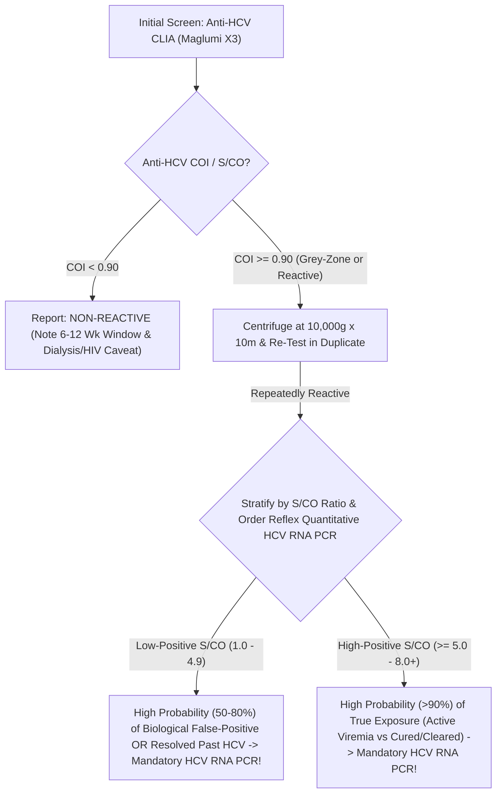

# 4.2.6 — Hepatitis C Virus Antibody (Anti-HCV — Maglumi X3 CLIA S/CO Ratio & Mandatory Reflex HCV RNA Viral Load Clause)

**Department Folder:** `04_Serology_Infectious_Diseases_and_Immunology`  
**Cluster Folder:** `4.2_Viral_Markers_HIV_Hepatitis_Syphilis_TORCH_and_EBV_Cluster`  
**Document ID:** `SOP-SER-4.2.6-ANTIHCV` | **Version:** `4.0 (ISO 15189:2022 / NABL 112 / WHO-CDC-INASL-NVHCP)`

---

## 1. Document Control, Standardized Coding & Hardware-Agnostic Platform Matrix

| Coding System / Attribute | Identifier / Code | Official Nomenclature & Scope |
| :--- | :--- | :--- |
| **LOINC** | `16128-1` (CLIA/ELISA) / `48159-8` (`S/CO` Ratio) / `75411-9` (Rapid) | Hepatitis C virus Ab (`Anti-HCV`) [Presence & Signal/Cutoff Ratio] in Serum or Plasma by Immunoassay |
| **SNOMED-CT** | `165812000` / `50711007` | Screening for Hepatitis C virus antibody / Viral hepatitis C |
| **ICD-10-CM** | `B17.10` (Acute HCV) / `B18.2` (Chronic HCV) / `Z11.59` (Screen) | Acute viral hepatitis C; Chronic viral hepatitis C |
| **UCUM Units** | `COI` / `S/CO` (`Signal-to-Cutoff Ratio`) | Chemiluminescence Cutoff Index / Signal-to-Cutoff Ratio |
| **Statutory Mandate** | **CDC / WHO / INASL / NVHCP Two-Step Algorithm** | **A reactive `Anti-HCV` screening test NEVER confirms active HCV infection!** Mandatory confirmation via **Quantitative `HCV RNA Real-Time PCR`** is required before starting DAA therapy |

### Hardware-Agnostic Analytical Platform Matrix
| Tier | Analytical Platform | Recombinant Antigen Targets | Diagnostic Role & Performance |
| :--- | :--- | :--- | :--- |
| **Primary Automated** | **Snibe MAGLUMI X3 / X8 `Anti-HCV` 3rd-Gen CLIA** | Indirect / Sandwich Flash Chemiluminescence against recombinant **`Core` (structural), `NS3` (helicase/protease), `NS4`, and `NS5` (polymerase)** antigens on magnetic microbeads | Sensitivity $> 99.5\%$, Specificity $> 99.4\%$; quantitative `COI / S/CO` ratio stratifies true viremia vs low-positive biological false-positives |
| **Reference Microplate** | **Bio-Rad Monolisa / Ortho / ErbaLisa 3rd-Gen `Anti-HCV` ELISA** | Multi-antigen (`Core + NS3 + NS4 + NS5`) Microplate ELISA ($450\text{ nm}/620\text{ nm}$) | High-sensitivity blood bank & clinical screening tier |
| **Rapid Screening** | **SD Bioline / Tri-Dot `HCV` Rapid ICT / Flow-Through** | Lateral-flow or immunofiltration recombinant Core/NS3/NS4/NS5 | **Screening Only** ($92\%\text{–}97\%$ sensitive; higher false-negative rate in hemodialysis/HIV) |

---

## 2. Pre-Analytical Phlebotomy, Prolonged Window Period, Stability & HIL Rejection Matrix

### Prolonged Seroconversion Window (`6 to 12 Weeks`) & Hemodialysis/HIV Caveat
1. **The $6\text{ to }12\text{ Week}$ Seronegative Window Period:**
   - Unlike `HCV RNA` (which becomes detectable in blood within **$1\text{ to }2\text{ weeks}$** of parenteral exposure), `Anti-HCV` antibodies require an average of **$6\text{ to }12\text{ weeks}$ ($42\text{–}84\text{ days}$, and up to $6\text{ months}$)** to seroconvert!
   - **Clinical Consequence:** Up to **$30\%\text{–}50\%$ of patients presenting at the onset of Acute Hepatitis C (`ALT > 500 U/L`) test NEGATIVE for `Anti-HCV`**! In suspected acute HCV or recent needlestick/transfusion/IVDU exposure, order **`HCV RNA Real-Time PCR`** directly.
2. **False-Negative `Anti-HCV` in Hemodialysis & Advanced HIV:**
   - Between **$2.5\%$ and $10\%$ of chronically HCV-viremic Maintenance Hemodialysis patients**, organ transplant recipients, and patients with advanced **HIV/AIDS ($\text{CD4} < 200/\mu\text{L}$)** or agammaglobulinemia fail to mount detectable `Anti-HCV` antibodies despite high `HCV RNA` viral loads!

### Specimen Stability & Quantitative HIL Rejection Matrix
| Storage Condition | Maximum Stability | Interference Factor | Quantitative Rejection Threshold & Corrective Action |
| :--- | :--- | :--- | :--- |
| **Ambient ($20\text{–}25^\circ\text{C}$)** | $\le 24\text{ hours}$ | **Fibrin Micro-Clots (Dialysis Samples!)** | **Critical Rule:** Heparinized hemodialysis patients frequently form delayed fibrin strands in serum tubes—**always centrifuge at $10,000 \times g$ for $10\text{ min}$** before running on Maglumi X3 CLIA! |
| **Refrigerated ($2\text{–}8^\circ\text{C}$)** | **Up to $7\text{ days}$** | **Hemolysis ($H$) / Lipemia ($L$)** | Maglumi X3 CLIA stable up to $\text{Hb } 500\text{ mg/dL}$, $\text{TG } 1,000\text{ mg/dL}$, $\text{Bilirubin } 25\text{ mg/dL}$. |
| **Frozen ($-20^\circ\text{C}$)** | $6\text{ months}$ | **Separate Reflex EDTA/SST Tube for `HCV RNA`** | Never use an open/manipulated serology tube that has sat at room temperature for `HCV RNA PCR` (RNases degrade viral RNA); draw a dedicated **$\text{K}_2\text{-EDTA}$ plasma or sterile SST tube separated within $< 4\text{ hours}$ and frozen at $-20^\circ\text{C}/-70^\circ\text{C}$**. |

---

## 3. Hardware-Agnostic Analytical SOP, `S/CO` Predictive Thresholds & Six Sigma IQC



1. **MAGLUMI X3 CLIA Cutoff Index (`COI` / `S/CO`) & Predictive Value of `S/CO` Ratio (CDC Guideline):**
   - **Non-Reactive:** $\text{COI} < 0.90\text{ AU/mL}$ (or $\text{S/CO} < 1.00$).
   - **Equivocal / Grey-Zone:** **$\text{COI } 0.90\text{ to }1.10$**.
   - **Low-Positive Reactive (`COI / S/CO 1.10 to 4.99`):** In low-prevalence populations (antenatal women, pre-operative screens), **$50\%\text{ to }80\%$ of samples with a low `S/CO` ratio ($1.0\text{–}4.9$) test NEGATIVE on `HCV RNA PCR`** (representing biological false-positives or remote cleared exposure)!
   - **High-Positive Reactive (`COI / S/CO >= 5.0 to 8.0+`):** $> 90\%\text{–}95\%$ true antibody specificity, though $20\%\text{–}25\%$ of untreated patients and $100\%$ of DAA-cured patients will still be `HCV RNA` negative!
2. **Six Sigma IQC & EQAS:**
   - Run Negative Control ($< 0.30\text{ COI}$) and Weak-Positive Control ($1.8\text{–}3.5\text{ COI}$) every shift; maintain $\text{CV}_A \le 6.0\%$ and participate in NABL/IAMM-EQAS.

---

## 4. Analytical Precision, Diagnostic Sensitivity/Specificity, Window Period & MRI

| Assay Tier | Within-Run $\text{CV}_A\%$ | Between-Run $\text{CV}_A\%$ | Sensitivity (Chronic HCV) | Specificity | Seroconversion Window | Minimum Retesting Interval (MRI) |
| :--- | :--- | :--- | :--- | :--- | :--- | :--- |
| **`Maglumi X3 3rd-Gen CLIA`** | $2.9\%\text{–}4.6\%$ | $4.2\%\text{–}6.4\%$ | **$99.5\%\text{ – }99.9\%$** | $99.4\%\text{ – }99.8\%$ | **$6\text{ to }12\text{ weeks}$** | **NEVER repeat `Anti-HCV` after cure** (remains positive for life; use `HCV RNA` for SVR12!) |
| **`3rd-Gen Rapid ICT / Tri-Dot`** | Qualitative | Qualitative | $92.0\%\text{ – }97.5\%$ | $98.0\%\text{ – }99.3\%$ | $8\text{ to }16\text{ weeks}$ | Confirm all Rapid ICT results by **CLIA & `HCV RNA PCR`** |

---

## 5. Multi-Stratified Reference Intervals & Two-Step `Anti-HCV` + `HCV RNA` Interpretation Matrix

| `Anti-HCV` Screen (`CLIA`) | Reflex Quantitative `HCV RNA PCR` | Definitive Clinical Diagnosis & Action (WHO / CDC / INASL / NVHCP) |
| :--- | :--- | :--- |
| **Non-Reactive (-)** | Not Required *(unless window/dialysis)* | **No Evidence of HCV Infection.** *(If acute hepatitis or recent exposure $< 12\text{ weeks}$ or hemodialysis/HIV, test `HCV RNA PCR`).* |
| **Reactive (+)** *(Any COI)* | **DETECTED (`> 15 IU/mL`)** | **Confirmed Active Viremic Hepatitis C Infection!** Initiate pan-genotypic Direct-Acting Antiviral (`DAA` — Sofosbuvir/Velpatasvir or Sofosbuvir/Daclatasvir for $12\text{–}24\text{ weeks}$ per NVHCP/INASL) after baseline `APRI / FIB-4` fibrosis staging. |
| **Reactive (+)** *(High COI $\ge 5.0$)* | **NOT DETECTED (`Target Not Detected`)** | **Resolved / Spontaneously Cleared ($20\%\text{–}25\%$) OR Previously Cured (Post-DAA `SVR12`) Past HCV Infection!** **NO active virus in body; NO antiviral treatment indicated!** *(Note: `Anti-HCV` remains positive for decades/life as an immunological scar).* |
| **Reactive (+)** *(Low COI $1.0\text{–}4.9$)* | **NOT DETECTED (`Target Not Detected`)** | **Biological False-Positive `Anti-HCV` Screening Reaction** (or remote cleared exposure). Patient does NOT have active Hepatitis C. |

---

## 6. NABL & CLSI GP47 Critical ("Panic") Alerts & Statutory Notification

- **Clinical & Medico-Legal Protection Alert:**
  - In Punjab, Haryana, and North India (where Hepatitis C prevalence and DAA treatment campaigns under NVHCP are widespread), thousands of patients who were **completely cured (`SVR12` achieved) with 12 weeks of Sofosbuvir + Daclatasvir/Velpatasvir** undergo routine pre-operative or visa screening years later and test **`Anti-HCV` REACTIVE (+)**!
  - Without the mandatory **`Anti-HCV` Lifelong Persistence After Cure Shield** in Section 10, cured patients are wrongly told their Hepatitis C has relapsed or are denied surgery!

---

## 7. Kinetic Persistence Profile & Smart LIMS Reflex Cascades

- **Why `Anti-HCV` Can NEVER Be Used to Monitor Treatment Response or Diagnose Re-Infection:**
  - Following successful Direct-Acting Antiviral (`DAA`) therapy (`Sustained Virologic Response at 12 weeks post-treatment [SVR12] = Undetectable HCV RNA`), circulating `Anti-HCV` $\text{IgG}$ antibodies persist for **10 to 30+ years (often for life)**.
  - Furthermore, `Anti-HCV` antibodies are **NOT neutralizing/protective**—if a cured patient shares needles or undergoes unsafe injections, diagnosing **HCV Re-infection** requires **`HCV RNA Real-Time PCR`**, never `Anti-HCV`!
- **Smart LIMS Reflex Cascade:** Every repeatedly reactive or equivocal `Anti-HCV` result ($\text{COI} \ge 0.90$) automatically triggers a mandatory LIMS reflex prompt for **Quantitative `HCV RNA Real-Time PCR` (`LoD <= 15 IU/mL`)**, `ALT/AST/Platelets` (for `FIB-4` calculation), and `HBsAg` / `HIV` co-infection screening.

---

## 8. Biological False-Positive (`BFP`) Cross-Reactivity & ISO 22367 Risk FMEA

- **Documented Causes of Biological False-Positive `Anti-HCV` ($\text{S/CO } 1.0\text{–}4.9$):**
  - **Pregnancy**, **Autoimmune Connective Tissue Diseases (`SLE`, `Sjögren's`, Autoimmune Hepatitis, high-titer `Rheumatoid Factor`)**, **Polyclonal Hypergammaglobulinemia / Cirrhosis / Multiple Myeloma**, **Acute Malaria / Dengue / Schistosomiasis**, recent vaccinations, and **fibrin micro-clots in hemodialysis sera**.

| Failure Mode (ISO 22367) | Root Cause | Clinical & Medico-Legal Risk | Mandatory Mitigation Control |
| :--- | :--- | :--- | :--- |
| **Patient Started on 12 Weeks of DAA Therapy Based on Reactive `Anti-HCV` Alone (Without `HCV RNA`)** | Clinician mistakes antibody screen for active viral infection | $30\%\text{–}50\%$ of low-COI or previously cured patients treated unnecessarily with hepatotoxic/costly drugs; NCDRC litigation! | Hardcode **Mandatory Reflex `HCV RNA` Confirmation Clause** in bold in Section 9 & Section 10 |
| **Post-DAA Cured Patient Told "Treatment Failed" Because `Anti-HCV` Is Still Positive** | Failure to understand lifelong `Anti-HCV` persistence after cure | Severe patient distress; unnecessary repeat DAA therapy | Explicitly include the **Post-DAA Cured Lifelong Antibody Persistence Shield** in Section 10 |

---

## 9. Conditional Band-Specific Pathologist Sign-Out Library

- **`[BAND-NON-REACTIVE]`:** *"Hepatitis C Virus Antibody (Anti-HCV) is NON-REACTIVE (COI <0.90). Note: Anti-HCV antibodies require 6 to 12 weeks (up to 6 months) to seroconvert after acute exposure and may remain negative in severely immunosuppressed or hemodialysis patients. If acute Hepatitis C or recent parenteral exposure is suspected, Quantitative HCV RNA Real-Time PCR is recommended."*
- **`[BAND-EQUIVOCAL/LOW-REACTIVE-SCO-LT-5]`:** *"Low-Index / Borderline Anti-HCV Reactivity detected (COI / S/CO 0.90–4.99), verified in duplicate after high-speed centrifugation. Per CDC/WHO/INASL guidelines, low S/CO Anti-HCV screening results frequently represent Biological False-Positive reactions (common in pregnancy, acute fevers, or autoimmune conditions) or resolved past exposure. MANDATORY NEXT STEP: Confirm active viremia by Quantitative HCV RNA Real-Time PCR before making any diagnostic or treatment decision."*
- **`[BAND-HIGH-REACTIVE-SCO-GE-5]`:** *"Anti-HCV Screening Assay is REACTIVE (COI / S/CO >=5.0). CRITICAL DIAGNOSTIC RULE: A reactive Anti-HCV antibody test does NOT distinguish between (1) Active Viremic HCV Infection, (2) Spontaneously Cleared Past HCV Infection (20–25% of cases), or (3) Previously Cured (Post-DAA Treatment) HCV where Anti-HCV antibodies remain positive for life! MANDATORY NEXT STEP: Perform Quantitative HCV RNA Real-Time PCR (Viral Load) to confirm active infection prior to initiating antiviral therapy."*

---

## 10. Master LIMS Copy-Paste Report Block (Physician + Patient Summary + CDC/INASL/NVHCP Legal Shield)

```text
================================================================================
   HEPATITIS C ANTIBODY (ANTI-HCV) — MANDATORY REFLEX HCV RNA & LEGAL SHIELD
================================================================================
1. CRITICAL TWO-STEP DIAGNOSTIC RULE (WHO / CDC / INASL / NVHCP GUIDELINES):
   • A REACTIVE ANTI-HCV SCREENING TEST DOES NOT CONFIRM ACTIVE HEPATITIS C!
   • Anti-HCV is an antibody screening test only. A reactive result CANNOT 
     distinguish between three completely different clinical states:
     (a) Active Viremic Hepatitis C Infection (requires DAA treatment),
     (b) Spontaneously Cleared Past HCV Infection (20-25% of exposed persons 
         clear the virus naturally without treatment, but keep antibodies!), OR
     (c) Previously Cured (Post-Treatment) Hepatitis C: Patients successfully 
         cured with Direct-Acting Antivirals (DAAs) remain Anti-HCV POSITIVE 
         for decades/life ("immunological scar") despite ZERO virus in the body!
     (d) Biological False-Positive Screening Reaction: Common in low-risk 
         individuals, pregnancy, malaria/dengue, or autoimmune conditions—
         especially when the Signal-to-Cutoff (S/CO or COI) ratio is <3.0-5.0.

2. MANDATORY NEXT STEP & WINDOW-PERIOD SHIELD:
   • Mandatory Reflex Confirmation: Every reactive or equivocal Anti-HCV result 
     MUST be confirmed by Quantitative HCV RNA Real-Time PCR (Viral Load) 
     before diagnosing active Hepatitis C or starting antiviral therapy.
   • Window Period (6-12 Weeks): Anti-HCV antibodies take 6 to 12 weeks after 
     exposure to appear (and may remain negative in Hemodialysis or HIV). Use 
     HCV RNA PCR if acute HCV or post-treatment cure (SVR12) is being evaluated.
   • Statutory Disclaimer: Correlate clinically. Not valid for medico-legal use.
================================================================================
```
