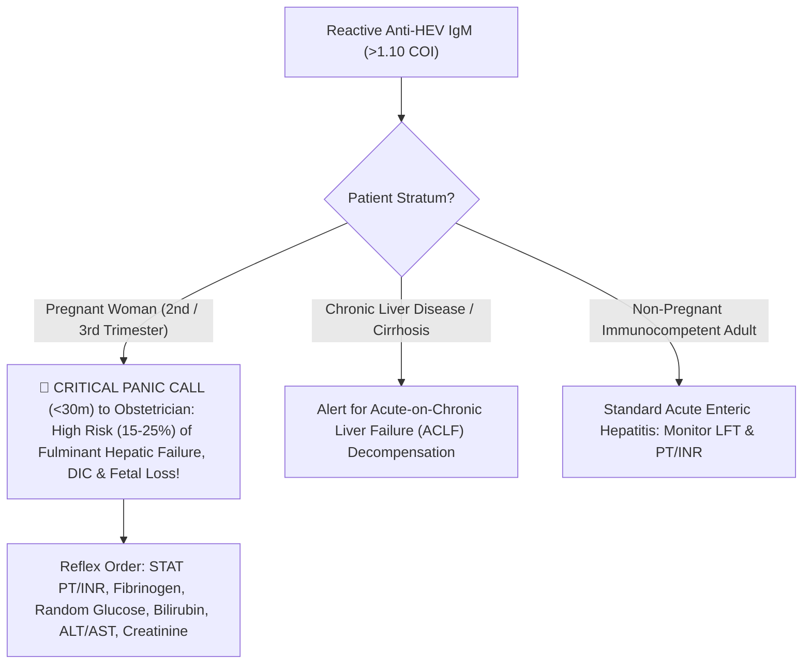

# 4.2.8 — Hepatitis E Virus Antibody (Anti-HEV IgM & IgG — 3rd-Trimester Pregnancy Fulminant Hepatic Failure High-Risk Alert)

**Department Folder:** `04_Serology_Infectious_Diseases_and_Immunology`  
**Cluster Folder:** `4.2_Viral_Markers_HIV_Hepatitis_Syphilis_TORCH_and_EBV_Cluster`  
**Document ID:** `SOP-SER-4.2.8-ANTIHEV` | **Version:** `4.0 (ISO 15189:2022 / NABL 112 / WHO-INASL-FOGSI)`

---

## 1. Document Control, Standardized Coding & Hardware-Agnostic Platform Matrix

| Coding System / Attribute | Identifier / Code | Official Nomenclature & Scope |
| :--- | :--- | :--- |
| **LOINC** | `14212-5` (`Anti-HEV IgM`) / `14211-7` (`Anti-HEV IgG`) | Hepatitis E virus (`HEV`) $\text{IgM}$ Ab & $\text{IgG}$ Ab [Presence/Index] in Serum by Immunoassay |
| **SNOMED-CT** | `313241009` / `235869004` | Measurement of Hepatitis E antibody / Acute viral hepatitis E (*Paslahepevirus balayani*, *Hepeviridae*) |
| **ICD-10-CM** | `B17.2` (Acute HEV) / `O98.413` (Viral hepatitis complicating pregnancy, 3rd trimester) | Acute hepatitis E; Maternal viral hepatitis in pregnancy |
| **UCUM Units** | `COI` / `S/CO` / `WHO U/mL` | Cutoff Index or WHO International Units per mL (`NIBSC 95/584`) |
| **Regulatory Mandate** | **IDSP & NVHCP Notifiable + Critical Obstetric Panic Trigger** | Leading cause of epidemic/sporadic acute adult viral hepatitis and **Pregnancy Fulminant Hepatic Failure (`ALF`)** in India |

### Hardware-Agnostic Analytical Platform Matrix
| Analyte | Primary Platform (`Snibe MAGLUMI X3 / X8` or `Wantai/Dia.Pro ELISA`) | Target Antigens | Methodological Principle |
| :--- | :--- | :--- | :--- |
| **`Anti-HEV IgM`** | **$\mu$-Capture Microplate ELISA (`Wantai / Dia.Pro / ErbaLisa`) or Maglumi X3 CLIA** | Recombinant **`ORF2` (capsid structural protein)** and **`ORF3` (immunogenic phosphoprotein)** of `HEV` Genotypes 1–4 | $\mu$-Capture format (`MAC-ELISA` / `CLIA`) provides superior sensitivity ($>96\%$) and specificity ($>98\%$) compared to indirect or rapid ICT cards |
| **`Anti-HEV IgG`** | **Indirect / Sandwich Quantitative ELISA or CLIA** | Recombinant `ORF2` conformational capsid dimer (`p239 / E2s`) | Quantifies past exposure and convalescent seroconversion |
| **`HEV RNA` (Confirmatory)** | **Real-Time RT-PCR (Serum or Stool)** | Conserved `ORF2/ORF3` overlap region | Gold standard in early window phase and **Immunocompromised / Solid-Organ Transplant patients** |

---

## 2. Pre-Analytical Phlebotomy, Window-Period Timing, Stability & HIL Rejection Matrix

### Virological Kinetics & Mandatory Pregnancy Status Check
- **Mandatory Pre-Analytical Question for Female Patients (Ages $15\text{–}45\text{ Years}$):** Phlebotomy and LIMS entry **MUST record Pregnancy Status and Trimester (`1st, 2nd, 3rd Trimester`)** whenever `Anti-HEV IgM` is ordered!
- **Kinetics:** After a $2\text{ to }8\text{ week}$ (mean $40\text{ days}$) waterborne feco-oral incubation period (`HEV Genotype 1` in India), **`Anti-HEV IgM` becomes detectable at the onset of clinical symptoms / transaminitis (`ALT/AST` rise)**, peaks within $2\text{ to }4\text{ weeks}$, and persists for **$3\text{ to }5\text{ months}$**. `HEV RNA` is detectable in blood for $2\text{–}3\text{ weeks}$ and in stool for $4\text{–}6\text{ weeks}$ after symptom onset.

### Specimen Stability & Quantitative HIL Rejection Matrix
| Storage Condition | Maximum Stability | Interference Factor | Quantitative Rejection Threshold & Corrective Action |
| :--- | :--- | :--- | :--- |
| **Ambient ($20\text{–}25^\circ\text{C}$)** | $\le 12\text{ hours}$ | **Extreme Icterus ($I$)** | Validated up to `Total Bilirubin` $25\text{–}30\text{ mg/dL}$ on CLIA and $\mu$-capture ELISA (wash $6\times$ thoroughly to remove icteric serum tint before adding TMB). |
| **Refrigerated ($2\text{–}8^\circ\text{C}$)** | **Up to $7\text{ days}$** | **Hemolysis ($H$) / Lipemia ($L$)** | Reject for ELISA if $\text{Hb} > 150\text{ mg/dL}$; ultracentrifuge if $\text{TG} > 500\text{ mg/dL}$. |
| **Frozen ($-20^\circ\text{C}$)** | $6\text{ months}$ | **Rheumatoid Factor (`RF`)** | Use $\mu$-capture assay or `RF`-absorbent buffer to prevent false-positive `IgM` bridging. |

---

## 3. Hardware-Agnostic Analytical SOP, Grey-Zone Verification & Six Sigma IQC

1. **Analytical Procedure ($\mu$-Capture ELISA / MAGLUMI X3 CLIA):**
   - Incubate patient serum on anti-human $\mu$-chain capture solid phase (or recombinant `ORF2/ORF3` magnetic microbeads), wash $5\text{–}6\times$, incubate with HRP/`ABEI`-conjugated `HEV ORF2/ORF3` antigen, wash $6\times$, and measure optical density (`OD` $450/620\text{ nm}$) or chemiluminescence (`RLU`).
2. **Cutoff Index (`COI` / `S/CO`) & Grey-Zone Duplicate Verification:**
   - **Non-Reactive:** $\text{COI} < 0.90$.
   - **Equivocal / Grey-Zone:** **$\text{COI } 0.90 \text{ to } 1.10$** $\rightarrow$ Centrifuge at $10,000 \times g$ for $10\text{ min}$ and re-test in duplicate. If equivocal in a pregnant patient, **immediately alert the Obstetrician** and recommend **`HEV RNA Real-Time RT-PCR`** or repeat sample in $48\text{–}72\text{ hours}$.
   - **Reactive (Positive):** $\text{COI} > 1.10$.
3. **Six Sigma IQC & EQAS:**
   - Run Negative Control, Cutoff Calibrator, and Positive Control in every run ($\text{CV}_A \le 7.0\%$); participate in NABL/IAMM-EQAS.

---

## 4. Analytical Precision, Diagnostic Sensitivity/Specificity, Window Period & MRI

| Assay Tier | Within-Run $\text{CV}_A\%$ | Between-Run $\text{CV}_A\%$ | Clinical Sensitivity | Clinical Specificity | Persistence Duration | Minimum Retesting Interval (MRI) |
| :--- | :--- | :--- | :--- | :--- | :--- | :--- |
| **`Anti-HEV IgM` ($\mu$-Capture ELISA/CLIA)** | $3.8\%\text{–}5.8\%$ | $5.2\%\text{–}7.2\%$ | **$95.0\%\text{ – }98.5\%$** | **$97.5\%\text{ – }99.2\%$** | **$3\text{ to }5\text{ months}$** | **$3\text{ to }5\text{ days}$** if initial prodromal test is negative |
| **`Anti-HEV IgM` Rapid ICT Card** | Qualitative | Qualitative | $80.0\%\text{ – }90.0\%$ | $92.0\%\text{ – }96.0\%$ | Variable | Confirm all antenatal/severe cases by **Capture ELISA / CLIA** |
| **`Anti-HEV IgG`** | $4.0\%\text{–}6.0\%$ | $5.5\%\text{–}7.5\%$ | $96.0\%$ | $98.0\%$ | **$5\text{ to }15+\text{ years}$** *(Wanes over time; re-infection possible!)* | Paired rise at $2\text{–}4\text{ weeks}$ |

---

## 5. Multi-Stratified Reference Intervals & Special High-Risk Strata

| Patient Stratum | `Anti-HEV IgM` Cutoff | Clinical Course & Risk Stratification |
| :--- | :--- | :--- |
| **General Immunocompetent Adult / Child** | Non-Reactive $< 0.90\text{ COI}$<br>Reactive $> 1.10\text{ COI}$ | Acute self-limiting icteric hepatitis ($98\%\text{–}99\%$ spontaneous recovery within $4\text{–}6\text{ weeks}$; mortality $0.5\%\text{–}1.0\%$). |
| **🚨 Pregnant Women (Especially 2nd & 3rd Trimesters)** | **CRITICAL ALERT IF $\ge 0.90\text{ COI}$** | **Extreme Risk of Fulminant Hepatic Failure (`Acute Liver Failure`) with $15\%\text{ to }25\%$ Maternal Mortality**, Disseminated Intravascular Coagulation (`DIC`), Postpartum Hemorrhage (`PPH`), Preterm Delivery, and **$30\%\text{–}50\%$ Intrauterine Fetal / Perinatal Mortality**! |
| **Underlying Chronic Liver Disease (`HBV / HCV / Alcohol / MASLD Cirrhosis`)** | Reactive $> 1.10\text{ COI}$ | Major precipitating trigger of **Acute-on-Chronic Liver Failure (`ACLF`)** in India with high 28-day mortality! |
| **Solid-Organ Transplant / Hematological Malignancy / HIV** | **Serology Frequently False-Negative!** | Immunosuppressed patients often fail to produce `Anti-HEV IgM` and can develop **Chronic Hepatitis E** (mostly Genotype 3/4) $\rightarrow$ **Order `HEV RNA Real-Time RT-PCR`!** |

---

## 6. NABL & CLSI GP47 Critical ("Panic") Alerts & Statutory Notification

> [!WARNING]
> **IMMEDIATE (<30 MINUTE) OBSTETRIC-HEPATOLOGY CRITICAL PANIC ALERT:**
> **ANY Reactive or Equivocal `Anti-HEV IgM` in a Pregnant Woman (2nd or 3rd Trimester) is a Life-Threatening Medical Emergency!**
> - **Why Pregnancy Triggers Fulminant `HEV` Failure:** High third-trimester progesterone/estrogen levels, placental trophoblast viral replication of `HEV Genotype 1`, and a maternal shift from $\text{Th1}$ to $\text{Th2}$ immunity coupled with suppressed $\text{NF-}\kappa\text{B p65}$ hepatocyte regeneration precipitate massive hepatic necrosis, cerebral edema, and coagulopathy (`DIC`).
> - **Mandatory Laboratory Action:** Immediately telephone the ordering Obstetrician/Physician (<30 min), log the call per NABL GP47, and recommend urgent inpatient tertiary ICU monitoring with serial **Prothrombin Time (`PT/INR`), Blood Glucose (watch for fatal hypoglycemia!), Arterial Ammonia/Lactate, Fibrinogen, Creatinine, and Bilirubin/ALT/AST**.

---

## 7. Kinetic Day-by-Day Rise/Peak/Persistence & Smart LIMS Reflex Cascades



---

## 8. Analytical Cross-Reactivity & ISO 22367 Risk FMEA

1. **Polyclonal Cross-Reactivity (`EBV / CMV / HAV / Autoimmune Hepatitis`):** Acute Epstein-Barr Virus (`EBV`), Cytomegalovirus (`CMV`), Acute Hepatitis A (`HAV`), or Autoimmune Hepatitis flare can cause false-positive dual `IgM` reactivity on indirect `Anti-HEV IgM` kits. Using **$\mu$-Capture `Anti-HEV IgM` (`ORF2/ORF3`)** reduces false-positivity to $< 1.5\%$.
2. **Waning `Anti-HEV IgG` & Re-Infection in Endemic India:** Unlike `Anti-HAV IgG` (which confers 100% lifelong immunity), naturally acquired `Anti-HEV IgG` titers decline over $5\text{ to }15\text{ years}$, allowing adult re-infection during waterborne outbreaks.

| Failure Mode (ISO 22367) | Root Cause | Clinical Risk | Mandatory Mitigation Control |
| :--- | :--- | :--- | :--- |
| **Reactive `Anti-HEV IgM` in 3rd-Trimester Pregnant Woman Released Without Urgent Call** | Treated as routine outpatient viral hepatitis | Patient develops hepatic encephalopathy, DIC, and intrauterine fetal death at home within 48 hours! | Hardcode **Pregnancy Fulminant Hepatic Failure Critical Panic Alert** in LIMS & Section 6/9/10 |
| **Immunosuppressed Renal Transplant Patient Tested Only by `Anti-HEV IgM`** | Calcineurin/MMF therapy blunts `IgM` synthesis | Missed Chronic/Acute HEV graft hepatitis | Recommend `HEV RNA Real-Time RT-PCR` in all immunocompromised patients |

---

## 9. Conditional Band-Specific Pathologist Sign-Out Library

- **`[BAND-NON-REACTIVE]`:** *"Hepatitis E Virus IgM Antibody (Anti-HEV IgM) is NON-REACTIVE (COI <0.90). No serological evidence of acute Hepatitis E virus infection. Note: In severely immunocompromised or solid-organ transplant patients, antibody synthesis may be blunted; if clinical suspicion persists, HEV RNA Real-Time RT-PCR is recommended."*
- **`[BAND-EQUIVOCAL/GREY-ZONE]`:** *"Anti-HEV IgM is EQUIVOCAL (Grey-Zone COI 0.90–1.10), verified in duplicate. May represent very early acute seroconversion, waning IgM from an infection within the past 3–5 months, or polyclonal cross-reactivity. Recommend repeat testing in 3–5 days or confirmatory HEV RNA RT-PCR. (If patient is pregnant, monitor LFT and PT/INR closely)."*
- **`[BAND-REACTIVE-NON-PREGNANT]`:** *"Anti-HEV IgM is REACTIVE, confirming Acute Hepatitis E Virus (HEV) infection in a compatible clinical and biochemical setting. Correlate with Serum Bilirubin, ALT (SGPT), AST (SGOT), and Prothrombin Time (PT/INR). Note: In patients with preexisting chronic liver disease, acute HEV can precipitate Acute-on-Chronic Liver Failure (ACLF)."*
- **`[BAND-CRITICAL-PREGNANCY]`:** *"🚨 CRITICAL OBSTETRIC-HEPATOLOGY ALERT: Reactive Anti-HEV IgM in a Pregnant Patient! Acute Hepatitis E infection during pregnancy (particularly in the 2nd and 3rd trimesters) carries a 15%–25% risk of Fulminant Hepatic Failure (Acute Liver Failure), Disseminated Intravascular Coagulation (DIC), postpartum hemorrhage, and intrauterine fetal demise. Immediate inpatient tertiary obstetric-hepatology management and serial monitoring of PT/INR, blood glucose, bilirubin, transaminases, and renal function are mandatory. Immediate telephone notification logged."*

---

## 10. Master LIMS Copy-Paste Report Block (Physician + Patient Summary + Pregnancy Fulminant Alert Shield)

```text
================================================================================
   HEPATITIS E VIRUS (ANTI-HEV IgM) — PREGNANCY FULMINANT ALERT & LEGAL SHIELD
================================================================================
1. CLINICAL KINETICS & SIGNIFICANCE:
   • Hepatitis E Virus (HEV) is the most common cause of waterborne epidemic and 
     sporadic acute viral hepatitis in Indian adults.
   • Anti-HEV IgM becomes positive at the onset of symptoms/jaundice, peaks at 
     2-4 weeks, and persists for 3 to 5 months. In healthy non-pregnant adults, 
     HEV is usually self-limiting over 4-6 weeks.

2. 🚨 CRITICAL OBSTETRIC & HEPATOLOGY WARNINGS (INASL / FOGSI / WHO):
   • PREGNANCY HIGH-RISK ALERT (2ND & 3RD TRIMESTER): Acute Hepatitis E during 
     pregnancy (especially in the 2nd and 3rd trimesters) is a medical emergency 
     carrying a 15% to 25% risk of Fulminant Hepatic Failure (Acute Liver 
     Failure), severe coagulopathy (DIC), postpartum hemorrhage, and fetal loss! 
     Any pregnant woman with reactive Anti-HEV IgM requires urgent inpatient 
     obstetric-hepatology care and serial monitoring of Prothrombin Time (PT/INR), 
     Random Blood Sugar (for hypoglycemia), Bilirubin, SGPT/SGOT, and Creatinine.
   • Acute-on-Chronic Liver Failure (ACLF): In patients with underlying Chronic 
     HBV, HCV, Alcohol, or Fatty Liver Cirrhosis, acute HEV superinfection can 
     trigger severe hepatic decompensation (ACLF).
   • Cross-Reactivity Shield: Polyclonal B-cell activation during acute HAV, 
     EBV, CMV, Autoimmune Hepatitis, or Rheumatoid Factor positivity can rarely 
     cause false-positive IgM reactivity; confirm discordant cases by HEV RNA 
     RT-PCR. Not valid for medico-legal purposes.
================================================================================
```
