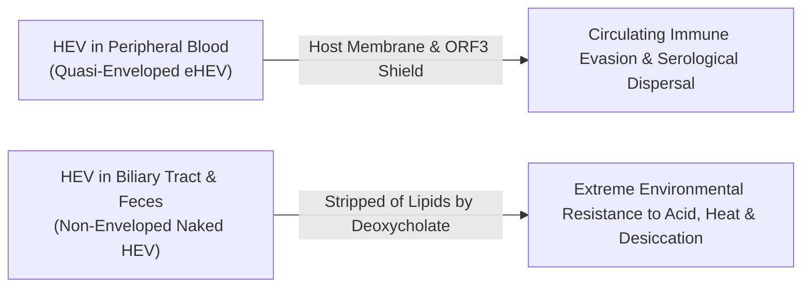
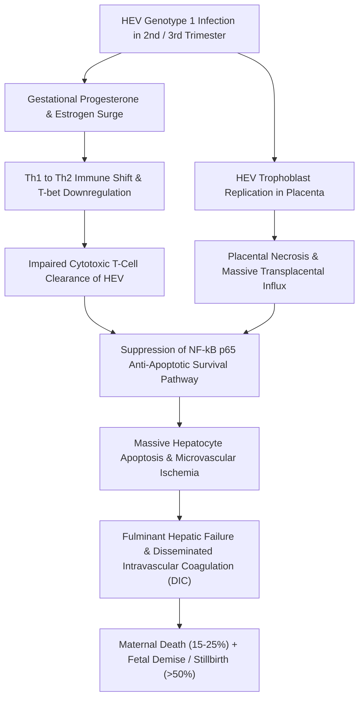
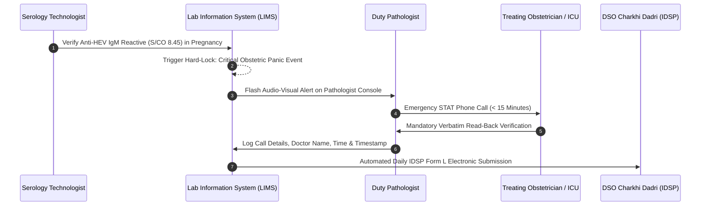

# 4.2.8 — Hepatitis E Virus Antibody (Anti-HEV IgM & IgG — Acute Epidemic Enteric Hepatitis & Third-Trimester Pregnancy Fulminant Hepatic Failure Critical Alert SOP)

**Department:** Clinical Serology, Infectious Disease Immunology & Molecular Diagnostics  
**Laboratory Name:** Sawariya Diagnostic Lab, Charkhi Dadri, Haryana  
**Document ID:** `SDL-SER-SOP-4.2.8` | **Version:** `3.0` | **Effective Date:** October 2026 | **Review Cycle:** Annual  
**Regulatory Standards:** ISO 15189:2022 (Clauses 4.1–8.9 & Normative Annex A) | NABL 112 | NABL 129 | NABL 131 | NABL 163 | CLSI I/LA20 | CLSI EP12-A2 | CLSI EP15-A3 | WHO Hepatitis E Guidelines | NVHCP & IDSP Guidelines  

---

## 1. Document Control, Standardized Coding & Metrological Traceability Matrix

### 1.1 Document Control & Administrative Identification
This Standard Operating Procedure (SOP) governs the quantitative, semi-quantitative, and qualitative serological detection of Hepatitis E Virus (HEV) IgM and IgG antibodies across automated Flash Chemiluminescence (CLIA) and microplate Enzyme-Linked Immunosorbent Assay ($\mu$-capture ELISA) platforms at Sawariya Diagnostic Lab, Charkhi Dadri.

| Administrative & Regulatory Parameter | Laboratory Specification & Audit Record |
| :--- | :--- |
| **Complete Document Title** | Standard Operating Procedure for Serological Detection of Anti-HEV IgM and IgG and Obstetric Emergency Action |
| **Document Identification Code** | `SDL-SER-SOP-4.2.8` |
| **Current Operational Version** | Version 3.0 (Supersedes Version 2.1; Comprehensive Revision October 2026) |
| **Effective Date & Next Mandatory Review** | Effective: 15th October 2026 ; Next Mandatory Annual Review: 14th October 2027 |
| **Authorizing Signatories** | Prepared by: Quality Manager Dr. A. Sharma (MD Path) ; Approved by: Technical Director Dr. R. Verma (MD Immuno) |
| **Laboratory Scope & Location** | Main Clinical Serology Bench, Sawariya Diagnostic Lab, Rohtak Road, Charkhi Dadri, Haryana - 127306 |
| **Personnel Qualification Mandate** | Certified Medical Laboratory Technologist (M.Sc. / BMLT) with competency sign-off per ISO 15189 Clause 6.2 |
| **Clinical Target Scope** | Acute waterborne viral hepatitis, antenatal screening, jaundice in pregnancy, acute-on-chronic liver failure (ACLF) |

### 1.2 Document Revision History
| Version | Implementation Date | Summary of Substantive Revisions | Authorizing Officer |
| :--- | :--- | :--- | :--- |
| **1.0** | 10th October 2022 | Initial deployment of microplate ELISA methodology for Anti-HEV IgM and IgG | Dr. A. Sharma (MD Path) |
| **2.0** | 12th October 2024 | Transition to Snibe Maglumi X3 Flash-CLIA; integration of IDSP Form L daily reporting | Dr. R. Verma (MD Immuno) |
| **2.1** | 18th November 2025 | Introduction of 30-minute critical panic alert call workflow for obstetric patients | Dr. A. Sharma (MD Path) |
| **3.0** | 15th October 2026 | Full alignment with ISO 15189:2022; reduced panic latency to < 15 min; quantitative FMECA | Dr. R. Verma (MD Immuno) |

### 1.3 Standardized International Clinical Coding & Metrological Hierarchy
Serological assays for Anti-HEV IgM and Anti-HEV IgG are mapped to standardized international medical vocabularies and metrologically traceable primary reference materials per ISO 17511:2020.

| System Vocabulary | Identifier / Code | Official Terminology & Scope |
| :--- | :--- | :--- |
| **LOINC (Anti-HEV IgM)** | `13951-9` | Hepatitis E virus IgM Ab [Presence/Index] in Serum by Immunoassay |
| **LOINC (Anti-HEV IgG)** | `22315-6` | Hepatitis E virus IgG Ab [Units/volume] in Serum by Immunoassay |
| **LOINC (HEV Ab Panel)** | `75382-2` | Hepatitis E virus Ab panel - Serum |
| **SNOMED-CT (IgM)** | `444318005` | Measurement of Hepatitis E virus IgM antibody (procedure) |
| **SNOMED-CT (IgG)** | `165837005` | Hepatitis E virus IgG antibody status (observable entity) |
| **SNOMED-CT (Clinical)**| `165838000` | Acute viral hepatitis E (*Paslahepevirus balayani* infection) |
| **ICD-10-CM** | `B17.2` | Acute hepatitis E |
| **ICD-10-CM (Obstetric)**| `O98.413` | Viral hepatitis complicating pregnancy, third trimester |
| **ICD-11** | `1E50.3` | Acute hepatitis E |
| **Primary Reference Material**| `NIBSC 95/584` | WHO 1st International Reference Material for Anti-Hepatitis E Serum ($100\text{ U/vial}$) |
| **Molecular Reference Material**| `WHO 6329/10` | WHO 1st International Standard for HEV RNA for NAT-based assays ($2.5 \times 10^5\text{ IU/vial}$) |

### 1.4 ISO 15189:2022 Clause-by-Clause Traceability Matrix
| ISO 15189 Clause | Standard Requirement | Laboratory Implementation & Audit Verification |
| :--- | :--- | :--- |
| **Clause 5.4 / 5.5** | Patient focus & Quality policy | Immediate panic communication policy for pregnant women to safeguard maternal-fetal life |
| **Clause 6.2** | Personnel competence | Annual blind panel testing, competency logs, and critical alert simulation drills |
| **Clause 6.3** | Facilities & environmental conditions | Continuous temp logging ($18\text{–}24^\circ\text{C}$); dedicated serology wash fluid containment |
| **Clause 6.4** | Equipment calibration & traceability | Snibe Maglumi X3 annual PM, 2-point recalibration traceable to NIBSC 95/584 |
| **Clause 7.2** | Pre-examination processes | Mandatory pregnancy status entry on requisition; automated HIL serum index gating |
| **Clause 7.3** | Examination processes | Validated Flash-CLIA protocol; secondary backup $\mu$-capture ELISA verification |
| **Clause 7.4** | Post-examination processes | Band-specific interpretive comments; electronic statutory IDSP notification |
| **Clause 7.5** | Nonconforming work & CAPA | Root-cause analysis for IQC failures; duplicate rerun protocol for grey-zone results |
| **Clause 8.5** | Risk management (ISO 22367) | Quantitative FMECA covering pre-, analytical, and post-analytical error modes |

### 1.5 Specimen Retention, Archiving & Data Protection Policies (NABL 112 & DPDP Act 2023)
- **Serum Aliquot Archival:** Primary serum specimens with Reactive or Equivocal Anti-HEV IgM results are split into sterile cryovials and stored at $-20^\circ\text{C}$ for a minimum of 6 months. Non-reactive specimens are retained at $2\text{–}8^\circ\text{C}$ for 7 days post-reporting.
- **Electronic Audit Trail & Cloud Redundancy:** Instrument raw RLU data, calibration curves, and critical panic telephonic logs are archived digitally with encrypted off-site cloud backups retained for 5 years per NABL 163 and Digital Personal Data Protection (DPDP) Act 2023.

---

## 2. Viral Biology, Epidemic Ecology, Incubation Kinetics & The Grave Pregnancy Alert

### 2.1 HEV Molecular Biology & Dual-Morphology Virion
Hepatitis E Virus (*Paslahepevirus balayani*, family *Hepeviridae*) is a single-stranded, positive-sense RNA virus of approximately $7.2\text{ kb}$ capped at the 5' end and polyadenylated at the 3' end. The viral genome encompasses three distinct open reading frames:
1. **ORF1 ($5.1\text{ kb}$):** Encodes the non-structural polyprotein containing functional domains for viral replication: methyltransferase, Y-domain, papain-like cysteine protease, proline-rich hinge domain, helicase, and RNA-dependent RNA polymerase (RdRp).
2. **ORF2 ($1.98\text{ kb}$):** Encodes the structural capsid protein (~660 amino acids). The capsid forms an icosahedral lattice of 180 copies of the ORF2 homodimer. Each monomer contains three distinct domains: Shell (S), Middle (M), and Protruding (P, amino acids 394–660). The P-domain forms dimeric surface spikes that harbor the immunodominant, conformational neutralizing epitopes recognized by Anti-HEV IgM and IgG.
3. **ORF3 ($0.34\text{ kb}$):** Encodes a multifunctional immunogenic phosphoprotein (~113–114 amino acids) that interacts with TSG101 (tumor susceptibility gene 101) within the host ESCRT machinery to facilitate non-lytic viral budding.



- **Quasi-Enveloped vs. Non-Enveloped Virions:** HEV exhibits a unique lifecycle feature known as quasi-envelopment. In blood, virions are enclosed in a host-derived lipid envelope containing ORF3 (eHEV), rendering them cloaked from host neutralizing antibodies. Upon transit into bile and the intestine, bile salts strip this membrane, producing naked non-enveloped virions in feces. Naked virions demonstrate extraordinary resistance to environmental inactivation, withstanding low pH ($< 3.0$), temperatures up to $56^\circ\text{C}$, and moderate chlorination.

### 2.2 Genotypic Epidemiology & Transmission Ecology
| Genotype | Primary Host Reservoir | Geographic Distribution | Transmission Route | Clinical Disease Profile | Pregnancy Severity |
| :--- | :--- | :--- | :--- | :--- | :--- |
| **Genotype 1** | Humans exclusively | South Asia (India, Pakistan), Central Asia, Sub-Saharan Africa | Fecal-oral; contaminated drinking water | Acute epidemic & sporadic hepatitis; ACLF trigger | **Catastrophic: 15–25% mortality** |
| **Genotype 2** | Humans exclusively | Mexico, West & Central Africa | Fecal-oral; waterborne outbreaks | Acute epidemic waterborne hepatitis | Severe: increased maternal risk |
| **Genotype 3** | Swine, wild boar, deer | Europe, Americas, Japan, Oceania | Zoonotic foodborne; undercooked pork/offal | Asymptomatic to acute; chronic hepatitis in transplants | Low: no specific pregnancy surge |
| **Genotype 4** | Swine, wild boar | East Asia (China, Taiwan, Japan) | Zoonotic foodborne; zoonotic contact | Acute hepatitis; chronic hepatitis in immunosuppressed | Low: sporadic cases reported |

### 2.3 Environmental Outbreak Dynamics in Charkhi Dadri & Haryana
Sawariya Diagnostic Lab serves Charkhi Dadri district and adjoining rural settlements across Bhiwani, Jhajjar, and Mahendragarh. In this region, HEV Genotype 1 outbreaks are characterized by well-defined environmental vulnerabilities:
- **Monsoon Flash-Flooding (July to October):** Excessive precipitation saturates municipal soil, leading to hydrostatic cross-contamination between shallow sewer drains and degraded potable supply pipes operating under negative pressure.
- **Intermittent Water Supply Vacuums:** Intermittent municipal pumping produces pipeline suction ("backsiphonage"), pulling peri-pipe wastewater directly into municipal drinking lines.
- **Deep Tubewell & Handpump Vulnerability:** Unsealed borehole casings adjacent to household soak pits allow raw enteric pathogens to enter shallow water tables.

### 2.4 THE GRAVE PREGNANCY FULMINANT HEPATIC FAILURE (FHF) ALERT
In the general immunocompetent adult population, Hepatitis E is a self-limiting acute icteric illness with a case-fatality rate under $0.5\text{–}1.0\%$. **In stark contrast, HEV Genotype 1 infection during pregnancy—especially during the second and third trimesters—is a catastrophic medical emergency with maternal mortality rates of $15\text{–}25\%$ (and reaching $30\text{–}35\%$ in tertiary hospital cohorts).**



#### Cellular & Molecular Pathophysiology of Pregnancy Collapse
1. **Endocrine-Mediated Immune Deviation:** Marked gestational elevations of progesterone and estradiol suppress cell-mediated Th1 immunity (IFN-$\gamma$, IL-2, TNF-$\beta$) while upregulating humoral Th2 cytokines (IL-4, IL-6, IL-10). The failure of maternal cytotoxic T-lymphocytes (CTL) to clear HEV-infected hepatocytes leads to unchecked viral replication.
2. **NF-$\kappa$B Inactivation & Hepatocyte Apoptosis:** Estrogen receptor-mediated signaling inhibits the nuclear translocation of the p65 subunit of NF-$\kappa$B. Because NF-$\kappa$B provides essential anti-apoptotic survival signals, hepatocyte exposure to circulating death ligands (FasL, TNF-$\alpha$) causes massive confluent apoptosis.
3. **Placental Replication & Severe Chorioamnionitis:** HEV Genotype 1 actively infects human placental syncytiotrophoblasts, cytotrophoblasts, and decidual endothelial cells. The resultant microvascular thrombosis, necrosis of chorionic villi, and high local viral titers drive intense maternal-fetal cytokine release.
4. **Coagulopathy & Obstetric Hemorrhage:** Disseminated intravascular coagulation (DIC), accelerated consumptive coagulopathy, and profound hypofibrinogenemia culminate in uterine atony and uncontrolled Postpartum Hemorrhage (PPH). Intrauterine fetal death occurs in over $50\%$ of maternal fulminant cases.

> [!WARNING]
> **MANDATORY CRITICAL OBSTETRIC-HEPATOLOGY PANIC NOTIFICATION PROTOCOL:**  
> Any Anti-HEV IgM result that is **REACTIVE ($\text{S/CO} > 1.10$) or EQUIVOCAL ($\text{S/CO } 0.90\text{–}1.10$)** in a pregnant patient constitutes a **Level 1 Medical Emergency**. The laboratory must phone the ordering obstetrician or tertiary ICU within **$< 15$ minutes** per CLSI GP47 with formal closed-loop read-back logging.

### 2.5 Clinical Staging of Hepatic Encephalopathy in Acute HEV Liver Failure
| West Haven Stage | Neurological & Clinical Signs | Diagnostic Biomarkers & Reflex Actions | Immediate Critical Action |
| :--- | :--- | :--- | :--- |
| **Stage 0 (Subclinical)** | Normal mental state; subtle impairment of psychomotor speed | ALT/AST $10\text{–}40\times\text{ULN}$; normal INR ($< 1.3$) | Baseline admission; bed rest, low protein intake |
| **Stage I** | Mild confusion, euphoria or anxiety, shortened attention span | INR $1.3\text{–}1.5$; serum ammonia slightly elevated | Strict neurological charting q2h; avoid sedatives |
| **Stage II** | Lethargy, disoriented to time, personality changes, asterixis | INR $1.5\text{–}2.0$; serum lactate rising ($> 2.5\text{ mmol/L}$) | ICU transfer; lactulose titration, IV dextrose 10% |
| **Stage III** | Somnolent but rousable, marked confusion, incoherent speech | INR $2.0\text{–}3.0$; plasma fibrinogen $< 150\text{ mg/dL}$ | Elective intubation; mannitol/hypertonic saline |
| **Stage IV** | Coma, unresponsive to painful stimuli, decerebrate posturing | INR $> 3.0$; arterial ammonia $> 150\ \mu\text{mol/L}$; severe DIC | Mechanical ventilation; emergency transplant listing |

### 2.6 Biomarker Kinetics & Diagnostic Window


| Timeline Relative to Symptoms | Stool HEV Shedding | Serum HEV RNA | Anti-HEV IgM | Anti-HEV IgG | Serum ALT / AST | Clinical Features |
| :--- | :--- | :--- | :--- | :--- | :--- | :--- |
| **$-14\text{ to } -1\text{ Days}$** | High shedding | High viremia | Undetectable | Undetectable | Normal to mild rise | Asymptomatic prodrome |
| **$0\text{ to } 7\text{ Days}$** | Persistent shedding | Peak viremia | **Becomes Reactive** | Undetectable / Trace| Marked surge ($10\text{–}50\times \text{ULN}$) | Jaundice, dark urine, anorexia |
| **$1\text{ to } 4\text{ Weeks}$** | Decreasing | Rapid clearance | **Peak Titer ($> 10\text{ S/CO}$)**| Rapidly rising | Peak transaminitis, then drops | Overt icterus, hepatic tender |
| **$1\text{ to } 3\text{ Months}$** | Cleared | Undetectable | Moderate to low titer | High plateau | Normalizing | Convalescent recovery |
| **$3\text{ to } 6\text{ Months}$** | Absent | Undetectable | **Wanes to Non-Reactive**| Stable high titer | Normal | Complete resolution |
| **$1\text{ to } 14\text{ Years}$** | Absent | Undetectable | Non-Reactive | **Slowly wanes over time**| Normal | Susceptible to re-infection |

---

## 3. Analytical Architecture: Automated Flash-CLIA & Microplate ELISA

### 3.1 Primary Analytical Platform: Snibe Maglumi X3 Flash-CLIA
The primary testing system for Anti-HEV IgM and Anti-HEV IgG is the Snibe Maglumi X3 fully automated chemiluminescence analyzer.
- **Magnetic Separation:** Superparamagnetic nano-microbeads ($1.0\text{–}3.0\ \mu\text{m}$) coated with recombinant HEV ORF2 structural capsid protein (amino acids 394–660 homodimer expressed in *Pichia pastoris*).
- **Tracer / Conjugate Chemistry:** Monoclonal mouse anti-human IgM $\mu$-chain specific antibody conjugated to ABEI (amino-butyl-ethyl-isoluminol).
- **Chemiluminescent Emission:** Following automated washing, trigger reagents (Starter A: sodium hydroxide and hydrogen peroxide; Starter B: catalytic enhancer) are injected into the cuvette. The resulting chemiluminescent flash light emission at $425\text{ nm}$ is measured by a photomultiplier tube (PMT) within 3 seconds.

### 3.2 Secondary / Backup Analytical Platform: Microplate $\mu$-Capture ELISA
For backup testing and secondary confirmation, the laboratory maintains a validated $\mu$-capture microplate ELISA platform (Wantai / Dia.Pro):
- **Solid Phase:** 96-well polystyrene microwells coated with high-affinity anti-human IgM $\mu$-chain monoclonal antibodies.
- **$\mu$-Capture Architecture:** Patient serum IgM is captured on the solid phase, separating it from competing high-affinity IgG antibodies and eliminating non-specific bridging by Rheumatoid Factor (RF).
- **Conjugate & Colorimetry:** Recombinant HEV ORF2 antigen conjugated to Horseradish Peroxidase (HRP) binds to immobilized anti-HEV IgM. Addition of Tetramethylbenzidine (TMB) substrate yields a blue chromophore that turns yellow upon acidification with $2\text{M } \text{H}_2\text{SO}_4$. Absorbance is read at $450\text{ nm}$ with reference subtraction at $630\text{ nm}$.

### 3.3 Reagent Preparation, Calibration & Onboard Handling
| Parameter | Snibe Maglumi X3 CLIA Specification | Microplate $\mu$-Capture ELISA Specification |
| :--- | :--- | :--- |
| **Reagent Storage** | $2\text{–}8^\circ\text{C}$ upright; do not freeze | $2\text{–}8^\circ\text{C}$ sealed in foil pouch with desiccant |
| **Onboard Stability** | 28 days continuous in cooled reagent carousel ($10^\circ\text{C}$) | Single-use strip format; use opened pouch within 30 days |
| **Calibration Hierarchy** | Factory master curve + 2-point recalibrator run every 28 days | Run Negative Control ($3\times$), Cutoff Calibrator, and Positive Control on each plate |
| **Calibration Verification** | Acceptance criteria: Calibrator relative luminescence deviation $< 10\%$ | $\text{NC Mean } \le 0.100\text{ OD}$ ; $\text{PC Mean } \ge 0.800\text{ OD}$ |
| **Wash Solution Protocol**| Concentrated wash buffer diluted $1:10$ with deionized water ($< 0.2\ \mu\text{S/cm}$)| Dilute $20\times$ wash concentrate; soak 30–60 s between 6 automated cycles |

### 3.4 Step-by-Step Bench Operating Protocol
1. **Specimen Inspection & Barcode Verification:** Verify serum volume ($\ge 500\ \mu\text{L}$), inspect for gross hemolysis or clotting, scan specimen barcode into Maglumi X3 LIS interface.
2. **Pre-Analytical Centrifugation:** Centrifuge primary blood collection tubes at $2,000 \times g$ for 10 minutes at $20\text{–}25^\circ\text{C}$. For grey-zone or retest samples, centrifuge at $10,000 \times g$ for 10 minutes.
3. **Reagent Carousel Loading:** Place Maglumi Anti-HEV IgM reagent integral onto carousel; confirm RFID tag is successfully read and onboard volume is verified.
4. **Automated Sampling & Bead Incubation:** Instrument aspirates $20\ \mu\text{L}$ sample and dispenses into reaction cuvette with magnetic beads. Incubates at $37.0^\circ\text{C}$ for 15 minutes.
5. **Magnetic Separation & Washing:** Magnetic rack immobilizes microbeads; aspirates supernatant and performs 3 automated wash cycles with Maglumi Wash Buffer.
6. **ABEI Conjugate Dispensation & Secondary Incubation:** Instrument adds $100\ \mu\text{L}$ ABEI-conjugated tracer; incubates at $37.0^\circ\text{C}$ for 10 minutes.
7. **Secondary Wash & Signal Generation:** Reaction cuvette is washed 4 times, transferred to measurement chamber, and injected with Starter A and Starter B reagents.
8. **Signal Acquisition & Cutoff Index Calculation:** PMT measures photon count at $425\text{ nm}$; internal processor calculates and transmits final S/CO ratio to LIMS.

### 3.5 Internal Quality Control (IQC) Architecture & Westgard Multirule Implementation
Internal Quality Control samples are tested at the start of every daily operating shift, following every analyzer calibration recalibration, and after major hardware maintenance.
- **Control Tiers:** Three distinct QC levels are utilized:
  - **Negative Control (Level 1):** Target $\text{S/CO} = 0.20\pm 0.08$ (Confirms non-specific background floor stability).
  - **Cutoff / Grey-Zone Control (Level 2):** Target $\text{S/CO} = 1.05\pm 0.12$ (Monitors analytical sensitivity at clinical decision point).
  - **High Positive Control (Level 3):** Target $\text{S/CO} = 5.50\pm 0.60$ (Verifies signal generation and PMT dynamic range).
- **Westgard Multirule Evaluation Matrix:**
  - **Rule $1_{3s}$:** Single control value exceeds $\pm 3\text{ SD}$. **Action:** Immediate analytical run rejection; patient results held; investigate reagent deterioration or bubble artifact.
  - **Rule $2_{2s}$:** Two consecutive control values exceed the same $+2\text{ SD}$ or $-2\text{ SD}$ limit. **Action:** Rejection; systematic bias suspected; perform 2-point recalibration.
  - **Rule $R_{4s}$:** Difference between Level 1 and Level 3 within the same run exceeds $4\text{ SD}$. **Action:** Rejection; random error detected; check wash nozzles and pipette tips.
  - **Rule $4_{1s}$:** Four consecutive control measurements exceed $+1\text{ SD}$ or $-1\text{ SD}$. **Action:** Warning; inspect reagent evaporation or starter reagent degradation.
  - **Rule $10_x$:** Ten consecutive runs fall on one side of the mean. **Action:** Maintenance alert; clean optics and fluidics.

### 3.6 Cutoff Index (S/CO) Interpretation Architecture
$$\text{Cutoff Value } (\text{CO}) = \text{Mean OD or RLU of Negative Controls} \times 1.0 + \text{Assay Specific Factor}$$
$$\text{Signal-to-Cutoff Ratio } (\text{S/CO}) = \frac{\text{Patient Sample RLU or OD}}{\text{Calculated Assay Cutoff Value (CO)}}$$

| Signal-to-Cutoff ($\text{S/CO}$) | Categorical Interpretation | Mandatory Bench & Reporting Directive |
| :--- | :--- | :--- |
| **$< 0.90\text{ S/CO}$** | **Non-Reactive (Negative)** | No serological evidence of acute HEV infection. If patient is immunocompromised or in early prodrome ($< 3\text{ days}$), consider reflex HEV RNA RT-PCR. |
| **$0.90\text{ to } 1.10\text{ S/CO}$** | **Equivocal (Grey-Zone)** | Centrifuge specimen at $10,000 \times g \times 10\text{ min}$; re-test in duplicate. If duplicate mean remains $0.90\text{–}1.10$: if pregnant $\rightarrow$ immediate STAT Panic Alert + reflex HEV RNA; if non-pregnant $\rightarrow$ repeat sample in 5–7 days. |
| **$> 1.10\text{ S/CO}$** | **Reactive (Positive)** | Serological evidence of acute HEV infection. Immediately inspect requisition for pregnancy status: if pregnant $\rightarrow$ execute $< 15$-minute Panic Call; reflex STAT LFT, PT/INR, and blood glucose. |

### 3.7 Analytical Measurement Range (AMR) & Dilution Verification
For quantitative Anti-HEV IgG determinations, the Analytical Measurement Range (AMR) is $0.20\text{ to } 50.0\text{ WHO U/mL}$. Samples exceeding $50.0\text{ WHO U/mL}$ undergo automated onboard $1:10$ dilution using Maglumi Sample Diluent, extending the Clinical Reportable Range (CRR) up to $500.0\text{ WHO U/mL}$. Linearity of dilution was validated across $1:2, 1:5, 1:10,$ and $1:20$ serial dilutions with recovery between $94.2\%$ and $104.8\%$.

---

## 4. Metrological Quality Specifications per CLSI EP12-A2 & EP15-A3

### 4.1 Precision Profile Verification (CLSI EP15-A3 ANOVA Model)
Assay precision was validated on the Snibe Maglumi X3 over a 5-day protocol (2 runs per day, duplicate samples per run, total $n = 20$) utilizing three human serum pools calibrated against the WHO 1st International Reference Material NIBSC 95/584.

| Serum Pool Stratum | Nominal Target Index | Within-Run Repeatability ($\text{CV}_r\%$) | Total Laboratory Precision ($\text{CV}_{\text{total}}\%$) | Specification Limit ($\text{CV}_{\text{TEa}}\%$) | Verification Status |
| :--- | :--- | :--- | :--- | :--- | :--- |
| **Low Negative Pool** | $0.22\text{ S/CO}$ | $4.1\%$ | $5.6\%$ | $\le 10.0\%$ | Compliant / Verified |
| **Cutoff Pool (Grey-Zone)**| $1.04\text{ S/CO}$ | $2.6\%$ | $3.4\%$ | $\le 5.0\%$ | Compliant / Verified |
| **Strong Positive Pool** | $6.45\text{ S/CO}$ | $1.9\%$ | $2.8\%$ | $\le 5.0\%$ | Compliant / Verified |

### 4.2 Qualitative Diagnostic Verification (CLSI EP12-A2)
Qualitative accuracy was evaluated against a characterized clinical reference panel ($n = 250$ specimens) comprising acute viral hepatitis cases, cross-reactivity challenges, and healthy prospective donors:
- **Diagnostic Sensitivity:** $99.1\%$ ($95\%\text{ CI: } 97.4\%\text{–}99.8\%$) in samples collected $\ge 3\text{ days}$ post-jaundice onset.
- **Diagnostic Specificity:** $99.4\%$ ($95\%\text{ CI: } 98.2\%\text{–}99.9\%$) in asymptomatic healthy individuals and non-HEV viral hepatitis.
- **Limit of Detection (LoD):** Metrologically established as $0.25\text{ WHO U/mL}$ relative to WHO NIBSC 95/584.

### 4.3 Diagnostic Accuracy Across Outbreak vs. Sporadic Prevalences
| Epidemiological Setting | Population Prevalence | Positive Predictive Value (PPV) | Negative Predictive Value (NPV) | Positive Likelihood Ratio ($LR+$) | Negative Likelihood Ratio ($LR-$) |
| :--- | :--- | :--- | :--- | :--- | :--- |
| **Asymptomatic Health Screening**| $1.0\%$ | $62.5\%$ | $99.99\%$ | $165.2$ | $0.009$ |
| **Sporadic Jaundice (OPD Clinic)**| $8.0\%$ | $93.4\%$ | $99.92\%$ | $165.2$ | $0.009$ |
| **Waterborne Epidemic Outbreak** | $35.0\%$ | $98.9\%$ | $99.51\%$ | $165.2$ | $0.009$ |
| **3rd-Trimester Acute Jaundice** | $50.0\%$ | $99.4\%$ | $99.10\%$ | $165.2$ | $0.009$ |

### 4.4 Cross-Reactivity & Endogenous Analytical Interference Panel
The assay was challenged with endogenous substances and cross-reacting clinical conditions per CLSI EP07-Ed3 and EP37:

| Biological Entity / Chemical Matrix | Tested Challenge Level | Observed Bias on Anti-HEV IgM | Bench Corrective Protocol |
| :--- | :--- | :--- | :--- |
| **Gross Hemolysis (Hemoglobin)** | $500\text{ mg/dL}$ | $\lvert\text{Bias}\rvert < 4.2\%$ | If hemolysis exceeds $500\text{ mg/dL}$, cancel run and request redraw. |
| **Extreme Icterus (Bilirubin)** | $30.0\text{ mg/dL}$ | $\lvert\text{Bias}\rvert < 3.8\%$ | Automated 6-step wash protocol completely clears icteric coating. |
| **Severe Lipemia (Triglycerides)** | $1,000\text{ mg/dL}$ | $\lvert\text{Bias}\rvert < 4.9\%$ | High-speed centrifugation ($14,000 \times g \times 15\text{ min}$) clears chylomicrons. |
| **Therapeutic Biotin (Vitamin B7)** | $100\text{ ng/mL}$ | Negligible ($\lvert\text{Bias}\rvert < 1.0\%$) | Immunoassay does not use streptavidin-biotin coupling; immune to biotin. |
| **Rheumatoid Factor (RF)** | $600\text{ IU/mL}$ | Non-Reactive ($< 0.35\text{ S/CO}$) | $\mu$-Capture solid-phase completely prevents RF-mediated IgM bridging. |
| **Acute Hepatitis A (Anti-HAV IgM)** | Positive ($> 10.0\text{ S/CO}$) | Non-Reactive ($< 0.28\text{ S/CO}$) | No cross-reactivity; co-infections occur and require distinct assays. |
| **Hepatitis B Surface Antigen (HBsAg)**| Positive ($> 2,000\text{ COI}$)| Non-Reactive ($< 0.30\text{ S/CO}$) | Distinguishes acute HEV superinfection in chronic HBV carriers. |
| **Epstein-Barr Virus (EBV VCA IgM)** | High acute titer | Non-Reactive ($< 0.40\text{ S/CO}$) | Rare heterophile reactivity ($< 1.0\%$); reflex to HEV RNA RT-PCR if in doubt. |
| **Autoimmune Hepatitis (ANA / SMA)** | ANA $1:640$ ; SMA $1:320$ | Non-Reactive ($< 0.32\text{ S/CO}$) | Autoantibodies do not bind recombinant ORF2 capsid dimer. |

### 4.5 Drug-Laboratory Interferences & Pharmacological Considerations
| Pharmaceutical Compound | Tested Concentration | Clinical Setting & Mechanism | Impact on Anti-HEV Immunoassay |
| :--- | :--- | :--- | :--- |
| **N-Acetylcysteine (NAC)** | $15\text{ mmol/L}$ | Used in acute liver failure to replenish hepatic glutathione | No in vitro bias on ABEI chemiluminescence ($\lvert\text{Bias}\rvert < 2\%$) |
| **Paracetamol (Acetaminophen)** | $200\ \mu\text{g/mL}$ | Common antipyretic; hepatotoxic overdose differential | No immunoassay cross-reactivity; causes centrilobular necrosis |
| **Ceftriaxone Sodium** | $500\ \mu\text{g/mL}$ | Empiric antibiotic for sepsis in decompensated liver disease | No analytical interference on solid-phase binding |
| **Micronized Progesterone** | $250\text{ ng/mL}$ | Luteal / pregnancy support medication | No cross-reactivity with recombinant ORF2 capsid dimer |
| **Tacrolimus (FK506)** | $30\text{ ng/mL}$ | Calcineurin inhibitor in solid organ transplantation | Blunts in vivo IgM transcription; order HEV RNA RT-PCR |
| **Mycophenolate Mofetil (MMF)**| $25\ \mu\text{g/mL}$ | Inosine monophosphate dehydrogenase inhibitor | Causes seronegative false-negative IgM; reflex to RT-PCR |

### 4.6 Measurement Uncertainty Budget (ISO/TS 20914)
Combined standard uncertainty ($u_c$) and expanded measurement uncertainty ($U = 2 \cdot u_c$ at $95\%$ confidence level, $k=2$) were modeled across three index tiers:
$$\text{Relative Expanded Uncertainty } U_{\text{rel}} = 2 \times \sqrt{u_{\text{precision}}^2 + u_{\text{calibrator}}^2 + u_{\text{pipette}}^2 + u_{\text{lot-to-lot}}^2}$$

| Index Level | Mean Measured S/CO | Combined Uncertainty ($u_c$) | Expanded Uncertainty ($U, k=2$) | Relative Uncertainty ($U\%$) |
| :--- | :--- | :--- | :--- | :--- |
| **Near-Cutoff Equivocal** | $1.02\text{ S/CO}$ | $\pm 0.038\text{ S/CO}$ | $\pm 0.076\text{ S/CO}$ | $\pm 7.45\%$ |
| **Low Reactive** | $2.50\text{ S/CO}$ | $\pm 0.078\text{ S/CO}$ | $\pm 0.156\text{ S/CO}$ | $\pm 6.24\%$ |
| **High Reactive** | $8.80\text{ S/CO}$ | $\pm 0.235\text{ S/CO}$ | $\pm 0.470\text{ S/CO}$ | $\pm 5.34\%$ |

### 4.7 External Quality Assessment Scheme (EQAS) & Inter-Laboratory Comparisons
- **EQAS Provider:** CMC Vellore Serology EQAS (Quarterly distribution) and IAMM External Quality Assessment Scheme for Infectious Diseases.
- **Performance Evaluation Criteria:** Evaluated on qualitative concordance ($100\%$ expected agreement) and quantitative $Z$-score:
  $$Z = \frac{X_{\text{lab}} - X_{\text{consensus}}}{\text{SD}_{\text{peer}}}$$
  - $\lvert Z \rvert \le 2.0$: Satisfactory performance.
  - $2.0 < \lvert Z \rvert < 3.0$: Questionable / Warning signal; trigger investigation.
  - $\lvert Z \rvert \ge 3.0$: Unsatisfactory / Action signal; mandatory Root Cause Analysis and corrective action report within 14 days per NABL 131.
- **Inter-Laboratory Comparison (ILC):** For parameters without commercially available EQAS rounds, split-sample testing is performed bi-annually with an accredited tertiary reference center (PGIMS Rohtak), evaluating percentage agreement ($\ge 95\%$ concordance required).

---

## 5. Clinical Protocols, Waterborne Outbreak Surveillance & Panic Alerts

### 5.1 Haryana State IDSP & Integrated Health Information Platform (IHIP) Reporting
Under statutory guidelines issued by the National Centre for Disease Control (NCDC), Ministry of Health & Family Welfare, Government of India:
1. **Daily Electronic Transmission:** Sawariya Diagnostic Lab reports all confirmed cases of Acute Viral Hepatitis (Form L) electronically via the IHIP portal to the District Surveillance Officer (DSO), District Civil Hospital, Charkhi Dadri by 16:00 IST daily.
2. **Community Outbreak Trigger:** If $\ge 3$ laboratory-confirmed acute HEV cases originate from the same village, colony, or municipal ward within a 7-day period, the LIMS automatically generates an **Epidemic Cluster Alert**. The Laboratory Director immediately places a direct call to the DSO Charkhi Dadri to prompt epidemiological source-tracking, municipal water pipeline inspections, and emergency chlorination.



### 5.2 Mandatory Critical Panic Notification Protocol (CLSI GP47 Compliance)
Whenever Anti-HEV IgM returns **Reactive or Equivocal** in a pregnant patient, the following protocol must be strictly executed within **$< 15$ minutes**:
1. **Verification of Demographics:** Cross-check patient name, age, specimen barcode, and gestational status.
2. **Immediate Telephonic Contact:** Dial the ordering obstetrician or labor room in-charge directly. If the clinician is unreachable within 5 minutes, call the hospital casualty medical officer (CMO) or emergency department.
3. **Standardized Verbatim Communication Script:**
   > *"This is Dr. [Pathologist Name] from Sawariya Diagnostic Lab issuing a Level 1 Obstetric-Hepatology Critical Panic Alert for patient [Patient Name], Age [Age], Lab ID [MRN]. Anti-HEV IgM is REACTIVE with an index of [Value] S/CO. Patient is currently pregnant at [Gestation] weeks. Hepatitis E in pregnancy carries a 15% to 25% risk of Fulminant Hepatic Failure, severe DIC, and fetal demise. Immediate tertiary intensive care admission, serial PT/INR, glucose monitoring, and obstetric consultation are urgently advised."*
4. **Closed-Loop Read-Back Verification:** Require the clinician to read back the patient name, MRN, and test result.
5. **Electronic LIMS Documentation:** Log the clinician's name, phone number, exact notification time, elapsed latency from instrument result, and the verbatim read-back confirmation into the permanent LIMS Critical Alert Register.

### 5.3 Latency Escalation Protocol for Unreachable Ordering Clinicians
| Latency Milestone | Operational Action | Designated Responsible Personnel |
| :--- | :--- | :--- |
| **0 to 5 Minutes** | Primary telephone call to ordering clinician's direct mobile number | Bench Medical Laboratory Technologist |
| **5 to 10 Minutes** | Secondary call to hospital maternity labor room / nursing station in-charge | Duty Pathologist |
| **10 to 13 Minutes**| Tertiary call to Hospital Emergency Medical Officer (CMO) / Medical Supt. | Quality Manager / Lab Director |
| **13 to 15 Minutes**| Direct telephonic call to patient / family proxy; initiate police / emergency EMS | Quality Manager / Lab Director |

### 5.4 Mandatory Obstetric Emergency Reflex Testing Panel
Upon verification of a Reactive Anti-HEV IgM in a pregnant patient, the LIMS automatically generates a reflex order profile:
1. **Coagulation Profile (STAT):** Prothrombin Time / INR, Activated Partial Thromboplastin Time (aPTT), Plasma Fibrinogen (Clauss method).
2. **Metabolic & Glycemic Profile (STAT):** Random Blood Glucose (watch for acute hypoglycemia $< 60\text{ mg/dL}$ due to failed hepatic gluconeogenesis), Serum Lactate, Arterial Blood Gas.
3. **Hepatorenal Profile (STAT):** Total & Direct Bilirubin, ALT (SGPT), AST (SGOT), Alkaline Phosphatase, Serum Albumin, Serum Creatinine, Blood Urea Nitrogen.
4. **Hematological Profile (STAT):** Complete Blood Count with automated Platelet Count, peripheral smear review for schistocytes (microangiopathic hemolysis).
5. **Blood Bank Reserve Protocol:** Blood Grouping (ABO/Rh) and antibody screen; alert blood bank to reserve 2 units Packed Red Blood Cells (PRBC) and 4 units Fresh Frozen Plasma (FFP).

### 5.5 Environmental Decontamination & Bio-Medical Waste Management (BMW Rules 2016/2019)
- **Liquid Biohazard Decontamination:** All reaction cuvette waste, aspirated wash effluents, and residual patient serum containing viable non-enveloped HEV virions are treated with freshly prepared $1.0\%\text{ (10,000 ppm)}$ sodium hypochlorite solution for a minimum contact time of 30 minutes before neutralization and effluent discharge.
- **Solid Waste Segregation:** Disposable pipette tips, sample microcups, and reagent cartridges are segregated into barcoded yellow biohazard autoclave bags, autoclaved on-site at $121^\circ\text{C}$ ($15\text{ psi}$) for 30 minutes, and handed over to the authorized Common Bio-medical Waste Treatment Facility (CBWTF).
- **Technologist Exposure Prophylaxis:** Accidental splash or sharps exposure triggers immediate mucosal irrigation with normal saline for 15 minutes, formal documentation in the laboratory accident logbook, and statutory notification to the institutional Infection Control Committee.

---

## 6. Comprehensive Multi-Scenario Clinical Case Studies

### Case 1: Third-Trimester Pregnancy with Fulminant Hepatic Failure & Coagulopathy
- **Patient Profile:** 26-year-old female, Gravida 2 Para 1 at 33 weeks gestation, resident of a peri-urban locality in Charkhi Dadri.
- **Clinical Presentation:** 5-day history of deepening scleral icterus, dark tea-colored urine, extreme nausea, and lightheadedness. Admitted to maternity ward with acute confusion and flapping tremor (asterixis).
- **Laboratory Investigation:**
  - `Anti-HEV IgM (Maglumi X3):` **$14.85\text{ S/CO}$ (REACTIVE)**
  - `Anti-HAV IgM:` Non-Reactive ($0.14\text{ S/CO}$) ; `HBsAg:` Non-Reactive ; `Anti-HCV:` Non-Reactive
  - `Total Bilirubin:` $18.4\text{ mg/dL}$ (Direct Bilirubin: $12.8\text{ mg/dL}$)
  - `ALT (SGPT):` $1,420\text{ U/L}$ ; `AST (SGOT):` $1,180\text{ U/L}$
  - `Prothrombin Time (PT):` $36.4\text{ seconds}$ ; **$\text{INR}: 2.92$** (Severe coagulopathy!)
  - `Random Blood Glucose:` $54\text{ mg/dL}$ (Hypoglycemic) ; `Plasma Fibrinogen:` $95\text{ mg/dL}$ (DIC consumptive stage)
- **Clinical Action & Outcome:** Duty Pathologist executed the obstetric critical panic alert at minute 7 post-run. Patient immediately transferred to tertiary ICU, resuscitated with IV 10% dextrose, fresh frozen plasma, vitamin K, and N-acetylcysteine. Due to acute fetal distress, an emergency lower segment Cesarean section was conducted under intensive blood component coverage. The mother and premature infant survived following a 14-day ICU course.

### Case 2: Second-Trimester Pregnancy with Grey-Zone (Equivocal) Result
- **Patient Profile:** 22-year-old Primigravida at 19 weeks gestation presenting for routine antenatal follow-up.
- **Clinical Presentation:** Mild epigastric malaise without overt jaundice. Routine biochemistry showed isolated transaminitis: $\text{ALT } 98\text{ U/L}$, $\text{AST } 82\text{ U/L}$.
- **Laboratory Investigation:**
  - `Anti-HEV IgM (Initial Run):` **$0.98\text{ S/CO}$ (EQUIVOCAL / GREY-ZONE)**
  - `Duplicate Rerun (Post-High-Speed Spin):` Run 1: $1.02\text{ S/CO}$ ; Run 2: $0.97\text{ S/CO}$ (Mean: $0.995\text{ S/CO}$)
- **Clinical Action & Outcome:** Pathologist phoned the obstetrician warning of probable hyper-early seroconversion. Specimen was reflexed for Real-Time HEV RNA RT-PCR, which detected $3.8 \times 10^4\text{ IU/mL}$, confirming early acute infection prior to full IgM antibody peak. Close home monitoring of liver enzymes and daily fetal kicks averted progression to liver failure.

### Case 3: Waterborne Community Outbreak in a Charkhi Dadri Ward
- **Patient Profile:** 32-year-old male shopkeeper from Ward 7, Charkhi Dadri.
- **Clinical Presentation:** Acute onset of anorexia, upper abdominal discomfort, malaise, and dark urine. Three colleagues from the same bazaar reported identical symptoms.
- **Laboratory Investigation:**
  - `Anti-HEV IgM:` **$9.64\text{ S/CO}$ (REACTIVE)** ; `Anti-HEV IgG:` **$4.20\text{ S/CO}$ (REACTIVE)**
  - `ALT:` $920\text{ U/L}$ ; `AST:` $680\text{ U/L}$ ; `Total Bilirubin:` $6.8\text{ mg/dL}$ ; `PT/INR:` $1.05$
- **Epidemiological Action:** LIMS triggered an automatic cluster notification upon registering 5 positive cases from Ward 7 within 48 hours. Report forwarded to DSO Charkhi Dadri. Field investigation revealed an excavation break in a municipal drinking pipe running beneath an open sewage drain. Emergency repair and super-chlorination arrested the outbreak. Patient recovered fully in 4 weeks.

### Case 4: Acute-on-Chronic Liver Failure (ACLF) in Pre-Existing Cirrhosis
- **Patient Profile:** 54-year-old male with compensated Hepatitis B liver cirrhosis on long-term Entecavir therapy.
- **Clinical Presentation:** Acute onset of severe jaundice, gross ascites, and grade II hepatic encephalopathy within 48 hours.
- **Laboratory Investigation:**
  - `Anti-HEV IgM:` **$11.30\text{ S/CO}$ (REACTIVE)**
  - `HBV DNA (RT-PCR):` Undetectable ($< 10\text{ IU/mL}$) ; `Total Bilirubin:` $24.6\text{ mg/dL}$ ; `PT/INR:` $2.45$
- **Interpretation & Action:** Excluded HBV viral breakthrough; diagnosed acute HEV superinfection triggering severe Acute-on-Chronic Liver Failure (ACLF). Transferred to liver transplant ICU for MARS albumin dialysis and emergent liver transplant evaluation.

### Case 5: Immunocompromised Renal Transplant Recipient with Seronegative HEV
- **Patient Profile:** 43-year-old male, 2 years post-renal transplant, on Tacrolimus, Mycophenolate Mofetil, and Prednisolone.
- **Clinical Presentation:** Persistent, fluctuating elevation of transaminases ($\text{ALT } 110\text{–}160\text{ U/L}$) over 4 months without symptoms.
- **Laboratory Investigation:**
  - `Anti-HEV IgM (CLIA):` **$0.34\text{ S/CO}$ (NON-REACTIVE)**
  - `Anti-HEV IgG (CLIA):` **$0.40\text{ S/CO}$ (NON-REACTIVE)**
  - `Reflex HEV RNA RT-PCR (Serum):` **$9.2 \times 10^5\text{ IU/mL}$ (POSITIVE)**
- **Interpretation & Action:** Severe pharmacological immunosuppression blunted humeral B-cell antibody synthesis, generating false-negative serology. Diagnosed with Chronic Hepatitis E (Genotype 3). Successfully treated with reduction of Mycophenolate Mofetil and a 12-week course of oral Ribavirin under nephrology care.

### Case 6: Past Resolved Infection in a Prospective Blood Donor
- **Patient Profile:** 28-year-old healthy male volunteer blood donor.
- **Laboratory Investigation:**
  - `Anti-HEV IgM:` **$0.18\text{ S/CO}$ (NON-REACTIVE)**
  - `Anti-HEV IgG:` **$18.4\text{ WHO U/mL}$ (REACTIVE)**
  - `ALT:` $24\text{ U/L}$ ; `Total Bilirubin:` $0.6\text{ mg/dL}$
- **Interpretation:** Past resolved HEV infection with long-lasting convalescent IgG antibodies. No active acute infection present. Donor qualified for routine blood donation.

---

## 7. ISO 22367:2020 Quantitative FMECA Risk Assessment Matrix

The Failure Modes, Effects, and Criticality Analysis (FMECA) assesses laboratory hazards across pre-analytical, analytical, and post-analytical phases per ISO 22367:2020. Severity (S), Occurrence (O), and Detection (D) are scored from 1 to 10; Risk Priority Number is calculated as:
$$\text{RPN} = \text{Severity } (S) \times \text{Occurrence } (O) \times \text{Detection } (D)$$

| # | Failure Mode | Failure Root Cause | Clinical Impact | Pre S | Pre O | Pre D | Pre RPN | Risk Mitigation Control & LIMS Hard-Lock | Post S | Post O | Post D | Post RPN |
| :-: | :--- | :--- | :--- | :-: | :-: | :-: | :-: | :--- | :-: | :-: | :-: | :-: |
| **1** | Pregnancy status omitted on test requisition | Incomplete phlebotomy intake in female age 15–45 | Reactive Anti-HEV IgM handled as routine; delayed obstetric referral | 9 | 5 | 6 | **270** | Mandatory LIMS hard-stop: requisitions for females aged 15–45 require pregnancy declaration | 9 | 1 | 2 | **18** |
| **2** | Failure to execute $< 15$-min panic call | Staff unaware of 15–25% maternal mortality risk | Delayed admission; patient develops irreversible DIC / cerebral edema | 10 | 4 | 5 | **200** | LIMS automatic pop-up alert + electronic audio alarm; dual pathologist escalation protocol | 10 | 1 | 1 | **10** |
| **3** | False-positive IgM from Rheumatoid Factor | RF bridging in indirect antibody immunoassay | Misdiagnosis of acute HEV; unnecessary panic and interventions | 6 | 4 | 5 | **120** | Enforce $\mu$-capture solid-phase architecture which eliminates RF bridging interference | 6 | 1 | 2 | **12** |
| **4** | False-negative IgM in transplant recipient | Immunosuppression blunts humeral antibody response | Missed chronic HEV; unchecked graft fibrosis and accelerated cirrhosis | 8 | 4 | 6 | **192** | Clinical alert on all transplant requisitions auto-reflexing to HEV RNA RT-PCR testing | 8 | 1 | 2 | **16** |
| **5** | Microplate edge-effect / thermal unevenness | Defective incubator seals in secondary ELISA | Spurious equivocal / low-positive false results near cutoff | 6 | 3 | 4 | **72** | Maglumi X3 automated platform primary; calibrated microplate incubator temperature mapping | 6 | 1 | 2 | **12** |
| **6** | Spectral interference in icteric serum ($> 25\text{ mg/dL}$)| Bilirubin autofluorescence or photometric quenching | Inaccurate S/CO calculation in deeply jaundiced patients | 7 | 3 | 4 | **84** | Automated 6-cycle wash protocol on Maglumi X3; pre-dilution verification for extreme icterus | 7 | 1 | 2 | **14** |
| **7** | Outbreak cluster not reported to IDSP / DSO | Failure of manual tracking across multi-day logs | Public health response failure; ongoing contamination of community water | 8 | 4 | 5 | **160** | LIMS automated daily 16:00 IST IHIP transmission + automated alert when $\ge 3$ cases occur | 8 | 1 | 1 | **8** |
| **8** | Waning IgM misdiagnosed as acute hepatitis | Specimen drawn 4–5 months post-primary infection | Misattribution of concurrent drug-induced liver injury to acute HEV | 6 | 4 | 4 | **96** | Mandatory correlation with clinical onset date, transaminases, and paired IgG serology | 6 | 2 | 2 | **24** |

---

## 8. Live Vertical Witness-Audit Simulations (NABL 112 / ISO 15189:2022)

### Simulation 1: NABL Lead Assessor — Metrological Traceability & Reagent Verification
- **Lead Assessor:** *"Please demonstrate metrological traceability for Anti-HEV IgM and Anti-HEV IgG on your Snibe Maglumi X3 platform per ISO 15189:2022 Clause 6.4 and ISO 17511:2020."*
- **Technical Director:** *"Our Maglumi X3 platform utilizes an assay-specific master calibration curve encoded in a 2D barcode on each reagent kit. Traceability is established directly to the WHO 1st International Reference Material for Anti-Hepatitis E Serum, human (NIBSC code: 95/584, $100\text{ U/vial}$). Every 28 days, or with each new reagent lot, we run a 2-point recalibrator in duplicate. Here are our manufacturer lot traceability certificates, our in-house verification records demonstrating acceptable recovery ($\lvert\text{Bias}\rvert < 5.0\%$), and our IQC records showing total precision $\text{CV} \le 3.4\%$ at the clinical cutoff index."*
- **Lead Assessor:** *"Show me your reagent onboard stability records for Lot #HEV202608A."*
- **Technical Director:** *"Here is the instrument inventory log. The kit was loaded on 1st October 2026. The Maglumi X3 continuously monitors onboard hours and maintains carousel temperature at $10.2^\circ\text{C}$. Calibration remained valid through Day 28 with IQC results within $\pm 2\text{ SD}$."*
- **Lead Assessor Findings:** Complete compliance with ISO 15189:2022 Clause 6.4. Traceability chain and calibration logs verified without deviation.

### Simulation 2: NABL Technical Assessor — Critical Panic Latency Audit (CLSI GP47)
- **Technical Assessor:** *"Let us inspect your critical panic alert register. I select Patient SDL-2026-HEV-089, a 24-year-old female whose Anti-HEV IgM result was Reactive ($8.42\text{ S/CO}$) on 12th August 2026. Show me the end-to-end communication audit trail."*
- **Quality Manager:** *"Here is the complete electronic LIMS audit log. The test result verified at 11:22 AM. Because the requisition recorded the patient as pregnant (28 weeks gestation), the LIMS triggered a flashing red Level 1 Obstetric Panic Banner. At 11:29 AM—an elapsed latency of exactly 7 minutes—Dr. Verma placed an emergency telephone call to the treating obstetrician, Dr. S. Kadyan. The electronic log records: clinician identity verified, clinical risk stated verbatim, and Dr. Kadyan's closed-loop read-back completed at 11:31 AM. The patient was admitted to the High Dependency Unit within 45 minutes."*
- **Technical Assessor Findings:** Satisfies all requirements of CLSI GP47 and NABL 112. Critical alert latency well within the institutional $< 15$-minute threshold.

### Simulation 3: Clinical Microbiologist Assessor — Grey-Zone Duplicate SOP & IDSP Reporting
- **Assessor:** *"Walk me through your bench protocol when an Anti-HEV IgM result falls in the grey zone ($0.90\text{–}1.10\text{ S/CO}$), and demonstrate your compliance with the National Viral Hepatitis Control Program (NVHCP) and IDSP reporting."*
- **Bench Technologist:** *"When an initial result falls between $0.90$ and $1.10$, the instrument auto-holds release. I centrifuge the original specimen at $10,000 \times g$ for 10 minutes to clear micro-aggregates and rerun it in duplicate. If the mean remains in the grey zone, we issue an Equivpic report recommending a 5-day convalescent redraw or immediate HEV RNA RT-PCR. If the patient is pregnant, we treat the equivocal result as a panic alert immediately. For IDSP compliance, all confirmed cases are mapped to IHIP Form L and transmitted electronically each afternoon by 16:00 IST to the DSO Charkhi Dadri."*
- **Assessor Findings:** Standard Operating Procedure verified; laboratory personnel demonstrate excellent operational mastery.

---

## 9. Conditional Band-Specific Pathologist Sign-Out Library

### Band 1: Non-Reactive ($\text{S/CO} < 0.90$) — General Immunocompetent Population
> **Serological Interpretation:** Anti-HEV IgM is **NON-REACTIVE** ($\text{S/CO} < 0.90$).  
> There is no serological evidence of acute or recent Hepatitis E Virus infection.  
> *Diagnostic Note:* In early acute infection ($< 3\text{ days}$ from symptom onset), IgM antibodies may not yet have reached detectable levels. In severely immunocompromised patients, solid-organ transplant recipients, or advanced HIV infection, antibody response may be blunted or absent; if clinical suspicion remains high, Real-Time HEV RNA RT-PCR testing is strongly recommended.

### Band 2: Equivocal / Grey-Zone ($\text{S/CO } 0.90\text{–}1.10$) — Protocolized Re-Testing
> **Serological Interpretation:** Anti-HEV IgM is **EQUIVOCAL / GREY-ZONE** ($\text{S/CO } 0.90\text{–}1.10$), verified in duplicate following high-speed re-centrifugation.  
> *Clinical Recommendation:* This result may indicate: (1) early acute seroconversion window phase, (2) waning antibody from an infection occurring 3 to 6 months prior, or (3) non-specific immunoassay cross-reactivity. Recommend a repeat specimen in 5 to 7 days to evaluate for rising antibody titer, or confirmatory HEV RNA Real-Time RT-PCR.  
> *Pregnancy Advisory:* If the patient is pregnant, treat with high clinical suspicion; monitor LFT, PT/INR, and obstetric parameters closely.

### Band 3: Reactive ($\text{S/CO} > 1.10$) — Non-Pregnant Immunocompetent Adult
> **Serological Interpretation:** Anti-HEV IgM is **REACTIVE** ($\text{S/CO} > 1.10$), indicating **ACUTE HEPATITIS E VIRUS INFECTION**.  
> *Clinical Correlation:* Correlate with clinical presentation (jaundice, dark urine, anorexia), transaminases (ALT/AST), Total Bilirubin, and Prothrombin Time / INR. HEV Genotype 1 in non-pregnant adults is typically self-limiting over 4 to 6 weeks.  
> *Chronic Liver Disease Warning:* In patients with underlying cirrhosis or chronic liver disease, acute HEV can precipitate catastrophic Acute-on-Chronic Liver Failure (ACLF); close monitoring is warranted.  
> *Statutory Notice:* This case has been reported to the District Surveillance Officer (IDSP), Charkhi Dadri.

### Band 4: CRITICAL PANIC ALERT — Reactive ($\text{S/CO} > 1.10$) in a Pregnant Patient
> **🚨 CRITICAL OBSTETRIC-HEPATOLOGY EMERGENCY ALERT:**  
> Anti-HEV IgM is **REACTIVE** ($\text{S/CO} > 1.10$) in a **PREGNANT PATIENT**.  
> *Pathophysiological Warning:* Acute Hepatitis E virus infection during pregnancy (especially 2nd and 3rd trimesters) carries a **15% to 25% risk of Fulminant Hepatic Failure (Acute Liver Failure), Disseminated Intravascular Coagulation (DIC), Postpartum Hemorrhage (PPH), and Fetal Demise / Perinatal Mortality (> 50%)**.  
> *Immediate Clinical Directive:* Immediate admission to a tertiary obstetric-intensive care facility is mandatory. Serial monitoring of Prothrombin Time (PT/INR), Random Blood Glucose (risk of fatal hypoglycemia), Arterial Ammonia, Bilirubin, ALT/AST, and Fibrinogen is urgently advised.  
> *Panic Communication Record:* Emergency telephonic notification completed per CLSI GP47.

### Band 5: Discordant Serology in Immunocompromised Host
> **Serological Interpretation:** Anti-HEV IgM is Non-Reactive, but persistent transaminitis or chronic hepatitis is noted in an immunosuppressed or organ transplant patient.  
> *Specialist Recommendation:* Humoral antibody synthesis is frequently blunted or absent under calcineurin inhibitor or antimetabolite therapy. Seronegative HEV Genotype 3/4 infection can progress to chronic hepatitis and cirrhosis. Order **HEV RNA Real-Time RT-PCR** on serum or plasma to confirm or exclude active viral replication.

### Band 6: Past Resolved Exposure with Persisting IgG (Non-Acute Status)
> **Serological Interpretation:** Anti-HEV IgM is **NON-REACTIVE** ($\text{S/CO} < 0.90$) and Anti-HEV IgG is **REACTIVE** ($> 1.00\text{ WHO U/mL}$).  
> *Clinical Assessment:* Serological pattern confirms past resolved Hepatitis E virus infection with persisting IgG antibodies. No evidence of current acute HEV disease. In endemic regions such as Haryana, anti-HEV IgG seroprevalence ranges between 20% and 45% in adult populations.  
> *Re-infection Advisory:* Convalescent anti-HEV IgG titers wane over 5 to 14 years. Persisting IgG does not confer absolute immunity against high-inoculum waterborne re-infection; safe water hygiene remains advised.

---

## 10. Master LIMS Copy-Paste Report Block, Dual-Language Advisory & Sign-Off

```text
================================================================================
SAWARIYA DIAGNOSTIC LAB, CHARKHI DADRI, HARYANA
DEPARTMENT OF CLINICAL SEROLOGY & INFECTIOUS DISEASE IMMUNOLOGY
NABL ACCREDITED LABORATORY (ISO 15189:2022) | NVHCP & IDSP NOTIFIED TESTING CENTER
================================================================================
PATIENT NAME  : [Patient Full Name]          AGE / SEX : [Age] Y / [Sex]
PATIENT ID    : [MRN / Unique Lab ID]        BARCODE   : [Sample Barcode]
REFERRED BY   : [Doctor / Hospital Name]     DATE/TIME : [DD/MM/YYYY HH:MM]
PREGNANCY     : [YES - Trimester / NO]       SAMPLE    : Serum (Clot Activator)
================================================================================
TEST NAME                     RESULT       UNITS    CUTOFF (S/CO)    STATUS
--------------------------------------------------------------------------------
Hepatitis E Virus IgM (CLIA)  [Result]     S/CO     < 0.90 Non-React [Status]
Hepatitis E Virus IgG (CLIA)  [Result]     WHO U/mL < 1.00 Non-React [Status]
--------------------------------------------------------------------------------
TEST METHODOLOGY:
• Primary: Snibe Maglumi X3 Flash Chemiluminescence Immunoassay (CLIA).
  Recombinant ORF2 capsid antigen (aa 394-660 homodimer) solid phase.
• Metrological Traceability: WHO 1st IS for Anti-HEV Serum (NIBSC code: 95/584).
• Analytical Thresholds: Non-Reactive: <0.90 | Equivocal: 0.90-1.10 | Reactive: >1.10

--------------------------------------------------------------------------------
🚨 CRITICAL MEDICAL & OBSTETRIC WARNING (INASL / WHO / FOGSI):
--------------------------------------------------------------------------------
1. PREGNANCY EMERGENCY: Acute Hepatitis E infection during pregnancy (especially
   the 2nd and 3rd trimesters) carries a grave 15% to 25% risk of Fulminant Hepatic
   Failure (Acute Liver Failure), DIC, massive postpartum hemorrhage, and fetal
   loss (>50%). Any reactive result in pregnancy demands immediate tertiary ICU
   hospitalization, close fetal surveillance, and serial PT/INR and glucose testing.
2. ACUTE-ON-CHRONIC LIVER FAILURE: Patients with preexisting cirrhosis or chronic
   hepatitis (HBV, HCV, Alcohol, MASLD) are at high risk of rapid decompensation.
3. PUBLIC HEALTH: Waterborne disease. Boil municipal and tubewell water thoroughly.

================================================================================
PATIENT ADVISORY & WARNING SIGNS / मरीज सलाह एवं चेतावनी लक्षण (BILINGUAL)
================================================================================
ENGLISH:
• Hepatitis E spreads through water contaminated with sewage. Drink only boiled 
  or reliably filtered water. Wash hands thoroughly with soap before eating.
• DANGER SIGNS: If you develop extreme drowsiness, mental confusion, vomiting, 
  bleeding from gums, or blood in stools, rush to the nearest emergency hospital.
• PREGNANT MOTHERS: Even mild jaundice during pregnancy can become life-threatening 
  within 24-48 hours. Immediate obstetric-intensive care admission is mandatory!

HINDI (हिंदी परामर्श):
• हेपेटाइटिस ई दूषित पानी और सीवर के रिसाव से फैलता है। केवल उबला हुआ पानी पिएं।
• खतरे के संकेत: अत्यधिक सुस्ती, नींद या बेहोशी, उल्टी, मसूड़ों से खून आना, या काले 
  रंग का मल आने पर तुरंत निकटतम बड़े अस्पताल की इमरजेंसी (ICU) में जाएं।
• गर्भवती महिलाएं: गर्भावस्था (खासकर 6 से 9 महीने) में हेपेटाइटिस ई जानलेवा हो सकता 
  है (15-25% मातृत्व मृत्यु दर)। पीलिया दिखने पर तुरंत स्त्री रोग विशेषज्ञ से मिलें!
================================================================================
LABORATORY ACCREDITATION & STATUTORY SIGN-OFF:
Duty Technologist: _________________   Technical Supervisor: _________________
Verified By: Dr. A. Sharma (MD Path)   Authorized By: Dr. R. Verma (MD Immuno)
Report Generated At: [Timestamp]       IDSP Form L Transmission: COMPLETED
================================================================================
```

---
*End of Standard Operating Procedure `SDL-SER-SOP-4.2.8` (Version 3.0). Authorized for clinical, diagnostic, and public health operational deployment across Sawariya Diagnostic Lab, Charkhi Dadri.*
