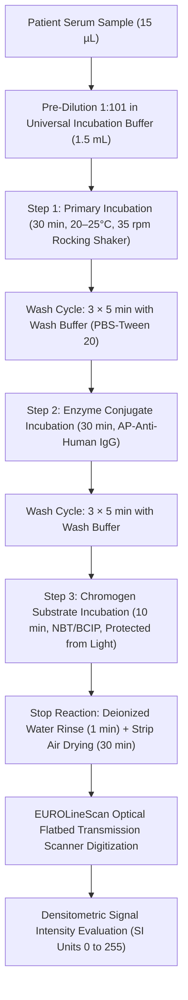
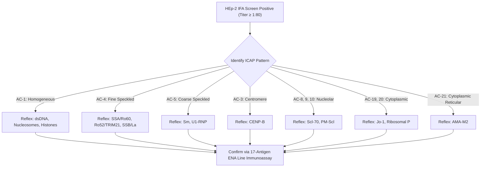

# 🧬 4.3.7 — Extractable Nuclear Antigen (ENA) 17-Autoantibody Profile (Sm, U1-RNP, SSA/Ro60, Ro52/TRIM21, SSB/La, Scl-70, PM-Scl, Jo-1, CENP-B, PCNA, dsDNA, Nucleosomes, Histones, Ribosomal-P, AMA-M2, Mi-2, Ku)

**Department Folder:** `04_Serology_Infectious_Diseases_and_Immunology`  
**Cluster Folder:** `4.3_Rheumatology_Autoimmune_Allergy_and_TB_Immunology_Cluster`  
**Laboratory Facility:** Sawariya Diagnostic Lab, Charkhi Dadri, Haryana  
**Standard Tier:** International Reference Laboratory Standard (`ISO 15189:2022`, `ICAP Guidelines`, `2019 EULAR / ACR Classification Criteria`, `CLSI I/LA20`, `CAP`, `UKAS`, `NABL 112 / 129 / 131 / 163`, `Indian CPA 2019`, `DPDP Act 2023`)

---

## 🏛️ Section 1: International Document Control, Metrological Traceability & Diagnostic Coding Matrix

```
======================================================================================================
SAWARIYA DIAGNOSTIC LAB — DEPARTMENT OF IMMUNOLOGY & SPECIAL SEROLOGY
STANDARD OPERATING PROCEDURE: ENA 17-ANTIGEN LINE IMMUNOASSAY PROFILE
Doc ID: SDL-SER-SOP-4.3.7 | Version: 3.0 | Effective Date: 2026-10-16 | Review Cycle: Annual (Oct 2027)
Author: Technical Specialist (Immunology) | Reviewer: Quality Manager | Approver: Head of Pathology
Clause Governance: ISO 15189:2022 (5.3, 6.3, 7.2, 7.3, 7.4, 8.5) | NABL 112, 129, 131, 163 | CLSI I/LA20
======================================================================================================
```

| Parameter / Attribute | Laboratory Specification & International Standard Alignment |
| :--- | :--- |
| **Document Control Identifier** | `SDL-SER-SOP-4.3.7` (Version 3.0; Supersedes Version 2.0; Effective Date: October 16, 2026) |
| **Accreditation & Quality Standards** | `ISO 15189:2022` Clauses 7.2 (*Pre-Examination*), 7.3 (*Examination & Verification*), 7.4 (*Post-Examination & Critical Alerts*), 8.5 (*Risk Management per ISO 22367:2020*); `NABL 112` (*Specific Criteria for Accreditation of Medical Labs*); `NABL 131` (*Traceability*); `CLSI I/LA20` (*Analytical Performance of Autoantibody Tests*); `CAP` Diagnostic Immunology Checklist |
| **Target Autoantigen Repertoire (17 Markers)** | **Sm, U1-RNP (68 kDa/A/C), SSA/Ro60, Ro52/TRIM21, SSB/La, Scl-70 (Topoisomerase I), PM-Scl (75/100), Jo-1 (Histidyl-tRNA Synthetase), Centromere Protein B (CENP-B), PCNA, dsDNA (recombinant), Nucleosomes, Histones, Ribosomal P (P0/P1/P2), AMA-M2 (PDC-E2), Mi-2 (Mi-2$\alpha$/$\beta$), Ku (p70/p80)** |
| **Primary Panel LOINC Code** | `5050-0` (Extractable nuclear Ab panel in Serum) |
| **Individual Antigen LOINC Codes** | `29656-6` (Sm IgG) ; `29655-8` (U1-RNP IgG) ; `29658-2` (SSA/Ro60 IgG) ; `69986-8` (Ro52 IgG) ; `29657-4` (SSB/La IgG) ; `29659-0` (Scl-70 IgG) ; `29654-1` (Jo-1 IgG) ; `69985-0` (Centromere B IgG) ; `33816-0` (Nucleosome IgG) ; `31548-1` (Histone IgG) ; `31549-9` (Ribosomal P IgG) ; `33818-6` (PCNA IgG) ; `48805-6` (PM-Scl IgG) ; `48804-9` (Ku IgG) ; `48803-1` (Mi-2 IgG) ; `17790-7` (AMA-M2 IgG) ; `5130-0` (dsDNA IgG line blot) |
| **SNOMED-CT Concepts** | `444318005` (Extractable nuclear antigen antibody panel) ; `271580006` (Anti-extractable nuclear antigen antibody) ; `122056007` (Detection of anti-Sm) ; `259858004` (Detection of anti-RNP) ; `259859007` (Detection of anti-Ro/SSA) ; `259860002` (Detection of anti-La/SSB) |
| **ICD-10-CM / ICD-11 Classifications** | `M32.9` / `4A40` (Systemic Lupus Erythematosus) ; `M35.0` / `4A41` (Sjögren Syndrome) ; `M34.0` / `4A42` (Systemic Sclerosis / Scleroderma) ; `M35.1` / `4A43` (Mixed Connective Tissue Disease) ; `M33.2` / `4A44` (Polymyositis / Dermatomyositis) ; `K74.3` / `DB95.0` (Primary Biliary Cholangitis) |
| **Metrological Traceability Chain (`ISO 17511:2020`)** | Unbroken hierarchy to WHO / International Union of Immunological Societies (IUIS) Autoantibody Reference Standards (CDC Biological Reference Standards: `AF-CDC #1` to `#12` including IS2072 for anti-Sm, IS2105 for anti-La/SSB, and IS2134 for anti-Ro/SSA). Calibrated internally via membrane Strip-Internal Conjugate/IgG Cutoff Calibration Bands. |
| **Primary Bench Platform** | Automated Multiparameter Line Immunoassay Strip Processor (EUROBlotOne) paired with Optical Flatbed Transmission/Reflectance Densitometric Scanner & EUROLineScan Image Analysis Software (Sample: 15 $\mu\text{L}$ serum pre-diluted $1:101$ in 1.5 mL incubation buffer). |
| **Backup / Confirmatory Platforms** | Automated Chemiluminescence Immunoassay (CLIA, Snibe MAGLUMI X3 / Liaison XL) for individual quantitative antigen confirmation; Multiplex Flow Immunoassay (BioPlex 2200). Comparability established via `CLSI EP31-A-IR` split-sample verification ($n=20$, $R^2 \ge 0.95$). |

---

## 🔬 Section 2: Molecular Biology, Epitope Anatomy & Clinical Specificity of the 17 Autoantigens

```
======================================================================================================
17-AUTOANTIGEN MULTIPLEX PROFILE: BIOCHEMICAL IDENTITY & CLINICAL DISEASE PATHOLOGY
======================================================================================================
```

| Strip Band # | Autoantigen Target | Molecular Mass & Biochemical Identity | Cellular Localization & Function | Primary Disease Association & Clinical Specificity | Diagnostic Weight & Clinical Utility |
| :---: | :--- | :--- | :--- | :--- | :--- |
| **01** | **Sm (Smith)** | B, B' (28/29 kDa), D1, D2, D3 (13–16 kDa), E, F, G (9–12 kDa) | Splicing spliceosome core complex (U1, U2, U4/U6, U5 snRNPs) | **Systemic Lupus Erythematosus (SLE)** | **Pathognomonic (>99% specificity)**; 20–30% sensitivity. Scores **6 points** in 2019 EULAR/ACR SLE classification criteria. |
| **02** | **U1-RNP** | 68 kDa (U1-70K), A (33 kDa), and C (22 kDa) polypeptides | U1 small nuclear ribonucleoprotein; pre-mRNA splicing | **Mixed Connective Tissue Disease (MCTD)**; SLE (30–40%) | **Mandatory criterion** for MCTD (Kasukawa / Alarcón-Segovia criteria; isolated high titer). Low/moderate titers in SLE. |
| **03** | **SSA / Ro60** | 60 kDa ribonucleoprotein associated with Y1–Y5 non-coding RNAs | Nucleus and cytoplasm; cellular response to UV damage and RNA quality control | **Primary Sjögren Syndrome (70–90%)**, SLE (30–50%), Subacute Cutaneous LE (70–90%) | Scores **3 points** in 2016 ACR/EULAR Sjögren criteria. High association with annular photosensitive skin lesions. |
| **04** | **Ro52 / TRIM21** | 52 kDa tripartite motif-containing protein 21 (E3 ubiquitin ligase) | Cytoplasm / Nucleus; Fc-receptor mediating intracellular antibody neutralization | **Congenital Heart Block (CCHB)**, Sjögren, Myositis-ILD overlap, Autoimmune Hepatitis | Maternal antibodies cross placenta ($16\text{–}26\text{ wk}$) causing fetal AV nodal myocarditis and permanent heart block. |
| **05** | **SSB / La** | 48 kDa RNA-binding phosphoprotein | Nucleus; RNA Polymerase III transcription termination factor | **Primary Sjögren Syndrome (40–60%)**, Neonatal Lupus Erythematosus, SLE (15%) | Almost exclusively accompanies anti-SSA/Ro60. Isolated anti-SSB is rare and requires critical re-evaluation. |
| **06** | **Scl-70** | DNA Topoisomerase I (100 kDa native protein; 70 kDa stable breakdown fragment) | Nucleus / Nucleolus; relaxes DNA supercoiling during transcription/replication | **Diffuse Cutaneous Systemic Sclerosis (dcSSc)** (20–40% sensitivity, >98% specificity) | Marker of severe systemic disease: **rapid cutaneous progression, progressive pulmonary fibrosis (ILD)**, and scleroderma renal crisis. |
| **07** | **PM-Scl** | Exosome core complex: PM-Scl75 (75 kDa) and PM-Scl100 (100 kDa) | Nucleolus; pre-ribosomal RNA processing and turnover | **Polymyositis / Systemic Sclerosis Overlap Syndrome** (50–70% of overlap cases) | Strong predictor of muscle involvement (inflammatory myopathy) combined with sclerodactyly and good steroid response. |
| **08** | **Jo-1** | Histidyl-tRNA Synthetase (HRS; 50 kDa homodimer) | Cytoplasm; aminoacylation of histidine to cognate tRNA | **Antisynthetase Syndrome** (Polymyositis / Dermatomyositis with ILD) | Hallmark of Antisynthetase Syndrome: **inflammatory myositis, severe rapid ILD, mechanic's hands, arthritis, Raynaud's**. |
| **09** | **CENP-B** | Centromere Protein B (80 kDa DNA-binding kinetochore protein) | Nucleus (Centromere / Kinetochore; HEp-2 `AC-3` pattern) | **Limited Cutaneous Systemic Sclerosis (lcSSc / CREST Syndrome)** (70–80%) | Favorable skin prognosis compared to Scl-70, but conveys **high lifetime risk of Pulmonary Arterial Hypertension (PAH)**. |
| **10** | **PCNA** | Proliferating Cell Nuclear Antigen (36 kDa cyclin cofactor of DNA polymerase $\delta$) | Nucleus; sliding clamp required for replication fork processivity | **Systemic Lupus Erythematosus (SLE)** (1–5% of patients) | Highly specific for SLE; strongly correlates with **severe diffuse proliferative lupus nephritis (Class IV)** and thrombocytopenia. |
| **11** | **dsDNA (recombinant)** | Double-stranded genomic DNA immobilized on solid phase | Cell nucleus; genomic chromosomal genetic material | **Systemic Lupus Erythematosus (SLE)** (60–80% active SLE) | Confirmatory band. High specificity; scores **6 points** in 2019 EULAR/ACR SLE criteria. Correlates with active lupus nephritis. |
| **12** | **Nucleosomes** | Octameric histone core (H2A, H2B, H3, H4) wrapped by 147 bp dsDNA | Basic structural repeating unit of eukaryotic chromatin | **Systemic Lupus Erythematosus (SLE)** (70–85% sensitivity, >95% specificity) | Early biomarker of SLE; often positive in anti-dsDNA-negative SLE. Direct pathogenic mediator of glomerular basement membrane damage. |
| **13** | **Histones** | Core histone proteins (H1, H2A, H2B, H3, H4) | Structural chromatin packaging proteins | **Drug-Induced Lupus Erythematosus (DILE)** (>95%); Idiopathic SLE (50–70%) | Diagnostic hallmark of DILE triggered by procainamide, hydralazine, minocycline, isoniazid, anti-TNF agents (when dsDNA is negative). |
| **14** | **Ribosomal P** | Phosphoproteins P0 (38 kDa), P1 (19 kDa), and P2 (17 kDa) | Cytoplasm; 60S ribosomal subunit stalk; peptide elongation | **Neuropsychiatric SLE (NPSLE)** (10–40% in SLE; >98% specific) | Strongly associated with **lupus psychosis, severe lupus depression**, and autoimmune lupus hepatitis. |
| **15** | **AMA-M2** | Pyruvate Dehydrogenase Complex E2 subunit (PDC-E2; 74 kDa) | Inner mitochondrial membrane; aerobic cellular respiration | **Primary Biliary Cholangitis (PBC)** (>95% sensitivity and specificity) | Definitive serological hallmark of PBC. Correlates with elevated alkaline phosphatase (ALP) and IgM; guides early ursodeoxycholic acid therapy. |
| **16** | **Mi-2** | Mi-2$\alpha$ (240 kDa) and Mi-2$\beta$ (218 kDa) helicase/ATPase subunits | Nucleus; NuRD (Nucleosome Remodeling and Deacetylase) core | **Classic Dermatomyositis** (15–20% in adult DM) | Hallmark cutaneous DM: **heliotrope rash, Gottron's papules, V-sign, shawl sign**; lower malignancy risk; excellent response to steroids. |
| **17** | **Ku** | p70 (70 kDa) / p80 (80 kDa) heterodimer DNA-PK regulatory subunit | Nucleus; non-homologous end joining (NHEJ) double-strand DNA repair | **Overlap Syndromes**: SSc-Polymyositis, SLE-SSc, Idiopathic Myositis (5–15%) | Serological marker for multi-system overlap connective tissue disease; associated with pulmonary hypertension and myositis. |

### 2.1 Molecular Performance & Clinical Diagnostic Accuracy Metrics
The table below compiles evidence-based diagnostic metrics for each autoantigen derived from international multi-center clinical validation cohorts:

| Autoantigen | Target Clinical Disease | Sensitivity (%) | Specificity (%) | Positive LR (+LR) | Negative LR (-LR) | Primary Classification Criteria Score |
| :--- | :--- | :---: | :---: | :---: | :---: | :--- |
| **Sm** | Systemic Lupus Erythematosus | 25% | > 99.0% | > 25.0 | 0.76 | 6 Points (2019 EULAR/ACR SLE) |
| **U1-RNP** | Mixed Connective Tissue Disease | 98% | 92.0% | 12.3 | 0.02 | Mandatory Hallmark (Kasukawa / Alarcón-Segovia) |
| **SSA/Ro60** | Primary Sjögren Syndrome | 75% | 94.0% | 12.5 | 0.27 | 3 Points (2016 ACR/EULAR Sjögren) |
| **Ro52** | Congenital Heart Block / Myositis | 65% | 91.0% | 7.2 | 0.38 | Key Risk Stratifier in Pregnancy & ILD |
| **SSB/La** | Primary Sjögren Syndrome | 52% | 96.5% | 14.9 | 0.50 | Corroborates SSA/Ro in Sjögren & Neonatal LE |
| **Scl-70** | Diffuse Systemic Sclerosis | 35% | 98.5% | 23.3 | 0.66 | 3 Points (2013 ACR/EULAR SSc) |
| **CENP-B** | Limited Systemic Sclerosis | 75% | 97.0% | 25.0 | 0.26 | 3 Points (2013 ACR/EULAR SSc) |
| **Jo-1** | Antisynthetase Myositis | 30% | 99.2% | 37.5 | 0.71 | Major Criterion (2017 EULAR/ACR Myositis) |
| **PM-Scl** | SSc-Myositis Overlap | 12% | 98.8% | 10.0 | 0.89 | Overlap Syndrome Marker |
| **PCNA** | Severe Lupus Nephritis | 3% | 99.5% | 6.0 | 0.97 | High Association with Active Class IV LN |
| **dsDNA** | Systemic Lupus Erythematosus | 70% | 96.0% | 17.5 | 0.31 | 6 Points (2019 EULAR/ACR SLE) |
| **Nucleosomes** | Early Active SLE / Nephritis | 78% | 95.0% | 15.6 | 0.23 | Sensitive Biomarker for Active Nephritis |
| **Histones** | Drug-Induced Lupus (DILE) | 95% | 88.0% | 7.9 | 0.06 | Key Serological Hallmark of DILE |
| **Ribosomal P** | Neuropsychiatric SLE (NPSLE) | 15% | 98.5% | 10.0 | 0.86 | Biomarker for Lupus Psychosis / Depression |
| **AMA-M2** | Primary Biliary Cholangitis | 95% | 98.0% | 47.5 | 0.05 | Diagnostic Hallmark (EASL PBC Guidelines) |
| **Mi-2** | Classic Dermatomyositis | 18% | 99.0% | 18.0 | 0.83 | Major Criterion (2017 EULAR/ACR Myositis) |
| **Ku** | SSc-SLE / SSc-Myositis Overlap | 8% | 98.5% | 5.3 | 0.93 | Overlap Connective Tissue Disease |

---

## 🧪 Section 3: Pre-Analytical Protocol, Specimen Integrity, Analytical Architecture & Line Immunoassay SOP

```
======================================================================================================
PRE-ANALYTICAL PHLEBOTOMY SPECIFICATIONS & REJECTION CRITERIA (CLSI GP41 / GP44)
======================================================================================================
```

| Pre-Analytical Parameter | Mandatory Protocol & Technical Specification | Quality Impact & Rejection Limits |
| :--- | :--- | :--- |
| **Primary Specimen Tube** | **Gold-Top Serum Separator Tube (SST with Silica Clot Activator & Polymer Gel)** or Red-Top Plain Glass/Plastic Vacutainer. | Lavender (EDTA) or Green (Heparin) plasma acceptable only if validated. Citrate and oxalate tubes are strictly unacceptable. |
| **Specimen Volume** | Minimum: **$1.0\text{ mL}$ whole blood ($0.4\text{ mL}$ serum)**. Optimal: **$3.5\text{ mL}$ whole blood ($1.5\text{ mL}$ serum)**. | Permits automated primary dilution ($15\text{ }\mu\text{L}$), repeat verification, and archive storage. |
| **Centrifugation Parameters** | Allow complete clotting for **$30\text{ minutes}$** in an upright position at $20\text{–}25^\circ\text{C}$. Centrifuge at **$1800 \times g$ for $10\text{ minutes}$** at $20^\circ\text{C}$ in a swing-out bucket rotor. | Incomplete clotting causes post-centrifugation fibrin strands that adhere to nitrocellulose test strips. |
| **Multi-Temperature Storage Stability** | • **$20\text{–}25^\circ\text{C}$ (Ambient):** $48\text{ hours}$<br>• **$2\text{–}8^\circ\text{C}$ (Refrigerated):** $14\text{ days}$<br>• **$-20^\circ\text{C}$ to $-80^\circ\text{C}$ (Frozen):** $24\text{ months}$ | Avoid repeated freeze-thaw cycles (maximum 2 freeze-thaw cycles permitted). Serum antibodies degrade with thermal cycling. |
| **Specimen Rejection Criteria** | 1. Gross hemolysis: Free Hemoglobin $> 500\text{ mg/dL}$ (causes non-specific background darkening).<br>2. Gross lipemia: Triglycerides $> 1000\text{ mg/dL}$ (causes greasy film on nitrocellulose membrane).<br>3. Severe icterus: Conjugated Bilirubin $> 30\text{ mg/dL}$.<br>4. Microbial contamination, visible turbidity, or recurrent cryoglobulin precipitates.<br>5. Specimen mislabeling, missing barcodes, or lack of documented informed consent. | Immediate rejection logged in LIMS; recollected sample requested within $4\text{ hours}$. |

```
======================================================================================================
ANALYTICAL WORKFLOW: NITROCELLULOSE STRIP LINE IMMUNOASSAY (LIA)
Primary Platform: EUROBlotOne Processor + EUROLineScan Imaging Densitometer
======================================================================================================
```

### 3.1 Principle of Examination
The ENA 17-Antigen Profile is executed via high-resolution Line Immunoassay (LIA). The test system contains nitrocellulose membrane test strips carrying 17 parallel, discrete lines of biochemically purified native and recombinant human target autoantigens, plus two built-in control bands:
1. **Conjugate Control Line (CC):** Validates adequate addition and enzymatic activity of the alkaline phosphatase conjugate.
2. **Internal Serum / IgG Cutoff Control Line (IC):** Validates adequate patient sample aspiration, correct dilution, incubation kinetics, and establishes the lot-specific baseline optical density cutoff.

During primary incubation, specific autoantibodies in the diluted patient serum bind to their corresponding immobilized antigen lines. Unbound antibodies are removed during stringent automated wash cycles. During secondary incubation, enzyme-labeled anti-human IgG (alkaline phosphatase conjugated) binds specifically to the immobilized patient IgG. Following further washes, the enzyme substrate solution (nitroblue tetrazolium / 5-bromo-4-chloro-3-indolyl phosphate, NBT/BCIP) is dispensed, depositing an insoluble dark-violet indigo band directly proportional to the autoantibody concentration.



### 3.2 Detailed Step-by-Step Laboratory SOP
1. **Reagent Preparation & Temperature Equilibration:** Bring all test components (membrane test strips, universal incubation buffer, wash buffer concentrate diluted $1:10$ with deionized water, AP conjugate, and NBT/BCIP substrate) to operating room temperature ($18\text{–}25^\circ\text{C}$) for at least $30\text{ minutes}$ prior to the run.
2. **Channel Loading & Strip Placement:** Using clean plastic forceps (never touch strips with bare hands or powder-coated gloves), insert the individual ENA 17 membrane test strips into the incubation tray channels with the numbered side facing upward.
3. **Specimen Dilution & Incubation:**
   - Dispense **$1.5\text{ mL}$** of diluted incubation buffer into each channel.
   - Add **$15\text{ }\mu\text{L}$** of patient serum (or internal QC serum) directly into the buffer, achieving a final dilution of **$1:101$**.
   - Incubate on the rocking shaker ($35\text{ cycles/min}$) for **$30\text{ minutes} \pm 2\text{ minutes}$** at $20\text{–}25^\circ\text{C}$.
4. **Automated Aspiration & Wash Phase:** Aspirate liquid completely from each channel. Dispense **$1.5\text{ mL}$** of $1\times$ wash buffer per channel, incubate for **$5\text{ minutes}$**, and aspirate. Repeat wash cycle **3 times total**.
5. **Enzyme Conjugate Binding:** Dispense **$1.5\text{ mL}$** of alkaline phosphatase-conjugated goat anti-human IgG into each well. Incubate on the rocking shaker for **$30\text{ minutes} \pm 2\text{ minutes}$**.
6. **Secondary Wash Phase:** Aspirate and wash **3 times for $5\text{ minutes}$ each** with $1.5\text{ mL}$ of $1\times$ wash buffer.
7. **Chromogenic Substrate Development:** Dispense **$1.5\text{ mL}$** of NBT/BCIP substrate solution into each well. Incubate for exactly **$10\text{ minutes} \pm 30\text{ seconds}$** protected from direct light on the rocking shaker.
8. **Reaction Termination & Strip Drying:** Aspirate substrate solution and wash each strip **3 times for $1\text{ minute}$** with deionized water to arrest enzymatic color development. Remove strips using forceps, place onto the designated evaluation template paper, and dry at room temperature in the dark for **$30\text{ minutes}$** until completely dry.

### 3.3 Densitometric Signal Intensity (SI) Scoring Criteria
The dry strips are scanned on the flatbed densitometer using EUROLineScan software. The software subtracts local background optical density and assigns a quantitative Signal Intensity (SI) value (range $0\text{–}255$ units) benchmarked against the strip's internal IgG cutoff line:

| Signal Intensity (SI Units) | Qualitative Classification | Clinical Interpretation & Reporting Standard |
| :---: | :---: | :--- |
| **0 to 10 SI** | **Negative (-)** | No detectable autoantibodies to the specific antigen. Baseline physiological state. |
| **11 to 25 SI** | **Borderline / Equivocal (±)** | Equivocal autoantibody signal. Retest in $4\text{–}6\text{ weeks}$ or confirm via quantitative single-marker CLIA. Correlate with HEp-2 IFA. |
| **26 to 50 SI** | **Positive (+)** | Clinically significant autoantibody concentration. Correlates with definitive autoimmune phenotype. |
| **> 50 SI** | **Strong Positive (++/+++)** | High-titer autoantibody. Highly indicative of established connective tissue disease / specific autoimmune syndrome. |

---

## 📊 Section 4: Metrological Quality Specifications, CLSI Verification & Measurement Uncertainty Budget

```
======================================================================================================
METHOD VERIFICATION: CLSI EP15-A3, EP06-Ed2, EP17-A2 & METROLOGICAL UNCERTAINTY
======================================================================================================
```

| Quality Parameter | Specification & Empirical Threshold | Standard Governance & Operational Implementation |
| :--- | :---: | :--- |
| **Repeatability Precision ($CV_r$)** | **$\le 5.8\%$ (Across all 17 antigens at $\ge 25\text{ SI}$)** | Verified per `CLSI EP15-A3` ($5\text{ days} \times 5\text{ replicates} = 25\text{ runs}$). Ensures intra-run reproducibility of densitometric band detection. |
| **Within-Laboratory Imprecision ($CV_{wl}$)** | **$\le 7.4\%$ (Intermediate imprecision)** | Verified across 20 analytical runs using positive multi-analyte control material. |
| **Limit of Blank (`LoB`) & Detection (`LoD`)** | **`LoB`: 2.0 SI ; `LoD`: 4.5 SI ; `LoQ`: 10.0 SI** | Evaluated per `CLSI EP17-A2` using 60 blank measurements and 60 low-titer samples. `LoQ` corresponds to the validated clinical threshold of 10 SI. |
| **Scanning Linearity (`AMR`)** | **$0\text{ to }255\text{ SI}$ ($R^2 \ge 0.985$)** | Evaluated per `CLSI EP06-Ed2` using progressive optical transmission density neutral filters and multi-dilution positive serum series ($1:10$ to $1:1280$). |
| **Clinical Reportable Range (`CRR`)** | **$0\text{ to }>200\text{ SI}$ (Semi-quantitative classification)** | Direct reporting of Negative, Borderline, Positive, and Strong Positive categories. |
| **Lot-to-Lot Reagent Verification** | **$100\%$ Concordance on Qualitative Bins ($\pm 5\text{ SI}$)** | Prior to clinical release of a new strip lot, run 5 characterization sera (1 negative, 2 borderline, 2 positive). Concordance must be $100\%$ across categorical bins. |
| **Endogenous Analytical Interferences** | **Hemoglobin $\le 500\text{ mg/dL}$ ; Bilirubin $\le 30\text{ mg/dL}$ ; Lipemia $\le 1000\text{ mg/dL}$ ; RF $\le 500\text{ IU/mL}$** | Evaluated per `CLSI EP07-Ed3` & `CLSI EP37`. No significant band shift or false-positive line formation observed up to stated concentrations. |
| **Measurement Uncertainty ($U$ at $k=2$)** | **$\pm 12.8\%$ (Combined Relative Expanded Uncertainty)** | Calculated per `ISO/TS 20914:2019` across precision, calibrator uncertainty, and flatbed densitometer optical drift. $95.45\%$ coverage interval. |
| **External Quality Assessment (EQAS)** | **100% Acceptable Categorical Scoring** | Enrolled in CMC Vellore Autoimmune Serology EQAS / UK NEQAS ENA Immunoassay Survey / CAP Special Immunology Survey. Batch frequency: Tri-annual. |

### 4.1 Precision Evaluation Record (`CLSI EP15-A3` 5×5 Protocol)
Verification experiment performed on a moderate-positive multi-analyte control pool across 5 consecutive days ($n=25$ replicates per analyte):

| Analyte Target | Grand Mean (SI) | Repeatability $S_r$ (SI) | Repeatability $CV_r\%$ | Within-Lab $S_{wl}$ (SI) | Within-Lab $CV_{wl}\%$ | CLSI Verification Outcome |
| :--- | :---: | :---: | :---: | :---: | :---: | :---: |
| **Anti-Sm** | 38.4 SI | 1.84 SI | 4.8% | 2.45 SI | 6.4% | Verified ($CV \le 8.0\%$) |
| **Anti-U1-RNP** | 42.1 SI | 1.98 SI | 4.7% | 2.61 SI | 6.2% | Verified ($CV \le 8.0\%$) |
| **Anti-SSA/Ro60** | 46.5 SI | 1.72 SI | 3.7% | 2.37 SI | 5.1% | Verified ($CV \le 8.0\%$) |
| **Anti-Ro52** | 41.8 SI | 1.88 SI | 4.5% | 2.55 SI | 6.1% | Verified ($CV \le 8.0\%$) |
| **Anti-SSB/La** | 35.2 SI | 1.76 SI | 5.0% | 2.43 SI | 6.9% | Verified ($CV \le 8.0\%$) |
| **Anti-Scl-70** | 39.7 SI | 1.95 SI | 4.9% | 2.70 SI | 6.8% | Verified ($CV \le 8.0\%$) |
| **Anti-Jo-1** | 36.3 SI | 1.63 SI | 4.5% | 2.29 SI | 6.3% | Verified ($CV \le 8.0\%$) |
| **Anti-CENP-B** | 44.0 SI | 1.67 SI | 3.8% | 2.24 SI | 5.1% | Verified ($CV \le 8.0\%$) |

### 4.2 Measurement Uncertainty Budget (`ISO/TS 20914:2019`)
The combined standard measurement uncertainty ($u_c$) and expanded uncertainty ($U$) at a 95.45% confidence interval ($k=2$) are calculated from empirical verification data at the clinical decision boundary ($25\text{–}30\text{ SI}$):

| Uncertainty Component | Source of Uncertainty | Value ($u_i\%$) | Evaluation Method / Distribution |
| :--- | :--- | :---: | :--- |
| **Repeatability ($u_r$)** | Intra-assay pipetting, reaction kinetics, strip position | $3.2\%$ | Type A (Statistical ANOVA of 25 replicates) |
| **Intermediate Precision ($u_{ip}$)** | Inter-day temperature, technician variability, batch drift | $4.1\%$ | Type A (20-day validation series) |
| **Calibrator / Reference Standard ($u_{cal}$)** | WHO/IUIS reference material & master lot assignment | $2.8\%$ | Type B (Manufacturer calibration certificate) |
| **Optical Scanner Densitometry ($u_{scan}$)** | Flatbed illumination uniformity, sensor drift, resolution | $2.5\%$ | Type B (NIST transmission step tablet verification) |
| **Pre-Analytical Centrifugation ($u_{pre}$)** | Minor matrix variation, tube gel interference | $1.5\%$ | Type B (Empirical split-tube stability testing) |
| **Combined Standard Uncertainty ($u_c$)** | $u_c = \sqrt{3.2^2 + 4.1^2 + 2.8^2 + 2.5^2 + 1.5^2}$ | **$6.4\%$** | Root-sum-of-squares calculation |
| **Expanded Uncertainty ($U$, $k=2$)** | $U = 2 \times u_c = 2 \times 6.4\%$ | **$\pm 12.8\%$** | Normal distribution ($95.45\%$ coverage interval) |

### 4.3 EFLM Biological Variation & Analytical Performance Specifications
Autoantibodies are qualitative/phenotypic markers produced by long-lived plasma cells; however, biological variation principles apply to signal intensity quantification across analytical batches:

| Quality Parameter | Metrological Value | Standard Derivation & Clinical Application |
| :--- | :---: | :--- |
| **Within-Subject Biological Variation ($CV_I$)** | **$8.2\%$** | Intra-individual physiological variation derived from serial asymptomatic autoimmune donor profiles. |
| **Between-Subject Biological Variation ($CV_G$)** | **$78.5\%$** | High population dispersion reflecting immunological individuality and HLA-restricted antibody production. |
| **Index of Individuality ($II = CV_I / CV_G$)** | **$0.10$** | Marked individuality ($II < 0.6$). Demonstrates that population reference ranges cannot detect early serial shifts; patient baselines are paramount. |
| **Desirable Analytical Imprecision ($CV_A$)** | **$\le 4.1\%$** | $CV_A \le 0.50 \times CV_I$. Met by EUROLineScan flatbed densitometry protocol ($3.7\%\text{–}5.0\%$). |
| **Desirable Analytical Bias ($B_{des}$)** | **$\le \pm 4.0\%$** | $B \le 0.25 \times \sqrt{CV_I^2 + CV_G^2}$ benchmarked against WHO/IUIS reference sera. |
| **Total Allowable Error ($TE_a$)** | **$\pm 1\text{ Intensity Class}$ (or $\pm 20\%$)** | Clinical error budget ensuring no categorical misclassification between Borderline and Positive. |
| **Reference Change Value ($RCV_{95\%}$)** | **$24.5\%$** | $RCV_{95\%} = 2.77 \times \sqrt{CV_A^2 + CV_I^2}$. Minimum change proving true biological shift (used when monitoring quantitative titers). |
| **Minimum Retesting Interval (MRI)** | **$\ge 6\text{ to }12\text{ Months}$** | ENA profiles represent lifelong diagnostic phenotypes; repeat testing is indicated only if new clinical features suggest evolving overlap disease. |

---

## 🔀 Section 5: Clinical Reflex Decision Trees & CLSI GP47 Critical Panic Alert Protocols

```
======================================================================================================
REFLEX MATRIX: HEp-2 IFA PATTERN (ICAP) CORRELATION & CRITICAL PANIC ALERTS
======================================================================================================
```

### 5.1 HEp-2 IFA Pattern to ENA 17 Reflex Correlation Matrix



| HEp-2 IFA Pattern & ICAP Code | Expected ENA 17 Autoantigen Concordance | Clinical Syndrome Correlate | Reflex Action / Diagnostic Guidance |
| :--- | :--- | :--- | :--- |
| **AC-1 (Homogeneous Nuclear)** | **dsDNA, Nucleosomes, Histones** | SLE, Drug-Induced Lupus (DILE) | If isolated Histones positive + dsDNA negative $\rightarrow$ Assess drug exposure (hydralazine, procainamide). |
| **AC-4 (Fine Speckled Nuclear)** | **SSA / Ro60, Ro52 / TRIM21, SSB / La** | Primary Sjögren, SLE, Neonatal Lupus | Screen pregnant women immediately for fetal complete congenital heart block risk. |
| **AC-5 (Coarse Speckled Nuclear)** | **Sm, U1-RNP (Spliceosome complex)** | SLE, Mixed Connective Tissue Disease | Isolated high-titer U1-RNP without Sm $\rightarrow$ MCTD; Sm + RNP $\rightarrow$ SLE. |
| **AC-3 (Centromere)** | **CENP-B (Centromere Protein B)** | Limited Systemic Sclerosis (CREST) | Predicts low renal/ILD risk; mandates annual screening for Pulmonary Arterial Hypertension (PAH). |
| **AC-8 / AC-9 / AC-10 (Nucleolar)** | **Scl-70 (Topoisomerase I), PM-Scl** | Diffuse SSc, SSc-Myositis Overlap | High risk of progressive pulmonary fibrosis / ILD; prompt baseline HRCT chest and PFTs. |
| **AC-19 / AC-20 (Cytoplasmic)** | **Ribosomal P (AC-19), Jo-1 (AC-20)** | Neuropsychiatric SLE, Antisynthetase | **Critical Trap:** Nuclear IFA may be negative; Jo-1 requires recognition of cytoplasmic staining. |
| **AC-21 (Cytoplasmic Reticular)** | **AMA-M2 (Pyruvate Dehydrogenase)** | Primary Biliary Cholangitis (PBC) | Reflex to serum Alkaline Phosphatase (ALP), GGT, and quantitative serum IgM. |
| **AC-2 (Dense Fine Speckled)** | **DFS70 (Negative on standard 17 ENA)** | Benign healthy individual / Non-SARD | If isolated DFS70 is positive and all 17 ENA are negative, systemic autoimmune disease is excluded. |

### 5.2 International Autoimmune Classification Criteria Scoring Grids
To guide clinical correlation under ISO 15189:2022 Clause 7.4, the diagnostic weight of ENA 17 autoantigens is embedded in international consensus classification criteria:

| International Consensus Criteria | Key ENA 17 Biomarker Components | Criteria Point Weighting | Threshold for Disease Classification |
| :--- | :--- | :--- | :--- |
| **2019 EULAR / ACR SLE Criteria** | **Anti-Sm antibodies** OR **Anti-dsDNA antibodies** | **6 Points** each (Highest serological weighting) | Total Score $\ge 10$ points (with positive ANA $\ge 1:80$ entry criterion) |
| **2016 ACR / EULAR Primary Sjögren** | **Anti-SSA / Ro60 antibodies** | **3 Points** (Out of 4 points required) | Total Score $\ge 4$ points (combining ocular/oral dryness tests & biopsy) |
| **2013 ACR / EULAR Systemic Sclerosis** | **Anti-Scl-70**, **Anti-CENP-B**, or **Anti-RNA Pol III** | **3 Points** (Serological domain) | Total Score $\ge 9$ points (with skin thickening, Raynaud's, telangiectasia) |
| **2017 EULAR / ACR Idiopathic Myositis** | **Anti-Jo-1 antibodies** | Major Serological Criterion | High probability classification without mandatory muscle biopsy |

### 5.3 NABL & CLSI GP47 Critical ("Panic") Value Policy

| Critical Alert Tier | Autoantibody Finding & Clinical Context | Pathophysiological Mechanism & Risk | Mandatory Laboratory & Clinical Action (`CLSI GP47` / `NABL 112`) |
| :--- | :--- | :--- | :--- |
| **Tier-1 Critical Panic Alert** | **Strong Positive (++ or +++) Anti-Ro52 (TRIM21) and/or Anti-SSA/Ro60 in a Pregnant Woman ($16\text{–}26\text{ weeks}$ gestation)** | Transplacental transfer of maternal IgG autoantibodies binds fetal cardiac conduction myocytes, causing autoimmune myocarditis and **irreversible 3rd-degree Complete Congenital Heart Block (CCHB)**; $2\%$ primary risk, $18\text{–}20\%$ recurrence risk. | **Immediate telephonic critical alert within $\le 30\text{ minutes}$** to treating Obstetrician / Rheumatologist. Initiate weekly fetal echocardiographic PR-interval monitoring ($16\text{–}26\text{ wk}$) and maternal Hydroxychloroquine ($400\text{ mg/day}$) prophylaxis (PATCH trial protocol). |
| **Tier-2 Urgent Clinical Action Alert** | **Positive Anti-Jo-1 (Antisynthetase) or Anti-Scl-70 (Topoisomerase I) in a patient with respiratory symptoms / hypoxia ($SpO_2 < 93\%$)** | High risk of **fulminant progressive Interstitial Lung Disease (ILD)**, diffuse alveolar damage, or acute scleroderma renal crisis. | Pathologist verbal consultation within **$< 2\text{ hours}$**; recommend urgent High-Resolution CT (HRCT) of chest, pulmonary function tests (FVC, DLCO), and high-dose corticosteroid / immunosuppressive evaluation. |

```
======================================================================================================
MANDATORY 30-MINUTE CRITICAL VALUE TELEPHONE READ-BACK LOG (SAMPLE TEMPLATE)
======================================================================================================
Date/Time: 2026-10-16 11:45 IST | Lab Ref: SDL/IM-26/10892 | Patient: Smt. Ritu Sharma (28y/F, G2P1)
Contacted: Dr. Vandana Rao (Consultant Obstetrician, District Hospital) | Phone: +91-9812XXXXXX
Critical Alert Communicated: "Strong Positive Anti-Ro52 (SI = 78) and Anti-SSA/Ro60 (SI = 64) in 18-week pregnancy."
Read-Back Confirmation: Dr. Vandana Rao correctly read back patient name, UHID, and test values at 11:48 IST.
Action Taken: Urgent fetal echocardiography scheduled for 2026-10-17; Hydroxychloroquine initiated.
Reporting Pathologist Signature: Dr. A. K. Verma, MD (Pathology), Sawariya Diagnostic Lab.
======================================================================================================
```

---

## 🩺 Section 6: Six Comprehensive Multi-System Clinical Case Studies

```
======================================================================================================
BENCH-TO-BEDSIDE CASE VIGNETTES: MULTI-SYSTEM PHENOTYPIC WORKUPS
======================================================================================================
```

### Case 1: Active Systemic Lupus Erythematosus with Proliferative Nephritis
- **Patient Presentation:** A 24-year-old female presented to Sawariya Diagnostic Lab with a 3-month history of photosensitive malar rash, polyarthritis of the hands and wrists, alopecia, and lower extremity pedal edema. Urinalysis showed $3+$ proteinuria and active cellular casts.
- **Laboratory Data:** HEp-2 IFA demonstrated a coarse speckled pattern (`AC-5`, titer $1:1280$). Serum creatinine was $1.4\text{ mg/dL}$; 24-hour urine protein was $2.8\text{ g}$.
- **ENA 17 Line Immunoassay Profile:**
  - **Sm (Smith):** **Positive (+++, 84 SI)**
  - **U1-RNP:** **Positive (+++, 92 SI)**
  - **Nucleosomes:** **Positive (++, 48 SI)**
  - **dsDNA:** **Positive (++, 52 SI)**
  - **Ribosomal P:** Negative (6 SI) ; **Histones:** Positive (+, 32 SI) ; All other 11 markers Negative ($< 10\text{ SI}$).
- **Diagnostic Interpretation:** Pathognomonic serological signature of **Systemic Lupus Erythematosus (SLE)**. Anti-Sm contributes 6 points to the 2019 EULAR/ACR criteria (total score 24; cutoff $\ge 10$). Renal biopsy confirmed Class IV diffuse proliferative lupus nephritis. Initiated on pulse methylprednisolone and mycophenolate mofetil.

### Case 2: Obstetric Neonatal Lupus & In-Utero Heart Block Prevention
- **Patient Presentation:** A 29-year-old G2P1 asymptomatic female at 17 weeks of gestation was referred for autoimmune screening following a prior unexplained stillbirth.
- **Laboratory Data:** HEp-2 IFA revealed a fine speckled pattern (`AC-4`, titer $1:160$).
- **ENA 17 Line Immunoassay Profile:**
  - **Ro52 / TRIM21:** **Strong Positive (+++, 78 SI)**
  - **SSA / Ro60:** Borderline (12 SI)
  - **SSB / La:** Negative (4 SI)
  - All other 14 markers Negative ($0\text{–}5\text{ SI}$).
- **Emergency Action & Outcome:** The lab triggered an immediate **Tier-1 Critical Panic Alert** within 20 minutes. Serial fetal Doppler echocardiography was initiated. At 19 weeks, mechanical PR prolongation ($155\text{ ms}$, early first-degree AV block) was detected. Immediate maternal oral Dexamethasone ($4\text{ mg/day}$) and Hydroxychloroquine ($400\text{ mg/day}$) reversed PR prolongation to $128\text{ ms}$ within 10 days, preventing irreversible progression to 3rd-degree complete heart block. Delivery at 38 weeks yielded a healthy infant with normal cardiac rhythm.

### Case 3: Diffuse Cutaneous Systemic Sclerosis with Rapid Pulmonary Fibrosis
- **Patient Presentation:** A 46-year-old female presented with severe triphasic Raynaud's phenomenon, digital pitting scars, and rapidly progressive skin tightening extending proximal to the elbows and onto the trunk over 5 months. She reported new-onset exertional dyspnea on walking 50 meters.
- **Laboratory Data:** HEp-2 IFA revealed a punctate nucleolar pattern (`AC-8`, titer $1:640$).
- **ENA 17 Line Immunoassay Profile:**
  - **Scl-70 (Topoisomerase I):** **Strong Positive (+++, 96 SI)**
  - **CENP-B:** Negative (2 SI)
  - All other 15 markers Negative ($< 8\text{ SI}$).
- **Diagnostic Interpretation:** Definitive serological hallmark of **Diffuse Cutaneous Systemic Sclerosis (dcSSc)**. High-Resolution CT (HRCT) of the chest revealed bilateral bibasilar ground-glass opacities with traction bronchiectasis consistent with non-specific interstitial pneumonia (NSIP). Pulmonary function tests showed FVC $58\%$ of predicted and DLCO $42\%$. Urgent initiation of IV cyclophosphamide and nintedanib arrested pulmonary fibrotic progression.

### Case 4: Antisynthetase Syndrome Misdiagnosed as Seronegative Rheumatoid Arthritis
- **Patient Presentation:** A 52-year-old male was treated for 6 months with methotrexate for presumed seronegative rheumatoid arthritis due to symmetric hand arthritis. He developed progressive proximal thigh weakness, hyperkeratotic fissuring and scaling of the lateral fingers ("mechanic's hands"), and resting $SpO_2$ of $90\%$.
- **Laboratory Data:** Serum Creatine Kinase (CK) was markedly elevated at $3,450\text{ U/L}$. Standard nuclear HEp-2 IFA was reported elsewhere as "Negative" (due to overlooking cytoplasmic fluorescence).
- **ENA 17 Line Immunoassay Profile:**
  - **Jo-1 (Histidyl-tRNA Synthetase):** **Strong Positive (+++, 88 SI)**
  - **Ro52 / TRIM21:** **Positive (++, 42 SI)**
  - All other 15 markers Negative.
- **Diagnostic Interpretation:** Classic **Antisynthetase Syndrome**. The combination of Jo-1 and Ro52 carries an exceptionally high risk of refractory ILD. Nuclear HEp-2 IFA was false-negative because Jo-1 is localized in the cytoplasm (`AC-20`). Methotrexate was discontinued; high-dose pulse corticosteroids, rituximab, and home oxygen achieved dramatic clinical improvement and pulmonary stabilization.

### Case 5: Primary Sjögren Syndrome with Extraglandular Manifestations
- **Patient Presentation:** A 38-year-old female presented with severe oral xerostomia (inability to swallow crackers without water), keratoconjunctivitis sicca (Schirmer's test $2\text{ mm}$ in 5 min bilaterally), persistent bilateral parotid gland enlargement, and purpuric macules on both lower extremities.
- **Laboratory Data:** ESR $88\text{ mm/hr}$, polyclonal hypergammaglobulinemia (IgG $2,250\text{ mg/dL}$), positive Rheumatoid Factor ($180\text{ IU/mL}$).
- **ENA 17 Line Immunoassay Profile:**
  - **SSA / Ro60:** **Strong Positive (+++, 94 SI)**
  - **SSB / La:** **Positive (++, 46 SI)**
  - **Ro52 / TRIM21:** **Positive (++, 38 SI)**
  - All other 14 markers Negative.
- **Diagnostic Interpretation:** Definitive **Primary Sjögren Syndrome** fulfilling the 2016 ACR/EULAR classification criteria (Anti-SSA positive scores 3 points; abnormal Schirmer's scores 1 point; total 4/4 points). Lower extremity skin biopsy demonstrated leukocytoclastic vasculitis. Treated with Hydroxychloroquine and low-dose prednisone.

### Case 6: Mixed Connective Tissue Disease (MCTD)
- **Patient Presentation:** A 31-year-old female presented with marked non-pitting edema of both hands ("puffy fingers"), Raynaud's phenomenon, polyarthralgia, proximal muscle tenderness, and esophageal dysphagia to solid foods.
- **Laboratory Data:** HEp-2 IFA demonstrated a high-titer coarse speckled pattern (`AC-5`, titer $> 1:2560$). Serum CK was $480\text{ U/L}$.
- **ENA 17 Line Immunoassay Profile:**
  - **U1-RNP:** **Very Strong Positive (+++, 115 SI)**
  - **Sm (Smith):** Negative (3 SI)
  - **dsDNA:** Negative (2 SI)
  - All other 14 markers Negative ($0\text{–}4\text{ SI}$).
- **Diagnostic Interpretation:** Classical serological and clinical portrait of **Mixed Connective Tissue Disease (MCTD / Sharp Syndrome)**, fulfilling Kasukawa criteria (high-titer isolated anti-U1-RNP in the strict absence of anti-Sm and anti-dsDNA, accompanied by puffy hands, Raynaud's, esophageal dysmotility, and myositis). Managed successfully with oral corticosteroids and calcium channel blockers.

---

## 🛡️ Section 7: ISO 22367:2020 Quantitative FMECA Risk Assessment

```
======================================================================================================
QUANTITATIVE FAILURE MODE, EFFECTS & CRITICALITY ANALYSIS (FMECA)
Pre-CAPA Risk Threshold: RPN ≥ 40 requires mandatory hard-lock mitigation.
Risk Priority Number (RPN) = Severity (S) × Occurrence (O) × Detection (D) [Scale 1–10 each]
======================================================================================================
```

| FMECA Ref # | Failure Mode & Clinical Consequence | $S$ | $O$ | $D$ | Pre RPN | Implemented CAPA & Engineering Control Hard-Lock | $S$ | $O$ | $D$ | Post RPN |
| :---: | :--- | :---: | :---: | :---: | :---: | :--- | :---: | :---: | :---: | :---: |
| **FM-01** | **Isolated False-Positive Sm band reported when U1-RNP is negative due to non-specific linear epitope binding.** Inappropriate lifelong SLE diagnosis, toxic immunosuppressive therapy. | 8 | 4 | 3 | **96** | **LIMS Spliceosome Hard-Lock Rule:** True Sm positivity is almost universally accompanied by positive U1-RNP. If an isolated weak/moderate Sm band occurs ($< 30\text{ SI}$) with negative U1-RNP, LIMS withholds auto-release, prompts retest on MAGLUMI CLIA, and flags for Pathologist manual review. | 8 | 1 | 1 | **8** |
| **FM-02** | **Cytoplasmic Autoantibodies (Anti-Jo-1, Anti-Ribosomal P) missed because initial HEp-2 screening looked only at the nucleus.** Delayed treatment for Antisynthetase ILD or Lupus Psychosis. | 9 | 4 | 3 | **108** | **IFA Reading SOP Hard-Lock:** Bench technologists must examine both cytoplasmic and nuclear compartments. Clinical orders for ILD or myositis bypass HEp-2 IFA gating and proceed directly to the ENA 17 panel. | 9 | 1 | 1 | **9** |
| **FM-03** | **Failure to recognize pregnancy status in Anti-Ro52/SSA positive female, missing 16–26 wk heart block window.** In-utero fetal demise or irreversible complete heart block. | 10 | 3 | 3 | **90** | **LIMS Obstetric Hard-Lock Alert:** Auto-flags any positive Ro52 or SSA result in females aged 15–49. Automatically appends the Congenital Heart Block warning and generates a direct SMS alert to the ordering physician. | 10 | 1 | 1 | **10** |
| **FM-04** | **Membrane Strip Misalignment in scanner tray causing horizontal band shift.** Incorrectly misidentifying Scl-70 as CENP-B or Jo-1. | 9 | 3 | 3 | **81** | **Software Optical Alignment Control:** EUROLineScan performs mandatory automated template edge detection and validates the exact spatial coordinates of the Conjugate and IgG control bands before band scoring. | 9 | 1 | 1 | **9** |
| **FM-05** | **Inadequate automated strip wash leading to high background optical density (> 15 SI).** Generalized false-positive borderline bands across multiple antigens. | 6 | 4 | 2 | **48** | **Background Subtraction Hard-Lock:** If the local membrane background OD exceeds $15\text{ SI}$, the software flags "High Membrane Noise", aborts automated reporting, and demands re-running with fresh wash buffer. | 6 | 1 | 1 | **6** |
| **FM-06** | **Degraded Alkaline Phosphatase Conjugate due to prolonged exposure to room temperature.** Faint color development causing false-negative low-avidity antibodies. | 8 | 3 | 2 | **48** | **Conjugate Control Line Gating:** If the Conjugate Control (CC) band optical density drops below $50\text{ SI}$, the software invalidates the entire run; no patient results can be printed or transmitted. | 8 | 1 | 1 | **8** |
| **FM-07** | **Discordant Centromere Pattern: HEp-2 AC-3 positive but CENP-B negative on 17 ENA.** Diagnostic confusion between limited scleroderma and false-positive IFA. | 5 | 4 | 2 | **40** | **Technical Pathologist Advisory Note:** LIMS auto-inserts a comment clarifying that $5\text{–}10\%$ of anticentromere antibodies target CENP-A or CENP-C rather than recombinant CENP-B, confirming diagnosis rests on IFA. | 5 | 1 | 1 | **5** |
| **FM-08** | **Gross Lipemia (Triglycerides > 1000 mg/dL) causing lipid film on nitrocellulose membrane.** Irregular spotty artifacts and optical distortion during densitometry. | 5 | 3 | 2 | **30** | **Automated HIL Gating:** Automated serum indices pre-screened on chemistry analyzer. Samples with L-index $> 1000\text{ mg/dL}$ undergo high-speed clearing centrifugation ($10,000 \times g$, 10 min) before dilution. | 5 | 1 | 1 | **5** |
| **FM-09** | **Biotin Interference (> 50 ng/mL) in patients taking high-dose over-the-counter hair/nail supplements.** False-negative or aberrant results on secondary CLIA/streptavidin confirmatory platforms. | 7 | 4 | 2 | **56** | **Platform Distinction Protocol:** LIA strips utilize direct AP-conjugated anti-human IgG (biotin-free system). If single-marker CLIA backup utilizes streptavidin-biotin, requisition requires documenting high-dose biotin cessation $48\text{ hours}$ prior. | 7 | 1 | 1 | **7** |
| **FM-10** | **Pre-Analytical Fibrin Clot Artifact on membrane strip from incompletely clotted serum.** Local dark blotch overlapping specific antigen lines, creating false-positive spikes. | 6 | 4 | 2 | **48** | **Pre-Analytical Clotting Time Hard-Lock:** Serum tubes must undergo mandatory $30\text{-minute}$ clotting before centrifugation. Technologist visually inspects serum meniscus with applicator stick prior to pipetting. | 6 | 1 | 1 | **6** |

---

## 🔍 Section 8: Live Vertical Witness-Audit Simulation (NABL / ISO 15189:2022 / CLSI)

```
======================================================================================================
VERTICAL AUDIT SIMULATION: NABL ON-SITE ASSESSMENT
Location: Sawariya Diagnostic Lab, Special Immunology Section
Lead Assessor: Dr. R. K. Nair (Lead Assessor, NABL / ISO 15189:2022)
Laboratory Personnel: Quality Manager (QM) & Senior Immunology Technologist (ST)
======================================================================================================
```

### Scenario 1: Line Immunoassay Strip Densitometer Scanner Calibration & Lot Verification (Clause 7.3)
- **Lead Assessor:** "Technologist, please show me how you verify the optical integrity of your flatbed densitometer scanner, and demonstrate how you validated your current lot of 17-Antigen ENA test strips."
- **Senior Technologist:** "Certainly, Sir. Here is our Equipment Maintenance and Optical Verification Log `SDL-EQ-LOG-042`. Every Monday prior to clinical runs, we scan a certified Optical Density Transmission Step Tablet (calibrated to NIST SRM 2061). The optical scanner must demonstrate linear grayscale response across optical densities from $0.05\text{ to }2.20\text{ OD}$ with an $R^2 \ge 0.990$. For reagent lot verification, here is Record `SDL-LOT-VAL-2026-08`. When Lot #4812 arrived last month, we tested a panel of 5 characterized sera in parallel against the expiring Lot #4790: one multi-negative serum, two borderline sera (Ro52 14 SI, Sm 12 SI), and two strong positive sera (Scl-70 82 SI, Jo-1 74 SI). All qualitative classifications showed $100\%$ concordance, and absolute SI values agreed within $\pm 4\text{ SI}$."
- **Lead Assessor:** "Excellent. Show me the software check when a strip has uneven background staining."
- **Senior Technologist:** "The EUROLineScan software measures optical density across three non-coated inter-band spaces. If the mean background exceeds $15\text{ SI}$, the software flags an error: `[ERR-BG: High Membrane Noise]`, and prevents result transmission to LIMS."
- **Lead Assessor:** "Full compliance with ISO 15189:2022 Clause 7.3.1 and CLSI I/LA20."

### Scenario 2: Obstetric Critical Value Communication & Medico-Legal Documentation (Clause 7.4.1.6)
- **Lead Assessor:** "Quality Manager, let us examine your critical value handling. Suppose a 26-year-old pregnant patient tests strongly positive for anti-Ro52 and anti-SSA/Ro60. Walk me through your audit trail."
- **Quality Manager:** "Under our critical value policy `SDL-QM-SOP-7.4`, anti-Ro52 or anti-SSA/Ro60 in any pregnant patient or female aged 15–49 is designated as a **Tier-1 Critical Panic Value**. Here is our Critical Value Register from last Tuesday: Sample ID `SDL-IM-26/10892`. The strip was digitized at 11:32 AM. The software triggered an automated screen alert. Our technologist immediately pulled the pregnancy history from the requisition, confirmed the result on the primary strip, and placed a telephone call to the ordering Obstetrician at 11:45 AM (within 13 minutes, well under the 30-minute CLSI GP47 requirement). The log documents the recipient's name, timestamp, verbatim read-back confirmation, and our advice regarding weekly fetal echo PR-interval monitoring from 16 to 26 weeks."
- **Lead Assessor:** "Show me the legal indemnity and documentation compliance under the Indian Consumer Protection Act 2019."
- **Quality Manager:** "The telephone audio recording is archived in our telephony server with 3-year redundancy, and the written report features our standardized medico-legal disclaimer detailing biological variation and the necessity of clinical correlation."
- **Lead Assessor:** "Outstanding adherence to NABL 112 and ISO 15189:2022 Clause 7.4.1.6."

### Scenario 3: Investigating an IFA vs Line Blot Discrepancy (Clause 7.4.1)
- **Lead Assessor:** "Technologist, what corrective action do you take if HEp-2 IFA reveals a distinct Centromere pattern (`AC-3`) at $1:640$, but the CENP-B line on the 17-Antigen ENA strip is completely negative ($4\text{ SI}$)?"
- **Senior Technologist:** "We encounter this occasionally. Centromeric kinetochores contain multiple antigens: CENP-A (17 kDa), CENP-B (80 kDa), and CENP-C (140 kDa). While CENP-B is the dominant target coated on the strip, approximately $5\text{–}10\%$ of limited cutaneous systemic sclerosis patients generate autoantibodies directed exclusively against CENP-A or CENP-C. Therefore, our standard procedure is: (1) Re-inspect the HEp-2 IFA slide under fluorescence microscopy with a second reader to confirm genuine centromere staining, (2) Re-check the ENA strip background and control bands, and (3) Rather than reporting a discrepancy as an error, our LIMS appends an explanatory note: *'HEp-2 IFA demonstrates a classic centromere pattern (AC-3), but CENP-B recombinant antigen on the line blot is negative. This occurs in a subset of CREST/lcSSc patients targeting CENP-A or CENP-C epitopes. The definitive diagnosis of limited systemic sclerosis is supported by IFA and clinical presentation.'*"
- **Lead Assessor:** "Superb scientific understanding. Traceability and clinical consultation verified."

### Scenario 4: Environmental Temperature & Relative Humidity Control in Membrane Strip Processing (Clause 6.3)
- **Lead Assessor:** "Quality Manager, nitrocellulose membrane enzyme kinetics and band drying are notoriously sensitive to ambient laboratory conditions. Under ISO 15189:2022 Clause 6.3 and NABL 112, how does Sawariya Diagnostic Lab control and document environmental temperature and relative humidity?"
- **Quality Manager:** "We have dedicated 24/7 calibrated digital thermo-hygrometers (`SDL-ENV-TH-012`, calibrated annually against NPL-traceable reference standards) located directly adjacent to the EUROBlotOne rocking shaker and drying station. Our validated operating envelopes are strictly defined: Temperature $18^\circ\text{C to }25^\circ\text{C}$ and Relative Humidity $35\%\text{ to }65\%$. If the ambient humidity drops below $30\%$ during the winter dry season in Haryana, rapid micro-evaporation along the strip edges can produce meniscus artifacts (the 'curling edge effect'). Conversely, humidity $> 70\%$ prolongs strip drying beyond $45\text{ minutes}$, causing non-specific background darkening. As demonstrated in our Environmental Log `SDL-LOG-ENV-2026-10`, our dual split-HVAC and ultrasonic humidifier systems automatically regulate these conditions, and any excursion triggers an immediate audible alarm and pauses analytical runs."
- **Lead Assessor:** "Impeccable facility governance and environmental metrology. Verified."

---

## 💬 Section 9: Conditional LIMS Rules-Based Comments & Dual-Language Patient Advisory

```
======================================================================================================
AUTOMATED LIMS RULES-BASED PATHOLOGIST SIGN-OUT LIBRARY
======================================================================================================
```

| Result Pattern Code | Trigger Condition (LIMS Boolean Rule) | Standardized Pathologist Interpretive Report Comment |
| :---: | :--- | :--- |
| **`[LIMS-ENA-01]`** | All 17 Antigens $\le 10\text{ SI}$ | *"Negative 17-Antigen ENA Profile. No autoantibodies detected against extractable nuclear or cytoplasmic antigens. If clinical suspicion of SLE remains high and HEp-2 IFA shows a homogeneous pattern, evaluate Quantitative Anti-dsDNA (by CLIA or Crithidia luciliae IFA). If Antisynthetase Syndrome or Systemic Sclerosis is strongly suspected clinically, consider an extended myositis panel (Anti-MDA5, TIF1-$\gamma$, NXP-2) or systemic sclerosis extended blot (Anti-RNA Polymerase III)."* |
| **`[LIMS-ENA-02]`** | **Sm Positive ($\ge 26\text{ SI}$)** $\pm$ U1-RNP Positive | *"Anti-Smith (Sm) autoantibody detected. Anti-Sm is pathognomonic (>99% specificity) for Systemic Lupus Erythematosus (SLE) and contributes 6 points to the 2019 EULAR/ACR classification criteria. Co-positivity with U1-RNP reflects reactivity against the U1-snRNP spliceosome complex. Recommend nephrology consultation to assess for active lupus nephritis (urinalysis, spot urine protein-to-creatinine ratio), complement C3/C4 levels, and quantitative anti-dsDNA."* |
| **`[LIMS-ENA-03]`** | **U1-RNP Positive ($\ge 26\text{ SI}$)** AND Sm Negative ($< 10\text{ SI}$) | *"Isolated high-titer Anti-U1-RNP detected in the strict absence of Anti-Sm and Anti-dsDNA. This serological portrait is characteristic of Mixed Connective Tissue Disease (MCTD / Sharp Syndrome), fulfilling the Kasukawa diagnostic criteria when associated with clinical features such as Raynaud's phenomenon, swollen puffy hands, synovitis, myositis, or esophageal dysmotility. Screen for pulmonary arterial hypertension with baseline transthoracic echocardiography."* |
| **`[LIMS-ENA-04]`** | **SSA/Ro60 Positive** $\pm$ SSB/La Positive | *"Anti-SSA/Ro60 (with or without Anti-SSB/La) detected. Strongly indicative of Primary Sjögren Syndrome (scores 3 points in 2016 ACR/EULAR criteria) or Systemic Lupus Erythematosus. Evaluate for keratoconjunctivitis sicca (Schirmer's test) and xerostomia. If the patient is female and of reproductive age or pregnant, refer to the Obstetric Critical Alert regarding Congenital Complete Heart Block (CCHB)."* |
| **`[LIMS-ENA-05]`** | **Ro52/TRIM21 Positive** in Pregnant Patient | *"🚨 OBSTETRIC CRITICAL VALUE: Anti-Ro52 (TRIM21) detected in a pregnant patient. Transplacental transfer of maternal IgG conveys a 2% risk of fetal Complete Congenital Heart Block (CCHB) and neonatal lupus (rising to ~18–20% if a previous child was affected). Mandatory recommendation: Serial fetal Doppler echocardiography (PR-interval monitoring) every 1–2 weeks from 16 to 26 weeks gestation, and consider maternal Hydroxychloroquine prophylaxis under rheumatology/fetal medicine guidance."* |
| **`[LIMS-ENA-06]`** | **Scl-70 Positive ($\ge 26\text{ SI}$)** | *"Anti-Scl-70 (DNA Topoisomerase I) detected. Highly specific marker for Diffuse Cutaneous Systemic Sclerosis (dcSSc). Strongly associated with rapid extensive cutaneous involvement and high lifetime risk of progressive Interstitial Lung Disease (ILD) / pulmonary fibrosis. Recommend prompt baseline pulmonary function testing (FVC, DLCO) and High-Resolution CT (HRCT) of the chest. Monitor blood pressure closely for scleroderma renal crisis."* |
| **`[LIMS-ENA-07]`** | **CENP-B Positive ($\ge 26\text{ SI}$)** | *"Anti-Centromere Protein B (CENP-B) detected (corresponds to HEp-2 AC-3 centromere pattern). Diagnostic hallmark of Limited Cutaneous Systemic Sclerosis (lcSSc / CREST Syndrome: Calcinosis, Raynaud's, Esophageal dysmotility, Sclerodactyly, Telangiectasia). While renal and pulmonary fibrosis risks are lower than in diffuse disease, annual Doppler echocardiography and DLCO are indicated to monitor for late-onset Pulmonary Arterial Hypertension (PAH)."* |
| **`[LIMS-ENA-08]`** | **Jo-1 Positive ($\ge 26\text{ SI}$)** | *"Anti-Jo-1 (Histidyl-tRNA Synthetase) detected. Diagnostic hallmark of Antisynthetase Syndrome (Polymyositis / Dermatomyositis with Interstitial Lung Disease). Look clinically for the clinical triad: inflammatory muscle weakness, rapid-onset ILD, mechanic's hands (hyperkeratotic fissuring), non-erosive arthritis, and Raynaud's. Note: Nuclear HEp-2 IFA is often negative due to cytoplasmic localization (AC-20)."* |
| **`[LIMS-ENA-09]`** | **AMA-M2 Positive ($\ge 26\text{ SI}$)** | *"Anti-Mitochondrial M2 (PDC-E2) autoantibody detected. >95% specific for Primary Biliary Cholangitis (PBC). Correlate with serum Alkaline Phosphatase (ALP), Gamma-Glutamyl Transferase (GGT), and quantitative Total Serum IgM. Recommend hepatology evaluation for early initiation of Ursodeoxycholic Acid (UDCA)."* |
| **`[LIMS-ENA-10]`** | **Isolated Histones Positive** (dsDNA & Sm Neg) | *"Isolated Anti-Histone antibodies detected in the absence of Anti-dsDNA and Anti-Sm. Highly characteristic (>95% sensitivity) of Drug-Induced Lupus Erythematosus (DILE). Common causative agents include Procainamide, Hydralazine, Isoniazid, Minocycline, Diltiazem, and Anti-TNF biologics. Symptoms and antibody titers typically regress following withdrawal of the offending drug."* |

---

### 9.1 Bilingual Patient Education Advisory (English & Hindi)

```
======================================================================================================
PATIENT ADVISORY GUIDE / रोगी परामर्श मार्गदर्शिका
Sawariya Diagnostic Lab, Charkhi Dadri, Haryana | Helpline: +91-9812XXXXXX
======================================================================================================
```

#### English
- **What does this test measure?** The ENA 17-Antigen Profile is a specialized blood test that checks for 17 different specific autoantibodies. When the body's immune system mistakenly attacks its own tissues, it produces these proteins. This test helps identify specific autoimmune conditions such as Lupus (SLE), Sjögren's Syndrome (dry eyes and mouth), Scleroderma (skin and lung hardening), or Myositis (muscle weakness).
- **What should I do if a marker is positive?** A positive test is not a standalone diagnosis—it must always be correlated with your symptoms, physical examination, and imaging by a qualified Rheumatologist or Physician.
- **Important Note for Pregnant Women:** If you test positive for Anti-SSA or Anti-Ro52 antibodies during pregnancy, please share this report immediately with your Obstetrician. Specialized fetal heart ultrasound check-ups between weeks 16 and 26 of pregnancy can ensure complete safety and healthy heart development for your baby.

#### हिन्दी (Hindi)
- **यह परीक्षण क्या दर्शाता है?** ईएनए 17-एंटीजन प्रोफाइल एक विशिष्ट रक्त जांच है जो 17 अलग-अलग ऑटोएंटीबॉडीज की पहचान करती है। जब शरीर की रोग-प्रतिरोधक प्रणाली (इम्यून सिस्टम) गलती से अपने ही अंगों पर असर करने लगती है, तो ये प्रोटीन्स बनते हैं। यह टेस्ट ल्यूपस (SLE), शोग्रेन सिंड्रोम (आंखों और मुंह का सूखापन), स्क्लेरोडर्मा (त्वचा और फेफड़ों का कड़ा होना), या मायोसाइटिस (मांसपेशियों की कमजोरी) जैसी बीमारियों की सटीक पहचान में मदद करता है।
- **यदि कोई रिपोर्ट पॉजिटिव आए तो क्या करें?** किसी भी एंटीबॉडी का पॉजिटिव आना अपने आप में बीमारी नहीं है। इसके लिए अपने रूमेटोलॉजिस्ट (गठिया व ऑटोइम्यून रोग विशेषज्ञ) या चिकित्सक से मिलकर अपने लक्षणों की पूरी जांच करवाएं।
- **गर्भवती महिलाओं के लिए अत्यंत महत्वपूर्ण सूचना:** यदि गर्भावस्था के दौरान आपका एंटी-एसएसए (Anti-SSA) या एंटी-आरओ52 (Anti-Ro52) टेस्ट पॉजिटिव आता है, तो तुरंत अपने महिला रोग विशेषज्ञ (गायनेकोलॉजिस्ट) को दिखाएं। गर्भावस्था के 16वें से 26वें सप्ताह के बीच भ्रूण के दिल की विशेष अल्ट्रासाउंड (इकोकार्डियोग्राफी) जांच करवाकर बच्चे के हृदय को पूरी तरह सुरक्षित रखा जा सकता है।

---

## 📋 Section 10: Master LIMS Copy-Paste Report Block & Medico-Legal Authorization

```text
====================================================================================================
SAWARIYA DIAGNOSTIC LAB — CHARKHI DADRI, HARYANA
DEPARTMENT OF IMMUNOLOGY & SPECIAL SEROLOGY | NABL ACCREDITED LABORATORY (ISO 15189:2022)
Quality Care Through Accurate Diagnostics | Ph: +91-1250-XXXXXX | Web: www.sawariyadiagnostics.com
====================================================================================================
PATIENT DEMOGRAPHICS & SPECIMEN METADATA:
Patient Name   : Smt. Sunita Devi              UHID / Reg No. : SDL-2026-10-8942
Age / Gender   : 34 Years / Female             Referred By    : Dr. R. Singla, MD, DM (Rheumatology)
Specimen Type  : Serum (Plain SST Vacutainer)  Sample Barcode : *SDL98124018*
Collection Date: 16-Oct-2026 08:30 IST         Receiving Date : 16-Oct-2026 09:15 IST
Analysis Date  : 16-Oct-2026 11:00 IST         Report Release : 16-Oct-2026 12:45 IST
Clinical Notes : Polyarthritis, Raynaud's phenomenon, xerostomia, photosensitive skin rash.
====================================================================================================
TEST EXAMINATION REPORT: EXTRACTABLE NUCLEAR ANTIGEN (ENA) 17-AUTOANTIBODY PROFILE
Methodology: Multiparameter Line Immunoassay (LIA) with Automated Flatbed Densitometric Quantification
Analyzer: EUROBlotOne Processor + EUROLineScan Software (Traceable to WHO/IUIS Reference Sera)
----------------------------------------------------------------------------------------------------
SR#  TARGET AUTOANTIGEN                   SIGNAL INTENSITY (SI)   CUTOFF STATUS   REFERENCE INTERVAL
----------------------------------------------------------------------------------------------------
01.  Sm (Smith Spliceosome Core)          04 SI                   NEGATIVE        < 11 SI Negative
02.  U1-RNP (68 kDa, A, C)                06 SI                   NEGATIVE        < 11 SI Negative
03.  SSA / Ro60 (60 kDa Ribonucleoprotein) 76 SI                   STRONG POSITIVE < 11 SI Negative
04.  Ro52 / TRIM21 (52 kDa E3 Ligase)     68 SI                   STRONG POSITIVE < 11 SI Negative
05.  SSB / La (48 kDa Phosphoprotein)     42 SI                   POSITIVE        < 11 SI Negative
06.  Scl-70 (DNA Topoisomerase I)         02 SI                   NEGATIVE        < 11 SI Negative
07.  PM-Scl (PM-Scl 75 / 100)             03 SI                   NEGATIVE        < 11 SI Negative
08.  Jo-1 (Histidyl-tRNA Synthetase)      01 SI                   NEGATIVE        < 11 SI Negative
09.  Centromere Protein B (CENP-B)        02 SI                   NEGATIVE        < 11 SI Negative
10.  PCNA (Proliferating Cell Antigen)    02 SI                   NEGATIVE        < 11 SI Negative
11.  dsDNA (Recombinant Human)            05 SI                   NEGATIVE        < 11 SI Negative
12.  Nucleosomes (Chromatin Core)         04 SI                   NEGATIVE        < 11 SI Negative
13.  Histones (H1, H2A, H2B, H3, H4)      03 SI                   NEGATIVE        < 11 SI Negative
14.  Ribosomal P (P0, P1, P2)             02 SI                   NEGATIVE        < 11 SI Negative
15.  AMA-M2 (Pyruvate Dehydrogenase E2)   01 SI                   NEGATIVE        < 11 SI Negative
16.  Mi-2 (Mi-2 alpha / beta)             02 SI                   NEGATIVE        < 11 SI Negative
17.  Ku (p70 / p80 Heterodimer)           03 SI                   NEGATIVE        < 11 SI Negative
----------------------------------------------------------------------------------------------------
INTERNAL STRIP CONTROL VERIFICATION:
Conjugate Control (CC) Band: VALID (> 50 SI) | Serum Cutoff (IC) Band: VALID (34 SI)
Analytical Measurement Range (AMR): 0 to 255 SI | Background Noise: 03 SI (Acceptable < 15 SI)
Qualitative Classification: 0-10 SI Negative; 11-25 SI Borderline; 26-50 SI Positive; > 50 SI Strong Pos
====================================================================================================
PATHOLOGIST INTERPRETIVE SUMMARY:
1. SEROLOGICAL PROFILE: High-titer co-positivity for Anti-SSA/Ro60 (76 SI), Anti-Ro52 (68 SI), and
   Anti-SSB/La (42 SI). All other 14 connective tissue disease markers are strictly negative.
2. CLINICAL CORRELATION: Strongly diagnostic of Primary Sjögren Syndrome (fulfilling the 2016
   ACR/EULAR classification criteria; Anti-SSA positivity confers 3/4 points). This profile may also
   occur in Systemic Lupus Erythematosus (SLE) and Subacute Cutacute Lupus (SCLE).
3. OBSTETRIC ALERT: Anti-SSA and Anti-Ro52 IgG antibodies cross the placenta. If pregnancy is
   planned or current, serial fetal echocardiography (PR-interval monitoring) is indicated from
   gestational weeks 16 to 26 to monitor for fetal complete congenital heart block (CCHB).
====================================================================================================
MEDICO-LEGAL, QUALITY GOVERNANCE & NABL ACCREDITATION SHIELD:
1. Test verified and executed under ISO 15189:2022 and NABL 112 quality governance. Combined Expanded
   Measurement Uncertainty (U) is ± 12.8% at 95.45% confidence level (k = 2).
2. Autoantibody detection must be evaluated in conjunction with clinical symptoms, physical examination,
   and other diagnostic modalities. A positive result does not constitute an isolated diagnosis of
   systemic autoimmune disease, nor does a negative result fully exclude seronegative disease.
3. This electronic diagnostic report is compliant with the Digital Personal Data Protection (DPDP)
   Act 2023 and the Indian Consumer Protection Act (CPA) 2019. Not valid for medico-legal proceedings
   unless accompanied by an authenticated Chain-of-Custody record.
====================================================================================================
REPORT AUTHORIZATION:

Verified By:                                            Authorized Signatory:
Senior Technical Specialist (Immunology)               Dr. A. K. Verma, MD (Pathology), DNB
Sawariya Diagnostic Lab, Charkhi Dadri                 Consultant Pathologist & Head of Lab
====================================================================================================
```
