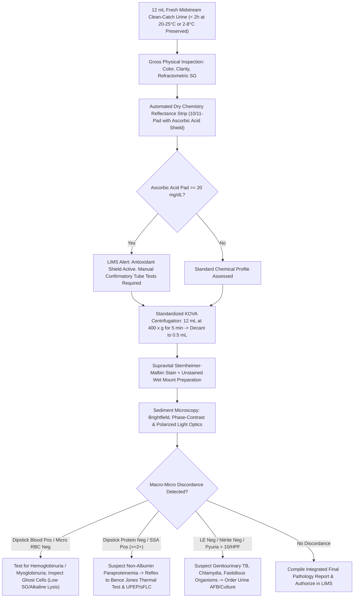

# 💧 Master Clinical Pathology Cluster SOP: Urine Complete Examination & Pregnancy Diagnostics
**Sawariya Diagnostic Lab, Charkhi Dadri, Haryana**  
**Document ID:** `SDL-CP-CLUSTER-5.1` | **Version:** `3.0` | **Effective Date:** `2026-10-15` | **Review Cycle:** Biennial  

---

## 📑 1. Document Control, Quality Architecture & Metrological Interoperability

### 1.1 Administrative Sign-Off & Governance
| Role | Name & Designation | Qualifications | Signature & Date |
| :--- | :--- | :--- | :--- |
| **Prepared By** | Dr. Ananya Sharma, Quality Manager & Clinical Pathologist | MBBS, MD (Pathology) | *Dr. A. Sharma* — 2026-10-10 |
| **Reviewed By** | Dr. Rajesh Verma, Technical Manager (Clinical Pathology) | MBBS, MD (Pathology) | *Dr. R. Verma* — 2026-10-12 |
| **Approved By** | Dr. Vikram Singhal, Laboratory Director & Chief Pathologist | MBBS, MD (Pathology), FICP | *Dr. V. Singhal* — 2026-10-15 |

### 1.2 Regulatory Compliance & Standards Traceability
This Master Cluster Operating Procedure strictly adheres to:
- **ISO 15189:2022:** Clauses 4.1 to 8.9 and Normative Annex A (Point-of-Care & Clinical Pathology).
- **NABL Specific Criteria:** `NABL 112` (Laboratory Quality System), `NABL 129` (Clinical Pathology Scope), `NABL 131` (Measurement Uncertainty & Calibration), `NABL 163` (Point of Care Testing).
- **International Consensus Guidelines:** CLSI GP16-A3 (*Urinalysis; Approved Guideline — 3rd Edition*), CLSI GP47 (*Management of Critical- and Significant-Risk Results*), European Confederation of Laboratory Medicine (ECLM) *European Urinalysis Guidelines*, KDIGO 2024 (*Clinical Practice Guideline for the Evaluation and Management of Chronic Kidney Disease*), AUA/SUFU *Microhematuria Consensus*, and IMWG *Guidelines for Multiple Myeloma-Induced Renal Impairment*.

### 1.3 Master Interoperability Directory (LOINC, SNOMED-CT, ICD-10-CM, ICD-11)
| Sub-Test Code | Individual Diagnostic Procedure | Primary LOINC | SNOMED-CT Concept | ICD-10-CM / ICD-11 Mapping | Analytical Platform / Methodology | STAT / Routine TAT |
| :--- | :--- | :--- | :--- | :--- | :--- | :--- |
| **`5.1.1`** | Complete Urine Examination (CUE / Routine & Micro) | `24356-8` | `27171005` (Urinalysis) | `N39.0` / `GC00` (UTI); `R31.9` / `MF96` (Hematuria); `R80.9` / `MF97` (Proteinuria) | Reflectance Photometry + Refractometry + $12\text{ mL}$ KOVA Centrifuged Sediment ($400\times g$) | **STAT:** 30 min<br>**Routine:** 90 min |
| **`5.1.2`** | Urine Physical & 10/11-Pad Dry Chemistry Dipstick | `24357-6` | `167217005` (Dipstick test) | `E10.10` / `5A10` (DKA); `R82.9` (Chromo-uria); `K71.9` (Hepatobiliary injury) | Dual-Wavelength LED Reflectance (Dirui H-100 / Roche Urisys 1100) + Visual Color Chart | **STAT:** 15 min<br>**Routine:** 45 min |
| **`5.1.3`** | Standardized Microscopic Sediment (Phase/Brightfield) | `50556-0` | `68151008` (Sediment exam) | `N00.9` / `GB40` (Nephritic syndrome); `N17.0` / `GB60` (ATN); `N20.0` (Calculus) | Standardized $12\text{ mL} \rightarrow 0.5\text{ mL}$ ($24\times$) Sediment Brightfield/Phase-Contrast/Polarization | **STAT:** 30 min<br>**Routine:** 90 min |
| **`5.1.4`** | Confirmatory Wet-Bench Chemistry (SSA, Rothera, Fouchet) | `2514-8` (Ketones)<br>`1978-6` (Bili) | `365756002` (Bile finding)<br>`27171005` (Urine analysis) | `E10.1` (Ketoacidosis); `O21.0` (Hyperemesis); `K83.1` (Biliary duct obstruction) | $20\%$ Sulfosalicylic Acid, Rothera Nitroprusside, Hay Sulfur, Fouchet $\text{BaCl}_2\text{-FeCl}_3$, Benedict | **STAT:** 30 min<br>**Routine:** 2 hrs |
| **`5.1.5`** | Bence Jones Free Light Chain Screening & Reflex | `20426-3` | `409622005` (Bence Jones) | `C90.0` / `2A20` (Multiple Myeloma); `E85.9` (Systemic Amyloidosis); `C88.0` (Waldenström) | Heat Coagulation ($40\text{–}60^\circ\text{C} \rightarrow 100^\circ\text{C}$) $\rightarrow$ Reflex UPCR, UPEP & sFLC on Bonavera 400 | **Routine:** 4 hrs (Screen)<br>**Reflex:** 24–48 hrs |
| **`5.1.6`** | Point-of-Care Urine Pregnancy Test (UPT $\beta\text{-hCG}$) | `2106-3` | `252160004` (UPT) | `Z32.01` / `JA00` (Pregnancy confirmed); `O00.9` (Ectopic); `O01.9` (Hydatidiform Mole) | Lateral-Flow Sandwich Immunochromatography (LoD $20\text{–}25\text{ mIU/mL}$) $\rightarrow$ Reflex Snibe Maglumi X3 | **STAT:** 15 min<br>**Routine:** 30 min |

### 1.4 Metrological Traceability Architecture (ISO 17511:2020)
All quantitative, ordinal, and visual testing within this cluster maintains certified unbroken calibration chains:
1. **Refractometric Specific Gravity:** Calibrated daily against Type I Clinical Laboratory Reagent Water (CLRW; Refractive Index $n_D = 1.3330$, $\text{SG} = 1.0000 \pm 0.0002$ at $20^\circ\text{C}$) and certified secondary Sucrose Density Standards ($5.0\%\text{ w/w}$, $\text{SG} = 1.0190 \pm 0.0005$; $9.0\%\text{ w/w}$, $\text{SG} = 1.0348 \pm 0.0005$).
2. **Reagent Strip Reflectance System:** Calibrated daily via manufacturer optical calibration strip (white reflectance reference standard, NIST traceable) and multi-constituent human-based liquid matrix controls (Bio-Rad Liquichek Urinalysis Plus, Level 1 and Level 2).
3. **Lateral-Flow $\beta\text{-hCG}$ Immunoassay:** Calibrated to the World Health Organization (WHO) 4th International Standard for Chorionic Gonadotrophin (`NIBSC 75/589`), establishing an analytical sensitivity threshold of $20\text{–}25\text{ mIU/mL}$.
4. **Centrifugation G-Force:** Centrifuge Relative Centrifugal Force ($\text{RCF}$) verified semi-annually with a calibrated digital optical tachometer under standard payload: $\text{RCF} = 1.118 \times 10^{-5} \times r \times (\text{RPM})^2 = 400\text{ g} \pm 20\text{ g}$ (where radius $r = 14.5\text{ cm}$, set to $1,570\text{ RPM}$).

---

## 🔬 2. Comprehensive Clinical Pathology & Analytical Workflows



### 2.1 Pre-Analytical Phase: Specimen Integrity & Cellular Lysis Dynamics
- **Collection Modalities:**
  1. *Midstream Clean-Catch (MSCC):* Preferred routine specimen. Thorough periurethral cleansing with saline-moistened sterile gauze (avoiding quaternary ammonium or chlorhexidine antiseptics which produce false-positive dipstick protein). Initial $15\text{–}30\text{ mL}$ voided into toilet; midstream portion collected directly into sterile polypropylene container without stopping stream.
  2. *First-Morning Specimen:* Essential for microalbuminuria, proteinuria quantification, casts, dysmorphic RBC evaluation, and early pregnancy testing. Minimum $8\text{-hour}$ bladder incubation provides optimal concentration ($\text{SG} > 1.015$) and physiological acidification ($\text{pH} < 6.0$).
  3. *Catheterized / Suprapubic Aspirates:* Used for comatose, pediatric, or acute retention patients. Suprapubic aspiration remains the gold standard for anaerobic or neonatal microbiological validation.
- **Specimen Stability & Lysis Kinetics:**
  - Analysis must be executed within **$2\text{ hours}$** of voiding if stored at ambient temperature ($20\text{–}25^\circ\text{C}$).
  - In unpreserved alkaline urine ($\text{pH} > 7.5$) or dilute hypotonic urine ($\text{SG} < 1.010$), **neutrophil and cast lysis occurs rapidly** ($t_{1/2} < 100\text{ minutes}$). Erythrocytes swell, lyse into "ghost cells," and release free hemoglobin.
  - Bacterial proliferation of urease-producing uropathogens (*Proteus mirabilis, Klebsiella pneumoniae, Corynebacterium urealyticum*) converts urea to ammonium carbonate:
    $$\text{CO(NH}_2)_2 + 2\text{H}_2\text{O} \xrightarrow{\text{Urease}} (\text{NH}_4)_2\text{CO}_3 \rightarrow 2\text{NH}_4^+ + \text{CO}_3^{2-} \quad (\text{causing pH to surge } > 8.0\text{–}9.0)$$
  - High pH dissolves hyaline and granular casts within minutes and precipitates amorphous phosphates, obscuring cellular elements.
  - If analysis is delayed $> 2\text{ hours}$, specimens must be refrigerated at $2\text{–}8^\circ\text{C}$ (stable up to $24\text{ hours}$ for chemistry/microscopy; warm to $20\text{–}25^\circ\text{C}$ before strip testing to restore enzymatic reaction kinetics). For delayed culture transport, boric acid preservative ($1.0\%\text{ w/v}$) is mandatory.

### 2.2 Physical Examination: Color Spectrum, Turbidity & Refractometry
- **Color Pathophysiology:**
  - *Straw to Deep Amber:* Physiological urochrome pigment; amber denotes high concentration/dehydration.
  - *Orange-Amber with Yellow Foam:* Conjugated bilirubin (hepatocellular jaundice or biliary obstruction).
  - *Red to Smoky Brown / "Cola-Colored":* Intact erythrocytes (glomerulonephritis produces smoky cola urine due to acid hematin conversion) vs free hemoglobin (intravascular hemolysis) vs myoglobin (rhabdomyolysis).
  - *Milky White:* Massive pyuria (bacterial nephronia), lipiduria/chyluria (filarial lymphatic-urinary fistula), or hyperphosphaturia.
  - *Dark Brown / Blackening on Standing:* Alkaptonuria (homogentisic acid oxidation on alkaline exposure), malignant melanoma (melanogen oxidation to melanin), or methemoglobin.
  - *Exogenous Pigments:* Rifampicin (bright orange-red), Phenazopyridine (blazing orange), Metronidazole (dark reddish-brown), Methylene blue / Propofol (greenish-blue), Beetroot ingestion (beeturia).
- **Turbidity Differentiation:** Normal urine is transparent. Turbidity is graded as *Clear, Hazy, Cloudy, or Turbid*.
  - *Amorphous Urates:* Pinkish "brick-dust" sediment in acidic urine; dissolves completely upon gentle heating to $60^\circ\text{C}$.
  - *Amorphous Phosphates / Carbonates:* White precipitate in alkaline urine; dissolves immediately upon adding $1\text{–}2\text{ drops}$ of $10\%$ dilute acetic acid without gas (phosphates) or with gas effervescence (carbonates).
  - *Pathological Turbidity:* Leukocytes (pyuria), erythrocytes, desquamated epithelial cells, bacteria, lipid droplets, or spermatozoa; unaffected by heating or weak acids.
- **Specific Gravity (Refractometer vs Dipstick):**
  - *Optical Clinical Refractometer:* Measures refractive index, directly proportional to total dissolved solute mass (urea, sodium, chloride, glucose, protein, radiographic contrast). Reading temperature-compensated to $20^\circ\text{C}$.
  - *Dipstick Polyelectrolyte Pad:* Measures only ionic solute concentration ($\text{Na}^+, \text{K}^+, \text{NH}_4^+, \text{Cl}^-$) via $\text{pK}_a$ shift; unaffected by non-ionized solutes (glucose, urea, radiocontrast dyes). If dipstick $\text{SG} \ge 1.035$ or discordance exists with clinical hydration, manual refractometry is mandatory.

### 2.3 Automated 10/11-Pad Dry Chemistry Dipstick Principles & Interferents
| Test Pad | Analytical Principle & Chemical Mechanism | Sensitivity / LoD | Major False-Positive Interferents | Major False-Negative Interferents |
| :--- | :--- | :--- | :--- | :--- |
| **Glucose** | Glucose oxidase / Peroxidase coupled with potassium iodide or tetramethylbenzidine chromogen | $50\text{–}100\text{ mg/dL}$ ($2.8\text{–}5.5\text{ mmol/L}$) | Oxidizing contaminants (bleach, hypochlorite, hydrogen peroxide); microbial peroxidases | **Ascorbic acid ($\ge 20\text{ mg/dL}$)**; high ketones ($\ge 40\text{ mg/dL}$); elevated SG; refrigerated unmixed cold urine |
| **Bilirubin** | Diazonium salt (2,4-dichlorobenzene diazonium) coupling forming azobilirubin in acid medium | $0.4\text{–}0.8\text{ mg/dL}$ ($6.8\text{–}13.6\text{ }\mu\text{mol/L}$) | Highly colored urine metabolites (phenazopyridine, chlorpromazine, etodolac); indoxylate | **Photo-oxidation to biliverdin** (light exposure $> 1\text{ hr}$); **Ascorbic acid ($\ge 25\text{ mg/dL}$)**; high nitrites |
| **Ketones** | Legal's reaction: Sodium nitroprusside + acetoacetic acid in alkaline glycine buffer forming purple complex | $5\text{–}10\text{ mg/dL}$ acetoacetic acid (weak acetone; **0% $\beta\text{-HB}$**) | Captopril, MESNA, penicillamine, levodopa metabolites, phthalein dyes; highly pigmented urine | Specimen aging (volatilization of acetone, bacterial degradation of acetoacetate); **Early severe DKA ($\beta\text{-HB} \gg \text{AcAc}$)** |
| **Specific Gravity** | Polymethylvinyl ether/maleic acid polyelectrolyte $\text{pK}_a$ depression releasing $\text{H}^+$ proportional to cations | $1.000\text{ – }1.030$ ($\Delta 0.005$) | Moderate-to-severe proteinuria ($> 100\text{ mg/dL}$ adds $\sim 0.005$ to reading) | Highly alkaline urine ($\text{pH} \ge 6.5$; must add $+0.005$ to reading manually); non-ionic solutes |
| **Blood / Hemoglobin** | Pseudoperoxidase activity of heme: Cumene hydroperoxide + tetramethylbenzidine $\rightarrow$ oxidized green-blue dye | $0.015\text{ mg/dL}$ free Hb or $5\text{–}10\text{ intact RBCs/}\mu\text{L}$ | Hypochlorite bleach, microbial peroxidases, povidone-iodine, menstrual admixture | **Ascorbic acid ($\ge 20\text{ mg/dL}$)**; high specific gravity ($> 1.025$ prevents RBC lysis on pad); captopril, formalin |
| **$\text{pH}$** | Dual indicator system: Methyl Red ($\text{pH } 4.4\text{–}6.2$) and Bromothymol Blue ($\text{pH } 6.0\text{–}8.5$) | Range $5.0\text{–}8.5$ ($\Delta 0.5\text{ units}$) | Run-over of acid buffer from adjacent protein pad if strip is dipped or drained improperly | Bacterial urease overgrowth releasing free ammonia ($\text{pH} > 8.5$ in aged unpreserved urine) |
| **Protein** | "Protein error of indicators": Tetrabromophenol blue buffered at $\text{pH } 3.0$ binds amino groups of Albumin | $15\text{–}30\text{ mg/dL}$ **selective for Albumin** | Highly alkaline urine ($\text{pH} \ge 8.0$ overrides acid buffer); quaternary ammonium disinfectants; chlorhexidine | **Non-albumin proteins (Bence Jones / Free Light Chains, $\beta_2\text{-microglobulin}$, Tamm-Horsfall)**; dilute urine |
| **Urobilinogen** | Ehrlich's aldehyde reaction ($p\text{-dimethylaminobenzaldehyde}$) or 4-methoxybenzene diazonium coupling | $0.2\text{–}1.0\text{ mg/dL}$ ($3.2\text{–}16\text{ }\mu\text{mol/L}$) | Sulfonamides, $p\text{-aminosalicylic acid}$, phenazopyridine; warm post-prandial urine ("alkaline tide") | Exposure to direct sunlight (oxidation to urobilin); formalin preservative; complete biliary duct obstruction |
| **Nitrite** | Griess reaction: Sulfanilamide diazotization by nitrite + tetrahydrobenzoquinolin coupling $\rightarrow$ pink azo dye | $0.06\text{–}0.10\text{ mg/dL}$ nitrite ion | Highly pigmented urine (phenazopyridine, beetroots); container contamination by environmental bacteria | **Non-nitrate reducing uropathogens (*Enterococcus, S. saprophyticus, Pseudomonas, Candida*)**; dwell $< 4\text{h}$; **Vitamin C** |
| **Leukocyte Esterase** | Granulocytic esterase cleaves indoxyl carbonic acid ester; liberated indoxyl reacts with diazonium salt $\rightarrow$ purple | $15\text{–}25\text{ WBCs/}\mu\text{L}$ (detects intact and lysed PMNs) | Vaginal discharge contamination; Trichomonas; formal-aldehyde preservative; clavulanic acid | High glucose ($\ge 2\text{ g/dL}$); heavy proteinuria ($> 500\text{ mg/dL}$); cephalexin, nitrofurantoin, gentamycin; tetracycline |
| **Ascorbic Acid (Pad 11)** | Phosphomolybdate reduction: Decolorization or blue color change proportional to reducing ascorbic acid | $10\text{–}40\text{ mg/dL}$ ($0.6\text{–}2.3\text{ mmol/L}$) | Strong reducing chemical agents | Strong oxidizing agents in urine |

### 2.4 Confirmatory Wet-Bench Manual Tube Chemistry
1. **$20\%$ Sulfosalicylic Acid (SSA) Turbidimetric Precipitation Test:**
   - *Diagnostic Role:* Pan-protein confirmatory method. Precipitates **all proteins equally** (Albumin, $\kappa/\lambda$ Immunoglobulin Free Light Chains / Bence Jones, Hemoglobin, Myoglobin, $\beta_2\text{-microglobulin}$, Tamm-Horsfall).
   - *Procedure:* Centrifuge $5\text{ mL}$ urine to obtain crystal-clear supernatant. Transfer $3\text{ mL}$ clear supernatant into an optically clear borosilicate tube. Add an equal volume ($3\text{ mL}$) of $20\%\text{ w/v}$ Sulfosalicylic Acid reagent. Invert gently 3 times. Let stand exactly $5\text{ minutes}$. Read turbidity against a black background with oblique illumination.
   - *Grading Scale:*
     - *Negative:* No turbidity or change in optical clarity ($\text{Protein } < 5\text{ mg/dL}$).
     - *Trace:* Faint, perceptible haziness against dark background ($5\text{–}20\text{ mg/dL}$).
     - *$1+$:* Distinct turbidity without discrete granulation ($20\text{–}50\text{ mg/dL}$).
     - *$2+$:* Moderate turbidity with visible fine granular precipitate; no flocculation ($50\text{–}200\text{ mg/dL}$).
     - *$3+$:* Heavy turbidity with marked flocculation and curdy clumping ($200\text{–}500\text{ mg/dL}$).
     - *$4+$:* Dense, solid precipitate or complete gelatinous coagulation ($> 500\text{ mg/dL}$).
   - *CRITICAL DISCORDANCE RULE:* If **Dipstick Protein is Negative or Trace**, but **SSA is $\ge 2+$**, this indicates non-albumin proteinuria (Bence Jones light chain myeloma, tubular proteinuria, or lysozymuria) until proven otherwise. Immediate reflex to Section 2.5 is mandatory.
2. **Rothera's Nitroprusside Ring Test (Ketone Bodies):**
   - *Principle:* Acetoacetic acid and acetone react with sodium nitroprusside in the presence of concentrated ammonium hydroxide and ammonium sulfate to produce a stable permanganate/purple ring at the liquid-liquid interface.
   - *Procedure:* Saturate $5\text{ mL}$ of centrifuged urine with crystalline ammonium sulfate powder ($\approx 3\text{ g}$; shake vigorously until undissolved crystals settle). Add $3\text{ drops}$ of freshly prepared $5\%$ sodium nitroprusside solution. Mix thoroughly. Tilt tube to $45^\circ$ and carefully layer $1\text{–}2\text{ mL}$ of concentrated liquor ammonia ($28\%$) down the side of the tube.
   - *Interpretation:* A permanganate-purple or amethyst ring developing at the interface within $60\text{–}90\text{ seconds}$ denotes a positive test (sensitivity: $5\text{ mg/dL}$ acetoacetate; $20\text{ mg/dL}$ acetone). Brownish rings are non-specific and negative.
3. **Hay's Sulfur Surface-Tension Test (Bile Salts):**
   - *Principle:* Bile salts (sodium glycocholate, sodium taurocholate) possess powerful amphipathic surface-active properties that reduce the surface tension of water from $72.8\text{ dynes/cm}$ to $< 50\text{ dynes/cm}$.
   - *Procedure:* Take $10\text{ mL}$ fresh urine chilled to room temperature in a clean, detergent-free beaker or wide tube. Gently sprinkle fine dry sublimed sulfur powder (flowers of sulfur) onto the liquid surface from a spatula held $1\text{ cm}$ above.
   - *Interpretation:* If bile salts are present ($\ge 0.01\%\text{ or } 10\text{ mg/L}$), the sulfur particles immediately sink to the bottom. If bile salts are absent, sulfur floats indefinitely on the surface. If sulfur sinks only after agitation, the test is negative.
4. **Fouchet's Bile Pigment Test (Urine Bilirubin):**
   - *Principle:* Barium chloride reacts with urinary sulfates to form a heavy barium sulfate precipitate, which adsorbs all conjugated bilirubin. Fouchet's reagent (trichloroacetic acid and ferric chloride) denatures the protein matrix and oxidizes yellow bilirubin to bright emerald-green biliverdin.
   - *Procedure:* Acidify $10\text{ mL}$ centrifuged urine with $2\text{ drops}$ of $33\%$ glacial acetic acid. Add $5\text{ mL}$ of $10\%$ Barium Chloride ($\text{BaCl}_2$) solution. Mix and filter through Whatman No. 1 filter paper. Unfold the filter paper on a white porcelain tile. Add $2\text{ drops}$ of Fouchet's Reagent ($25\text{ g TCA} + 10\text{ mL } 10\%\text{ FeCl}_3 + 90\text{ mL distilled }\text{H}_2\text{O}$) directly onto the barium precipitate.
   - *Interpretation:* Immediate appearance of an emerald green to blue-green color confirms bilirubin (sensitivity: $0.05\text{ mg/dL}$, 10-fold more sensitive than dipstick).
5. **Benedict's Qualitative Reducing Sugars Test:**
   - *Principle:* Reducing sugars contain a free aldehyde or ketone group that reduces cupric ions ($\text{Cu}^{2+}$, blue cupric sulfate) to cuprous oxide ($\text{Cu}_2\text{O}$, insoluble red precipitate) in hot alkaline sodium carbonate medium.
   - *Procedure:* In a borosilicate glass tube, mix $5.0\text{ mL}$ of Benedict's Qualitative Reagent with exactly $0.5\text{ mL}$ ($8\text{ drops}$) of centrifuged urine. Place in a vigorously boiling water bath for exactly $5\text{ minutes}$ (or boil directly over a Bunsen flame for $2\text{ minutes}$ with continuous shaking). Cool naturally to room temperature.
   - *Grading:* Blue (Negative; $< 0.1\text{ g/dL}$); Green precipitate ($1+; 0.5\text{ g/dL}$); Yellow precipitate ($2+; 1.0\text{ g/dL}$); Orange precipitate ($3+; 1.5\text{ g/dL}$); Brick-red heavy precipitate with clear supernatant ($4+; \ge 2.0\text{ g/dL}$).
   - *Pediatric & Inborn Error Alert:* Dipstick Negative + Benedict Positive in an infant confirms non-glucose reducing mellituria: mandatory reflex testing for **Galactosemia** (galactose-1-phosphate uridylyltransferase deficiency), essential fructosuria, or pentosuria.

### 2.5 Bence Jones Protein (BJP) Differential Thermal Precipitation & Reflex Pathway
- **Thermal Physical Kinetics:** Monoclonal free immunoglobulin light chains ($\kappa$ or $\lambda$, molecular weight $22\text{–}44\text{ kDa}$) exhibit unique reversible thermal solubility:
  $$\text{Soluble Native FLC} \xrightarrow{40\text{–}60^\circ\text{C}} \text{Turbid Denatured Precipitate} \xrightarrow{95\text{–}100^\circ\text{C}} \text{Complete Solubilization / Clearing} \xrightarrow{\text{Cool to } 50^\circ\text{C}} \text{Reprecipitation}$$
- **Standard Operating Procedure:**
  1. Centrifuge $15\text{ mL}$ fresh urine at $2,000\text{ RPM}$ for $10\text{ minutes}$ to clear cellular debris.
  2. Adjust urine $\text{pH}$ strictly to **$4.8 \pm 0.2$** using $10\%$ acetic acid (monoclonal light chains precipitate optimally at their isoelectric point; incorrect pH produces false-negative results).
  3. Transfer $5\text{ mL}$ acidified urine to a clean tube; insert a calibrated laboratory thermometer directly into the liquid.
  4. Place tube in a regulated water bath; raise temperature slowly ($1^\circ\text{C/minute}$).
  5. Observe for initial turbidity beginning between **$40^\circ\text{C}$ and $50^\circ\text{C}$**, consolidating into a heavy curdy flocculant precipitate at **$56\text{–}60^\circ\text{C}$**.
  6. Transfer tube to a boiling water bath ($100^\circ\text{C}$) for $5\text{ minutes}$. Observe for clearing/dissolution of the precipitate. (If albumin is co-present, it will coagulate permanently at $100^\circ\text{C}$; filter while boiling through pre-heated filter paper. If the hot filtrate turns clear at $100^\circ\text{C}$ and reprecipitates upon cooling back to $50^\circ\text{C}$, BJP is positive).
- **Metrological Limitations & Mandatory Reflex Cascade:**
  - *Analytical Sensitivity of Thermal Coagulation:* $50\text{–}100\text{ mg/dL}$ light chains. The test has a false-negative rate exceeding **$45\%$** in light-chain myeloma and cannot detect oligoclonal or monoclonal intact immunoglobulins.
  - *Above-NABL Reflex Protocol:* Any specimen exhibiting **SSA $\ge 2+$ with Dipstick Albumin $\le \text{Trace}$**, or positive thermal coagulation, or clinical suspicion of Cast Nephropathy ("Myeloma Kidney"), automatically triggers:
    1. Quantitative Spot Urine Protein-to-Creatinine Ratio (UPCR) on **Bonavera Chem 400**.
    2. High-Resolution Agarose Gel Urine Protein Electrophoresis (UPEP) of concentrated 24-hour urine with densitometric M-spike quantification.
    3. Urine Immunofixation Electrophoresis (UIFE) using antisera against IgG, IgA, IgM, total $\kappa$, total $\lambda$, free $\kappa$, and free $\lambda$.
    4. Serum Free Light Chain ($\text{sFLC}$) assay on automated analyzer calculating the $\kappa/\lambda$ ratio (Reference Interval: $0.26\text{–}1.65$; renal impairment reference: $0.37\text{–}3.10$).

### 2.6 Standardized Sediment Centrifugation & Quantitative Microscopy
- **Standardized KOVA Centrifugation Protocol:**
  - Exactly **$12.0\text{ mL}$** of fresh, well-mixed urine is transferred to a standardized conical graduated KOVA centrifuge tube.
  - Centrifuge at **$400\text{ g} \pm 20\text{ g}$** for exactly **$5\text{ minutes}$** with brake set to *soft/off* to prevent pellet resuspension.
  - Aspirate or decant the top $11.5\text{ mL}$ of supernatant, leaving precisely **$0.5\text{ mL}$** of concentrated sediment at the tip (Concentration Factor: $12.0 / 0.5 = \mathbf{24\times}$).
  - Resuspend the pellet thoroughly using a dedicated KOVA pipette by gentle aspiration/expulsion 5 times.
  - Place $1.0\text{ drop}$ ($20\text{ }\mu\text{L}$) of resuspended sediment onto a clean glass slide, cover with a $22 \times 22\text{ mm}$ coverglass (or load into KOVA counting grid chamber). Prepare duplicate wet mount stained with $10\text{ }\mu\text{L}$ of **Sternheimer-Malbin supravital stain** (Crystal Violet and Safranin O).
- **Systematic Microscopic Examination Protocol:**
  - *Low-Power Field ($10\times$ Objective, $100\times$ Total Magnification):* Scan minimum 10 fields under low light/substage condenser lowered. Quantify and report **Casts** (number per LPF), Squamous Epithelial Cells, and general crystal background.
  - *High-Power Field ($40\times$ Objective, $400\times$ Total Magnification):* Examine minimum 20 fields under medium light. Quantify and report **RBCs**, **WBCs / Pus Cells**, **Renal Tubular Epithelial Cells**, **Crystals**, and **Bacteria** (number per HPF).
- **Diagnostic Microscopic Sediment Differential Matrix:**
  1. *Erythrocytes (RBCs):*
     - *Isomorphic / Non-Glomerular RBCs:* Smooth, uniform biconcave discs ($7\text{–}8\text{ }\mu\text{m}$) with normal central pallor. Originates from lower urinary tract bleeding (urolithiasis, cystitis, BPH, transitional cell carcinoma).
     - *Dysmorphic RBCs:* Marked variations in size, shape, and membrane integrity with blebs, budding, and fragmentation caused by osmotic and enzymatic trauma through the glomerular basement membrane.
     - *Acanthocytes (G1 Cells):* Ring-shaped erythrocytes with one or more vesicle-like protrusions/blebs ("Mickey Mouse ears"). Under KDIGO and international consensus: **$\ge 5\%$ Acanthocytes or $\ge 40\%$ Dysmorphic RBCs** confirms **Glomerular Hematuria** (Glomerulonephritis, Lupus Nephritis, IgA Nephropathy, ANCA Vasculitis).
  2. *Leukocytes & Pus Cells:*
     - *Polymorphonuclear Neutrophils (PMNs):* Spherical, $10\text{–}14\text{ }\mu\text{m}$ with segmented lobular nuclei and granular cytoplasm. Stains purple-blue with Sternheimer-Malbin stain.
     - *"Glitter Cells":* Swollen neutrophils in hypotonic urine ($\text{SG} < 1.010$) exhibiting Brownian motion of intracellular cytoplasmic granules, staining pale blue. Indicates active renal parenchymal inflammation/pyelonephritis.
     - *Hansel Stain for Eosinophils:* $> 1\%$ urinary eosinophils on Hansel or Wright-Giemsa stain confirms **Acute Interstitial Nephritis (AIN)** induced by $\beta$-lactams, NSAIDs, PPIs, or sulfonamides.
  3. *Epithelial Cells:*
     - *Squamous Epithelial Cells (SECs):* Large ($40\text{–}60\text{ }\mu\text{m}$), flat, polygonal with abundant cytoplasm and small pyknotic nucleus. Originates from external urethra or vaginal introits. **$> 15\text{–}20\text{ SECs/LPF}$ signifies gross perineal contamination**, invalidating bacterial and chemical findings (mandatory specimen recollection).
     - *Transitional (Urothelial) Cells:* Medium-sized ($20\text{–}40\text{ }\mu\text{m}$), round, pear-shaped or caudate with distinct central round nucleus. Normal shedding from renal pelvis to bladder; sheets or syncytia indicate urothelial instrumentation or transitional cell carcinoma.
     - *Renal Tubular Epithelial Cells (RTECs):* Slightly larger than neutrophils ($10\text{–}14\text{ }\mu\text{m}$), round or polyhedral with single eccentric, round, prominent nucleus and coarse granular cytoplasm. Often present as RTEC casts. **$> 2\text{ RTECs/HPF}$ confirms Acute Tubular Necrosis (ATN)**, viral interstitial nephropathy (CMV, BK virus), or renal allograft rejection.
  4. *Lipiduria & Oval Fat Bodies:*
     - RTECs or macrophages filled with engulfed cholesterol esters and triglycerides.
     - Under **Polarized Light Microscopy**, intracellular cholesterol droplets produce the pathognomonic **"Maltese Cross" birefringence** (anisotropic cross pattern in black/white quadrant). Confirms **Nephrotic Syndrome** or severe Fabry disease.
  5. *Cylindruria (Urinary Casts):* Formed within distal convoluted tubules and collecting ducts via precipitation of uromodulin (Tamm-Horsfall mucoprotein):
     - *Hyaline Casts:* Colorless, transparent, cylindrical with smooth rounded ends; low refractive index. $0\text{–}2\text{/LPF}$ is physiological after strenuous exercise, fever, or volume contraction.
     - *RBC Casts:* Entrapped dysmorphic erythrocytes or orange-red homogenous hemoglobin matrix. **Pathognomonic of Acute Glomerulonephritis, RPGN, or Vasculitis.**
     - *WBC Casts:* Densely packed neutrophils within protein matrix. Diagnostic of **Acute Pyelonephritis** (upper UTI) vs cystitis (lower UTI, where WBC casts are absent), or acute interstitial nephritis.
     - *Renal Tubular Cell Casts:* Confluent RTECs within matrix. Indicates severe desquamation in **Acute Tubular Necrosis (ischemic or nephrotoxic)**.
     - *Muddy Brown Granular Casts:* Coarse, dense, dark brown pigmented granular debris. **Pathognomonic of severe Acute Tubular Necrosis (ATN).**
     - *Waxy Casts:* High refractive index, homogenous yellowish glass-like appearance with broad, blunt, fractured ends and notched borders. Indicates prolonged tubular stasis and oliguria in **Advanced Chronic Kidney Disease ("Renal Failure Casts")**.
     - *Fatty Casts:* Encrusted with lipid globules and oval fat bodies; exhibits Maltese cross birefringence under polarization. Nephrotic syndrome.
     - *Broad Casts:* Molded within dilated collecting ducts ($2\text{–}6\times$ normal cast diameter); end-stage renal failure.
  6. *Pathological & Non-Pathological Crystalluria:*
     - *Acidic Urine Crystals:* Uric acid (rhombic, barrel, rosettes; strongly birefringent under polarization); Calcium oxalate dihydrate (envelope / bipyramidal octahedrons); Calcium oxalate monohydrate (ovoid, dumb-bells, or elongated needle-like in **Ethylene Glycol poisoning**); Amorphous urates.
     - *Alkaline Urine Crystals:* Triple Phosphate / Struvite (magnesium ammonium phosphate; "coffin-lid" prisms; indicates urease-producing UTI and staghorn calculi); Ammonium biurate ("thorn-apple" spheres with spicules); Calcium carbonate; Amorphous phosphates.
     - *Diagnostic Pathological Crystals:*
       - **Cystine:** Colorless, perfectly hexagonal plates; non-birefringent or weak birefringence. Pathognomonic for **Cystinuria** (confirm with cyanide-nitroprusside test).
       - **Tyrosine:** Fine, silky, colorless-to-black needles radiating in sheaves or rosettes. Severe fulminant hepatic necrosis, tyrosinemia.
       - **Leucine:** Highly refractive yellow-brown spheres with distinct concentric radial striations ("wagon wheels"). Fulminant liver failure.
       - **Bilirubin:** Small, reddish-brown needles, clusters, or rhomboids. Obstructive liver disease.
       - **Cholesterol:** Colorless, transparent, flat rectangular plates with notched corners ("window-panes"). Severe nephrotic syndrome, chyluria.
       - **Drug Crystals:** Sulfonamides (sheaves of wheat with central binding), Ampicillin (long thin colorless needles), Indinavir/Atazanavir (starburst clusters of needles), Acyclovir (needle-like birefringent crystals causing acute obstructive crystal nephropathy).

### 2.7 Point-of-Care Urine Pregnancy Testing (UPT $\beta\text{-hCG}$) & Hook-Effect Shield
- **Analytical Principle:** Qualitative lateral flow sandwich immunochromatography. Colloidal gold-conjugated monoclonal anti-$\alpha\text{-hCG}$ antibody mobilizes across nitrocellulose membrane; captured by immobilized anti-$\beta\text{-hCG}$ on the Test Line (`T`), while goat anti-mouse IgG captures excess gold conjugate on the Control Line (`C`).
- **Kinetics & Sensitivity:** Analytical sensitivity is calibrated to **$20\text{–}25\text{ mIU/mL}$ intact $\text{hCG}$** (WHO 4th IS 75/589). Normal intrauterine pregnancy doubles hCG every $48\text{ hours}$ in early gestation, achieving $25\text{ mIU/mL}$ at day $10\text{–}14$ post-conception.
- **Hook Effect & Variant Interferences:**
  1. *High-Dose Hook Effect:* In Gestational Trophoblastic Disease (Hydatidiform Mole, Choriocarcinoma) or twin/triplet pregnancies where intact $\text{hCG} > 500,000\text{ mIU/mL}$, excess uncomplexed antigen simultaneously saturates both capture and detector antibodies, preventing sandwich cross-linking and yielding a **false-negative or faint test line**.
  2. *Variant $\text{hCG}\beta\text{-Core Fragment (hCG}\beta\text{cf) Hook Effect}:*$ Between **$8\text{ and }12\text{ weeks}$ gestation**, metabolic breakdown of hCG in maternal kidneys excretes massive amounts of $\text{hCG}\beta\text{cf}$ into urine ($10\times$ concentration of intact hCG). This fragment binds to capture antibodies without binding detector antibodies, causing **falsely negative UPT results in confirmed intrauterine pregnancy**.
- **Mandatory Hook Mitigation & Ectopic Shield:**
  - Whenever clinical presentation (amenorrhea $> 6\text{ weeks}$, uterine enlargement, vaginal bleeding, lower quadrant pelvic pain) or pelvic ultrasound conflicts with a negative or equivocal UPT:
    1. Immediately perform a **$1:10$ and $1:100$ serial dilution of the urine specimen in normal saline** and re-test. If the diluted specimen produces a dark, definitive positive test line, the hook effect is confirmed.
    2. Simultaneously reflex to **Quantitative Total Serum $\beta\text{-hCG}$ on the Snibe MAGLUMI X3 Flash-CLIA** analyzer (Dynamic Range: $0.5\text{ to } 10,000\text{ mIU/mL}$, auto-dilution up to $1,000,000\text{ mIU/mL}$).
    3. Document an immediate STAT alert to the attending Obstetrician/Gynecologist within **$30\text{ minutes}$** to evaluate for ruptured ectopic pregnancy or molar trophoblastic disease.

---

## 📊 3. Quality Assurance, IQC, EQAS & Calibration Hierarchy

### 3.1 Daily Multi-Level Internal Quality Control (IQC) Architecture
```
[Start of Shift: 08:00 AM] -> Bio-Rad Liquichek Urinalysis Plus
├── Level 1: Normal / Negative Matrix (pH ~5.5, SG ~1.015, All Pads Neg, Centrifuged Clear)
└── Level 2: Abnormal / Pathological Matrix (pH ~7.5, SG ~1.025, Glucose 2+, Ketones 2+, Protein 2+, Blood 2+, Bili 1+, Nitrite Pos, LE Pos)
        │
        ├── Westgard Analysis: 1_2s Warning | 1_3s Rejection | 2_2s Shift Rejection | R_4s Precision Rejection
        └── Passing IQC -> Green Flag in LIMS -> Patient Testing Enabled
```
- **Concordance Acceptance Criteria:**
  - *Continuous Parameters (SG, pH):* $CV_A \le 0.2\%$ for Refractometric SG; $\pm 0.5\text{ units}$ for dipstick pH. Must be within $\pm 2\text{ SD}$ of established lot mean.
  - *Ordinal Dipstick Pads:* $100\%$ concordance within $\pm 1$ color block of target value. **Zero tolerance ($0\%$ false-positives)** for glucose, blood, ketones, nitrite, or protein on Level 1 Negative Control.
- **Standardized Microscopic Sediment IQC:**
  - Daily testing of commercial stabilized sediment control (Quantimetrix / KOVA-Trol) verifying RBC count ($30\text{–}50\text{/HPF}$), WBC count ($20\text{–}35\text{/HPF}$), and crystal recognition.
  - Monthly inter-technologist concordance challenge across 5 blinded urine sediment slides; Cohen's kappa coefficient ($\kappa$) must exceed **$0.85$** for cellular and cast identification.

### 3.2 External Quality Assessment Schemes (EQAS) & PT Management
- **Participating Programs:**
  1. *CMC Vellore Clinical Pathology External Quality Assessment Scheme:* Bi-annual dispatch covering physical urinalysis, chemical dipstick concordance, and photomicrographic sediment identification.
  2. *AIIMS Clinical Pathology Inter-Laboratory Comparison Scheme:* Bi-annual survey for automated and manual urinalysis.
- **EQAS Performance Target:**
  - Dipstick chemical parameters: Absolute concordance or $\pm 1$ color block ($100\%$ compliance).
  - Microscopic sediment particle identification: $100\%$ agreement with expert consensus panel.
  - Specific Gravity: $\lvert Z\text{-score} \rvert \le 2.0$. If $\lvert Z \rvert > 2.0$ (warning) or $\lvert Z \rvert \ge 3.0$ (out-of-control), immediate formal 8D Root Cause Analysis and CAPA is filed in LIMS.

### 3.3 Primary-to-Backup Platform Comparability Protocol (CLSI EP31-A)
- **Analyte Comparability Matrix:**
  - *Primary Analyzer:* Dirui H-100 Automated Reflectance Photometer.
  - *Backup System:* Roche Urisys 1100 / Mission U120 Strip Reader & Certified Visual Color Comparator.
  - *Comparability Frequency:* Semi-annual split-sample verification ($n = 40$ fresh urine specimens covering negative, low-positive, and high-positive ranges across all 10 chemical pads).
  - *Acceptance Criteria:* Concordance $\ge 95\%$ within $\pm 1$ color block; Cohen's kappa $\kappa \ge 0.90$. If $\kappa < 0.90$, technical recalibration of optical read-heads is executed prior to reporting backup results.

---

## 📐 4. Metrological Performance Specifications per CLSI Guidelines

### 4.1 Method Performance & Verification Matrix
| Analyte / Metric | Evaluation Standard | Analytical Sensitivity (LoB / LoD / LoQ) | Linearity & Reportable Range (AMR / CRR) | Repeatability & Within-Lab Precision Target | Known Analytical Cross-Reactivity |
| :--- | :--- | :--- | :--- | :--- | :--- |
| **Specific Gravity** | CLSI EP15-A3 / EP06-Ed2 | $\text{LoD} = 1.000$; $\text{LoQ} = 1.002$ | $1.000\text{ to }1.050$ (Refractometer) | $\text{SD} \le 0.001$; $CV \le 0.1\%$ | Non-ionic glucose ($+0.004$ per $1\text{ g/dL}$); radiocontrast ($> 1.050$) |
| **Urine Glucose** | CLSI EP17-A2 / EP15-A3 | $\text{LoD} = 30\text{ mg/dL}$; $\text{LoQ} = 50\text{ mg/dL}$ | $50\text{ to }1,000\text{ mg/dL}$ (Neg to $4+$) | $\ge 98\%$ agreement within $\pm 1$ block | Ascorbic acid ($> 20\text{ mg/dL}$ false neg); Bleach/peroxide (false pos) |
| **Urine Protein** | CLSI EP17-A2 / EP15-A3 | $\text{LoD} = 10\text{ mg/dL}$; $\text{LoQ} = 15\text{ mg/dL}$ | $15\text{ to }2,000\text{ mg/dL}$ (Neg to $4+$) | $\ge 98\%$ agreement within $\pm 1$ block | High pH ($> 8.0$ false pos); Quaternary ammonium (false pos); BJP (false neg) |
| **Urine Erythrocytes** | CLSI GP16-A3 / EP17-A2 | $\text{LoD} = 5\text{ RBCs/}\mu\text{L}$; $\text{LoQ} = 10\text{ RBCs/}\mu\text{L}$ | $0\text{ to }500\text{ RBCs/HPF}$ | Poisson $CV \le 15\%$ at $\ge 10\text{ RBC/HPF}$ | Ascorbic acid ($> 25\text{ mg/dL}$ false neg); Microbial peroxidases (false pos) |
| **Leukocyte Esterase**| CLSI EP17-A2 / EP15-A3 | $\text{LoD} = 10\text{ WBC/}\mu\text{L}$; $\text{LoQ} = 15\text{ WBC/}\mu\text{L}$ | $15\text{ to }500\text{ WBC/}\mu\text{L}$ (Neg to $3+$) | $\ge 95\%$ agreement within $\pm 1$ block | Glucose $> 2\text{ g/dL}$, Protein $> 500\text{ mg/dL}$, Cephalexin (false neg) |
| **Urine $\beta\text{-hCG}$ (UPT)**| CLSI EP12-A2 / WHO 75/589 | $\text{LoD} = 20\text{–}25\text{ mIU/mL}$ intact | $25\text{ to }500,000\text{ mIU/mL}$ | $100\%$ sensitivity at $25\text{ mIU/mL}$ | High-dose hook effect ($> 500\text{k mIU/mL}$); $\text{hCG}\beta\text{cf}$ at 8–12 wks |

### 4.2 Precision & Trueness Verification Protocols (CLSI EP15-A3 & EP06-Ed2)
- **EP15-A3 Precision Protocol:** 5-day $\times$ 5-run protocol ($n = 25$ replicates) utilizing Bio-Rad Liquichek Level 1 and Level 2 controls. Within-laboratory standard deviation ($s_{WL}$) must not exceed manufacturer-claimed repeatability limits ($s_r$).
- **EP06-Ed2 Linearity & Dilution Validation:** For continuous parameters (Refractometric SG and quantitative urine chemistries), 5-point serial admixtures of high and low pools confirm polynomial first-order linearity ($R^2 \ge 0.995$) across the entire Analytical Measurement Range (AMR).

---

## 🚨 5. Macro-Micro Correlation Rules, Decision Thresholds & Critical Panic Alerts

### 5.1 Automated LIMS Macro-Micro Discrepancy Matrix
| Chemical Dipstick Finding | Microscopic Sediment Finding | Pathophysiological Interpretation | Mandatory Laboratory Action |
| :--- | :--- | :--- | :--- |
| **Blood: $2+$ to $4+$ (Large)** | **Microscopic RBCs: $0\text{–}2\text{ /HPF}$** | 1. In-vitro RBC lysis in alkaline ($\text{pH} > 7.5$) or hypotonic ($\text{SG} < 1.010$) urine.<br>2. Intravascular Hemolysis (Hemoglobinuria).<br>3. Severe Rhabdomyolysis (Myoglobinuria). | Examine wet mount under phase-contrast for RBC "ghost cells". Check patient serum for hemolysis/pink color. Reflex STAT Serum CK and LDH on **Bonavera Chem 400**. |
| **Blood: Negative** | **Microscopic RBCs: $\ge 5\text{ /HPF}$** | 1. High Ascorbic Acid ($\ge 20\text{ mg/dL}$) inhibiting peroxidase pad.<br>2. Misidentification of yeast cells, air bubbles, or calcium oxalate monohydrate as RBCs. | Check Ascorbic Acid pad 11. Add $1\text{ drop } 2\%$ acetic acid to slide: true RBCs lyse immediately; yeast and crystals remain intact. |
| **Protein: Negative / Trace** | **SSA Turbidity: $3+$ to $4+$** | Paraproteinemia: Monoclonal Free Light Chains (Bence Jones Protein), Multiple Myeloma, AL Amyloidosis, or Lysozymuria. | **CRITICAL REFLEX:** Perform Bence Jones thermal precipitation test. Order STAT Spot UPCR, Serum Protein Electrophoresis, UPEP, and sFLC. |
| **LE: Negative & Nitrite: Neg**| **Microscopic WBCs: $> 20\text{ /HPF}$** | 1. High glucose ($> 2\text{ g/dL}$), heavy proteinuria, or cephalosporins inhibiting esterase.<br>2. Infection by non-nitrate uropathogens (*Enterococcus, Candida*).<br>3. Genitourinary Tuberculosis ("sterile acidic pyuria"). | Verify no squamous contamination ($< 5\text{ SEC/LPF}$). Inquire regarding prior antibiotic therapy. Reflex urine culture and CBNAAT/AFB for Tuberculosis. |
| **Nitrite: Positive** | **Microscopic Bacteria: Absent** | 1. Contamination of collection container or delayed processing ($> 2\text{ hrs}$).<br>2. Over-decolorized Gram-negative rod fragments. | Perform Gram stain on unspun urine droplet. If fresh specimen is confirmed, alert clinician of early/low-count colonization. |

### 5.2 Master Critical ("Panic") Value Trigger Table (CLSI GP47 & NABL 112)
| Critical Parameter | Panic Threshold Trigger | Primary Clinical Emergency | Mandatory Laboratory Action & 30-Minute Callout Protocol |
| :--- | :--- | :--- | :--- |
| **1. Erythrocyte (RBC) Casts** | **$\ge 1$ True RBC Cast per LPF** | Rapidly Progressive Glomerulonephritis (RPGN), Goodpasture's, ANCA Vasculitis, or Acute Lupus Nephritis | Slide confirmed by Consultant Pathologist. Direct telephone call to Nephrologist/Physician within **$\le 30\text{ minutes}$**. Read-back logged. Reflex STAT Serum Creatinine & Electrolytes. |
| **2. Muddy Brown Granular Casts with Oliguria** | **Abundant ($\ge 5\text{/LPF}$) Muddy Brown Casts + RTECs** | Severe Ischemic or Toxic Acute Tubular Necrosis (ATN) | Direct telephonic alert to attending physician within **$\le 30\text{ minutes}$**. Alert regarding nephrotoxic medication hold and IV hydration. |
| **3. Massive Ketonuria with Glycosuria** | **Ketones $\ge 80\text{ mg/dL}$ ($3+/4+$) + Glucose $\ge 500\text{ mg/dL}$** | Diabetic Ketoacidosis (DKA) or Euglycemic DKA (in patients on SGLT2 inhibitors) | STAT telephone call to Physician/Emergency within **$\le 30\text{ minutes}$**. Recommend immediate venous blood gas (VBG/ABG), blood glucose, potassium, and serum $\beta\text{-hydroxybutyrate}$. |
| **4. Pathological Crystalluria** | **Presence of Cystine, Leucine, Tyrosine, or Oxalate Dumbbells** | Inherited Cystinuria, Fulminant Hepatic Failure, or Acute Ethylene Glycol (Antifreeze) Poisoning | Immediate microscopic polarization and confirmation by Pathologist. Telephonic read-back within **$\le 30\text{ minutes}$**. Alert ER/ICU. |
| **5. Discordant / Weak UPT in Acute Abdomen** | **Faint/Negative UPT with Amenorrhea & Lower Quadrant Pain** | Ruptured / Unruptured Ectopic Pregnancy or Trophoblastic Hook Effect | Execute immediate $1:100$ saline dilution UPT. Draw blood for STAT Quantitative Serum $\beta\text{-hCG}$ on Snibe Maglumi X3. Verbal alert to Gynecologist $\le 30\text{ min}$. |
| **6. Heavy Bence Jones Discordance** | **SSA $3+/4+$ with Dipstick Albumin Neg/Trace** | Multiple Myeloma / Acute Light-Chain Cast Nephropathy ("Myeloma Kidney") | Immediate phone alert to Hematologist/Oncologist within **$\le 30\text{ minutes}$**. Initiate myeloma diagnostic workup panel. |

### 5.3 AUA/SUFU Microhematuria & KDIGO 2024 CKD Staging Integration
- **Microhematuria Definition (AUA/SUFU 2020 Guidelines):** $\ge 3$ properly prepared isomorphic erythrocytes per high-power field on a single unspun/properly centrifuged specimen without an obvious benign cause (UTI, vigorous exercise, menses). Microhematuria cannot be established by dipstick alone without confirmatory sediment microscopy.
- **KDIGO 2024 CKD Albuminuria Staging Integration:**
  - *Stage A1 (Normal to mildly increased):* $\text{UACR} < 30\text{ mg/g}$ ($< 3\text{ mg/mmol}$) — Dipstick Protein Negative.
  - *Stage A2 (Moderately increased / "Microalbuminuria"):* $\text{UACR } 30\text{–}300\text{ mg/g}$ ($3\text{–}30\text{ mg/mmol}$) — Dipstick Protein Negative to Trace. **Requires spot UACR assay on Bonavera Chem 400.**
  - *Stage A3 (Severely increased / "Macroalbuminuria"):* $\text{UACR} > 300\text{ mg/g}$ ($> 30\text{ mg/mmol}$) — Dipstick Protein $\ge 1+$ to $4+$. Nephrotic range if $\text{UPCR} > 2.0\text{ g/g}$ or dipstick $4+$.

---

## 💡 6. Real-World Worked Clinical Scenarios

### Case 1: Euglycemic Diabetic Ketoacidosis in an SGLT2-Inhibitor Patient
- **Clinical History:** A 52-year-old female with Type 2 Diabetes Mellitus on Empagliflozin ($25\text{ mg/day}$) presents to the emergency room with severe nausea, persistent vomiting, tachypnea (Kussmaul breathing), and deep lethargy. Capillary blood glucose is $168\text{ mg/dL}$ (unexpectedly modest).
- **Urinalysis Findings:**
  - *Physical:* Pale yellow, clear; Refractometric $\text{SG} = 1.022$; $\text{pH} = 5.0$.
  - *Dry Chemistry:* Glucose: $3+$ ($> 500\text{ mg/dL}$); Ketones: $4+$ ($> 160\text{ mg/dL}$, acetoacetate); Protein: Trace; Blood: Negative; Nitrite: Negative; LE: Negative.
  - *Manual Chemistry:* Rothera's Test: Deep permanganate-purple ring developing in $< 15\text{ seconds}$ ($4+$).
  - *Sediment Microscopy:* $0\text{–}1\text{ RBC/HPF}$; $1\text{–}2\text{ WBC/HPF}$; No casts; Rare uric acid crystals.
- **Pathophysiological Evaluation:** SGLT2 inhibitors block proximal tubular glucose reabsorption, maintaining glucosuria even with near-normal plasma glucose. Glucosuria lowers insulin-to-glucagon ratio, stimulating adipose lipolysis and hepatic ketogenesis, causing severe **Euglycemic DKA**.
- **Action & Outcome:** Pathologist immediately placed a Critical Panic Alert callout to the ER within $15\text{ minutes}$. Arterial blood gas demonstrated severe metabolic acidosis ($\text{pH } 7.12$, $\text{HCO}_3^- = 8.2\text{ mmol/L}$, Anion Gap $26\text{ mEq/L}$). Serum $\beta$-hydroxybutyrate was $6.4\text{ mmol/L}$. IV insulin and dextrose infusion was initiated immediately, saving the patient's life.

### Case 2: Acute Post-Streptococcal Glomerulonephritis (APSGN)
- **Clinical History:** A 9-year-old male presents with periorbital edema, dark smoky urine, headache, and hypertension ($145/95\text{ mmHg}$) three weeks following an episode of streptococcal pharyngitis.
- **Urinalysis Findings:**
  - *Physical:* "Cola-colored" / smoky dark brown; Turbidity: Cloudy; Refractometric $\text{SG} = 1.026$; $\text{pH} = 5.5$.
  - *Dry Chemistry:* Blood: $3+$ (Heavy); Protein: $2+$ ($100\text{ mg/dL}$); Glucose: Negative; Ketones: Negative; Nitrite: Negative; LE: Trace.
  - *Sediment Microscopy (Phase-Contrast):*
    - Erythrocytes: $80\text{–}100\text{ RBCs/HPF}$; **$> 70\%$ Dysmorphic RBCs with $12\%$ classic G1 Acanthocytes** (ring cells with blebs).
    - Casts: **$3\text{–}5\text{ True RBC Casts/LPF}$** with dense orange-brown erythrocyte aggregation; $2\text{–}4\text{ Coarse Granular Casts/LPF}$.
    - Leukocytes: $5\text{–}8\text{ WBCs/HPF}$; SECs: $< 2\text{/LPF}$.
- **Pathophysiological Evaluation:** Subepithelial immune-complex deposition (streptococcal pyrogenic exotoxin B) triggers complement-mediated glomerular capillary wall rupture. RBCs squeezing through basement membrane rents become severely dysmorphic and entrap within uromodulin gels forming pathognomonic RBC casts.
- **Action & Outcome:** Panic alert communicated to the Pediatrician within $20\text{ minutes}$. STAT serum creatinine was $1.4\text{ mg/dL}$, complement $\text{C3}$ was severely depressed ($24\text{ mg/dL}$; reference $90\text{–}180$), and ASO titer was elevated ($820\text{ IU/mL}$). Patient was hospitalized, treated with loop diuretics and salt restriction, and fully recovered renal function.

### Case 3: Light-Chain Multiple Myeloma ("Myeloma Kidney") Missed by Dipstick
- **Clinical History:** A 66-year-old male presents with severe normocytic normochromic anemia, refractory lumbar back pain, and progressive unexplained azotemia (Serum Creatinine $4.2\text{ mg/dL}$).
- **Urinalysis Findings:**
  - *Physical:* Straw, hazy; Refractometric $\text{SG} = 1.014$; $\text{pH} = 6.0$.
  - *Automated Dipstick:* **Protein: TRACE** ($\sim 15\text{ mg/dL}$); Blood: Negative; Glucose: Negative; Ketones: Negative.
  - *Manual Wet Chemistry:* **$20\%$ Sulfosalicylic Acid (SSA) Test: $4+$ (Dense curdy precipitate and complete gelatinous solid clot, $> 1,000\text{ mg/dL}$)**.
  - *Thermal Precipitation:* Dense precipitate forming at $54^\circ\text{C}$; completely cleared at $98\text{–}100^\circ\text{C}$; reprecipitated upon cooling to $52^\circ\text{C}$ (Positive Bence Jones Protein).
  - *Sediment Microscopy:* $0\text{–}2\text{ RBC/HPF}$; $1\text{–}3\text{ WBC/HPF}$; Occasional fractured broad waxy casts.
- **Pathophysiological Evaluation:** The dipstick tetrabromophenol blue reagent relies on the "protein error of indicators," which is exquisitely sensitive to Albumin but blind to Immunoglobulin Free Light Chains. The patient was excreting massive amounts of monoclonal $\lambda$ light chains, which easily pass the glomerulus and precipitate with uromodulin in distal tubules forming obstructing, fractured casts ("Cast Nephropathy").
- **Action & Outcome:** Urgent phone notification sent to Hematology. Spot UPCR was $5.4\text{ g/g}$. Agarose Gel UPEP revealed a dense monoclonal $\beta$-region spike; UIFE confirmed monoclonal $\lambda$ Free Light Chains. Serum Free Light Chain assay showed $\lambda = 2,450\text{ mg/L}$ with a distorted $\kappa/\lambda$ ratio of $0.005$. Patient was promptly placed on bortezomib-dexamethasone therapy and emergency plasmapheresis, preventing irreversible end-stage renal disease.

### Case 4: Complete Biliary Duct Obstruction (Choledocholithiasis)
- **Clinical History:** A 48-year-old female presents with severe right upper quadrant colic, deep icterus, pruritus, and pale clay-colored stools.
- **Urinalysis Findings:**
  - *Physical:* Dark brownish-olive ("beer-colored"); **Yellow-green foam on shaking**; $\text{SG} = 1.020$; $\text{pH} = 6.0$.
  - *Automated Dipstick:* **Bilirubin: $3+$ (Large)**; **Urobilinogen: NEGATIVE ($< 0.2\text{ mg/dL}$)**; Blood: Negative; Protein: Negative.
  - *Manual Chemistry:*
    - Fouchet's Test: Heavy barium precipitate yields **intense emerald-green biliverdin reaction ($4+$)**.
    - Hay's Sulfur Test: Powdered sulfur sinks immediately to the bottom ($4+$ Bile Salts).
- **Pathophysiological Evaluation:** Gallstone impaction of the common bile duct completely arrests bile flow into the duodenum. Intestinal bacteria cannot generate urobilinogen (hence complete absence of urobilinogen in urine and acholic stools). Water-soluble conjugated bilirubin surges in serum and is freely filtered into urine along with bile salts.
- **Action & Outcome:** The complete absence of urobilinogen coupled with $3+$ bilirubin pointed directly to extrahepatic mechanical obstruction. STAT abdominal ultrasonography demonstrated a $14\text{ mm}$ stone impacted at the ampulla of Vater with severe intrahepatic biliary duct dilation. Emergency ERCP sphincterotomy and stone extraction relieved the obstruction.

### Case 5: False-Negative Dipstick UTI Masked by Mega-Dose Vitamin C
- **Clinical History:** A 28-year-old female presents with acute dysuria, severe urinary frequency, urgency, and suprapubic tenderness. She reports consuming $2,000\text{ mg/day}$ of over-the-counter Vitamin C supplements for viral prophylaxis.
- **Urinalysis Findings:**
  - *Automated Dipstick:* Glucose: Neg; Bilirubin: Neg; Ketones: Neg; Blood: Neg; Nitrite: **NEGATIVE**; LE: **NEGATIVE**; **Ascorbic Acid (Pad 11): $> 40\text{ mg/dL}$ ($4+$ Intense Blue Shield)**.
  - *Sediment Microscopy (Unstained & Sternheimer-Malbin):*
    - Leukocytes: **$40\text{–}50\text{ Pus Cells / HPF}$** with active intracellular granulations.
    - Erythrocytes: **$8\text{–}12\text{ RBCs / HPF}$**.
    - Microorganisms: **Abundant Gram-negative motile bacilli** ($3+$).
    - SECs: $2\text{–}4\text{ /LPF}$ (true clean-catch specimen).
- **Pathophysiological Evaluation:** High urinary concentrations of ascorbic acid act as a powerful antioxidant, scavenging diazonium ions and hydrogen peroxide intermediates, entirely extinguishing the color reactions of the Blood, Nitrite, and Leukocyte Esterase pads.
- **Action & Outcome:** The technologist flagged the Ascorbic Acid interference shield in LIMS, preventing a false-negative automated release. The microscopic pyuria and bacteriuria findings were released with an explicit warning note. Quantitative urine culture grew $> 10^5\text{ CFU/mL } E. coli$ sensitive to Nitrofurantoin and Fosfomycin. The patient was successfully treated.

### Case 6: High-Dose Hook Effect in Complete Hydatidiform Mole
- **Clinical History:** A 22-year-old female, gravidity 1 parity 0, presents at 10 weeks of amenorrhea with severe hyperemesis gravidarum, bilateral lower abdominal fullness, and dark brownish vaginal spotting. Uterine fundus corresponds to a 16-week gestation.
- **Urinalysis Findings:**
  - *Urine Pregnancy Test (Neat Urine):* **FAINT, BARELY VISIBLE TEST LINE (Equivocal / Indeterminate)**.
  - *Clinical Suspicion:* Severe discordance between advanced clinical symptoms and faint UPT line.
  - *Intervention:* Technologist prepared a **$1:100$ dilution of urine in normal saline**.
  - *Diluted Urine Pregnancy Test:* **IMMEDIATE, INTENSELY DARK PURPLE TEST LINE ($4+$)** within $15\text{ seconds}$ (Classic High-Dose Hook Effect confirmed).
- **Pathophysiological Evaluation:** Complete hydatidiform mole generates massive syncytiotrophoblastic proliferation, causing $\text{hCG}$ to exceed $1,000,000\text{ mIU/mL}$. In undiluted urine, astronomical concentrations of intact $\text{hCG}$ and $\text{hCG}\beta\text{cf}$ independently saturate both the mobile colloidal gold-conjugated antibodies and the fixed membrane capture antibodies, preventing sandwich complex formation. Dilution eliminates the antigen excess, restoring the immunocomplex sandwich.
- **Action & Outcome:** STAT serum draw sent to **Snibe MAGLUMI X3 Flash-CLIA**; 1:1,000 automated dilution yielded a quantitative serum $\beta\text{-hCG}$ of **$920,000\text{ mIU/mL}$**. Urgent pelvic ultrasound confirmed a complete molar pregnancy ("snowstorm" vesicular appearance with bilateral theca lutein cysts). Emergency suction curettage was performed, averting uterine rupture and malignant choriocarcinoma transformation.

---

## 🛡️ 7. Quantitative Failure Mode, Effects & Criticality Analysis (ISO 22367:2020 FMECA)

Risk Scoring: **Severity (S)** [1–5], **Occurrence (O)** [1–5], **Detection (D)** [1–5]; $\mathbf{RPN} = S \times O \times D$. Action mandatory if $\text{RPN} \ge 30$ or $S \ge 4$.

| Process Step | Potential Failure Mode | Root Cause Mechanism | S | O | D | RPN | Mitigation & Poka-Yoke Quality Safeguards | Revised S | Revised O | Revised D | Revised RPN |
| :--- | :--- | :--- | :--- | :--- | :--- | :--- | :--- | :--- | :--- | :--- | :--- |
| **Specimen Transit** | Lysis of RBCs and casts prior to analysis | Unpreserved urine sitting at room temp $> 2\text{ hours}$; alkaline/hypotonic lysis | 4 | 4 | 3 | **48** | Hard LIMS accession lock rejecting specimens $> 2\text{ hours}$ old without refrigeration. Mandatory reflex to phase-contrast ghost cell review if dipstick blood is positive. | 4 | 1 | 2 | **8** |
| **Dipstick Chemistry** | False-negative glucose, blood, nitrite, and LE | Ascorbic acid excretion $> 20\text{ mg/dL}$ scavenging chemical reaction intermediates | 4 | 3 | 3 | **36** | Implementation of 11-pad strips with dedicated Ascorbic Acid pad. Auto-flagging in LIMS: any Vitamin C $> 20\text{ mg/dL}$ triggers mandatory sediment microscopy override. | 4 | 1 | 1 | **4** |
| **Proteinuria Screen** | Missed Bence Jones light chain cast nephropathy | Exclusive reliance on dipstick albumin pad which is blind to free light chains | 5 | 2 | 4 | **40** | Mandatory parallel $20\%$ Sulfosalicylic Acid (SSA) tube testing on all adult nephrology/elderly samples. Any SSA $\ge 2+$ with Dipstick Trace triggers reflex UPEP/sFLC. | 5 | 1 | 1 | **5** |
| **Sediment Centrifuge**| Crushing/destruction of fragile cellular casts | Centrifuge over-speeding ($> 1,500\text{ g}$) or harsh electrical braking | 4 | 3 | 3 | **36** | Semi-annual tachometer calibration fixing speed to $400\text{ g} \pm 20\text{ g}$ ($1,570\text{ RPM}$). Electronic brake disabled; centrifuge decelerates by gentle momentum. | 4 | 1 | 1 | **4** |
| **Pregnancy Testing** | Falsely negative UPT in molar pregnancy or hyperemesis | High-dose hook effect or variant $\text{hCG}\beta\text{cf}$ saturation at 8–12 weeks | 5 | 2 | 4 | **40** | Standard Operating Procedure requires mandatory $1:100$ saline dilution test whenever amenorrhea $> 6\text{ weeks}$ conflicts with a faint/negative UPT; reflex to Snibe Maglumi X3. | 5 | 1 | 1 | **5** |
| **Microscopic Analysis**| Misdiagnosing vaginal contamination as true UTI | High squamous cell contamination masking underlying pathology | 3 | 4 | 2 | **24** | LIMS rejection rule: $> 15\text{ SECs/LPF}$ automatically appends "Specimen Contaminated" advisory and blocks reporting of pyuria until clean-catch recollect is performed. | 3 | 1 | 1 | **3** |
| **Crystal Identification**| Misclassifying CaOx monohydrate in antifreeze poisoning | Needle/dumbbell monohydrate mistaken for hippurate or uric acid | 5 | 1 | 4 | **20** | Polarizing microscopy mandatory for all atypical crystals. Dual-technologist review and Pathologist sign-off required for any unusual crystal morphology. | 5 | 1 | 1 | **5** |
| **Panic Reporting** | Delayed notification of RBC casts or massive DKA | Unlogged telephone call or technologist failure to recognize emergency | 5 | 2 | 3 | **30** | LIMS hard-stop pop-up on RBC casts $\ge 1\text{/LPF}$ or Ketones $4+$. 30-minute countdown timer with automated escalation to Technical Manager if read-back is unlogged. | 5 | 1 | 1 | **5** |

---

## 🔍 8. Live Vertical Witness-Audit Simulation (NABL / CAP Assessor Dialogues)

### Audit Scenario 1: Bench Review of Standardized Centrifugation & Microscopy
- **NABL Lead Assessor (Clinical Pathology Specialist):** *"Technologist, show me your centrifuge operating parameters for urine sediment analysis. How did you verify that this bench centrifuge delivers exactly $400\text{ g}$?"*
- **Bench Technologist (Clinical Pathology):** *"Sir, under our CLSI GP16-A3 and SDL-CP-CLUSTER-5.1 protocol, we do not centrifuge urine by arbitrary RPM. Our centrifuge rotor has a radius ($r$) of $14.5\text{ cm}$. Using the standard formula $\text{RCF} = 1.118 \times 10^{-5} \times r \times (\text{RPM})^2$, we determined that $1,570\text{ RPM}$ produces exactly $400\text{ g}$. Here is our calibration certificate from our NABL-accredited metrology vendor dated June 2026 showing that an optical tachometer confirmed $1,570\text{ RPM} \pm 10\text{ RPM}$. Furthermore, our electric brake is permanently locked to 'OFF' so the rotor coasts to a gentle stop over $90\text{ seconds}$, preventing shear disruption of fragile RBC casts."*
- **Assessor:** *"Excellent. Show me how you prepare and stain the sediment."*
- **Bench Technologist:** *"We place exactly $12.0\text{ mL}$ of urine into this graduated conical tube. After 5 minutes at $400\text{ g}$, we decant down to precisely $0.5\text{ mL}$, achieving a $24\times$ concentration factor. We resuspend with a dedicated pipette and prepare two smears: one unstained wet mount for phase-contrast birefringence, and one stained with $10\text{ }\mu\text{L}$ of Sternheimer-Malbin supravital stain. Here is our daily QC log for our commercial sediment control, showing recovery of RBCs at $38\text{ /HPF}$ and WBCs at $28\text{ /HPF}$, well within established limits."*
- **Assessor:** *"Verification completed. Conforms fully to ISO 15189:2022 Clause 7.3."*

### Audit Scenario 2: Chemical Discrepancy & Bence Jones Protein Reflex Cascade
- **NABL Technical Assessor:** *"Dr. Verma, suppose an automated strip reports Protein as TRACE, but your bench technologist observes a $3+$ precipitation on the manual Sulfosalicylic Acid tube test. What does your laboratory do, and what is the scientific justification?"*
- **Technical Manager (Dr. Rajesh Verma):** *"Madam, that discordance is one of our mandatory LIMS hard-stops. Dipstick protein utilizes the tetrabromophenol blue 'protein-error-of-indicators' reaction, which requires an albumin-specific charge interaction. It has virtually zero sensitivity for Immunoglobulin Free Light Chains. The $20\%$ SSA test, on the other hand, is a turbidimetric denaturation method that precipitates all proteins equally. An SSA $\ge 2+$ with a negative or trace dipstick indicates Bence Jones paraproteinemia until proven otherwise. Under SOP 5.1.5, the technologist is barred from releasing this report. The sample is immediately reflexed to a Bence Jones heat precipitation test between $40\text{–}60^\circ\text{C}$ and $100^\circ\text{C}$, and we contact the attending clinician to recommend an urgent spot UPCR on our Bonavera Chem 400, serum protein electrophoresis, urine immunofixation, and serum free light chains. In fact, Case 3 in our validation file illustrates how this exact rule detected a lambda light chain myeloma."*
- **Assessor:** *"Impressive depth of clinical and metrological integration. Traceable and verified."*

### Audit Scenario 3: Critical Result Notification & 30-Minute Read-Back Protocol
- **NABL Lead Assessor:** *"Technologist, show me your Critical Results Register for the past 3 months. Let us review your last entry for an Erythrocyte (RBC) Cast finding."*
- **Bench Technologist:** *"Here is Critical Callout Log Entry `#CC-2026-088`, recorded on 2026-09-28 at 11:14 AM. The specimen belonged to a 14-year-old male with acute glomerulonephritis showing $3\text{ RBC casts/LPF}$ and $85\text{ dysmorphic RBCs/HPF}$."*
- **Assessor:** *"Walk me through the callout steps and verification records."*
- **Bench Technologist:** *"The slide was first cross-examined and confirmed by Dr. Sharma, our Consultant Pathologist, at 11:20 AM. At 11:26 AM—within 12 minutes of slide completion—Dr. Sharma telephoned Dr. K. N. Rao, the attending Pediatrician. The critical register records Dr. Rao's direct mobile number, the exact findings communicated, and Dr. Rao's verbal read-back: 'Patient Master Aryan, 14M, Lab ID 84920, 3 RBC casts per LPF and abundant dysmorphic RBCs with acanthocytes, critical glomerular hematuria alert.' The call was completed at 11:28 AM, well within our mandatory 30-minute window under CLSI GP47. Our LIMS timestamped the authorized electronic alert simultaneously."*
- **Assessor:** *"Record is pristine. Perfect compliance with ISO 15189:2022 Clause 7.4.2."*

---

## 💬 9. Conditional LIMS Interpretative Comments & Dual-Language Patient Advisory

### 9.1 Automated Conditional LIMS Interpretative Comments
- **Rule 1 — Glomerular Hematuria Alert:**  
  *Trigger:* $\text{RBCs} \ge 3\text{/HPF}$ with $\ge 5\%$ Acanthocytes (G1 cells) OR $\ge 1$ True RBC Cast.  
  *LIMS Comment:*  
  `"CRITICAL PATHOLOGY ALERT: Microscopic sediment demonstrates marked erythrocyte dysmorphism with significant acanthocytes (>= 5%) and/or erythrocyte casts, pathognomonic for Glomerular Hematuria (Glomerulonephritis / Vasculitis). Immediate clinical correlation with Blood Pressure, Serum Creatinine, Urea, Complement C3/C4, Spot UPCR, and Nephrology consultation is strongly advised."`
- **Rule 2 — Ascorbic Acid Interference Shield:**  
  *Trigger:* Ascorbic Acid $\ge 20\text{ mg/dL}$ with Negative Dipstick Blood, Nitrite, or Glucose.  
  *LIMS Comment:*  
  `"NOTE: Significant urinary Ascorbic Acid (Vitamin C > 20 mg/dL) detected. High reducing antioxidant concentrations can cause chemical false-negatives on dipstick Blood, Nitrite, Glucose, Bilirubin, and Leukocyte Esterase. Microscopic sediment analysis has been manually performed to override chemical inhibition."`
- **Rule 3 — Significant Pyuria / Suspected UTI:**  
  *Trigger:* $\text{WBC} > 10\text{/HPF}$ and $\text{SECs} < 10\text{/LPF}$.  
  *LIMS Comment:*  
  `"Significant pyuria detected in a clean specimen with minimal epithelial contamination, suggestive of urinary tract inflammation or active infection. Reflex Quantitative Urine Culture & Antibiotic Susceptibility Testing is recommended prior to initiating antimicrobial therapy."`
- **Rule 4 — Specimen Contamination Advisory:**  
  *Trigger:* $\text{SECs} > 15\text{–}20\text{/LPF}$ with mixed bacterial flora.  
  *LIMS Comment:*  
  `"ADVISORY: Specimen demonstrates abundant squamous epithelial cells (> 15/LPF), indicative of significant perineal/vaginal contamination during collection. Microscopic bacterial and leukocyte counts may not reflect true bladder conditions. If clinically indicated, repeat collection using strict Midstream Clean-Catch technique is recommended."`
- **Rule 5 — Marked Discrepancy in Refractometric Specific Gravity:**  
  *Trigger:* Refractometer $\text{SG} > 1.040$ with normal dipstick ionic SG ($1.015\text{–}1.025$).  
  *LIMS Comment:*  
  `"NOTE: Very high refractometric specific gravity (> 1.040) discordant with dipstick ionic SG, typical of excretion of high-molecular-weight non-ionic solutes (e.g., intravenous iodinated radiographic contrast media, dextran, mannitol, or heavy glucosuria). Re-evaluate renal concentrating ability 48 hours post-contrast."`
- **Rule 6 — Fungal Elements in Sediment:**  
  *Trigger:* Presence of yeast cells with budding and pseudohyphae.  
  *LIMS Comment:*  
  `"Microscopic sediment demonstrates budding yeast-like fungal elements and pseudohyphae. Findings may indicate fungal urinary tract infection (Candida cystitis) or vulvovaginal colonization. Clinical correlation with immune status, indwelling catheterization, recent antibiotic use, and diabetes mellitus is advised."`

### 9.2 Dual-Language Patient Advisory: Clean-Catch Urine Collection SOP

```
=================================================================================================
             SAWARIYA DIAGNOSTIC LAB — PATIENT INSTRUCTION MANUAL / रोगी निर्देश संदर्शिका
        MIDSTREAM CLEAN-CATCH URINE COLLECTION / मध्य-धारा स्वच्छ मूत्र नमूना संग्रह प्रक्रिया
=================================================================================================

[ENGLISH]
For accurate laboratory results and to prevent contamination, please follow these instructions:
1. Wash your hands thoroughly with soap and water before opening the sterile container.
2. Open the sterile container carefully. Do NOT touch the inside of the cup or the inside of the lid.
3. Cleanse the genital area thoroughly with the provided sterile saline wipe from front to back.
4. Begin urinating directly into the toilet bowl. Do NOT collect the initial stream.
5. After the first 20-30 mL has passed into the toilet, bring the container into the urine stream
   and collect approximately 30 to 50 mL of urine (fill the cup halfway).
6. Allow the remaining urine to finish into the toilet.
7. Screw the lid on tightly to prevent leakage. Wipe the outside of the container dry if needed.
8. Hand the container to the laboratory reception immediately (within 15-30 minutes).

-------------------------------------------------------------------------------------------------

[हिंदी अनुवाद - शुद्ध मध्य-धारा मूत्र नमूना संग्रह]
सटीक जांच परिणाम प्राप्त करने और बाहरी कीटाणुओं के संदूषण (Contamination) से बचने के लिए कृपया निम्न निर्देशों का पालन करें:
1. नमूना संग्रह का डिब्बा खोलने से पहले अपने हाथों को साबुन और पानी से अच्छी तरह धोएं।
2. स्टेराइल (कीटाणुरहित) डिब्बे को सावधानी से खोलें। डिब्बे के अंदरूनी हिस्से या ढक्कन के अंदर हाथ न लगाएं।
3. दिए गए गीले टिशू/रूई से जननांग क्षेत्र को आगे से पीछे की ओर अच्छी तरह साफ करें।
4. मूत्र त्याग शुरू करें और पहले 20-30 मिलीलीटर मूत्र को शौचालय (कमोड) में जाने दें। इसे डिब्बे में न भरें।
5. इसके बाद, मूत्र त्याग की धार को रोके बिना, डिब्बे को धार के बीच में लाएं और लगभग 30-50 मिलीलीटर
   (डिब्बे को आधा) भर लें। इसे "मध्य-धारा" (Midstream) नमूना कहते हैं।
6. शेष बचा हुआ मूत्र पुनः शौचालय में ही त्याग दें।
7. ढक्कन को कसकर बंद करें ताकि रिसाव न हो। यदि डिब्बे के बाहर मूत्र लगा हो तो उसे पोंछ लें।
8. नमूना भरने के तुरंत बाद (15 से 30 मिनट के भीतर) डिब्बे को लैब काउंटर पर जमा करें।
=================================================================================================
```

---

## 📋 10. Master LIMS Report Formats & Bench Verification Sign-Off

```text
=================================================================================================
                               SAWARIYA DIAGNOSTIC LAB
               Opp. Civil Hospital, Circular Road, Charkhi Dadri, Haryana - 127306
                 Accredited as per ISO 15189:2022 | NABL Certificate No: MC-XXXX
                   Phone: +91-1250-XXXXXX | Email: clinicalpath@sawariyadiagnostics.com
=================================================================================================
PATIENT COMPREHENSIVE URINALYSIS & PREGNANCY REPORT (CUE / ROUTINE & MICROSCOPY)
-------------------------------------------------------------------------------------------------
Patient ID      : SDL-2026-94812              Accession Date  : 16-Oct-2026 09:15 AM
Patient Name    : Mrs. Suman Sharma           Reporting Date  : 16-Oct-2026 10:30 AM
Age / Gender    : 31 Y / Female               Ref. Physician  : Dr. R. K. Bansal, MD (Med)
Specimen Type   : Clean-Catch Midstream Urine Barcode ID      : *U-94812-2026*
=================================================================================================
TEST PARAMETER                     OBSERVED RESULT       BIOLOGICAL REF. INTERVAL   METHOD
=================================================================================================
I. GROSS PHYSICAL EXAMINATION
   Color                           Pale Yellow           Pale Yellow / Straw        Visual Inspection
   Clarity / Appearance            Clear                 Clear / Transparent        Visual Inspection
   Specific Gravity (Refractometer) 1.018                1.005 - 1.030              Optical Refractometry
   Urine Reaction (pH)             6.0                   4.5 - 8.0                  Dual Indicator Pad

II. DRY CHEMISTRY REAGENT STRIP (REFLECTANCE PHOTOMETRY)
   Glucose                         Negative              Negative (< 30 mg/dL)      Glucose Oxidase-POD
   Protein (Albumin)               Negative              Negative (< 15 mg/dL)      Tetrabromophenol Blue
   Ketone Bodies (Acetoacetate)    Negative              Negative (< 5 mg/dL)       Sodium Nitroprusside
   Blood / Hemoglobin              Negative              Negative (< 5 RBC/uL)      Peroxidase TMB
   Bilirubin                       Negative              Negative (< 0.4 mg/dL)     Diazonium Coupling
   Urobilinogen                    Normal (0.2 mg/dL)    0.2 - 1.0 mg/dL            Modified Ehrlich Pad
   Nitrite                         Negative              Negative                   Griess Reaction
   Leukocyte Esterase              Negative              Negative (< 15 WBC/uL)     Indoxyl Esterase
   Ascorbic Acid (Vitamin C Shield) Negative (< 10 mg/dL) Negative                   Phosphomolybdate

III. CONFIRMATORY WET-BENCH CHEMISTRY
   20% Sulfosalicylic Acid (SSA)   Negative              Negative (No Turbidity)    SSA Precipitation
   Rothera's Nitroprusside Test    Negative              Negative (No Ring)         Nitroprusside Tube
   Fouchet's Bile Pigment Test     Negative              Negative (No Green Color)  Barium Sulfate-FeCl3
   Benedict's Reducing Sugars      Negative              Negative (Clear Blue)      Copper Reduction

IV. STANDARDIZED CENTRIFUGED SEDIMENT MICROSCOPY (KOVA 24x CONCENTRATION, 400x g)
   Erythrocytes (RBCs)             0 - 1 /HPF            0 - 2 /HPF                 Brightfield 400x
   RBC Morphology                  N/A (Normal)          > 95% Isomorphic           Phase-Contrast 400x
   Leukocytes (Pus Cells)          1 - 2 /HPF            0 - 5 /HPF                 Brightfield / S-M Stain
   Renal Tubular Epithelial Cells  Absent                0 - 1 /HPF                 Phase-Contrast 400x
   Squamous Epithelial Cells       2 - 4 /HPF            < 10 /HPF                  Brightfield 100x
   Hyaline Casts                   0 - 1 /LPF            0 - 2 /LPF                 Brightfield 100x
   Pathological Casts (RBC/WBC)    Absent                Absent                     Brightfield 100x
   Crystals                        Occasional Ca-Oxalate Absent / Normal Types      Polarized Light 400x
   Bacteria                        Absent                Absent                     Brightfield 400x
   Yeast Cells / Trichomonas       Absent                Absent                     Wet Mount 400x
   Mucus Threads                   Occasional            Absent / Rare              Brightfield 100x

V. POINT-OF-CARE URINE PREGNANCY IMMUNOASSAY
   Qualitative Urine Beta-hCG      POSITIVE (Reactive)   NEGATIVE (< 20 mIU/mL)     Lateral Flow Sandwich
   Assay Sensitivity Threshold     20 - 25 mIU/mL        WHO 4th IS 75/589 Traceable Lateral Flow Device
   Internal Procedural Control (C) VALID (Distinct Line) Must Be Present            Quality Control Band
-------------------------------------------------------------------------------------------------
PATHOLOGICAL INTERPRETATION & CLINICAL CORRELATION:
1. Routine physical, chemical, and microscopic urinalysis findings are within normal biological limits.
2. Urine Pregnancy Test (UPT) is POSITIVE, indicating intact urinary hCG >= 20-25 mIU/mL.
3. ADVISORY: Qualitative UPT cannot establish gestational age, viability, or localize pregnancy 
   (intrauterine vs ectopic). Recommend clinical correlation with Pelvic Ultrasound and Quantitative 
   Serum Total Beta-hCG (MAGLUMI X3 Flash-CLIA) as clinically indicated.
-------------------------------------------------------------------------------------------------
Testing Technologist: S. K. Sharma, DMLT, CPT       Authorized Signatory: Dr. Vikram Singhal, MD
=================================================================================================
                                    *** END OF REPORT ***
```

### 10.1 Formal Administrative Verification & Authorization Block
| Verification Level | Designated Officer | Verification Checkpoints Passed | Electronic Signature & Seal |
| :--- | :--- | :--- | :--- |
| **Bench Verification** | Sh. Suresh Kumar, Senior DMLT | 1. IQC Bio-Rad Levels 1 & 2 validated on shift.<br>2. KOVA 24× concentration factor maintained.<br>3. Ascorbic acid pad negative; no chemical interference.<br>4. UPT internal procedural control line validated. | *Suresh Kumar*<br>Tech ID: `SDL-T-042` |
| **Technical Review** | Dr. Rajesh Verma, Technical Manager | 1. Macro-micro concordance cross-checked.<br>2. SSA confirmatory protein test concordant.<br>3. Differential cell counts within reference limits.<br>4. Calibration status of refractometer and centrifuge verified. | *Dr. Rajesh Verma*<br>Reg No: `MCI-24810-D` |
| **Final Clinical Sign-Off** | Dr. Vikram Singhal, Laboratory Director | 1. Clinical history correlated with findings.<br>2. Pregnancy test interpretation validated.<br>3. Full report conforms to ISO 15189:2022 standards.<br>4. LIMS electronic authorization released to clinician. | *Dr. Vikram Singhal*<br>MD (Pathology), FICP |
