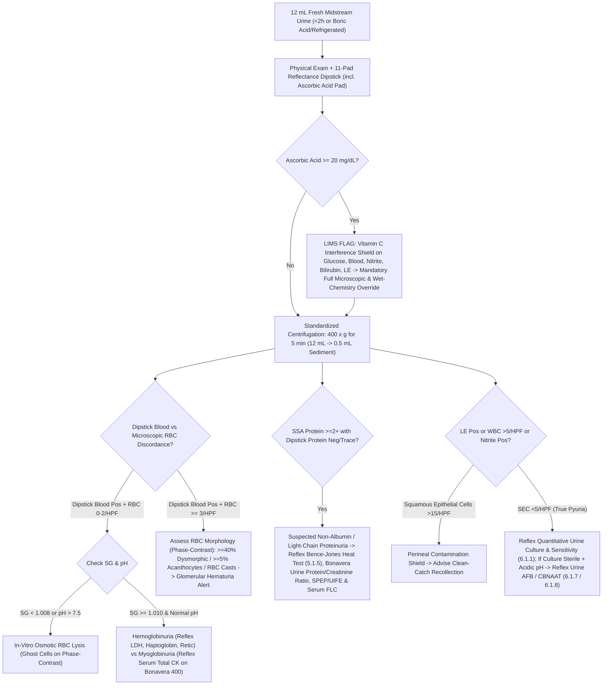

# 💧 Cluster 5.1: Urine Complete Examination & Pregnancy Master Cluster

**Department Folder:** `05_Clinical_Pathology_and_Body_Fluids`  
**Cluster ID:** `5.1` (`5.1_Urine_Complete_Examination_and_Pregnancy_Cluster`)  
**Analytical Platforms Covered:** Dual-Wavelength Reflectance Photometry Multi-Reagent Urine Strip Reader (10/11-Parameter + Ascorbic Acid Shield) + Standardized Centrifuged Sediment Brightfield/Phase-Contrast Microscopy (`400x g` for 5 min, KOVA/Sternheimer-Malbin Supravital Stain) / Automated Digital Flow Morphology; Classical Wet-Bench Special Urine Chemistry (Rothera's, Hay's, Fouchet's, Ehrlich's, Heat Coagulation $40\text{–}60^\circ\text{C} \rightarrow 100^\circ\text{C}$); Lateral-Flow Immunochromatographic Urine $\beta\text{-hCG}$ ($\text{UPT}$) with Quantitative Serum $\beta\text{-hCG}$ Reflex (**Snibe MAGLUMI X3** Flash-CLIA) & Urine Protein/Creatinine Chemistry (**Bonavera Chem 400 Primary / Bonavera Chem 200 Backup**).  
**Global Reference Benchmarks:** CLSI GP16-A3 (*Urinalysis; Approved Guideline — 3rd Edition*), European Confederation of Laboratory Medicine (ECLM) European Urinalysis Guidelines, KDIGO 2024 CKD Guidelines, AUA/SUFU Microhematuria Guidelines, International Myeloma Working Group (IMWG), ISO 15189:2022, CAP Urinalysis Checklist, CPA 2019 (India).

---

## 🗂️ 1. Master Cluster Directory & Global Interoperability Index (`5.1.1` – `5.1.6`)

| Test ID | Individual SOP File Name | Primary LOINC Code | SNOMED-CT Specimen / Concept | ICD-10 / ICD-11 Diagnostic Mapping | Primary / Backup Analytical Method | Turnaround Time (STAT / Routine) |
| :--- | :--- | :--- | :--- | :--- | :--- | :--- |
| **`5.1.1`** | `5.1.1_Complete_Urine_Examination_CUE_Routine_and_Microscopy_Master_SOP.md` | `24356-8` *(Urinalysis complete panel)* | `122575003` *(Urine specimen)* / `27171005` *(Urinalysis)* | `N39.0` (UTI), `R31.9` (Hematuria), `R80.9` (Proteinuria), `N18.9` (CKD) | Reflectance Photometry + Refractometry + Standardized $12\text{ mL}$ Sediment Microscopy ($400\times g$) | **STAT:** 30 min **Routine:** 1–2 hrs |
| **`5.1.2`** | `5.1.2_Urine_Physical_and_10_Parameter_Chemical_Dipstick_Analysis.md` | `24357-6` *(Urinalysis macro dipstick panel)* | `122575003` / `167217005` *(Urine dipstick test)* | `E10.10`/`E11.10` (DKA), `R82.9` (Chromo-uria), `K71.9` (Hepatobiliary) | Dual-Wavelength LED Reflectance Photometry (10-Pad + 11th Pad Ascorbic Acid Shield) vs Manual Visual Color Chart | **STAT:** 15 min **Routine:** 1 hr |
| **`5.1.3`** | `5.1.3_Urine_Sediment_Microscopy_Cells_Casts_Crystals_and_Dysmorphic_RBCs.md` | `50556-0` *(Urinalysis microscopic sediment panel)* | `122575003` / `68151008` *(Urine sediment microscopy)* | `N00.9` (Acute nephritic syndrome), `N17.0` (ATN), `N20.0` (Nephrolithiasis) | Standardized $12\text{ mL} \rightarrow 0.5\text{ mL}$ ($24\times$) Centrifuged Sediment Brightfield + Phase-Contrast / Polarized Microscopy | **STAT:** 30 min **Routine:** 1–2 hrs |
| **`5.1.4`** | `5.1.4_Urine_Special_Chemistry_Rothera_Ketones_Hay_Bile_Salts_Fouchet_Bile_Pigments.md` | `2514-8` *(Ketones)*, `1978-6` *(Bilirubin)*, `20405-7` *(Urobilinogen)* | `122575003` / `365756002` *(Urine bilirubin/bile salt finding)* | `E10.1` (DKA), `O21.0` (Hyperemesis gravidarum), `K83.1` (Obstructive jaundice) | Rothera's Nitroprusside Tube Test, Hay's Sulfur Surface-Tension Test, Fouchet's $\text{BaCl}_2\text{-FeCl}_3$ Test, Ehrlich's $p\text{-DMAB}$ Test | **STAT:** 30 min **Routine:** 2 hrs |
| **`5.1.5`** | `5.1.5_Urine_Bence_Jones_Protein_Heat_Coagulation_and_UPEP_Immunofixation_Reflex.md` | `20426-3` *(Bence-Jones protein urine)* / `49275-1` *(UIFE)* | `122575003` / `409622005` *(Bence Jones proteinuria)* | `C90.0` (Multiple Myeloma), `E85.9` (AL Amyloidosis), `C88.0` (Waldenström's) | Bradshaw Ring + $20\%$ Sulfosalicylic Acid ($\text{SSA}$) Turbidimetry + Thermal Differential Coagulation ($40\text{–}60^\circ\text{C} \rightarrow 100^\circ\text{C}$) $\rightarrow$ Reflex $24\text{h}$ UPEP/UIFE & Serum FLC | **Routine:** 4 hrs (Screening) / 24–48 hrs (UIFE) |
| **`5.1.6`** | `5.1.6_Urine_Pregnancy_Test_UPT_Qualitative_Beta_hCG_and_Hook_Effect_Shield.md` | `2106-3` *(Choriogonadotropin urine ql)* | `122575003` / `252160004` *(Urine pregnancy test)* | `Z32.01` (Pregnancy confirmed), `O00.9` (Ectopic pregnancy), `O01.9` (Hydatidiform mole) | Lateral-Flow Sandwich Immunochromatography ($\alpha/\beta\text{-hCG}$ mAb, LoD $20\text{–}25\text{ mIU/mL}$, WHO 4th IS 75/589) $\rightarrow$ Reflex **Snibe Maglumi X3** Serum Total $\beta\text{-hCG}$ | **STAT:** 15 min **Routine:** 30 min |

---

## ⚙️ 2. Analytical Performance Specifications (`APS`), Biological Variation & Quality Control Matrix

Because Urinalysis encompasses ordinal dipstick chemistry, continuous physical refractometry, Poisson-distributed microscopic particle counts, and qualitative immunochromatography, **ECLM European Urinalysis Guidelines** and **CLSI GP16-A3** define both analytical performance limits and inter-observer concordance targets:

| Parameter / Sub-System | Metrological Traceability | Analytical Sensitivity / LoD | Precision / Concordance Target ($CV_A\%$ or $\kappa$) | Westgard / CLSI IQC Rule | Primary-to-Backup Comparability (`CLSI EP31-A`) |
| :--- | :--- | :--- | :--- | :--- | :--- |
| **Specific Gravity (`SG`)** | NIST NaCl / Sucrose Density Standard | $1.000\text{ – }1.050$ ($\Delta 0.001$) | $CV_A \le 0.2\%$ ($\pm 0.002$ SG units) | Daily Distilled Water ($1.000$) + $5\%\text{ NaCl}$ ($1.022$) | Digital Refractometer $\leftrightarrow$ Dipstick Polyelectrolyte $\text{pK}_a$ Pad ($\pm 0.005$) |
| **10-Pad Chemical Dipstick** | WHO / NIST Certified Reference Analytes | Protein $15\text{ mg/dL}$; Glucose $50\text{ mg/dL}$; Hb $0.015\text{ mg/dL}$ ($5\text{ RBC}/\mu\text{L}$); Nitrite $0.06\text{ mg/dL}$ | $\ge 95\%$ agreement within $\pm 1$ color block; **Zero false-positives on Level-1 Negative Control** | Daily Bio-Rad Liquichek / Quantimetrix Dipper Level-1 (Neg) & Level-2 (Pathological Pos) | Automated Reflectance Reader $\leftrightarrow$ Second Calibrated Reader / Certified Dual-Tech Visual Read ($\kappa \ge 0.90$) |
| **Microscopic Sediment (`RBC`/`WBC`/Casts)** | Standardized $12\text{ mL}$ KOVA System ($24\times$ Concentration) | $1\text{ cell/HPF}$ ($\approx 3\text{–}5\text{ cells}/\mu\text{L}$ unspun urine) | Poisson $CV$ at low counts; Inter-observer $\kappa \ge 0.85$ on cell/cast classification | Daily Liquid Stabilized Urine Sediment QC + Monthly CAP/CMC EQAS Photomicrographs | Phase-Contrast / Supravital KOVA Slide $\leftrightarrow$ Neubauer Hemocytometer Unspun Count ($r \ge 0.95$) |
| **Bence-Jones Screening (`SSA` vs Dipstick)** | Albumin / Free $\kappa$-$\lambda$ Light Chain Standards | $\text{SSA}$ Turbidimetry: $5\text{–}10\text{ mg/dL}$ (vs Dipstick $15\text{–}30\text{ mg/dL}$ Albumin only) | $100\%$ concordance on SSA-positive / Dipstick-negative discordance detection | Positive Free Light Chain Control + Negative Normal Urine Control per batch | Thermal Coagulation + Quantitative Urine Total Protein (**Bonavera Chem 400 $\leftrightarrow$ 200**) $\rightarrow$ UIFE |
| **Urine Pregnancy (`UPT`)** | WHO 4th IS `75/589` ($20\text{–}25\text{ mIU/mL}$) | $20\text{–}25\text{ mIU/mL}$ Intact $\text{hCG}$ | $100\%$ sensitivity at $\ge 25\text{ mIU/mL}$; $100\%$ specificity on $0\text{ mIU/mL}$ control | Built-in Procedural Control Line (`C`) every strip + External Low-Positive ($25\text{ mIU/mL}$) & Negative QC | Qualitative Strip $\leftrightarrow$ Quantitative Serum/Urine $\beta\text{-hCG}$ on **Snibe MAGLUMI X3** + $1:10$ Hook Dilution |

---

## 🔄 3. Smart LIMS Algorithmic Diagnostic Cascades & Auto-Reflex Rules

---

## 🚨 4. Master Critical ("Panic") Values & Urgent Clinical Action Table (`CLSI GP47` & NABL)

| Critical / Urgent Finding | Trigger Threshold | Pathophysiological Emergency | Mandatory Lab Action & 30-Minute Read-Back Protocol |
| :--- | :--- | :--- | :--- |
| **1. RBC Casts / Muddy Brown Casts with Acute Oliguria** | **$\ge 1$ True `RBC` Cast or Abundant Pigmented Granular Casts** | **Rapidly Progressive Glomerulonephritis (RPGN) / Crescentic GN or Severe Acute Tubular Necrosis (ATN)** | Pathologist slide verification $\rightarrow$ Immediate telephone alert to attending Physician/Nephrologist within **30 minutes**; reflex STAT Serum Creatinine, Potassium & Urea on **Bonavera Chem 400**. |
| **2. Massive Ketonuria (`3+` / `4+` or Rothera Deep Permanganate $< 30\text{s}$) + Glycosuria (`3+` / `4+`)** | Dipstick Ketones $\ge 80\text{ mg/dL}$ (`3+/4+`) + Glucose $\ge 500\text{ mg/dL}$ (or in Pregnancy) | **Diabetic Ketoacidosis (DKA) or Euglycemic DKA (SGLT2i) or Severe Starvation/Hyperemesis Ketoacidosis in Pregnancy** | Immediate STAT alert to Physician/ER within **30 minutes**; recommend STAT Blood Gas (`ABG`), Serum $\beta\text{-Hydroxybutyrate}$, Blood Glucose & Potassium. |
| **3. Pathological Crystalluria (Cystine, Tyrosine, Leucine, or Envelope/Needle Calcium Oxalate Monohydrate in Poisoning)** | Any **Cystine** hexagons, **Tyrosine/Leucine** sheaves/spheres, or massive **Hippurate-like Calcium Oxalate Monohydrate** | **Cystinuria, Fulminant Hepatic Failure (Tyrosine/Leucine), or Acute Ethylene Glycol (Antifreeze) Poisoning** | Pathologist polarization verification $\rightarrow$ Immediate telephone read-back within **30 minutes**. |
| **4. Positive Bence-Jones Protein / Light-Chain Cast Nephropathy ("Myeloma Kidney")** | Positive $40\text{–}60^\circ\text{C}$ precipitate dissolving at $100^\circ\text{C}$ OR $\text{SSA } 3+/4+$ with Dipstick Negative | **Multiple Myeloma / Monoclonal Gammopathy of Renal Significance (MGRS)** | Pathologist verification $\rightarrow$ Urgent notification to clinician; recommend STAT Serum Calcium, Creatinine, SPEP/UIFE & Free $\kappa/\lambda$ Ratio. |
| **5. Weak/Discordant `UPT` in Acute Lower Abdominal Pain / Amenorrhea** | Faint `UPT` test line ($20\text{–}50\text{ mIU/mL}$) or Negative `UPT` with suspected Hook Effect in Molar/Ectopic | **Ruptured / Unruptured Ectopic Pregnancy or Hydatidiform Mole** | Perform immediate $1:10$ urine dilution check + urgent **Quantitative Serum $\beta\text{-hCG}$ on Snibe MAGLUMI X3** and telephone alert to OB-GYN. |

---

## 📋 5. Master LIMS Copy-Paste Interpretation Blocks

### 🏛️ 5.1a — Complete Urine Examination (`CUE` / Urine Routine & Microscopy)

**Integrated Chemical Dipstick & Microscopic Sediment Correlation Matrix:**
| Parameter | Reference Interval | Key Pathological & Pre-Analytical Correlations |
| :--- | :--- | :--- |
| **Specific Gravity (`SG`) & `pH`** | **SG:** $1.005 \text{ – } 1.030$ **$\text{pH}$:** $4.5 \text{ – } 8.0$ | - **Fixed SG ($1.010$ — Isosthenuria):** Loss of renal medullary concentrating ability (Chronic Kidney Disease / ATN). - **Alkaline $\text{pH} > 7.5$:** Urease-producing UTI (*Proteus mirabilis, Klebsiella, Pseudomonas, Corynebacterium urealyticum*), Distal Renal Tubular Acidosis (Type 1 RTA), vegetarian/alkaline therapy, or **unpreserved specimen $> 2\text{ hours}$ old** (bacterial conversion of urea $\rightarrow \text{NH}_3$). |
| **Urine Protein (Dipstick)** | Negative to Trace ($< 15\text{ mg/dL}$) | Tetrabromophenol blue "protein error of indicators" is **selective for Albumin** (threshold $15\text{–}30\text{ mg/dL}$). It is **insensitive to early diabetic Microalbuminuria ($30\text{–}300\text{ mg/g}$ — order Spot `UACR`) and Immunoglobulin Free Light Chains (Bence-Jones protein)**. False-positives occur in highly alkaline urine ($\text{pH} \ge 8.0$), quaternary ammonium antiseptics, or chlorhexidine contamination. |
| **Glucose & Ketones** | Negative | - **Glycosuria:** Hyperglycemia exceeding renal tubular $T_{\max}$ ($\sim 180\text{ mg/dL}$), gestational lowered threshold, proximal tubular Fanconi syndrome, or **therapeutic SGLT2 inhibitor use (*Dapagliflozin, Empagliflozin*)**. - **Ketonuria:** Nitroprusside reacts with **Acetoacetate** (LoD $5\text{–}10\text{ mg/dL}$), weakly with Acetone, and **does NOT detect $\beta\text{-Hydroxybutyrate}$** (the predominant ketone body in early/severe DKA; ratio $\text{BHB:AcAc}$ rises from $1:1$ to $10:1$). |
| **Leukocyte Esterase (`LE`) & Pus Cells (`WBCs`)** | **LE:** Negative **WBC:** $0 \text{ – } 5\text{ /HPF}$ | **Pyuria ($> 5\text{ WBCs/HPF}$):** Urinary tract inflammation or infection. **LE Pos + WBC Neg:** Osmotic lysis of neutrophils in hypotonic ($< 1.008$) or alkaline/stale urine releasing granulocytic esterase. **Sterile Pyuria (WBC $> 10/\text{HPF}$ + Sterile Routine Culture):** Partially treated UTI, **Genitourinary Tuberculosis (classic "acidic sterile pyuria")**, *Chlamydia trachomatis*, *Ureaplasma*, urolithiasis, or drug-induced acute interstitial nephritis (NSAIDs/$\beta$-lactams/PPIs). |
| **Urine Nitrite** | Negative | **Positive Nitrite:** $> 95\%$ specific for nitrate-reducing Gram-negative *Enterobacterales* (*E. coli, Klebsiella, Proteus*) at $\ge 10^5\text{ CFU/mL}$. **False-Negative Nitrite in True UTI:** Gram-positive uropathogens (*Enterococcus faecalis, Staphylococcus saprophyticus, Streptococcus agalactiae*) and *Pseudomonas aeruginosa* lack nitrate reductase; bladder incubation $< 4\text{ hours}$ (frequent voiding); low dietary vegetable nitrate; or **Ascorbic Acid interference**. |
| **Dipstick Blood vs Microscopic `RBCs`** | **Dipstick:** Negative **RBC:** $0 \text{ – } 2\text{ /HPF}$ | - **Dipstick Pos + $\text{RBCs} \ge 3\text{/HPF}$:** True **Microscopic/Gross Hematuria** (Urolithiasis, UTI, Glomerulonephritis [$\ge 40\%$ dysmorphic RBCs / $\ge 5\%$ G1 acanthocytes / RBC casts], BPH, urothelial malignancy, or menstrual admixture). - **Dipstick Pos + $\text{RBCs}$ Absent:** **Hemoglobinuria** (intravascular hemolysis), **Myoglobinuria** (rhabdomyolysis — elevated Serum CK), or **in-vitro RBC lysis** in hypotonic/alkaline urine. |
| **Casts & Crystals** | $0 \text{ – } 2$ Hyaline Casts/LPF | **RBC Casts:** Glomerulonephritis/vasculitis. **WBC Casts:** Acute pyelonephritis/AIN. **Muddy Brown Granular Casts:** ATN. **Waxy/Broad Casts:** Advanced CKD ("renal failure casts"). **Crystals:** Calcium oxalate (dihydrate envelopes vs monohydrate dumbbells), uric acid (acidic $\text{pH}$), triple phosphate "coffin-lids" (alkaline/urease UTI). |

### 🤰 5.1b — Urine Pregnancy Test (`UPT` — Qualitative $\beta\text{-hCG}$)
- **Analytical Principle:** Lateral-flow sandwich immunochromatography detecting intact $\text{hCG}$ above **$20\text{–}25\text{ mIU/mL}$** (calibrated to WHO 4th IS `75/589`).
- **Mandatory Medico-Legal & Hook-Effect Shield:**
  1. **Very Early Gestation & Dilute Urine (`SG < 1.010`):** Random dilute urine or testing prior to day 12–14 post-conception may yield a false-negative result. Always confirm with **First-Morning Concentrated Urine** or **Quantitative Serum $\beta\text{-hCG}$ (Snibe MAGLUMI X3, LoD $< 1.0\text{ mIU/mL}$)** repeating at $48\text{-hour}$ intervals.
  2. **Variant & High-Dose Hook Effect Shield:** Between **$8\text{ and }12\text{ weeks}$ gestation** (when urinary $\text{hCG } \beta\text{-core fragment [hCG}\beta\text{cf]}$ exceeds intact $\text{hCG}$ by 10-fold) or in **Hydatidiform Mole / Choriocarcinoma** ($\text{hCG} > 500,000\text{ mIU/mL}$), saturation of capture/detector antibodies can produce a **falsely negative or faint-positive UPT**. Whenever clinical/ultrasound suspicion of advanced pregnancy or molar gestation exists alongside a negative UPT, perform a **$1:10$ saline dilution of urine** and measure **Quantitative Serum $\beta\text{-hCG}$**.
  3. **Ectopic & Post-Abortion Persistence:** A positive UPT cannot localize pregnancy (intrauterine vs **Ectopic**) and remains positive for **$2\text{ to }4\text{ weeks}$** following miscarriage, MTP, or delivery due to the $24\text{–}36\text{ hour}$ terminal half-life of $\text{hCG}$. *Not valid for medico-legal purposes.*
