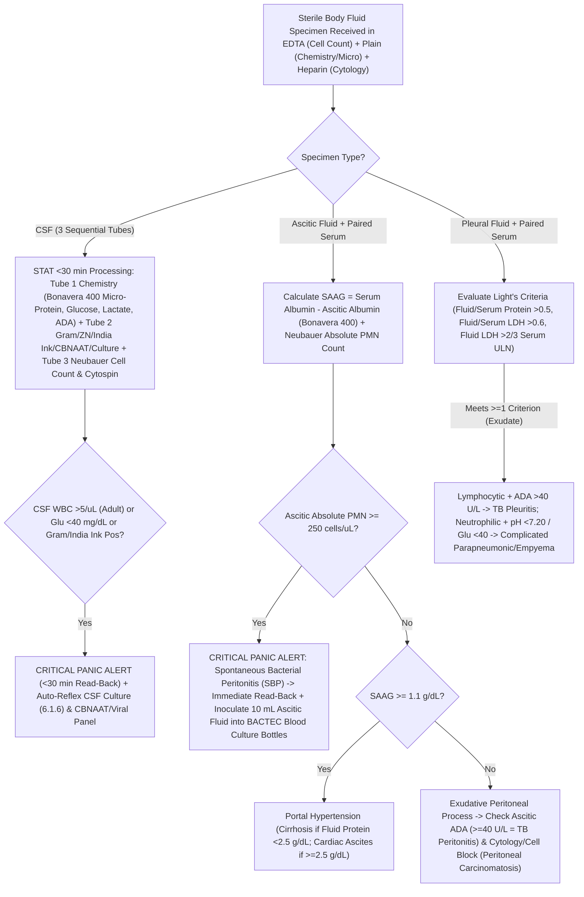

# 🔬 Cluster 5.2: Stool, Semen & Body Fluid Analysis Master Cluster

**Department Folder:** `05_Clinical_Pathology_and_Body_Fluids`  
**Cluster ID:** `5.2` (`5.2_Stool_Semen_and_Body_Fluid_Analysis_Cluster`)  
**Analytical Platforms Covered:** Standardized Saline ($0.85\%$), Lugol's Iodine ($1\%$), Methylene Blue & Hanging-Drop Darkfield/Phase-Contrast Stool Microscopy; Monoclonal Immunochemical (`FIT`) vs Guaiac (`gFOBT`) Fecal Occult Blood + Benedict's Reducing Sugar; **Snibe MAGLUMI X3** Flash-CLIA Fecal Calprotectin & Fecal Pancreatic Elastase-1; **WHO 6th Edition (2021)** Standardized Manual Andrology (Improved Neubauer Hemocytometer, Phase-Contrast $37^\circ\text{C}$ Stage, Eosin-Nigrosin Vitality, Diff-Quik/Papanicolaou Tygerberg Strict Morphology); Improved Neubauer Hemocytometer + Cytospin Cytology + Compensated Polarized Light Crystal Microscopy; **Bonavera Chem 400 (Primary) & Bonavera Chem 200 (Backup)** Body Fluid Biochemistry (Fluid Protein, Albumin, Glucose, LDH, Amylase, Triglycerides, Cholesterol, Enzymatic ADA).  
**Global Reference Benchmarks:** **WHO Laboratory Manual for the Examination and Processing of Human Semen (6th Edition, 2021)**, **CLSI H56-A** (*Body Fluid Analysis for Cellular Composition*), **CLSI C49-A** (*Analysis of Body Fluids in Clinical Chemistry*), Light's Criteria, AASLD Ascites/SBP Guidelines, IDSA Meningitis & Joint Infection Guidelines, ATS/ERS BAL Guidelines, ISO 15189:2022, CAP, CPA 2019 (India).

---

## 🗂️ 1. Master Cluster Directory & Global Interoperability Index (`5.2.1` – `5.2.9`)

| Test ID | Individual SOP File Name | Primary LOINC Code | SNOMED-CT Specimen / Concept | ICD-10 / ICD-11 Diagnostic Mapping | Primary / Backup Analytical Method | Turnaround Time (STAT / Routine) |
| :--- | :--- | :--- | :--- | :--- | :--- | :--- |
| **`5.2.1`** | `5.2.1_Stool_Routine_and_Microscopy_Ova_Cysts_Trophozoites_and_Hanging_Drop.md` | `24355-0` *(Stool routine & ova/parasite panel)* | `119339001` *(Stool specimen)* / `167593003` *(Stool microscopy)* | `A06.0` (Amoebiasis), `A07.1` (Giardiasis), `A00.9` (Cholera), `A09` (Infectious gastroenteritis) | Direct Wet Mount ($0.85\%$ Saline + Lugol's Iodine) + Formalin-Ether Concentration + Hanging Drop Darting Motility | **STAT (Hanging Drop):** 20 min **Routine:** 1–2 hrs |
| **`5.2.2`** | `5.2.2_Fecal_Occult_Blood_Test_FOBT_FIT_and_Stool_pH_Reducing_Substances.md` | `29771-3` *(FIT Hb)*, `2335-8` *(gFOBT)*, `27925-7` *(Stool reducing)* | `119339001` / `252156002` *(Fecal occult blood test)* | `K92.1` (Melena/GI bleed), `D50.9` (IDA), `C18.9` (CRC screen), `E73.9` (Lactose intolerance) | Anti-Human Globin Immunochromatography (`FIT`, Cutoff $50\text{ ng/mL}$ [$10\text{ }\mu\text{g Hb/g}$]) + Guaiac Peroxidase + Benedict's Test | **STAT:** 30 min **Routine:** 1–2 hrs |
| **`5.2.3`** | `5.2.3_Fecal_Calprotectin_and_Fecal_Pancreatic_Elastase_1_CLIA.md` | `38445-3` *(Calprotectin)*, `25907-7` *(Pancreatic Elastase-1)* | `119339001` / `440580006` *(Fecal calprotectin measurement)* | `K50.9` (Crohn's), `K51.9` (Ulcerative Colitis), `K58.9` (IBS), `K86.81` (Exocrine Pancreatic Insufficiency) | Automated Extraction + Flash-CLIA (**Snibe MAGLUMI X3**) / Quantitative Sandwich ELISA Backup | **Routine:** 4–6 hrs |
| **`5.2.4`** | `5.2.4_Semen_Analysis_Seminogram_WHO_6th_Edition_2021_Complete_SOP.md` | `50666-7` *(Semen analysis panel WHO)* | `119347001` *(Seminal fluid specimen)* / `28191009` *(Semen analysis)* | `N46.9` (Male infertility), `Z31.41` (Fertility investigation), `Z98.52` (Post-vasectomy status) | **WHO 6th Ed (2021)** Gravimetric Volume, $37^\circ\text{C}$ Phase-Contrast Motility (`PR`/`NP`/`IM`), Improved Neubauer Count, Eosin-Nigrosin Vitality, Tygerberg Strict Morphology | **Routine:** 2–3 hrs *(Motility read strictly at 30–60 min)* |
| **`5.2.5`** | `5.2.5_Pleural_Fluid_Complete_Analysis_Lights_Criteria_ADA_and_Cytology.md` | `24359-2` *(Pleural fluid analysis panel)* | `418564007` *(Pleural fluid specimen)* | `J90` (Pleural effusion), `A15.6` (Tuberculous pleurisy), `J86.9` (Empyema), `C78.2` (Malignant effusion) | Neubauer Chamber Count + Cytospin Romanowsky/Pap Cytology + **Bonavera Chem 400/200** Protein, LDH (Light's Criteria), Glucose, Enzymatic $\text{ADA}$ | **STAT:** 1 hr **Routine:** 2–3 hrs |
| **`5.2.6`** | `5.2.6_Ascitic_Peritoneal_Fluid_Analysis_SAAG_Gradient_and_SBP_Neutrophil_Cutoff.md` | `24358-4` *(Peritoneal fluid analysis panel)* | `168139001` *(Peritoneal fluid specimen)* | `R18.8` (Ascites), `K65.2` (Spontaneous bacterial peritonitis), `K74.60` (Cirrhosis), `A18.31` (TB peritonitis) | Neubauer Absolute $\text{PMN}$ Count + Cytology + **Bonavera Chem 400/200** Paired Serum-Ascites Albumin Gradient (`SAAG`), Protein, Glucose, LDH, Amylase, $\text{ADA}$ | **STAT (PMN):** 45 min **Routine:** 2–3 hrs |
| **`5.2.7`** | `5.2.7_Cerebrospinal_Fluid_CSF_Emergency_Analysis_Meningitis_Differential_and_Xanthochromia.md` | `24360-0` *(CSF analysis panel)* | `258450006` *(Cerebrospinal fluid specimen)* | `G00.9` (Bacterial meningitis), `A17.0` (TB meningitis), `G03.9` (Viral meningitis), `I60.9` (SAH) | 3-Tube Sequential Comparison + Unconcentrated Neubauer Count ($< 1\text{h}$) + Cytospin Differential + **Bonavera Chem 400/200** Micro-Protein (Pyrogallol Red), Glucose, Lactate, $\text{ADA}$ | **STAT Emergency:** $< 45\text{–}60\text{ min}$ |
| **`5.2.8`** | `5.2.8_Synovial_Joint_Fluid_Analysis_Mucin_Clot_and_Polarized_Crystal_Microscopy.md` | `24361-8` *(Synovial fluid analysis panel)* | `119332005` *(Synovial fluid specimen)* | `M00.9` (Septic arthritis), `M10.9` (Gout), `M11.2` (CPPD Pseudogout), `M06.9` (RA) | Hyaluronidase-Treated Neubauer Count + Compensated First-Order Red ($\lambda = 530\text{ nm}$) Polarized Microscopy (`MSU` vs `CPPD`) + Mucin Clot + **Bonavera 400/200** Chemistry | **STAT:** 1 hr **Routine:** 2 hrs |
| **`5.2.9`** | `5.2.9_Pericardial_Fluid_and_Bronchoalveolar_Lavage_BAL_Fluid_Analysis.md` | `14311-5` *(Pericardial fluid)*, `33622-2` *(BAL panel)* | `122571007` *(Pericardial fluid)* / `258607008` *(BAL specimen)* | `I31.3` (Pericardial effusion), `J84.10` (ILD/HP/Sarcoidosis), `J15.9` (VAP), `R04.89` (DAH) | Pericardial Light's/ADA/Cytology + BAL Cytospin Differential ($300\text{–}500\text{ cells}$, ATS/ERS Guidelines), Golde Hemosiderin Score & Oil-Red-O Lipid Index | **STAT:** 1 hr **Routine:** 3 hrs |

---

## ⚙️ 2. Analytical Performance Specifications (`APS`), Six Sigma (`TEa`) & Comparability Matrix

| Assay / Fluid Matrix | Primary Platform | Backup Platform | Desirable $CV_A\%$ | Total Allowable Error ($\text{TE}_a\%$) | Reference Change Value (`RCV %` / Concordance) | Quality Control & Verification (`CLSI C49-A` / `H56-A`) |
| :--- | :--- | :--- | :--- | :--- | :--- | :--- |
| **Fecal Calprotectin** | **Snibe MAGLUMI X3** (Flash-CLIA) | Calibrated Sandwich ELISA | $\le 6.5\%$ | $\pm 20\%$ | $\text{RCV}_{95\%} \approx \pm 45\%$ (High $CV_I$ in IBD mucosal shedding) | 2-Level Stool Extract QC daily; AMR $5\text{–}2,000\text{ }\mu\text{g/g}$ |
| **Fecal Elastase-1** | **Snibe MAGLUMI X3** / Monoclonal ELISA | Backup ELISA Reader | $\le 7.0\%$ | $\pm 20\%$ | Stable marker (unaffected by oral PERT porcine enzymes) | 2-Level Stool Control per run; AMR $15\text{–}500\text{ }\mu\text{g/g}$ |
| **Semen Analysis (WHO 2021)** | Improved Neubauer Hemocytometer + $37^\circ\text{C}$ Phase-Contrast | Validated CASA + Manual Verification | Poisson $\le 5\%$ ($\ge 400$ sperm counted in duplicate) | $\pm 10\%$ between duplicate chambers (Binomial CI) | Inter-observer $\kappa \ge 0.85$; Mandatory 74-day repeat interval | Daily Latex Bead Concentration QC + Video Motility QC + Stained Morphology Slide QC |
| **Body Fluid Chemistry (Protein, Albumin, Glucose, LDH, ADA)** | **Bonavera Chem 400** | **Bonavera Chem 200** | Protein $\le 2.5\%$; Alb $\le 2.0\%$; Glu $\le 2.2\%$; LDH $\le 3.5\%$; ADA $\le 4.0\%$ | Protein $\pm 8\%$; Alb $\pm 8\%$; Glu $\pm 10\%$; LDH $\pm 15\%$; ADA $\pm 15\%$ | Slope $0.97\text{–}1.03$, Bias $< \frac{1}{3}\text{TE}_a$ between Bonavera 400 & 200 | Bio-Rad Liquichek Body Fluid Chemistry Control (Level 1 & 2) + Matrix Spiking (`CLSI C49-A`) |
| **CSF Micro-Protein** | **Bonavera Chem 400** (Pyrogallol Red-Molybdate) | **Bonavera Chem 200** | $\le 3.0\%$ | $\pm 10\%$ (or $\pm 4\text{ mg/dL}$ at $< 40\text{ mg/dL}$) | $\text{RCV}_{95\%} \approx \pm 18\%$ | Bio-Rad Spinal Fluid Control Level 1 (Normal $\sim 28\text{ mg/dL}$) & Level 2 (Pathological $\sim 110\text{ mg/dL}$) |
| **Body Fluid Cell Count (`WBC`/`RBC`)** | Improved Neubauer Hemocytometer (Both Chambers) | Automated Body Fluid Mode ($\ge 30\text{ cells}/\mu\text{L}$) | $\le 10\%$ at $\ge 100\text{ cells}/\mu\text{L}$; Poisson limit at $< 10\text{ cells}/\mu\text{L}$ | $\pm 20\%$ between Chamber A & Chamber B | Immediate recount if Chamber A vs B differs by $> 20\%$ | Daily Liquid Body Fluid Cell Control (Level 1 Low & Level 2 High) |

---

## 🔄 3. Smart LIMS Algorithmic Diagnostic Cascades (Pleural, Ascitic, CSF, Synovial, Stool & Semen)

---

## 🚨 4. Master Critical ("Panic") Values & Statutory Notification Table (`CLSI GP47` & IDSP)

| Critical / Panic Parameter | Critical Threshold | Clinical Emergency | Mandatory 30-Minute Read-Back & Statutory Action |
| :--- | :--- | :--- | :--- |
| **1. `CSF` Pleocytosis / Hypoglycorrhachia / Positive Stain** | Adult $\text{WBC} > 5\text{ cells}/\mu\text{L}$ (Neonate $> 20\text{–}30/\mu\text{L}$), **$\text{CSF Glucose} < 20\text{ mg/dL}$** (urgent $< 40\text{ mg/dL}$), or **Any Organism on Gram / ZN / India Ink** | **Acute Bacterial Meningitis, Tuberculous Meningitis, or Cryptococcal Meningitis** | Immediate repeat verification $\rightarrow$ Telephone read-back to attending Physician within **$\le 15\text{–}30\text{ minutes}$**. |
| **2. Ascitic Fluid Absolute Neutrophil Count (`PMN`)** | **$\text{PMN} \ge 250\text{ cells}/\mu\text{L}$** ($\ge 0.25 \times 10^9/\text{L}$) | **Spontaneous Bacterial Peritonitis (`SBP`)** or Secondary Hollow-Viscus Perforation *(if Protein $> 1\text{ g/dL}$, Glucose $< 50\text{ mg/dL}$, LDH $>$ Serum ULN)* | Immediate telephone read-back within **30 minutes** to initiate life-saving empirical IV 3rd-generation cephalosporin. |
| **3. Synovial Fluid Septic Leukocytosis / Positive Gram Stain** | **$\text{WBC} > 50,000\text{ cells}/\mu\text{L}$ ($> 90\%\text{ PMNs}$), or $> 10,000\text{ cells}/\mu\text{L}$ in Prosthetic Joint, or Positive Gram Stain** | **Acute Septic (Pyogenic) Arthritis** (irreversible cartilage destruction within $24\text{–}48\text{ hours}$) | Immediate telephone read-back within **30 minutes** to Orthopedic Surgeon / Rheumatologist. *(Note: Coexistent MSU/CPPD crystals do NOT rule out septic arthritis!)* |
| **4. Pleural Fluid Empyema / Esophageal Rupture Alert** | **Gross Pus, Pleural $\text{pH} < 7.20$, Glucose $< 40\text{ mg/dL}$, or Pleural Amylase $>$ Serum ULN** | **Complicated Parapneumonic Effusion / Empyema (requires immediate tube thoracostomy) or Boerhaave Esophageal Rupture** | Immediate telephone read-back within **30 minutes**. |
| **5. Stool Hanging Drop "Shooting-Star" Darting Motility** | Darting motility in rice-water stool inhibited by *V. cholerae* O1/O139 antisera | **Acute Cholera (*Vibrio cholerae*)** | Immediate **30-minute read-back** to clinician for aggressive IV rehydration + **Mandatory IDSP (Integrated Disease Surveillance Programme) Outbreak Notification**. |
| **6. Post-Vasectomy Persistent Motile Spermatozoa** | **Any motile spermatozoa** seen $\ge 12\text{ weeks}$ and $\ge 20$ ejaculations post-vasectomy | **Vasectomy Failure / Early Recanalization** (high risk of unintended pregnancy) | Pathologist verification $\rightarrow$ Direct notification to Urologist/Surgeon. |

---

## 📋 5. Master LIMS Copy-Paste Summary Reference Matrix (`5.2.1` – `5.2.9`)

### 💩 5.2a — Stool Routine, `FIT` vs `gFOBT`, Fecal Calprotectin & Elastase-1
- **3-Sample Rule for Ova/Cysts (CDC/WHO):** Single stool microscopy has $50\%\text{–}60\%$ sensitivity due to intermittent shedding; **3 specimens collected on alternate days** are required for $> 90\%$ sensitivity. *Entamoeba histolytica* is morphologically indistinguishable from non-pathogenic *E. dispar/E. moshkovskii* unless **erythrophagocytosis (ingested RBCs inside trophozoites)** is demonstrated.
- **`FIT` vs `gFOBT`:** Immunochemical `FIT` detects intact human globin ($> 10\text{ }\mu\text{g Hb/g stool}$), is **specific to lower GI bleeding**, and requires **zero dietary or drug restrictions** (unlike `gFOBT`, which suffers false-positives from red meat/peroxidase vegetables and false-negatives from Vitamin C).
- **Fecal Calprotectin & Elastase-1 (Snibe MAGLUMI X3):**
  - **Calprotectin:** $< 50\text{ }\mu\text{g/g}$ Normal (**IBS** likely; $99\%$ NPV for active IBD); $50\text{–}200\text{ }\mu\text{g/g}$ Borderline (hold NSAIDs/PPIs for 2 weeks & repeat); **$> 200\text{–}250\text{ }\mu\text{g/g}$ Active Organic Intestinal Inflammation (IBD — Crohn's / Ulcerative Colitis)** — advise colonoscopy.
  - **Pancreatic Elastase-1:** $> 200\text{ }\mu\text{g/g}$ Normal Exocrine Function; $100\text{–}200\text{ }\mu\text{g/g}$ Mild-to-Moderate Insufficiency; **$< 100\text{ }\mu\text{g/g}$ Severe Exocrine Pancreatic Insufficiency (`EPI`)** *(Note: Watery diarrhea dilutes stool elastase causing false-positives; form-stool normalization or lyophilized testing is required).*

### 🧬 5.2b — Semen Analysis (WHO 6th Edition 2021 Lower 5th Percentile Decision Limits)
- **Volume:** $\ge 1.4\text{ mL}$ | **$\text{pH}$:** $\ge 7.2$ | **Concentration:** $\ge 16 \times 10^6/\text{mL}$ | **Total Sperm Number:** $\ge 39 \times 10^6/\text{ejaculate}$ | **Progressive Motility (`PR`):** $\ge 30\%$ | **Total Motility (`PR+NP`):** $\ge 42\%$ | **Vitality:** $\ge 54\%$ | **Strict Normal Morphology:** $\ge 4\%$ | **Peroxidase Leukocytes:** $< 1.0 \times 10^6/\text{mL}$.
- **WHO 2021 Medico-Legal Shield:** Lower 5th percentile limits do NOT divide fertile from sterile men. Mandatory **2–7 day abstinence window**, **on-site collection ($37^\circ\text{C}$ within 30 min)**, **centrifuged pellet examination ($3,000\times g \times 15\text{ min}$) before reporting Azoospermia vs Cryptozoospermia**, and **repeat confirmation after 74 days** (one full spermatogenic cycle) following any febrile illness.

### 🧪 5.2c — Body Fluid Differential Summary (`Pleural`, `Ascitic`, `CSF`, `Synovial`, `Pericardial`, `BAL`)
- **Pleural & Pericardial (Light's Criteria):** Exudate if Fluid/Serum Protein $> 0.5$, Fluid/Serum LDH $> 0.6$, or Fluid LDH $> \frac{2}{3}$ Serum ULN. *(If patient is on diuretics with borderline exudate: **Serum-Pleural Albumin Gradient $> 1.2\text{ g/dL}$** or **Serum-Pleural Protein Gradient $> 3.1\text{ g/dL}$** reclassifies as true Transudate).*
- **Ascitic (`SAAG`):** $\text{Serum Albumin} - \text{Ascitic Albumin} \ge 1.1\text{ g/dL} = \text{Portal Hypertension}$ ($97\%$ accuracy); $< 1.1\text{ g/dL} = \text{Peritoneal Exudate}$ (TB Peritonitis [ADA $\ge 40\text{ U/L}$], Malignancy, Pancreatitis).
- **Synovial Polarized Microscopy (Compensated First-Order Red $\lambda$ Plate):**
  - **Monosodium Urate (`MSU` — Gout):** Needle-shaped, **Strongly Negatively Birefringent** (**Yellow when parallel** to slow axis of compensator, **Blue when perpendicular**).
  - **Calcium Pyrophosphate Dihydrate (`CPPD` — Pseudogout):** Rhomboid/rod-shaped, **Weakly Positively Birefringent** (**Blue when parallel**, **Yellow when perpendicular**). *Not valid for medico-legal purposes.*
