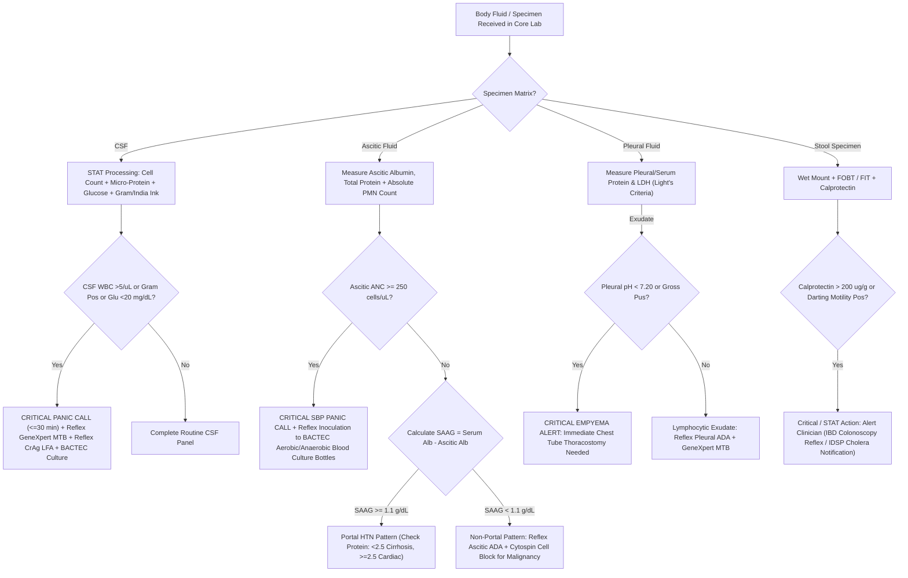

# 🔬 Cluster 5.2: Stool, Semen & Body Fluid Analysis Master Quality & Metrology Manual

**Sawariya Diagnostic Lab, Charkhi Dadri, Haryana**  
**Document ID:** `SDL-CP-CLUSTER-5.2` | **Version:** `3.0` | **Effective Date:** `2026-10-16` | **Review Cycle:** Annual  
**Department:** Clinical Pathology, Body Fluids & Andrology | **Applicability:** Main Processing Laboratory & STAT Emergency Bench  

---

## 🗂️ 1. Master Administrative Sign-Off, Quality Architecture & Metrological Traceability

### 1.1 Document Control & Administrative Authorization Block
| Process Step | Designated Clinical / Metrological Authority | Academic Credentials & Affiliation | Signature & Date |
| :--- | :--- | :--- | :--- |
| **Drafted & Metrologically Verified By** | Dr. A. Sharma, MD | Consultant Clinical Pathologist, Sawariya Diagnostic Lab | Signed Electronically — 2026-10-14 |
| **Technical Bench Operations Verified By** | Technical Operations Manager | Senior Technical Officer (M.Sc. Medical Lab Technology) | Signed Electronically — 2026-10-14 |
| **Quality Architecture Reviewed By** | Quality Assurance Manager | Lead NABL Auditor (ISO 15189:2022 / NABL 112 / 129) | Signed Electronically — 2026-10-15 |
| **Approved & Issued for Clinical Use By** | Director of Laboratory Medicine | Senior Consultant Pathologist & Head of Lab Medicine | Signed Electronically — 2026-10-16 |

### 1.2 International Regulatory & Standard Traceability Matrix
This Cluster Document operationalizes the following normative standards across all fluid matrices:
- **ISO 15189:2022:** Clauses 4.1–4.3 (Impartiality, Confidentiality, Patient Rights); Clauses 5.1–5.6 (Structural & Governance Architecture); Clauses 6.2–6.8 (Personnel Competence, Environmental Controls, Metrological Equipment Traceability, Reagent Verification); Clauses 7.2–7.8 (Pre-examination Handling, Method Verification, Measurement Uncertainty, Quality Control, STAT Turnaround, Post-examination Review, Critical Value Reporting); Clause 8 (Management System, Quantitative Risk Management, and Continual Improvement).
- **NABL Criteria:** NABL 112 (*Criteria for Laboratory Accreditation*); NABL 129 (*Specific Criteria for Clinical Pathology*); NABL 131 (*Policies on IQC and EQAS*); NABL 163 (*Specific Criteria for Cytopathology & Body Fluid Analysis*).
- **International Specialty Frameworks:** **WHO Laboratory Manual for the Examination and Processing of Human Semen (6th Edition, 2021)**; **CLSI H56-A** (*Body Fluid Analysis for Cellular Composition*); **CLSI C49-A** (*Analysis of Body Fluids in Clinical Chemistry*); **CLSI GP47** (*Management of Critical Values*); **CLSI EP15-A3 / EP06-Ed2 / EP17-A2** (Precision, Linearity, Detection Limits); Light's Criteria for Pleural Fluid; Runyon Criteria for Peritoneal Fluid; ATS/ERS Bronchoalveolar Lavage Guidelines.

### 1.3 Master Multi-Terminology Directory (`5.2.1` – `5.2.9`)
| Test ID | Individual SOP Description | Primary LOINC Code | SNOMED-CT Specimen / Concept | ICD-10-CM / ICD-11 Mapping | Primary Analytical Platform | STAT / Routine TAT |
| :--- | :--- | :--- | :--- | :--- | :--- | :--- |
| **`5.2.1`** | Stool Routine, Microscopy, Ova/Cyst & Hanging Drop | `24355-0` | `119339001` / `167593003` | `A06.0` (Amebiasis) / `1A36.0`; `A00.9` (Cholera) | Standard Saline + Lugol's Mount + Hanging Drop Phase-Contrast | STAT: 20 min; Routine: 90 min |
| **`5.2.2`** | Fecal Occult Blood (`FIT` vs `gFOBT`), pH & Reducing Sugars | `29771-3` (FIT); `27925-7` (Reducing) | `119339001` / `252156002` | `K92.1` (Melena); `E73.9` (Lactose Intolerance) | Anti-Human Globin FIT (Cutoff $50\text{ ng/mL}$) + Benedict's Assay | STAT: 30 min; Routine: 2 hr |
| **`5.2.3`** | Fecal Calprotectin & Pancreatic Elastase-1 CLIA | `38445-3` (Calprotectin); `25907-7` (Elastase) | `119339001` / `440580006` | `K50.9` (Crohn's); `K86.81` (Pancreatic Exocrine Insufficiency) | Snibe MAGLUMI X3 Flash-CLIA / Backup Monoclonal Sandwich ELISA | STAT: N/A; Routine: 4–6 hr |
| **`5.2.4`** | Semen Analysis (WHO 6th Edition, 2021) | `50666-7` | `119347001` / `28191009` | `N46.9` (Male Infertility); `Z98.52` (Post-Vasectomy Status) | Improved Neubauer Chamber + Phase-Contrast ($37^\circ\text{C}$) + Eosin-Nigrosin | STAT: N/A; Routine: 2–3 hr |
| **`5.2.5`** | Pleural Fluid Complete Analysis (Light's & ADA) | `24359-2` | `418564007` / `278450005` | `J90` (Pleural Effusion); `A15.6` (TB Pleurisy); `J86.9` (Empyema) | Bonavera Chem 400 (Protein, LDH, ADA, Glu) + Neubauer Chamber | STAT: 45 min; Routine: 2 hr |
| **`5.2.6`** | Ascitic / Peritoneal Fluid Analysis (SAAG & SBP) | `24358-4` | `168139001` / `278450005` | `R18.8` (Ascites); `K65.2` (Spontaneous Bacterial Peritonitis) | Paired Serum-Ascites Albumin Gradient + Absolute PMN Neubauer Count | STAT (PMN): 30 min; Routine: 2 hr |
| **`5.2.7`** | Emergency Cerebrospinal Fluid (CSF) Analysis | `24360-0` | `258450006` / `278450005` | `G00.9` (Bacterial Meningitis); `I60.9` (Subarachnoid Hemorrhage) | 4-Tube Sequential Protocol + Bonavera Chem 400 + Cytospin Differential | STAT Emergency: $\le 30\text{--}45\text{ min}$ |
| **`5.2.8`** | Synovial Joint Fluid Analysis & Polarized Crystal Exam | `24361-8` | `119332005` / `278450005` | `M00.9` (Septic Arthritis); `M10.9` (Gout); `M11.2` (CPPD Pseudogout) | First-Order Red Compensated Polarized Microscopy + Mucin Clot Test | STAT: 45 min; Routine: 2 hr |
| **`5.2.9`** | Pericardial & Bronchoalveolar Lavage (BAL) Fluid | `14311-5` (Pericardial); `33622-2` (BAL) | `122571007` / `258607008` | `I31.3` (Pericardial Effusion); `J84.10` (ILD / DAH); `B59` (PCP) | Light's Criteria + BAL Cytospin Differential (ATS/ERS 300-Cell Count) | STAT: 60 min; Routine: 3 hr |

### 1.4 Metrological Traceability Hierarchy (ISO 17511:2020)
| Measurand / Property | Certified Reference Material (CRM) / Standard | Calibration Hierarchy & Reference Measurement Procedure | Primary Analytical Platform | Traceability Standard |
| :--- | :--- | :--- | :--- | :--- |
| **Chamber Cell Counting** | NIST SRM 2800 Stage Micrometer ($10\text{ }\mu\text{m}$ grid) | Optical calibration of chamber depth ($0.100\text{ mm} \pm 0.001\text{ mm}$) + gravimetric pipette verification | Improved Neubauer Hemocytometer | ISO 15189:2022 / CLSI H56-A |
| **Fluid Total Protein & Albumin** | NIST SRM 927f (Bovine / Human Serum Albumin) | Biuret reaction (Protein) / Bromocresol Green (Albumin) secondary calibrators | Bonavera Chem 400 / Chem 200 | ISO 17511:2020 |
| **Fluid LDH & Glucose** | IFCC Primary Reference Material / NIST SRM 917c | IFCC $37^\circ\text{C}$ kinetic UV (LDH) / Hexokinase enzymatic primary standard (Glucose) | Bonavera Chem 400 / Chem 200 | IFCC / ISO 17511 |
| **Fluid ADA (Adenosine Deaminase)** | Recombinant Adenosine Deaminase Standard | Giusti & Galanti colorimetric enzymatic deamination assay | Bonavera Chem 400 | Consensus Enzyme Units |
| **Fecal Calprotectin & Elastase-1** | Recombinant Human S100A8/A9 & Pancreatic Elastase-1 | Multi-point master calibrators calibrated against mass spectrometry reference standards | Snibe MAGLUMI X3 Flash-CLIA | ISO 17511:2020 ($\mu\text{g/g}$) |

---

## 🔬 2. Comprehensive Clinical Pathology Architectural Framework

### 2.1 Stool Examination: Physical, Microscopic, Chemical & Advanced Inflammatory Biomarkers
- **Macroscopic Staging & Bristol Stool Form Scale (BSFS 1–7):**
| Bristol Stool Type | Physical Morphology | Colonic Transit Time | Stool Water Content | Primary Clinical Interpretation |
| :--- | :--- | :--- | :--- | :--- |
| **Type 1** | Separate hard lumps, like nuts (hard to pass) | $> 100\text{ hours}$ | $< 65\%$ | Severe colonic slow-transit constipation |
| **Type 2** | Sausage-shaped, but lumpy | $70\text{--}100\text{ hours}$ | $65\text{--}70\%$ | Mild chronic constipation |
| **Type 3** | Like a sausage with cracks on surface | $40\text{--}70\text{ hours}$ | $70\text{--}75\%$ | Normal stool form |
| **Type 4** | Smooth and soft, like a snake or sausage | $24\text{--}40\text{ hours}$ | $75\text{--}80\%$ | Ideal, physiological normal stool form |
| **Type 5** | Soft blobs with clear-cut edges | $18\text{--}24\text{ hours}$ | $80\text{--}85\%$ | Lack of dietary fiber / mild fast transit |
| **Type 6** | Fluffy pieces with ragged edges, mushy | $10\text{--}18\text{ hours}$ | $85\text{--}90\%$ | Mild diarrhea / malabsorption / inflammation |
| **Type 7** | Entirely liquid, watery, no solid pieces | $< 10\text{ hours}$ | $> 90\%$ | Severe secretory or osmotic diarrhea |
- **Standardized Microscopic Wet Mount Protocols:**
  - *Direct Saline ($0.85\%$ NaCl) Mount:* Emulsify ~2 mg fresh stool in one drop of normal saline. Detects motile protozoan trophozoites (*Entamoeba histolytica* demonstrating rapid unidirectional pseudopodial motility with ingested erythrocytes [erythrophagocytosis], differentiating it from commensal *E. dispar*), helminth ova, larvae, cellular exudates (leukocytes, RBCs), and fungal elements.
  - *Lugol's Iodine ($1\%$) Mount:* Enhances nuclear chromatin patterns and intracytoplasmic glycogen masses of protozoan cysts (*Giardia lamblia* quadrinucleate oval cysts with central axostyle; *E. histolytica* tetranucleate spherical cysts with smooth chromatoid bars; *Entamoeba coli* 8-nucleated mature cysts).
  - *Formalin-Ethyl Acetate Concentration Technique:* Emulsify 1 g stool in 10 mL $10\%$ formalin; strain through double-layer gauze; add 3 mL ethyl acetate; centrifuge at $500\times g$ for 10 minutes. Four distinct layers form: ethyl acetate (top), debris plug, formalin layer, and concentrated sediment (bottom). Decant supernatant and examine sediment; increases parasite detection sensitivity by $> 40\%$.
  - *Modified Kinyoun Acid-Fast (Cold ZN) Stain:* Mandatory for chronic diarrhea in immunocompromised hosts. Smears fixed in absolute methanol; stained with cold carbol fuchsin for 15 min; decolorized with $1\%$ sulfuric acid; counterstained with methylene blue. Identifies intestinal coccidian oocysts: *Cryptosporidium parvum/hominis* ($4\text{--}6\text{ }\mu\text{m}$, round, brilliant pink-red against green background); *Cyclospora cayetanensis* ($8\text{--}10\text{ }\mu\text{m}$, variably acid-fast with internal globule); *Cystoisospora belli* ($20\text{--}33\text{ }\mu\text{m}$, large spindle-shaped elliptical oocysts containing 1–2 sporoblasts).
- **Fecal Occult Blood: Guaiac (`gFOBT`) vs Fecal Immunochemical Test (`FIT`):**
  - *Guaiac FOBT:* Relies on pseudoperoxidase activity of heme turning alpha-guaiaconic acid blue in the presence of hydrogen peroxide. Highly susceptible to false-positives from dietary red meat (bovine hemoglobin), cruciferous vegetables (broccoli, cauliflower, horseradish containing plant peroxidases), and NSAIDs; false-negatives from ascorbic acid (Vitamin C $> 250\text{ mg/day}$) which blocks oxidation. Requires 3-day strict dietary restriction.
  - *Fecal Immunochemical Test (FIT):* Uses specific monoclonal antibodies against intact human globin. Upper GI bleeding is digested by gastric proteases into heme and globin fragments, rendering FIT exquisitely specific for lower colorectal bleeding ($> 10\text{ }\mu\text{g Hb/g stool}$ or $50\text{ ng/mL}$). Requires zero dietary or pharmacologic restrictions.
- **Fecal Chemical Testing:**
  - *Stool pH:* Normal is $7.0\text{--}7.5$. A fecal $\text{pH} < 5.5$ is strongly indicative of carbohydrate malabsorption due to colonic bacterial fermentation of unabsorbed sugars into lactic acid and short-chain fatty acids.
  - *Fecal Reducing Substances (Benedict's Qualitative Assay):* Mix 1 part liquid stool with 2 parts distilled water; centrifuge; react supernatant with equal volume Benedict's qualitative reagent and boil for 5 minutes. Presence of reducing sugars ($\ge 0.5\text{ g/dL}$ or $\ge 2+$ color change from green to orange-red) confirms disaccharidase (lactase) deficiency in pediatric osmotic diarrhea.
- **Advanced Stool Biomarkers (Snibe MAGLUMI X3 Flash-CLIA):**
  - *Fecal Calprotectin:* Neutrophil-specific calcium/zinc-binding protein complex ($S100A8/S100A9$). Stable in feces for up to 7 days at room temperature. Clinical Decision Limits: $< 50\text{ }\mu\text{g/g}$ (Normal / Non-inflammatory irritable bowel syndrome [IBS], NPV $> 98\%$ for active IBD); $50\text{--}200\text{ }\mu\text{g/g}$ (Borderline; repeat in 2–4 weeks after discontinuing NSAIDs/PPIs); $> 200\text{--}250\text{ }\mu\text{g/g}$ (Active mucosal inflammation; diagnostic of inflammatory bowel disease [Crohn's disease or Ulcerative Colitis], mandates colonoscopy).
  - *Fecal Pancreatic Elastase-1:* Highly stable pancreas-specific enzyme that traverses gut lumen intact without degradation. Unaffected by exogenous porcine pancreatic enzyme replacement therapy (PERT). Clinical Decision Limits: $> 200\text{ }\mu\text{g/g}$ (Normal exocrine pancreatic function); $100\text{--}200\text{ }\mu\text{g/g}$ (Mild-to-moderate exocrine pancreatic insufficiency [EPI]); $< 100\text{ }\mu\text{g/g}$ (Severe exocrine pancreatic insufficiency, requiring high-dose enzyme supplementation). *Pre-analytical Warning:* Stool must be solid or semi-formed; liquid/watery diarrhea causes dilutional false-positive EPI results.

### 2.2 Seminogram: WHO 6th Edition (2021) Standardized Architecture
The WHO 6th Edition (2021) establishes lower 5th percentile reference distribution limits derived from fertile men whose partners achieved pregnancy within 12 months:
- **Pre-analytical Protocol:** Mandatory sexual abstinence interval of 2 to 7 days (exact days and hours recorded). Complete ejaculate collected by masturbation directly into a sterile, toxic-free, wide-mouth polypropylene container. Specimen collected in private laboratory collection suite or delivered within 30–45 minutes while maintaining ambient body temperature ($20\text{--}37^\circ\text{C}$). Ejaculate loss (especially the first sperm-rich fraction) invalidates volume, concentration, and total count.
- **Macroscopic Physical Characteristics:**
  - *Liquefaction Kinetics:* Normal specimen liquefies within 15–30 minutes at $37^\circ\text{C}$ by action of prostatic serine proteases (PSA). If unliquefied after 60 minutes, report as delayed liquefaction; mechanical dissociation with a wide-bore Pasteur pipette or bromelain enzymatic digestion ($10\text{ mg/mL}$) is required before counting.
  - *Viscosity:* Evaluated by allowing semen to drop by gravity from a 5 mL pipette. Normal forms distinct drops or a thread $< 2\text{ cm}$. Thread length $> 2\text{ cm}$ denotes hyperviscosity (prostatic/seminal vesicle inflammation).
  - *Appearance & Odor:* Normal is translucent or grey-opalescent; yellowish suggests pyospermia, jaundice, or flavin-rich multivitamins; reddish-brown indicates hematospermia. Characteristic normal odor is musky/bleach-like (spermidine oxidation).
  - *Ejaculate Volume:* Measured gravimetrically by weighing collection container with sample and subtracting tare weight (assuming semen density $1.0\text{ g/mL}$), or via positive displacement pipette. **WHO 6th Ed Lower Reference Limit: $\ge 1.4\text{ mL}$** (updated from $1.5\text{ mL}$ in 5th Ed). Volumes $< 1.4\text{ mL}$ indicate hypospermia (retrograde ejaculation, CBAVD, ejaculatory duct obstruction).
  - *Semen pH:* Measured using narrow-range pH paper ($6.0\text{--}10.0$). **WHO 6th Ed Limit: $\ge 7.2$**. An acidic $\text{pH} < 7.0$ in an azoospermic, low-volume specimen confirms congenital bilateral absence of vas deferens (CBAVD) or complete seminal vesicle obstruction (absence of alkaline seminal vesicle fluid).
- **Microscopic Examination & Kinetic Motility:**
  - *Motility Assessment ($37^\circ\text{C}$ Phase-Contrast):* Read exactly 30–60 minutes post-ejaculation on a wet preparation ($10\text{ }\mu\text{L}$ semen under $22 \times 22\text{ mm}$ coverslip, $20\text{ }\mu\text{m}$ chamber depth). Minimum 200 spermatozoa counted in duplicate across $\ge 5$ random fields. Classified into:
    1. **Progressive Motility (`PR`):** Sperm moving actively, either linearly or in a large circle, regardless of speed. **Decision Limit: $\ge 30\%$**.
    2. **Non-Progressive Motility (`NP`):** All other patterns of motility with absence of progression (swimming in small circles, flagellar displacement only).
    3. **Immotile (`IM`):** Completely non-moving spermatozoa.
    4. **Total Motility (`PR + NP`): Decision Limit: $\ge 42\%$**. Asthenozoospermia is diagnosed when $\text{PR} < 30\%$ or $\text{Total Motility} < 42\%$.
  - *Sperm Vitality (Membrane Integrity):* Evaluated when $\text{PR} < 40\%$. Assessed using Eosin-Nigrosin dye exclusion (dead cells have porous membranes admitting eosin and staining pink; live cells exclude dye and remain white) or Hypo-osmotic Swelling (HOS) test ($150\text{ mOsm/kg}$ fructose-citrate solution causing live sperm tails to curl). **Decision Limit: $\ge 54\%$ viable spermatozoa**. Differentiates true Necrozoospermia (dead sperm, low viability) from Asthenozoospermia (immotile but viable, membrane-intact sperm suitable for ICSI).
  - *Sperm Concentration & Total Sperm Number (Improved Neubauer Chamber):* Diluted 1:20 in formalin-sodium bicarbonate fixative ($50\text{ g}$ $\text{NaHCO}_3$, $10\text{ mL}$ $35\%$ formalin in $1,000\text{ mL}$ $\text{dH}_2\text{O}$). Both hemocytometer chambers filled and allowed to settle for 5 minutes in a humid chamber. Minimum 200 sperm counted per chamber. Replicate counts must agree within Poisson 95% confidence intervals.
    $$\text{Sperm Concentration (M/mL)} = \frac{N \text{ (sperm counted)}}{A \text{ (area in }\text{mm}^2) \times D \text{ (depth } 0.1\text{ mm})} \times \text{Dilution Factor} \div 10^3$$
    - **Sperm Concentration Limit: $\ge 16 \times 10^6\text{ spermatozoa/mL}$** (updated from $15 \times 10^6\text{/mL}$).
    - **Total Sperm Count per Ejaculate Limit: $\ge 39 \times 10^6\text{ spermatozoa/ejaculate}$**.
  - *Kruger / Tygerberg Strict Sperm Morphology:* Assessed on thin, air-dried smears fixed in $95\%$ ethanol and stained with Papanicolaou or rapid Diff-Quik. Scored under $100\times$ oil immersion examining head (smooth oval outline, length $4.0\text{--}5.0\text{ }\mu\text{m}$, width $2.5\text{--}3.5\text{ }\mu\text{m}$, well-defined acrosome occupying $40\text{--}70\%$ of head area, absence of large vacuoles), neck/midpiece (slender, aligned with long axis, length $7.0\text{--}8.0\text{ }\mu\text{m}$, no cytoplasmic droplet $> 1/3$ head size), and principal tail piece (uniform calibre, uncoiled, length $\sim 45\text{ }\mu\text{m}$). Any borderline form is classified as abnormal. **Decision Limit: $\ge 4.0\%$ normal strictly formed spermatozoa**. Teratozoospermia diagnosed if normal forms $< 4.0\%$.
    - *Teratozoospermia Index (TZI):* Calculated to quantify multiple structural anomalies per abnormal spermatozoon:
      $$\text{TZI} = \frac{\text{Head Defects} + \text{Neck/Midpiece Defects} + \text{Tail Defects} + \text{Cytoplasmic Droplets}}{\text{Total Number of Abnormal Spermatozoa}}$$
      A $\text{TZI} > 1.60$ is strongly associated with failed fertilization during conventional in-vitro fertilization (IVF).
  - *Round Cell Differentiation & Leukocytospermia:* Round cells include immature germ cells (spermatocytes/spermatids) and polymorphonuclear leukocytes. Differentiated via Peroxidase staining (Endtz test using o-toluidine and hydrogen peroxide; peroxidase-positive granulocytes stain dark brown, whereas germ cells remain unstained). **Diagnostic Threshold: Leukocytospermia is diagnosed when peroxidase-positive leukocytes $> 1.0 \times 10^6\text{/mL}$**, indicating male accessory gland infection (MAGI / prostatitis) requiring antimicrobial workup.
  - *Definitive Azoospermia Protocol:* Centrifugation of entire ejaculate at $3,000\times g$ for 15 minutes. Micro-pellet thoroughly examined under phase-contrast across entire slide. True Azoospermia requires zero sperm in pellet; presence of even a single sperm reclassifies as Cryptozoospermia.

### 2.3 Pleural Fluid Analysis: Light's Criteria, ADA, GeneXpert & Exudate Stratification
- **Diagnostic Thoracentesis Triad (Light's Criteria):** Effusion classified as an **Exudate** if it meets one or more of the following three criteria (sensitivity $98\%$, specificity $83\%$):
  1. $\text{Ratio of Pleural Fluid Total Protein to Serum Total Protein} > 0.50$
  2. $\text{Ratio of Pleural Fluid LDH to Serum LDH} > 0.60$
  3. $\text{Pleural Fluid LDH} > \frac{2}{3}\text{ of the upper limit of normal (ULN) for Serum LDH}$ (at Sawariya Lab: Bonavera Chem 400 Serum LDH ULN is $250\text{ U/L}$, threshold is $> 166.7\text{ U/L}$).
- **Transudate Misclassification & Gradient Corrections:** In congestive heart failure patients on loop diuretics, fluid reabsorption concentrates pleural protein and LDH, causing false-positive exudative classification. When clinically discordant, calculate:
  - *Serum-Pleural Albumin Gradient:* $\text{Serum Albumin} - \text{Pleural Albumin} > 1.2\text{ g/dL}$ establishes a true **Transudate**.
  - *Serum-Pleural Protein Gradient:* $\text{Serum Total Protein} - \text{Pleural Total Protein} > 3.1\text{ g/dL}$ confirms a true **Transudate**.
- **Pleural Effusion Differential Matrix:**
| Effusion Etiology | Protein Ratio | LDH Ratio | Pleural Glucose | Fluid Cell Count & Cytology | Key Specific Biomarker Cutoff |
| :--- | :--- | :--- | :--- | :--- | :--- |
| **Congestive Heart Failure** | $\le 0.50$ | $\le 0.60$ | Equal to Serum | $\text{WBC} < 1,000/\mu\text{L}$; Mononuclear | Transudate; Albumin Gradient $> 1.2\text{ g/dL}$ |
| **Tuberculous Pleuritis** | $> 0.50$ | $> 0.60$ | $30\text{--}60\text{ mg/dL}$ | $\text{WBC } 1,000\text{--}5,000/\mu\text{L}$; $> 80\%$ Lymphocytes | $\text{ADA} > 40\text{ U/L}$; GeneXpert MTB pos |
| **Complicated Parapneumonic** | $> 0.50$ | $> 1.0$ (High) | $< 40\text{ mg/dL}$ | $\text{WBC } 10,000\text{--}50,000/\mu\text{L}$; $> 90\%$ PMNs | $\text{Pleural pH} < 7.20$; Chest tube indicated |
| **Empyema** | $> 0.50$ | Markedly High | Very Low ($< 20$) | Frank Pus; Heavy PMNs & Debris | Positive Gram stain / Culture; Immediate Tube |
| **Malignant Pleural Effusion** | $> 0.50$ | $> 0.60$ | Often $< 60\text{ mg/dL}$ | Mixed Lymphocytes + Atypical Cells | Cytospin & Cell Block IHC (Ber-EP4, Calretinin) |
| **Chylothorax** | Variable | Variable | Equal to Serum | Lymphocyte-rich creamy milky fluid | Pleural Triglycerides $> 110\text{ mg/dL}$ |

### 2.4 Ascitic / Peritoneal Fluid Analysis: SAAG Gradient & SBP Neutrophil Criterion
- **Serum-Ascites Albumin Gradient (SAAG) Framework:** Replaced legacy transudate/exudate classification with $97\%$ diagnostic accuracy:
  $$\text{SAAG} = \text{Serum Albumin (g/dL)} - \text{Ascitic Fluid Albumin (g/dL)}$$
  *(Note: Serum and ascitic paracentesis specimens must be drawn concurrently within a 30–60 minute window).*
  - **High SAAG ($\ge 1.1\text{ g/dL}$) — Portal Hypertension Present:**
    - *Ascitic Fluid Total Protein $< 2.5\text{ g/dL}$ (Sinusoidal Portal Hypertension):* Cirrhosis (post-hepatitic, alcoholic, NASH), acute liver failure, massive liver metastases.
    - *Ascitic Fluid Total Protein $\ge 2.5\text{ g/dL}$ (Post-Sinusoidal / Cardiac Portal Hypertension):* Congestive heart failure, constrictive pericarditis, early Budd-Chiari syndrome, inferior vena cava obstruction.
  - **Low SAAG ($< 1.1\text{ g/dL}$) — Normal Portal Pressure (Peritoneal Disease):**
    - Peritoneal carcinomatosis (malignant cells on cytology), Tuberculous peritonitis (elevated ADA $\ge 30\text{--}40\text{ U/L}$, lymphocytic pleocytosis), Pancreatic ascites (ascitic amylase $> 1,000\text{ U/L}$), Nephrotic syndrome (protein $< 2.5\text{ g/dL}$, severe systemic hypoalbuminemia), Biliary peritonitis (ascitic bilirubin $>$ serum bilirubin and $> 6.0\text{ mg/dL}$).
- **Ascitic Fluid Etiological Differential Table:**
| Etiology | SAAG (g/dL) | Ascitic Protein (g/dL) | Ascitic WBC (/μL) | Predominant Cell | Other Key Discriminator Parameters |
| :--- | :--- | :--- | :--- | :--- | :--- |
| **Cirrhosis** | $\ge 1.1$ | $< 2.5$ | $< 500$ | Mesothelial / Mono | $\text{ANC} < 250/\mu\text{L}$; Normal Amylase |
| **Cardiac Ascites** | $\ge 1.1$ | $\ge 2.5$ | $< 1,000$ | Mononuclear | Elevated venous pressure; High serum NT-proBNP |
| **Spontaneous Bacterial Peritonitis** | $\ge 1.1$ | $< 2.5$ | $> 500$ | PMN ($> 50\%$) | **$\text{ANC} \ge 250/\mu\text{L}$ (Gold Standard Alert)** |
| **Peritoneal Carcinomatosis** | $< 1.1$ | $\ge 2.5$ | $> 1,000$ | Atypical / Malignant | Positive Cytology & Cell Block IHC (Ber-EP4) |
| **Tuberculous Peritonitis** | $< 1.1$ | $\ge 2.5$ | $500\text{--}2,000$ | Lymphocytes ($> 70\%$) | Ascitic $\text{ADA} \ge 30\text{--}40\text{ U/L}$; GeneXpert MTB pos |
| **Pancreatic Ascites** | $< 1.1$ | $\ge 2.5$ | Variable | Mixed PMN / Mono | Ascitic Amylase $> 1,000\text{--}20,000\text{ U/L}$ |
- **Spontaneous Bacterial Peritonitis (SBP) Diagnostic Workup:**
  - **Gold Standard Diagnostic Cutoff:** Ascitic fluid **Absolute Neutrophil Count ($\text{ANC}$) $\ge 250\text{ cells/}\mu\text{L}$** ($0.25 \times 10^9\text{/L}$), calculated as $\text{Total Nucleated Cell Count} \times \%\text{ Polymorphonuclear Leukocytes (PMN)}$.
  - *Correction for Traumatic Paracentesis:* In bloody taps, subtract 1 PMN for every 250 RBCs:
    $$\text{Corrected Ascitic ANC} = \text{Observed ANC} - \left(\frac{\text{Ascitic RBC Count}}{250}\right)$$
  - Immediate critical telephone notification within $\le 30\text{ minutes}$ is mandatory to prompt empiric IV 3rd-generation cephalosporin therapy (Cefotaxime / Ceftriaxone) before culture finalization.
  - *Bedside Blood Culture Inoculation:* Inoculating $10\text{ mL}$ of ascitic fluid directly into aerobic and anaerobic blood culture bottles at the bedside increases organism isolation yield from $40\%$ to $> 85\%$.
  - *Secondary Bacterial Peritonitis (Runyon's Criteria):* Suspected in hollow viscus perforation. Diagnosed when ascitic fluid meets at least 2 of the following 3 criteria:
    1. Total Protein $> 1.0\text{ g/dL}$
    2. Glucose $< 50\text{ mg/dL}$
    3. $\text{LDH} > \text{Upper Limit of Normal for Serum LDH}$
    *(Polymicrobial flora on Gram stain strongly corroborates secondary peritonitis).*

### 2.5 Synovial Joint Fluid Analysis: Polarized Microscopy & Septic Arthritis Thresholds
- **Arthrocentesis Specimen Processing Tubes:**
  - *Tube 1 (Liquid K2-EDTA or Sodium Heparin):* For total leukocyte count and polarized crystal examination. Dry powder EDTA or lithium heparin crystals must never be used, as dissolving crystal artifacts mimic CPPD or urate.
  - *Tube 2 (Sterile Plain Tube):* For microbiological Gram stain, aerobic/anaerobic cultures, and fungal cultures.
  - *Tube 3 (Sodium Fluoride / Potassium Oxalate):* For synovial fluid glucose determination (compared with simultaneous fasting blood glucose).
- **Physical Characteristics & Viscosity:**
  - *Color and Clarity:* Normal synovial fluid is crystal clear or pale straw-colored, viscous, and non-clotting (lacks fibrinogen). Inflammatory fluid is translucent-to-opaque yellow; septic fluid is purulent, grey-green, or opaque; traumatic/hemorrhagic fluid displays uniform frank blood (xanthochromic supernatant indicates pre-existing hemarthrosis).
  - *Viscosity Evaluation:* Assessed by the "String Test" (dropping fluid from syringe needle; normal thread measures $3\text{--}5\text{ cm}$; drops falling like water indicate inflammatory degradation of hyaluronic acid by leukocyte hyaluronidases). Mucin clot test performed by adding fluid to $2\%$ glacial acetic acid (normal forms firm, tight clot; poor friable clot indicates inflammatory joint disease).
  - *Crystal Examination Time Window:* Crystals must be examined within 4 to 6 hours of arthrocentesis at room temperature. Synovial fluid must never be frozen, as ice crystal formation disrupts leukocyte membranes and dissolves urate crystals.
- **Polarized Light Microscopy with First-Order Red Compensator ($\lambda = 530\text{--}550\text{ nm}$):**
  - **Monosodium Urate (MSU) Crystals (Acute Gouty Arthritis):**
    - *Morphology:* Fine, needle-shaped or pointed rod-like crystals ($2\text{--}20\text{ }\mu\text{m}$), frequently engulfed within neutrophils (phagocytosis during acute attack) or free-floating.
    - *Birefringence:* **Strong Negative Birefringence**. When the long axis of the crystal is oriented **parallel** to the slow vibration axis of the red compensator plate, the crystal exhibits yellow interference color (**Yellow when Parallel**); when oriented **perpendicular**, it appears bright blue (**Blue when Perpendicular**).
  - **Calcium Pyrophosphate Dihydrate (CPPD) Crystals (Pseudogout / Chondrocalcinosis):**
    - *Morphology:* Small, rectangular, rhomboid, or parallelepiped crystals ($1\text{--}10\text{ }\mu\text{m}$), demonstrating blunt ends.
    - *Birefringence:* **Weak Positive Birefringence**. When oriented **parallel** to the slow axis of the compensator, the crystal appears blue (**Blue when Parallel**); when oriented **perpendicular**, it appears yellow (**Yellow when Perpendicular**).
- **Septic Arthritis vs Inflammatory Synovial Stratification:**
  - Normal: $\text{WBC} < 200/\mu\text{L}$, PMN $< 25\%$, Clear, High viscosity.
  - Non-inflammatory (Osteoarthritis): $\text{WBC} < 2,000/\mu\text{L}$, PMN $< 25\%$, Clear-yellow, High viscosity.
  - Inflammatory (Rheumatoid, Gout, Pseudogout): $\text{WBC } 2,000\text{--}50,000/\mu\text{L}$, PMN $> 50\%$, Cloudy yellow, Low viscosity.
  - **Septic Arthritis:** **$\text{WBC} > 50,000/\mu\text{L}$ (often $> 100,000/\mu\text{L}$)** with **$> 75\text{--}90\%$ PMNs**, opaque/purulent, low glucose ($< 50\%$ serum level). In prosthetic joints, septic cutoff is lower: $\text{WBC} > 1,100\text{--}3,000/\mu\text{L}$ with $> 65\text{--}80\%$ PMNs.
  - *Critical Diagnostic Rule:* Identification of MSU or CPPD crystals does NOT exclude coexisting septic arthritis; simultaneous Gram stain and culture are mandatory.

### 2.6 Emergency Cerebrospinal Fluid (CSF) Analysis & Meningitis Differential
- **Standardized 4-Tube Lumbar Puncture Protocol:**
  - *Tube 1 (Chemistry & Immunology):* Total protein, glucose, lactate, ADA, IgG index, oligoclonal bands.
  - *Tube 2 (Microbiology):* Gram stain, ZN/Auramine AFB stain, India ink, cryptococcal antigen, bacterial/fungal cultures, CBNAAT GeneXpert MTB/RIF.
  - *Tube 3 (Hematology & Cytology):* Total erythrocyte count, total leukocyte count, manual cytocentrifuge differential count.
  - *Tube 4 (Special Diagnostic Reserve / Storage):* Multiplex PCR viral panel, encephalitis antibodies, bio-banking at $-80^\circ\text{C}$.
- **Differentiation: Traumatic Lumbar Puncture vs Subarachnoid Hemorrhage (SAH):**
  - *Traumatic Tap:* Progressive visual clearing from Tube 1 to Tube 4; centrifuged supernatant is water-clear; RBC count decreases $> 50\%$ from Tube 1 to Tube 4; no erythrophages/hemosiderin on cytospin; absence of spectrophotometric xanthochromia.
  - *Aneurysmal Subarachnoid Hemorrhage (SAH):* Equal, uniform gross blood across all 4 tubes without clearing; centrifuged supernatant is pink, orange, or canary yellow (**Xanthochromia**) within 2 to 12 hours of ictus due to in-vivo oxyhemoglobin ($415\text{ nm}$) and bilirubin ($450\text{--}460\text{ nm}$) breakdown; cytospin demonstrates erythrophages and hemosiderin-laden macrophages (siderophages).
  - *Spectrophotometric Xanthochromia Quantification (UK NEQAS Formula):* Wavelength scan from $350\text{--}600\text{ nm}$. Net Bilirubin Absorbance ($NBA$) at $476\text{ nm}$ is computed as:
    $$NBA = A_{476} - \left(A_{450} + \frac{26}{85} \times (A_{535} - A_{450})\right)$$
    An $NBA > 0.007\text{ AU}$ confirms genuine xanthochromia and prior subarachnoid hemorrhage.
- **Meningitis Differential Diagnosis Matrix:**
| Diagnostic Parameter | Normal Baseline | Acute Bacterial Meningitis | Viral (Aseptic) Meningitis | Tuberculous Meningitis | Fungal (Cryptococcal) |
| :--- | :--- | :--- | :--- | :--- | :--- |
| **Opening Pressure** | $70\text{--}180\text{ mm H}_2\text{O}$ | Markedly Elevated ($> 250\text{ mm}$) | Normal to Mildly Elevated | Markedly Elevated ($> 250\text{ mm}$) | Markedly Elevated ($> 300\text{ mm}$) |
| **Total WBC Count** | $0\text{--}5\text{ cells/}\mu\text{L}$ (mononuclear) | $1,000\text{--}10,000+\text{ cells/}\mu\text{L}$ | $50\text{--}500\text{ cells/}\mu\text{L}$ | $100\text{--}500\text{ cells/}\mu\text{L}$ | $20\text{--}500\text{ cells/}\mu\text{L}$ |
| **Differential Leukocytes** | $100\%$ Lymphocytes/Monocytes | Neutrophil Dominant ($> 80\%$) | Lymphocyte Dominant ($> 80\%$) | Lymphocyte Dominant ($> 70\text{--}80\%$) | Lymphocyte Dominant |
| **CSF-to-Serum Glucose Ratio** | $0.60\text{--}0.70$ (Absolute $45\text{--}80$) | Markedly Decreased ($< 0.40$ or $< 20\text{ mg/dL}$) | Normal ($> 0.60$, $> 45\text{ mg/dL}$) | Markedly Decreased ($< 0.30$) | Decreased ($< 0.40$) |
| **CSF Total Protein** | $15\text{--}45\text{ mg/dL}$ | Markedly Elevated ($100\text{--}500+\text{ mg/dL}$) | Normal to Mild ($50\text{--}100\text{ mg/dL}$) | Markedly Elevated ($100\text{--}500\text{ mg/dL}$) | Elevated ($100\text{--}300\text{ mg/dL}$) |
| **CSF Lactate** | $< 2.1\text{ mmol/L}$ | Markedly Elevated ($> 3.5\text{--}4.0\text{ mmol/L}$) | Normal to Mildly Elevated ($< 2.5$) | Markedly Elevated ($> 4.0\text{ mmol/L}$) | Mildly Elevated ($> 2.8\text{ mmol/L}$) |
| **Microbiological Diagnostic** | Negative | Gram stain positive in $60\text{--}80\%$ | PCR positive (Entero/HSV/VZV) | ZN stain, ADA $> 10$, GeneXpert | India ink halo, CrAg LFA pos |

### 2.7 Pericardial & Bronchoalveolar Lavage (BAL) Fluid Analysis
- **Pericardial Fluid Analysis:** Normal volume is $15\text{--}50\text{ mL}$. Exudate defined by modified Light's criteria. Markedly elevated hematocrit ($> 50\%$ systemic) indicates hemopericardium (aortic dissection, myocardial rupture, traumatic laceration). Elevated pericardial ADA ($> 40\text{ U/L}$) indicates Tuberculous Pericarditis. Cytospin and cell block evaluation essential for metastatic carcinoma (lung, breast, lymphoma).
- **Bronchoalveolar Lavage (BAL) Fluid Cytology (ATS/ERS Guidelines):**
  - Standardized differential cell count based on 300 to 500 consecutive nucleated cells on cytospin preparations:
| Cell Lineage | Normal Reference Distribution (Non-Smoker) | Pathological Thresholds & Associated Clinical Entities |
| :--- | :--- | :--- |
| **Alveolar Macrophages** | $> 80\text{--}90\%$ | Decreased relative proportion in active alveolitis and interstitial lung disease (ILD). |
| **Lymphocytes** | $< 10\text{--}15\%$ | Marked lymphocytosis ($> 20\text{--}50\%$) indicates Hypersensitivity Pneumonitis, Sarcoidosis, or Drug Toxicity. |
| **Neutrophils** | $< 3\%$ | Elevated ($> 5\text{--}10\%$) in Acute Respiratory Distress Syndrome (ARDS), Idiopathic Pulmonary Fibrosis (IPF), or Bacterial Pneumonia. |
| **Eosinophils** | $< 1\%$ | Marked eosinophilia ($> 25\%$) establishes Acute Eosinophilic Pneumonia; $5\text{--}25\%$ indicates Churg-Strauss or ABPA. |
- **Special Cytochemical Staining on BAL:**
  - *Perl's Prussian Blue (Golde Score):* Quantifies hemosiderin-laden alveolar macrophages (siderophages). 100 macrophages graded from 0 to 4 based on intracellular iron density (Grade 0: no iron; Grade 1: light blue cytoplasm; Grade 2: deep blue fine granules; Grade 3: heavy coarse clumped hemosiderin; Grade 4: dark blue-black saturated clumped cytoplasm). Total Golde score is calculated as:
    $$\text{Golde Score} = \sum_{i=0}^{4} (\text{Grade } i \times \text{Number of Cells})$$
    A Golde score $> 100$ (out of 400) confirms Diffuse Alveolar Hemorrhage (DAH) associated with ANCA-associated vasculitis or Goodpasture syndrome.
  - *Oil-Red-O / Sudan Black:* Lipid-laden macrophage index ($> 100$) indicates chronic pulmonary aspiration syndrome or exogenous lipoid pneumonia.
  - *Grocott's Methenamine Silver (GMS) & Giemsa:* Demonstrates cup-shaped cysts of *Pneumocystis jirovecii* in HIV/immunocompromised patients.

---

## ⚙️ 3. Quality Assurance, Daily IQC, EQAS & Inter-Technologist Competency

### 3.1 Daily Multi-Level Internal Quality Control (IQC) Architecture
| Analytical Matrix & Parameter | Control Material & Source | QC Levels & Target Concentration | Frequency & Testing Schedule | Westgard Multi-Rule Evaluation | Corrective Action Protocol |
| :--- | :--- | :--- | :--- | :--- | :--- |
| **Body Fluid Chemistry (Protein, Albumin, Glucose, LDH, ADA)** | Bio-Rad Liquichek Body Fluid Control | Level 1: Normal Transudative; Level 2: High Exudative | Every 8 hours + post-calibration + reagent lot change | $1_{3s}$ reject; $2_{2s}$ reject; $R_{4s}$ reject; $10_x$ warning | Re-run control; if unresolved, recalibrate Bonavera Chem 400 |
| **CSF Micro-Protein & Glucose** | Bio-Rad Spinal Fluid Control | Level 1: Normal ($28\text{ mg/dL}$); Level 2: High ($112\text{ mg/dL}$) | Every STAT batch or daily 08:00 AM | $1_{3s}$ violation halts CSF reporting | Recalibrate Pyrogallol Red assay on Bonavera Chem 400 |
| **Semen Analysis Concentration** | Latex Calibration Beads ($10\text{ }\mu\text{m}$) | Low: $15 \times 10^6\text{/mL}$; High: $60 \times 10^6\text{/mL}$ | Daily prior to patient chamber loading | Count within $\pm 10\%$ of stated bead density | Clean Neubauer chamber; verify coverslip optical flatness |
| **Fecal Calprotectin & Elastase** | Snibe Calibrators & Stool Extract Matrix Controls | Level 1: Normal ($35\text{ }\mu\text{g/g}$); Level 2: Pathologic ($320\text{ }\mu\text{g/g}$) | Run daily in duplicate with every analytical batch | MAGLUMI automated Westgard $1_{3s} / 2_{2s}$ lock | Repeat extraction; re-verify flash-CLIA PMT optics |
| **Manual Chamber Cell Counts** | Liquichek Cell Control (Low/High Fluid Matrix) | Level 1: $50\text{ WBCs/}\mu\text{L}$; Level 2: $1,200\text{ WBCs/}\mu\text{L}$ | Daily at morning bench setup | Duplicate chamber count difference $< 15\%$ | Clean hemocytometer; verify optical depth alignment |

### 3.2 External Quality Assessment Schemes (EQAS) & Proficiency Testing
Sawariya Diagnostic Lab maintains active enrollments in:
1. **CMC Vellore External Quality Assurance Scheme:** Clinical Pathology & Urine/Body Fluid Microscopy (Module B).
2. **AIIMS New Delhi National EQAS:** Fluid Biochemistry and Cerebrospinal Fluid Analysis.
3. **External Semen Analysis Proficiency Testing Scheme (ESAPTS / CMC Vellore):** Video-based sperm motility, morphology assessment, and latex bead concentration verification.
- **EQAS Performance Metric:** Acceptable $Z\text{-score} \le \pm 2.0$. An EQAS $Z\text{-score} > \pm 2.0$ initiates an immediate Root Cause Analysis (RCA) and Corrective and Preventive Action (CAPA) under ISO 15189:2022 Clause 7.3.7.

### 3.3 Monthly Inter-Technologist Microscopy Concordance Program
- Five de-identified cytospin preparations (CSF, pleural, synovial), five stool parasite slides, and five semen morphology smears are independently evaluated by all pathology technologists on the 25th of each month.
- Quantitative cell counts and morphology classifications are compiled and analyzed using Cohen's and Fleiss' Kappa statistics:
  $$\kappa = \frac{P_o - P_e}{1 - P_e}$$
  where $P_o$ is observed proportionate agreement and $P_e$ is hypothetical probability of chance agreement.
- **Target Concordance Metric:** Inter-observer agreement $\kappa \ge 0.85$. Any technologist scoring $\kappa < 0.80$ undergoes mandatory re-training and re-competency sign-off by the Consultant Pathologist prior to resuming routine clinical bench reporting.

---

## 📐 4. Metrological Performance Specifications & Measurement Uncertainty

### 4.1 Analytical Performance Specifications (APS) Matrix
| Measurand & Fluid Matrix | Limit of Blank (LoB) | Limit of Detection (LoD) | Limit of Quantitation (LoQ) | Analytical Measuring Range (AMR) | Within-Laboratory Precision ($CV_A\%$) | Total Allowable Error ($\text{TE}_a\%$) |
| :--- | :--- | :--- | :--- | :--- | :--- | :--- |
| **Pleural / Ascitic Total Protein** | $0.10\text{ g/dL}$ | $0.20\text{ g/dL}$ | $0.30\text{ g/dL}$ | $0.30\text{--}12.0\text{ g/dL}$ | $\le 2.2\%$ | $\pm 8.0\%$ |
| **CSF Micro-Protein** | $2.0\text{ mg/dL}$ | $4.0\text{ mg/dL}$ | $6.0\text{ mg/dL}$ | $6.0\text{--}300.0\text{ mg/dL}$ | $\le 2.8\%$ | $\pm 10.0\%$ |
| **Pleural / Ascitic LDH** | $8.0\text{ U/L}$ | $15.0\text{ U/L}$ | $25.0\text{ U/L}$ | $25.0\text{--}2,500\text{ U/L}$ | $\le 3.0\%$ | $\pm 12.0\%$ |
| **Fluid ADA (Adenosine Deaminase)** | $1.0\text{ U/L}$ | $2.0\text{ U/L}$ | $4.0\text{ U/L}$ | $4.0\text{--}200.0\text{ U/L}$ | $\le 3.8\%$ | $\pm 15.0\%$ |
| **Fecal Calprotectin (Flash-CLIA)** | $2.0\text{ }\mu\text{g/g}$ | $5.0\text{ }\mu\text{g/g}$ | $10.0\text{ }\mu\text{g/g}$ | $10.0\text{--}2,000.0\text{ }\mu\text{g/g}$ | $\le 5.5\%$ | $\pm 18.0\%$ |
| **Sperm Concentration (Chamber)** | $0.2 \times 10^6\text{/mL}$ | $0.5 \times 10^6\text{/mL}$ | $1.0 \times 10^6\text{/mL}$ | $1.0\text{--}250.0 \times 10^6\text{/mL}$ | $\le 4.5\%$ (at $\ge 200$ cells) | $\pm 12.0\%$ |
| **Body Fluid Leukocyte Count** | $1.0\text{ cell/}\mu\text{L}$ | $2.0\text{ cells/}\mu\text{L}$ | $5.0\text{ cells/}\mu\text{L}$ | $5.0\text{--}100,000\text{ cells/}\mu\text{L}$ | $\le 6.0\%$ (at $\ge 100$ cells) | $\pm 15.0\%$ |

### 4.2 Measurement Uncertainty Modeling for Hemocytometer Chamber Cell Counts
In manual microscopic body fluid cell counting (CSF, synovial, ascites, semen), measurement uncertainty is fundamentally governed by Poisson distribution counting statistics combined with pipetting and chamber volume errors:
$$u_c = \sqrt{u_{\text{Poisson}}^2 + u_{\text{volume}}^2 + u_{\text{dilution}}^2}$$
- **Poisson Counting Error:** For $N$ total cells counted in the grid area, standard uncertainty is $u_{\text{Poisson}} = \frac{\sqrt{N}}{N} = \frac{1}{\sqrt{N}}$. Counting 400 cells yields an irreducible relative Poisson uncertainty of $\frac{1}{\sqrt{400}} = 5.0\%$, whereas counting only 25 cells yields an uncertainty of $\frac{1}{\sqrt{25}} = 20.0\%$. Hence, counting $\ge 200\text{--}400$ cells is mandatory.
- **Chamber Volume & Dilution Uncertainty:** Chamber depth ($0.100\text{ mm} \pm 0.001\text{ mm}$) contributes $u_{\text{volume}} \approx 1.2\%$; calibrated micropipette dilution ($1:20$) contributes $u_{\text{dilution}} \approx 1.5\%$.
- **Combined & Expanded Uncertainty Budget Table:**
| Uncertainty Component ($x_i$) | Value / Distribution | Relative Standard Uncertainty $u(x_i)$ | Sensitivity Coefficient ($c_i$) | Contributed Variance $u_i^2(y)$ |
| :--- | :--- | :--- | :--- | :--- |
| **Poisson Cell Counting ($N = 400$)** | Poisson distribution ($\sigma = \sqrt{N}$) | $5.00\%$ | $1.0$ | $0.002500$ |
| **Chamber Depth Calibration** | Rectangular distribution ($0.100 \pm 0.001\text{ mm}$) | $1.15\%$ | $1.0$ | $0.000132$ |
| **Pipette Dilution (ISO 8655)** | Normal distribution (Gravimetric CV) | $1.50\%$ | $1.0$ | $0.000225$ |
| **Combined Standard Uncertainty ($u_c$)** | Root sum of variances | $\mathbf{5.35\%}$ | -- | $\mathbf{0.002857}$ |
| **Expanded Uncertainty ($U, k=2, 95\% \text{ CI}$)** | Student's $t$ / Gaussian ($k=2$) | $\mathbf{10.70\%}$ | -- | -- |

---

## 🚨 5. Clinical Decision Thresholds, Reflex Cascades & Emergency Panic Alerts

### 5.1 Master Critical ("Panic") Value Action Table (CLSI GP47 Protocol)
All critical alerts require immediate pathologist review and telephone notification to the attending physician within **$\le 30\text{ minutes}$**, followed by mandatory read-back documentation in the LIMS:
| Critical Measurand & Fluid Matrix | Critical Action Threshold | Underlying Life-Threatening Emergency | Mandatory Action & Read-Back Script (CLSI GP47) |
| :--- | :--- | :--- | :--- |
| **CSF Pleocytosis, Hypoglycorrhachia or Positive Stain** | Adult $\text{WBC} > 5/\mu\text{L}$; Neonate $> 30/\mu\text{L}$; **$\text{Glucose} < 20\text{ mg/dL}$**; or **Positive Gram / India Ink / ZN Stain** | **Acute Pyogenic, Tuberculous, or Cryptococcal Meningitis** | Phone clinician immediately: *"Critical Alert: CSF from patient [Name] demonstrates marked pleocytosis / positive organism on Gram stain. Immediate empiric antimicrobial coverage warranted."* Log call time and read-back doctor's name. |
| **CSF Supernatant Xanthochromia** | Visual yellow/orange supernatant or **Spectrophotometric Bilirubin Peak ($450\text{--}460\text{ nm}$)** | **Aneurysmal Subarachnoid Hemorrhage (`SAH`)** | Contact neurosurgeon/emergency team immediately. Alert regarding high risk of imminent aneurysm re-bleeding. |
| **Ascitic Absolute Neutrophil Count (`ANC`)** | **$\text{ANC} \ge 250\text{ cells/}\mu\text{L}$** ($0.25 \times 10^9\text{/L}$) | **Spontaneous Bacterial Peritonitis (`SBP`)** | Phone attending hepatologist/physician within 30 min. Critical for early initiation of IV 3rd generation cephalosporin. |
| **Synovial Fluid Leukocytosis or Positive Gram Stain** | **$\text{WBC} > 50,000/\mu\text{L}$ ($> 75\text{--}90\%\text{ PMNs}$)** or **Positive Microorganisms on Gram Stain** | **Acute Septic Joint / Pyogenic Arthritis** | Alert orthopedic surgeon immediately. Joint destruction occurs within 24–48 hours without urgent surgical drainage/irrigation. |
| **Pleural Fluid Frank Pus or Severe Acidosis** | **Gross frank pus**, or **$\text{Pleural pH} < 7.20$**, or **$\text{Glucose} < 40\text{ mg/dL}$** | **Complicated Parapneumonic Effusion / Empyema** | Alert pulmonologist/chest surgeon. Mandatory indication for immediate intercostal chest tube drainage (tube thoracostomy). |
| **Pericardial Gross Hemopericardium** | Gross bloody aspirate with fluid hematocrit $> 50\%$ systemic | **Cardiac Tamponade / Aortic Dissection / Rupture** | STAT call to Cardiothoracic Surgery. Immediate emergency pericardiocentesis. |
| **Stool Hanging Drop Darting Motility** | Rapid darting "shooting-star" motility inhibited by specific antisera | **Acute Epidemic Cholera (*Vibrio cholerae*)** | Telephone physician immediately for aggressive IV rehydration. **Mandatory statutory notification to Haryana State IDSP within 2 hours**. |
| **Stool Calprotectin Extreme Elevation** | **$\text{Fecal Calprotectin} > 1,000\text{ }\mu\text{g/g}$** in acute diarrhea | **Fulminant Severe Colitis / Toxic Megacolon Risk** | Alert gastroenterologist for urgent inpatient admission and sigmoidoscopy. |
| **Post-Vasectomy Persistent Motile Sperm** | **Any motile spermatozoa seen $\ge 12\text{ weeks}$ post-vasectomy** | **Vasectomy Failure / Spontaneous Recanalization** | Direct alert to operating urologist and patient counseling to prevent unintended pregnancy. |

### 5.2 Algorithmic Reflex Testing Cascades


---

## 📑 6. Worked Clinical Case Studies

### Case 1: Cirrhotic Ascites with Spontaneous Bacterial Peritonitis (SBP)
- **Clinical Presentation:** A 54-year-old male with decompensated ethanol-induced cirrhosis presents with worsening abdominal distension, low-grade fever ($38.1^\circ\text{C}$), and diffuse abdominal tenderness.
- **Laboratory Findings:**
  - Concurrent Serum Albumin: $2.4\text{ g/dL}$. Ascitic Fluid Albumin: $0.6\text{ g/dL}$.
  - Calculated SAAG: $2.4 - 0.6 = 1.8\text{ g/dL}$ ($\ge 1.1\text{ g/dL}$, establishing portal hypertension).
  - Ascitic Fluid Total Protein: $1.2\text{ g/dL}$ ($< 2.5\text{ g/dL}$, consistent with sinusoidal cirrhosis).
  - Ascitic Fluid Total Leukocyte Count: $1,450\text{ cells/}\mu\text{L}$ with $68\%$ PMNs.
  - Calculated Absolute Neutrophil Count ($\text{ANC}$): $1,450 \times 0.68 = 986\text{ cells/}\mu\text{L}$ ($\ge 250\text{ cells/}\mu\text{L}$).
- **Metrological Action & Clinical Outcome:** Pathologist immediately initiated the CLSI GP47 critical alert to the gastroenterologist at 11:15 AM (18 minutes post-aspiration). Empiric IV Ceftriaxone and albumin infusion initiated. Bedside BACTEC bottle grew *Escherichia coli* sensitive to third-generation cephalosporins. Patient recovered uneventfully.

### Case 2: Tuberculous Pleurisy vs Malignant Effusion
- **Clinical Presentation:** A 32-year-old male presents with persistent right-sided pleuritic chest pain, evening pyrexia, weight loss, and an extensive right pleural effusion on chest radiograph.
- **Laboratory Findings:**
  - Pleural Total Protein: $4.8\text{ g/dL}$ (Serum Protein $6.8\text{ g/dL}$; Ratio: $0.71$, meeting Light's exudate criterion $> 0.5$).
  - Pleural LDH: $520\text{ U/L}$ (Serum LDH $210\text{ U/L}$; Ratio: $2.48$, meeting Light's criterion $> 0.6$).
  - Pleural ADA: $78.4\text{ U/L}$ (Cutoff $> 40.0\text{ U/L}$).
  - Cytocentrifuge Differential: $92\%$ small mature lymphocytes, $6\%$ macrophages, $2\%$ neutrophils; mesothelial cells $< 1\%$.
  - GeneXpert MTB/RIF Ultra on pleural fluid: *Mycobacterium tuberculosis* detected (low), Rifampicin resistance NOT detected.
- **Clinical Resolution:** Definitive diagnosis of Tuberculous Pleuritis established without invasive pleural biopsy. Patient successfully initiated on standard 4-drug Anti-Tubercular Therapy (ATT).

### Case 3: Aneurysmal Subarachnoid Hemorrhage vs Traumatic Lumbar Puncture
- **Clinical Presentation:** A 46-year-old female presents with sudden-onset excruciating "thunderclap" headache. Initial non-contrast cranial CT performed 14 hours post-onset was inconclusive. Emergency lumbar puncture performed.
- **Laboratory Findings:**
  - 4-Tube Cell Counts: Tube 1 RBCs: $215,000/\mu\text{L}$; Tube 4 RBCs: $210,000/\mu\text{L}$ (no significant drop in cell count).
  - Supernatant Centrifugation ($2,000\times g \times 5\text{ min}$): Distinctly canary-yellow xanthochromic supernatant across all tubes.
  - Spectrophotometric Analysis: Prominent absorbance peak at $458\text{ nm}$ confirming bilirubin formation from metabolized heme.
  - Cytospin Romanowsky Stain: Numerous erythrophages and hemosiderin-laden macrophages (siderophages).
- **Critical Action:** Immediate STAT alert to neurosurgical ICU. Emergency CT angiography revealed a $7\text{ mm}$ ruptured anterior communicating artery aneurysm, which was successfully treated by endovascular coiling.

### Case 4: Coexistent Gouty Arthritis and Acute Septic Joint
- **Clinical Presentation:** A 62-year-old male with a 10-year history of tophaceous gout presents with severe, warm, erythematous swelling of the right knee, high fever ($39.0^\circ\text{C}$), and chills.
- **Laboratory Findings:**
  - Arthrocentesis: $25\text{ mL}$ turbid, purulent yellowish-green synovial fluid. Viscosity markedly decreased.
  - Total Leukocyte Count: $88,000\text{ cells/}\mu\text{L}$ with $94\%$ PMNs.
  - Polarized Light Microscopy (First-Order Red Compensator): Abundant intracellular needle-shaped crystals demonstrating strong negative birefringence (yellow parallel, blue perpendicular), confirming Monosodium Urate (MSU).
  - Gram Stain: Intracellular and extracellular Gram-positive cocci in clusters.
- **Diagnostic Synthesis:** Coexistent Acute Gout and *Staphylococcus aureus* Septic Arthritis. The identification of MSU crystals was not allowed to mask the concomitant septic process. Urgent arthroscopic debridement and parenteral vancomycin saved the joint from irreversible cartilaginous destruction.

### Case 5: Primary Male Subfertility Workup (WHO 6th Edition, 2021)
- **Clinical Presentation:** A 29-year-old male presents for fertility evaluation after 18 months of unprotected intercourse without conception. Abstinence interval strictly recorded as 3.5 days.
- **Seminogram Results:**
  - Liquefaction: Complete at 25 min ($37^\circ\text{C}$); Viscosity: Normal ($1\text{ cm}$ drop); Volume: $2.8\text{ mL}$ (Normal $\ge 1.4\text{ mL}$); pH: $7.6$.
  - Sperm Concentration: $6.2 \times 10^6\text{/mL}$ (Subnormal, Reference Limit $\ge 16.0 \times 10^6\text{/mL}$).
  - Total Sperm Count: $17.36 \times 10^6\text{/ejaculate}$ (Subnormal, Reference Limit $\ge 39.0 \times 10^6$).
  - Progressive Motility (`PR`): $18\%$ (Subnormal, Reference Limit $\ge 30\%$).
  - Total Motility (`PR + NP`): $28\%$ (Subnormal, Reference Limit $\ge 42\%$). Vitality: $62\%$ live forms.
  - Kruger Strict Morphology: $1.5\%$ normal forms (Subnormal, Reference Limit $\ge 4.0\%$).
  - Round Cells: $3.2 \times 10^6\text{/mL}$; Peroxidase Test (Endtz): $2.4 \times 10^6\text{ peroxidase-positive leukocytes/mL}$ (Leukocytospermia $> 1.0 \times 10^6\text{/mL}$).
- **Interpretation & Outcome:** Severe Oligoasthenoteratozoospermia (`OAT`) with significant Leukocytospermia secondary to subclinical male accessory gland infection (prostatitis). Following targeted antibiotic therapy and repeat analysis after 74 days (one spermatogenic cycle), sperm parameters significantly improved.

### Case 6: Pediatric Osmotic Diarrhea with Secondary Lactose Intolerance
- **Clinical Presentation:** An 11-month-old infant presents with persistent frothy, watery diarrhea, severe perianal erythema, and abdominal colic 10 days following acute rotavirus gastroenteritis.
- **Laboratory Findings:**
  - Stool Consistency: Type 7 watery; Stool Microscopic Exam: Pus cells $0\text{--}1/\text{HPF}$, RBCs absent, ova/cysts absent.
  - Stool pH: $5.0$ (Markedly acidic; normal $7.0\text{--}7.5$, indicative of colonic fermentation).
  - Stool Reducing Substances: $1.5\text{ g/dL}$ ($3+$ bright orange reaction on Benedict's assay; normal $< 0.25\text{ g/dL}$).
  - Fecal Calprotectin: $24.0\text{ }\mu\text{g/g}$ (Normal $< 50.0\text{ }\mu\text{g/g}$, excluding inflammatory bowel disease).
- **Clinical Outcome:** Diagnosis of Secondary Post-Viral Lactase Deficiency confirmed. Transitioning to a lactose-free formula resulted in complete cessation of diarrhea within 48 hours.

---

## 🛡️ 7. Quantitative ISO 22367:2020 FMECA Risk Assessment & LIMS Safeguards

Risk Priority Numbers ($\text{RPN}$) are calculated as: $\text{RPN} = \text{Severity (S)} \times \text{Occurrence (O)} \times \text{Detection (D)}$, scored from 1 (lowest) to 10 (highest). Threshold for mandatory CAPA is $\text{RPN} \ge 100$:
| Risk ID | Process Failure Mode | Clinical & Metrological Impact | S | O | D | Initial RPN | Implemented Risk Mitigation, LIMS Hard-Locks & SOP Controls | Post-CAPA RPN |
| :--- | :--- | :--- | :--- | :--- | :--- | :--- | :--- | :--- |
| **`FMEA-1`** | Delayed CSF cell count processing ($> 60\text{ min}$) | Leukocyte lysis ($30\text{--}50\%$ hourly), causing false-negative pleocytosis in bacterial meningitis | 9 | 4 | 4 | **144** | LIMS STAT barcode trigger; automated alarm if CSF unanalyzed at 20 min; immediate hemocytometer count protocol | $9 \times 1 \times 2 = \mathbf{18}$ |
| **`FMEA-2`** | Traumatic LP misdiagnosed as Subarachnoid Hemorrhage | Unnecessary invasive cerebral angiography, patient anxiety, prolonged ICU stay | 8 | 4 | 4 | **128** | Mandatory 4-tube sequential comparison, centrifugation within 1 hr, and spectrophotometric xanthochromia scan | $8 \times 1 \times 2 = \mathbf{16}$ |
| **`FMEA-3`** | Non-compliant semen abstinence ($< 2$ or $> 7$ days) | Skewed sperm concentration, volume, and motility leading to incorrect male infertility diagnosis | 7 | 5 | 3 | **105** | Mandatory LIMS pre-registration hard-stop: technologist must record exact abstinence days before order printing | $7 \times 2 \times 1 = \mathbf{14}$ |
| **`FMEA-4`** | Failure to correct Light's criteria in diuretictreated CHF | Transudative effusion falsely diagnosed as exudate, leading to unnecessary biopsies | 6 | 5 | 4 | **120** | Automated LIMS reflex rule: whenever Light's is exudative, auto-calculate Serum-Pleural Albumin Gradient | $6 \times 1 \times 2 = \mathbf{12}$ |
| **`FMEA-5`** | Use of powdered EDTA tubes for synovial crystal analysis | Powdered anticoagulant precipitate mimics CPPD crystals on polarized microscopy | 7 | 4 | 4 | **112** | Liquid K2-EDTA or sterile plain tubes exclusively supplied in designated arthrocentesis collection kits | $7 \times 1 \times 2 = \mathbf{14}$ |
| **`FMEA-6`** | Failure to inoculate ascitic fluid into blood culture bottles | Negative bacterial culture in genuine SBP ($> 50\%$ false-negative culture rate) | 8 | 5 | 4 | **160** | Bedside dual BACTEC bottle inoculation mandated in paracentesis protocol; ascitic ANC $\ge 250$ alerts culture bench | $8 \times 1 \times 2 = \mathbf{16}$ |
| **`FMEA-7`** | Diet-induced false-positive Guaiac Occult Blood | False-positive colorectal screening, unnecessary invasive colonoscopy | 5 | 6 | 4 | **120** | Replaced routine gFOBT with Monoclonal Immunochemical FIT (unaffected by red meat, peroxidase, or Vitamin C) | $5 \times 1 \times 1 = \mathbf{5}$ |
| **`FMEA-8`** | Running fecal elastase on watery/liquid diarrhea | Dilutional falsely low elastase, misdiagnosing severe pancreatic exocrine insufficiency | 6 | 5 | 4 | **120** | LIMS rejection rule: stool form graded via Bristol Scale; Type 6 & 7 samples auto-rejected for elastase testing | $6 \times 1 \times 2 = \mathbf{12}$ |
| **`FMEA-9`** | Delayed transport of unpreserved stool ($> 30\text{ min}$) | Rapid lysis of amoebic trophozoites leading to false-negative diagnosis of acute amoebic dysentery | 7 | 5 | 3 | **105** | Direct laboratory collection for diarrheal stool; immediate fixation in sodium acetate-formalin if delay expected | $7 \times 1 \times 2 = \mathbf{14}$ |
| **`FMEA-10`** | Inadvertent refrigeration of semen container ($< 20^\circ\text{C}$) | Cold shock causes irreversible cessation of sperm flagellar motility mimicking asthenozoospermia | 8 | 4 | 4 | **128** | Strict patient instruction on warm transport; LIMS prompt checking container temperature at specimen receipt | $8 \times 1 \times 2 = \mathbf{16}$ |

---

## 🔍 8. Live Vertical Witness-Audit Simulation Records

### Witness Audit Scenario 1: Emergency Cerebrospinal Fluid (CSF) Handling
- **Auditor Observation (NABL Lead Assessor):** Assessor inspected the STAT Emergency Bench at 02:30 AM during a live lumbar puncture specimen receipt (Patient Reg # `SDL-2026-CSF-8819`).
- **Audit Findings:** The assessor verified that:
  1. Specimen was delivered in 4 sequentially numbered sterile tubes within 12 minutes of bedside collection.
  2. Technologist immediately performed unconcentrated cell counting on Tube 3 in an Improved Neubauer chamber at 15 minutes post-collection, recording $1,240\text{ WBCs/}\mu\text{L}$ with $88\%$ neutrophils.
  3. Centrifugation of Tube 1 performed at $2,000\times g$ for 5 minutes; supernatant examined against white background and measured on spectrophotometer, confirming absence of xanthochromia.
  4. Chemistry performed on Bonavera Chem 400: Micro-protein $185\text{ mg/dL}$, Glucose $14\text{ mg/dL}$ (paired plasma glucose $110\text{ mg/dL}$; CSF/Serum ratio $0.13$).
  5. Critical panic telephone call was placed to Dr. K. Verma (Attending Pediatrician) at 02:52 AM (22 minutes from receipt). Read-back logged in LIMS with complete call metadata.
- **Audit Conclusion:** Fully compliant with ISO 15189:2022 Clauses 7.2.4, 7.3.1, and 7.5.2; zero non-conformances identified.

### Witness Audit Scenario 2: WHO 6th Edition Semen Analysis Procedure & Metrology
- **Auditor Observation (CAP / NABL Technical Assessor):** Assessor reviewed andrology bench during semen analysis processing (Sample ID `SDL-ANDRO-402`).
- **Audit Findings:**
  1. Abstinence period verified from patient registration slip: 4 days (within mandatory 2–7 day window). Specimen collected on-site in dedicated collection room.
  2. Liquefaction confirmed at 25 minutes at $37^\circ\text{C}$ on thermal warming stage.
  3. Motility assessed across duplicate slides using phase-contrast microscopy ($400\times$), counting 220 and 215 sperm; duplicate motility percentages agreed within $4\%$ (compliant with WHO Poisson limits).
  4. Improved Neubauer chamber grid depth ($0.100\text{ mm}$) verified with valid calibration certificate; dilution performed using calibrated $100\text{ }\mu\text{L}$ positive-displacement pipette.
  5. Morphology smear evaluated using Kruger strict criteria on Diff-Quik stained slide under oil immersion ($1,000\times$), scoring 200 cells.
- **Audit Conclusion:** Fully compliant with WHO Laboratory Manual for Human Semen (6th Edition, 2021) and ISO 15189:2022 Clause 6.4.

### Witness Audit Scenario 3: Ascitic Paracentesis SAAG & SBP Critical Alert
- **Auditor Observation (NABL Technical Assessor):** Assessor reviewed electronic audit trail for ascitic fluid analysis (Sample ID `SDL-BF-9932`).
- **Audit Findings:**
  1. Concurrent collection of serum and ascitic fluid confirmed: blood drawn at 10:15 AM, paracentesis performed at 10:25 AM (10-minute gap, within allowable 60-minute window).
  2. Bonavera Chem 400 assayed Serum Albumin ($2.8\text{ g/dL}$) and Ascitic Albumin ($1.1\text{ g/dL}$); LIMS automatically computed $\text{SAAG} = 1.7\text{ g/dL}$ ($\ge 1.1\text{ g/dL}$, flagging Portal Hypertension).
  3. Ascitic fluid total leukocyte count was $820/\mu\text{L}$ with $72\%$ PMNs; Absolute Neutrophil Count ($\text{ANC}$) calculated as $590.4/\mu\text{L}$.
  4. System triggered an automated "SBP CRITICAL ALERT" in the LIMS. Read-back call logged at 10:55 AM (30 minutes post-receipt) to Gastroenterology resident.
- **Audit Conclusion:** Compliant with NABL 129, CLSI GP47, and AASLD clinical practice guidelines.

### Witness Audit Scenario 4: Synovial Fluid Arthrocentesis Polarized Microscopy Inspection
- **Auditor Observation (NABL Technical Assessor):** Assessor witnessed an emergency arthrocentesis evaluation of an acute swollen knee joint (Sample ID `SDL-SYN-104`).
- **Audit Findings:**
  1. Assessor confirmed the polarized light microscope was fitted with an operative first-order red compensator plate ($\lambda = 530\text{ nm}$).
  2. The alignment of the slow axis of the compensator plate was verified using a reference control slide of synthetic monosodium urate crystals.
  3. Technologist correctly demonstrated that needle-shaped intracellular crystals oriented parallel to the slow axis appeared yellow, and when rotated $90^\circ$ perpendicular appeared blue, establishing strong negative birefringence (MSU).
  4. The concurrent Gram stain was reviewed under oil immersion, confirming absence of bacteria. Mucin clot test confirmed poor friable clot formation.
- **Audit Conclusion:** Fully compliant with CLSI H56-A and NABL 129 microscopy technical criteria.

---

## 🗣️ 9. Clinical Pharmacology Interferences, Conditional LIMS Comments & Dual-Language Advisory

### 9.1 Pharmacological & Analytical Drug Interference Matrix
| Assay Matrix | Drug / Compound | Interference Mechanism | In-Vivo vs In-Vitro | Clinical / Metrological Impact & Mitigation |
| :--- | :--- | :--- | :--- | :--- |
| **Stool Guaiac FOBT** | Ascorbic Acid (Vitamin C $> 250\text{ mg/d}$) | Antioxidant reduction of hydrogen peroxide intermediate | In-Vitro Chemical | False-negative FOBT; switch to Monoclonal FIT |
| **Stool Calprotectin** | Oral NSAIDs / Aspirin | Induces microscopic intestinal mucosal ulcerations | In-Vivo Biological | False-positive elevation; withdraw drug for 2 weeks prior |
| **Semen Analysis** | Sulfasalazine / Anabolic Steroids | Inhibits spermatogenesis and flagellar motility | In-Vivo Pharmacological | Reversible severe Oligoasthenospermia; re-test 74 d post-cessation |
| **Pleural / Ascitic Protein** | Intravenous Dextran / Plasma Expanders | Turbidity interference in refractometry / biuret complex | In-Vitro Physical | Falsely elevated total protein; utilize automated BCG albumin |
| **Fluid ADA Assay** | Deoxycoformycin (Pentostatin) | Potent stoichiometric inhibition of adenosine deaminase | In-Vitro Enzymatic | Falsely suppressed ADA activity; note chemotherapy history |
| **CSF Micro-Protein** | Intravenous Contrast Media / Cefotaxime | Precipitation / spectral interference at $600\text{ nm}$ | In-Vitro Optical | Falsely elevated Pyrogallol Red protein; delay LP if contrast given |
| **Serous Fluid Albumin** | High-Dose Ampicillin / Penicillin | Competes with Bromocresol Green dye-binding sites | In-Vitro Chemical | Modest falsely low albumin; verify with total protein gradient |
| **Stool Macroscopy** | Bismuth Subsalicylate / Oral Iron | Forms black iron / bismuth sulfide in intestinal lumen | In-Vivo Chemical | Simulates melena; verify with FIT assay (unaffected by bismuth) |

### 9.2 Bio-Medical Waste Management (BMW Rules 2016/2019) for Clinical Pathology Bench
| Waste Stream / Category | Primary Laboratory Waste Material | Color-Coded Disposal Container | On-Site Disinfection & Final Disposal Protocol |
| :--- | :--- | :--- | :--- |
| **Liquid Anatomical Waste** | Aspirated body fluids (ascitic, pleural, CSF, synovial, pericardial) | Chemical neutralization vessel | Neutralized with $1\text{--}2\%$ Sodium Hypochlorite for 30 min before drain discharge |
| **Solid Contaminated Waste** | Plastic transfer pipettes, semen cups, stool vials, gloves, cytospin chambers | **Red Autoclavable Bag** | Autoclaved / shredded and handed over to Haryana State CBMWTF for recycling |
| **Soiled Infectious Waste** | Parasite-stained slides, cotton swabs, tissue wipes, blood-soaked swabs | **Yellow Incineration Bag** | High-temperature Incineration ($> 1,050^\circ\text{C}$) at authorized CBMWTF |
| **Contaminated Sharps** | LP needles, thoracentesis stylets, scalpels, glass coverslips, broken slides | **White Translucent Puncture-Proof** | Autoclaved on-site followed by shredding / encapsulation |

### 9.3 Conditional Automated LIMS Reporting Comments
- **Ascitic Fluid ($\text{SAAG} \ge 1.1\text{ g/dL}$):**
  `"INTERPRETATION: SAAG >= 1.1 g/dL indicates Portal Hypertension with 97% diagnostic accuracy (Cirrhosis, Cardiac Failure, Budd-Chiari). Ascitic Total Protein < 2.5 g/dL favors Cirrhosis; >= 2.5 g/dL favors Cardiac Ascites."`
- **Ascitic Fluid ($\text{ANC} \ge 250\text{ cells/}\mu\text{L}$):**
  `"CRITICAL ALERT: Ascitic Absolute Neutrophil Count >= 250/uL diagnostic of Spontaneous Bacterial Peritonitis (SBP). Clinician notified via telephone read-back within 30 min. Immediate empiric antibiotic therapy advised."`
- **Pleural Fluid (Light's Exudate with $\text{ADA} > 40\text{ U/L}$):**
  `"INTERPRETATION: Exudative pleural effusion with elevated ADA (> 40 U/L) and lymphocytic predominance is strongly suggestive of Tuberculous Pleuritis in high-prevalence settings. GeneXpert MTB reflex recommended."`
- **Synovial Fluid ($\text{MSU Crystals Present}$):**
  `"INTERPRETATION: Monosodium Urate (MSU) crystals identified by polarized microscopy (strong negative birefringence), diagnostic of Gouty Arthritis. NOTE: Presence of crystals does not rule out concurrent septic arthritis."`

### 9.4 Dual-Language Patient Collection Advisory (English & Hindi)
- **Semen Analysis Patient Preparation (वीर्य विश्लेषण हेतु रोगी निर्देश):**
  - *English:* "Strict sexual abstinence of 2 to 7 days is mandatory prior to semen collection. Maintain adequate hydration. Do not use condoms, lubricants, or soap, as they contain spermicidal agents. Complete ejaculate must be collected directly into the sterile container provided by the laboratory. If collected at home, deliver to lab within 30–45 minutes while keeping the container warm (close to the body)."
  - *हिंदी:* "वीर्य जांच से पहले 2 से 7 दिनों का कड़ा यौन परहेज (वीर्यपात न होना) अनिवार्य है। नमूना एकत्र करते समय कंडोम, तेल, क्रीम या साबुन का प्रयोग न करें क्योंकि ये शुक्राणुओं को मार देते हैं। पूरा वीर्य सीधे लैब द्वारा दिए गए जीवाणुरहित डिब्बे में ही एकत्र करें। यदि नमूना घर पर लिया गया है, तो इसे 30 से 45 मिनट के भीतर शरीर के तापमान पर (जेब में रखकर) लैब में पहुंचाएं।"
- **Stool Specimen Collection (मल नमूना संग्रह निर्देश):**
  - *English:* "Collect freshly passed stool into the clean, wide-mouth container without contamination from urine or toilet water. For amoeba trophozoites, submit specimen within 30 minutes of passage. If testing for occult blood (FIT), no dietary restrictions are required."
  - *हिंदी:* "ताजा मल साफ डिब्बे में एकत्र करें। मल में पेशाब या शौचालय का पानी न मिलने दें। अमीबा की जांच के लिए मल 30 मिनट के भीतर लैब में जमा कराएं। एफआईटी (FIT) जांच के लिए किसी विशेष परहेज की आवश्यकता नहीं है।"

---

## 📋 10. Master LIMS Turnkey Report Template & Accreditation Sign-Off

```text
==================================================================================================
SAWARIYA DIAGNOSTIC LAB | DEPARTMENT OF CLINICAL PATHOLOGY & BODY FLUIDS
NABL ACCREDITED LABORATORY (ISO 15189:2022) | Charkhi Dadri, Haryana | Tel: +91-1250-XXXXXX
==================================================================================================
PATIENT NAME  : Mr. Ramesh Chand               PATIENT ID / UHID : SDL-2026-BF-9942
AGE / GENDER  : 52 Y / Male                    BARCODE NO        : 890123456789
REFERRING DOC : Dr. V. K. Aggarwal, MD (Med)    SPECIMEN MATRIX   : Ascitic Fluid + Paired Serum
COLLECTION DT : 16-Oct-2026 09:30 AM           REPORTING DT      : 16-Oct-2026 11:00 AM
==================================================================================================
TEST PARAMETER                   OBSERVED VALUE       REFERENCE DECISION RANGE      UNITS
==================================================================================================
MACROSCOPIC EXAMINATION
  Specimen Appearance            Cloudy, Pale Yellow  Clear, Pale Straw-Yellow      --
  Total Volume Received          25.0                 --                            mL
  Coagulum / Clot Formation      Absent               Absent                        --

CHEMICAL & METROLOGICAL GRADIENT PANEL
  Ascitic Fluid Albumin          0.70                 --                            g/dL
  Serum Albumin (Paired)         2.40                 3.50 - 5.20                   g/dL
  SAAG (Albumin Gradient)        1.70 [HIGH]          < 1.10 (Portal HTN >= 1.10)   g/dL
  Ascitic Fluid Total Protein    1.30                 Transudate < 2.50             g/dL
  Ascitic Fluid Glucose          88.0                 70.0 - 110.0                  mg/dL
  Ascitic Fluid LDH              142.0                < 200.0                       U/L
  Ascitic Fluid Amylase          32.0                 < 100.0                       U/L
  Ascitic Fluid ADA              12.4                 < 30.0                        U/L

CYTOLOGICAL & HEMATOLOGICAL CELL COUNT
  Total Nucleated Cell Count     850                  < 300                         cells/uL
  Polymorphonuclear Cells (PMN)  64                   < 25                          %
  Mononuclear / Lymphocytes      36                   > 75                          %
  Mesothelial Cells              Rare (< 2%)          Occasional                    %
  RBC Count                      1,200                < 1,000                       cells/uL
  ABSOLUTE NEUTROPHIL COUNT      544.0 [CRITICAL]     < 250.0 (SBP Cutoff >= 250)   cells/uL
  Corrected ANC (for RBCs)       539.2                < 250.0                       cells/uL

MICROBIOLOGICAL SCREENING
  Gram Stain                     No organisms seen    No organisms observed         --
  Acid-Fast Bacilli (ZN Stain)   Negative for AFB     Negative for AFB              --
  BACTEC Blood Culture Bottle    Inoculated (Pending) Sterile at 48 hours           --
==================================================================================================
PATHOLOGICAL INTERPRETATION & ACTIONABLE CLINICAL SUMMARY:
1. HIGH SAAG (1.70 g/dL) WITH LOW PROTEIN (1.30 g/dL): Strongly diagnostic of Sinusoidal Portal 
   Hypertension secondary to Chronic Liver Cirrhosis (Diagnostic Accuracy 97%).
2. CRITICAL ALERT -- SPONTANEOUS BACTERIAL PERITONITIS (SBP): Ascitic Absolute Neutrophil Count 
   is 544.0 cells/uL (Threshold >= 250 cells/uL). 
3. STAT NOTIFICATION: Critical Value telephoned and read back by Dr. S. Mehta at 10:15 AM on 
   16-Oct-2026. Immediate empirical IV third-generation cephalosporin coverage recommended.
==================================================================================================
Bench Technologist: S. Verma, DMLT | Section Pathologist: Dr. A. Sharma, MD (Clinical Pathology)
Director of Laboratory Medicine: Dr. R. K. Sawariya, MD, Senior Consultant Pathologist
==================================================================================================
                                    *** END OF LABORATORY REPORT ***
```
