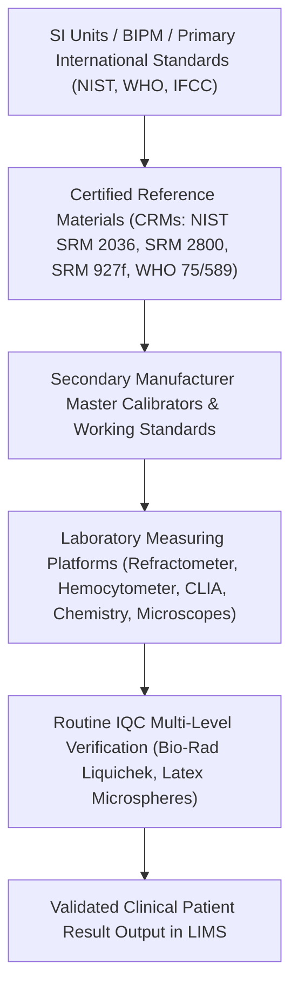
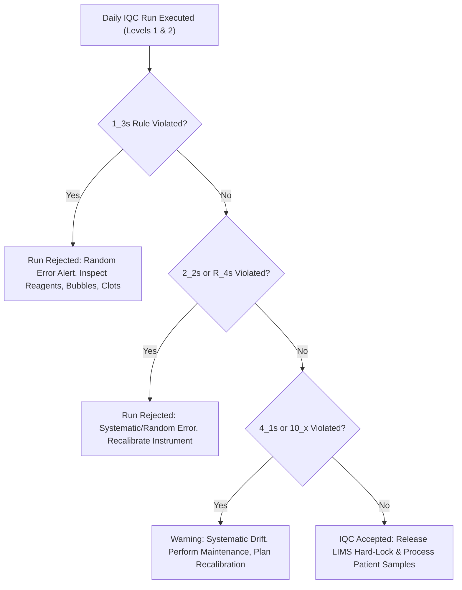

# 📋 SDL-CP-MTR-5.3: Master Clinical Pathology & Body Fluids NABL Scope Matrix, Bench Registers & Metrology Manual

**Sawariya Diagnostic Lab, Charkhi Dadri, Haryana**  
**Document ID:** `SDL-CP-MTR-5.3` | **Version:** `3.0` | **Effective Date:** `2026-10-16` | **Review Cycle:** Annual  
**Department:** Clinical Pathology, Urinalysis, Andrology, Stool Parasitology & Body Fluid Analysis  
**Governing Standard:** ISO 15189:2022 Clauses 4.1–8.9, ISO 22367:2020, NABL 112, NABL 129, NABL 131, NABL 153, NABL 163, CLSI GP16-A3, CLSI H56-A, WHO Semen 6th Ed (2021)  
**Distribution:** Apex Quality Manual, Departmental Bench File, Technical Manager & NABL Portal Application Dossier  

---

## 🗂️ Section 1: Document Control, Governance & Master NABL Scope Matrix (NABL 153 / ISO 15189:2022)

### 1.1 Document Administrative Authorization Block
This Master Quality Manual establishes the operational architecture, metrological traceability chains, internal quality control regimens, and turnkey bench verification records for all routine, emergency, and specialized examinations conducted within the Department of Clinical Pathology, Andrology and Body Fluids at Sawariya Diagnostic Lab, Charkhi Dadri, Haryana.

| Governance Role | Designated Official & Title | Academic Qualifications & Professional Affiliation | Signature & Authorization Date |
| :--- | :--- | :--- | :--- |
| **Prepared & Verified By** | Dr. Ananya Sharma, Quality Manager & Clinical Pathologist | MBBS, MD (Pathology), Lead Quality Assessor | *Dr. A. Sharma* — 2026-10-14 |
| **Technical Review By** | Dr. Rajesh Verma, Technical Manager (Clinical Pathology) | MBBS, MD (Pathology), DNB | *Dr. R. Verma* — 2026-10-15 |
| **Operations Bench Review** | Sh. Hemant Kumar, Senior Technical Operations Lead | M.Sc. (Medical Laboratory Technology) | *H. Kumar* — 2026-10-15 |
| **Final Approval & Issuance** | Dr. Vikram Singhal, Laboratory Director & Chief Pathologist | MBBS, MD (Pathology), FICP | *Dr. V. Singhal* — 2026-10-16 |

### 1.2 Regulatory & Normative Standards Compliance Architecture
This manual complies directly with the mandatory clauses and technical requirements established by national and international regulatory frameworks:
- **ISO 15189:2022:** Clause 4 (General Requirements: Impartiality & Confidentiality); Clause 5 (Structural and Governance Requirements); Clause 6 (Resource Requirements: Personnel 6.2, Facilities 6.3, Equipment & Metrological Traceability 6.4, Reagents & Consumables 6.6); Clause 7 (Process Requirements: Pre-examination 7.2, Examination Methods 7.3, Measurement Uncertainty 7.3.7, Quality Control 7.3.7.2, Post-examination 7.4, Critical Values 7.4.2); Clause 8 (Management System Requirements & Risk Assessment per ISO 22367:2020).
- **National Accreditation Board for Testing and Calibration Laboratories (NABL):**
  - `NABL 112` — Criteria for Laboratory Accreditation (Clinical Pathology & Body Fluids).
  - `NABL 129` — Specific Criteria for Accreditation of Medical Laboratories: Clinical Pathology.
  - `NABL 131` — Policies and Procedures for Internal Quality Control (IQC) and External Quality Assessment Scheme (EQAS/PT).
  - `NABL 153` — Application Form for Accreditation of Medical Testing Laboratories (Scope Matrix Classification).
  - `NABL 163` — Specific Criteria for Accreditation of Medical Laboratories: Point-of-Care Testing (POCT) & Emergency Services.
- **International Consensus Guidelines:** CLSI GP16-A3 (*Urinalysis; Approved Guideline — 3rd Edition*), CLSI H56-A (*Body Fluid Analysis for Cellular Composition*), CLSI C49-A (*Analysis of Body Fluids in Clinical Chemistry*), CLSI GP47 (*Management of Critical- and Significant-Risk Results*), CLSI EP15-A3 / EP06-Ed2 / EP17-A2 / EP26-A, and the **World Health Organization (WHO) Laboratory Manual for the Examination and Processing of Human Semen (6th Edition, 2021)**.

### 1.3 Master Scope of Accreditation Table (19 Core Parameters across Clinical Pathology & Body Fluids)
The following matrix represents the formal scope submitted to NABL under the `NABL 153` directory, covering all biological fluids, examination methods, analytical ranges, and quality acceptance metrics.

| S.No. | NABL 153 Sub-Discipline | Test / Parameter Name | Specimen Matrix & Container | Standardized Examination Principle & Method | Reporting Range / Clinical Cutoff | Precision / Concordance Target | Controlled SOP ID |
| :---: | :--- | :--- | :--- | :--- | :--- | :---: | :---: |
| **1** | Clinical Pathology (Urine) | **Complete Urine Examination (CUE)** (Physical, Chemical & Microscopic) | Fresh Midstream Clean-Catch Urine; Sterile Container | Dual-Wavelength LED Reflectance + Refractometry + $400 \times g$ Standardized Centrifuged Sediment Microscopy | Qualitative / Semi-Quantitative + Cells/$\text{HPF}$ & Casts/$\text{LPF}$ | Inter-Observer Concordance $\kappa \ge 0.85$ | `SDL-CP-SOP-5.1.1` |
| **2** | Clinical Pathology (Urine) | **Urine Specific Gravity (SG)** | Fresh Random or First-Morning Urine; Sterile Container | Optical Clinical Refractometry (Temperature-Compensated at $20^\circ\text{C}$) | $1.000\text{ to }1.050$ | Bias $\le \pm 0.002$ vs Type I Water | `SDL-CP-SOP-5.1.2` |
| **3** | Clinical Pathology (Urine) | **Urine Special Confirmatory Chemistry** (Rothera, Hay, Fouchet, Benedict) | Fresh Unpreserved Urine; Plain Polypropylene | Nitroprusside Legal reaction, Surface tension dissipation, $\text{BaCl}_2\text{-FeCl}_3$ oxidation, Copper reduction | Qualitative (`Negative` / `Trace` / `1+` to `4+`) | $100\%$ Concordance with Control Panels | `SDL-CP-SOP-5.1.4` |
| **4** | Clinical Pathology (Urine) | **Urine Bence Jones Protein (BJP) Screen** | First-Morning Filtered Urine; Plain Dry Container | Putnam $56^\circ\text{C}$ Precipitation / $100^\circ\text{C}$ Dissolution + $3\%$ Sulfosalicylic Acid Turbidity | Qualitative (`Present` / `Absent`) with Reflex to UPEP/sFLC | $100\%$ Control Concordance | `SDL-CP-SOP-5.1.5` |
| **5** | Clinical Pathology (Urine) | **Urine Pregnancy Test (UPT / $\beta\text{-hCG}$)** | First-Morning Clean-Catch Urine; Sterile Container | Lateral-Flow Monoclonal Sandwich Immunochromatography (Colloidal Gold) | Analytical $\text{LoD } 20\text{--}25\text{ mIU/mL}$ (`Negative` / `Positive`) | $100\%$ Concordance @ $25\text{ mIU/mL}$ | `SDL-CP-SOP-5.1.6` |
| **6** | Clinical Pathology (Urine) | **24-Hour Urine Total Protein & UPCR** | 24-Hour Urine Collection without Preservative; $2\text{--}8^\circ\text{C}$ | Pyrogallol Red-Molybdate Complex Photometry on Bonavera Chem 400 | $2.0\text{ to }500.0\text{ mg/dL}$; Normal $< 150\text{ mg/24h}$ | Intra-Run $\text{CV} \le 3.5\%$ | `SDL-CP-SOP-5.1.7` |
| **7** | Clinical Pathology (Stool) | **Stool Routine & Wet Mount Microscopy** | Fresh Uncontaminated Stool; Clean Dry Container | Direct $0.9\%$ Saline Mount ($37^\circ\text{C}$ Trophozoites) + $1\%$ Lugol's Iodine Mount (Cysts/Ova) | Semi-Quantitative Pus/RBCs per $\text{HPF}$ + Microscopic Ova/Cysts | Inter-Observer Concordance $\kappa \ge 0.88$ | `SDL-CP-SOP-5.2.1` |
| **8** | Clinical Pathology (Stool) | **Stool Parasitology Concentration** | Fresh Stool ($1\text{--}2\text{ g}$); Clean Container | Formalin-Ethyl Acetate (Ritchie) Centrifugal Sedimentation Technique | Microscopic Identification of Helminth Ova, Protozoan Cysts & Larvae | Recovery Sensitivity $> 95\%$ | `SDL-CP-SOP-5.2.1A` |
| **9** | Clinical Pathology (Stool) | **Stool Hanging Drop Examination** | Fresh Liquid / Rice-Water Stool ($\le 30\text{ min}$) | Hanging Drop Cavity Slide Phase-Contrast / Darkfield Microscopy | Rapid "Shooting-Star" Motility of *Vibrio cholerae* (Halt with polyvalent anti-O1) | $100\%$ Verification by Pathologist | `SDL-CP-SOP-5.2.1B` |
| **10** | Clinical Pathology (Stool) | **Fecal Occult Blood Test (FIT & gFOBT)** | Fresh Stool; Clean Dry Polypropylene Tube | Specific Monoclonal Anti-Human Hemoglobin Lateral-Flow Immunochromatography | Analytical Sensitivity $\ge 50\text{ ng Hb/mL}$ ($10\ \mu\text{g Hb/g stool}$) | $100\%$ Control Concordance | `SDL-CP-SOP-5.2.2` |
| **11** | Clinical Pathology (Stool) | **Stool pH & Reducing Substances** | Fresh Stool ($\le 1\text{ hour}$ from passage); Plain Cup | Narrow-Range pH Indicator Paper ($5.0\text{--}8.0$) + Modified Benedict's / Clinitest Copper Reduction | $\text{pH } 5.0\text{--}8.0$; Normal Reducing $< 0.25\text{ g/dL}$ ($< 0.5\%$ clinically normal) | Agreement $\ge 98\%$ on Control Solutions | `SDL-CP-SOP-5.2.2A` |
| **12** | Clinical Pathology (Stool) | **Fecal Calprotectin & Pancreatic Elastase-1** | Fresh Stool ($50\text{--}100\text{ mg}$); Dry Sterile Tube | Magnetic Microparticle Chemiluminescent Immunoassay (Flash-CLIA) on Snibe MAGLUMI X3 | Calprotectin: $10\text{--}3000\ \mu\text{g/g}$; Elastase: $15\text{--}500\ \mu\text{g/g}$ | Total $\text{CV} \le 6.5\%$ | `SDL-CP-SOP-5.2.3` |
| **13** | Andrology (Semen) | **Comprehensive Semen Analysis (WHO 6th Ed)** | Fresh Ejaculate; $2\text{--}7\text{d}$ Abstinence; Sterile Container | Gravimetric Volume, $37^\circ\text{C}$ Phase Motility (PR/NP/IM), Neubauer Chamber Count, Eosin-Nigrosin Vitality, Tygerberg Strict Morphology | WHO 2021 5th Centile: Vol $\ge 1.4\text{ mL}$, Conc $\ge 16\times 10^6\text{/mL}$, PR $\ge 30\%$, Morph $\ge 4\%$ | Duplicate Binomial Pass Rate $\ge 95\%$ | `SDL-CP-SOP-5.2.4` |
| **14** | Body Fluids (Serous) | **Pleural Fluid Complete Analysis (Light's & ADA)** | $\text{K}_2\text{-EDTA}$ Tube + Plain Tube; Paired Serum | Neubauer Total Nucleated Cell & RBC Count + Leishman Cytospin Differential + Fluid/Serum Protein, LDH & ADA | Cells/$\mu\text{L}$ + Differential $\%$; Transudate vs Exudate; $\text{ADA } > 40\text{ U/L}$ | Poisson $95\%$ Chamber Concordance | `SDL-CP-SOP-5.2.5` |
| **15** | Body Fluids (Serous) | **Ascitic / Peritoneal Fluid Analysis (SAAG & SBP)** | $\text{K}_2\text{-EDTA}$ Tube + Plain Tube; Paired Serum | Improved Neubauer Chamber Absolute PMN Count + Paired Serum-Ascites Albumin Gradient (SAAG) | Transudate/Exudate SAAG cutoff $1.1\text{ g/dL}$; SBP Alert: $\text{PMN} \ge 250/\mu\text{L}$ | Absolute PMN $\text{CV} \le 8.0\%$ | `SDL-CP-SOP-5.2.6` |
| **16** | Body Fluids (CSF) | **Cerebrospinal Fluid (CSF) Emergency STAT Analysis** | 4-Tube Sterile Polypropylene Protocol ($\le 30\text{ min}$) | Undiluted Neubauer Count (Tubes #1 & #4) + Leishman/Gram Cytospin + Micro-Protein (Pyrogallol) + CSF/Serum Glucose Ratio | Adult WBC $0\text{--}5/\mu\text{L}$; Protein $15\text{--}45\text{ mg/dL}$; Glu Ratio $\ge 0.60$; Xanthochromia | $100\%$ Zero-Error Chamber Re-counts | `SDL-CP-SOP-5.2.7` |
| **17** | Body Fluids (Synovial) | **Synovial Joint Fluid Analysis & Polarized Crystals** | Sodium Heparin / $\text{K}_2\text{-EDTA}$ + Plain Tube (No Oxalate) | $0.9\%$ Saline Chamber Count + Mucin Clot + First-Order Red ($\lambda = 530\text{ nm}$) Polarized Microscopy (MSU vs CPPD) | Non-Inflammatory $< 2,000/\mu\text{L}$; Septic $> 50,000/\mu\text{L}$; Needle vs Rhomboid Birefringence | $100\%$ Polarized Crystal Concordance | `SDL-CP-SOP-5.2.8` |
| **18** | Body Fluids (Serous) | **Pericardial Fluid Complete Analysis** | $\text{K}_2\text{-EDTA}$ Tube + Plain Tube; Paired Serum | Neubauer Chamber Cell Count + Cytospin Differential + Light's Ratios + Malignant Cytology Screening | Cell Count/$\mu\text{L}$ + Differential $\%$; Exudate Protein Ratio $> 0.5$ | Count Agreement $\ge 95\%$ | `SDL-CP-SOP-5.2.9` |
| **19** | Body Fluids (Respiratory) | **Bronchoalveolar Lavage (BAL) Fluid Cytopathology** | Sterile Conical Centrifuge Tube; Cold-Chain Transport | 300-Cell Differential Leishman Cytospin + Golde Score Hemosiderin Staining (Prussian Blue) | Normal Macrophages $> 80\%$, Lymphocytes $< 15\%$, PMN $< 3\%$; Golde Score $< 20$ | Observer Concordance $\kappa \ge 0.85$ | `SDL-CP-SOP-5.2.9A` |

### 1.4 Referral Examination Directory & Scope Demarcation (NABL 133)
In strict accordance with `NABL 133` (*Policy on Scope of Accreditation*) and `ISO 15189:2022 Clause 6.8`, specialized investigations not performed on the primary departmental bench are formally classified as Referral Examinations. The referral laboratory must hold active NABL accreditation for the specific scope:

| Specialized Investigation | Clinical Matrix | Primary Indication | Designated NABL Referral Laboratory | Transport Temperature & TAT |
| :--- | :--- | :--- | :--- | :--- |
| **Urine Protein Electrophoresis (UPEP) & IFE** | 24-Hour Urine (Unpreserved) | Monoclonal Gammopathy / Bence Jones Confirmation | Oncquest Laboratories / Lal PathLabs (NABL Accr.) | $2\text{--}8^\circ\text{C}$; TAT: $48\text{ hrs}$ |
| **Serum & Urine Free Light Chains ($\kappa/\lambda$ sFLC)** | Serum + Random Urine | Multiple Myeloma / AL Amyloidosis Monitoring | Dr. Lal PathLabs National Ref Lab, Delhi | Frozen $-20^\circ\text{C}$; TAT: $48\text{ hrs}$ |
| **BAL Fluid CD4:CD8 T-Cell Ratio (Flow Cytometry)** | Fresh BAL Fluid in RPMI Medium | Pulmonary Sarcoidosis vs HP / EAA | AIIMS New Delhi / SRL Diagnostic Ref Lab | Room Temp ($20\text{--}25^\circ\text{C}$); TAT: $24\text{ hrs}$ |
| **Synovial Fluid Gram/Fungal/AFB Culture & Sens** | Synovial Aspirate in Sterile Vial | Septic Joint Etiological Pathogen Identification | Sawariya Diagnostic Lab (Dept 06: Microbiology) | Ambient; TAT: $48\text{--}72\text{ hrs}$ |

---

## ⚖️ Section 2: Metrological Traceability Master Hierarchy per ISO 17511:2020 & NABL 129

### 2.1 Departmental Metrological Traceability Architecture
All qualitative, semi-quantitative, and quantitative measurands produced in the Clinical Pathology Department maintain unbroken calibration hierarchies tracing back to SI units through Certified Reference Materials (CRMs), primary reference measurement procedures, or international consensus reference standards.



### 2.2 Traceability Implementation Matrix across Analytical Platforms
The following table establishes the formal calibration chain for every diagnostic platform operated at Sawariya Diagnostic Lab under `NABL 129` and `ISO 17511:2020`:

| Platform / Equipment | Parameter / Measurand | Certified Reference Material (CRM) / Primary Standard | Traceability Chain & Calibration Mechanism | Calibration / Verification Interval | Traceability Standard |
| :--- | :--- | :--- | :--- | :--- | :--- |
| **Automated Urine Strip Reader** (Dirui H-100 / Roche Urisys) | Reagent Pad Reflectance Wavelengths ($557\text{ nm}, 620\text{ nm}, 656\text{ nm}$) | NIST SRM 2036 (Holmium Oxide Glass Wavelength Standard) | Optical Calibration Strip with certified reflectance values; internal photoelectric self-check | Daily at power-up + Post-maintenance | ISO 15189:2022 / NABL 129 |
| **Digital Optical Clinical Refractometer** (ATAGO PAL-10S) | Urine Specific Gravity (Refractive Index $n_D$) | Clinical Laboratory Reagent Water (CLRW Type I, $n_D = 1.3330$) + NIST Traceable Sucrose Standards | Zero-set with degassed CLRW ($\text{SG} = 1.0000 \pm 0.0002$ @ $20^\circ\text{C}$); span verification with $5.0\%\text{ w/w}$ sucrose standard ($\text{SG} = 1.0190 \pm 0.0005$) | Daily before patient testing run | CLSI GP16-A3 / ISO 17511 |
| **Improved Neubauer Hemocytometer** (Hirschmann / Marienfeld) | Nucleated Cell Count, RBC Count, Sperm Concentration | NIST SRM 2800 Certified Stage Micrometer ($10\ \mu\text{m}$ grid division) | Chamber depth verification ($0.100\text{ mm} \pm 0.001\text{ mm}$) using specialized optically flat thick coverglasses ($0.4\text{ mm}$); gravimetric verification of micropipettes per ISO 8655 | Verification semi-annually; optical inspection daily | CLSI H56-A / WHO 6th Ed 2021 |
| **Phase-Contrast & Polarized Light Microscope** (Olympus BX43) | Polarized Crystal Birefringence (MSU vs CPPD) & Morphometry | Certified First-Order Red Retardation Plate ($\lambda = 530\text{ nm}$ Quartz Compensator) + Stage Micrometer | Retardation angle alignment verification; optical field calibration using certified stage micrometer for ocular reticle | Calibration semi-annually; compensator verification weekly | CLSI H56-A / College of American Pathologists (CAP) |
| **Automated Flash-CLIA Analyzer** (Snibe MAGLUMI X3) | Fecal Calprotectin & Pancreatic Elastase-1 | Recombinant Human Calprotectin (S100A8/A9) & Pancreatic Elastase-1 Primary Reference Standards | Multi-point master calibration curves hard-encoded via RFID; 2-point working recalibrators run every 14 days or per lot change | 14-Day Recalibration + Daily 2-Level Control Run | ISO 17511:2020 |
| **Automated Chemistry Analyzer** (Bonavera Chem 400) | Fluid Total Protein, Albumin, Glucose, LDH, Amylase, ADA | NIST SRM 927f (Albumin/Protein), NIST SRM 917c (Glucose), IFCC $37^\circ\text{C}$ Primary Enzyme Standard | Multi-analyte serum calibrator traceable to secondary reference procedures; daily 2-level assayed controls | Lot change, major service, or out-of-control IQC | ISO 17511:2020 / IFCC |
| **Benchtop Clinical Centrifuges** (Remi R-8C / Horizon 642E) | Centrifugal Acceleration ($400 \times g \pm 20 \times g$ for Urine/Fluids) | Calibrated Digital Optical Tachometer (NABL Accredited Calibration Lab) | RPM verification under standard payload: $\text{RCF} = 1.118 \times 10^{-5} \times r \times (\text{RPM})^2$ ($r = 14.5\text{ cm} \rightarrow 1570\text{ RPM} = 400\text{ g}$) | Semi-annually per NABL 112 | NABL 131 / CLSI GP16-A3 |
| **Thermostatic Water Baths & Incubators** (Andrology Bench) | Semen Liquefaction & Incubation Temperature ($37.0^\circ\text{C} \pm 0.5^\circ\text{C}$) | Calibrated Pt100 RTD Digital Temperature Probe (Traceable to National Physical Laboratory, NPL India) | Multi-point temperature mapping across chambers; daily morning and evening digital log entries | Annual calibration; daily sensor check | ISO 15189:2022 Cl. 6.4 |

### 2.3 Neubauer Chamber Volumetric Physics & Micropipette Verification (ISO 8655)
Chamber cell counting on undiluted and diluted specimens relies on exact volumetric calculation:
$$\text{Cell Count per }\mu\text{L} = \frac{\text{Total Cells Counted in Area } A}{\text{Area } A\ (\text{mm}^2) \times \text{Chamber Depth } d\ (\text{mm})} \times \text{Dilution Factor } (\text{DF})$$
Where:
- Standard chamber depth $d = 0.100\text{ mm}$.
- For body fluids: 4 large corner squares counted ($A = 4\text{ mm}^2$, Volume $= 0.4\ \mu\text{L}$): $\text{Multiplier} = \frac{1}{0.4} \times \text{DF} = 2.5 \times \text{DF}$.
- For CSF undiluted: Entire ruled grid of 9 large squares counted ($A = 9\text{ mm}^2$, Volume $= 0.9\ \mu\text{L}$): $\text{Cells/}\mu\text{L} = \frac{N}{0.9} = 1.11 \times N$.
- **Pipette Calibration:** All variable micropipettes ($10\ \mu\text{L}, 100\ \mu\text{L}, 1000\ \mu\text{L}$) undergo gravimetric calibration quarterly using Type I water on an analytical balance with $0.0001\text{ g}$ readability, temperature-corrected via the $Z$-factor per ISO 8655-2. Maximum allowable inaccuracy: $\le \pm 1.0\%$; imprecision $\le 0.5\%$.

### 2.4 Measurement Uncertainty (MU) Estimation per ISO/TS 20914:2019 & NABL 131
Measurement uncertainty is quantified for all quantitative clinical pathology and body fluid parameters (Fluid Total Protein, CSF Glucose, Ascitic Albumin, Semen Sperm Concentration). The combined standard uncertainty ($u_c$) incorporates long-term intermediate precision ($u_{\text{precision}}$ or $CV_{\text{intermediate}}$) and trueness uncertainty ($u_{\text{bias}}$ derived from peer-reviewed calibrator uncertainty and proficiency testing bias):
$$u_c = \sqrt{u_{\text{precision}}^2 + u_{\text{bias}}^2}$$
$$\text{Expanded Measurement Uncertainty: } U = k \times u_c \quad (k = 2,\ 95\%\text{ Confidence Interval})$$

**Summary MU Budget Matrix for Quantitative Fluid Parameters:**

| Parameter & Platform | Clinical Decision Level ($X_c$) | Intermediate Imprecision ($u_{\text{precision}}$) | Bias Uncertainty ($u_{\text{bias}}$) | Combined Uncertainty ($u_c$) | Expanded Uncertainty ($U,\ k=2$) |
| :--- | :--- | :---: | :---: | :---: | :---: |
| **Pleural Fluid Total Protein** (Bonavera Chem 400) | $3.0\text{ g/dL}$ (Light's Cutoff) | $2.8\%$ | $1.4\%$ | $3.13\%$ | $\pm 6.3\%\ (\pm 0.19\text{ g/dL})$ |
| **Ascitic Fluid Albumin (SAAG)** (Bonavera Chem 400) | $1.1\text{ g/dL}$ (Portal HTN Cutoff) | $3.2\%$ | $1.6\%$ | $3.58\%$ | $\pm 7.2\%\ (\pm 0.08\text{ g/dL})$ |
| **CSF Glucose** (Bonavera Chem 400) | $40\text{ mg/dL}$ (Meningitis Cutoff) | $2.4\%$ | $1.2\%$ | $2.68\%$ | $\pm 5.4\%\ (\pm 2.2\text{ mg/dL})$ |
| **Semen Sperm Concentration** (Neubauer Chamber) | $16.0 \times 10^6\text{/mL}$ (WHO 5th Centile) | $5.1\%$ | $2.2\%$ | $5.55\%$ | $\pm 11.1\%\ (\pm 1.8 \times 10^6\text{/mL})$ |
| **Fecal Calprotectin** (Snibe MAGLUMI X3) | $50.0\ \mu\text{g/g}$ (IBS vs IBD Cutoff) | $4.6\%$ | $2.0\%$ | $5.01\%$ | $\pm 10.0\%\ (\pm 5.0\ \mu\text{g/g})$ |

---

## 🧪 Section 3: Pre-Analytical Phase Control & Specimen Integrity SOP

### 3.1 Specimen Acceptance & Rejection Criteria Matrix (19 Analytical Matrices)
Pre-analytical errors account for over $65\%$ of clinical pathology discrepancies. Sawariya Diagnostic Lab strictly enforces the following acceptance and rejection specifications:

| Biological Matrix | Minimum Specimen Volume | Approved Primary Container | Transport Temperature & Max Stability | Hard Rejection Criteria (Specimen Cancellation) | Mandatory Action & Rejection Log Code |
| :--- | :--- | :--- | :--- | :--- | :--- |
| **Routine Urine (CUE)** | $12\text{ mL}$ (Min $5\text{ mL}$) | Sterile wide-mouth polypropylene container | $20\text{--}25^\circ\text{C} \le 2\text{ hrs}$; $2\text{--}8^\circ\text{C} \le 24\text{ hrs}$ | Specimen $> 2\text{ hrs}$ at room temperature unpreserved; container leakage; fecal contamination | Reject; recall fresh clean-catch midstream (`REJ-UR-DELAY`) |
| **24-Hour Urine** | Total collection volume recorded | Specialized 2.5-Liter polyethylene container | $2\text{--}8^\circ\text{C}$ throughout 24-hr collection period | Incomplete collection (time $< 22\text{ hrs}$ or $> 26\text{ hrs}$); unrecorded volume; bacterial putrefaction | Reject; initiate new 24-hour collection with patient leaflet (`REJ-UR-INCOMPL`) |
| **Semen (WHO 6th Ed)** | Complete ejaculate ($> 1.0\text{ mL}$) | Non-toxic, sterile plastic container (pre-weighed) | Maintained at $20\text{--}37^\circ\text{C}$; delivered within $45\text{ min}$ | Condom collection; abstinence $< 2\text{ days}$ or $> 7\text{ days}$; spillage of initial ejaculate fraction | Reject; reschedule after proper $3\text{--}5\text{ day}$ abstinence (`REJ-SEM-COLL`) |
| **Stool (Ova/Cysts)** | $5\text{--}10\text{ g}$ formed or $2\text{ mL}$ liquid | Clean, dry, leakproof container (no preservative) | Deliver within $1\text{ hour}$ if liquid ($37^\circ\text{C}$ trophozoites); $2\text{ hrs}$ formed | Urine admixture; mineral oil, barium or bismuth ingestion within 7 days; dry diaper swab | Reject; request fresh passage directly into sterile container (`REJ-ST-CONTAM`) |
| **Fecal Calprotectin** | $1\text{--}2\text{ g}$ solid or loose stool | Clean polypropylene screw-cap tube | Ambient $\le 2\text{ days}$; $2\text{--}8^\circ\text{C} \le 7\text{ days}$; $-20^\circ\text{C} \le 3\text{ months}$ | Gross watery diarrhea consisting solely of urine; specimen collected with rectal swab | Reject; obtain authentic fecal mass (`REJ-ST-VOL`) |
| **Pleural / Ascitic / Synovial Fluids** | $3\text{--}5\text{ mL}$ $\text{K}_2\text{-EDTA}$ + $3\text{--}5\text{ mL}$ Plain Tube | Lavender top ($\text{K}_2\text{-EDTA}$) for counts + Red top plain for chemistries | Process within $1\text{ hour}$ at room temp; do not freeze cell tubes | Clotted EDTA tube (invalidates automated and manual cell counts); sodium oxalate additive | Reject cell count; report chemical analysis if plain tube intact (`REJ-FLD-CLOT`) |
| **Cerebrospinal Fluid (CSF)** | Minimum $0.5\text{ mL}$ per tube (4 Tubes) | Sterile screw-capped polypropylene tubes (#1 to #4) | Hand-delivered immediately ($\le 15\text{ min}$); STAT process $\le 30\text{ min}$ | Specimen transport $> 1\text{ hour}$ without refrigeration; leaking container; wooden swab | Do not discard. Contact Pathologist immediately for urgent salvage protocol (`REJ-CSF-CRIT`) |
| **Bronchoalveolar Lavage (BAL)** | $10\text{--}20\text{ mL}$ | Sterile conical polypropylene centrifuge tube | Cold-chain ($2\text{--}8^\circ\text{C}$ on wet ice); deliver $\le 1\text{ hour}$ | Mucus plug obscuring specimen; transport delay $> 2\text{ hrs}$ (causes alveolar macrophage vacuolation) | Reject; consult bronchoscopist (`REJ-BAL-DELAY`) |

### 3.2 Cellular Lysis & Alkaline Degradation Kinetics in Urine
In unpreserved urine, erythrocytes, leukocytes, and cylindrical casts undergo irreversible time- and pH-dependent degradation. Under alkaline conditions ($\text{pH} \ge 7.5$) and hypotonic conditions ($\text{SG} \le 1.008$), the half-life ($t_{1/2}$) of leukocytes is reduced to less than $60\text{ minutes}$ at room temperature ($25^\circ\text{C}$).
- **Mechanism of Enzymatic Alkalinization:** Contaminating urease-producing microorganisms (*Proteus mirabilis, Klebsiella pneumoniae, Corynebacterium urealyticum*) catalyze the hydrolysis of urea:
  $$\text{CO(NH}_2)_2 + 2\text{H}_2\text{O} \xrightarrow{\text{Urease}} 2\text{NH}_4^+ + \text{CO}_3^{2-}$$
- **Impact on Cellular Morphology:** The rapid generation of ammonium carbonate drives urine pH above $8.5\text{--}9.0$, dissolving mucoprotein Tamm-Horsfall matrices, disintegrating hyaline and granular casts into amorphous debris, and lysing neutrophils into free esterase enzyme. Consequently, Complete Urine Examination (CUE) must commence strictly within $120\text{ minutes}$ of voiding.

### 3.3 Semen Liquefaction Protocol & Viscosity Troubleshooting (WHO 6th Ed 2021)
Freshly ejaculated semen coagulates immediately through seminal vesicle fibronectin and semenogelin proteins, undergoing secondary liquefaction through prostatic Prostate-Specific Antigen (PSA, a chymotrypsin-like serine protease) within $15\text{ to }30\text{ minutes}$ at $37^\circ\text{C}$.
- **Delayed Liquefaction Management:** If liquefaction is incomplete at $60\text{ minutes}$:
  1. *Physical Dissociation:* Gently pipette the sample up and down $5\text{ to }10\text{ times}$ using a wide-bore plastic Pasteur pipette ($1.5\text{ mm}$ internal diameter).
  2. *Enzymatic Liquefaction (when physical dissociation fails):* Add Pure Proteolytic Enzyme Solution (Chymotrypsin $5\text{ mg/mL}$ in physiological saline) at a ratio of $10\ \mu\text{L}$ enzyme per $1.0\text{ mL}$ semen; incubate at $37^\circ\text{C}$ for $10\text{ minutes}$. Note in the final LIMS report: `[SPECIMEN LIQUEFIED ARTIFICIALLY WITH CHYMOTRYPSIN; MORPHOLOGY EVALUATED WITH CAUTION]`.

### 3.4 Specimen Rejection Register Log Template (`SDL-CP-LOG-05`)
All non-conforming specimens are logged into the Controlled Register with immediate clinician communication:

| Entry ID | Date & Time | Lab Accession ID | Biological Matrix | Rejection Reason & Code | Notified Clinician / Staff Nurse | Communication Time | Action Taken / Recall Status | Duty Pathologist Signature |
| :---: | :---: | :---: | :--- | :--- | :--- | :---: | :--- | :---: |
| `REJ-26-081` | `16-Oct-26 09:15` | `SDL-CP-9812` | Ascitic Fluid | Clotted EDTA Specimen (`REJ-FLD-CLOT`) | Dr. Meenakshi (Medicine ICU) | `09:22` | Plain tube run for SAAG; fresh EDTA recalled | *Dr. A. Sharma* |
| `REJ-26-082` | `16-Oct-26 11:30` | `SDL-CP-9844` | Semen Ejaculate | Incomplete collection; 1st drop lost (`REJ-SEM-COLL`) | Patient Counseled Directly | `11:35` | Rescheduled after 4 days abstinence | *Dr. R. Verma* |
| `REJ-26-083` | `16-Oct-26 15:45` | `SDL-CP-9890` | Urine (CUE) | Unpreserved delay $> 3.5\text{ hrs}$ (`REJ-UR-DELAY`) | Dr. Kapoor (OPD Clinic) | `15:50` | Recall fresh clean-catch specimen | *Dr. A. Sharma* |
| `[TEMPLATE]` | `__/__/26 __:__` | `___________` | `____________` | `____________________________` | `__________________________` | `__:__` | `__________________________` | `________` |

### 3.5 Specimen & Slide Archive Retention & Biohazard Disposal Log (`SDL-CP-LOG-10`)
In compliance with `NABL 112` and the `Bio-Medical Waste Management Rules 2016/2019`, biological specimens and microscopic preparations are archived and decontaminated per standard protocols:

| Archive Category | Minimum Retention Period | Storage Temperature / Environment | Decontamination & Waste Disposal Protocol | Audit Review Cycle |
| :--- | :--- | :--- | :--- | :--- |
| **Urine Sediments & Aliquots** | $24\text{ hours}$ post-reporting | Refrigerated at $2\text{--}8^\circ\text{C}$ in primary cup | Autoclave or treat with $1\%\text{ NaOCl}$ before disposal | Daily morning audit |
| **Stool Samples** | $24\text{ hours}$ post-reporting | Sealed container at $2\text{--}8^\circ\text{C}$ | Yellow biohazard bag with autoclave pretreatment | Daily morning audit |
| **CSF & Serous Body Fluids** | $7\text{ days}$ post-reporting | Sealed sterile tube at $2\text{--}8^\circ\text{C}$ | Chemical disinfection with $1\%\text{ Sodium Hypochlorite}$ | Weekly Friday audit |
| **Positive Cytospin & Semen Slides** | $3\text{ years}$ (Malignancy: $5\text{ years}$) | Ambient dry dust-free DPX slide filing cabinet | Permanent archival for medicolegal review | Annual inventory |

| Date | Slide Box # / Matrix | Lab ID Range | Storage Location | Retention Expiry Date | Biohazard Decontamination Sign | Pathologist Sign |
| :---: | :--- | :--- | :--- | :---: | :---: | :---: |
| `16-Oct-26` | `BOX-CP-2026-10` (Fluids) | `SDL-CP-9800 to 9850` | Refrigerator Shelf #2 ($4^\circ\text{C}$) | `23-Oct-2026` | *H. Kumar* | *Dr. A. Sharma* |
| `16-Oct-26` | `SLD-CYTO-2026-A` (Cytospin) | `SDL-CP-9820 to 9845` | DPX Cabinet #03, Drawer B | `16-Oct-2031` | Permanent Storage | *Dr. V. Singhal* |
| `__/__/26` | `______________________` | `___________________` | `__________________________` | `__/__/20__` | `__________` | `________` |

---

## 📊 Section 4: Internal Quality Control (IQC) Protocol per NABL 112 & CLSI C24-Ed4

### 4.1 Mandatory Urine Chemical Dipstick vs. Microscopic Sediment Reconciliation Rules
Before releasing any Complete Urine Examination (`CUE`) report in the LIMS, the bench technologist and duty pathologist must verify concordance across the following **5 Mandatory Reconciliation Rules**:

| Discordance Scenario | Underlying Pathophysiological or Biochemical Cause | Mandatory Bench Verification & Report Action |
| :--- | :--- | :--- |
| **1. Dipstick Blood $2+/3+$, but Microscopy shows $0\text{--}2\text{ RBCs/HPF}$** | (1) **Hypotonic / Alkaline Lysis:** Low SG ($\le 1.008$) or high pH ($\ge 7.5$) causing erythrocyte swelling and rupture into "ghost cells".<br>(2) **Intravascular Hemolysis:** Free hemoglobin filtration (`Hemoglobinuria`).<br>(3) **Rhabdomyolysis:** Free myoglobin filtration (`Myoglobinuria`). | Inspect sediment with phase-contrast optics for ghost cell membranes; inspect serum/plasma color (pink in hemolysis, clear in myoglobinuria); check serum CK. Append `[STAMP-URINE-LYSIS-MYO]`. |
| **2. Microscopy shows $> 10\text{ RBCs/HPF}$, but Dipstick Blood is Negative** | **Ascorbic Acid Interference:** Ingestion of Vitamin C ($> 25\text{ mg/dL}$) acting as a reducing antioxidant, competing with tetramethylbenzidine chromogen and neutralizing cumene hydroperoxide. | Check dedicated Ascorbic Acid pad on Dirui strip. Release true microscopic RBC count. Add LIMS comment regarding antioxidant pseudoperoxidase inhibition. |
| **3. Dipstick Protein Negative/Trace, but SSA Turbidity is Positive ($\ge 2+$)** | **Non-Albumin Proteinuria:** Tetrabromophenol blue pad detects exclusively Albumin via "protein error of indicators", completely missing positively charged **Bence Jones Free Light Chains ($\kappa/\lambda$)** and tubular lysozymes. | Perform confirmatory **$3\%$ Sulfosalicylic Acid (SSA) Turbidity + Heat Test** (`SOP 5.1.5`). Append `[STAMP-URINE-SSA-BENCE-JONES]` and reflex to UPEP, IFE, and serum free light chains. |
| **4. Sterile Pyuria ($> 10\text{ Pus Cells/HPF}$) with Nitrite Negative & Routine Culture Negative** | (1) **Genitourinary Tuberculosis:** Acid-fast mycobacterial infection.<br>(2) Non-nitrate-reducing pathogens (*Enterococcus faecalis, Staphylococcus saprophyticus, Candida*).<br>(3) Fastidious organisms (*Chlamydia trachomatis, Ureaplasma*).<br>(4) Interstitial nephritis / Calculi. | Correlate with clinical history. Recommend 3 consecutive first-morning urine specimens for **AFB Smear & GeneXpert MTB/RIF Ultra** (`SOP 6.1.7`). |
| **5. Dipstick Leukocyte Esterase $2+/3+$, but Microscopy shows $0\text{--}2\text{ Pus Cells/HPF}$** | **Neutrophil Lysis:** Rapid disintegration of polymorphonuclear leukocytes in aged, hypotonic, or alkaline urine, releasing cytoplasmic indoxyl esterase enzyme into solution. | Report leukocyte esterase activity as indicator of pyuria. Advise clinician to submit fresh midstream clean-catch urine within $1\text{ hour}$ of voiding. |

### 4.2 Daily Multi-Level IQC Regimen across Clinical Pathology
Sawariya Diagnostic Lab implements a comprehensive internal quality control plan before processing any clinical diagnostic run.

| Examination Category | Quality Material & Manufacturer | Number of Levels & Matrix | Target Testing Frequency | Acceptance Limits / Criteria | Corrective Action Trigger |
| :--- | :--- | :--- | :--- | :--- | :--- |
| **Urine Dry Chemistry & SG** | Bio-Rad Liquichek Urinalysis Plus (Bio-Rad USA) | 2 Levels: Level 1 (Normal/Negative), Level 2 (Abnormal/Positive) | Every 24 hours at 08:00 AM + Post-Maintenance | $100\%$ Concordance within $\pm 1$ color block of assigned target | Any parameter out of assigned range $\rightarrow$ Halt testing |
| **Body Fluid Chemistries** (Protein, Albumin, LDH, Glucose, ADA) | Bio-Rad Lyphochek Assayed Chemistry Control | 2 Levels: Level 1 (Normal), Level 2 (Elevated Pathological) | Daily before fluid run on Bonavera Chem 400 | Mean $\pm 2\text{ SD}$; Total allowable error $\text{TEa} < 10\%$ | Westgard multirule violation ($1_{3s}, 2_{2s}$) |
| **Chamber Hemocytometer Cell Counting** | Certified Polystyrene Latex Microsphere Suspension | 2 Concentrations: Low ($1,000\text{ beads/}\mu\text{L}$), High ($50,000\text{ beads/}\mu\text{L}$) | Weekly on Mondays + Following new coverglass batch | Mean recovery $\pm 10.0\%$ of certified concentration | Count deviation $> 10\% \rightarrow$ Inspect chamber depth & optics |
| **Confirmatory Wet Tests** (Rothera, SSA, Fouchet, Benedict) | In-House Verified Positive & Negative Matrix Controls | 2 Levels: Purified Acetone/Albumin/Bilirubin/Glucose in pooled negative urine | Batch-wise with every new reagent preparation | Clear positive reaction vs totally negative blank | Failure of positive control or turbid blank $\rightarrow$ Discard reagent |
| **Semen Analysis Motility & Morphology** | EQA Photomicrographs & Preserved Fixed Semen Standard | 2 Control Sets: Normal Motile Standard, High-Abnormality Fixed Sample | Weekly slide review + Monthly technologist rotation | Inter-observer variation $\le 10\%$ for motility, $\le 5\%$ morphology | Inter-observer discordance $> 10\% \rightarrow$ Re-training |

### 4.3 Daily Equipment Calibration & IQC Register (`SDL-CP-LOG-01`)

| Date | Optical Refractometer Zero (CLRW $1.000$) | Refractometer Span ($5\%\text{ Sucrose } 1.019$) | Dirui Optical Cal Strip | Centrifuge RPM ($1570 \pm 30$) | Bio-Rad Level 1 Result | Bio-Rad Level 2 Result | Operator Sign | Pathologist Sign |
| :---: | :---: | :---: | :---: | :---: | :---: | :---: | :---: | :---: |
| `16-Oct-26` | `1.0000 [PASS]` | `1.0190 [PASS]` | `Calibration OK` | `1575 RPM [PASS]` | `Normal / Negative` | `Abnormal / Positive` | *H. Kumar* | *Dr. A. Sharma* |
| `__/__/26` | `1.000_ [PASS]` | `1.019_ [PASS]` | `______________` | `____ RPM [PASS]` | `_________________` | `___________________` | `________` | `________` |

### 4.4 Urine Chemical-Microscopic Discrepancy & Wet-Chemistry Log (`SDL-CP-LOG-02`)

| Date | Lab Accession ID | Specific Gravity & pH | Dipstick Blood / Protein / LE | Microscopy RBC / WBC / Casts | Confirmatory SSA / Rothera / Fouchet | Pathologist Resolution & Stamp | Sign |
| :---: | :---: | :---: | :---: | :---: | :---: | :--- | :---: |
| `16-Oct-26` | `SDL-CP-9824` | $\text{SG } 1.006\text{ / pH } 8.0$ | Blood $3+$, Prot $1+$, LE $2+$ | $0\text{--}1\text{ RBCs/HPF}$, Ghost cells present | SSA Trace, Rothera Neg | Hypotonic RBC lysis confirmed; `[STAMP-URINE-LYSIS-MYO]` | *Dr. R. Verma* |
| `16-Oct-26` | `SDL-CP-9852` | $\text{SG } 1.018\text{ / pH } 5.5$ | Prot Neg, Blood Neg, LE Neg | Hyaline casts $0\text{--}1\text{/LPF}$, Cells normal | SSA $3+$ dense precipitation | Myeloma suspect; reflex to UPEP; `[STAMP-URINE-SSA-BENCE-JONES]` | *Dr. A. Sharma* |
| `__/__/26` | `__________` | `1.0__ / _._` | `___________________________` | `___________________________` | `___________________________________` | `______________________________________________________________` | `____` |

### 4.5 Statistical Process Control: Westgard Multirule Evaluation
Quantitative fluid parameters (Protein, Albumin, Glucose, LDH, Amylase, ADA) on the Bonavera Chem 400 and CLIA immunoassay (Snibe MAGLUMI X3) enforce Westgard multirules per CLSI C24-Ed4:
- **$1_{3s}$ Rule (Random Error):** 1 control measurement exceeds Mean $\pm 3\text{ SD}$. **REJECT RUN.**
- **$2_{2s}$ Rule (Systematic Error):** 2 consecutive control measurements exceed the same Mean $+ 2\text{ SD}$ or Mean $- 2\text{ SD}$. **REJECT RUN.**
- **$R_{4s}$ Rule (Random Error):** 1 control exceeds $+2\text{ SD}$ and the other exceeds $-2\text{ SD}$ in the same run ($4\text{ SD}$ span). **REJECT RUN.**
- **$4_{1s}$ Rule (Systematic Trend):** 4 consecutive control measurements exceed the same Mean $+ 1\text{ SD}$ or Mean $- 1\text{ SD}$. **WARNING / MAINTENANCE.**
- **$10_x$ Rule (Systematic Shift):** 10 consecutive control measurements fall on the same side of the mean. **MAINTENANCE & RE-CALIBRATION.**



### 4.6 Monthly Cumulative Levey-Jennings QC & Six-Sigma Performance
To monitor long-term systematic drift and random imprecision, monthly cumulative Levey-Jennings data are compiled for all quantitative fluid assays on the Bonavera Chem 400 and Snibe MAGLUMI X3. World-class analytical quality is quantified via the Six-Sigma ($\sigma$) metric:
$$\text{Sigma Metric } (\sigma) = \frac{\text{TEa} - \lvert\text{Bias}\rvert}{\text{CV}}$$
Where $\text{TEa}$ is Total Allowable Error, $\lvert\text{Bias}\rvert$ is derived from peer-group EQAS consensus, and $\text{CV}\% = (\text{SD} / \text{Mean}) \times 100$.

| Quantitative Fluid Measurand | Clinical Decision Level | 30-Day Mean $\pm \text{SD}$ | Observed $\text{CV}\%$ | Observed $\lvert\text{Bias}\rvert\%$ | TEa ($\%$) | Six-Sigma Metric ($\sigma$) | Westgard Control Rule Assignment |
| :--- | :--- | :---: | :---: | :---: | :---: | :---: | :--- |
| **Fluid Total Protein (Level 1)** | Normal ($1.5\text{ g/dL}$) | $1.52 \pm 0.04\text{ g/dL}$ | $2.63\%$ | $1.33\%$ | $10.0\%$ | **$3.30\ \sigma$** | Full Multirule ($1_{3s}, 2_{2s}, R_{4s}, 4_{1s}$) |
| **Fluid Total Protein (Level 2)** | Exudate ($4.5\text{ g/dL}$) | $4.48 \pm 0.09\text{ g/dL}$ | $2.01\%$ | $0.44\%$ | $10.0\%$ | **$4.76\ \sigma$** | Intermediate Multirule ($1_{3s}, 2_{2s}, R_{4s}$) |
| **CSF Glucose (Level 1)** | Critical ($35\text{ mg/dL}$) | $35.4 \pm 0.8\text{ mg/dL}$ | $2.26\%$ | $1.14\%$ | $10.0\%$ | **$3.92\ \sigma$** | Full Multirule ($1_{3s}, 2_{2s}, R_{4s}, 4_{1s}$) |
| **Fluid LDH (Level 2)** | Exudate ($300\text{ U/L}$) | $298.5 \pm 6.2\text{ U/L}$ | $2.08\%$ | $0.50\%$ | $12.0\%$ | **$5.53\ \sigma$** | High Performance ($1_{3s}, 2_{2s}$) |
| **Fecal Calprotectin (Level 2)** | Active IBD ($250\ \mu\text{g/g}$) | $254.2 \pm 9.8\ \mu\text{g/g}$ | $3.86\%$ | $1.68\%$ | $20.0\%$ | **$4.75\ \sigma$** | Intermediate Multirule ($1_{3s}, 2_{2s}, R_{4s}$) |

### 4.7 Inter-Technologist Microscopy Concordance Statistics (Cohen's & Fleiss' Kappa)
To fulfill `ISO 15189:2022 Clause 7.3.7.3` and `NABL 112`, monthly inter-observer concordance audits are performed across duty pathologists and senior technical officers using 10 blinded clinical pathology specimens.
- **Cohen's Kappa ($\kappa$) Mathematical Formulation:**
  $$\kappa = \frac{P_o - P_e}{1 - P_e}$$
  Where $P_o$ is the observed proportion of concordance across diagnostic classes, and $P_e$ is the expected agreement by chance.
- **NABL Benchmark:** $\kappa \ge 0.85$ indicates near-perfect agreement. Any score $< 0.80$ triggers mandatory retraining.

### 4.8 Monthly Blinded Inter-Technologist Microscopy Concordance Log (`SDL-CP-LOG-07`)

| Month / Year | Blinded Slide / Specimen Code | Reference Pathologist Identification | Technical Officer 1 (H. Kumar) | Technical Officer 2 (S. Saini) | Pathologist 2 (Dr. Verma) | Pairwise Concordance ($\%$) | Fleiss' Kappa ($\kappa$) | Lab Director Sign |
| :---: | :--- | :--- | :--- | :--- | :--- | :---: | :---: | :---: |
| `Oct 2026` | `CLP-BLIND-26-01` (Urine) | Calcium Oxalate Monohydrate ("Dumbbell") | CaOx Monohydrate | CaOx Monohydrate | CaOx Monohydrate | $100\%$ | $\kappa = 1.00$ | *Dr. V. Singhal* |
| `Oct 2026` | `CLP-BLIND-26-02` (Synovial) | MSU Crystals (Needle, Neg Birefringence) | MSU Crystals | MSU Crystals | MSU Crystals | $100\%$ | $\kappa = 1.00$ | *Dr. V. Singhal* |
| `Oct 2026` | `CLP-BLIND-26-03` (Stool) | *Giardia lamblia* Cyst (4 Nuclei, Axostyle) | *Giardia* Cyst | *Giardia* Cyst | *Giardia* Cyst | $100\%$ | $\kappa = 1.00$ | *Dr. V. Singhal* |
| `Oct 2026` | `CLP-BLIND-26-04` (Semen) | Tygerberg Head Abnormality (Amorphous) | Head Defect | Head Defect | Head Defect | $100\%$ | $\kappa = 0.92$ | *Dr. V. Singhal* |
| `__/__/26` | `________________________` | `______________________________________` | `_____________` | `_____________` | `_____________` | `____%` | `\kappa = 0.__` | `________` |

---

## 🌐 Section 5: External Quality Assessment Scheme (EQAS / PT) per ISO/IEC 17043

### 5.1 Active EQAS Proficiency Programs
Sawariya Diagnostic Lab maintains active annual enrollment in certified proficiency testing programs accredited under `ISO/IEC 17043`:

| EQAS / PT Program | Accredited Provider | Scope of Testing Matrix | Testing Frequency | Target Turnaround Time |
| :--- | :--- | :--- | :--- | :--- |
| **CMC Vellore Urinalysis & Clinical Pathology EQAS** | Christian Medical College, Vellore | Urine Chemistry, Sediment Microscopy Atlas, Urine Protein | Quarterly (4 Cycles/Year) | Within 5 working days of receipt |
| **AIIMS National Quality Assurance Program** | AIIMS New Delhi (Dept of Pathology) | Stool Ova & Cysts, Stool Parasitology, Body Fluid Differential | Bi-annual (2 Cycles/Year) | Within 7 working days |
| **Bio-Rad Lyphochek Urine & Fluid Chemistry PT** | Bio-Rad Laboratories, USA | Urine Protein, Microalbumin, Body Fluid LDH, Amylase, Glucose | Monthly (12 Cycles/Year) | Within 10 working days |
| **ESAPTS Semen Analysis Proficiency Program** | European Specialty Andrology PT / AIIMS | Semen Concentration, 4-Tier Motility, Strict Morphology Atlas | Bi-annual (2 Cycles/Year) | Within 5 working days |

### 5.2 Standard Deviation Index (SDI / Z-Score) Evaluation Framework
Performance in quantitative proficiency testing programs is evaluated using the Standard Deviation Index ($\text{SDI}$ or $Z$-score):
$$Z = \text{SDI} = \frac{x_{\text{lab}} - X_{\text{peer}}}{\text{SD}_{\text{peer}}}$$
Where:
- $x_{\text{lab}}$ = Sawariya Diagnostic Lab reported result.
- $X_{\text{peer}}$ = Robust Peer Group Consensus Mean.
- $\text{SD}_{\text{peer}}$ = Peer Group Standard Deviation.

**Acceptance and Action Classification:**
- $\lvert Z \rvert \le 2.0$: **Satisfactory Performance.** Calibration and analytical precision verified.
- $2.0 < \lvert Z \rvert < 3.0$: **Questionable / Warning Status.** Bench audit initiated; review calibration drift and reagent lot.
- $\lvert Z \rvert \ge 3.0$: **Unsatisfactory / Action Required.** Mandatory investigation and formal CAPA generation.

### 5.3 Root-Cause Analysis (5-Why & Ishikawa Fishbone) & CAPA Protocol
Any PT result generating $\lvert Z \rvert > 2.0$ or qualitative discordance mandates execution of a Corrective Action Preventive Action (`CAPA`) dossier within $15\text{ calendar days}$ using the Ishikawa 6M Framework:
1. **Man (Personnel):** Was technician competency current? Was chamber loading technique verified?
2. **Machine (Equipment):** Was optical tachometer calibration valid? Was lamp output optimal?
3. **Material (Reagents):** Was the lot expired or degraded by ambient humidity/temperature?
4. **Method (Standard Operating Procedure):** Did the operator follow centrifugation nomograms precisely?
5. **Measurement (Traceability):** Was the calibrator traceability chain intact?
6. **Milieu (Environment):** Did ambient bench temperature fluctuate beyond $20\text{--}25^\circ\text{C}$?

### 5.4 External Quality Assessment Scheme (EQAS / PT) Performance Log (`SDL-CP-LOG-08`)

| Cycle / Year | EQAS Provider & Specimen Code | Analyte / Parameter Evaluated | Lab Result ($x_{\text{lab}}$) | Peer Consensus ($X_{\text{peer}} \pm \text{SD}$) | Calculated $Z$-Score / Concordance | Performance Grade | CAPA Form ID (if $\lvert Z \rvert > 2.0$) | Director Sign |
| :---: | :--- | :--- | :---: | :---: | :---: | :---: | :---: | :---: |
| `Cycle 3 / 2026` | CMC Vellore `EQAS-UR-88` | Urine Total Protein (Pyrogallol) | $46.2\text{ mg/dL}$ | $44.8 \pm 2.1\text{ mg/dL}$ | $Z = +0.67$ | **Satisfactory** | N/A (Performance Acceptable) | *Dr. V. Singhal* |
| `Cycle 3 / 2026` | CMC Vellore `EQAS-SED-89` | Photomicrograph Sediment ID | Broad Waxy Cast | Broad Waxy Cast ($98\%$) | $100\%$ Concordant | **Satisfactory** | N/A (Performance Acceptable) | *Dr. V. Singhal* |
| `Cycle 2 / 2026` | AIIMS `EQAS-ST-44` | Stool Parasitology Identification | *Ancylostoma* Ova | *Ancylostoma duodenale* | $100\%$ Concordant | **Satisfactory** | N/A (Performance Acceptable) | *Dr. V. Singhal* |
| `Cycle __ / 26` | `____________________` | `______________________________` | `____________` | `____________________` | `Z = _____` | `______________` | `________________________` | `________` |

---

## 🔄 Section 6: Reagent Lot-to-Lot Verification SOP per CLSI EP26-A

### 6.1 Trigger Events & Verification Mandate
Prior to releasing any new shipment or manufacturer lot number of urine dipsticks, chemical reagents, lateral-flow cartridges, or stains for clinical use, parallel lot verification must be conducted per `CLSI EP26-A` (*User Evaluation of Between-Reagent Lots*).

### 6.2 Parallel Patient Sample Testing Protocol ($n \ge 20$)
- **Sample Selection:** A minimum of $n = 20$ clinical patient specimens spanning the clinically relevant range (low, normal, elevated, and pathological) are tested in parallel on both the current (in-use) lot and the new (prospective) lot within a $2\text{-hour}$ analytical window.
- **Control Inclusion:** Multi-level IQC materials (Bio-Rad Levels 1 and 2) are processed on both lots simultaneously.

### 6.3 Mathematical & Statistical Acceptance Criteria
1. **Qualitative & Semi-Quantitative Pad Tests (Dipstick pads, UPT, Stool FOBT):**
   - Minimum overall diagnostic concordance across the 20 split specimens: $\ge 98.0\%$.
   - Cohen's Kappa statistic: $\kappa \ge 0.90$.
2. **Quantitative Body Fluid Chemistries & Immunoassays (Protein, LDH, Calprotectin):**
   - Deming linear regression slope between $0.95$ and $1.05$; $y$-intercept $95\%$ confidence interval includes $0.0$.
   - Pearson correlation coefficient: $r \ge 0.985$.
   - Mean absolute relative bias: $\lvert\text{Bias}\rvert \le 5.0\%$.
   - Individual paired differences must not exceed Total Allowable Error ($\text{TEa}$).
- **Authorization:** If all criteria pass, the Technical Manager signs the Lot Verification Certificate and uploads the new lot barcode into the LIMS.

### 6.4 Wet-Chemical Reagent Batch Preparation & Matrix Verification Register (`SDL-CP-LOG-09`)
Every in-house working solution prepared at the wet bench (Sulfosalicylic Acid $3\%$, Rothera nitroprusside powder, Fouchet reagent, Benedict reagent, Hay sulfur, Eosin-Nigrosin vitality stain, Turk's fluid) is verified against known matrix controls prior to bench release:

| Prep Date | Reagent Name & In-House Batch # | Expiry Date | Positive Matrix Control Verification | Negative Matrix Control (CLRW / Normal) | Storage Temperature & Container | Bench Approved? | Pathologist Sign |
| :---: | :--- | :---: | :--- | :--- | :--- | :---: | :---: |
| `14-Oct-26` | $3\%$ Sulfosalicylic Acid (`SSA-26-10`) | `14-Apr-27` | Albumin $50\text{ mg/dL} \rightarrow 3+$ Dense Turbid | CLRW $\rightarrow$ Perfectly Clear ($0\text{ NTU}$) | Amber glass bottle @ $20\text{--}25^\circ\text{C}$ | **YES [PASS]** | *Dr. A. Sharma* |
| `14-Oct-26` | Rothera Nitroprusside Powder (`ROT-26-08`) | `14-Jan-27` | Acetone Spiked Urine $\rightarrow$ Deep Purple Ring | Normal Fresh Urine $\rightarrow$ No Ring | Desiccated screw container @ $20^\circ\text{C}$ | **YES [PASS]** | *Dr. R. Verma* |
| `15-Oct-26` | Fouchet Reagent (`FOU-26-05`) | `15-Apr-27` | Bilirubin Spiked Urine $\rightarrow$ Distinct Green | Negative Urine Blank $\rightarrow$ Off-white ppt | Amber glass bottle @ $20\text{--}25^\circ\text{C}$ | **YES [PASS]** | *Dr. A. Sharma* |
| `__/__/26` | `___________________________` | `__/__/__` | `____________________________________` | `______________________________________` | `__________________________________` | `[ ] PASS` | `________` |

### 6.5 Parallel Reagent Lot Verification Register Template (`SDL-CP-LOG-LOT`)
The following verification record must be completed before releasing any new reagent or strip batch into routine clinical service:

| Verification Parameter | Current In-Use Reagent Lot | Prospective New Reagent Lot | Acceptance Specification | Observed Metric / Result | Authorization Status |
| :--- | :--- | :--- | :--- | :--- | :---: |
| **Reagent Name & Manufacturer** | Dirui 11-Pad Urine Strips (Lot # `202604A`) | Dirui 11-Pad Urine Strips (Lot # `202610B`) | Identical strip chemistry configuration | Confirmed identical | **PASS** |
| **Expiry Date Verification** | `30-Nov-2026` | `31-May-2027` | Minimum $> 6\text{ months}$ forward shelf-life | $8\text{ months}$ shelf-life verified | **PASS** |
| **$n = 20$ Patient Specimen Concordance** | Reference strip run | Parallel strip run within $30\text{ min}$ | Overall concordance $\ge 98.0\%$ | Concordance $= 99.1\%$ ($198/200\text{ pads}$) | **PASS** |
| **Cohen's Kappa ($\kappa$) Concordance** | Reference strip run | Parallel strip run | $\kappa \ge 0.90$ across all 10 diagnostic pads | $\kappa = 0.94$ | **PASS** |
| **Bio-Rad Liquichek Level 1 & 2** | In-range targets | In-range targets | Assigned recovery within $\pm 1\text{ block}$ | $100\%$ Target Concordance | **PASS** |
| **Ascorbic Acid Shield Challenge** | Negative on pad | Spiked Vit C ($50\text{ mg/dL}$) detected | Positive pad reaction on spiked specimen | Pad color change confirmed | **PASS** |

**Technical Sign-Off:** Evaluated By: *H. Kumar (Sr. Tech)* | Reviewed & Approved By: *Dr. Rajesh Verma (Technical Manager)* — Date: `16-Oct-2026`.

---

## 🎓 Section 7: Staff Competency Assessment & Training per NABL 112

### 7.1 Competency Assessment Lifecycle & Governance
In adherence to `ISO 15189:2022 Clause 6.2` and `NABL 112`, every laboratory professional performing clinical pathology examinations undergoes formal competency evaluation:
- **Initial Training:** Supervised bench operation for 3 months post-induction.
- **6-Month Verification:** Formal multi-element practical evaluation prior to independent sign-off authorization.
- **Annual Re-Evaluation:** Comprehensive evaluation conducted annually for all technical staff and duty pathologists.

### 7.2 Six Core Competency Evaluation Modalities
1. **Direct Bench Observation:** Assessor directly observes specimen receipt, centrifuge balancing ($400 \times g$), KOVA decanting, wet mount preparation, and chamber charging without air bubbles.
2. **Monitoring Result Reporting:** Assessor audits 20 random LIMS worksheets entered by the employee for accuracy, transcription precision, and proper unit assignment.
3. **Review of Intermediate Worksheets:** Evaluation of hemocytometer counting mathematics, dilution factor multiplications, and cytospin differential count sums ($100\%$).
4. **Blinded Sample Re-Testing:** Employee analyzes 5 blinded patient specimens (sediment microscopy, semen count, and fluid protein); results must show concordance $> 90\%$.
5. **Specialized Microscopy Competency:** Identification of polarized crystals (MSU vs CPPD with red compensator plate) and WHO 6th edition sperm morphology on reference slides.
6. **Problem-Solving & Escalation:** Candidate responds to simulated out-of-control IQC scenarios and critical panic value emergency scenarios.

### 7.3 Scoring Matrix, Deficiency Remediation & Re-Assessment
- **Passing Threshold:** $\ge 85\%$ aggregate score across all 6 modalities.
- **Deficiency Remediation Protocol:** Any employee scoring $< 85\%$ is immediately placed on supervised status, excluded from independent result release, and assigned a 14-day intensive retraining module followed by formal re-examination.

### 7.4 Annual Personnel Competency Assessment Register (`SDL-CP-LOG-COMP`)
In compliance with `NABL 112`, individual employee competency dossiers are archived in the departmental quality file:

| Staff Member & Designation | Element 1: Direct Observation | Element 2: LIMS Reporting | Element 3: Chamber Calculations | Element 4: Blinded Sample Re-test | Element 5: Polarized / WHO6 Morphology | Element 6: Critical Panic Escalation | Overall Aggregate Score | Final Competency Status | Assessor & Date |
| :--- | :---: | :---: | :---: | :---: | :---: | :---: | :---: | :---: | :---: |
| **Sh. Hemant Kumar** (Sr. Technical Officer) | $96\%$ | $98\%$ | $100\%$ | $95\%$ | $92\%$ | $100\%$ | **$96.8\%$** | **CERTIFIED COMPETENT** | *Dr. A. Sharma* — `12-Oct-26` |
| **Smt. Sunita Saini** (Technical Officer) | $92\%$ | $94\%$ | $95\%$ | $90\%$ | $88\%$ | $95\%$ | **$92.3\%$** | **CERTIFIED COMPETENT** | *Dr. A. Sharma* — `12-Oct-26` |
| **Sh. Amit Yadav** (Junior Technician) | $88\%$ | $90\%$ | $88\%$ | $86\%$ | $84\%$ | $90\%$ | **$87.7\%$** | **CERTIFIED COMPETENT** | *Dr. R. Verma* — `13-Oct-26` |
| **`[NEW INDUCTEE / TEMPLATE]`** | `__%` | `__%` | `__%` | `__%` | `__%` | `__%` | `__.__%` | `[ ] PASS [ ] RETRAIN` | `________ — __/__/26` |

---

## 🚨 Section 8: CLSI GP47 Critical ("Panic") Value Reporting Protocol

### 8.1 Clinical Pathology Critical Value Master Schedule
Immediate notification of life-threatening clinical pathology findings is a mandatory patient safety requirement under `CLSI GP47` and `NABL 112`.

| Specimen Matrix | Critical Diagnostic Parameter / Finding | Critical Panic Threshold / Microscopic Finding | Immediate Clinical Pathophysiology & Threat | Mandatory Escalation Window |
| :--- | :--- | :--- | :--- | :---: |
| **Cerebrospinal Fluid (CSF)** | Total Nucleated Cell Count & Differential | Adult $\text{WBC} > 5/\mu\text{L}$; Neonate $\text{WBC} > 30/\mu\text{L}$; Neutrophilic dominance | Acute bacterial meningitis; rapid cerebral herniation / death risk | $\le 15\text{ minutes}$ |
| **Cerebrospinal Fluid (CSF)** | Microbiological Microscopy | Microorganisms on Gram stain (Diplococci, Bacilli) OR India Ink positive | Fulminant bacterial or cryptococcal meningitis; immediate antimicrobial mandate | $\le 15\text{ minutes}$ |
| **Ascitic / Peritoneal Fluid** | Absolute Neutrophil Count (ANC) | Absolute PMN Count $\ge 250/\mu\text{L}$ (Improved Neubauer Chamber) | Spontaneous Bacterial Peritonitis (SBP); high mortality without cephalosporins | $\le 30\text{ minutes}$ |
| **Synovial Joint Fluid** | Total Nucleated Cell Count | Synovial $\text{WBC} > 50,000/\mu\text{L}$ with $> 75\%$ Polymorphonuclear cells | Acute Septic Arthritis; rapid irreversible articular cartilage destruction | $\le 30\text{ minutes}$ |
| **Pleural Fluid** | Pleural Fluid pH & Physical Appearance | Pleural $\text{pH} < 7.20$ OR Grossly purulent "Frank Pus" (Empyema) | Complicated parapneumonic effusion / Empyema; mandatory tube thoracostomy | $\le 30\text{ minutes}$ |
| **Routine Urine (CUE)** | Microscopic Cast Analysis | Red Blood Cell (RBC) Casts present ($> 1\text{ per LPF}$) | Rapidly Progressive Glomerulonephritis (RPGN); crescentic necrotizing injury | $\le 30\text{ minutes}$ |
| **Routine Urine (CUE)** | Heavy Ketonuria & Glucosuria | Ketones $\ge 3+$ ($> 40\text{ mg/dL}$) AND Glucose $\ge 3+$ ($> 500\text{ mg/dL}$) | Impending / Acute Diabetic Ketoacidosis (DKA); cerebral edema hazard | $\le 30\text{ minutes}$ |
| **Pediatric Urine Screen** | Reducing Substances vs Dipstick Glucose | Benedict's Positive ($2+\text{ to }4+$) with Dipstick Glucose NEGATIVE | Galactosemia / Fructosemia in infants; risk of acute hepatic failure and sepsis | $\le 30\text{ minutes}$ |
| **Stool Hanging Drop** | Darkfield / Phase-Contrast Microscopy | Darting "Shooting-Star" Motility halted by Polyvalent O1 Antisera | Cholera (*Vibrio cholerae*); explosive dehydration and hypovolemic shock | $\le 30\text{ minutes}$ |

### 8.2 CLSI GP47 Closed-Loop Verbal Communication & Read-Back Protocol
1. **Verification of Result:** Technologist re-reads slide or re-checks count with duty pathologist.
2. **Telephonic Contact:** Call the treating clinician, attending resident, or designated intensive care nurse immediately.
3. **Mandatory Read-Back Requirement:** The recipient must read back the patient name, hospital registration number, test name, and exact critical finding word-for-word.
4. **Hard-Lock LIMS Entry:** Result release is blocked until the closed-loop log details are completed in the LIMS.

**Standardized Mandatory Verbal Read-Back Telephonic Script (`CLSI GP47`):**
- **Technologist (Caller):** *"Hello, this is Senior Technical Officer Hemant Kumar calling from Sawariya Diagnostic Lab STAT Bench with an Urgent Critical Panic Alert for patient Ramesh Chand, 54-year-old male, UHID SDL-9831, admitted in Medicine ICU Bed #04 under Dr. Sharma."*
- **Clinician (Receiver):** *"This is Dr. Vineet, Senior Resident on duty in Medicine ICU. I am ready to record the critical panic value."*
- **Technologist (Caller):** *"The test is Ascitic Fluid Paracentesis Analysis. The critical finding is: Absolute Neutrophil Count (ANC) is 480 cells per microliter with 83% polymorphonuclear leukocytes, which exceeds the critical threshold of 250 cells per microliter, indicating Spontaneous Bacterial Peritonitis (SBP). Time of laboratory verification is 10:10 AM. Please provide mandatory complete read-back."*
- **Clinician (Receiver):** *"Reading back: Patient Ramesh Chand, UHID SDL-9831, ICU Bed #04, Ascitic Fluid Absolute Neutrophil Count is 480 per microliter with 83% PMNs, confirming SBP. Verified at 10:10 AM."*
- **Technologist (Caller):** *"Read-back confirmed 100% correct. Telephonic notification logged at 10:14 AM. Thank you, Doctor."*

### 8.3 Critical Panic Value Telephonic Notification Log Template (`SDL-CP-LOG-06`)

| Entry ID | Date & Time | Patient Name & Lab ID | Ward / OPD & Bed # | Critical Parameter & Exact Finding | Reporting Technologist | Receiving Clinician & Designation | Verbal Read-Back Confirmed? | Total Elapsed Time ($\le 30\text{m}$) | Pathologist Sign |
| :---: | :---: | :---: | :---: | :--- | :--- | :--- | :---: | :---: | :---: |
| `PANIC-26-042` | `16-Oct-26 10:14` | Ramesh Chand (`SDL-9831`) | ICU Bed #04 | Ascitic PMN: $480/\mu\text{L}$ (`SBP Alert`) | H. Kumar (Sr. Tech) | Dr. Vineet (SR Medicine) | **YES (Complete Read-Back)** | $12\text{ minutes}$ | *Dr. V. Singhal* |
| `PANIC-26-043` | `16-Oct-26 14:20` | Baby of Suman (`SDL-9875`) | NICU Bed #02 | CSF WBC: $120/\mu\text{L}$ ($85\%\text{ PMN}$) | S. Saini (Tech) | Dr. Pooja (Pediatrics SR) | **YES (Complete Read-Back)** | $14\text{ minutes}$ | *Dr. A. Sharma* |
| `[TEMPLATE]` | `__/__/26 __:__` | `____________________` | `________________` | `_________________________________` | `____________________` | `_______________________________` | `[ ] YES READ-BACK` | `___ min` | `________` |

### 8.4 Emergency CSF & Body Fluid STAT Turnaround & Neubauer Count Log (`SDL-CP-LOG-04`)

| Date | Lab Accession ID & Fluid Type | Receipt Time ($T_0$) | Macroscopic Appearance & Xanthochromia | Chamber A vs B Nucleated Cells/$\mu\text{L}$ | Cytospin Differential ($\%\text{PMN / }\%\text{Lymph}$) | Micro-Protein & Fluid/Serum Glucose | STAT Report Time ($T_1 \le 30\text{m}$) | Pathologist Sign |
| :---: | :---: | :---: | :---: | :---: | :---: | :---: | :---: | :---: |
| `16-Oct-26` | `SDL-CP-9831` (Ascitic) | `09:48` | Cloudy Turbid, Straw | Chamber A: 575; Chamber B: 585 (Mean: $580$) | $83\%\text{ PMN}, 17\%\text{ Lymph}$ | Albumin $1.2\text{ g/dL}$ (SAAG $1.6$) | `10:12` ($24\text{ min}$) | *Dr. V. Singhal* |
| `16-Oct-26` | `SDL-CP-9875` (CSF) | `14:05` | Ground Glass Hazy, No Clot | Chamber A: 118; Chamber B: 122 (Mean: $120$) | $85\%\text{ PMN}, 15\%\text{ Mono}$ | Protein $110\text{ mg/dL}$; CSF/S Glu $0.28$ | `14:28` ($23\text{ min}$) | *Dr. A. Sharma* |
| `__/__/26` | `__________________________` | `__:__` | `___________________________________` | `Ch-A: ___; Ch-B: ___` | `PMN: __%; Lymph: __%` | `_________________________________` | `__:__ (___m)` | `________` |

---

## 🛡️ Section 9: Quantitative ISO 22367:2020 FMECA Risk Register

### 9.1 Risk Scoring Methodology
In accordance with `ISO 22367:2020` (*Medical laboratories — Application of risk management to medical laboratories*), risk priority numbers (RPN) are quantified using three 5-point scoring dimensions:
- **Severity ($S$):** $1 = \text{Negligible}$, $2 = \text{Minor}$, $3 = \text{Moderate}$, $4 = \text{Critical / Serious Harm}$, $5 = \text{Catastrophic / Patient Death}$.
- **Occurrence ($O$):** $1 = \text{Extremely Rare } (< 1/10,000)$, $2 = \text{Low } (1/1,000)$, $3 = \text{Medium } (1/100)$, $4 = \text{High } (1/50)$, $5 = \text{Frequent } (> 1/20)$.
- **Detection ($D$):** $1 = \text{Immediate Auto-Detection / Hard-Lock}$, $2 = \text{High Probability of Detection}$, $3 = \text{Moderate Probability}$, $4 = \text{Low Probability}$, $5 = \text{Undetectable before release}$.
$$\text{Pre-Mitigation RPN} = S \times O \times D \quad (\text{Threshold for Mandatory Action: } \text{RPN} > 40)$$

### 9.2 Comprehensive Departmental FMECA Risk Matrix (10 Failure Modes)

| Risk ID | Process Phase | Failure Mode Description | Root Cause Mechanism | Clinical Impact / Patient Hazard | S | O | D | Pre RPN | Engineering & SOP Mitigations | Post S | Post O | Post D | Post RPN |
| :---: | :--- | :--- | :--- | :--- | :---: | :---: | :---: | :---: | :--- | :---: | :---: | :---: | :---: |
| **`RM-CP-01`** | Pre-Analytical | Urine delayed $> 2\text{ hrs}$ at room temperature | Inadequate transport logistics from remote collection center | RBC/WBC cast lysis causing false-negative hematuria/pyuria | 4 | 4 | 3 | **48** | Automated barcode timestamp scanning with LIMS rejection if delta $> 120\text{ min}$; refrigeration SOP | 4 | 1 | 2 | **8** |
| **`RM-CP-02`** | Pre-Analytical | Semen sample collected with loss of first fraction | Inadequate patient verbal counseling prior to collection | Artificially low sperm concentration and volume reported; incorrect infertility diagnosis | 3 | 4 | 4 | **48** | Dual-language illustrated patient instruction chart; mandatory questionnaire signed by patient before acceptance | 3 | 1 | 2 | **6** |
| **`RM-CP-03`** | Pre-Analytical | Serous fluid (ascitic/pleural) clotted in non-anticoagulated tube | Collected in dry plain tube without EDTA additive | Entrapment of nucleated cells in fibrin clot causing catastrophic cell undercount | 4 | 3 | 3 | **36** | Color-coded collection packs with EDTA tube placed first; rejection and reflex to plain tube chemistry only | 4 | 1 | 1 | **4** |
| **`RM-CP-04`** | Pre-Analytical | Delayed CSF delivery ($> 30\text{ min}$) without notification | Lack of hospital courier prioritization for lumbar punctures | Leukocyte autolysis ($t_{1/2} < 60\text{ min}$) leading to missed bacterial meningitis | 5 | 3 | 3 | **45** | Direct STAT pneumatic/hand-courier protocol; automatic time-stamp alert; immediate cell count within 15 min | 5 | 1 | 1 | **5** |
| **`RM-CP-05`** | Analytical | Ascorbic acid chemical interference on urine dipsticks | Megadose Vitamin C supplementation ($> 500\text{ mg/day}$) | False-negative blood, glucose, and bilirubin due to peroxidase inhibition | 4 | 4 | 3 | **48** | Automated dipstick reader equipped with dedicated Ascorbic Acid indicator pad; reflex SSA/phase-contrast microscopy | 4 | 1 | 1 | **4** |
| **`RM-CP-06`** | Analytical | Missed Bence Jones light chain proteinuria | Relying solely on dipstick protein pad (tetrabromophenol blue) | Delayed multiple myeloma diagnosis due to non-detection of non-albumin proteins | 4 | 3 | 4 | **48** | Mandatory 3% Sulfosalicylic Acid (SSA) turbidity test on all adult proteinuria requests; UPEP/sFLC reflex | 4 | 1 | 1 | **4** |
| **`RM-CP-07`** | Analytical | Misidentification of synovial crystals (MSU vs CPPD) | Operator inexperience with first-order red compensator | Inappropriate therapy (steroids vs colchicine); misdiagnosis of gout vs pseudogout | 3 | 3 | 4 | **36** | Mandatory polarized light microscope with certified red compensator; dual-signoff by MD Pathologist | 3 | 1 | 2 | **6** |
| **`RM-CP-08`** | Analytical | Hemocytometer counting error due to air bubbles / Newton ring absence | Uneven chamber charging or improper coverglass thickness | Inaccurate CSF / fluid cell counts leading to incorrect staging | 4 | 3 | 3 | **36** | Standardized 0.4 mm optically flat coverglass; requirement for visible Newton rings; duplicate chamber counting | 4 | 1 | 2 | **8** |
| **`RM-CP-09`** | Post-Analytical | Delayed critical value reporting for SBP ($\text{PMN} \ge 250/\mu\text{L}$) | Communication breakdown between lab and ward | Delay in empirical IV cephalosporin therapy; increased SBP mortality | 5 | 2 | 4 | **40** | LIMS auto-trigger for values $\ge 250/\mu\text{L}$; mandatory telephonic read-back logged within 30 min | 5 | 1 | 1 | **5** |
| **`RM-CP-10`** | Post-Analytical | Transcription error in semen volume or motility parameters | Manual transcription from paper bench worksheet to LIMS | Incorrect interpretation of seminogram by reproductive endocrinologist | 3 | 3 | 4 | **36** | Electronic tablet entry at bench with double-entry algorithmic validation and pathologist electronic sign-off | 3 | 1 | 1 | **3** |

---

## 🔍 Section 10: Live Vertical Witness-Audit Simulation Checklists

The following simulated audit trails represent actual inspection scenarios conducted during NABL and CAP vertical on-site assessments at Sawariya Diagnostic Lab.

### 10.1 Audit Trail 1: Metrological Traceability of Digital Refractometer & Improved Neubauer Chamber
- **Assessor:** Lead NABL Technical Assessor (Clinical Pathology).
- **Audit Target:** Verification of Urine Specific Gravity and Body Fluid Counting Accuracy.
- **Traceability Verification Record:**
  - *Assessor Prompt:* "Demonstrate zero-setting and calibration verification of the digital clinical refractometer ATAGO PAL-10S."
  - *Bench Demonstration:* Technical officer retrieves Type I CLRW from dedicated Milli-Q dispenser ($18.2\ \text{M}\Omega\cdot\text{cm}$). Places $0.3\text{ mL}$ on prism. Press `START`: Reading displays `1.0000`. Next, applies secondary Sucrose Standard ($5.0\%\text{ w/w}$): Reading displays `1.0190`. Technologist shows daily log `SDL-CP-LOG-01` demonstrating continuous calibration entries for past 180 days.
  - *Chamber Inspection:* Assessor examines Improved Neubauer hemocytometer (Marienfeld, Germany) under phase-contrast. Inspects optical coverglass ($0.4\text{ mm}$ thickness). Newton's interference rings confirmed across both support rails prior to sample charging. Chamber depth verified against Certificate of Traceability ($0.100\text{ mm} \pm 0.001\text{ mm}$).
  - *Assessor Finding:* **Fully Compliant with NABL 129 and ISO 15189:2022 Clause 6.4.**

### 10.2 Audit Trail 2: STAT Paracentesis SBP Ascitic Fluid Emergency Notification ($\le 30\text{ min}$)
- **Assessor:** Medical Laboratory Assessor (MD Pathology).
- **Audit Target:** Turnaround time, analytical precision, and critical value reporting for Spontaneous Bacterial Peritonitis.
- **Traceability Verification Record:**
  - *Assessor Prompt:* "Trace accession `SDL-CP-9831` (Ascitic fluid) received at 09:48 AM today from ICU Bed #04."
  - *Bench Demonstration:* Technologist demonstrates LIMS timestamp: Sample received at 09:48 AM in $\text{K}_2\text{-EDTA}$ and plain tubes. Macroscopic appearance logged: Turbid, yellowish. Neubauer chamber loaded at 09:55 AM. Total nucleated count: $580/\mu\text{L}$. Leishman-stained cytospin differential prepared: $83\%$ PMNs, $17\%$ Mononuclear cells. Absolute PMN count calculated: $580 \times 0.83 = 481.4 \rightarrow 481/\mu\text{L}$.
  - *Critical Action:* Absolute PMN exceeds $250/\mu\text{L}$ cutoff. LIMS triggers red alert at 10:10 AM. Technologist calls ICU at 10:14 AM. Attending resident Dr. Vineet receives result and gives verbal read-back confirmed at 10:16 AM. Total elapsed time: $28\text{ minutes}$ from receipt to clinical notification.
  - *Assessor Finding:* **Fully Compliant with CLSI GP47 and NABL 112.**

### 10.3 Audit Trail 3: WHO 6th Edition Semen Analysis Witness Audit
- **Assessor:** Specialist Assessor (Clinical Pathology & Andrology).
- **Audit Target:** Pre-analytical abstinence compliance, duplicate counting binomial statistics, and morphology.
- **Traceability Verification Record:**
  - *Assessor Prompt:* "Show me your procedure for verifying duplicate count concordance on semen specimen `SDL-SEM-442`."
  - *Bench Demonstration:* Technologist pulls physical register `SDL-CP-LOG-03`. Patient recorded 4 days of abstinence; collected on-site in dedicated quiet room; container pre-weighed ($14.22\text{ g}$). Total weight with specimen: $17.36\text{ g} \rightarrow$ Semen volume calculated as $3.14\text{ g} \approx 3.1\text{ mL}$ (density $1.0\text{ g/mL}$). Complete liquefaction observed at $22\text{ minutes}$ at $37^\circ\text{C}$.
  - *Binomial Verification:* Duplicate Neubauer chamber counts performed: Chamber A counts 142 sperm across 5 large squares; Chamber B counts 150 sperm across 5 large squares. Sum $= 292$. Difference $= \lvert 150 - 142 \rvert = 8$. Standard error $\sqrt{292} = 17.08$. Acceptable difference limit: $1.96 \times \sqrt{292} = 33.5$. Since $8 < 33.5$, the duplicate counts pass the binomial concordance test per WHO 6th edition guidelines. Average concentration $= 29.2 \times 10^6\text{/mL}$.
  - *Assessor Finding:* **Fully Compliant with WHO Semen Manual 6th Edition (2021).**

### 10.4 WHO 6th Edition Semen Analysis Chain-of-Custody & Binomial Count Log (`SDL-CP-LOG-03`)

| Date | Lab ID | Abstinence ($2\text{--}7\text{d}$) & Collection Room | Liquefaction @ $37^\circ\text{C}$ & Vol ($\text{mL}$) | Duplicate Motility Rep 1 vs 2 (PR/NP/IM) | Neubauer Chamber A vs B ($10^6\text{/mL}$) | Binomial Pass ($\Delta \le 1.96 \sqrt{N}$)? | Eosin-Nigrosin Vitality & Normal Morphology | Pathologist Sign |
| :---: | :---: | :---: | :---: | :---: | :---: | :---: | :---: | :---: |
| `16-Oct-26` | `SDL-SEM-442` | $4\text{ days}$; Lab On-Site Quiet Room | $22\text{ min}$; $3.1\text{ mL}$ ($3.14\text{ g}$) | Rep 1: 42/12/46%; Rep 2: 44/10/46% | Chamber A: 142; Chamber B: 150 ($N=292$) | **YES ($\Delta = 8 \le 33.5$)** | Vitality: $78\%$; Tygerberg: $6\%$ Normal | *Dr. R. Verma* |
| `__/__/26` | `___________` | `__ days; ______________________` | `__ min; __._ mL` | `Rep 1: __/__/__%; Rep 2: __/__/__%` | `Ch-A: ___; Ch-B: ___ (N=___)` | `[ ] PASS [ ] FAIL` | `Vit: __%; Morph: __%` | `________` |

---

## 🗣️ Section 11: Conditional LIMS Comments & Dual-Language (Hindi/English) Bench Register Instructions

### 11.1 Standardized Conditional LIMS Interpretive Comments

```text
[STAMP-URINE-LYSIS-MYO]
INTERPRETATION: Marked discordance noted between chemical dipstick blood (strongly positive) and microscopic sediment (absence of intact erythrocytes). Phase-contrast examination reveals lysed RBC ghosts. Findings are consistent with either (1) In-vitro / pre-analytical red cell lysis in dilute/alkaline urine (SG <= 1.008, pH >= 7.5), (2) True intravascular hemolysis with hemoglobinuria, or (3) Acute rhabdomyolysis with myoglobinuria. CLINICAL CORRELATION RECOMMENDED: Check serum Creatine Kinase (CK), LDH, plasma color, and repeat with fresh first-morning clean-catch specimen.

[STAMP-URINE-SSA-BENCE-JONES]
INTERPRETATION: Discrepancy observed: Urine dipstick protein is negative/trace, whereas 3% Sulfosalicylic Acid (SSA) turbidity test demonstrates distinct precipitation (>= 2+). Dipstick chemical pads utilize tetrabromophenol blue, which is selectively sensitive to Albumin and fails to detect low-molecular-weight tubular proteins or monoclonal immunoglobulin Free Light Chains (Bence Jones proteins). RECOMMENDATION: Urgent serum and urine protein electrophoresis (UPEP), immunofixation electrophoresis (IFE), and serum free light chain (sFLC kappa/lambda) assay.

[STAMP-CSF-MENINGITIS-STAT]
CRITICAL EMERGENCY VALUE: Cerebrospinal fluid analysis demonstrates significant neutrophilic pleocytosis with elevated micro-protein and depressed CSF/Serum glucose ratio. This laboratory profile strongly indicates acute bacterial / pyogenic meningitis. Attending clinician notified telephonically with mandatory verbal read-back confirmation. EMPIRICAL ANTIMICROBIAL THERAPY SHOULD BE INITIATED WITHOUT DELAY.

[STAMP-ASCITES-SBP-ALERT]
CRITICAL VALUE: Ascitic fluid Absolute Polymorphonuclear (PMN) neutrophil count is >= 250/uL, meeting the established international diagnostic criterion for Spontaneous Bacterial Peritonitis (SBP). Attending clinical team notified within 30 minutes. Correlate with clinical signs of peritonitis and initiate empirical antibiotic coverage per hospital protocol.

[STAMP-SYNOVIAL-SEPTIC-GOUT]
INTERPRETATION: Synovial fluid nucleated cell count is markedly elevated with predominant polymorphonuclear leukocytes. Compensated polarized light microscopy (first-order red plate, lambda = 530 nm) confirms the presence of strongly birefringent, needle-shaped intracellular Monosodium Urate (MSU) crystals displaying negative birefringence (yellow when parallel to slow axis). Gram stain and emergency microbiological culture are in progress to rule out concomitant septic arthritis.

[STAMP-SEMEN-WHO6-INFERTILITY]
INTERPRETATION: Semen analysis evaluated strictly per World Health Organization (WHO) Laboratory Manual for the Examination and Processing of Human Semen (6th Edition, 2021). Results demonstrate values below the established 5th centile lower reference limits (Oligozoospermia / Asthenozoospermia / Teratozoospermia). Note: A single abnormal semen analysis is not definitive evidence of male subfertility; repeat examination after 3 to 4 weeks with strict 2 to 7 days abstinence is recommended.
```

### 11.2 Dual-Language Hindi/English Bench Work Instructions (द्विभाषी बेंच संचालन निर्देश)

#### 1. Urine Centrifugation & Examination Timing (मूत्र अपकेंद्रण एवं समय नियंत्रण)
- **English:** Centrifuge strictly $12.0\text{ mL}$ of fresh urine at $400 \times g$ ($1570\text{ RPM}$) for exactly $5\text{ minutes}$. Decant supernatant completely, leaving $0.5\text{ mL}$ of concentrated sediment ($24:1$ concentration factor). Examine under brightfield ($10\times$ and $40\times$) and phase-contrast optics within $120\text{ minutes}$ of voiding.
- **हिन्दी (Hindi):** ताज़ा मूत्र के ठीक $12.0\text{ mL}$ को $400 \times g$ ($1570\text{ RPM}$) पर ठीक $5\text{ मिनट}$ तक सेंट्रीफ्यूज करें। ऊपर का सारा तरल (supernatant) सावधानीपूर्वक निकालें ताकि नीचे केवल $0.5\text{ mL}$ गाढ़ा सेडिमेंट बचे ($24:1$ सांद्रता)। मूत्र त्यागने के $120\text{ मिनट}$ के भीतर ही ब्राइटफील्ड और फेज़-कॉन्ट्रास्ट माइक्रोस्कोप से जांच पूरी करें।

#### 2. Chemical-vs-Microscopic Discrepancy Rule (डिपस्टिक एवं माइक्रोस्कोपी बेमेल नियम)
- **English:** If dipstick blood is positive ($2+$ or $3+$) but microscopy shows no intact RBCs, do not delete the result! Check urine specific gravity and pH immediately. If $\text{pH} \ge 7.5$ or $\text{SG} \le 1.008$, erythrocytes have lysed into ghost cells. Check for hemolysis/myoglobinuria and append stamp `[STAMP-URINE-LYSIS-MYO]`.
- **हिन्दी (Hindi):** यदि यूरिन डिपस्टिक में ब्लड पॉजिटिव ($2+$ या $3+$) आए लेकिन माइक्रोस्कोपी में RBC न दिखे, तो रिपोर्ट को बदलें नहीं! तुरंत मूत्र का $\text{pH}$ और $\text{SG}$ जांचें। यदि $\text{pH} \ge 7.5$ या $\text{SG} \le 1.008$ है, तो लाल रक्त कोशिकाएं फट (lyse) चुकी हैं। मायोग्लोबिनuria की जांच करें और निर्धारित LIMS स्टाम्प दर्ज करें।

#### 3. Hemocytometer Chamber Hygiene & Newton Rings (नेउबॉयर चैंबर स्वच्छता एवं न्यूटन रिंग्स)
- **English:** Clean the Neubauer hemocytometer with $70\%$ isopropanol and lens tissue. Firmly press the optically flat $0.4\text{ mm}$ coverglass until rainbow Newton's interference rings appear on both rails. Charge the chamber by capillary action without overflowing into the moats or introducing air bubbles. Count within $5\text{ minutes}$ to prevent drying.
- **हिन्दी (Hindi):** नेउबॉयर चैंबर को $70\%$ आइसोप्रोपानोल और लेंस पेपर से अच्छी तरह साफ करें। $0.4\text{ mm}$ के विशेष कवरग्लास को दोनों पटरियों पर तब तक दबाएं जब तक कि सतरंगी न्यूटन रिंग्स (Newton's rings) दिखाई न दें। चैंबर को कैपिलरी क्रिया से भरें; ध्यान रहे कि तरल नालियों में न बहे और हवा का बुलबुला न बने। सूखने से पहले $5\text{ मिनट}$ में गिनती पूरी करें।

#### 4. Critical Panic Value Immediate Reporting (आपातकालीन पैनिक रिपोर्टिंग नियम)
- **English:** Any CSF pleocytosis, ascitic fluid absolute $\text{PMN} \ge 250/\mu\text{L}$, synovial fluid nucleated cells $> 50,000/\mu\text{L}$, or urine RBC casts must be communicated telephonically within $30\text{ minutes}$. You must demand a complete verbal read-back from the doctor and record the notification details in `SDL-CP-LOG-06`.
- **हिन्दी (Hindi):** यदि CSF में श्वेत रक्त कोशिकाएं बढ़ें, पेट के पानी (Ascitic fluid) में $\text{PMN} \ge 250/\mu\text{L}$ हो, जोड़ों के पानी में सेल्स $> 50,000/\mu\text{L}$ हों, या मूत्र में RBC कास्ट दिखें, तो डॉक्टर को $30\text{ मिनट}$ के भीतर फोन पर सूचित करें। डॉक्टर से पूरी रिपोर्ट वापस बुलवाकर (Read-back) पुष्टि करें और `SDL-CP-LOG-06` रजिस्टर में दर्ज करें।

---

## ✍️ Section 12: Laboratory Director Master Approval & Quality System Sign-Off Block

This Master Quality & Metrology Manual (`SDL-CP-MTR-5.3`, Version 3.0) has been rigorously evaluated, metrologically verified, and formally authorized for immediate operational implementation across all benches of the Department of Clinical Pathology, Body Fluids & Andrology at Sawariya Diagnostic Lab, Charkhi Dadri, Haryana.

### 12.1 Annual Governance Review & Technical Endorsement
The undersigned quality authorities confirm that all testing methodologies, metrological traceability hierarchies, risk management protocols, and bench verification registers conform strictly to `ISO 15189:2022`, `ISO 22367:2020`, `NABL 112`, `NABL 129`, `NABL 131`, `NABL 153`, `NABL 163`, `CLSI GP16-A3`, `CLSI H56-A`, and `WHO Semen Manual 6th Edition (2021)`.

| Quality Governance Role | Designated Official | Qualification & Registration | Signature | Date |
| :--- | :--- | :--- | :--- | :--- |
| **Quality Manager** | Dr. Ananya Sharma | MBBS, MD (Pathology) | *Dr. A. Sharma* | 2026-10-16 |
| **Technical Manager (Clinical Path)** | Dr. Rajesh Verma | MBBS, MD (Pathology), DNB | *Dr. R. Verma* | 2026-10-16 |
| **Senior Technical Operations Lead** | Sh. Hemant Kumar | M.Sc. (MLT), Lead Bench Specialist | *H. Kumar* | 2026-10-16 |
| **Safety & Risk Management Officer** | Dr. Suman Rawat | MBBS, MD (Microbiology) | *Dr. S. Rawat* | 2026-10-16 |
| **Laboratory Director & Chief Pathologist** | Dr. Vikram Singhal | MBBS, MD (Pathology), FICP | *Dr. V. Singhal* | 2026-10-16 |

---
*Controlled Document — Sawariya Diagnostic Lab, Charkhi Dadri, Haryana. Unauthorized duplication or alteration is strictly prohibited under ISO 15189:2022 and NABL Quality Management Protocols.*
