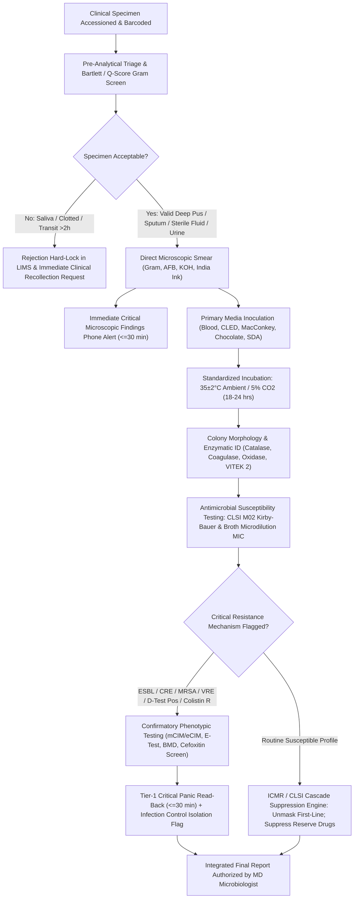

# 🧫 Master Cluster 6.1: Clinical Microbiology, Diagnostic Cultures, Staining & Antimicrobial Susceptibility Testing (AST) Cluster

**Department:** Clinical Microbiology, Serology & Molecular Mycobacteriology  
**Document ID:** `SDL-MICRO-OVW-6.1` | **Version:** 3.0 | **Effective Date:** October 2026 | **Review Cycle:** Annual  
**Facility:** Sawariya Diagnostic Lab, Charkhi Dadri, Haryana, India  
**Accreditation & Standards Compliance:** ISO 15189:2022 (Clauses 4.1 to 8.9 + Normative Annex A), NABL 112 (Issue 5), NABL 129 (Specific Criteria for Medical Laboratories - Microbiology Discipline), NABL 131, NABL 163, CLSI M100-Ed34 (2024), CLSI M02-A13, CLSI M07-A11, CLSI M47, CLSI M54, CLSI GP47, EUCAST Clinical Breakpoint Tables v14.0 (2024), WHO GLASS, ICMR AMRSN Guidelines 2024, NTEP Guidelines (Govt. of India), CPA 2019.

---

## 📑 1. Administrative Document Control, Traceability & Interoperability Directory

### 1.1 Administrative Sign-Off & Governance Block
| Role | Name & Academic Credentials | Professional Designation | Approval Verification & Stamp | Date of Approval |
| :--- | :--- | :--- | :--- | :--- |
| **Laboratory Director** | Dr. A. Sharma, MD (Pathology), DNB | Head of Laboratory Medicine | Signed & Sealed [SDL/DIR/2026/01] | 01-Oct-2026 |
| **Quality Manager** | Dr. R. Verma, MD (Microbiology) | Lead Quality Coordinator | Signed & Sealed [SDL/QM/2026/14] | 01-Oct-2026 |
| **Technical Manager** | Mr. S. Yadav, MSc (Med. Micro), CQC | Senior Technical Lead | Signed & Sealed [SDL/TM/2026/08] | 01-Oct-2026 |
| **Biosafety Officer** | Dr. N. Singh, MD (Microbiology) | Infection Control & Safety Officer | Signed & Sealed [SDL/BSO/2026/03] | 01-Oct-2026 |

### 1.2 Normative Regulatory & Clause-Level Alignment Matrix
- **ISO 15189:2022 Mandates:** Clause 4 (Impartiality, Confidentiality & Patient Rights), Clause 5 (Structural & Governance Architecture), Clause 6 (Resource Requirements: Personnel Qualifications 6.2, Facility Biosafety 6.3, Equipment Calibration 6.4, Metrological Traceability 6.5, Reagents & Media Lot Qualification 6.6), Clause 7 (Process Requirements: Pre-examination Specimen Triage 7.2, Examination Method Verification 7.3, Post-examination Cascade Reporting 7.4, Nonconforming Event CAPA 7.5, LIMS Cybersecurity & Data Governance 7.6, Clinical Risk Assessment 7.7), Clause 8 (Management System Review), and Normative Annex A (Point-of-Care Testing & Diagnostic Reflexes).
- **NABL Criteria Traceability:** NABL 112 (General Quality Management), NABL 129 (Microbiology-specific criteria: biological safety cabinets, autoclave sterilization logs, ATCC strain passaging limits, primary media sterility and growth promotion), NABL 131 (Internal Quality Control protocol), and NABL 163 (External Quality Assessment / Inter-laboratory PT participation).
- **Global Stewardship & Diagnostic Guidelines:** CLSI M100 (34th Edition, 2024), CLSI M02 (Disk Diffusion), CLSI M07 (Dilution Susceptibility), EUCAST v14.0 (2024), ICMR Antimicrobial Stewardship & Surveillance Network (AMRSN), WHO GLASS, and Govt. of India NTEP Operational Guidelines for Mycobacterial Diagnostics.

### 1.3 Master Cluster Interoperability Directory (`6.1.1` – `6.1.10`)
| Sub-Test Code | Diagnostic Procedure Title | Primary LOINC Code | SNOMED-CT Concept | ICD-10-CM / ICD-11 Diagnostic Code | Primary Analytical Platform | Backup / Confirmatory Analytical Method | Target TAT (Prelim / Final) |
| :--- | :--- | :--- | :--- | :--- | :--- | :--- | :--- |
| **6.1.1** | Urine Aerobic Culture & Colony Count | `630-4` / `18769-0` | `122575003` (Urine) / `117010004` (Culture) | `N39.0` (UTI) / `GC08` (Cystitis) | Calibrated Loop ($1\text{ }\mu\text{L} / 10\text{ }\mu\text{L}$) CLED/Chromogenic Agar | Automated MIC (VITEK 2 Compact) + CLSI M02 MHA Disk Diffusion | Prelim: 24h<br>Final: 48h |
| **6.1.2** | Automated Blood Culture & TTP | `600-7` / `29576-6` | `119297000` (Blood) / `30088009` (Culture) | `A41.9` (Sepsis) / `1G40` (Sepsis) | Continuous Fluorometric Monitoring (BD BACTEC FX / BacT/ALERT) | Direct Positive Bottle Gram Panic Call + Subculture + Automated MIC | Gram: $\le 30\text{ min}$<br>Final: 5 Days |
| **6.1.3** | Pus, Wound Swab & Aspirate Culture | `624-7` / `6460-0` | `119323008` (Pus) / `119364003` (Tissue) | `L08.9` (Cellulitis) / `1B10` (Abscess) | Direct Gram Q-Score + 5% Sheep Blood / MacConkey / Chocolate / RCM | CLSI M100 MHA Kirby-Bauer AST + VITEK 2 AST Cards | Gram: 1h<br>Final: 48–72h |
| **6.1.4** | Sputum / ET / BAL Culture & Bartlett | `6460-0` / `6463-4` | `119334006` (Sputum) / `258607008` (BAL) | `J18.9` (Pneumonia) / `CA40` (Pneumonia) | Bartlett Screening + Quantitative Loop ($\text{BAL} \ge 10^4\text{ CFU/mL}$) | Chocolate Agar ($5\%\text{ CO}_2$) + MacConkey + Blood Agar + CLSI AST | Screen: 2h<br>Final: 48–72h |
| **6.1.5** | Stool, Throat & Genital Swab Culture | `625-4` / `626-2` | `119339001` (Stool) / `258529004` (Throat) | `A09.0` (Gastroenteritis) / `1A40` (Infectious diarrhea) | Selenite-F / DCA / XLD / TCBS + Blood Agar (Throat) | Slide agglutination antisera + Biochemical Gallery + VITEK 2 GN | Prelim: 24h<br>Final: 48–72h |
| **6.1.6** | Sterile Body Fluids & CSF Culture | `606-4` / `634-6` | `258450006` (CSF) / `309051001` (Body fluid) | `G00.9` (Meningitis) / `1D01` (Bacterial meningitis) | Cytocentrifugation ($3000\times g$) + STAT Gram + Chocolate ($5\%\text{ CO}_2$) | Bedside Pediatric Blood Culture Bottle Inoculation + Broth Subculture | STAT Gram: $\le 30\text{ min}$<br>Final: 5 Days |
| **6.1.7** | AFB Smear (ZN & Auramine-O Fluorescent) | `11545-1` / `11475-1` | `119334006` / `168186007` (Smear) | `A15.0` (Pulmonary TB) / `1B10` (Tuberculosis) | LED Auramine-O Fluorescence ($200\times/400\times$) + ZN Confirmation | RNTCP/NTEP Quantitative Oil Immersion ($1000\times$) Grading | STAT: 2h<br>Routine: $< 6\text{h}$ |
| **6.1.8** | Molecular TB: GeneXpert Ultra & Truenat | `89373-5` / `88151-6` | `119334006` / `711334009` (MTB PCR) | `A15.0` (TB) / `U84.3` (Rifampicin resistance) | Real-Time PCR (Cepheid GeneXpert MTB/RIF Ultra - Nested RT-PCR) | Molbio Truenat MTB-Plus & MTB-RIF Dx Micro-PCR | STAT: 2h<br>Routine: 4h |
| **6.1.9** | Special Stains: Gram, Albert, India Ink | `664-3` / `652-8` | `258450006` / `104210008` (Gram method) | `A36.0` (Diphtheria) / `B45.1` (Cryptococcosis) | Hucker's Gram + Albert's Stain (Babes-Ernst) + Nigrosin Capsule Mount | Phase Contrast Microscopy & Correlative Cytology | STAT: $< 30\text{ min}$ |
| **6.1.10** | Mycology: KOH Mount, Calcofluor & SDA | `681-7` / `580-1` | `119325001` (Skin/Nail) / `252398000` (Fungal) | `B44.9` (Aspergillosis) / `B46.5` (Mucormycosis) | $10\%\text{–}20\%$ KOH Mount + Calcofluor White Fluorescent Microscopy | Paired SDA (with/without Cycloheximide at $25^\circ\text{C}$ & $37^\circ\text{C}$) + LPCB Mount | STAT KOH: 1h<br>Culture: 4 Weeks |

### 1.4 Metrological Traceability & Equipment Calibration Matrix (`ISO 17511:2020`)
| Instrument / Equipment | Parameter Verified | Traceable Primary Calibration Standard | Calibration Frequency | Permissible Operational Tolerance |
| :--- | :--- | :--- | :--- | :--- |
| **Spectrophotometer / Densitometer** | Turbidity / Absorbance ($625\text{ nm}$) | Primary BaSO4 & Polymer McFarland Standards (NIST SRM 2034) | Semi-Annual | Absorbance: $0.080\text{ to }0.130$ at $625\text{ nm}$ |
| **Mitutoyo Digital Vernier Caliper** | Inhibition Zone Diameters | NPL-Traceable Class 0 Steel Gauge Blocks (ISO 3650) | Annual | Bias $\le \pm 0.02\text{ mm}$; Expanded $U = \pm 0.02\text{ mm}$ |
| **Class II Type A2 Biosafety Cabinet** | Face Inflow & Downflow Velocity | Calibrated Thermal Anemometer (NABL Accredited) | Annual | Inflow: $100 \pm 10\text{ fpm}$; Downflow: $55 \pm 5\text{ fpm}$ |
| **Class II Type A2 BSC HEPA Filters** | Aerosol Containment Integrity | Polyalphaolefin (PAO-4) Aerosol Photometer (NSF 49) | Annual | Leakage penetration $< 0.005\%$ |
| **Steam Sterilization Autoclaves** | Temperature & Pressure Profile | Multi-Channel Data Logger with PT100 Class A Probes | Semi-Annual | $121.0 \pm 1.0^\circ\text{C}$ at $15.0 \pm 0.5\text{ psi}$ for $\ge 20\text{ min}$ |
| **Incubators & Cold Rooms** | Thermal Stability & Distribution | NABL Calibrated Data Loggers with External NIST Probes | Continuous / Annual | Incubators: $35.0 \pm 1.0^\circ\text{C}$; Cold Storage: $2.0\text{ to }8.0^\circ\text{C}$ |
| **Analytical & Precision Balances** | Mass Gravimetric Verification | OIML Class E2 & F1 Stainless Steel Reference Weights | Annual | Linearity error $\le \pm 0.1\text{ mg}$ (Analytical balance) |

---

## 🔬 2. Microbiological Governance Architecture, Biosafety & Diagnostic Cascades

### 2.1 Laboratory Biosafety Level 2 (BSL-2) Engineering Controls & Biohazard Management
1. **Biosafety Containment Engineering:** All specimen handling, direct smear preparation, vortexing, centrifugation, and fungal/mycobacterial inoculations are strictly confined to certified Class II Type A2 Biosafety Cabinets (BSC) complying with NSF/ANSI Standard 49 and CDC/WHO Biosafety in Microbiological and Biomedical Laboratories (BMBL 6th Edition).
   - **Airflow Parameters:** Inflow face velocity maintained at $100 \pm 10\text{ fpm}$ ($0.51 \pm 0.05\text{ m/s}$); 70% internal laminar recirculation through supply HEPA filter; 30% exhaust discharge through exhaust HEPA filter.
   - **Annual Certification:** HEPA filters challenged annually using polyalphaolefin (PAO) aerosol penetration testing with an aerosol photometer ($\text{penetration } < 0.005\%$), accompanied by smoke pattern visualization and air velocity profiling.
2. **Autoclave Sterilization Cycle Validation:** Double-door, high-pressure gravity displacement steam autoclaves used for biohazard decontamination and in-house media preparation.
   - **Sterilization Parameters:** Clean cycle for culture media: $121^\circ\text{C}$ at $15\text{ psi}$ ($103.4\text{ kPa}$) for 20 minutes; Biohazardous waste decontamination cycle: $121^\circ\text{C}$ at $15\text{ psi}$ for 45 minutes.
   - **Verification Strategy:** Every run verified using chemical Class 5 integrating indicators (multiparameter steam-temperature-time). Weekly biological challenge conducted using self-contained *Geobacillus stearothermophilus* ATCC 7953 spore ampoules ($10^6$ spores/carrier), incubated at $56 \pm 2^\circ\text{C}$ for 48 hours to confirm complete spore inactivation.
3. **Bio-Medical Waste (BMW) Management Rules Compliance:** Segregation strictly enforced at source:
   - **Yellow Bag (Non-chlorinated):** Contaminated anatomical waste, swab sticks, soiled dressings, and culture media plates (pre-autoclaved before offsite handover).
   - **Red Bag:** Contaminated recyclable plastics, specimen containers, vacutainers, and pipette tips (chemical disinfection with $1\%\text{–}2\%$ sodium hypochlorite prior to autoclaving).
   - **White Puncture-Proof Container:** Needles, scalpel blades, contaminated glass slides, and lancets (autoclaved/shredded).
   - **Blue Cardboard Box:** Broken glassware, glass reagent vials, and discarded ampoules.

### 2.2 Integrated Diagnostic Workflow Cascade


### 2.3 Diagnostic Biochemical Cascades & Key Enzymatic Reactions
| Test Reaction | Primary Reagent / Substrate | Biological Principle & Positive Endpoint | Clinical Diagnostic Differentiation |
| :--- | :--- | :--- | :--- |
| **Catalase Test** | $3\%\text{ H}_2\text{O}_2$ | Cytochrome enzyme degrades $\text{H}_2\text{O}_2 \rightarrow \text{H}_2\text{O} + \text{O}_2$ (Rapid vigorous effervescence) | Differentiates *Staphylococcus* (+) from *Streptococcus* / *Enterococcus* (-) |
| **Coagulase Test** | Rabbit Plasma with EDTA | Bound coagulase (clumping factor) & Free coagulase forms fibrin clot | Confirms *Staphylococcus aureus* (+) from CoNS (Coagulase-Negative Staphylococci) |
| **Oxidase Test** | $1\%\text{ Tetramethyl-p-phenylenediamine}$ | Cytochrome c oxidase oxidizes reagent to deep purple within 10–30s | Differentiates *Pseudomonas* (+) from Enterobacterales (-) |
| **Indole Test** | Kovac's Reagent (p-dimethylaminobenzaldehyde) | Tryptophanase converts tryptophan to indole (Cherry red ring) | Differentiates *E. coli* (+) from *Klebsiella pneumoniae* (-) |
| **Bile Solubility** | $2\%\text{ Sodium Deoxycholate}$ | Deoxycholate activates autolytic amidase enzymes (Rapid lysis/clearing) | Differentiates *Streptococcus pneumoniae* (Soluble) from Viridans Streptococci |
| **PYR Hydrolysis** | L-pyrrolidonyl-$\beta$-naphthylamide | Pyrrolidonyl peptidase produces $\beta$-naphthylamine (Bright red with DMACA) | Confirms *Enterococcus* spp. (+) and *Streptococcus pyogenes* (GAS) (+) |

### 2.4 Core Antimicrobial Stewardship & Critical Resistance Phenotypes
1. **Methicillin-Resistant *Staphylococcus aureus* (MRSA / MRCoNS):**
   - **Surrogate Disk Screen:** Cefoxitin $30\text{ }\mu\text{g}$ disk on MHA incubated at $35 \pm 1^\circ\text{C}$ for a full 24 hours. Zone diameter $\le 21\text{ mm}$ for *S. aureus* (or $\le 24\text{ mm}$ for *S. coagulase-negative*) indicates *mecA*- or *mecC*-mediated penicillin-binding protein 2a (PBP2a) production.
   - **Reporting Rule:** An isolate confirmed as MRSA must be reported as RESISTANT to ALL $\beta$-lactam antibiotics (penicillins, cephalosporins, carbapenems, and $\beta$-lactamase inhibitor combinations), regardless of in-vitro susceptibility, EXCEPT ceftaroline and ceftobiprole (advanced anti-MRSA cephalosporins).
2. **Extended-Spectrum $\beta$-Lactamases (ESBL) in Enterobacterales:**
   - **Initial Screening:** Zone diameters: Ceftazidime $30\text{ }\mu\text{g} \le 22\text{ mm}$, Cefotaxime $30\text{ }\mu\text{g} \le 27\text{ mm}$, or Ceftriaxone $30\text{ }\mu\text{g} \le 25\text{ mm}$.
   - **Phenotypic Confirmation (Phenotypic Combined Disk):** Tested using Ceftazidime ($30\text{ }\mu\text{g}$) versus Ceftazidime-Clavulanic Acid ($30/10\text{ }\mu\text{g}$) and Cefotaxime ($30\text{ }\mu\text{g}$) versus Cefotaxime-Clavulanic Acid ($30/10\text{ }\mu\text{g}$). A $\ge 5\text{ mm}$ increase in zone diameter for either antimicrobial agent tested in combination with clavulanate confirms ESBL production.
3. **Carbapenem-Resistant Enterobacterales (CRE) & Carbapenemase Characterization:**
   - **Screening:** Meropenem or Ertapenem disk zone diameter $\le 19\text{ mm}$ or automated MIC $\ge 2\text{ }\mu\text{g/mL}$ (Ertapenem) / $\ge 4\text{ }\mu\text{g/mL}$ (Meropenem).
   - **mCIM & eCIM Differentiation:** A $1\text{-}\mu\text{L}$ loop of the test isolate is suspended in $2\text{ mL}$ Tryptic Soy Broth (TSB) containing a Meropenem $10\text{ }\mu\text{g}$ disk, incubated for 4 hours at $35^\circ\text{C}$. The disk is transferred to an MHA lawn of *E. coli* ATCC 25922. A zone of 6–15 mm indicates carbapenemase inactivation (mCIM positive). An EDTA-supplemented tube (eCIM) is run simultaneously: if the zone diameter increases by $\ge 5\text{ mm}$ in the presence of EDTA, it confirms a Metallo-$\beta$-Lactamase (MBL, such as NDM-1, VIM, IMP); if no increase occurs, a Serine Carbapenemase (KPC, OXA-48-like) is confirmed.
4. **Inducible Clindamycin Resistance ($i\text{MLS}_\text{B}$) via D-Zone Test:**
   - **Technique:** Erythromycin $15\text{ }\mu\text{g}$ disk placed 15 to 26 mm edge-to-edge from Clindamycin $2\text{ }\mu\text{g}$ disk on MHA.
   - **Interpretation:** Blunting or flattening of the clindamycin zone adjacent to the erythromycin disk creating a distinct "D-shaped" inhibition zone indicates inducible methylase production (*erm* gene). The isolate must be reported as RESISTANT to Clindamycin with a cautionary note: *"Clindamycin-induced resistance detected. Therapy failure likely if used."*
5. **Colistin / Polymyxin Broth Microdilution Mandate:**
   - **Strict Methodological Prohibition:** CLSI M100 and EUCAST strictly forbid the use of disk diffusion and gradient diffusion strips (E-test) for colistin due to the large, cationic, poorly diffusing polypeptide structure of polymyxins.
   - **Reference Standard:** Only Broth Microdilution (BMD) using cation-adjusted Mueller-Hinton broth without polysorbate-80, or validated Colistin Broth Disk Elution (CBDE), is acceptable. Intermediate breakpoint $\le 2\text{ mg/L}$, Resistant $> 2\text{ mg/L}$.

### 2.5 Emergency Tier-1 Panic Critical Alert Protocol
| Alert Index | Laboratory Trigger Condition | Clinical Significance | Mandatory Phone Notification Timeframe | Escalation Protocol & Notification Script |
| :--- | :--- | :--- | :--- | :--- |
| **PANIC-01** | Positive Blood Culture Bottle Flag (Gram stain positive) | Fulminant bacteremia, acute sepsis, infective endocarditis | Within $\le 30\text{ minutes}$ of instrument alarm flag | Contact ICU/Ward attending nurse/physician; demand closed-loop verbal readback; document caller ID, recipient, and exact Gram morphology. |
| **PANIC-02** | Positive CSF Direct Gram Stain, India Ink, or Latex Agglutination | Acute pyogenic or cryptococcal bacterial/fungal meningitis | Within $\le 30\text{ minutes}$ of cytospin preparation | Immediate verbal notification; state whether intracellular Gram-negative diplococci (*N. meningitidis*), Gram-positive diplococci (*S. pneumoniae*), or encapsulated yeast. |
| **PANIC-03** | Detection of CRE, CRAB, CRPA, or Colistin-Resistant Isolate | Pan-drug resistant pathogen outbreak risk in ICU | Within $\le 30\text{ minutes}$ of AST verification | Alert Hospital Infection Control Committee (HICC) for contact isolation cohorting; unmask reserve synergy testing panel. |
| **PANIC-04** | Detection of MRSA with Vancomycin MIC $\ge 4\text{ }\mu\text{g/mL}$ (VISA/VRSA) | Vancomycin intermediate/resistant *S. aureus* failure risk | Within $\le 30\text{ minutes}$ of MIC reading | Direct communication with treating physician; switch to daptomycin/linezolid/ceftaroline; submit strain for reference PCR. |
| **PANIC-05** | Direct Microscopic Detection of Mucorales (Broad Aseptate Hyphae) | Acute invasive rhino-orbital-cerebral mucormycosis | Within $\le 30\text{ minutes}$ of KOH examination | Immediate alert to ENT/Ophthalmic surgery; immediate emergency surgical debridement and liposomal Amphotericin-B indication. |
| **PANIC-06** | Molecular / Smear AFB Positive (*M. tuberculosis* ± Rifampicin Resistance) | Contagious open pulmonary tuberculosis or MDR-TB | Within $\le 60\text{ minutes}$ of CBNAAT run completion | Immediate statutory electronic entry into Govt. of India **Nikshay** portal + Direct readback to treating chest specialist. |

---

## ⚙️ 3. Analytical Architecture: Standard Operating Procedures (SOP)

### 3.1 Specimen Accessioning, Visual Triage & Rejection Criteria
1. **Specimen Acceptance Hierarchy:** Fresh, unpreserved clinical specimens must be accessioned into the laboratory LIMS within 30 minutes of collection. Sterile aspirates, deep purulent exudates, and tissue biopsies collected prior to initiating empiric antimicrobial therapy represent the highest diagnostic yield.
2. **Standardized Rejection Criteria (Immediate LIMS Rejection & Clinical Notification):**
   - Specimen container unlabeled, mismatched barcode, or leaking container.
   - Sputum exhibiting $> 25$ squamous epithelial cells per low-power field ($100\times$) indicating salivary contamination (Bartlett score $\le 0$).
   - Urine specimens maintained at ambient temperature ($> 22^\circ\text{C}$) for $> 2\text{ hours}$ without boric acid preservation or refrigeration ($2\text{–}8^\circ\text{C}$).
   - Blood cultures submitted in EDTA, heparin, or citrate vacutainers instead of automated blood culture broth bottles.
   - Dry wound swabs without transport medium, or superficial skin swabs for deep diabetic foot ulcers.
   - Formol-saline fixed specimens submitted for microbiological culture.

### 3.2 Quantitative Specimen Validation Systems (Bartlett Sputum Screen & Kass Colony Count)
1. **Bartlett Sputum Screening Matrix:**
   | Microscopic Parameter (Low Power Field, 100x) | Quantitative Count Observed | Score Value Assigned |
   | :--- | :--- | :--- |
   | **Neutrophils (Pus Cells)** | $< 10\text{ cells/LPF}$ | $0$ |
   | **Neutrophils (Pus Cells)** | $10\text{ to }25\text{ cells/LPF}$ | $+1$ |
   | **Neutrophils (Pus Cells)** | $> 25\text{ cells/LPF}$ | $+2$ |
   | **Mucus Strands Present** | Visible microscopic bands | $+1$ |
   | **Squamous Epithelial Cells (SEC)** | $10\text{ to }25\text{ cells/LPF}$ | $-1$ |
   | **Squamous Epithelial Cells (SEC)** | $> 25\text{ cells/LPF}$ | $-2$ |
   - **Diagnostic Action:** A total score of $\le 0$ indicates heavy salivary contamination $\rightarrow$ REJECT specimen in LIMS; score of $+1$ to $+3$ indicates genuine lower respiratory purulent secretion $\rightarrow$ ACCEPT for quantitative plating.
2. **Kass Colony Count Interpretation for Clean-Catch Midstream Urine:**
   | Colony Count Range (CFU/mL) | Pure Single Isolate Interpretation | Mixed Flora ($\ge 3$ Morphotypes) | Clinical Action Protocol |
   | :--- | :--- | :--- | :--- |
   | **$< 10^3\text{ CFU/mL}$** | Insignificant / Contamination | Normal urethral flora | Report as no significant bacteriuria; no AST. |
   | **$10^3\text{ to }10^4\text{ CFU/mL}$** | Probable early UTI if symptomatic male or catheterized | Contamination likely | Repeat clean-catch; AST performed only on special request. |
   | **$10^4\text{ to }10^5\text{ CFU/mL}$** | Suspect UTI in symptomatic female or pyelonephritis | Mixed perineal contamination | Correlate with urine microscopy pyuria ($\ge 10\text{ WBCs/}\mu\text{L}$). |
   | **$\ge 10^5\text{ CFU/mL}$** | **Significant Bacteriuria** (Kass Diagnostic Criterion) | Mixed periurethral contamination | Perform automated identification & CLSI M100 AST panel. |

### 3.3 Master Staining Protocols (Gram, ZN, Albert, India Ink & KOH)
1. **Gram Stain (Hucker's Modification):**
   - Crystal violet ($0.5\%$ aqueous) for 1 minute; wash gently with tap water.
   - Gram's iodine mordant for 1 minute; wash with water.
   - Decolorize with $95\%$ ethanol/acetone mixture for 5–10 seconds until runoff is clear; immediately rinse with water.
   - Counterstain with Safranin ($0.25\%$) or dilute Carbol Fuchsin for 30–60 seconds; wash, blot dry, and examine under $1000\times$ oil immersion.
2. **Ziehl-Neelsen (ZN) Acid-Fast Stain:**
   - Flood heat-fixed smear with strong Carbol Fuchsin ($1\%$ basic fuchsin in $5\%$ phenol).
   - Heat gently with spirit flame until steam rises; maintain steaming without boiling for 5 minutes; wash with water.
   - Decolorize with $25\%\text{ H}_2\text{SO}_4$ for 3 minutes; rinse with water (smear should be faint pink).
   - Counterstain with $0.1\%$ Methylene Blue for 1 minute; wash, dry, and examine under oil immersion ($1000\times$, minimum 100 fields examined).
3. **Albert's Stain for *Corynebacterium diphtheriae*:**
   - Heat-fix smear from Loeffler's serum slope; flood with Albert's Stain A (Toluidine blue, Malachite green, glacial acetic acid, ethanol) for 3–5 minutes.
   - Drain without washing; flood with Albert's Stain B (Iodine, potassium iodide) for 1 minute; wash with water, dry.
   - Microscopic examination: Green bacilli arranged in Chinese-letter / L-V patterns with bluish-black metachromatic (Babes-Ernst) volutin granules at poles.
4. **Negative Staining (India Ink / 10% Nigrosin Mount):**
   - Place 1 drop of centrifuged CSF sediment on a clean glass slide; add 1 equal drop of sterile India ink or $10\%$ Nigrosin; mix gently and apply coverslip.
   - Examine immediately under $400\times$: Clear refractive round/oval halos (mucopolysaccharide capsules) surrounding budding yeasts of *Cryptococcus neoformans* against dark particulate background.

### 3.4 Culture Media Preparation, Sterility & Performance Verification
1. **Mueller-Hinton Agar (MHA) Formulation & Pouring:**
   - Dehydrated MHA reconstituted per manufacturer instructions, autoclaved at $121^\circ\text{C}$ for 15 minutes, cooled to $48\text{–}50^\circ\text{C}$ in a monitored water bath.
   - Dispensed onto flat, level plastic Petri dishes ($100\text{ mm}$ or $150\text{ mm}$ diameter) to an exact, uniform agar depth of $4.0 \pm 0.5\text{ mm}$ ($25\text{ mL}$ for $100\text{ mm}$ plates, $60\text{ mL}$ for $150\text{ mm}$ plates). Agar depth verified randomly using a sterile depth gauge. Plates with agar depth $< 3.5\text{ mm}$ produce falsely enlarged zones (false susceptibility); plates $> 4.5\text{ mm}$ produce falsely constricted zones (false resistance).
   - pH verified at room temperature ($25^\circ\text{C}$) using a calibrated surface electrode to ensure $\text{pH } 7.3 \pm 0.1$.
2. **Batch In-House Sterility & Growth Support Testing:**
   - Five plates or 1% of each prepared batch (whichever is greater) incubated uninoculated at $35 \pm 2^\circ\text{C}$ for 48 hours to confirm sterility.
   - Growth support and performance verified using standard ATCC control strains before releasing media batches for clinical diagnostic testing.

### 3.5 Inoculum Standardisation: 0.5 McFarland Verification
1. **Preparation:** Touch 3–5 morphologically identical colonies from a 18–24 hour pure culture plate with a sterile loop and suspend in $4.0\text{ mL}$ of sterile $0.85\%\text{–}0.90\%$ physiological saline.
2. **Nephelometric Standardization:** Vortex suspension and adjust turbidity to match standard 0.5 McFarland using an optical densitometer or spectrophotometer ($\text{absorbance at } 625\text{ nm} = 0.080\text{ to }0.130$, verifying $1.5 \times 10^8\text{ CFU/mL}$).
3. **Application Window:** Inoculum suspension must be inoculated onto MHA within 15 minutes of preparation to prevent changes in bacterial density.

### 3.6 Inoculation, Disk Placement & Incubation Geometry
1. **Inoculation Technique:** Dip a sterile, non-toxic cotton swab into the standardized suspension, rotate firmly against the inside wall of the tube above liquid level to expel excess moisture. Streak the swab evenly across the entire dried surface of the MHA plate in three planes at $60^\circ$ angles, finishing with a circular rim pass to ensure a confluent, uniform lawn of growth.
2. **Disk Placement Precision:** Disks must be applied within 15 minutes of plate swabbing using sterile fine-pointed forceps or an automated disk dispenser. Press each disk firmly to ensure complete, flat contact with the agar surface.
   - **Geometry:** Centers of adjacent disks must be separated by $\ge 24\text{ mm}$; disk edges must be $\ge 15\text{ mm}$ from the plate border.
   - **Disk Capacity Limits:** Maximum 12 disks per $150\text{ mm}$ Petri dish; maximum 5–6 disks per $100\text{ mm}$ dish to avoid overlapping inhibition zones.
3. **Incubation Atmosphere & Timing:**
   - Invert plates and incubate within 15 minutes of disk application.
   - Incubate at $35 \pm 2^\circ\text{C}$ in ambient air for 16–18 hours.
   - **Crucial CLSI Prohibition:** DO NOT incubate routine MHA plates in a $\text{CO}_2$-enriched atmosphere! Carbon dioxide forms surface carbonic acid, reducing agar pH, leading to false resistance for macrolides, aminoglycosides, and clindamycin, and false susceptibility for tetracyclines.
   - **Extended Incubation (24 Hours):** Required for detection of MRSA (cefoxitin disk) and Vancomycin-resistant enterococci (VRE).

### 3.7 Zone Measurement & Caliper Verification Rules
- Measure zones of complete inhibition (including disk diameter) from the back of the inverted plate against a black, non-reflecting background using reflected light and a calibrated digital vernier caliper to the nearest $0.1\text{ mm}$.
- *Proteus* swarming: Ignore thin veils of swarming within the zone of inhibition; measure the clear edge.
- Trimethoprim-sulfamethoxazole: Slight trailing growth (up to 20% faint haze) is ignored; read margin of 80% inhibition.
- Blood MHA (Fastidious organisms): Plates are read from the top surface with the lid removed using reflected illumination.

---

## 📊 4. Metrological Quality Assurance & ATCC Reference Verification Matrix

### 4.1 Master ATCC Reference Strain Acceptance Criteria (`CLSI M100-Ed34`)
| ATCC Reference Strain | Quality Control Purpose | Antimicrobial Disk & Potency | CLSI Acceptable Range (mm) | Action Limit if Out-of-Range |
| :--- | :--- | :--- | :--- | :--- |
| **`Escherichia coli` ATCC 25922** | Control for Gram-negative susceptible isolates | Ampicillin ($10\text{ }\mu\text{g}$)<br>Ciprofloxacin ($5\text{ }\mu\text{g}$)<br>Gentamicin ($10\text{ }\mu\text{g}$)<br>Meropenem ($10\text{ }\mu\text{g}$) | 15 – 22 mm<br>29 – 38 mm<br>19 – 26 mm<br>28 – 35 mm | If any zone deviates by $> 1\text{ mm}$, halt clinical reporting; inspect MHA depth, disk lot number, and inoculum turbidity. |
| **`Escherichia coli` ATCC 35218** | Control for $\beta$-lactamase inhibitor combinations | Amoxicillin-Clavulanic Acid ($20/10\text{ }\mu\text{g}$)<br>Piperacillin-Tazobactam ($100/10\text{ }\mu\text{g}$) | 17 – 22 mm<br>24 – 30 mm | Validates inhibitor potency; deterioration of clavulanate or tazobactam causes zone constriction $< 17\text{ mm}$. |
| **`Pseudomonas aeruginosa` ATCC 27853** | Control for divalent cation ($\text{Ca}^{2+}, \text{Mg}^{2+}$) content | Gentamicin ($10\text{ }\mu\text{g}$)<br>Tobramycin ($10\text{ }\mu\text{g}$)<br>Amikacin ($30\text{ }\mu\text{g}$)<br>Ceftazidime ($30\text{ }\mu\text{g}$) | 17 – 23 mm<br>20 – 26 mm<br>20 – 26 mm<br>23 – 29 mm | Gentamicin zone $< 17\text{ mm}$ indicates excess divalent cations; zone $> 23\text{ mm}$ indicates cation deficiency in MHA. |
| **`Staphylococcus aureus` ATCC 25923** | Control for Gram-positive susceptible isolates | Cefoxitin ($30\text{ }\mu\text{g}$)<br>Oxacillin ($1\text{ }\mu\text{g}$)<br>Vancomycin ($30\text{ }\mu\text{g}$)<br>Erythromycin ($15\text{ }\mu\text{g}$) | 23 – 29 mm<br>18 – 24 mm<br>17 – 21 mm<br>22 – 30 mm | Cefoxitin zone must remain $\ge 22\text{ mm}$; if $< 22\text{ mm}$, susceptible control is failing; check incubator temperature ($> 35^\circ\text{C}$). |
| **`Staphylococcus aureus` ATCC 43300** | Positive control for MRSA (*mecA* positive) | Cefoxitin ($30\text{ }\mu\text{g}$) | $\le 21\text{ mm}$ (Resistance profile) | Must demonstrate resistant phenotype ($\le 21\text{ mm}$); if zone $> 21\text{ mm}$, batch of cefoxitin disks is rejected. |
| **`Enterococcus faecalis` ATCC 29212** | Thymidine/Thymine deficiency control of MHA | Trimethoprim-Sulfamethoxazole ($1.25/23.75\text{ }\mu\text{g}$) | $\ge 20\text{ mm}$ (Clear zone) | Zone $< 20\text{ mm}$ or growth up to disk indicates high thymidine/thymine in MHA; leads to false TMP-SMX resistance. |
| **`Enterococcus faecalis` ATCC 51299** | Positive control for Vancomycin resistance (*vanB*) | Vancomycin ($30\text{ }\mu\text{g}$ disk / Screen Plate) | Zone 6 – 15 mm / Growth on screen | Confirms instrument and bench capability to detect low-to-moderate glycopeptide resistance. |
| **`Klebsiella pneumoniae` ATCC 700603** | Phenotypic ESBL positive reference | Ceftazidime ($30\text{ }\mu\text{g}$) vs Ceftazidime-Clav ($30/10\text{ }\mu\text{g}$) | $\ge 5\text{ mm}$ increase with clavulanate | Confirms ESBL detection algorithm; difference $< 5\text{ mm}$ invalidates ESBL testing batch. |
| **`Klebsiella pneumoniae` ATCC BAA-1705** | Positive control for Carbapenemase (KPC positive) | Meropenem $10\text{ }\mu\text{g}$ + mCIM Method | Zone 6 – 15 mm (Inactivation confirmed) | Positive mCIM control; verifies carbapenem hydrolysis detection. |
| **`Klebsiella pneumoniae` ATCC BAA-2146** | Positive control for Metallo-$\beta$-Lactamase (NDM-1) | Meropenem $10\text{ }\mu\text{g}$ + mCIM & eCIM | mCIM 6–15 mm; eCIM zone increase $\ge 5\text{ mm}$ | Positive eCIM control; confirms $\text{Zn}^{2+}$-dependent carbapenemase inhibition. |
| **`Streptococcus pneumoniae` ATCC 49619** | Control for fastidious blood agar AST | Penicillin ($1\text{ }\mu\text{g}$ Oxacillin disk)<br>Levofloxacin ($5\text{ }\mu\text{g}$)<br>Vancomycin ($30\text{ }\mu\text{g}$) | 19 – 25 mm<br>20 – 25 mm<br>20 – 27 mm | Mueller-Hinton Agar with 5% Defibrinated Sheep Blood incubated in $5\%\text{ CO}_2$. |
| **`Candida krusei` ATCC 6258** | Control for antifungal microdilution AST | Fluconazole MIC<br>Voriconazole MIC<br>Caspofungin MIC | 16 – 64 $\mu\text{g/mL}$<br>0.12 – 1.0 $\mu\text{g/mL}$<br>0.12 – 1.0 $\mu\text{g/mL}$ | Validates RPMI-1640 broth microdilution broth batch per CLSI M27-Ed4. |

### 4.2 Differential Resistance Phenotype Diagnostic Matrix
| Resistance Phenotype | Cefotaxime / Ceftriaxone | Ceftazidime | Cefepime | Cefoxitin | Meropenem | Combined Clavulanate Disk | Combined EDTA Disk (eCIM) | Ceftazidime-Avibactam |
| :--- | :--- | :--- | :--- | :--- | :--- | :--- | :--- | :--- |
| **Wild Type (Susceptible)** | Susceptible | Susceptible | Susceptible | Susceptible | Susceptible | No enhancement | No enhancement | Susceptible |
| **ESBL Producer** | Resistant | Resistant | Variable / R | Susceptible | Susceptible | $\ge 5\text{ mm}$ Enhancement | No enhancement | Susceptible |
| **AmpC $\beta$-Lactamase** | Resistant | Resistant | Susceptible / I | Resistant | Susceptible | No enhancement | No enhancement | Susceptible |
| **KPC Carbapenemase** | Resistant | Resistant | Resistant | Resistant | Resistant | No enhancement | No enhancement | Susceptible |
| **MBL (NDM / VIM)** | Resistant | Resistant | Resistant | Resistant | Resistant | No enhancement | $\ge 5\text{ mm}$ Enhancement | **Resistant** |
| **OXA-48-Like** | Variable / R | Variable / R | Resistant | Resistant | Resistant | No enhancement | No enhancement | Susceptible |

### 4.3 Measurement Uncertainty ($U$) & Analytical Precision
- **Measurement Uncertainty Model:** Combined standard uncertainty calculated per ISO/TS 20914:
  $$u_c = \sqrt{u_{\text{caliper}}^2 + u_{\text{inoculum}}^2 + u_{\text{depth}}^2 + u_{\text{reading}}^2}$$
- **Expanded Uncertainty ($k=2$, 95% Confidence Interval):** For automated and digital vernier zone measurements, $U = 2 \times u_c = \pm 0.8\text{ mm}$. If an observed clinical zone lies within $\pm 1\text{ mm}$ of the CLSI clinical breakpoint, the isolate is tested in duplicate or reflexed to broth microdilution MIC determination.

---

## ⚖️ 5. Clinical Decision Thresholds, ICMR Cascade Reporting & Stewardship Engine

### 5.1 Antimicrobial Cascade Reporting Strategy (`CLSI M100` / `ICMR AMRSN`)
To prevent the overuse of broad-spectrum antibiotics and preserve critical reserve antimicrobials, results are reported according to hierarchical tiers:
- **Group A (Primary / First-Line):** Routinely tested and reported for all isolated pathogens (e.g., Ampicillin, Cefazolin, Gentamicin, Ciprofloxacin, Amoxicillin-Clavulanic Acid).
- **Group B (Secondary / Selective):** Tested routinely but reported selectively—only when the isolate is resistant to Group A agents, when the patient has a severe multi-site infection, or when clinical allergy precludes first-line drugs (e.g., Piperacillin-Tazobactam, Cefepime, Meropenem, Amikacin, Vancomycin).
- **Group C (Supplemental / Alternative):** Tested in specialized clinical settings (e.g., Ceftazidime-Avibactam, Ceftolozane-Tazobactam, Linezolid, Daptomycin).
- **Group U (Urinary Tract Specific):** Tested and reported exclusively for urine isolates; never reported for systemic, respiratory, or bacteremic isolates (e.g., Nitrofurantoin, Fosfomycin tromethamine, Norfloxacin).
- **Reserve Group (Restricted / Stewardship Hold):** Colistin, Polymyxin B, Tigecycline. Held under administrative lock in LIMS; unmasked ONLY upon MD Microbiologist authorization following confirmed carbapenem resistance (CRE, CRAB, CRPA).

### 5.2 Cascade Reporting Logic Flowchart
| Bacterial Group | Primary Reported Agents (Tier 1) | Secondary Unmasked Agents (Tier 2 - If Tier 1 Resistant) | Reserve Agents (Tier 3 - Restricted Authorization) |
| :--- | :--- | :--- | :--- |
| **Enterobacterales (Non-Urine)** | Ampicillin, Cefazolin, Ceftriaxone, Gentamicin, Ciprofloxacin | Piperacillin-Tazobactam, Cefepime, Amikacin, Meropenem, Ertapenem | Ceftazidime-Avibactam, Aztreonam-Avibactam, Colistin (BMD MIC only), Tigecycline |
| **Enterobacterales (Urine Only)** | Nitrofurantoin, Trimethoprim-Sulfamethoxazole, Ciprofloxacin, Cefuroxime | Amoxicillin-Clavulanate, Fosfomycin (oral), Ceftriaxone, Gentamicin | Meropenem, Amikacin, Colistin |
| **`Pseudomonas aeruginosa`** | Piperacillin-Tazobactam, Ceftazidime, Ciprofloxacin, Gentamicin | Cefepime, Meropenem, Imipenem, Amikacin, Tobramycin | Ceftolozane-Tazobactam, Ceftazidime-Avibactam, Colistin (BMD MIC only) |
| **`Staphylococcus aureus`** | Cefoxitin (MRSA screen), Penicillin, Erythromycin, Clindamycin, TMP-SMX | Vancomycin (MIC), Teicoplanin, Gentamicin, Ciprofloxacin | Linezolid, Daptomycin, Ceftaroline, Tedizolid |
| **`Enterococcus` spp.** | Ampicillin, Penicillin | Vancomycin (MIC), High-Level Gentamicin Screen, High-Level Streptomycin Screen | Linezolid, Daptomycin, Tigecycline |

### 5.3 CLSI vs EUCAST Interpretative Discrepancies Matrix
| Antimicrobial Agent | Clinical Scenario | CLSI M100 Breakpoint ($\mu\text{g/mL}$) | EUCAST Breakpoint ($\mu\text{g/mL}$) | Laboratory Consensus Protocol (ICMR AMRSN) |
| :--- | :--- | :--- | :--- | :--- |
| **Cefepime** | Enterobacterales | $\le 2\text{ (S)}; 4\text{–}8\text{ (SDD)}; \ge 16\text{ (R)}$ | $\le 1\text{ (S)}; > 4\text{ (R)}$ | Apply CLSI SDD (Susceptible-Dose Dependent) with explicit high-dose advisory ($2\text{ g IV q8h}$). |
| **Piperacillin-Tazobactam** | *P. aeruginosa* | $\le 16/4\text{ (S)}; \ge 32/4\text{ (R)}$ | $\le 8/4\text{ (S)}; > 16/4\text{ (R)}$ | Use conservative EUCAST breakpoint for ICU septic shock to prevent underdosing. |
| **Ciprofloxacin** | Enterobacterales | $\le 0.25\text{ (S)}; 0.5\text{ (I)}; \ge 1\text{ (R)}$ | $\le 0.25\text{ (S)}; > 0.5\text{ (R)}$ | Harmonized lowered breakpoints adopted to detect plasmid-mediated quinolone resistance (PMQR). |
| **Colistin** | *Acinetobacter* / *Enterobacterales* | $\le 2\text{ (I)}; \ge 4\text{ (R)}$ (No Susceptible) | $\le 2\text{ (S)}; > 2\text{ (R)}$ | Report MIC value via BMD with footnote explaining lack of bactericidal cure without combination agent. |

### 5.4 CLSI GP47 Closed-Loop Critical Call Protocol
1. **Detection:** Bench technologist flags critical result (e.g., positive blood bottle Gram, CRE, VISA).
2. **Contact:** Dial attending ICU/ward physician or nurse within $\le 30\text{ minutes}$.
3. **Transmission:** State laboratory identifier, patient unique health ID (UHID), patient name, sample type, exact observation, and potential urgency.
4. **Read-Back Requirement:** Technologist requests the recipient read back the patient name, UHID, and test result verbatim.
5. **Documentation:** Record date, exact time, caller name, recipient name and designation, read-back verification status, and clinical acknowledgement in the LIMS critical call ledger.

---

## 🩺 6. Worked Clinical Diagnostic Scenarios

### Case 1: Hypervirulent Urosepsis (*Klebsiella pneumoniae*, CRE Producer)
- **Clinical Presentation:** A 68-year-old diabetic male presented to the Emergency Department with high-grade fever ($39.2^\circ\text{C}$), chills, altered sensorium, hypotension ($85/50\text{ mmHg}$), and bilateral flank pain. Baseline labs: TLC $22,400\text{/}\mu\text{L}$, Serum Procalcitonin $18.4\text{ ng/mL}$, Lactate $3.8\text{ mmol/L}$.
- **Diagnostic Timeline:**
  - *Day 0 (0 hrs):* Blood and urine cultures collected. Immediate initiation of IV Meropenem empirically.
  - *Day 1 (18 hrs):* Urine culture yielded $> 10^5\text{ CFU/mL}$ mucoid lactose fermenters; blood bottle flagged positive at 9.4 hrs showing Gram-negative bacilli.
  - *Day 2 (40 hrs):* Automated VITEK 2 confirmed *Klebsiella pneumoniae*. High-level carbapenem resistance detected (Meropenem MIC $\ge 16\text{ }\mu\text{g/mL}$).
  - *Day 2 (44 hrs):* mCIM positive (zone $6\text{ mm}$) and eCIM positive (zone $22\text{ mm}$ with EDTA), establishing NDM-1 metallo-$\beta$-lactamase production.
- **Critical Action & Stewardship:** Critical panic alert phoned within 25 minutes. Ceftazidime-avibactam alone will NOT be effective against NDM-1 producers; reflex testing performed for Ceftazidime-Avibactam + Aztreonam synergy and Colistin BMD ($\text{MIC } 0.5\text{ mg/L}$, intermediate/susceptible). Patient treated with combination Aztreonam + Ceftazidime-Avibactam, resulting in hemodynamic recovery.

### Case 2: Catheter-Related Bloodstream Infection (MRSA with Elevated Vancomycin MIC)
- **Clinical Presentation:** A 54-year-old female with end-stage renal disease undergoing hemodialysis via a tunneled internal jugular catheter developed fever, rigors, and erythema at the catheter exit site. Labs: TLC $16,800\text{/}\mu\text{L}$, CRP $142\text{ mg/L}$.
- **Diagnostic Timeline:**
  - *Day 0 (0 hrs):* Paired blood cultures (catheter hub vs peripheral venipuncture) drawn simultaneously.
  - *Day 0 (8.2 hrs):* Catheter bottle flagged positive; peripheral bottle flagged positive at 11.5 hrs ($\text{DTP} = 3.3\text{ hrs}$, confirming CRBSI).
  - *Day 1 (24 hrs):* Gram stain showed Gram-positive cocci in clusters; coagulase positive. Cefoxitin disk zone $12\text{ mm}$ (MRSA).
  - *Day 2 (48 hrs):* Vancomycin BMD MIC confirmed at $2.0\text{ }\mu\text{g/mL}$ ("Vancomycin Creep" phenotype). D-zone test negative.
- **Stewardship Decision:** Vancomycin therapeutic trough levels may fail to achieve an $\text{AUC}_{24}/\text{MIC} \ge 400$ when the MIC is $2.0\text{ }\mu\text{g/mL}$ without inducing severe nephrotoxicity. LIMS interpretative advisory recommended switching to Daptomycin ($8\text{–}10\text{ mg/kg/day}$) or Linezolid, accompanied by immediate catheter removal.

### Case 3: Ventilator-Associated Pneumonia (VAP) due to Extensively Drug-Resistant *Acinetobacter baumannii* (CRAB)
- **Clinical Presentation:** A 42-year-old trauma victim on mechanical ventilation for 9 days in the ICU developed purulent endotracheal secretions, deteriorating $\text{PaO}_2/\text{FiO}_2$ ratio ($160$), and new pulmonary infiltrates.
- **Diagnostic Timeline:**
  - *Day 0 (0 hrs):* Endotracheal aspirate received; Bartlett score $+3$ ($> 25\text{ pus cells}$, $< 10\text{ epithelial cells/LPF}$). Direct Gram showed Gram-negative coccobacilli.
  - *Day 1 (20 hrs):* Quantitative culture grew $2 \times 10^6\text{ CFU/mL}$ *Acinetobacter baumannii* complex.
  - *Day 2 (44 hrs):* AST demonstrated resistance to all $\beta$-lactams, fluoroquinolones, and aminoglycosides (Meropenem MIC $> 32\text{ }\mu\text{g/mL}$).
  - *Day 2 (48 hrs):* Colistin BMD MIC was $1.0\text{ mg/L}$ (intermediate/susceptible); Tigecycline MIC was $1.5\text{ mg/L}$.
- **Stewardship & Pharmacokinetic Warning:** Daptomycin and oral polymyxins strictly contraindicated. Nebulized colistin plus IV loading-dose colistin initiated under therapeutic drug monitoring with renal dosing adjustments. Strict ICU contact precautions implemented.

### Case 4: Acute Bacterial Meningitis (*Streptococcus pneumoniae*)
- **Clinical Presentation:** A 28-year-old male presented with fever, severe headache, photophobia, altered consciousness, and pronounced neck rigidity (Kernig's and Brudzinski's signs positive).
- **Diagnostic Timeline:**
  - *Day 0 (0 hrs):* STAT CSF collection. Opening pressure $280\text{ mm }\text{H}_2\text{O}$.
  - *Day 0 (20 min):* CSF cytospin smear examined: $> 1,200\text{ WBCs/}\mu\text{L}$ ($92\%\text{ neutrophils}$), CSF glucose $18\text{ mg/dL}$ (plasma $110\text{ mg/dL}$), lancet-shaped Gram-positive diplococci with capsule halos.
  - *Day 0 (25 min):* Immediate Tier-1 Panic Call made to Emergency Medicine registrar. Empiric Ceftriaxone + Vancomycin + Dexamethasone initiated.
  - *Day 1 (24 hrs):* Oxacillin $1\text{ }\mu\text{g}$ disk screen zone was $14\text{ mm}$ ($< 20\text{ mm}$ indicates penicillin resistance). Direct E-test: Penicillin MIC $1.5\text{ }\mu\text{g/mL}$ (Resistant for meningitis); Ceftriaxone MIC $0.5\text{ }\mu\text{g/mL}$ (Susceptible).
- **Clinical Action:** High-dose Ceftriaxone ($2\text{ g IV q12h}$) combined with Vancomycin continued, leading to full neurological recovery.

### Case 5: Open Pulmonary Tuberculosis with Rifampicin Resistance (MDR-TB Screen)
- **Clinical Presentation:** A 35-year-old male with chronic cough, evening fever, night sweats, and $8\text{ kg}$ weight loss over 3 months presented for evaluation. Chest X-ray showed right apical cavitary lesion.
- **Diagnostic Timeline:**
  - *Day 0 (0 hrs):* Early morning purulent sputum collected.
  - *Day 0 (2 hrs):* ZN smear revealed $3+$ acid-fast bacilli ($> 10\text{ AFB/oil immersion field}$). Auramine-O confirmed bright yellow-green fluorescence under LED $400\times$.
  - *Day 0 (4 hrs):* GeneXpert MTB/RIF Ultra completed: *Mycobacterium tuberculosis* detected (High level, $C_t = 14.2$); Rifampicin resistance DETECTED via melt curve shift in $81\text{-bp } rpoB$ RRDR.
- **Statutory Reporting:** Direct critical call made to chest physician within 90 minutes. Result formally transmitted to the Government of India **Nikshay** surveillance portal under the mandatory National TB Elimination Programme (NTEP) registry. Patient referred to District DR-TB Centre for second-line line-probe assay (LPA) and bedaquiline-containing regimen.

### Case 6: Rhino-Orbital-Cerebral Mucormycosis (*Rhizopus arrhizus*)
- **Clinical Presentation:** A 58-year-old male with uncontrolled type 2 diabetes (HbA1c $11.4\%$) presenting with unilateral facial pain, proptosis, black necrotic eschar over the middle nasal turbinate, and chemosis.
- **Diagnostic Timeline:**
  - *Day 0 (0 hrs):* Deep endoscopic nasal mucosal biopsy/scraping collected.
  - *Day 0 (30 min):* Emergency $10\%\text{ KOH}$ mount and Calcofluor White fluorescent examination performed.
  - *Day 0 (45 min):* Microscopic examination revealed abundant wide ($10\text{–}25\text{ }\mu\text{m}$), thin-walled, ribbon-like, aseptate hyphae with wide right-angle ($90^\circ$) branching, characteristic of Mucorales.
  - *Day 0 (55 min):* STAT Panic phone call placed to ENT surgeon and on-duty endocrinologist.
- **Critical Notification:** Patient taken for urgent surgical debridement of necrotic nasal and sinus tissues within 4 hours. Initiated on high-dose IV Liposomal Amphotericin B ($5\text{–}10\text{ mg/kg/day}$) with tight glycemic insulin control.

---

## 🛡️ 7. ISO 22367:2020 Quantitative Risk Assessment & FMECA Matrix

The laboratory employs Failure Mode, Effects, and Criticality Analysis (FMECA) across all phases of the testing cascade. Severity ($S$), Occurrence ($O$), and Detection ($D$) are scored from 1 to 5. Risk Priority Number ($\text{RPN} = S \times O \times D$). Any process with $\text{RPN} \ge 24$ mandates immediate engineering controls and LIMS hard-locks.

| Phase | Failure Mode | Clinical / Analytical Consequence | S | O | D | RPN (Init) | Risk Mitigation & Engineering Controls | S | O | D | RPN (Res) |
| :--- | :--- | :--- | :--- | :--- | :--- | :--- | :--- | :--- | :--- | :--- | :--- |
| **Pre-Anal.** | Prior antibiotic exposure before sample collection | False-negative culture in true sepsis; inappropriate antibiotic cessation | 4 | 4 | 3 | **48** | Mandatory LIMS field for prior antibiotic history; reflex to blood culture bottles containing polymeric antimicrobial neutralizing resins. | 4 | 2 | 2 | **16** |
| **Pre-Anal.** | Oropharyngeal salivary sputum processed for AST | Inappropriate treatment of normal oral commensals; diagnostic error | 4 | 3 | 2 | **24** | Mandatory Bartlett screening; automated LIMS hard-lock rejecting specimens with $> 25\text{ epithelial cells/LPF}$. | 3 | 1 | 2 | **6** |
| **Pre-Anal.** | Skin flora contamination of blood cultures | Unnecessary vancomycin therapy, increased length of stay, toxicity | 3 | 3 | 3 | **27** | Phlebotomy chlorhexidine 2% protocol; monitoring individual collector contamination rates ($< 1.5\%$ lab benchmark). | 3 | 1 | 2 | **6** |
| **Anal.** | Non-standard MHA agar depth ($< 3.5\text{ mm}$ or $> 4.5\text{ mm}$) | Falsely large or small inhibition zones, causing false AST categorization | 4 | 3 | 2 | **24** | Standard volume dispensing ($25\text{ mL}/100\text{ mm}$); random physical depth gauge verification per media lot. | 3 | 1 | 2 | **6** |
| **Anal.** | McFarland inoculum turbidity error ($> 0.6$ or $< 0.4$) | Systematic shift in inhibition zones across all antibiotic disks | 4 | 3 | 2 | **24** | Mandatory spectrophotometric densitometer check ($625\text{ nm}$ absorbance $0.08\text{–}0.13$) before plate lawn streaking. | 3 | 1 | 2 | **6** |
| **Anal.** | Failure to detect Inducible Clindamycin Resistance ($i\text{MLS}_\text{B}$) | In-vivo clindamycin therapeutic failure; recurrence of osteomyelitis/sepsis | 4 | 3 | 2 | **24** | Mandatory D-test disk placement rule (Erythromycin-Clindamycin 15–26 mm) on all erythromycin-resistant *Staphylococci*. | 4 | 1 | 1 | **4** |
| **Anal.** | Use of disk diffusion or E-test for Colistin susceptibility | False-susceptible colistin reporting in pan-drug resistant CRE | 5 | 2 | 3 | **30** | Absolute prohibition of colistin disk diffusion; LIMS hard-lock requiring BMD MIC before releasing colistin result. | 5 | 1 | 1 | **5** |
| **Anal.** | Reagent disk degradation due to moisture condensation | Constricted inhibition zones across expired or humidified antibiotic disks | 4 | 3 | 2 | **24** | Desiccant indicators in frozen storage ($-20^\circ\text{C}$); mandatory 1-hour warming to room temp before opening canisters. | 4 | 1 | 1 | **4** |
| **Anal.** | Incubation of routine MHA in $\text{CO}_2$ incubator | False macrolide resistance, false tetracycline susceptibility | 4 | 2 | 2 | **16** | Physical separation: ambient air incubators strictly designated for routine aerobic AST plates. | 4 | 1 | 1 | **4** |
| **Post-Anal.** | Failure or delay ($> 30\text{ min}$) in critical panic phone alert | Delayed clinical intervention in septic shock or meningitis; CPA liability | 5 | 2 | 3 | **30** | Automated LIMS panic flag; mandatory 30-minute closed-loop verbal readback with audit trail and escalation protocol. | 4 | 1 | 1 | **4** |

---

## 🔍 8. Live Vertical Witness-Audit Simulation (NABL / CAP / ISO 15189:2022)

### Simulation 1: Clause 7.3.7 / NABL 129 — Method Verification of Kirby-Bauer Disk Diffusion
- **Assessor Scenario:** The NABL Lead Technical Assessor approaches the antimicrobial susceptibility bench and requests verification records for Mueller-Hinton Agar lot `MHA-2026-08` and Cefoxitin $30\text{ }\mu\text{g}$ disks lot `FOX-9942`.
- **Assessor Prompt:** *"Demonstrate how you verify that your Kirby-Bauer disk diffusion measurements are metrologically valid, and show me your weekly ATCC control charts for S. aureus ATCC 25923 and S. aureus ATCC 43300."*
- **Bench Technologist Demonstration:**
  1. Technologist retrieves the QC binder and electronic LIMS Levey-Jennings QC charts.
  2. Demonstrates daily QC logs showing *S. aureus* ATCC 25923 cefoxitin zone maintained between $24.2\text{ mm}$ and $26.8\text{ mm}$ (CLSI range $23\text{–}29\text{ mm}$).
  3. Demonstrates positive resistance control using *S. aureus* ATCC 43300 yielding $14.1\text{ mm}$ ($\le 21\text{ mm}$).
  4. Technologist presents the calibration certificate of the Mitutoyo Digital Vernier Caliper (Certificate No. `CAL-NPL-8812`, valid through March 2027) with measurement uncertainty $U = \pm 0.02\text{ mm}$.
  5. Shows agar depth measurement log showing 5 randomly selected plates measured with sterile depth gauge showing $4.1\text{ mm}, 3.9\text{ mm}, 4.0\text{ mm}, 4.2\text{ mm}$, and $4.0\text{ mm}$.
- **Assessor Finding:** Full compliance with ISO 15189:2022 Clause 7.3.7 and NABL 129; no non-conformity recorded.

### Simulation 2: Clause 6.4 / Biosafety — Autoclave Decontamination & BSC Certification
- **Assessor Scenario:** The Assessor inspects the primary washroom and containment facility, reviewing decontamination of infectious waste and certification of Class II Type A2 BSC.
- **Assessor Prompt:** *"Show me objective physical and biological evidence confirming that infectious clinical cultures are completely sterilized prior to leaving the laboratory premises."*
- **Bench Technologist Demonstration:**
  1. Technologist presents the Autoclave Run Logbook for unit `AC-02`.
  2. Points to the physical cycle printout showing chamber temperature reached $121.8^\circ\text{C}$ at $15.4\text{ psi}$ sustained for 45 minutes.
  3. Displays the chemical Class 5 integrator strip from the center of the biohazard run, showing the migration bar passed into the "SAFE" zone.
  4. Displays the biological indicator incubator log for *Geobacillus stearothermophilus* ATCC 7953 ampoules incubated weekly at $56^\circ\text{C}$ for 48 hours, showing negative growth (purple, no yellow color change) with a positive control showing vivid yellow growth.
  5. Presents NSF/ANSI 49 annual certification report for BSC-01 showing face inflow velocity $102\text{ fpm}$ and PAO HEPA filter penetration $0.001\%$.
- **Assessor Finding:** Fully compliant with ISO 15189:2022 Clause 6.4 and Biomedical Waste Management Rules 2016.

### Simulation 3: Clause 7.4.2 / CLSI GP47 — Critical Value Closed-Loop Notification Audit
- **Assessor Scenario:** Assessor randomly samples a verified critical panic result from the LIMS: Blood culture bottle flagging positive for Gram-negative bacilli from ICU Bed 4.
- **Assessor Prompt:** *"Show me the step-by-step electronic audit trail demonstrating closed-loop communication and compliance with the 30-minute read-back policy."*
- **Bench Technologist Demonstration:**
  1. Technologist opens LIMS accession `SDL-BC-2026-1042`.
  2. Electronic audit trail shows:
     - Bottle alarm flag timestamp: `10:14 AM`.
     - Direct Gram smear prepared and examined: `10:22 AM` (observed: Gram-negative bacilli).
     - Telephone call placed: `10:29 AM` (15 minutes from alarm).
     - Call recipient: Staff Nurse Meenakshi, ICU In-Charge (Employee ID `ICU-N-442`).
     - Technologist read back: *"Critical Alert: Blood culture bottle A flagging positive for Gram-negative bacilli in pairs/chains, patient Ramphal, UHID 90124."*
     - Documented verbatim read-back confirmation received from Staff Nurse Meenakshi at `10:31 AM`.
     - Attending intensivist Dr. R. K. Gupta acknowledged in electronic medical record at `10:38 AM`.
- **Assessor Finding:** Exceptional closed-loop traceability meeting CLSI GP47 and ISO 15189:2022 Clause 7.4.2.

---

## 📋 9. Standardized LIMS Interpretative Comments & Bilingual Clinical Advisory

### 9.1 Automated LIMS Interpretative Comments
- **ESBL Producer Comment:** *"Isolate demonstrates phenotypic Extended-Spectrum $\beta$-Lactamase (ESBL) production. Penicillins, cephalosporins (including 3rd/4th generation), and aztreonam must be considered clinically RESISTANT regardless of in-vitro susceptibility test results. Carbapenems (Meropenem/Ertapenem) or $\beta$-lactamase inhibitor combinations (based on clinical indication) represent preferred therapeutic options."*
- **CRE / MBL Producer Comment:** *"CRITICAL MULTI-DRUG RESISTANT PHENOTYPE: Isolate is Carbapenem-Resistant Enterobacterales (CRE) with confirmed Metallo-$\beta$-Lactamase (NDM-like) production. Ceftazidime-avibactam alone is clinically INEFFECTIVE. Infectious disease consultation strongly advised. Synergy testing (Ceftazidime-avibactam + Aztreonam) and Colistin BMD MIC recommended. Immediate strict contact isolation precautions required."*
- **MRSA with D-Test Positive Comment:** *"Isolate confirmed as Methicillin-Resistant Staphylococcus aureus (MRSA). All standard $\beta$-lactam antibiotics are clinically ineffective. Isolate demonstrates INDUCIBLE CLINDAMYCIN RESISTANCE (D-Zone Test Positive); clindamycin therapy is contraindicated due to risk of clinical emergence of resistance. Recommended agents: Vancomycin (trough 15–20 mg/L), Linezolid, or Daptomycin."*
- **Intrinsic Resistance Warning (Respiratory Isolates):** *"Daptomycin is physiologically inactivated by pulmonary surfactant and is NEVER reported or utilized for pneumonia or respiratory tract infections."*
- **Urinary Agent Restriction:** *"Nitrofurantoin, Norfloxacin, and Oral Fosfomycin achieve therapeutic bactericidal levels exclusively in the urinary bladder. They are strictly contraindicated in pyelonephritis, renal abscesses, and systemic bacteremia."*

### 9.2 Bilingual (English & Hindi) Patient & Clinician Advisory
- **English:**  
  *Important Antimicrobial Stewardship Notice:* Laboratory culture and sensitivity testing guides targeted antimicrobial therapy. Indiscriminate use of broad-spectrum or reserve antibiotics without microbiological confirmation accelerates antimicrobial resistance (AMR). Always complete the full prescribed course of antibiotics. In patients who have received empirical antibiotics prior to sample collection, culture results may show no bacterial growth despite active clinical infection.
- **Hindi (हिन्दी परामर्श):**  
  *रोगाणुरोधी प्रबंधन एवं रोगी परामर्श सूचना:* कल्चर और संवेदनशीलता परीक्षण की रिपोर्ट डॉक्टर को सही एंटीबायोटिक चुनने में मदद करती है। बिना प्रयोगशाला पुष्टि के उच्च श्रेणी (ब्रॉड-स्पेक्ट्रम) की एंटीबायोटिक्स का अनुचित उपयोग दवा प्रतिरोध (AMR) को बढ़ावा देता है। डॉक्टर द्वारा निर्धारित एंटीबायोटिक का पूरा कोर्स अवश्य पूरा करें। यदि जांच का नमूना देने से पहले एंटीबायोटिक दवा ले ली गई हो, तो संक्रमण होने के बावजूद कल्चर में बैक्टीरिया की वृद्धि नहीं दिखाई दे सकती है।

---

## 🖨️ 10. Master Standardized LIMS Laboratory Report Block

```text
====================================================================================================
                        SAWARIYA DIAGNOSTIC LAB
              Plot 14, Commercial Complex, Charkhi Dadri, Haryana - 127306
         NABL Accredited Medical Testing Laboratory | Certificate No: MC-9942
                 ISO 15189:2022 Accredited | Phone: +91-1250-220000
====================================================================================================
PATIENT DEMOGRAPHICS & SPECIMEN METADATA
----------------------------------------------------------------------------------------------------
Patient Name     : MR. RAMPHAL YADAV                Accession No   : SDL-2026-MC-10482
Age / Sex        : 68 Y / Male                      UHID / IPD No  : U-90124 / ICU-04
Referring Doctor : Dr. R. K. Gupta, MD (Crit Care)  Sample Type    : Blood (Paired Sets A & B)
Department       : Intensive Care Unit (ICU)        Collection Dt  : 14-Oct-2026 08:30 AM
Clinical History : Septic Shock, High Fever, Post-op Accession Dt   : 14-Oct-2026 08:50 AM
Clinical Syndrome: Acute Urosepsis / Bacteremia     Report Date    : 16-Oct-2026 04:30 PM
====================================================================================================
EXAMINATION RESULTS: CLINICAL MICROBIOLOGY & ANTIMICROBIAL SUSCEPTIBILITY
----------------------------------------------------------------------------------------------------
1. DIRECT EXAMINATION & AUTOMATED MONITORING:
   - Primary Blood Culture Platform: Continuous Fluorometric Detection (BD BACTEC FX)
   - Aerobic Bottle Bottle A Alarm : POSITIVE at 9.4 Hours Time-to-Positivity (TTP)
   - Anaerobic Bottle Bottle B     : No growth at 48 Hours (Incubation continued to 5 Days)
   - Direct Bottle Gram Smear      : Numerous Gram-negative bacilli, non-sporing, capsulated

2. CRITICAL PANIC NOTIFICATION RECORD (CLSI GP47):
   - Critical Alert Trigger        : Direct positive blood bottle Gram stain (Gram-negative bacilli)
   - Time of Flag / Phone Call     : 14-Oct-2026 05:54 PM / 14-Oct-2026 06:12 PM (18 min elapsed)
   - Communicated To               : Staff Nurse Meenakshi (ICU In-Charge), Verified Read-Back Received

3. ISOLATE IDENTIFICATION:
   - Colonial Characteristics      : 5% Sheep Blood Agar: 3-4 mm moist, mucoid colonies, non-hemolytic
                                     MacConkey Agar     : Large, highly mucoid, lactose-fermenting colonies
   - Biochemical / Automated ID    : Catalase: Positive | Oxidase: Negative | Indole: Negative
                                     Citrate : Positive | Urease : Positive | String Test: Positive (>5mm)
   - Final Automated ID (VITEK 2)  : Klebsiella pneumoniae (Probability: 99.8%)
----------------------------------------------------------------------------------------------------
4. ANTIMICROBIAL SUSCEPTIBILITY TEST (AST) RESULTS (CLSI M100-Ed34 / EUCAST 2024 Standards):
----------------------------------------------------------------------------------------------------
Antimicrobial Agent            Potency / Method      Observed Zone / MIC      Interpretation (CLSI)
----------------------------------------------------------------------------------------------------
Ampicillin                     10 ug Disk            6.0 mm (No zone)         RESISTANT
Amoxicillin-Clavulanic Acid    20/10 ug Disk         8.0 mm                   RESISTANT
Piperacillin-Tazobactam        100/10 ug Disk        11.0 mm                  RESISTANT
Ceftriaxone                    30 ug Disk            6.0 mm                   RESISTANT
Ceftazidime                    30 ug Disk            6.0 mm                   RESISTANT
Cefepime                       30 ug Disk            9.0 mm                   RESISTANT
Aztreonam                      30 ug Disk            8.0 mm                   RESISTANT
Gentamicin                     10 ug Disk            10.0 mm                  RESISTANT
Amikacin                       30 ug Disk            11.0 mm                  RESISTANT
Ciprofloxacin                  5 ug Disk             8.0 mm                   RESISTANT
Levofloxacin                   5 ug Disk             9.0 mm                   RESISTANT
Ertapenem                      10 ug Disk            8.0 mm (MIC >= 8 ug/mL)  RESISTANT
Meropenem                      10 ug Disk            9.0 mm (MIC >= 16 ug/mL) RESISTANT
Imipenem                       10 ug Disk            8.0 mm (MIC >= 16 ug/mL) RESISTANT
Ceftazidime-Avibactam          30/20 ug Disk         10.0 mm (MIC >= 16 ug/mL)RESISTANT
Ceftazidime-Avibactam+Aztreonam E-Test Synergy Strip Susceptible Synergy Zone SUSCEPTIBLE (Synergy)
Tigecycline                    Broth Microdilution   MIC = 1.0 ug/mL          SUSCEPTIBLE (EUCAST)
Colistin                       Broth Microdilution   MIC = 0.5 ug/mL          INTERMEDIATE / SUSCEPTIBLE
----------------------------------------------------------------------------------------------------
5. PHENOTYPIC RESISTANCE MECHANISM CONFIRMATION:
   - Modified Carbapenem Inactivation Method (mCIM) : POSITIVE (Zone: 6.0 mm)
   - EDTA-Modified Carbapenem Inactivation (eCIM)   : POSITIVE (Zone: 22.0 mm; >=5mm increase)
   - Resistance Phenotype Classification           : METALLO-BETA-LACTAMASE (MBL / NDM Phenotype)
----------------------------------------------------------------------------------------------------
INTERPRETATIVE ADVISORY & ANTIMICROBIAL STEWARDSHIP NOTE:
- Isolate is a Carbapenem-Resistant Enterobacterales (CRE) producing Metallo-beta-lactamase (NDM-type).
- Ceftazidime-Avibactam ALONE is ineffective against MBL producers; however, in-vitro synergy is 
  demonstrated when combined with Aztreonam.
- Colistin tested strictly via Broth Microdilution (BMD) per CLSI/EUCAST mandate.
- Immediate hospital infection control contact isolation precautions must be strictly maintained.
====================================================================================================
                        LABORATORY AUTHORIZATION & SIGN-OFF
----------------------------------------------------------------------------------------------------
Tech. Microbiologist: S. Yadav, MSc, CQC           Consultant Microbiologist: Dr. N. Singh, MD
Quality Verified By : Dr. R. Verma, MD             Authorized Signatory     : Dr. A. Sharma, MD
Report Status       : FINAL AUTHORIZED             QR Code / Verification   : [VERIFIED DIGITAL SEAL]
====================================================================================================
```
