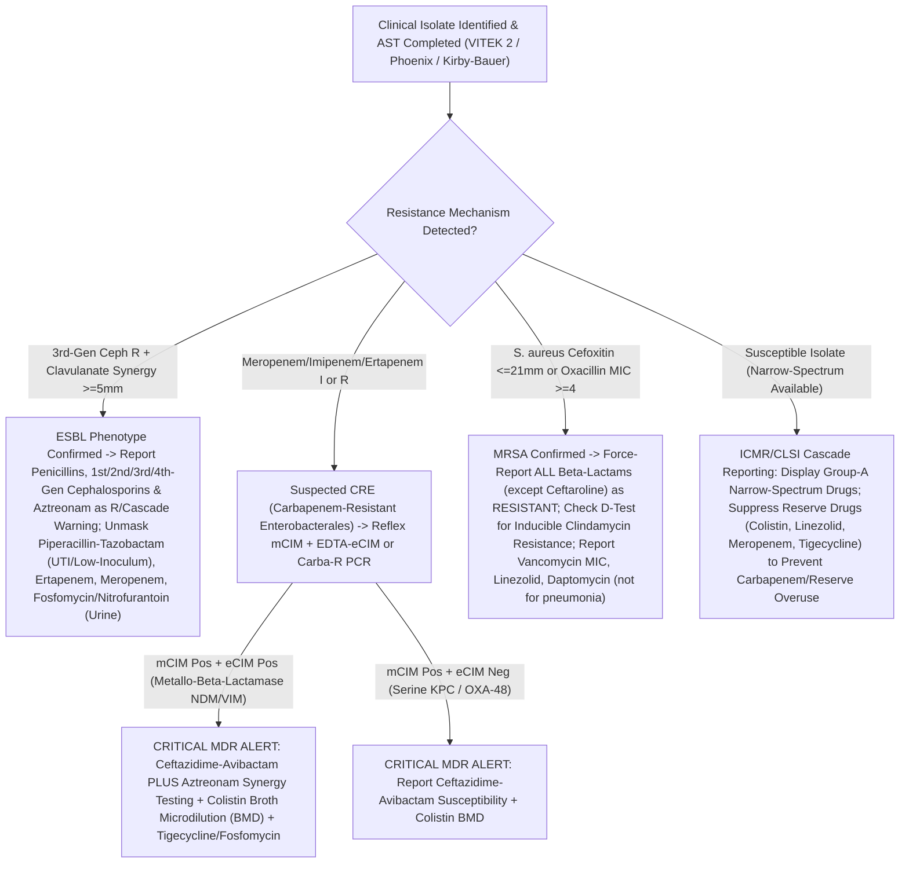

# 🧫 Cluster 6.1: Microbiology, Culture, Antimicrobial Susceptibility & Molecular TB Master Cluster

**Department Folder:** `06_Microbiology_and_Culture_Sensitivity`  
**Cluster ID:** `6.1` (`6.1_Culture_Sensitivity_and_Staining_Cluster`)  
**Analytical Platforms Covered:** Quantitative Calibrated Loop ($1\text{ }\mu\text{L} / 10\text{ }\mu\text{L}$) CLED/Chromogenic/MacConkey/Blood Agar Urine Culture; Automated Continuous-Monitoring Fluorometric/Colorimetric Blood & Sterile Body Fluid Culture (**BD BACTEC FX / bioMérieux BacT/ALERT 3D/VIRTUO**); Automated Turbidimetric/Colorimetric Identification & Minimum Inhibitory Concentration (`MIC`) Susceptibility (**bioMérieux VITEK 2 Compact / BD Phoenix M50**) + Standardized **CLSI M02/M100 & EUCAST** Kirby-Bauer Mueller-Hinton Agar (`MHA`) Disk Diffusion & Gradient E-Test Backup; **NTEP/WHO** Ziehl-Neelsen (`ZN`) Carbol Fuchsin ($1000\times$) & LED Auramine-O Fluorescence ($200\times/400\times$) Microscopy; Cartridge-Based & Chip-Based Real-Time PCR (**Cepheid GeneXpert MTB/RIF Ultra & Molbio Truenat MTB-Plus / MTB-RIF Dx**); Direct Gram Stain, Albert's Metachromatic Stain, India Ink Capsule Mount, $10\%\text{–}20\%$ KOH / Calcofluor White & Sabouraud Dextrose Agar (`SDA`) Mycology.  
**Global Reference Benchmarks:** **CLSI M100 (34th Ed, 2024)**, **CLSI M02 / M07 / M47 / M54**, **EUCAST Breakpoint Tables**, **ICMR Antimicrobial Stewardship & Surveillance Network (AMRSN) Guidelines**, **NTEP (National TB Elimination Programme, Govt. of India) Technical & Operational Guidelines**, **WHO Consolidated Guidelines on Tuberculosis**, ISO 15189:2022, CAP Microbiology Checklist, CPA 2019 (India).

---

## 🗂️ 1. Master Cluster Directory & Global Interoperability Index (`6.1.1` – `6.1.10`)

| Test ID | Individual SOP File Name | Primary LOINC Code | SNOMED-CT Specimen / Concept | ICD-10 / ICD-11 Diagnostic Mapping | Primary / Backup Analytical Method | Turnaround Time (Prelim / Final) |
| :--- | :--- | :--- | :--- | :--- | :--- | :--- |
| **`6.1.1`** | `6.1.1_Urine_Aerobic_Culture_and_Sensitivity_Kass_Colony_Count_and_CLSI_M100.md` | `630-4` *(Urine culture)* + `18769-0` *(AST panel)* | `122575003` *(Urine)* / `117010004` *(Urine culture)* | `N39.0` (UTI), `N10` (Acute pyelonephritis), `O23.4` (UTI in pregnancy), `B96.20` (E. coli) | Calibrated Loop ($1\text{ }\mu\text{L} / 10\text{ }\mu\text{L}$) CLED / Chromogenic Agar + Automated `MIC` (VITEK 2 / Phoenix) $\leftrightarrow$ CLSI M100 Disk Diffusion | **Prelim:** 18–24 hrs **Final AST:** 24–48 hrs |
| **`6.1.2`** | `6.1.2_Automated_Blood_Culture_and_Sensitivity_Time_to_Positivity_and_Gram_Panic_Call.md` | `600-7` *(Blood culture)* + `29576-6` *(AST)* | `119297000` *(Blood)* / `30088009` *(Blood culture)* | `A41.9` (Sepsis), `I33.0` (Infective endocarditis), `A01.0` (Enteric fever), `T80.211` (CLABSI) | Continuous-Monitoring Automated Blood Culture (BACTEC / BacT/ALERT 5-Day Protocol, `DTP` $\ge 2\text{h}$) + Direct Positive Bottle Gram Panic Call ($< 30\text{m}$) + `MIC` AST | **Gram Panic:** $< 30\text{ min}$ of flag **Prelim:** 24 & 48h **Final:** 5 Days (120h) |
| **`6.1.3`** | `6.1.3_Pus_Wound_Swab_Aspirate_and_Tissue_Aerobic_Culture_and_Sensitivity.md` | `624-7` *(Wound/Pus culture)* | `119323008` *(Pus)* / `119364003` *(Tissue specimen)* | `L02.9` (Abscess), `L03.90` (Cellulitis), `T81.4` (Surgical site infection), `E11.621` (Diabetic foot) | Direct Gram ($Q\text{-Score}$) + 5% Sheep Blood / MacConkey / Chocolate / Robertson Cooked Meat (`RCM`) Enrichment + CLSI M100 `MIC`/Kirby-Bauer | **Gram:** 1 hr **Final AST:** 48–72 hrs |
| **`6.1.4`** | `6.1.4_Sputum_Endotracheal_Aspirate_ET_and_BAL_Culture_Bartlett_Grading.md` | `6460-0` *(Sputum culture)*, `29591-5` *(BAL culture)* | `119334006` *(Sputum)* / `258607008` *(BAL)* | `J18.9` (Pneumonia), `J95.851` (VAP), `J44.0` (AECOPD), `J47.9` (Bronchiectasis) | **Bartlett / Murray-Washington Gram Screen** + Quantitative Loop Culture ($\text{BAL} \ge 10^4$, $\text{ET} \ge 10^5\text{ CFU/mL}$) + CLSI M100 AST | **Gram Quality:** 1 hr **Final AST:** 48–72 hrs |
| **`6.1.5`** | `6.1.5_Stool_Culture_Throat_Swab_and_High_Vaginal_Urethral_Swab_Culture.md` | `625-4` *(Stool)*, `626-2` *(Throat)*, `627-0` *(Genital)* | `119339001` *(Stool)*, `258529004` *(Throat)*, `258520000` *(HVS)* | `A01`/`A02` (Salmonella), `A03.9` (Shigella), `A00.9` (Cholera), `J02.0` (GAS Pharyngitis), `N76.0` (Vaginitis) | Selenite-F / APW $\rightarrow$ XLD/DCA/TCBS + Antisera; Throat Blood Agar + Bacitracin/Lancefield; HVS Nugent Score + Thayer-Martin / GBS / Candida CHROMagar | **Prelim:** 24 hrs **Final:** 48–72 hrs |
| **`6.1.6`** | `6.1.6_Sterile_Body_Fluid_CSF_Pleural_Ascitic_Synovial_Culture_and_Sensitivity.md` | `606-4` *(CSF culture)*, `619-7` *(Body fluid culture)* | `258450006` *(CSF)* / `309051001` *(Body fluid)* | `G00.9` (Bacterial meningitis), `K65.2` (SBP), `M00.9` (Septic arthritis), `J86.9` (Empyema) | Cytospin / $3,000\times g$ Sediment Gram + Chocolate ($5\%\text{ CO}_2$) / Blood / MacConkey + Bedside Pediatric Blood Culture Bottle Inoculation | **STAT Gram:** $< 45\text{ min}$ **Final:** 5 Days (120h) |
| **`6.1.7`** | `6.1.7_AFB_Ziehl_Neelsen_ZN_and_Auramine_O_Fluorescent_Smear_RNTCP_NTEP_Grading.md` | `11545-1` *(AFB stain)* / `53925-4` *(Auramine AFB)* | `119334006` / `168186007` *(Sputum AFB microscopy)* | `A15.0` (Pulmonary TB smear+), `A18.9` (Extrapulmonary TB), `A31.0` (Pulmonary NTM) | LED Auramine-O Fluorescence ($200\times/400\times$) + Hot Ziehl-Neelsen ($1\%$ Carbol Fuchsin, $25\%\text{ H}_2\text{SO}_4$, $0.1\%$ Methylene Blue, $1000\times$) | **STAT:** 2 hrs **Routine:** Same Day ($< 6\text{ hrs}$) |
| **`6.1.8`** | `6.1.8_Molecular_TB_CBNAAT_GeneXpert_MTB_RIF_Ultra_and_Truenat_MTB_Plus.md` | `89373-5` *(Xpert MTB/RIF Ultra)* | `119334006` / `711334009` *(MTB PCR & Rif resistance)* | `A15.0` (TB confirmed by molecular), `U84.3` (Resistance to tuberculostatic drug / MDR-TB) | **Cepheid GeneXpert MTB/RIF Ultra (`IS6110`/`IS1081` + $81\text{-bp } rpoB$ RRDR Melt Curve, LoD $15.6\text{ CFU/mL}$) $\leftrightarrow$ Molbio Truenat MTB-Plus & MTB-RIF Dx** | **STAT / Routine:** 2–4 hrs |
| **`6.1.9`** | `6.1.9_Special_Microbiological_Stains_Gram_Stain_Alberts_Diphtheria_and_India_Ink_Cryptococcus.md` | `664-3` *(Gram)*, `10644-3` *(Corynebacterium)*, `652-8` *(India Ink)* | `258450006` / `104210008` *(Gram stain method)* | `A36.0` (Pharyngeal diphtheria), `B45.1` (Cerebral cryptococcosis), `A54.0` (Gonorrhea) | Hucker's Gram Stain + **Albert's Toluidine Blue / Malachite Green** (Babes-Ernst Metachromatic Granules) + **Nigrosin / India Ink** Negative Capsule Stain | **STAT Emergency:** $< 30\text{–}60\text{ min}$ |
| **`6.1.10`** | `6.1.10_Mycology_10_20_Percent_KOH_Mount_Calcofluor_White_and_Fungal_Culture_SDA.md` | `681-7` *(KOH fungal mount)*, `580-1` *(Fungal culture)* | `119325001` *(Skin/Nail)* / `252398000` *(Fungal microscopy)* | `B44.9` (Aspergillosis), `B46.5` (Mucormycosis), `B37.9` (Candidiasis), `B35.9` (Dermatophytosis) | $10\%\text{–}20\%$ KOH + Parker Ink / **Calcofluor White UV** + Paired **SDA** (with & without Cycloheximide/Chloramphenicol at $25^\circ\text{C}$ & $37^\circ\text{C}$ for 4 wks) + LPCB | **KOH STAT:** 30–60 min **SDA Culture:** 7–28 Days |

---

## 🧪 2. International `ATCC` Quality Control Reference Strains & `CLSI M100` Resistance Verification Matrix

Every batch of culture media, stain reagents, automated `MIC` cards, and Kirby-Bauer Mueller-Hinton Agar (`MHA`, depth $4.0 \pm 0.5\text{ mm}$, $\text{pH } 7.2\text{–}7.4$, $0.5\text{ McFarland} = 1.5 \times 10^8\text{ CFU/mL}$) MUST be validated against international **ATCC Reference Strains**:

| ATCC Reference Strain | Primary Organism Identity | Mandatory QC Application & Resistance Phenotype Verification (`CLSI M100`) |
| :--- | :--- | :--- |
| **`Escherichia coli` ATCC 25922** | Non-ESBL Susceptible Gram-Negative Control | Routine `MHA` disk diffusion & automated `MIC` card QC for $\beta$-lactams, aminoglycosides, fluoroquinolones, nitrofurantoin, fosfomycin; Gram-negative staining control. |
| **`Escherichia coli` ATCC 35218** | $\beta$-Lactamase Producing Control (`TEM-1`) | Specific QC for **$\beta$-Lactam / $\beta$-Lactamase Inhibitor combinations** (Amoxicillin-Clavulanate, Ampicillin-Sulbactam, Piperacillin-Tazobactam, Ceftolozane-Tazobactam). |
| **`Klebsiella pneumoniae` ATCC 700603** | **ESBL-Positive** (`SHV-18`) Reference Strain | Confirms phenotypic **ESBL detection** ($\ge 5\text{ mm}$ zone increase with Cefotaxime/Clavulanate or Ceftazidime/Clavulanate vs cephalosporin alone). |
| **`Klebsiella pneumoniae` ATCC BAA-1705 / BAA-2146** | **Carbapenemase-Positive (`KPC` / `NDM`)** | Positive QC for **Modified Carbapenem Inactivation Method (`mCIM` / `eCIM`)**, Carba NP, and Xpert Carba-R. |
| **`Pseudomonas aeruginosa` ATCC 27853** | Non-Fermenting Gram-Negative Control | Validates **$\text{Ca}^{2+}$ ($20\text{–}25\text{ mg/L}$) and $\text{Mg}^{2+}$ ($10\text{–}12.5\text{ mg/L}$) cation content of Mueller-Hinton Agar** (via Gentamicin/Tobramycin/Colistin zones) + Oxidase Positive control. |
| **`Staphylococcus aureus` ATCC 25923 / ATCC 29213** | Methicillin-Susceptible (`MSSA`) Control | `ATCC 25923` for Kirby-Bauer disk diffusion; `ATCC 29213` for Broth Microdilution / Automated `MIC` (`VITEK 2` / `Phoenix`); Gram-positive & Coagulase positive control. |
| **`Staphylococcus aureus` ATCC 43300** | **MRSA (`mecA` Positive)** & Inducible Clindamycin | Validates **Cefoxitin $30\text{ }\mu\text{g}$ disk ($\le 21\text{ mm}$) / Oxacillin `MIC` ($\ge 4\text{ }\mu\text{g/mL}$)** MRSA screening and **D-Zone Test** (`erm`-mediated inducible macrolide-lincosamide resistance). |
| **`Enterococcus faecalis` ATCC 29212 / ATCC 51299** | Thymidine Media QC / **VRE (`vanB`)** Control | `ATCC 29212` verifies low thymidine content of `MHA` via Trimethoprim-Sulfamethoxazole zone ($\ge 20\text{ mm}$); `ATCC 51299` validates Vancomycin resistance & High-Level Gentamicin/Streptomycin synergy. |
| **`Mycobacterium tuberculosis` H37Rv (ATCC 27294)** | Pan-Susceptible `MTB` Reference Strain | Positive control for Ziehl-Neelsen / Auramine-O staining, MGIT 960 liquid culture, and CBNAAT/Truenat `rpoB` wild-type verification *(paired with `M. smegmatis` or *E. coli* negative control)*. |
| **`Candida albicans` ATCC 10231 / `C. parapsilosis` ATCC 22019** | Mycology & Antifungal Susceptibility (`CLSI M27/M60`) | Germ-tube positive control (`ATCC 10231`), CHROMagar differentiation, and azole/echinocandin `MIC` QC (`ATCC 22019` / `C. krusei` `ATCC 6258`). |

---

## 🔄 3. Smart LIMS Antimicrobial Stewardship, Cascade Reporting & Resistance Reflex Engine

---

## 🚨 4. Master Critical ("Panic") Values, 30-Minute Read-Back & Statutory Notification (`Nikshay` / `IDSP`)

| Critical Microbiological Alert | Trigger Criterion | Mandatory 30-Minute Read-Back & Statutory Reporting Protocol |
| :--- | :--- | :--- |
| **1. Positive Blood Culture or `CSF` / Sterile Body Fluid Gram Stain or Culture** | Any bottle flagging positive on BACTEC/BacT/ALERT or any organism seen on direct CSF/Pericardial/Synovial/Pleural/Ascitic Gram stain | **Immediate ($\le 15\text{–}30\text{ min}$) Telephone Read-Back** of exact Gram morphology (e.g., *"Gram-negative bacilli in aerobic bottle at TTP 9.4 hours"*) to attending clinician **before** waiting 24h for final ID/AST. |
| **2. Positive `CSF` India Ink / Cryptococcal Antigen (`CrAg`) or Broad Aseptate Mucor Hyphae on `KOH`** | Encapsulated budding yeast (*Cryptococcus neoformans*) in CSF OR ribbon-like $90^\circ$-branching aseptate hyphae (*Mucormycosis*) in nasal/orbital scraping | **STAT Life-Threatening Emergency Call ($\le 15\text{ min}$):** Rhino-orbital-cerebral Mucormycosis is a surgical & Liposomal Amphotericin-B emergency; Cryptococcal meningitis requires immediate antifungal & ICP management. |
| **3. Positive `AFB` Smear (`Scanty` / `1+` / `2+` / `3+`) or Positive `CBNAAT` / `Truenat` (`MTB` Detected ± `RIF` Resistance)** | Any positive acid-fast smear or molecular `MTB` detection (especially **Rifampicin Resistance Detected = MDR-TB Alert**) | **30-Minute Physician Read-Back** + **Mandatory Statutory Entry into Govt. of India `Nikshay` Portal** under Ministry of Health Gazette Notification (failure to notify TB is a punishable offense under Indian law). |
| **4. Positive Albert's Stain (*Corynebacterium diphtheriae*), Stool *Vibrio cholerae*, or Blood *Salmonella Typhi / Brucella / N. meningitidis*** | Green bacilli with bluish-black Babes-Ernst metachromatic granules at poles; darting motility/TCBS *V. cholerae*; or invasive *N. meningitidis* | **Immediate 30-Minute Read-Back** (Diphtheria requires **immediate Antitoxin [DAT]** without waiting for culture!) + **Mandatory Statutory Notification to District Surveillance Officer (`IDSP`)**. |
| **5. Pan-Drug Resistant (`PDR`) or Critical `WHO Priority Pathogens` (`CRE`, `CRAB`, `CRPA`, `MRSA` with Vancomycin `MIC` $\ge 4$, `VRE`, *Candida auris*)** | Confirmed Carbapenemase producer, Vancomycin-Intermediate/Resistant *S. aureus* (`VISA`/`VRSA`), `VRE`, or *Candida auris* | **Immediate Infection Control & Antimicrobial Stewardship Alert** for strict contact isolation cohorts +Read-back to ICU/Ward physician within **30 minutes**. |

---

## 🛡️ 5. Master Microbiological Medico-Legal & Stewardship Shield (`ISO 15189:2022` / `CLSI M100` / `CPA 2019`)

1. **Prior Antibiotic Exposure ("Culture-Negative Sepsis / Sterile Pyuria") Shield:** Administration of even a single oral or intravenous dose of an antimicrobial agent prior to specimen collection can inhibit in-vitro bacterial replication while leaving non-viable organisms or pus cells intact. A negative culture report does NOT exclude active bacterial infection in a pre-treated patient.
2. **Pre-Analytical Contamination vs True Pathogen Shield:**
   - **Urine:** Mixed growth of $\ge 3$ colonial morphotypes indicates periurethral/perineal contamination or delayed transit ($> 2\text{h}$ unrefrigerated); AST on mixed flora is suppressed per **CLSI M35 / ASM Cumitech** to prevent inappropriate broad-spectrum antibiotic prescribing.
   - **Blood:** Recovery of Coagulase-Negative *Staphylococci*, *Corynebacterium*, *Cutibacterium*, or *Bacillus* spp. in **$1\text{ of }2$ blood culture sets** without clinical line sepsis or endocarditis represents skin venipuncture contamination ($< 3\%$ benchmark).
   - **Sputum:** Specimens exhibiting **$> 25\text{ Squamous Epithelial Cells/LPF}$ (Bartlett Q-Score $\le 0$)** represent oropharyngeal saliva rather than deep lower respiratory purulence and are rejected for routine aerobic culture.
3. **Intrinsic & Site-Specific Pharmacokinetic Disclaimers (`CLSI M100`):**
   - **Daptomycin** is inactivated by pulmonary surfactant and is **never reported for Respiratory (Sputum/BAL) isolates**.
   - **Nitrofurantoin, Fosfomycin (oral), and Norfloxacin** achieve therapeutic concentrations **exclusively in the lower urinary tract** and must never be used for bacteremia, pyelonephritis, or systemic tissue infections.
   - ***Salmonella* & *Shigella*:** 1st/2nd-generation cephalosporins, cephamycins, and aminoglycosides may appear susceptible in-vitro but are **clinically ineffective in-vivo** and are never reported as Susceptible. *Not valid for medico-legal purposes.*
