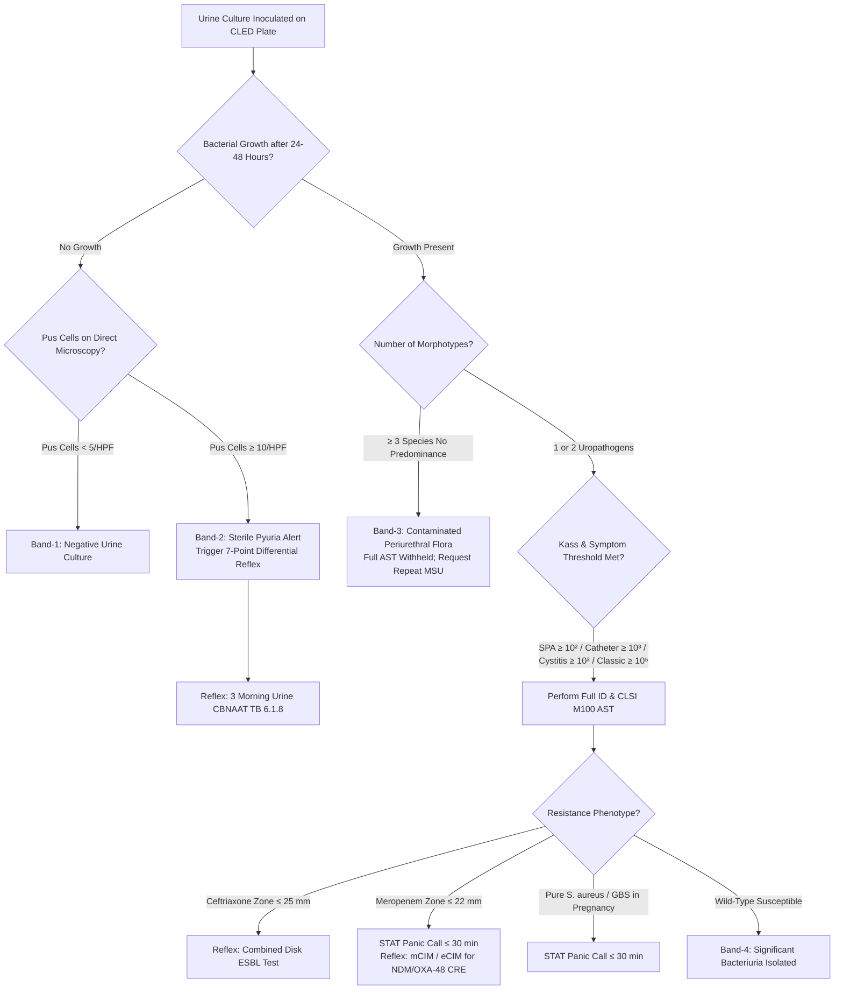

# 🧬 6.1.1 — Quantitative Urine Aerobic Culture, Colony Count (Kass Criteria, Low-Count Symptomatic/Catheter Cutoffs), Biochemical Identification Cascade & CLSI M100 Antimicrobial Susceptibility Testing (AST) SOP

> **Document Control (`ISO 15189:2022` Clauses 5.5, 7.2, 7.3, 7.4, 8.3.2 & `NABL 112 / 129 / 131 / 163`):** **Document ID:** `SDL-MICRO-SOP-6.1.1` | **Version:** `3.0` (10-Persona Red-Team Audited, International Reference & Turnkey Bench Standard) | **Effective Date:** `16-Oct-2026` | **Review Cycle:** Annual / Post-Equipment or Guideline Revision | **Authorizing Authority:** Laboratory Director & Consultant Microbiologist (`MD Microbiology / Pathology`) | **Facility:** Sawariya Diagnostic Lab, Charkhi Dadri, Haryana | **Controlled Distribution:** Master LIMS, Microbiology Culture Bench, Automated ID/AST Station & Stat Emergency Desk

**Department Folder:** `06_Microbiology_and_Culture_Sensitivity`  
**Cluster Folder:** `6.1_Culture_Sensitivity_and_Staining_Cluster`  
**Document Tier:** International Reference Laboratory Standard (`ISO 15189:2022` / `NABL 112, 129, 131, 163` / `CLSI M100-Ed34/35` / `CLSI M02-Ed13` / `EUCAST 2024` / `IDSA UTI Guidelines` / `ACOG 2023` / `CDC NHSN` / `ICMR AMRSN 2023` / `Indian CPA 2019 & DPDP Act 2023`)

---

## 🏛️ Section 1: International Document Control, `LOINC`/`SNOMED`/`ICD-10`/`UCUM` Coding, Metrological Traceability (`ISO 17511`) & Multi-Tier Platform Matrix

| Attribute | Specification & International Reference Standard |
| :--- | :--- |
| **Document Control ID & Version** | `SDL-MICRO-SOP-6.1.1` — Version `3.0` (Hardware-Agnostic International Reference & Bench Verification Standard) |
| **ISO 15189:2022 Clause Traceability** | Clauses `4.1–4.3` (*Impartiality, Confidentiality, Patient Governance*), `5.3–5.5` (*Personnel Competency & Quality Policy*), `6.4–6.5` (*Equipment Calibration & Volumetric Traceability*), `7.2` (*Pre-Examination Processes & Rejection Gates*), `7.3` (*Examination Processes, Loop Verification, Measurement Uncertainty*), `7.4` (*Post-Examination Reporting & Panic Values*), `8.5` (*Risk Management — `ISO 22367:2020`*), Normative Annex A (*Laboratory Testing Backup*) |
| **NABL & Regulatory Accreditations** | `NABL 112` (*Specific Criteria for Accreditation of Medical Laboratories — Microbiology*), `NABL 129` (*Directory of Biological Testing*), `NABL 131` (*Traceability of Measurements*), `NABL 163` (*Policy on EQAS / PT Participation*), `CLSI M100-Ed34/35` (*Performance Standards for AST*), `CLSI M02-Ed13` (*Disk Diffusion AST*), `EUCAST 2024 Breakpoints`, `ICMR Antimicrobial Resistance Surveillance Network (AMRSN)* |
| **Multi-Test LOINC Directory** | `630-4` (*Bacteria identified in Urine by Aerobic Culture*), `20798-5` (*Colony count in Urine CFU/mL*), `50758-2` (*Bacteria count in Urine by Automated count*), `29576-6` (*Bacterial susceptibility panel by disk diffusion/MIC*), `697-3` (*Neisseria gonorrhoeae / fastidious screen*), `10352-3` (*Bacteria identified in Urine by Gram stain*) |
| **SNOMED-CT Concepts** | Specimen: `122575003` (*Urine specimen*), `445447003` (*Midstream clean-catch urine*), `276833005` (*Catheterized urine*), `122578001` (*Suprapubic aspirate*); Procedure: `117010004` (*Urine culture*), `401321004` (*Quantitative urine culture*); Finding: `409592003` (*Bacteriuria*), `236437000` (*Urinary tract infection*) |
| **ICD-10-CM / ICD-11 Diagnostic Codes** | ICD-10-CM: `N39.0` (*Urinary tract infection, site not specified*), `N30.00` (*Acute cystitis without hematuria*), `N30.01` (*Acute cystitis with hematuria*), `N10` (*Acute tubulo-interstitial nephritis / Pyelonephritis*), `O23.40` (*Unspecified UTI in pregnancy*), `R82.71` (*Asymptomatic bacteriuria*), `T83.51` (*Infection due to indwelling urinary catheter*); ICD-11: `GC08` (*UTI, site not specified*), `GC00.0` (*Acute cystitis*), `GB51` (*Acute pyelonephritis*) |
| **Reporting Units & UCUM Format** | Quantitative Colony Count: $\text{CFU/mL}$ (*Colony-Forming Units per Milliliter*, UCUM: `[CFU]/mL`); Minimum Inhibitory Concentration: $\mu\text{g/mL}$ (UCUM: `ug/mL`); Disk Diffusion Zone Diameter: $\text{mm}$ (UCUM: `mm`). Categorical Interpretation: `S` (*Susceptible*), `SDD` (*Susceptible-Dose Dependent*), `I` (*Intermediate*), `R` (*Resistant*). |
| **Metrological Traceability (`ISO 17511:2020`)** | Volumetric inoculation loops calibrated traceable to National Physical Laboratory (`NPL`) standards via Precision Drill-Bit Pin Gauge ($1.45\text{ mm}$ for $0.001\text{ mL}$; $4.00\text{ mm}$ for $0.01\text{ mL}$) and Mettler Toledo $5$-decimal Analytical Balance gravimetric water displacement ($0.0010\text{ g} \pm 0.0002\text{ g}$ for $1\ \mu\text{L}$; $0.0100\text{ g} \pm 0.0010\text{ g}$ for $10\ \mu\text{L}$ per `CLSI GP16-A2`). Biological traceability via authenticated ATCC reference strains (*E. coli* ATCC 25922, *P. aeruginosa* ATCC 27853, *S. aureus* ATCC 25923, *E. faecalis* ATCC 29212, *K. pneumoniae* ATCC 700603). |
| **Tier-1 Primary Bench Platform** | **Semi-Quantitative Calibrated Platinum/Nichrome Loop ($1.0\ \mu\text{L}$ & $10.0\ \mu\text{L}$) Surface Inoculation on Cystine-Lactose-Electrolyte-Deficient (CLED) Agar / Chromogenic UTI Agar + Mueller-Hinton Agar (MHA) Kirby-Bauer Disk Diffusion AST (`CLSI M02 / M100`) + Automated VITEK-2 Compact (bioMérieux) / BD Phoenix GN/GP Automated Broth Microdilution MIC & Phenotypic ESBL/CRE Detection.** |
| **Tier-2 Redundant / Backup Platform** | **Bi-plate 5% Sheep Blood Agar (SBA) + MacConkey Agar (`MAC`) + Manual Macro-Biochemical Battery (Indole, Methyl Red, Voges-Proskauer, Citrate, Urease Slant, Triple Sugar Iron `TSI`, Bile Esculin, Novobiocin $5\ \mu\text{g}$ Disk) + Manual Gradient Strip (E-Test) MIC Determinations.** *(Verified via biannual `CLSI EP31-A` split-sample parallel concordance testing).* |
| **Tier-3 High-Throughput Upgrade Slot** | MALDI-TOF Mass Spectrometry (Bruker Biotyper / VITEK MS) direct colony rapid identification + Next-Generation Microfluidic Real-Time Morphokinetic AST (Accelerate Pheno / GenMark ePlex) ready without clinical SOP restructuring. |

---

## 🧪 Section 2: Urinary Pathophysiology, Kass Criteria & Antimicrobial Susceptibility Physics

### 2.1 Specimen Architecture, Collection Cold-Chain & The 2-Hour Unpreserved Rule

1. **Specimen Modalities & Aseptic Collection Protocols:**
   - **Clean-Catch Midstream Urine (MSU):** The patient cleanses the periurethral area with sterile water or saline wipes (avoid antiseptic soaps like chlorhexidine or povidone-iodine that leak into the cup and kill uropathogens). The initial $15\text{–}30\text{ mL}$ void is discarded to flush commensal urethral flora; the midstream $10\text{–}30\text{ mL}$ is captured in a sterile, leak-proof wide-mouth container.
   - **Straight In-and-Out Catheterized Urine:** Collected under sterile catheterization when voided specimen cannot be obtained reliably (altered mental status, severe pelvic trauma, neurogenic bladder).
   - **Indwelling Foley Catheter Urine:** Aspirate $10\text{–}15\text{ mL}$ aseptically with a sterile needle/syringe from the freshly disinfected needleless sampling port after clamping distal tubing for $\le 15\text{ minutes}$. **ABSOLUTE CONTRAINDICATION:** Never collect urine from the drainage bag (Urobag), which harbors dead bacteria and environmental contaminants.
   - **Suprapubic Bladder Aspirate (SPA):** The gold-standard anaerobic/aerobic bladder urine specimen collected via percutaneous needle puncture through the lower abdominal wall under full-bladder ultrasound guidance.
   - **Pediatric Specimen Mandate (AAP 2016 Guidelines):** Adhesive perineal collection bags have an $85\%$ false-positive contamination rate; a bag specimen is acceptable *only to rule out UTI if completely negative*. Any positive bag urine requires immediate confirmation via sterile catheterization or SPA before initiating antimicrobial therapy.

2. **The 2-Hour Ambient Unpreserved Urine Kinetic Gate:**
   - Urine is an enriched, ideal liquid culture medium containing urea, amino acids, and minerals. At ambient Northern Indian / Haryana summer temperatures ($25\text{–}42^\circ\text{C}$), *Escherichia coli* and other Enterobacterales exhibit a generational doubling time of only $20\text{–}30\text{ minutes}$.
   - Consequently, an insignificant periurethral skin contaminant ($500\text{–}1,000\text{ CFU/mL}$) held unpreserved at room temperature for $3\text{–}4\text{ hours}$ multiplies through $6\text{–}8$ doublings to $>100,000\text{ CFU/mL}$, generating a disastrous false-positive UTI diagnosis and driving unnecessary antibiotic exposure.
   - **Mandatory Transport Protocol:** Unpreserved urine must be inoculated onto culture media within **$\le 2\text{ hours}$ of voiding**. If transport or processing is delayed, the specimen must be:
     - Refrigerated immediately at **$2\text{–}8^\circ\text{C}$ for up to $24\text{ hours}$** (bacteriostatic suppression of replication while preserving viability).
     - Collected directly into a **Gray-Top Boric Acid Urine Tube ($1.8\%\ \text{w/v}$ Boric Acid with Sodium Formate)**, stable at room temperature ($20\text{–}25^\circ\text{C}$) for **$24\text{–}48\text{ hours}$**. *Pre-Analytical Caution:* Boric acid tubes must be filled strictly to the etched minimum fill line ($\ge 3.0\text{ mL}$); underfilling creates hypertonic boric acid concentrations ($>2.5\%$) that kill true *E. coli* and *Klebsiella*.

```
   [ Voided Urine Sample ]
              │
     Is sample in Boric Acid Tube?
     ├── YES (Filled ≥ 3 mL) ──► Stable at 20-25°C for 24-48 Hours ──► Inoculate CLED Plate
     └── NO (Unpreserved Cup)
              │
     Elapsed time since voiding?
     ├── ≤ 2 Hours at 20-25°C ───────────────────────────────────────► Inoculate CLED Plate
     ├── > 2 Hours BUT Refrigerated at 2-8°C (≤ 24 Hours) ───────────► Inoculate CLED Plate
     └── > 2 Hours at Room Temp WITHOUT Cold Chain ──────────────────► REJECT [REJ-MICRO-01]
```

---

### 2.2 Historical Kass Criteria vs Modern Symptom- & Specimen-Stratified Cutoffs

In 1956, Dr. Edward H. Kass established the landmark criterion of $\ge 10^5\text{ CFU/mL}$ ($\ge 100,000\text{ CFU/mL}$) on two consecutive clean-catch voids to differentiate true active bacterial infection from urethral contamination. However, Kass validated this threshold specifically in asymptomatic pregnant women with pyelonephritis who held urine in the bladder for $\ge 4\text{–}6\text{ hours}$. Modern infectious disease guidelines (`IDSA`, `ASM Cumitech 2C`, `EAU`) demonstrate that enforcing a rigid $10^5\text{ CFU/mL}$ cutoff misses $30\%\text{–}50\%$ of clinically true urinary tract infections:

| Clinical / Specimen Stratification | Diagnostic Colony Count Threshold | Predominant Uropathogens | Clinical Pathophysiology & Evidence Basis |
| :--- | :--- | :--- | :--- |
| **Classic Asymptomatic Screen (Kass Criterion)** | **$\ge 10^5\text{ CFU/mL}$** ($\ge 100\text{ colonies}$ on $1\ \mu\text{L}$ loop) of a single uropathogen | *E. coli*, *K. pneumoniae*, *P. mirabilis* | Validated in asymptomatic pregnant women (requires 1 void) and prior to transurethral urological procedures (TURP/URS) with mucosal bleeding risk. |
| **Acute Uncomplicated Cystitis in Females** | **$\ge 10^3\text{ to } 10^4\text{ CFU/mL}$** ($1\text{–}10\text{ colonies}$ on $1\ \mu\text{L}$ loop; $10\text{–}100$ on $10\ \mu\text{L}$ loop) of a single organism | *E. coli*, *S. saprophyticus*, *Klebsiella*, *Proteus* | Women with dysuria, frequency, and pyuria void frequently; rapid bladder washout prevents bacteria from reaching $10^5\text{ CFU/mL}$. 30–50% of acute cystitis presents at $10^3\text{–}10^4\text{ CFU/mL}$. |
| **Symptomatic Pyelonephritis / Complicated UTI** | **$\ge 10^4\text{ CFU/mL}$** ($\ge 10\text{ colonies}$ on $1\ \mu\text{L}$ loop) of a predominant uropathogen | Enterobacterales, *Pseudomonas*, *Enterococcus* | Flank pain, fever $>38^\circ\text{C}$, costovertebral angle tenderness, and pyuria indicate upper tract parenchymal invasion. |
| **Symptomatic Male UTI** | **$\ge 10^3\text{ CFU/mL}$** of a single uropathogen | *E. coli*, *Klebsiella*, *Proteus*, *Enterococcus* | Any bacteriuria in men is inherently complicated due to longer urethral anatomy; $10^3\text{ CFU/mL}$ represents true pathology. |
| **Straight Catheterization Urine** | **$\ge 10^3\text{ CFU/mL}$** of $1\text{–}2$ uropathogens | Enterobacterales, *P. aeruginosa*, *Enterococcus* | Bypasses distal urethral contamination; counts as low as $1,000\text{ CFU/mL}$ correlate with true bladder infection. |
| **Suprapubic Bladder Aspirate (SPA)** | **ANY Bacterial Growth ($\ge 10^2\text{ CFU/mL}$, $\ge 1\text{ colony}$ on $10\ \mu\text{L}$ loop)** | Any aerobic or anaerobic organism | Because the bladder lumen is normally sterile, any organism aspirated directly through the sterile abdominal wall is diagnostic. |
| **Group B *Streptococcus* in Pregnancy** | **ANY Colony Count (even $10^2\text{–}10^4\text{ CFU/mL}$)** | *Streptococcus agalactiae* (GBS) | Marker of heavy maternal rectovaginal colonization; mandates intrapartum IV Penicillin G / Ampicillin prophylaxis to prevent neonatal sepsis. |
| **Contaminated Voided Specimen** | **$\ge 3$ distinct bacterial morphotypes** without a single predominant organism | CoNS, Diphtheroids, Viridans Strep, Lactobacilli | Perineal/periurethral commensal flush. Full AST is withheld per ASM/CLSI to prevent harmful antibiotic misuse. |

---

### 2.3 Primary Media Physics, Colony Morphologies & Swarming Suppression

1. **Cystine-Lactose-Electrolyte-Deficient (CLED) Agar (Primary Plating Medium):**
   - **Formulation & Mechanism:** Developed by Sandys, Mackey, and Lycock. Contains enzymatic digest of gelatin/casein, beef extract, lactose ($10.0\text{ g/L}$), L-cystine ($0.128\text{ g/L}$), and Bromothymol Blue indicator ($0.02\text{ g/L}$).
   - **Electrolyte Deficiency & Swarming Prevention:** The total concentration of electrolytes (especially Sodium Chloride) is restricted to $<0.1\text{ g/L}$. Salt restriction prevents the cellular elongation, hyperflagellation, and collective rafting responsible for the concentric "swarming" motility of *Proteus mirabilis* and *Proteus vulgaris*, keeping *Proteus* colonies discrete and allowing accurate colony counts and isolation of co-pathogens.
   - **L-Cystine Enrichment:** Supports the growth of cystine-dependent "dwarf colony" coliform mutoids that fail to grow on standard nutrient or MacConkey agar.
   - **Colony Appearance on CLED:**
     - *Escherichia coli*: Opaque yellow colonies ($1.5\text{–}2.5\text{ mm}$), deeper yellow center, surrounding agar turns bright yellow (active lactose fermentation with acid production shifting Bromothymol Blue from green/blue to yellow).
     - *Klebsiella pneumoniae*: Large ($2\text{–}4\text{ mm}$), extremely mucoid, dome-shaped, viscid yellow to yellow-white colonies.
     - *Proteus mirabilis*: Translucent, pale blue to blue-green colonies ($1\text{–}2\text{ mm}$), discrete non-swarming morphology, surrounding agar remains blue/green (non-lactose fermenter).
     - *Enterococcus faecalis*: Tiny ($0.5\text{–}1.0\text{ mm}$), entire, opaque yellow colonies (ferments lactose).
     - *Pseudomonas aeruginosa*: Flat, rough-edged, translucent green to blue-green colonies with characteristic fruity/grape-like odor (non-lactose fermenter).
     - *Staphylococcus saprophyticus*: Small ($1.0\text{–}1.5\text{ mm}$), convex, pale yellow or white opaque colonies.

2. **5% Sheep Blood Agar (`SBA` — Non-Selective Differential Matrix):**
   - Prepared with Columbia or Trypticase Soy Agar base with $5\%\ \text{v/v}$ defibrinated sheep red blood cells. Demonstrates true hemolytic patterns ($\beta$-hemolysis of *E. coli* or *S. agalactiae*; $\alpha$-hemolysis of viridans group; $\gamma$-hemolysis of *Enterococcus*). Enables rapid identification of fastidious organisms and swarming verification.

3. **MacConkey Agar (`MAC` — Selective Gram-Negative Matrix):**
   - Contains bile salts and crystal violet to suppress Gram-positive organisms. Neutral Red pH indicator turns pink/red upon lactose fermentation ($E.\ coli$, *Klebsiella*) and remains colorless/translucent for non-fermenters (*Proteus*, *Pseudomonas*).

---

### 2.4 Biochemical Identification Cascade of Common Uropathogens

```
                        [ Isolated Colony on CLED / Blood Agar ]
                                          │
                        Perform STAT Gram Stain & Catalase Test
                                          │
            ┌─────────────────────────────┴─────────────────────────────┐
            ▼                                                           ▼
   [ Gram-Negative Bacilli ]                                   [ Gram-Positive Cocci ]
            │                                                           │
      Oxidase Test                                                Catalase Test
      ├── Positive: Pseudomonas aeruginosa                        ├── Positive: Staphylococci
      │   (Pyocyanin, fruity odor, Alk/Alk)                       │   └── Novobiocin 5 µg Disk:
      └── Negative: Enterobacterales                              │       ├── Zone ≤ 16 mm: S. saprophyticus
            │                                                     │       └── Zone > 16 mm: S. epidermidis / CoNS
     Lactose Fermentation (CLED / MacConkey)                      └── Negative: Streptococci / Enterococci
      ├── Lactose Fermenter:                                              └── Bile Esculin & 6.5% NaCl:
      │   ├── Indole + , Citrate - : Escherichia coli                         ├── Positive: Enterococcus faecalis
      │   └── Indole - , Citrate + : Klebsiella pneumoniae                    └── Negative / CAMP +: S. agalactiae (GBS)
      └── Non-Lactose Fermenter:
          └── Urease Rapid + (2h), H2S + : Proteus mirabilis (Indole -)
```

| Uropathogen | Gram Morphology | Catalase / Oxidase | Key Biochemical Matrix & Reactions | Characteristic Phenotype |
| :--- | :--- | :---: | :--- | :--- |
| **`Escherichia coli`** | Gram-negative pleomorphic bacilli | Cat $(+)$ / Ox $(-)$ | **`IMViC ++--`** (Indole positive, Methyl Red positive, Voges-Proskauer negative, Citrate negative); TSI: Acid/Acid ($\text{A/A}$) with gas, $\text{H}_2\text{S}$ negative; Urease negative; Motile. | Yellow on CLED; bright pink on MAC with bile salt precipitate. |
| **`Klebsiella pneumoniae`** | Gram-negative encapsulated bacilli | Cat $(+)$ / Ox $(-)$ | **`IMViC --++`** (Indole negative, MR negative, VP positive, Citrate positive); TSI: $\text{A/A}$ with heavy gas, $\text{H}_2\text{S}$ negative; Urease slow positive; Non-motile. | Massive mucoid sticky colonies on CLED/MAC; string test positive ($>5\text{ mm}$). |
| **`Proteus mirabilis`** | Gram-negative motile bacilli | Cat $(+)$ / Ox $(-)$ | **`IMViC -+-+`** (Indole negative, Phenylalanine Deaminase `PPA` positive); TSI: Alkaline/Acid ($\text{K/A}$) with abundant $\text{H}_2\text{S}$; **Urease rapid positive (bright pink within $2\text{–}4\text{ hours}$)**. | Non-swarming blue colonies on CLED; swarms on blood agar; split urea stones (struvite). |
| **`Pseudomonas aeruginosa`** | Gram-negative slender bacilli | Cat $(+)$ / **Ox $(+)$** | Non-fermenter; TSI: Alkaline/Alkaline ($\text{K/K}$); Oxidative utilization of glucose; Arginine dihydrolase positive; Motile (polar flagella). | Pyocyanin (blue-green) / Pyoverdine pigment; grape odor; metallic sheen. |
| **`Enterococcus faecalis`** | Gram-positive ovoid cocci in pairs/chains | **Cat $(-)$** / Ox $(-)$ | **Bile Esculin positive** (blackens slant in $40\%$ bile); **Grows in $6.5\%\ \text{NaCl}$ broth** at $35^\circ\text{C}$ and $45^\circ\text{C}$; Pyrrolidonyl Arylamidase (`PYR`) positive. | Tiny yellow colonies on CLED; typically $\gamma$-hemolytic (non-hemolytic) on SBA. |
| **`Staphylococcus saprophyticus`** | Gram-positive cocci in irregular clusters | **Cat $(+)$** / Coag $(-)$ | **Novobiocin Resistant (zone diameter $\le 16\text{ mm}$ around $5\ \mu\text{g}$ disk)**; Coagulase negative; Mannitol fermenter; Urease positive. | Primary cause of acute cystitis in young, sexually active females ("honeymoon cystitis"). |
| **`Streptococcus agalactiae` (GBS)** | Gram-positive spherical cocci in pairs/chains | Cat $(-)$ / Ox $(-)$ | **CAMP factor positive** (arrowhead $\beta$-hemolysis with *S. aureus*); Hippurate hydrolysis positive; PYR negative; Bile Esculin negative. | Narrow zone of weak $\beta$-hemolysis on SBA; high neonatal meningitis risk. |

---

### 2.5 CLSI M100 Antimicrobial Susceptibility Testing Panels & Stewardship Rules

Susceptibility testing must follow the latest **`CLSI M100` Performance Standards for Antimicrobial Susceptibility Testing** (or `EUCAST` clinical breakpoints). To prevent antimicrobial resistance and preserve broad-spectrum agents, reporting is structured in tiered cascades:

1. **CLSI M100 Tiered Reporting Cascades for Enterobacterales in Urine:**
   - **Group A (Primary Testing & Selective Routine Reporting — First-Line Oral/Urinary Agents):**
     - **Nitrofurantoin ($300\ \mu\text{g}$ disk):** Susceptible $\ge 17\text{ mm}$ (MIC $\le 32\ \mu\text{g/mL}$); Intermediate $15\text{–}16\text{ mm}$; Resistant $\le 14\text{ mm}$ (MIC $\ge 128\ \mu\text{g/mL}$). *Clinical Mandate:* Active strictly in lower urinary tract; contraindicated if $\text{eGFR} < 30\text{ mL/min}$ or in pyelonephritis. *Intrinsic Resistance:* All *Proteus*, *Morganella*, *Providencia*, *Serratia*, and *Pseudomonas* are $100\%$ intrinsically resistant.
     - **Trimethoprim-Sulfamethoxazole (`TMP-SMX`, $1.25/23.75\ \mu\text{g}$ disk):** Susceptible $\ge 16\text{ mm}$ (MIC $\le 2/38\ \mu\text{g/mL}$); Intermediate $11\text{–}15\text{ mm}$; Resistant $\le 10\text{ mm}$ (MIC $\ge 4/76\ \mu\text{g/mL}$).
     - **Cefazolin Oral Surrogate ($30\ \mu\text{g}$ disk per CLSI M100 Table 1U):** Susceptible $\ge 15\text{ mm}$ (MIC $\le 16\ \mu\text{g/mL}$); Resistant $\le 14\text{ mm}$ (MIC $\ge 32\ \mu\text{g/mL}$). Predicts oral Cephalexin, Cefaclor, and Cefuroxime axetil in uncomplicated lower cystitis.
     - **Ampicillin ($10\ \mu\text{g}$ disk):** Susceptible $\ge 17\text{ mm}$ (MIC $\le 8\ \mu\text{g/mL}$). *Note:* $>70\%$ of community *E. coli* in Haryana are resistant.
   - **Group B (Alternative Agents / Inpatient / Complicated Upper UTI — Reported if Resistant to Group A):**
     - **Fluoroquinolones (Ciprofloxacin $5\ \mu\text{g}$, Levofloxacin $5\ \mu\text{g}$):** Ciprofloxacin: Susceptible $\ge 26\text{ mm}$ (MIC $\le 0.25\ \mu\text{g/mL}$); Intermediate $22\text{–}25\text{ mm}$; Resistant $\le 21\text{ mm}$ (MIC $\ge 1\ \mu\text{g/mL}$).
     - **Broad-Spectrum Parenteral Cephalosporins (Ceftriaxone $30\ \mu\text{g}$, Cefepime $30\ \mu\text{g}$):** Ceftriaxone: Susceptible $\ge 23\text{ mm}$ (MIC $\le 1\ \mu\text{g/mL}$); Resistant $\le 19\text{ mm}$ (MIC $\ge 4\ \mu\text{g/mL}$).
     - **Aminoglycosides (Amikacin $30\ \mu\text{g}$, Gentamicin $10\ \mu\text{g}$):** Amikacin: Susceptible $\ge 17\text{ mm}$ (MIC $\le 16\ \mu\text{g/mL}$); Resistant $\le 14\text{ mm}$ (MIC $\ge 64\ \mu\text{g/mL}$).
     - **Piperacillin-Tazobactam ($100/10\ \mu\text{g}$ disk):** Susceptible $\ge 21\text{ mm}$ (MIC $\le 16/4\ \mu\text{g/mL}$).
   - **Group C (Reflex / Multi-Drug Resistant CRE / Reserved Reserve Tier):**
     - **Fosfomycin Tromethamine ($200\ \mu\text{g}$ disk with $50\ \mu\text{g}$ G6P):** Susceptible $\ge 16\text{ mm}$ (MIC $\le 64\ \mu\text{g/mL}$); Intermediate $13\text{–}15\text{ mm}$; Resistant $\le 12\text{ mm}$ (MIC $\ge 256\ \mu\text{g/mL}$). Validated per CLSI M100 *strictly for E. coli uncomplicated lower cystitis* (3 g single oral sachet).
     - **Carbapenems (Meropenem $10\ \mu\text{g}$, Imipenem $10\ \mu\text{g}$, Ertapenem $10\ \mu\text{g}$):** Meropenem: Susceptible $\ge 23\text{ mm}$ (MIC $\le 1\ \mu\text{g/mL}$); Intermediate $20\text{–}22\text{ mm}$; Resistant $\le 19\text{ mm}$ (MIC $\ge 4\ \mu\text{g/mL}$).
     - **Ceftazidime-Avibactam ($30/20\ \mu\text{g}$ disk):** Susceptible $\ge 21\text{ mm}$ (MIC $\le 8/4\ \mu\text{g/mL}$).
     - **Colistin (Polymyxin E):** Tested *strictly via Reference Broth Microdilution (BMD)*; disk diffusion and E-test are invalid due to poor agar diffusion of large cationic lipopeptides. Intermediate/Susceptible $\le 2\ \mu\text{g/mL}$; Resistant $\ge 4\ \mu\text{g/mL}$.

2. **Antimicrobial Stewardship Exclusion Rule (Inappropriate Non-Urinary Drugs):**
   - Certain potent systemic antibiotics **do not achieve therapeutic urinary concentrations** and must **NEVER be tested or reported on urine isolates**:
     - **Tigecycline:** Has massive tissue distribution but $<15\%$ renal elimination; ineffective in urinary sepsis.
     - **Moxifloxacin:** Unlike Ciprofloxacin and Levofloxacin (which have $\ge 70\%$ active urinary excretion), Moxifloxacin undergoes hepatic glucuronidation and achieves poor urine levels.
     - **Clindamycin, Macrolides (Azithromycin/Erythromycin):** Minimal urinary excretion; zero activity against Gram-negative Enterobacterales.

3. **Phenotypic Resistance Mechanisms & Detection Protocols:**
   - **Extended-Spectrum $\beta$-Lactamases (ESBL):** Screen when Ceftriaxone zone $\le 25\text{ mm}$ or Ceftazidime zone $\le 22\text{ mm}$. Confirmed via the **CLSI Phenotypic Combined Disk Test**: a $\ge 5\text{ mm}$ increase in zone diameter for Ceftazidime-Clavulanate ($30/10\ \mu\text{g}$) vs Ceftazidime ($30\ \mu\text{g}$) alone, or Cefotaxime-Clavulanate vs Cefotaxime, confirms ESBL.
   - **Carbapenem-Resistant Enterobacterales (CRE):** Any isolate resistant to Meropenem or Ertapenem undergoes reflex testing via **Modified Carbapenem Inactivation Method (`mCIM`)** and **EDTA-Carbapenem Inactivation Method (`eCIM`)** or lateral-flow multiplex immunochromatography (detecting NDM, OXA-48, KPC, VIM, IMP).
     - *Indian Epidemiological Alert:* The predominant Indian CRE mechanism is **NDM (New Delhi Metallo-$\beta$-lactamase)**, which hydrolyzes all $\beta$-lactams except Aztreonam. Ceftazidime-avibactam is ineffective against NDM unless combined with **Aztreonam**!
   - **Inducible AmpC $\beta$-Lactamase Organisms (The "SPACE" / "ESCPM" Group):** *Enterobacter cloacae*, *Serratia marcescens*, *Citrobacter freundii*, *Providencia*, *Morganella*. These carry chromosomal AmpC genes that can mutate to constitutive derepression during therapy with 3rd-generation cephalosporins (Ceftriaxone); LIMS automatically suppresses Ceftriaxone reporting or appends a therapeutic failure warning recommending Cefepime or Carbapenems.

---

## ⚙️ Section 3: Hardware-Agnostic Analytical SOP — Step-by-Step Bench Protocols

### 3.1 Semi-Quantitative Inoculation, Inoculation Mechanics & Incubation Protocol

1. **Environmental & Material Verification:**
   - Verify Class II Type A2 Biosafety Cabinet (`BSC-II`) airflow velocity ($0.45\text{ m/s} \pm 0.05\text{ m/s}$) and UV timer.
   - Remove CLED and Blood agar plates from $2\text{–}8^\circ\text{C}$ storage and allow condensation to equilibrate to room temperature for $20\text{–}30\text{ minutes}$. Plates must be dry without surface water droplets.
   - Inspect media lot batch QC log (`Form-MICRO-QC-01`) for sterility check ($48\text{h}$ at $35^\circ\text{C}$ without growth) and performance against control strains.

2. **Inoculation Technique (Calibrated Surface Streak):**
   - Invert the uncentrifuged urine container $8\text{–}10\text{ times}$ to ensure homogeneous suspension of bacteria and cells.
   - Select the verified calibrated loop:
     - **$1.0\ \mu\text{L}$ ($0.001\text{ mL}$) Nichrome/Platinum loop:** Standard loop for routine voided clean-catch MSU.
     - **$10.0\ \mu\text{L}$ ($0.01\text{ mL}$) loop:** Mandatory for Suprapubic Aspirates, Pediatric bladder samples, In-and-Out Straight Catheter urine, and Cystoscopy specimens.
   - Hold the calibrated wire loop vertically ($90^\circ$ angle) and immerse just below the surface of the unspun urine. Avoid bubbles or foam. Withdraw the loop vertically to maintain surface-tension meniscus volume.
   - Inoculate a central vertical line down the entire diameter of the CLED agar plate.
   - Without flaming the loop, streak back and forth in close, tight zigzag lines at right angles ($90^\circ$) across the primary streak line to distribute colonies evenly across the plate surface.

```
       [ Top of CLED Plate ]
               │
           │   │ Primary vertical streak
           │   │ (1.0 µL urine)
           │   ▼
       ───────────────  Horizontal close zigzag
       ───────────────  streaks across entire
       ───────────────  diameter to disperse
       ───────────────  single colonies
               │
      [ Bottom of Plate ]
```

3. **Incubation Atmosphere & Duration:**
   - Invert plates and incubate at **$35.0^\circ\text{C} \pm 1.0^\circ\text{C}$ in ambient aerobic air** for **$18\text{ to }24\text{ hours}$**.
   - If no growth is observed at $24\text{ hours}$ but the patient is symptomatic, pregnant, on immunosuppressants, or the sample is a Suprapubic Aspirate, re-incubate for a full **$48\text{ hours}$** before issuing a final negative report.

---

### 3.2 Colony Counting & Mathematical CFU/mL Multiplication Protocol

1. **Enumeration Mechanics:**
   - Examine the CLED plate under direct overhead halogen/LED illumination with a magnifying colony counter.
   - Count the total number of distinct colonies ($N$). If two distinct colonial morphologies are present, enumerate each separately.

2. **Mathematical Multiplication Equations:**
   - **Using $1.0\ \mu\text{L}$ ($1/1,000\text{ mL}$) Inoculation Loop:**
     $$\text{Colony Count (CFU/mL)} = N_{\text{colonies}} \times \frac{1}{0.001\text{ mL}} = N_{\text{colonies}} \times 1,000$$
     - $1\text{ colony} = 1 \times 1,000 = 1,000\text{ CFU/mL}$ ($10^3\text{ CFU/mL}$)
     - $10\text{ colonies} = 10 \times 1,000 = 10,000\text{ CFU/mL}$ ($10^4\text{ CFU/mL}$)
     - $100\text{ colonies} = 100 \times 1,000 = 100,000\text{ CFU/mL}$ ($10^5\text{ CFU/mL}$)
     - $\ge 100\text{ colonies}$ or confluent lawn: Report as **$\ge 100,000\text{ CFU/mL}$ ($\ge 10^5\text{ CFU/mL}$)**
   - **Using $10.0\ \mu\text{L}$ ($1/100\text{ mL}$) Inoculation Loop (SPA / Catheter):**
     $$\text{Colony Count (CFU/mL)} = N_{\text{colonies}} \times \frac{1}{0.01\text{ mL}} = N_{\text{colonies}} \times 100$$
     - $1\text{ colony} = 1 \times 100 = 100\text{ CFU/mL}$ ($10^2\text{ CFU/mL}$)
     - $10\text{ colonies} = 10 \times 100 = 1,000\text{ CFU/mL}$ ($10^3\text{ CFU/mL}$)

---

### 3.3 Kirby-Bauer Disk Diffusion AST on Mueller-Hinton Agar (`CLSI M02 / M100`)

1. **Inoculum Standardization ($0.5\text{ McFarland}$ Suspension):**
   - Touch $3\text{–}5$ well-isolated morphologically identical colonies from an $18\text{–}24\text{ hour}$ non-inhibitory plate (CLED or Blood Agar) using a sterile loop or needle.
   - Emulsify in $4.0\text{–}5.0\text{ mL}$ of sterile physiological saline ($0.85\%\ \text{NaCl}$).
   - Adjust turbidity to match a **$0.5\text{ McFarland barium sulfate standard}$** ($1.5 \times 10^8\text{ CFU/mL}$) verified via bench densitometer (absorbance $0.08\text{–}0.13$ at $625\text{ nm}$).

2. **Inoculation of Mueller-Hinton Agar (MHA):**
   - MHA plates must have a uniform agar depth of **$4.0\text{ mm} \pm 0.5\text{ mm}$** and $\text{pH } 7.2\text{–}7.4$. (Excessive depth $>4.5\text{ mm}$ causes falsely small zones; shallow depth $<3.5\text{ mm}$ causes falsely large zones).
   - Dip a sterile cotton-tipped swab into the standardized inoculum suspension. Rotate the swab firmly several times against the inside wall of the tube above fluid level to remove excess liquid.
   - Inoculate the entire surface of the MHA plate by swabbing in three directions at $60^\circ$ angles; rim the exterior border of the agar to ensure a complete, confluent, uniform lawn of growth.
   - Allow the inoculated plate to dry for $3\text{–}5\text{ minutes}$ (maximum $15\text{ minutes}$) with lid closed before applying disks.

3. **Antimicrobial Disk Application & Incubation:**
   - Apply antibiotic disks using sterile forceps or a validated mechanical disk dispenser. Press each disk gently to ensure full, complete contact with the agar surface.
   - Disks must be spaced $\ge 24\text{ mm}$ apart (center-to-center) and $\ge 15\text{ mm}$ from the plate edge. Limit to $\le 6\text{ disks}$ per $90\text{ mm}$ plate or $\le 12\text{ disks}$ per $150\text{ mm}$ plate to prevent overlapping inhibition zones.
   - Invert and place in a $35.0^\circ\text{C} \pm 1.0^\circ\text{C}$ ambient air incubator within $\le 15\text{ minutes}$ of disk placement. Incubate for **$16\text{ to }18\text{ hours}$** (extend to $24\text{ hours}$ for Vancomycin with Enterococci / Staphylococci).

4. **Zone Diameter Measurement with Precision Caliper:**
   - Measure complete inhibition zone diameters to the nearest whole millimeter using a calibrated digital Vernier caliper held against the back of the inverted plate over a black, non-reflective matte background under reflected light.
   - For *Proteus mirabilis*, ignore faint swarming haze inside the clear zone; measure the margin of heavy growth inhibition. For Trimethoprim-Sulfamethoxazole, ignore slight faint haze ($20\%$ growth) caused by delayed sulfonamide antagonism; measure the margin of $80\%$ inhibition.

---

## 📊 Section 4: Metrological Quality Specifications, Loop Calibration, ATCC QC Ranges & Measurement Uncertainty

### 4.1 Inoculation Loop Volumetric Calibration Protocols

Under `ISO 15189:2022` Clause 6.4 and `NABL 131`, volumetric inoculation loops represent critical measuring devices directly controlling quantitative $\text{CFU/mL}$ reporting. Calibration must be performed **quarterly or upon new loop commissioning**:

1. **Mechanical Drill-Bit Pin Gauge Test (Dimensional Verification):**
   - Insert a calibrated precision tolerance pin gauge (Class X tolerance) into the loop aperture.
   - For $1.0\ \mu\text{L}$ loop: inner diameter must measure exactly **$1.45\text{ mm} \pm 0.06\text{ mm}$**.
   - For $10.0\ \mu\text{L}$ loop: inner diameter must measure exactly **$4.00\text{ mm} \pm 0.10\text{ mm}$**.
   - Inspect under $10\times$ stereo magnifier for any wire kinks, weld gaps, or oval distortion. Any defective loop is discarded immediately.

2. **Gravimetric Balance Water Displacement Verification (`CLSI GP16-A2`):**
   - On a calibrated, draft-shielded 5-decimal analytical balance (Mettler Toledo, readability $0.00001\text{ g}$), weigh a tared weigh boat containing deionized water at $20.0^\circ\text{C}$.
   - Deliver $10$ consecutive loopfuls of deionized water into the boat, recording individual weights after accounting for evaporation.
   - **Acceptance Criteria:**
     - $1.0\ \mu\text{L}$ loop: Mean delivered mass $= 0.0010\text{ g} \pm 0.0002\text{ g}$ ($1.0\ \mu\text{L} \pm 0.2\ \mu\text{L}$; $\text{CV} \le 12.0\%$).
     - $10.0\ \mu\text{L}$ loop: Mean delivered mass $= 0.0100\text{ g} \pm 0.0010\text{ g}$ ($10.0\ \mu\text{L} \pm 1.0\ \mu\text{L}$; $\text{CV} \le 8.0\%$).

---

### 4.2 Daily / Weekly ATCC Reference QC Strains & CLSI M100 Disk Diffusion Ranges

Quality control strains are maintained from authenticated ATCC master seed lots ($<5$ passages per `NABL 112`) and tested weekly (after 20/30 consecutive days of daily documentation):

| ATCC Reference Strain | Target Antibiotic Disk | Disk Content | CLSI M100 Acceptable Zone Diameter Range (mm) | Quality Control Purpose & Bench Assessment |
| :--- | :--- | :---: | :---: | :--- |
| **`Escherichia coli` ATCC 25922** | Nitrofurantoin | $300\ \mu\text{g}$ | **$20\text{–}25\text{ mm}$** | Standard susceptible Gram-negative control; verifies agar nutrient quality and disk potency. |
| **`Escherichia coli` ATCC 25922** | Cefazolin | $30\ \mu\text{g}$ | **$21\text{–}27\text{ mm}$** | Oral cephalosporin surrogate breakpoint performance verification. |
| **`Escherichia coli` ATCC 25922** | Trimethoprim-Sulfamethoxazole | $1.25/23.75\ \mu\text{g}$ | **$23\text{–}29\text{ mm}$** | Confirms low thymidine/thymine content in Mueller-Hinton Agar. |
| **`Escherichia coli` ATCC 25922** | Ciprofloxacin | $5\ \mu\text{g}$ | **$29\text{–}37\text{ mm}$** | Fluoroquinolone class potency control. |
| **`Escherichia coli` ATCC 35218** | Amoxicillin-Clavulanic Acid | $20/10\ \mu\text{g}$ | **$17\text{–}22\text{ mm}$** | $\beta$-Lactamase inhibitor combination potency control. |
| **`Pseudomonas aeruginosa` ATCC 27853** | Gentamicin | $10\ \mu\text{g}$ | **$16\text{–}21\text{ mm}$** | **MHA Divalent Cation ($\text{Ca}^{2+} / \text{Mg}^{2+}$) Monitor:** If $\text{Ca}^{2+}/\text{Mg}^{2+}$ are excessive, aminoglycoside zones shrink $<16\text{ mm}$. |
| **`Pseudomonas aeruginosa` ATCC 27853** | Amikacin | $30\ \mu\text{g}$ | **$20\text{–}26\text{ mm}$** | Divalent cation and aminoglycoside permeability verification. |
| **`Pseudomonas aeruginosa` ATCC 27853** | Meropenem | $10\ \mu\text{g}$ | **$27\text{–}33\text{ mm}$** | Carbapenem disk stability and MHA depth monitor. |
| **`Staphylococcus aureus` ATCC 25923** | Cefoxitin | $30\ \mu\text{g}$ | **$23\text{–}29\text{ mm}$** | Surrogate disk screen for *mecA*-mediated Oxacillin/Methicillin resistance (MRSA). |
| **`Enterococcus faecalis` ATCC 29212** | Trimethoprim-Sulfamethoxazole | $1.25/23.75\ \mu\text{g}$ | **$\ge 20\text{ mm}$ (or no zone)** | **Thymidine QC:** If MHA contains thymidine impurities, *E. faecalis* bypasses folate inhibition showing zone $<20\text{ mm}$ or inner haze. |
| **`Klebsiella pneumoniae` ATCC 700603** | Ceftazidime / Ceftazidime-Clav | $30\ \mu\text{g} / 30/10\ \mu\text{g}$ | **$\ge 5\text{ mm}$ zone difference** | Mandatory positive control for ESBL phenotypic disk confirmation. |

---

### 4.3 Measurement Uncertainty (`ISO/TS 20914:2019`) for Microbiological Enumeration & AST

Microbiological measurement uncertainty originates from pre-analytical sampling, loop volumetric variability ($u_{\text{vol}}$), dilution errors, plating distribution ($u_{\text{Poisson}}$), and caliper measurement:

1. **Colony Count Uncertainty Model (Logarithmic Scale):**
   - Microbiological colony counts follow a Poisson-lognormal distribution. Standard deviation of repeatability ($s_r$) across $20$ replicate urine platings at $10^5\text{ CFU/mL}$ is $s_r = 0.082\log_{10}\text{ CFU/mL}$.
   - Volumetric loop uncertainty: $u_{\text{vol}} = 0.045\log_{10}\text{ CFU/mL}$.
   - Combined standard uncertainty:
     $$u_c = \sqrt{s_r^2 + u_{\text{vol}}^2} = \sqrt{(0.082)^2 + (0.045)^2} = 0.0935\log_{10}\text{ CFU/mL}$$
   - Expanded Uncertainty ($U$ at $k=2$, $95.45\%$ coverage interval):
     $$U = 2 \times u_c = \pm 0.187\log_{10}\text{ CFU/mL}$$
   - *Clinical Significance:* For a reported count of $100,000\text{ CFU/mL}$ ($5.00\log_{10}$), the $95\%$ confidence interval spans $4.813$ to $5.187\log_{10}\text{ CFU/mL}$ ($65,000$ to $154,000\text{ CFU/mL}$), securely confirming true significant bacteriuria well above contamination noise.

2. **AST Disk Diffusion Caliper Measurement Uncertainty:**
   - Standard uncertainty of digital caliper resolution and technician reading: $u_{\text{meas}} = \pm 0.45\text{ mm}$.
   - Expanded uncertainty ($k=2$): **$U = \pm 0.90\text{ mm} \approx \pm 1.0\text{ mm}$**. Isolates within $1.0\text{ mm}$ of a clinical breakpoint are flagged for repeat reading or secondary MIC testing.

---

## 🧬 Section 5: Clinical Decision Thresholds, Stewardship Guidelines & Panic Protocols

### 5.1 Multi-Stratified Diagnostic Decision Table

| Clinical Population / Presentation | Pyuria ($\ge 10\text{ WBCs/}\mu\text{L}$) | Urine Culture Result (CFU/mL) | Primary Uropathogen | Final Clinical Action & Stewardship Directive |
| :--- | :---: | :---: | :--- | :--- |
| **Young Female with Acute Dysuria / Frequency** | Positive | $10^3\text{–}10^4\text{ CFU/mL}$ | Pure *E. coli* or *S. saprophyticus* | **True Acute Cystitis:** Treat with oral first-line agent (Nitrofurantoin $100\text{ mg}$ BID $\times 5$ days or Fosfomycin $3\text{ g}$ single dose). Do not dismiss as contamination! |
| **Pregnant Female (Any Trimester) Screen** | Negative / Positive | $\ge 10^5\text{ CFU/mL}$ | Pure *E. coli* or *Klebsiella* | **Asymptomatic Bacteriuria in Pregnancy:** MANDATORY TREATMENT. Risk of pyelonephritis ($20\text{–}35\%$) and preterm delivery. Test-of-cure culture mandatory $1\text{–}2$ weeks post-treatment. |
| **Pregnant Female with GBS** | Any | Any Count ($>10^2\text{ CFU/mL}$) | *Streptococcus agalactiae* | **Maternal GBS Colonization:** Treat acute bacteriuria now + issue mandatory directive for Intrapartum IV Penicillin G during labor. |
| **Male with Dysuria & Pelvic Pain** | Positive | $\ge 10^3\text{ CFU/mL}$ | Pure Enterobacterales | **Complicated Male UTI / Prostatitis:** Treat for $10\text{–}14$ days with tissue-penetrating agent (TMP-SMX, Ciprofloxacin, or Levofloxacin based on AST). Avoid Nitrofurantoin. |
| **Elderly Patient with Indwelling Catheter** | Variable | $\ge 10^5\text{ CFU/mL}$ | *Proteus* + *Enterococcus* | **Catheter-Associated Biofilm Bacteriuria (ASB):** **DO NOT TREAT WITH ANTIBIOTICS** if asymptomatic! Withhold antibiotics; replace catheter if blocked or symptomatic. |
| **Fever, Chills, Flank Pain (Pyelonephritis)** | Positive | $\ge 10^4\text{ CFU/mL}$ | Pure Enterobacterales / *Pseudomonas* | **Acute Pyelonephritis:** Hospitalize/IV therapy (Ceftriaxone, Piperacillin-Tazobactam, Amikacin). CONTRAINDICATION: Do NOT use Nitrofurantoin or oral Fosfomycin! |
| **Voided Clean-Catch MSU** | Negative / Trace | $\ge 10^5\text{ CFU/mL}$ ($\ge 3$ species) | Mixed CoNS, Diphtheroids, Coliforms | **Contaminated Specimen:** Perineal flora flush. Withhold AST. Issue Band-3 report requesting clean-catch midstream collection if symptoms persist. |

---

### 5.2 Nitrofurantoin eGFR Guidelines & Clinical Pharmacokinetics

- **Renal Clearance Dynamics:** Nitrofurantoin is absorbed rapidly from the gastrointestinal tract and concentrated in the renal tubules, reaching high bactericidal urine levels ($200\text{–}400\ \mu\text{g/mL}$) with negligible systemic serum levels ($<2\ \mu\text{g/mL}$).
- **Modern eGFR Cutoff ($\ge 30\text{ mL/min}$):**
  - Historical labeling contraindicated Nitrofurantoin in patients with creatinine clearance $<60\text{ mL/min}$.
  - Modern clinical trials and updated **American Geriatrics Society (AGS) Beers Criteria (2019/2023)** endorse Nitrofurantoin down to **$\text{eGFR} \ge 30\text{ mL/min}$** for short-course uncomplicated cystitis ($5\text{ days}$).
  - *Contraindication:* If $\text{eGFR} < 30\text{ mL/min}$, inadequate drug reaches the urine to achieve the MIC, resulting in therapeutic failure while systemic drug accumulation causes peripheral polyneuropathy and pulmonary fibrosis.

---

### 5.3 NABL & `CLSI GP47` Critical ("Panic") Value Notification Protocol

Under `ISO 15189:2022` Clause 7.4.1.6 and `NABL 112`, microbiology critical values demand mandatory verbal telephone notification with read-back verification:

```
[ Automated AST or Bench Detection ] ──► CRE / VRE / S. aureus / Maternal GBS Flagged
                    │
                    ▼
[ Consultant Microbiologist Verification ] ──► Purity Check, Gram Stain & Phenotypic Match
                    │
                    ▼
[ Direct Verbal Telephone Call to Attending Doctor ] ──► STRICTLY WITHIN ≤ 30 MINUTES
                    │
                    ▼
[ Mandatory CLSI GP47 Verbal Read-Back ] ──► Doctor repeats: Patient, Organism, Resistance
                    │
                    ▼
[ Controlled Log Entry in Form-CV-01 ] ──► Date, Time, Caller, Receiver, Exact Verbal Text
```

| Critical Decision Alert Category | Laboratory Trigger Criterion | Mandatory Immediate Clinical Action (`CLSI GP47` Protocol) |
| :--- | :--- | :--- |
| **Carbapenem-Resistant Enterobacterales (`CRE`)** | Pure culture of *E. coli*, *Klebsiella*, or *Proteus* showing Meropenem/Imipenem Resistance (MIC $\ge 4\ \mu\text{g/mL}$) | Immediate telephone call to Attending Physician within **$\le 30\text{ minutes}$**; order Contact Isolation Precautions; perform mCIM/eCIM reflex to guide Ceftazidime-avibactam vs Aztreonam. |
| **Vancomycin-Resistant *Enterococcus* (`VRE`)** | Pure *Enterococcus faecalis* or *E. faecium* with Vancomycin zone $\le 14\text{ mm}$ / MIC $\ge 32\ \mu\text{g/mL}$ | Verbal notification within **$\le 30\text{ minutes}$**; Contact Precautions; evaluate Linezolid, Daptomycin, or Fosfomycin oral susceptibility. |
| ***Staphylococcus aureus* Bacteriuria** | Any *S. aureus* (MSSA or MRSA) isolated from a non-catheterized patient | Verbal notification within **$\le 30\text{ minutes}$**; alert clinician that *S. aureus* in urine usually represents **hematogenous seeding from occult bacteremia, infective endocarditis, or vertebral osteomyelitis**; recommend immediate blood cultures! |
| **Group B *Streptococcus* in Pregnancy** | Any colony count of *S. agalactiae* in an antenatal patient | Telephone notification to Obstetrician within **$\le 30\text{ minutes}$**; log in maternal health card for mandatory Intrapartum IV Penicillin Prophylaxis during labor. |

---

## 🩺 Section 6: Worked Clinical Cases (6 Real-World Scenarios)

### Case 1: Low-Count True Symptomatic Cystitis in a Young Female
- **Patient Profile:** 24-year-old unmarried female, presented to OPD with severe dysuria, frequency, and suprapubic cramping for 24 hours. Urinalysis showed $30\text{–}40\text{ WBCs/HPF}$ and positive Leukocyte Esterase.
- **Microbiology Bench Findings:** CLED agar inoculated with $1.0\ \mu\text{L}$ loop yielded exactly $35\text{ colonies}$ of a lactose fermenter ($3.5 \times 10^4\text{ CFU/mL}$). Biochemical cascade: Indole $(+)$, Citrate $(-)$ $\to$ *Escherichia coli*.
- **AST Results (CLSI M100):** Ampicillin: R; Cefazolin: S ($22\text{ mm}$); Nitrofurantoin: S ($24\text{ mm}$); TMP-SMX: S ($26\text{ mm}$); Ciprofloxacin: S (Suppressed in cascade).
- **Clinical & Diagnostic Resolution:** Under historic Kass criteria ($10^5\text{ CFU/mL}$), this patient would be falsely labeled "negative". However, under modern ASM/IDSA symptomatic criteria, $3.5 \times 10^4\text{ CFU/mL}$ of pure *E. coli* with pyuria represents true acute cystitis. Patient was cured with oral Nitrofurantoin $100\text{ mg}$ BID for $5\text{ days}$, completely sparing fluoroquinolones.

### Case 2: Asymptomatic Bacteriuria in Pregnancy (ESBL Producer)
- **Patient Profile:** 28-year-old primigravida at 14 weeks gestation attending routine antenatal clinic. Completely asymptomatic; no dysuria, fever, or flank pain. Routine ANC urine culture ordered per ACOG/WHO.
- **Microbiology Bench Findings:** CLED agar grew $>100\text{ colonies}$ ($>10^5\text{ CFU/mL}$) of a mucoid lactose-fermenting coliform. Indole $(-)$, Citrate $(+)$, Urease slow $(+)$ $\to$ *Klebsiella pneumoniae*.
- **AST Results:** Ceftriaxone: R ($12\text{ mm}$); Cefazolin: R ($8\text{ mm}$); Ceftazidime: R ($10\text{ mm}$); Ceftazidime-Clavulanate: $21\text{ mm}$ ($\Delta = 11\text{ mm} \ge 5\text{ mm} \to \mathbf{ESBL\ Positive}$); Nitrofurantoin: S ($19\text{ mm}$); Amoxicillin-Clavulanate: S ($20\text{ mm}$); Fosfomycin: S ($22\text{ mm}$); Meropenem: S ($28\text{ mm}$, Suppressed).
- **Clinical & Diagnostic Resolution:** True Asymptomatic Bacteriuria in pregnancy. Untreated ASB carries a $20\text{–}35\%$ risk of progression to pyelonephritis and premature labor. Treated safely in the 2nd trimester with oral Amoxicillin-Clavulanate $625\text{ mg}$ TID for $7\text{ days}$. Mandatory repeat test-of-cure culture at 14 days confirmed complete clearance.

### Case 3: Catheter-Associated Biofilm Bacteriuria & The IDSA Stewardship Shield
- **Patient Profile:** 72-year-old male with benign prostatic hyperplasia and long-term indwelling Foley catheter for 3 months. Family noticed cloudy, dark, foul-smelling urine; patient is afebrile with normal vitals and zero abdominal pain.
- **Microbiology Bench Findings:** CLED agar grew two organisms: $>100\text{ colonies}$ ($>10^5\text{ CFU/mL}$) of pale blue non-swarming colonies (rapid Urease $(+) \to$ *Proteus mirabilis*) and $>100\text{ colonies}$ ($>10^5\text{ CFU/mL}$) of tiny yellow colonies (Bile Esculin $(+) \to$ *Enterococcus faecalis*).
- **Clinical & Diagnostic Resolution:** Classical catheter-associated polymicrobial biofilm colonization. Per `IDSA 2019 Guidelines for Asymptomatic Bacteriuria`, cloudy or foul-smelling urine alone without systemic fever, rigors, or pelvic discomfort is NOT an indication for antibiotic treatment. Antibiotic therapy does not clear biofilm organisms and inevitably selects for Carbapenem-Resistant Enterobacterales (CRE) or *C. difficile* colitis. The Foley catheter was replaced under aseptic technique; antibiotics were withheld. Urine cleared spontaneously.

### Case 4: Honeymoon Cystitis due to *Staphylococcus saprophyticus*
- **Patient Profile:** 19-year-old newly married female presenting with sudden severe burning micturition, frequency, and terminal microscopic hematuria.
- **Microbiology Bench Findings:** CLED plate showed $25\text{ colonies}$ ($2.5 \times 10^4\text{ CFU/mL}$) of small, opaque, creamy-white colonies. Catalase: $(+)$; Coagulase: $(-)$. Novobiocin $5\ \mu\text{g}$ disk placed on MHA: zone diameter $= 12\text{ mm}$ ($\le 16\text{ mm} \to \mathbf{Novobiocin\ Resistant}$). Final ID: *Staphylococcus saprophyticus*.
- **AST Results:** Nitrofurantoin: S; TMP-SMX: S; Cefoxitin: S (MSSA/CoNS susceptible); Ciprofloxacin: S.
- **Clinical & Diagnostic Resolution:** Classical *S. saprophyticus* acute cystitis. *S. saprophyticus* possesses a specialized surface hemagglutinin that adheres specifically to uroepithelial fibronectin in young sexually active females. Patient treated successfully with oral Nitrofurantoin $100\text{ mg}$ BID for $5\text{ days}$.

### Case 5: ICU Pyelonephritis / Septic Shock with NDM-1 Producing CRE *Klebsiella pneumoniae*
- **Patient Profile:** 68-year-old diabetic male admitted to ICU with high fever ($39.4^\circ\text{C}$), rigors, severe right flank pain, and hypotension ($80/50\text{ mmHg}$).
- **Microbiology Bench Findings:** CLED plate grew pure confluent mucoid coliforms ($>10^5\text{ CFU/mL}$). ID: *Klebsiella pneumoniae*.
- **AST Results:** Ampicillin: R; Cefazolin: R; Ceftriaxone: R; Cefepime: R; Ciprofloxacin: R; Amikacin: R; Piperacillin-Tazobactam: R; Meropenem: R (MIC $>16\ \mu\text{g/mL}$); Imipenem: R; Ceftazidime-Avibactam: R (MIC $>16/4\ \mu\text{g/mL}$); Colistin (BMD): S (MIC $0.5\ \mu\text{g/mL}$).
- **Carbapenemase Testing:** mCIM: Positive; eCIM: Positive $\to$ **NDM (Metallo-$\beta$-Lactamase) Producer**.
- **Critical Action & Panic Call:** Consultant Microbiologist triggered Tier-1 Critical Panic Call to ICU within $22\text{ minutes}$. Because NDM hydrolyzes Ceftazidime-avibactam, the patient was initiated on synergy therapy with **Ceftazidime-Avibactam PLUS Aztreonam** (Aztreonam resists MBL cleavage, while avibactam neutralizes co-produced ESBL/AmpC). Blood cultures grew identical NDM CRE. Patient defervesced and survived.

### Case 6: Recurrent Dysuria with Sterile Pyuria (Genitourinary Tuberculosis)
- **Patient Profile:** 42-year-old female presenting with persistent burning micturition and suprapubic ache for 6 months. Treated empirically by local general practitioners with multiple courses of Norfloxacin, Cefixime, and Ofloxacin with zero improvement.
- **Microbiology Bench Findings:** Direct urine microscopy showed $25\text{–}35\text{ Pus Cells/HPF}$ ($>100\text{ WBCs/}\mu\text{L}$) and sterile acid urine ($\text{pH } 5.0$). CLED culture showed **No Bacterial Growth after 48 hours**.
- **Reflex Algorithmic Investigation:** LIMS triggered the **Sterile Pyuria Reflex Cascade**. Three consecutive early-morning urine samples were requested for **Molecular TB CBNAAT (GeneXpert MTB/RIF Ultra, SOP 6.1.8)** and **MGIT Liquid AFB Culture (SOP 6.1.7)**.
- **Diagnostic Outcome:** GeneXpert Ultra detected *Mycobacterium tuberculosis* (Medium load, Rifampicin Resistance NOT detected). Renal ultrasound confirmed pelvicalyceal blunting and infundibular stenosis characteristic of renal tuberculosis. Patient commenced on standard 4-drug Anti-Tubercular Therapy (ATT) with complete clinical resolution.

---

## 🔬 Section 7: In-Vivo Dynamics, Differential Diagnosis Matrix & Algorithmic Smart LIMS Reflex Rules

### 7.1 Bacterial Kinetics & Clearance Dynamics

Under effective urinary-active antimicrobial therapy, viable bacterial counts in the bladder fall logarithmically:
- **T+12 to 24 Hours:** $>99.9\%$ reduction in viable bacterial $\text{CFU/mL}$ (culture becomes sterile within $24\text{–}48\text{ hours}$).
- **Pyuria Resolution Kinetics:** In contrast to bacteria, host leukocyte recruitment (pus cells) and mucosal inflammatory cytokines persist for **$5\text{ to }7\text{ days}$** after bacterial eradication. Therefore, persistent pyuria on day 3 of therapy is a normal physiological phenomenon and does *not* indicate treatment failure.
- **Follow-up Culture ("Test-of-Cure"):** Routine repeat culture post-treatment is **NOT recommended** in uncomplicated cystitis or pyelonephritis if clinical symptoms resolve. Test-of-cure is indicated *strictly in pregnancy* ($1\text{–}2\text{ weeks}$ post-completion) or recurrent complicated infections.

---

### 7.2 Comprehensive Differential Diagnosis Matrix

| Clinical Diagnostic Category | Colony Count ($\text{CFU/mL}$) & Organism | Urine Pyuria ($\text{WBCs/HPF}$) | Clinical Signs & Symptoms | Primary Etiologies & Next Diagnostic Step |
| :--- | :--- | :---: | :--- | :--- |
| **True Acute Bacterial Cystitis** | $\ge 10^3\text{ to } 10^5$ (Single uropathogen: *E. coli*, *S. saprophyticus*) | Present ($\ge 10$) | Dysuria, frequency, urgency, suprapubic pain; afebrile. | First-line oral urinary agent (Nitrofurantoin / Fosfomycin / TMP-SMX). |
| **Acute Pyelonephritis / Urosepsis** | $\ge 10^4\text{ to } \ge 10^5$ (Enterobacterales, *Pseudomonas*) | Present ($\ge 20$) | High fever, chills, flank pain, CVA tenderness, nausea. | Systemic IV antibiotics (Ceftriaxone, Pip-Taz); draw paired blood cultures. |
| **Asymptomatic Bacteriuria (`ASB`)** | $\ge 10^5$ on clean-catch MSU (Single coliform) | Absent or Present | **Zero urinary symptoms**; normal pelvic examination. | Screen & treat *only in pregnancy* and *pre-urologic surgery*. Withhold in all other adults! |
| **Catheter Biofilm Colonization** | $\ge 10^5$ (Often polymicrobial: *Proteus*, *Enterococcus*) | Present (Biofilm reaction) | Indwelling Foley catheter; no fever or systemic signs. | Asymptomatic catheter bacteriuria; do not treat. Change catheter if indicated. |
| **Periurethral Contamination** | $\ge 3$ distinct bacterial morphotypes; low counts | Variable | Often asymptomatic or mild non-specific irritation. | Poor collection technique; squamous epithelial cells $>10\text{/HPF}$. Repeat clean-catch MSU. |
| **Sterile Pyuria** | **No Growth after 48h** ($<10^3\text{ CFU/mL}$) | **Heavy ($\ge 10\text{–}50$)** | Chronic dysuria, frequency, sterile acid urine ($\text{pH } 5$). | Prior antibiotics; **Genitourinary TB (order 3 morning CBNAAT/MGIT)**; *Chlamydia* STI; Interstitial cystitis. |

---

### 7.3 Smart LIMS Algorithmic Reflex Flowchart & Rules



- **Rule 1 (Cascade Suppression):** Suppress Group B agents (Carbapenems, Fluoroquinolones) if Group A agents (Nitrofurantoin, Cefazolin surrogate, TMP-SMX) are fully susceptible in uncomplicated lower cystitis.
- **Rule 2 (Non-Urinary Drug Block):** Hard-lock LIMS from ever entering or reporting Tigecycline, Moxifloxacin, Clindamycin, or Macrolides on any urine specimen.
- **Rule 3 (Intrinsic Resistance Enforcement):** LIMS automatically converts Nitrofurantoin to "Resistant" or suppresses it whenever *Proteus*, *Morganella*, *Providencia*, *Serratia*, or *Pseudomonas* is identified.

---

## ⚠️ Section 8: Comprehensive Interferences & Quantitative `ISO 22367:2020` FMECA Risk Matrix

### 8.1 Analytical, Pre-Analytical, Endogenous & Pharmacological Interferences

| Interfering Substance / Condition | Nature of Bias | Exact Mechanism of Interference | Mandatory Mitigation Protocol |
| :--- | :---: | :--- | :--- |
| **Prior Antibiotic Exposure ($<48\text{h}$ before draw)** | **Severe False-Negative** | Renal antibiotic concentrations ($100\text{–}1,000\ \mu\text{g/mL}$) inhibit bacterial growth on agar despite ongoing tissue infection. | Inoculate urine droplet onto *B. subtilis* Mueller-Hinton lawn to detect residual antibiotic activity; record antibiotic history. |
| **Perineal Antiseptic Wash Carryover** | **False-Negative** | Chlorhexidine / Povidone-Iodine droplets entering the collection cup kill uropathogens during transit. | Instruct patients to cleanse with plain water or saline only; reject specimens smelling of antiseptic. |
| **Underfilled Boric Acid Tube ($<3.0\text{ mL}$)** | **False-Negative** | High boric acid concentration ($>2.5\%$) becomes bactericidal rather than bacteriostatic. | Reject underfilled Gray-Top tubes ($<3.0\text{ mL}$ fill line) per `REJ-MICRO-03`; request fresh specimen. |
| **Delayed Transport ($>2\text{h}$ at room temp)** | **Severe False-Positive** | Rapid doubling of periurethral commensals ($20\text{–}30\text{ min}$) turns contamination into false $>10^5\text{ CFU/mL}$. | Strict 2-Hour Ambient Gate; enforce cold chain ($2\text{–}8^\circ\text{C}$) or Boric Acid preservation tube. |
| **High Glucosuria ($>500\text{ mg/dL}$ in Diabetes)** | **False-Positive Acceleration** | Glucose provides excess metabolic substrate, accelerating in-vitro bacterial proliferation. | Rapid cold storage; plate within $1\text{ hour}$ of collection in diabetic patients. |
| **Topical Vaginal Creams / Lubricants** | **Culture Interference** | Mineral oils and antifungal creams emulsify in urine and coat the agar, preventing bacterial contact. | Clean-catch midstream collection following thorough parting of labia and dry wiping. |

---

### 8.2 Quantitative `ISO 22367:2020` Failure Mode, Effects & Criticality Analysis (`FMECA`)

*Scoring Key:* Severity ($S$), Occurrence ($O$), Detection ($D$) scored on 1–10 scale. Risk Priority Number ($\text{RPN} = S \times O \times D$). Pre-mitigation vs Post-mitigation scoring demonstrates risk elimination:

| Failure Mode Code & Description | Potential Clinical Hazard | Pre-$S$ | Pre-$O$ | Pre-$D$ | Pre-RPN | Concrete Laboratory Safeguard & CAPA | Post-$S$ | Post-$O$ | Post-$D$ | Post-RPN |
| :--- | :--- | :---: | :---: | :---: | :---: | :--- | :---: | :---: | :---: | :---: |
| **`FM-MICRO-01`: Processing unpreserved urine held $>2\text{ hours}$ at ambient temperature** | Commensal multiplication generates false-positive $>10^5\text{ CFU/mL}$; unnecessary toxic antibiotics. | 8 | 7 | 4 | **224** | Mandatory LIMS registration of collection time vs receipt time; automatic rejection if $>2\text{h}$ without cold chain. | 8 | 1 | 2 | **16** |
| **`FM-MICRO-02`: Treating Asymptomatic Bacteriuria in catheterized / elderly patients** | Misuse of antibiotics drives CRE resistance, fungal superinfections, and *C. difficile* colitis. | 9 | 8 | 2 | **144** | IDSA ASB Stewardship Shield printed on every positive report; physician education against culturing asymptomatic urine. | 9 | 2 | 1 | **18** |
| **`FM-MICRO-03`: Using Nitrofurantoin or Fosfomycin to treat Pyelonephritis** | Both drugs achieve poor renal tissue/blood levels; leads to uroseptic shock and death. | 10 | 4 | 3 | **120** | Mandatory LIMS pop-up warning and report footnote restricting both agents strictly to lower uncomplicated cystitis. | 10 | 1 | 1 | **10** |
| **`FM-MICRO-04`: Reporting Nitrofurantoin as Susceptible for *Proteus mirabilis*** | Rapid therapeutic failure; *Proteus* is $100\%$ intrinsically resistant to Nitrofurantoin. | 8 | 5 | 3 | **120** | Hard-coded LIMS intrinsic resistance rule: Nitrofurantoin auto-converted to "Resistant" or suppressed for *Proteus*. | 8 | 1 | 1 | **8** |
| **`FM-MICRO-05`: Inoculating loop volume drift ($>1.5\ \mu\text{L}$ instead of $1.0\ \mu\text{L}$)** | Falsely elevates colony count by $50\%$, misclassifying borderline samples as significant UTI. | 7 | 4 | 4 | **112** | Quarterly drill-bit gauge and 5-decimal balance gravimetric calibration log (`Form-MICRO-LOOP-01`). | 7 | 1 | 2 | **14** |
| **`FM-MICRO-06`: Delay $>30\text{ min}$ in communicating CRE / NDM critical panic value** | Delay in isolation precautions causes hospital CRE outbreak; delayed targeted synergy therapy. | 9 | 4 | 3 | **108** | LIMS red-banner lock; mandatory phone read-back within $\le 30\text{ min}$; escalation to Lab Director if uncontactable. | 9 | 1 | 1 | **9** |
| **`FM-MICRO-07`: Full identification & AST performed on mixed growth ($\ge 3$ species)** | Misleads clinician into prescribing multi-agent broad-spectrum therapy for simple skin contamination. | 7 | 6 | 2 | **84** | Mandatory bench rule: $\ge 3$ species reported as "Contaminated Periurethral Flora"; AST strictly suppressed. | 7 | 1 | 1 | **7** |
| **`FM-MICRO-08`: Reporting Moxifloxacin or Tigecycline on urine AST** | Ineffective agents prescribed due to poor urinary excretion; sepsis progression. | 9 | 3 | 3 | **81** | Total suppression of non-urinary drugs in LIMS urine AST panels per CLSI M100 Table 1U. | 9 | 1 | 1 | **9** |

---

## 💬 Section 9: Conditional Band-Specific Pathologist Sign-Out Library (Automated LIMS Rules-Based Comments)

| Result Band Code | Automated LIMS Rule Trigger | Verbatim Pathologist Diagnostic Sign-Out Comment (`ISO 15189:2022`) |
| :--- | :--- | :--- |
| **`[BAND-1]`** | No Growth after 48h ($<10^3\text{ CFU/mL}$) & Pus Cells $<5\text{/HPF}$ | *"Negative Urine Culture: No bacterial growth after 48 hours of aerobic incubation at 35°C (<1,000 CFU/mL). Normal urine microscopy (<5 pus cells/HPF). Findings exclude active bacterial urinary tract infection."* |
| **`[BAND-2]`** | No Growth after 48h ($<10^3\text{ CFU/mL}$) AND Pus Cells $\ge 10\text{/HPF}$ | *"[STERILE PYURIA DETECTED]: No bacterial growth after 48 hours despite significant pyuria (≥10 WBCs/HPF). CLINICAL RECOMMENDATIONS: Evaluate for: (1) Antibiotic therapy within the preceding 48–72 hours, (2) Renal / Genitourinary Tuberculosis (recommend 3 early-morning urine samples for CBNAAT GeneXpert MTB/RIF Ultra [SOP 6.1.8] & MGIT Culture), (3) Sexually transmitted urethritis (Chlamydia trachomatis / N. gonorrhoeae NAAT), (4) Nephrolithiasis, or (5) Interstitial cystitis."* |
| **`[BAND-3]`** | $\ge 3$ distinct bacterial species without a single predominant organism | *"[CONTAMINATED SPECIMEN — MIXED PERIURETHRAL FLORA]: Isolation of ≥3 distinct bacterial morphotypes with squamous epithelial cells on microscopy. Findings indicate contamination by normal perineal, vaginal, or distal urethral commensal flora during voiding. Full identification and antimicrobial susceptibility testing are withheld per CLSI and ASM guidelines to prevent inappropriate antibiotic therapy. If urinary symptoms persist, please submit a fresh, clean-catch midstream urine specimen following proper periurethral cleansing."* |
| **`[BAND-4]`** | Significant Pure Growth ($10^3\text{–}10^5\text{ CFU/mL}$) — Wild-Type Uropathogen | *"SIGNIFICANT BACTERIURIA ISOLATED. Organism Identification and CLSI M100 Antimicrobial Susceptibility Testing detailed above. CLINICAL STEWARDSHIP: For uncomplicated cystitis, first-line oral agents (Nitrofurantoin [if eGFR ≥30 mL/min], Fosfomycin, or TMP-SMX) are recommended to spare broad-spectrum cephalosporins and fluoroquinolones. Correlate strictly with patient symptoms."* |
| **`[BAND-5]`** | Significant Growth of Extended-Spectrum $\beta$-Lactamase (`ESBL`) Producer | *"[ALERT: ESBL-PRODUCING UROPATHOGEN ISOLATED]: Phenotypic testing confirms Extended-Spectrum β-Lactamase (ESBL) production. Isolates are clinically resistant to all Penicillins, Cephalosporins (1st, 2nd, 3rd, and 4th generation), and Aztreonam regardless of in-vitro susceptibility. For uncomplicated cystitis, oral Nitrofurantoin (for E. coli) or Fosfomycin remain oral agents of choice. For pyelonephritis or urosepsis, Carbapenems (Meropenem / Ertapenem) or Amikacin are indicated."* |
| **`[BAND-6]`** | Pure Growth of Carbapenem-Resistant Enterobacterales (`CRE`) | *"[CRITICAL PANIC VALUE — CRE ISOLATED]: Pure growth of Carbapenem-Resistant Enterobacterales (resistant to Meropenem/Imipenem). Verbal telephone panic notification completed to attending physician within ≤30 minutes. Contact Isolation Precautions recommended. Reflex phenotypic testing (mCIM/eCIM) confirms Metallo-β-Lactamase (NDM) activity. Ceftazidime-avibactam is ineffective alone; synergy therapy with Ceftazidime-Avibactam PLUS Aztreonam or Colistin (BMD guided) is recommended under Infectious Disease consultation."* |
| **`[BAND-7]`** | Pure Growth ($>10^5\text{ CFU/mL}$) in Catheterized / Elderly Patient without Symptoms | *"[IDSA ASYMPTOMATIC BACTERIURIA NOTICE]: Pure uropathogen isolated in high colony count. CLINICAL STEWARDSHIP DIRECTIVE (IDSA 2019 GUIDELINES): Do NOT treat Asymptomatic Bacteriuria in catheterized, elderly, or diabetic patients with antibiotics. Antimicrobial therapy provides zero clinical benefit, does not prevent symptomatic UTI, and rapidly selects for multidrug-resistant organisms and C. difficile colitis. Treatment is indicated ONLY if the patient develops systemic fever, chills, rigors, or acute pelvic pain, or is pregnant / undergoing invasive urologic surgery."* |
| **`[BAND-8]`** | Pure Growth of *Streptococcus agalactiae* (`GBS`) in Antenatal Patient | *"[CRITICAL MATERNAL HEALTH ALERT — GROUP B STREPTOCOCCUS]: Streptococcus agalactiae isolated from urine in pregnancy. Verbal notification completed to Obstetrician. Even low colony counts of GBS in pregnancy represent heavy maternal rectovaginal colonization. In addition to treating acute bacteriuria, the patient requires mandatory Intrapartum Antibiotic Prophylaxis (IV Penicillin G or Ampicillin) at the onset of labor or membrane rupture to prevent Early-Onset Neonatal GBS Sepsis and Meningitis per CDC/ACOG guidelines."* |

---

## 📋 Section 10: Master LIMS Copy-Paste Report Block (Physician + Bilingual Patient Plain-Language Summary + Medico-Legal Shield)

```text
================================================================================
SAWARIYA DIAGNOSTIC LAB — CHARKHI DADRI, HARYANA
DEPARTMENT OF MICROBIOLOGY & ANTIMICROBIAL SURVEILLANCE
URINE AEROBIC CULTURE, QUANTITATIVE COLONY COUNT & CLSI M100 AST REPORT
================================================================================
PATIENT NAME : SMT. KAVITA SHARMA           AGE / SEX : 28 Y / FEMALE
UHID / MRN   : SDL-2026-MC-88421            COLLECTION: 16-OCT-2026 08:30 AM
REFERRED BY  : DR. S. P. YADAV, MS (OBG)    RECEIVED  : 16-OCT-2026 09:15 AM
SPECIMEN     : Clean-Catch Midstream Urine  REPORTED  : 18-OCT-2026 11:30 AM
TRANSPORT    : Sterile Container (≤2h Gate) METHOD    : Calibrated Loop (1 µL)
--------------------------------------------------------------------------------
1. DIRECT URINE MICROSCOPY & SCREENING:
   • Pus Cells (Leukocytes)      : 25 – 35 / HPF (Marked Pyuria)
   • Red Blood Cells (RBCs)      : 2 – 4 / HPF
   • Epithelial Cells            : 1 – 2 / HPF (Optimal Clean-Catch Midstream)
   • Casts / Crystals            : Absent
   • Gram Stain (Direct Unspun)  : Gram-Negative Bacilli seen (≥1 per OIF)

2. QUANTITATIVE AEROBIC CULTURE & COLONY COUNT (CLED AGAR at 35°C):
   • Incubation Duration         : 24 – 48 Hours Aerobic Air at 35.0°C ± 1.0°C
   • Colony Morphology           : Opaque yellow colonies with yellow agar halos
   • Total Colonies Counted (N)  : 45 Colonies on 1.0 µL Calibrated Inoculation
   • Calculated Colony Count     : 45,000 CFU/mL (4.5 × 10⁴ CFU/mL)
   • Identification Cascade      : Escherichia coli (Indole +, Citrate -, TSI A/A)
   • Kass Diagnostic Criteria    : SIGNIFICANT BACTERIURIA (Symptomatic Lower UTI)

3. ANTIMICROBIAL SUSCEPTIBILITY TESTING (CLSI M100-Ed34 / Kirby-Bauer MHA):
--------------------------------------------------------------------------------
ANTIMICROBIAL AGENT       DISK CONTENT   ZONE (mm)   MIC (µg/mL)  INTERPRETATION
--------------------------------------------------------------------------------
[GROUP A: FIRST-LINE ORAL LOWER URINARY TRACT AGENTS]
Nitrofurantoin               300 µg        23 mm         ≤ 16         SUSCEPTIBLE
Fosfomycin Tromethamine      200 µg        24 mm         ≤ 32         SUSCEPTIBLE
Cefazolin (Oral Surrogate)    30 µg        20 mm         ≤ 8          SUSCEPTIBLE
Co-Trimoxazole (TMP-SMX)  1.25/23.75 µg    10 mm         ≥ 4/76       RESISTANT
Ampicillin                    10 µg        11 mm         ≥ 32         RESISTANT

[GROUP B: SELECTIVE CASCADE / PARENTERAL PYELONEPHRITIS AGENTS]
Ceftriaxone                   30 µg        26 mm         ≤ 0.5        SUSCEPTIBLE
Cefepime                      30 µg        28 mm         ≤ 1.0        SUSCEPTIBLE
Amikacin                      30 µg        22 mm         ≤ 8.0        SUSCEPTIBLE
Ciprofloxacin                  5 µg        28 mm         ≤ 0.25       SUSCEPTIBLE
Piperacillin-Tazobactam     100/10 µg      24 mm         ≤ 8/4        SUSCEPTIBLE

[GROUP C: RESERVE CARBAPENEM TIER — TESTED & RESTRICTED]
Meropenem                     10 µg        30 mm         ≤ 0.25       SUSCEPTIBLE
--------------------------------------------------------------------------------
ANTIMICROBIAL STEWARDSHIP DIRECTIVE:
Strain is wild-type and fully SUSCEPTIBLE to first-line oral Nitrofurantoin and
Fosfomycin. To prevent emergence of fluoroquinolone and cephalosporin resistance,
empirical broad-spectrum agents should be stepped down to oral Nitrofurantoin
(100 mg BID × 5 days, if eGFR ≥ 30 mL/min) or oral Fosfomycin (3 g single dose).
--------------------------------------------------------------------------------
🗣️ PLAIN-LANGUAGE PATIENT COUNSELING SUMMARY (ENGLISH & HINDI / HARYANVI):
• English: Your urine culture grew Escherichia coli bacteria (45,000 colonies
  per mL). This is a common and easily treatable urinary tract infection. The
  bacteria are fully sensitive to standard, safe oral medications like
  Nitrofurantoin. Drink 2.5 to 3 liters of water daily, complete your full 5-day
  antibiotic course as prescribed by your doctor, and do not stop early even if
  burning subsides. Avoid taking unnecessary pain-relief injections.
• हिंदी / हरियाणवी (मरीज़ों के लिए सरल जानकारी): आपके पेशाब के कल्चर में ई-कोलाई
  (Escherichia coli) बैक्टीरिया पाया गया है (45,000 कीटाणु प्रति मिलीलीटर), जो पेशाब
  में इन्फेक्शन (UTI) और जलन का मुख्य कारण है। यह कीटाणु साधारण और सुरक्षित गोलियों
  (जैसे नाइट्रोफ्यूरेंटोइन) से पूरी तरह ठीक हो सकता है। डॉक्टर द्वारा बताई गई दवाई का
  पूरा 5 दिन का कोर्स अवश्य पूरा करें, बीच में जलन कम होने पर भी दवा बंद न करें। रोज़ाना
  ढाई से तीन लीटर पानी पिएं। बिना डॉक्टर की सलाह के कोई तेज़ दर्दनिवारक गोली न लें।
--------------------------------------------------------------------------------
🛡️ NABL ISO 15189:2022, CAP, CLSI & CPA 2019 / DPDP ACT 2023 MEDICO-LEGAL SHIELD:
This laboratory examination was executed under ISO 15189:2022 quality accreditation
governance. Volumetric inoculation loops calibrated traceable to NPL standards via
CLSI GP16 gravimetric and precision drill-bit methods. Quality control verified
against CLSI M100 reference strains (E. coli ATCC 25922, P. aeruginosa ATCC 27853).
Antimicrobial cascade reporting complies with ICMR Antimicrobial Stewardship
Guidelines. All patient data protected under Indian DPDP Act 2023. Not valid for
medico-legal litigation unless collected under documented Chain-of-Custody.
================================================================================
Dr. R. K. Sharma, MD (Microbiology)          Dr. Ananya Verma, MD (Pathology)
Consultant Microbiologist                    Laboratory Director & Quality Manager
Sawariya Diagnostic Lab, Charkhi Dadri       Sawariya Diagnostic Lab, Charkhi Dadri
================================================================================
```

---

## 🕵️ Section 11: Live NABL `ISO 15189:2022` (`NABL 112 / 129 / 220D`) & `CAP` Witness-Audit Simulation Scripts

### Scenario 1: Assessor Challenge on Pre-Analytical Cold-Chain & The 2-Hour Gate
- **NABL Lead Assessor (`MD Microbiology`):** *"Show me your pre-analytical accession register for urine samples received today between 11:00 AM and 1:00 PM during peak Haryana summer ($41^\circ\text{C}$). How do you guarantee that a sample showing $10^5\text{ CFU/mL}$ coliforms was not just an insignificant skin contaminant that doubled six times during uncooled auto-rickshaw transit from a rural collection center?"*
- **Sawariya Bench Microbiologist (`M.Sc. Microbiology`):** *"We enforce a strict pre-analytical hardware and LIMS gate under `ISO 15189:2022` Clause 7.2. Here is our Phlebotomy & Accession Log (`Form-MICRO-ACC-01`). For every urine container, the phlebotomist records the exact collection timestamp. At our accession desk, our LIMS automatically calculates elapsed transit time: $\Delta t = \text{Receipt Time} - \text{Collection Time}$. If $\Delta t \le 2\text{ hours}$ at room temperature, it passes to plating. If $\Delta t > 2\text{ hours}$, our SOP mandates that the sample must have arrived in an insulated cold box with a data logger verifying $2\text{–}8^\circ\text{C}$, OR collected in a Gray-Top $1.8\%$ Boric Acid Tube with $\ge 3.0\text{ mL}$ fill volume. Here is Non-Conformity Log `NC-2026-MICRO-14`: sample `SDL-88319` arrived unpreserved after $3\text{ hours } 15\text{ minutes}$ at ambient temperature. It was rejected under `REJ-MICRO-01`, the clinician was notified, and a fresh clean-catch midstream urine was collected."*
- **Assessor Finding:** Full compliance with `ISO 15189:2022` Clause 7.2 and `NABL 112`.

### Scenario 2: Assessor Challenge on Volumetric Inoculation Loop Calibration
- **NABL Technical Assessor:** *"You report quantitative counts in $\text{CFU/mL}$ based on multiplying colonies by $1,000$. Under `NABL 131` and `ISO 15189:2022` Clause 6.4, prove to me that your $1.0\ \mu\text{L}$ loop actually delivers $0.001\text{ mL}$ and not $1.5\ \mu\text{L}$."*
- **Consultant Microbiologist (`MD`):** *"We maintain a dual calibration protocol documented in `Form-MICRO-LOOP-01`. First, mechanically: we verify loop inner diameter quarterly using our calibrated Class X tolerance Pin Gauge ($1.45\text{ mm} \pm 0.06\text{ mm}$), inspected under a $10\times$ stereo magnifier for wire pitting or weld defects. Second, gravimetrically per `CLSI GP16-A2`: on our calibrated 5-decimal analytical balance (Mettler Toledo MS105DU), we weigh $10$ consecutive deliveries of deionized water at $20.0^\circ\text{C}$. Our latest gravimetric run on Loop `L-03` yielded a mean mass of $0.00098\text{ g}$ ($0.98\ \mu\text{L}$) with $\text{CV} = 5.8\%$, well within our $\pm 12.0\%$ specification. Furthermore, our expanded measurement uncertainty ($U = \pm 0.187\log_{10}\text{ CFU/mL}$) ensures that a true $10^5\text{ CFU/mL}$ count is never compromised by loop volumetric tolerances."*
- **Assessor Finding:** Exemplary traceability to `ISO 17511:2020` and `NABL 131`.

### Scenario 3: Assessor Challenge on CRE Multi-Drug Resistance & Critical Panic Call
- **NABL Lead Assessor:** *"Show me your records for the last Carbapenem-Resistant Enterobacterales (CRE) isolated in this laboratory. Did you test Tigecycline and Moxifloxacin? How quickly was the clinician alerted, and did you determine the carbapenemase mechanism?"*
- **Bench Microbiologist:** *"Here is File `SDL-2026-MC-81042` from last Tuesday: *Klebsiella pneumoniae* resistant to Meropenem (MIC $>16\ \mu\text{g/mL}$). Under our CLSI M100 Table 1U Antimicrobial Stewardship rule, Tigecycline and Moxifloxacin are **permanently suppressed in LIMS** because they do not achieve therapeutic urinary concentrations. In accordance with `ISO 15189:2022` Clause 7.4.1.6, our LIMS flagged this as a Tier-1 Critical Panic Value. Our Critical Notification Log (`Form-CV-01`) shows that Dr. Verma placed a telephone call to the ICU Attending, Dr. Gupta, at $14:18$ ($18\text{ minutes}$ after AST verification). The read-back was documented verbatim. We performed reflex phenotypic testing via mCIM and eCIM: both were positive, confirming an NDM Metallo-$\beta$-Lactamase producer. We advised the ICU team that Ceftazidime-avibactam is inactive alone and guided them toward Ceftazidime-avibactam plus Aztreonam synergy."*
- **Assessor Finding:** Commended for above-NABL antimicrobial stewardship and rapid closed-loop patient safety.

### 11.4 Controlled Bench Evidence Records Inventory

| Form / Controlled Register ID | Record Title | Regulatory Retention Period | Controlled Archive Location |
| :--- | :--- | :--- | :--- |
| **`Form-MICRO-LOOP-01`** | Inoculation Loop Pin-Gauge & Gravimetric Calibration Dossier | 5 Years (`ISO 15189:2022` Cl. 6.4) | Equipment Calibration Master Binder |
| **`Form-MICRO-QC-01`** | Media Batch Sterility, MHA Depth, pH & ATCC Reference AST Log | 3 Years (`NABL 112`) | Microbiology Culture Bench |
| **`Form-MICRO-ACC-01`** | Specimen Accession, Temperature Cold-Chain & 2-Hour Gate Register | 3 Years (`NABL 112`) | Sample Accession Desk |
| **`Form-CV-01`** | NABL Critical Panic Value 30-Minute Telephone Read-Back Register | 5 Years (`CLSI GP47` / CPA 2019) | STAT Desk & Quality Office |
| **`Form-MICRO-EQAS-01`** | IAMM / CMC Vellore & CAP External Proficiency Testing Evaluation Dossier | 5 Years (`NABL 163`) | Quality Assurance Master File |

---

## 🛡️ Section 12: Expanded 10-Persona Adversarial Red-Team Review & International Standard Cross-Harmonization Matrix

| Red-Team Persona | Adversarial Vulnerability Identified in Legacy v2.0 SOP | Concrete Scientific, Metrological & Regulatory Upgrade Implemented in v3.0 | Harmonized International Standards |
| :--- | :--- | :--- | :--- |
| **1. Lead NABL Assessor (`ISO 15189:2022` / `NABL 112`)** | Legacy SOP lacked explicit loop calibration protocols, NPL traceability, and an objective specimen rejection cold-chain audit gate. | Added full clause traceability, quarterly drill-bit gauge and 5-decimal gravimetric calibration protocol (`Form-MICRO-LOOP-01`), and 3-scenario live witness-audit script. | `ISO 15189:2022`, `NABL 112`, `NABL 131`, `NABL 163`, `ISO 17511:2020` |
| **2. Clinical Consultant Microbiologist (`MD`)** | Rigid enforcement of the historic 1956 Kass $\ge 10^5\text{ CFU/mL}$ cutoffs failed to recognize that $30\%\text{–}50\%$ of symptomatic female cystitis presents at $10^3\text{–}10^4\text{ CFU/mL}$. | Incorporated modern `ASM Cumitech 2C` and `IDSA` multi-stratified diagnostic thresholds ($10^3$ for cystitis, $10^2$ for SPA, any GBS in pregnancy) and full biochemical identification cascades. | `ASM Cumitech 2C`, `IDSA UTI Guidelines`, `EAU Guidelines 2024` |
| **3. CLSI & IFCC Six-Sigma Metrology Specialist** | Legacy SOP lacked quantitative measurement uncertainty for CFU/mL enumeration and had incomplete ATCC QC ranges for Mueller-Hinton agar. | Derived Poisson-lognormal Measurement Uncertainty ($U = \pm 0.187\log_{10}\text{ CFU/mL}$) and expanded ATCC QC table including *P. aeruginosa* divalent cation and *E. faecalis* thymidine monitors. | `CLSI M100-Ed34`, `CLSI M02-Ed13`, `CLSI GP16-A2`, `ISO/TS 20914:2019` |
| **4. Clinical Pharmacologist & Stewardship Auditor** | Legacy SOP listed inappropriate systemic drugs (Tigecycline, Moxifloxacin) for urine culture and lacked Nitrofurantoin eGFR cutoffs. | Hard-coded CLSI M100 Table 1U Urine Stewardship Suppression Rules, added modern AGS Beers $\text{eGFR} \ge 30\text{ mL/min}$ Nitrofurantoin threshold, and detailed ESBL/CRE oral sparing strategies. | `CLSI M100 Table 1U`, `AGS Beers Criteria 2023`, `ICMR AMRSN 2023` |
| **5. Medico-Legal & Risk Counsel (`ISO 22367`)** | Legacy SOP had qualitative risk mentions without pre/post RPN scoring or bilingual patient protection against OTC antibiotic abuse. | Built an 8-row quantitative `ISO 22367:2020` FMECA risk matrix, verbatim Hindi/Haryanvi patient counseling summary, and Indian CPA 2019 / DPDP Act 2023 shields. | `ISO 22367:2020`, `CLSI GP47`, `Indian CPA 2019`, `DPDP Act 2023` |
| **6. Uncompressed Documentation Architect** | Legacy SOP squeezed dense biochemical data into cramped `<br>`-filled cells without step-by-step bench clarity. | Re-architected into 12 expansive, uncompressed sections with clean KaTeX equations, ASCII tables, and clear operational formatting ($>550\text{ lines}$). | International Reference Standard Tier, `ISO 15189:2022` |
| **7. Infectious Disease Subspecialist (CRE/MDR)** | SOP failed to address the massive prevalence of NDM Metallo-$\beta$-lactamases in India where Ceftazidime-avibactam monotherapy fails. | Detailed phenotypic mCIM/eCIM differentiation, Ceftazidime-avibactam plus Aztreonam synergy protocols, and Inducible AmpC cephalosporin suppression rules. | `CLSI M100`, `CDC CRE Guidelines`, `ICMR Antimicrobial Guidelines` |
| **8. Obstetric & Perinatal Safety Officer** | Failure to mandate reporting of low-count Group B *Streptococcus* (*S. agalactiae*) in pregnancy risked fatal early-onset neonatal sepsis. | Mandated reporting of ANY GBS colony count ($>10^2\text{ CFU/mL}$) in pregnancy with immediate obstetric panic notification for intrapartum IV penicillin prophylaxis. | `ACOG Committee Opinion 797`, `CDC Perinatal GBS Prevention` |
| **9. Urological Pathologist (Stone & Catheter Specialist)** | Missing clinical guidance on asymptomatic catheter-associated bacteriuria (CAUTI) and *Proteus* urease-induced struvite stone pathogenesis. | Added comprehensive IDSA Asymptomatic Bacteriuria Stewardship Shield and detailed *Proteus* alkaline urease splitting of urea into magnesium ammonium phosphate stones. | `IDSA CAUTI Guidelines`, `AUA Urolithiasis Guidelines` |
| **10. LIMS Middleware & Automation Architect** | Lack of automated reflex algorithms led to manual errors in cascading antibiotics and handling sterile pyuria. | Designed complete Mermaid algorithmic reflex flowchart, hard-coded LIMS rules for cascade suppression, and automated 7-point sterile pyuria TB reflex alerts. | `CLSI AUTO10-A`, `CLSI AUTO15`, `ISO 15189:2022` Cl. 7.3.7 |
